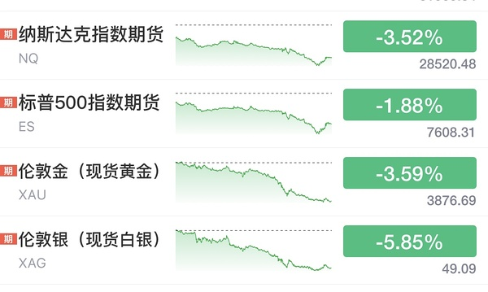
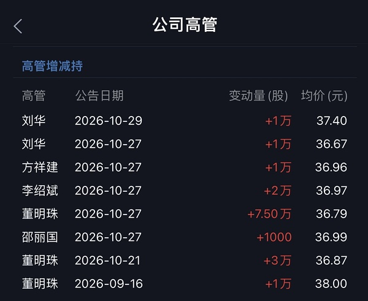
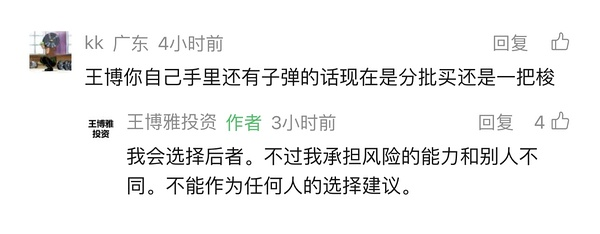
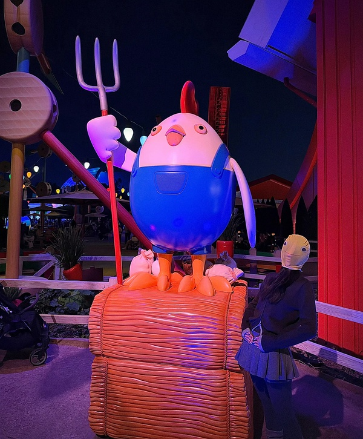
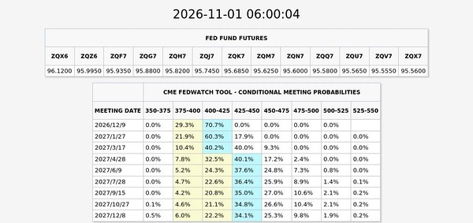

# 📋 楼主每日发言推送

> **推送日期**：2026-11-01 ｜ **执行时间**：2026-11-01 16:33:07 ｜ **监控用户**：`不知道还能说啥`
> **追踪模式**：`topic`（用户主页广播·豆瓣话题）

## 📊 持仓追踪
> 上次更新：2026-11-01 ｜ 基于楼主发言持续追踪（共 13 项）

| 标的 | 状态 | 类型 | 现价 | 提及 |
|------|------|------|------|------|
| 招商银行 | 持有 | 红利/银行 | 43.55（1.42%） | 继续持有，大金融仅银行 |
| 长白山 | 持有 |  | 35.88（-3.05%） | 持有，五日线未拐头 |
| 雪人集团 | 持有 |  | 13.82（-1.78%） | 设条件单：14.84买一半，15.47涨停清仓 |
| 上海电影 | 持有 |  | 27.50（-5.01%） | 将sg、txx（天下秀）全换成sy，“sg txx… |
| 幸福蓝海 | 持有 |  | 11.70（-8.45%） | “幸福配置满额 对等”；中影维持核心仓位，均不靠融… |
| 粤传媒 | 持有 |  | 9.34（-10.02%） | 暂无 |
| 大连圣亚 | 持有 |  | 40.88（0.71%） | 触发条件单S后回接，“那是第二笔S的回接啊”；今日… |
| 博纳影业(bn) | 买入 |  | 暂无 | 「三分之一给bn」买入，但随后「今天bn也应该出」… |
| 博纳影业（bn） | 持有 |  | 暂无 | 10.27；「减仓bn 买入中影」；bn跌到60日线。 |
| bn（博纳影业） | 持有 |  | 暂无 | 10.27；清仓bn转换xf（幸福蓝海），“清仓bn转换xf” |
| 中国电影（中影） | 买入 |  | 暂无 | 10.28；持有，"我够了"，不再加仓 |
| 中韩半导体ETF | 买入 |  | 暂无 | 10.28；持有，等溢价率超20%再卖 |
| 中影（中国电影） | 买入 |  | 暂无 | 10.29；昨日换仓进来 |

> ⚠️ 执行任务时如发现新操作，请更新 `state.json` 的 `positions`。成本价和市值有数据才填，没有则保留「暂无」。

## 🌅 今日总览
### 📌 市场背景
今日发言以剧本推演与信用事件讨论为主：楼主提出「科技股爆掉以后，再爆掉长债」对应2015-2016剧本、赢家是消费；「长债爆不掉，那就是走2021-2022的剧本」、赢家是高股息。同时指出「食品饮料，二是家用电器，股息率都超过4%」可脚踏两条船。信用层面讨论「万科美元债也是违约的」「资金都躲债券里趁机一把砍」，并提及「美债快速下行 市场大幅度抹去第三次加息预期」「周末出政策都是埋人的」。整体未给出单一方向定论，偏情景推演与风险观察。

### 📌 今日操作
| 操作 | 标的 | 详情 |
|---|---|---|
| ⏭️ | 食品饮料/家用电器 | 讨论二者股息率超4%、可脚踏两条船，未提及实际买卖 |
| ⏭️ | 长债/美元债 | 讨论长债爆与不爆两套剧本及美元债违约事件，未提及实际交易 |
| ⏭️ | 无明确操作 | 今日发言未提及本人具体买卖动作 |

### 📌 今日议题
| 议题 | 态度 | 核心观点 | 关键引用 |
|---|---|---|---|
| 科技与长债组合剧本 | 💬讨论 | 科技爆后长债爆则消费赢，长债不爆则高股息赢 | 「科技股爆掉以后，再爆掉长债」「长债爆不掉，那就是走2021-2022的剧本」 |
| 食品饮料与家用电器 | 📈看多 | 二者股息率超4%，与银行同档，可脚踏两条船 | 「食品饮料，二是家用电器，股息率都超过4%」 |
| 美元债与债券拥挤 | 📉看空 | 美元债常被赖账，债券拥挤下资金躲债砍仓 | 「美元债我们经常不还的」「资金都躲债券里趁机一把砍」 |
| 美债与加息预期 | ➡️中性 | 美债快速下行，市场大幅抹去第三次加息预期 | 「美债快速下行 市场大幅度抹去第三次加息预期」 |
| 周末政策 | 📉看空 | 认为周末出政策多是埋人 | 「周末出政策都是埋人的」 |

### 📌 看好板块/方向
- **食品饮料**：股息率超过4%，与银行同档，可脚踏两条船
- **家用电器**：股息率超过4%，与食品饮料同属可脚踏两条船方向
- **消费**：若科技股爆掉后再爆长债，走2015-2016剧本，最终赢家是消费
- **高股息**：若科技股爆掉后长债爆不掉，走2021-2022剧本，最终赢家是高股息

### 📌 风险提示
- 「万科美元债也是违约的」——美元债违约事件仍在发酵，信用风险需警惕
- 「资金都躲债券里趁机一把砍」——债券拥挤交易下存在集中砍仓风险
- 「美元债我们经常不还的」——美元债赖账并非罕见，境内公司发美元债利息高
- 「周末出政策都是埋人的」——对周末政策消息保持警惕，不轻易当利好
- 「美债快速下行 市场大幅度抹去第三次加息预期」——加息预期快速变化，外围利率波动风险
- 「国内地方zf债券违约我记得有过 有家煤炭公司是国内债券违约 那次影响更大」——境内信用债违约冲击可能更大

## 📊 本次结果
- **今日发言**：15 条
- **累计存档**：18820 条

## 📝 该最新广播作者发言聚合（共 15 条）
- (2026-10-31 09:03:29) 我在车上给我女朋友看这个 她依然觉得大A是提款机😂😂😂

如果科技股爆掉以后，再爆掉长债，那就是走2015-2016的剧本，最终的赢家是消费。

如果科技股爆掉以后长债爆不掉，那就是走2021-2022的剧本，最终的赢家是高股息。

但是，这轮行情有两个比较贼的行业，一是食品饮料，二是家用电器，股息率都超过4%，和银行属于同一档次，这俩哥们儿可以脚踏两条船。

- (2026-10-31 09:03:46) 马上抵达😂😂😂  ⊳ （引用 @momo）希望楼楼的迪士尼底➕楼里没设投票➕呆老师的天象，都能成为翅膀扑腾扑腾的带我们美基往上飞

- (2026-10-31 09:10:26) 他这个如果其实说的是长债爆还是不爆了😂😂😂😂😂  ⊳ （引用 @六倍做多退休）老师别这样 俺们真不中 看的人真是心慌慌

- (2026-10-31 09:12:56) 这已经发生了 不需要如果 😂  ⊳ （引用 @momo）老师还带安慰了我们一下，而我们只看到了“科技爆掉”这四个字

- (2026-10-31 09:14:18) 这样的话 ANT还能如期IPO吗  ⊳ （引用 @六倍做多退休）美股昨天涨幅第一的是农药板块啊 好地狱

- (2026-10-31 09:16:29) [图] 昨晚还在说黄金nana谁少亏谁孙子

nana是凌晨的孙子！

  ⊳ （引用 @VVV坚定持有VVV）其实还是V起来了一些的🤔
所有自选只有一个红的

- (2026-10-31 09:45:22) [图] 董阿姨最近一个月买了11.5万股空调哈哈哈

- (2026-10-31 09:49:18) 稳稳的
那个事件被放大了
你可以查一下
美元债我们经常不还的
我昨天以为是内地债券违约
印度在美国发行美元债 好多公司都是最后赖掉
所以境内公司发行美元债总是利息高的吓人  ⊳ （引用 @momo）格力还要接盘华发呢

- (2026-10-31 09:52:35) 去年就递表了啊
ANT openai都是去年递表  ⊳ （引用 @家不住海边）妈呀。搜了下 都是说11月中或11月底就能上了
美国速度吗 不是才交了申请吗

- (2026-10-31 09:55:52) 应该是这个原因
万科美元债也是违约的
但是和债券太拥挤确实也有关系
最近资金都躲债券里趁机一把砍

国内地方zf债券违约我记得有过 有家煤炭公司是国内债券违约 那次影响更大  ⊳ （引用 @momo）那是因为华发是纯国资的，地方zf背书，所以这件事这么大

- (2026-10-31 22:24:47) [图] 看这个吧
投资美国的果然都不爱慢慢的🤣

  ⊳ （引用 @VVV坚定持有VVV）是的！我已经很久不看他了，这两天终于有人味了😂

- (2026-10-31 22:28:34) [图] 今天看到这个
就想到一个字
干

- (2026-11-01 12:50:08) [图] 美债快速下行 
市场大幅度抹去第三次加息预期

- (2026-11-01 16:05:43) 通过金融市场下跌来遏制加息  ⊳ （引用 @稀里不糊涂）楼之前说了什么阴谋论

- (2026-11-01 16:07:22) 周末出政策都是埋人的  ⊳ （引用 @木感情的打工人）等来的不是政策，是开会

## 🧠 投资风格分析
> 📏 增量更新指引：仅当今日发言确有新依据时才修订对应维度，无变化不强行重写；单维度修订建议 ≤150 字。

- 投资理念与方法：重视全球联动、机构行为与指数规则带来的被动买卖盘，先质疑公开数据真实性；以参与度判断行情性质，对高位腾空型科技股、小票垃圾票与微盘股保持戒心，关注业绩确定性与融资盘出清；操作留后手，坚持条件单与时间纪律，月末防守至上；偏好用筹码游戏逻辑处理传媒垃圾票，对miss业绩直接砍；以股债双爆/单爆情景推演倒推最终受益资产，并以股息率作为跨行业比较锚；今日进一步用科技股爆+长债爆/不爆两剧本分别指向消费/高股息，并关注食品饮料、家用电器股息率超4%、可脚踏两条船。
- 风险偏好：对高位腾空型科技股、小票垃圾票与微盘股保持戒心，认为融资盘爆仓式强卖是出清主要形式；对强势股补跌、月末微盘杀伤高度警惕，操作留后手；对传媒等垃圾票只做筹码游戏、不做价值投资；对债券拥挤交易与美元债/境内信用债违约保持警惕，视信用事件为风险偏好变量；新增关注美元债常不还、万科美元债违约与债券拥挤下资金躲债砍仓，并对周末政策消息保持“埋人”警惕。
- 交易与仓位：坚持条件单分档与预设时间表；将分散在十几只同题材小仓位合并到少数主攻标的，以「加大布局」而非新增资金方式提集中度；逢跌分批低吸但按价位设多档留后手；未站上五日线不当真，站上且拐头才加仓；月末提前设定总仓位滚动控制，防守至上；弱势板块不尾盘买入博次日反抽，改为次日早盘择机；反对无纪律加仓拉低成本，倾向留钱等更确定机会；涨停价手动挂单兑现；对已放弃旧方向不回头补仓。新增：清仓bn转换xf，幸福配置满额与中影对等；计划sy和zy对等布局，幸福低配做情绪放大；强调"右侧开始会加仓的呀 别着急"，耐心等右侧确认。
- 心理特质：对持仓波动冷静，以低换手耐心持有避免手贱；月末/冰点等时点记忆清晰，强调纪律边界；看到他人不守计划会直接点出；对无价值吐槽情绪自我屏蔽；反复强调严格执行计划、防守至上；对已放弃旧方向不念旧不回头；把换仓视为对弱者的惩罚而非情绪操作；对自身手贱行为有清醒认知并主动惩罚。新增：对市场节奏有清晰时间感（"11月不搞这些东西"），能自嘲手贱但不失控；以"慢就是快"校准耐心，拒绝冲动。

> ⚠️ 本板块由 Actions 全自动增量更新（复用当日发言与今日总览），每次仅在内容足够支撑时才改动。

## 🏷️ 昵称映射表
### 📖 昵称规律（供 AI 判断新昵称时参考）
【昵称命名规律（用于推断未知新昵称）】
- 拼音首字母缩写：取标的/基金名汉字拼音首字母串（含数字代码），多为 ETF/股票代码口语化｜示例：yl=引力传媒｜zy=掌阅科技｜sj=视觉中国｜cc=华安文体健康混合｜C50=创业板50ETF｜k50=科创50｜kun=昆仑万维｜xhxc=新瀚新材｜zxfc=中欣氟材
- 小/老+姓氏代指：「小X」「老X」通常指姓 X 的标的或该标的的基金经理；「X兄弟」多为同系基金｜示例：小惠=惠发食品｜老莫=万家品质生活(莫海波)｜小华=华夏全球科技先锋(QDII)A｜小华兄弟=华夏移动互联(QDII)｜小浦=浦银安盛全球智能科技(QDII)A｜小广=广发全球精选(QDII)A｜小远=华宝致远(QDII)C｜招招=招商银行｜小德=德明利｜赵姨=兆易创新｜露露=泸州老窖｜空调=格力电器
- 戏称/黑话→题材板块：生活化比喻或黑话对应某个题材/板块，而非单一标的；出现时多指板块方向｜示例：卖国=PCB板块(英伟达AI链)｜爱国=国产自主(半导体设备/芯片)｜奶茶=易点天下｜老师=中文在线｜蓝色=蓝色光标｜宇航员=航空航天板块｜华子=华泰保兴安悦债券｜国际=国际复材｜巨无霸=长鑫科技等重大IPO
- 谐音/取字：昵称含标的名关键字（取一字或谐音），多为 A 股个股或基金简称｜示例：万华=万华化学｜东百=东百集团｜宝=保利发展｜讨饭/亚洲讨饭/建信新兴=建信新兴市场(QDII)A｜华宝zy=华宝致远(QDII)A
- 机构/基金经理昵称：以基金公司名、经理姓、或平台代称指代对应基金产品｜示例：周经理=中欧新趋势混合(LOF)A｜张经理=信澳匠心回报混合A｜网易云/音乐世家=富国全球科技互联网股票(QDII)A｜国富亚洲=国富亚洲机会股票(QDII)A｜国泰纳指=国泰纳斯达克100指数(QDII)｜易方达全球=易方达全球成长精选混合(QDII)A｜浦银安盛=浦银安盛全球智能科技(QDII)A

### 📋 已收录映射
| 昵称 | 对应名称 |
|------|----------|
| C50 | 创业板50ETF |
| cc | 华安文体健康混合A |
| k50 | 科创50 |
| kun | 昆仑万维 |
| sj | 视觉中国 |
| xhxc | 新瀚新材 |
| yl | 引力传媒 |
| zxfc | 中欣氟材 |
| zy | 掌阅科技 |
| 万华 | 万华化学 |
| 东百 | 东百集团 |
| 亚洲讨饭 | 建信新兴市场混合(QDII)A |
| 保利发展 | 保利发展 |
| 华子 | 华泰保兴安悦债券 |
| 华宝 zy | 华宝致远混合(QDII)A |
| 华宝zy | 华宝致远混合(QDII)A |
| 卖国 | PCB、光模块、通信板块（英伟达AI产业链） |
| 周经理 | 中欧新趋势混合(LOF)A |
| 国富亚洲 | 国富亚洲机会股票(QDII)A |
| 国泰纳指 | 国泰纳斯达克100指数(QDII) |
| 奶茶 | 易点天下 |
| 宇航员 | 航空航天板块 |
| 宝 | 保利发展 |
| 小华 | 华夏全球科技先锋混合(QDII)A |
| 小华兄弟 | 华夏移动互联混合(QDII) |
| 小广 | 广发全球精选股票(QDII)A |
| 小德 | 德明利 |
| 小惠 | 惠发食品 |
| 小浦 | 浦银安盛全球智能科技(QDII)A |
| 小远 | 华宝致远混合(QDII)C |
| 巨无霸 | 长鑫科技等重大IPO企业 |
| 建信新兴 | 建信新兴市场混合(QDII)A |
| 张经理 | 信澳匠心回报混合A |
| 招招 | 招商银行 |
| 易方达全球 | 易方达全球成长精选混合(QDII)A |
| 浦银安盛 | 浦银安盛全球智能科技(QDII)A |
| 爱国 | 国产自主（半导体设备/芯片制造） |
| 空调 | 格力电器 |
| 网易云 | 富国全球科技互联网股票(QDII)A |
| 老师 | 中文在线 |
| 老莫 | 万家品质生活混合A(519195) |
| 蓝色 | 蓝色光标 |
| 讨饭 | 建信新兴市场混合(QDII)A |
| 赵姨 | 兆易创新 |
| 赵哥 | 兆易创新 |
| 露露 | 泸州老窖 |
| 安安 | 安记食品 |
| 音乐世家 | 富国全球科技互联网股票(QDII)A |
| 老伯伯 | 铜冠铜箔 |
| nk | 景顺长城纳斯达克科技ETF联接(QDII)A |
| bk | 易方达标普信息科技指数(QDII-LOF)A |
| txx | 天下秀 |
| 媛媛 | 今世缘 |
| uu | 友友、网友们 |
| 温暖老师 | 某个特别牛逼的散户 |
| 余老师 | 余利，某牛逼投资者 |
| ycm | 粤传媒 |
| 江老师 | 江琪（投资博主） |
| 水果老师 | 投资博主 |
| 小爱 | 我爱我家 |
| ty | 天娱数科 |
| bn | 博纳影业 |
| sy | 上海电影 |
| CBS | 长白山 |
| 东哥 | 东百集团 |
| 芒果 | 芒果超媒 |
| 阿中 | 中国电影 |
| 欢欢 | 欢瑞世纪 |
| 雪人 | 雪人集团 |
| 大连 | 大连圣亚 |
| 幸福 | 幸福蓝海 |
| 小粤 | 粤传媒 |
| 阿博 | 博纳影业 |
| 创成长 | 创业板成长etf |

> ⚠️ 以下为 LLM **建议**，未自动写入状态文件。请人工确认后，本地编辑 `state.json` 的 `nickname_map` / `positions`，或 `nickname_rules.json` 的 `rules` 并 push 生效。

*🤖 自动生成于 2026-11-01 16:33:07 ｜ 豆瓣楼主发言追踪*