# 📋 楼主每日发言推送

> **推送日期**：2026-11-02 ｜ **执行时间**：2026-11-02 11:03:59 ｜ **监控用户**：`不知道还能说啥`
> **追踪模式**：`topic`（用户主页广播·豆瓣话题）

## 📊 持仓追踪
> 上次更新：2026-11-02 ｜ 基于楼主发言持续追踪（共 13 项）

| 标的 | 状态 | 类型 | 现价 | 提及 |
|------|------|------|------|------|
| 招商银行 | 持有 | 红利/银行 | 43.42（-0.30%） | 继续持有，大金融仅银行 |
| 长白山 | 持有 |  | 34.89（-2.76%） | 分笔加仓第二笔，挂单3644 |
| 雪人集团 | 持有 |  | 13.22（-4.34%） | 触发卖出条件，挂单1374成交 |
| 上海电影 | 持有 |  | 30.25（10.00%） | 挂单买入，sy走势引其注意 |
| 幸福蓝海 | 持有 |  | 12.10（3.42%） | “幸福配置满额 对等”；中影维持核心仓位，均不靠融… |
| 粤传媒 | 持有 |  | 9.61（2.89%） | 暂无 |
| 大连圣亚 | 持有 |  | 39.28（-3.91%） | 分笔加仓，已买两笔，挂单4074 |
| 博纳影业(bn) | 卖出 |  | 暂无 | 已决定清仓bn转换xf |
| 博纳影业（bn） | 持有 |  | 暂无 | 「减仓bn 买入中影」；bn跌到60日线。 |
| bn（博纳影业） | 持有 |  | 暂无 | 清仓bn转换xf（幸福蓝海），“清仓bn转换xf” |
| 中国电影（中影） | 买入 |  | 暂无 | 10.28；持有，"我够了"，不再加仓 |
| 中韩半导体ETF | 买入 |  | 暂无 | 10.28；持有，等溢价率超20%再卖 |
| 中影（中国电影） | 买入 |  | 暂无 | 10.29；昨日换仓进来 |

> ⚠️ 执行任务时如发现新操作，请更新 `state.json` 的 `positions`。成本价和市值有数据才填，没有则保留「暂无」。

## 🌅 今日总览
### 📌 市场背景
市场背景：科技股高位补跌风险显现，融资盘持续出清。楼主推演两种宏观剧本指向不同赢家——长债爆则消费胜，长债不爆则高股息胜。「如果科技股爆掉以后，再爆掉长债，最终的赢家是消费」「如果科技股爆掉以后长债爆不掉，最终的赢家是高股息」「两市融资余额减少413.4亿元」「周五融资盘越来越脆弱了 警惕本周五uu们」「最近楼里科技股有个特色 只要哪个被连续点名有点强 很快就会大幅度补跌」

### 📌 今日操作
| 操作 | 标的 | 详情 |
|---|---|---|
| ✅卖出 | 雪人集团 | 触发卖出条件，挂单1374成交 |
| ✅卖出 | 博纳影业(bn) | 清仓bn |
| ✅买入 | 大连圣亚(大连) | 分笔加仓，已买两笔，挂单4074 |
| ✅买入 | 长白山(cbs) | 分笔加仓第二笔，挂单3644 |
| ✅买入 | 上海电影(sy) | 挂单买入，sy走势引其注意 |
| ❌未买 | 博纳影业(bn) | 已决定清仓bn转换xf |
| ⏭️观察 | 中影(阿中) | 认为适合拿着，慢工出细活 |
| ⏭️观察 | 芒果超媒 | 提及若情绪好应高开 |

### 📌 今日议题
| 议题 | 态度 | 核心观点 | 关键引用 |
|---|---|---|---|
| 长债与科技股双爆剧本 | 💬讨论 | 推演两种宏观情景，指向消费或高股息两大赢家 | 「如果科技股爆掉以后，再爆掉长债，那就是走2015-2016的剧本」|
| 食品饮料/家用电器股息率 | 📈看多 | 股息率超4%与银行同档次，可脚踏两条船 | 「这俩哥们儿可以脚踏两条船」|
| 阿里巴巴IPO时机 | 💬讨论 | 担忧美国选举后政策变化影响上市节奏 | 「这样的话ANT还能如期IPO吗」「应该是这个原因」|
| 万科美元债违约 | 📉看空 | 美元债经常赖掉，境内公司发美元债利息高吓人 | 「万科美元债也是违约的」「美元债我们经常不还的」|
| 融资盘出清 | 📉看空 | 融资余额连降，周五脆弱需警惕，月末防守 | 「周五融资盘越来越脆弱了 警惕本周五uu们」|
| sy业绩与走势 | 💬讨论 | Q3扣非转亏仍涨停，走势像之前横盘的奶茶 | 「哈哈哈哈哈哈 奖励涨停」「sy现在走势有没有让大家想起之前的横盘奶茶？」|
| 红利 vs 微盘股 | 💬讨论 | 杠铃组合逻辑，微盘走弱红利不缺，进入右侧 | 「如果是微盘股垃圾票行情 红利不会缺席」「趋势 动物昨晚发了 红利 进入右侧」|
| 中影 vs sy风格差异 | 💬讨论 | 中影慢工出细活适合拿，sy激情澎湃适合滚动 | 「中影就适合拿着 sy激情澎湃适合滚动bs」|
| 机器人/游戏传媒 | 📈看多 | AI应用催化下传媒游戏有机会 | 「只要有AI应用 游戏传媒不会缺席」|
| 信用债配置 | ➡️中性 | 利率债先行，信用债买点靠后 | 「利率债已经缓解 信用债还在挖」|

### 📌 看好板块/方向
- **高股息/银行/红利**：长债不爆剧本下的赢家方向，股息率稳定
- **食品饮料/家用电器**：股息率超4%可与银行匹敌，脚踏两条船
- **电影/传媒（sy/中影）**：AI应用催化下有望大放异彩，sy做滚动，中影适合拿着
- **债券（利率债优先）**：信用债还在挖，利率债先行配置

### 📌 风险提示
「周五融资盘越来越脆弱了」——月末融资盘出清风险，需谨慎
「最近楼里科技股有个特色 只要哪个被连续点名有点强 很快就会大幅度补跌」——科技股高位补跌风险极高
「信用债还得跌」——信用债违约风险仍在，配置时点需延后
「周末出政策都是埋人的」——对周末政策消息保持警惕
「迪士尼回来的路上 我女朋友P照片 我研究债券 我最终选择疯狂加仓债券」——债券拥挤交易下的风险
「不贪心 垃圾消费我撤了 薅到一把」——及时止盈，不恋战

## 📊 本次结果
- **今日发言**：102 条
- **累计存档**：18907 条

## 📝 该最新广播作者发言聚合（共 102 条）
### 其他讨论（提及 75 次，占比 74%）2026-10-31 09:03:29
- 我在车上给我女朋友看这个 她依然觉得大A是提款机😂😂😂

如果科技股爆掉以后，再爆掉长债，那就是走2015-2016的剧本，最终的赢家是消费。

如果科技股爆掉以后长债爆不掉，那就是走2021-2022的剧本，最终的赢家是高股息。

但是，
- 马上抵达😂😂😂
- 他这个如果其实说的是长债爆还是不爆了😂😂😂😂😂

### 友友、网友们（提及 6 次，占比 6%）2026-11-01 19:22:12
- uu弱了
豆瓣现在top1
- 周五融资盘越来越脆弱了

警惕本周五uu们

我这周五不会再手贱了
- uu你去科技就是最大的错误

你就是玩垃圾的料🤣

### 上海电影（提及 6 次，占比 6%）2026-11-02 08:46:44
- 还有sy 雪人
- 加仓大连 cbs
触发卖出周五sy买入雪人
- sy无敌

### 雪人集团（提及 3 次，占比 3%）2026-11-02 09:39:56
- 你雪人又不是没买过急啥呢
- 雪人挂单1374
- 大连4074
雪人1374

### 中文在线（提及 2 次，占比 2%）2026-11-01 22:05:31
- 让我们看看王老师🤣

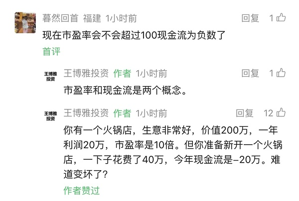
- 王老师这个例子我现身说法🤣
我们本来是只有个播

在24年下半年加入做团播后为了搭建新的几个直播间和装修设备等等 现金流也是大幅度减少 但这并不是公司在变差🤣反而现在更好了 和王老师的例子异曲同工

### 大连圣亚（提及 2 次，占比 2%）2026-11-02 09:42:21
- 大连第三笔 cbs第二笔了
- 大连现在有两个单子了
如果你不在状态
一定搞不清楚

### 幸福蓝海（提及 2 次，占比 2%）2026-11-02 09:50:50
- 幸福降临 太爽了
- 幸福上周的
今天没有

### 格力电器（提及 1 次，占比 1%）2026-10-31 09:45:22
- 董阿姨最近一个月买了11.5万股空调哈哈哈

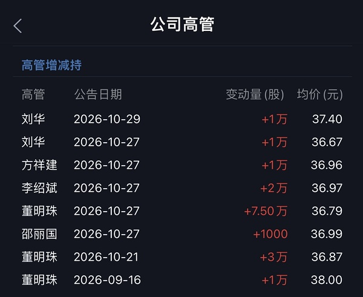

### 江琪（投资博主）（提及 1 次，占比 1%）2026-11-01 22:11:49
- 江老师现在账户今年-40%😂😂😂😂

### 投资博主（提及 1 次，占比 1%）2026-11-02 08:38:32
- 有中字头必有银行🤣🤣🤣
余老师只先看整个Q4都是微盘红利
水果老师又把明年看完了

### 招商银行（提及 1 次，占比 1%）2026-11-02 08:58:21
- 以前招招宁波是唯一两个pb一直处在1以上的
现在全都破净😂😂😂😂😂

### 芒果超媒（提及 1 次，占比 1%）2026-11-02 10:09:36
- 如果情绪好的话
今天芒果应该直接高开的吧

### 易点天下（提及 1 次，占比 1%）2026-11-02 10:16:10
- sy现在走势有没有让大家想起之前的横盘奶茶？

### 📄 全部发言（共 102 条）
- (2026-10-31 09:03:29) 我在车上给我女朋友看这个 她依然觉得大A是提款机😂😂😂

如果科技股爆掉以后，再爆掉长债，那就是走2015-2016的剧本，最终的赢家是消费。

如果科技股爆掉以后长债爆不掉，那就是走2021-2022的剧本，最终的赢家是高股息。

但是，这轮行情有两个比较贼的行业，一是食品饮料，二是家用电器，股息率都超过4%，和银行属于同一档次，这俩哥们儿可以脚踏两条船。

- (2026-10-31 09:03:46) 马上抵达😂😂😂  ⊳ （引用 @momo）希望楼楼的迪士尼底➕楼里没设投票➕呆老师的天象，都能成为翅膀扑腾扑腾的带我们美基往上飞

- (2026-10-31 09:10:26) 他这个如果其实说的是长债爆还是不爆了😂😂😂😂😂  ⊳ （引用 @六倍做多退休）老师别这样 俺们真不中 看的人真是心慌慌

- (2026-10-31 09:12:56) 这已经发生了 不需要如果 😂  ⊳ （引用 @momo）老师还带安慰了我们一下，而我们只看到了“科技爆掉”这四个字

- (2026-10-31 09:14:18) 这样的话 ANT还能如期IPO吗  ⊳ （引用 @六倍做多退休）美股昨天涨幅第一的是农药板块啊 好地狱

- (2026-10-31 09:16:29) [图] 昨晚还在说黄金nana谁少亏谁孙子

nana是凌晨的孙子！

  ⊳ （引用 @VVV坚定持有VVV）其实还是V起来了一些的🤔
所有自选只有一个红的

- (2026-10-31 09:45:22) [图] 董阿姨最近一个月买了11.5万股空调哈哈哈

- (2026-10-31 09:49:18) 稳稳的
那个事件被放大了
你可以查一下
美元债我们经常不还的
我昨天以为是内地债券违约
印度在美国发行美元债 好多公司都是最后赖掉
所以境内公司发行美元债总是利息高的吓人  ⊳ （引用 @momo）格力还要接盘华发呢

- (2026-10-31 09:52:35) 去年就递表了啊
ANT openai都是去年递表  ⊳ （引用 @家不住海边）妈呀。搜了下 都是说11月中或11月底就能上了
美国速度吗 不是才交了申请吗

- (2026-10-31 09:55:52) 应该是这个原因
万科美元债也是违约的
但是和债券太拥挤确实也有关系
最近资金都躲债券里趁机一把砍

国内地方zf债券违约我记得有过 有家煤炭公司是国内债券违约 那次影响更大  ⊳ （引用 @momo）那是因为华发是纯国资的，地方zf背书，所以这件事这么大

- (2026-10-31 22:24:47) [图] 看这个吧
投资美国的果然都不爱慢慢的🤣

  ⊳ （引用 @VVV坚定持有VVV）是的！我已经很久不看他了，这两天终于有人味了😂

- (2026-10-31 22:28:34) [图] 今天看到这个
就想到一个字
干

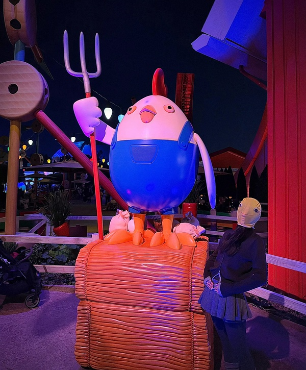

- (2026-11-01 12:50:08) [图] 美债快速下行 
市场大幅度抹去第三次加息预期

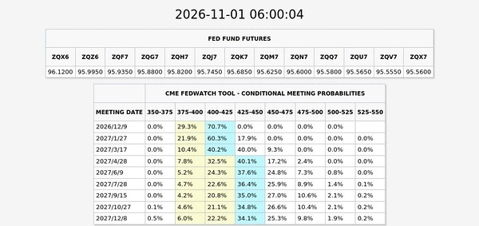

- (2026-11-01 16:05:43) 通过金融市场下跌来遏制加息  ⊳ （引用 @稀里不糊涂）楼之前说了什么阴谋论

- (2026-11-01 16:07:22) 周末出政策都是埋人的  ⊳ （引用 @木感情的打工人）等来的不是政策，是开会

- (2026-11-01 17:22:41) 闪迪、英特尔、英伟达、SK海力士暗盘集体拉升  ⊳ （引用 @六倍做多退休）川子喊大伙买科技股了😂大伙买吗

- (2026-11-01 17:23:37) [图] 原来新浪就能看那么多暗盘 新浪真牛逼

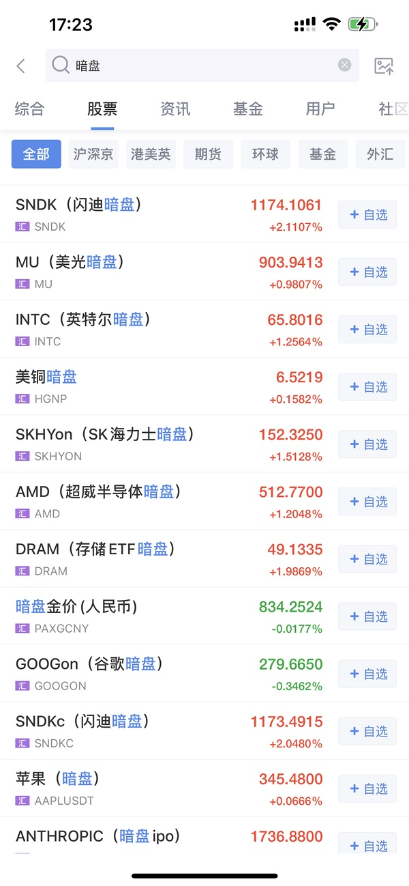  ⊳ （引用 @六倍做多退休）假号哈哈哈哈

- (2026-11-01 17:25:03) [图] 原来ant一直都在默默交易啊

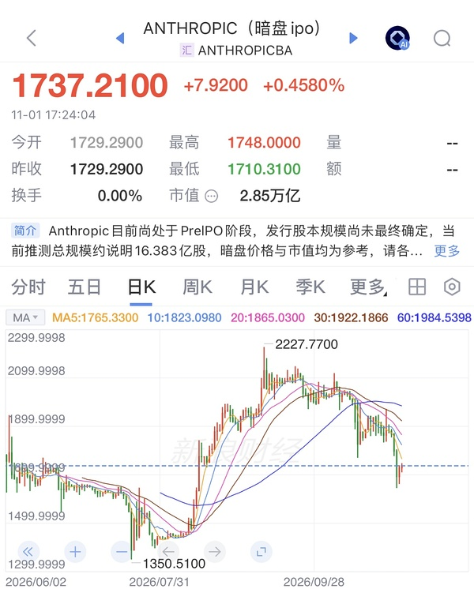

- (2026-11-01 19:12:00) 让我们再把炒垃圾发挥出来😂  ⊳ （引用 @Milumio发财版）都有点害怕开盘了😭

- (2026-11-01 19:16:20) 就算其他你都忘了
2025.4.7你还不知道是什么情况嘛
最终只是12%吗  ⊳ （引用 @家不住海边）越弹越少啊

- (2026-11-01 19:17:54) 小熊猫的数据结论也是错的  ⊳ （引用 @海贼）我咋感觉这条信息在胡说八道…没有啥必然联系呢。24年2月那波反弹不是在千股//跌停的冰点后才反弹的吗

- (2026-11-01 19:18:11) 你又要被删了  ⊳ （引用 @半闲公子）不要在垃圾市场里翻垃圾。大家保重身体。以前都会安慰说都会回来的。现在也不敢按摩，因为不知道这次缅A的下限。😮‍💨

- (2026-11-01 19:19:20) 哈哈我在迪士尼回来的路上
我女朋友P照片 我研究债券
我最终选择疯狂加仓债券😂😂😂😂😂  ⊳ （引用 @我爱牛肉火锅）退休uu说他投资的很分散，然后上周五被一锅端了

- (2026-11-01 19:22:12) uu弱了
豆瓣现在top1  ⊳ （引用 @温妤哦）你不说我咋知道在哪看啊！

- (2026-11-01 19:25:27) 24年2月是易下台 反转 不过就是你说的冰点触发了
2025.4.7大家知道是为什么
2025.9也是口嗨关税 后面taco
和座谈会都毫无关系😂😂😂  ⊳ （引用 @海贼）对呀，我还去看了日k图，觉得他这个数据日期还有反弹幅度包括逻辑都很奇怪。反正我印象中24年2月和25年4月都是冰点后反弹的。说实话就算没有这些什么会不会的，到楼判断的冰点条件市场我觉得自然都会反弹了，不认同这个因果联系😂

- (2026-11-01 19:48:36) 是中债

美债国庆之前买好了  ⊳ （引用 @木感情的打工人）美债吗，易方达还是哪个

- (2026-11-01 19:51:32) [图] 

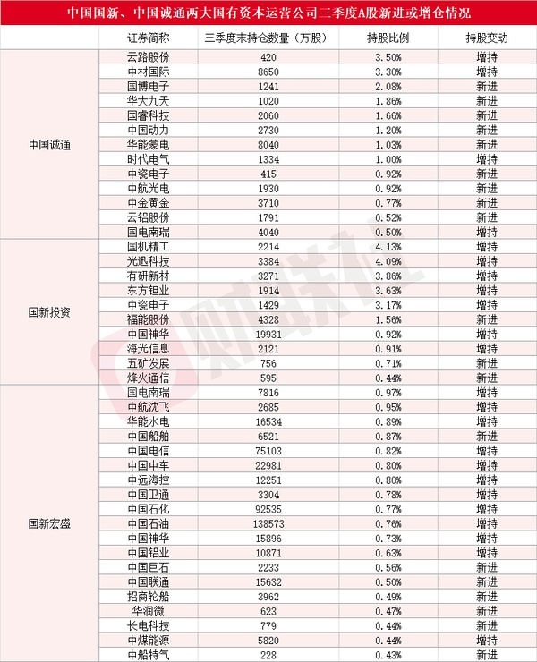  ⊳ （引用 @木感情的打工人）记者今日从相关渠道了解到，一家国有超大型银行近日计划向中国国新、中国诚通两家央企新增股票回购增持贷款额度，单家新增额度或可达到1000亿元。据悉，此次新增的再贷款额度规模，或将超过2024年该政策工具设立时该行向上述主体发放的首期额度。

- (2026-11-01 20:01:40) 是看好经济不会起色

昨天那个pmi已经验证了 🤣🤣  ⊳ （引用 @木感情的打工人）你看好印度接下来继续降息是嘛

- (2026-11-01 20:21:36) 不瞒你说
美国的加仓目标我也都在一个个看
包括易方达57的美国+3%日本的配比也在我恐慌飙升时候的狙击范围里😂  ⊳ （引用 @VVV坚定持有VVV）什么？加仓！（bushi哈哈哈哈哈哈

- (2026-11-01 22:05:31) [图] 让我们看看王老师🤣

  ⊳ （引用 @VVV坚定持有VVV）发生什么了，江老师一下子这么悲观🫢

- (2026-11-01 22:11:49) 江老师现在账户今年-40%😂😂😂😂  ⊳ （引用 @木感情的打工人）价投印度科技，江老师一定是知道我们不知消息，不然怎么会说出这种话😂

- (2026-11-01 22:19:10) 王老师这个例子我现身说法🤣
我们本来是只有个播

在24年下半年加入做团播后为了搭建新的几个直播间和装修设备等等 现金流也是大幅度减少 但这并不是公司在变差🤣反而现在更好了 和王老师的例子异曲同工  ⊳ （引用 @VVV坚定持有VVV）让我来看看坚定多头的看法，找点高兴的感觉🤣

- (2026-11-01 22:22:38) 应该稳稳的😂

红利ETF10月也就2-5%收益  ⊳ （引用 @点-重生炒垃圾）冰雪收益能打赢红利不😂😂😂

- (2026-11-01 22:24:02) 我要等等看 
他选举完是taco还是攻击伊朗

其实最重要的连续加息已经不存在了
这一波下跌不是没有意义
意义非常大啊  ⊳ （引用 @VVV坚定持有VVV）王老师说下周有更大机会，就等着买了！

- (2026-11-01 22:26:33) 😂😂😂😂😂😂😂😂  ⊳ （引用 @VVV坚定持有VVV）哈哈哈哈哈哈誓死追随老米🤣

- (2026-11-01 22:29:18) 等选举呀

之前看过报道 临近选举taco反而会损失更多的选票  ⊳ （引用 @VVV坚定持有VVV）他好久没taco了不知道在等啥🤔
不过没关系对我们多头来说，结果都一样，就是买入🤣

- (2026-11-01 23:18:46) 大幅削弱了加息预期
目前非但抹掉了未来第三次加息的预期
甚至第二次再加息的预期都不足60%了
理论上12月就可能是本轮最后一次加息
这是最最重要的 没有之一  ⊳ （引用 @momo）差生想问楼楼意义是什么😭

- (2026-11-02 08:38:32) 有中字头必有银行🤣🤣🤣
余老师只先看整个Q4都是微盘红利
水果老师又把明年看完了  ⊳ （引用 @VVV坚定持有VVV）有啊，小微盘买诺安，中字头去买中特估？

- (2026-11-02 08:40:34) 机构主导的科技行情散户玩的怎么样🤣  ⊳ （引用 @momo）这种散根本没得玩啊

- (2026-11-02 08:41:50) 铠侠股价大跌，业绩指引暗示需求增长或将放缓
周一，日本存储芯片制造商铠侠控股的股价一度暴跌15%。

此前，该公司给出的谨慎业绩指引令投资者大失所望，再次引发市场对人工智能（AI）驱动的爆发式增长可能正在放缓的担忧。这家总部位于东京的企业上周五表示，预计12月季度的营业利润为2万亿日元（约合127亿美元），低于分析师普遍预期的2.35万亿日元。该预测暗示，其业绩较9月季度的1.99万亿日元几乎没有增长。

- (2026-11-02 08:46:44) 还有sy 雪人  ⊳ （引用 @摇头晃脑小脑斧）复习条件单，大连44.39，还有啥吗

- (2026-11-02 08:47:42) 是的
搞到现在中特估还没把银行的pb拉到1 
依然都是破净状态  ⊳ （引用 @VVV坚定持有VVV）是的，23年应该是第一次听这个概念🤔

- (2026-11-02 08:48:34) 两市融资余额减少413.4亿元
截至10月30日，上交所融资余额报11989.02亿元，较前一交易日减少192.87亿元；深交所融资余额报11089.1亿元，较前一交易日减少220.53亿元；两市合计23078.12亿元，较前一交易日减少413.4亿元。

- (2026-11-02 08:48:56) 周五融资盘越来越脆弱了

警惕本周五uu们

我这周五不会再手贱了  ⊳ （引用 @不知道还能说啥）两市融资余额减少413.4亿元
截至10月30日，上交所融资余额报11989.02亿元，较前一交易日减少192.87亿元；深交所融资余额报11089.1亿元，较前一交易日减少220.53亿元；两市合计23078.12亿元，较前一交易日减少4

- (2026-11-02 08:58:21) 以前招招宁波是唯一两个pb一直处在1以上的
现在全都破净😂😂😂😂😂  ⊳ （引用 @我爱牛肉火锅）谷子地评招的三季报好像说招有提高分红的潜力，但专业的词好多，我看不懂😂

- (2026-11-02 09:02:42) [图] 融资盘顶不住了

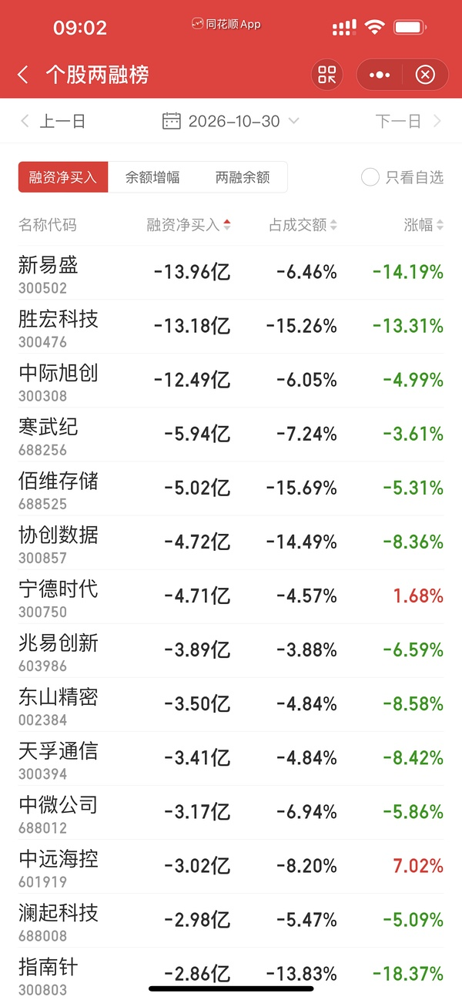

- (2026-11-02 09:25:28) 哈哈近几年我第一次场内额外充值🤣  ⊳ （引用 @VVV坚定持有VVV）中韩真棒啊

- (2026-11-02 09:29:09) 新华传媒跌停走出2连板
新华传媒跌停走出2连板，2天累计跌幅达19.0%。

- (2026-11-02 09:31:37) bbbbb

- (2026-11-02 09:38:08) 加仓大连 cbs
触发卖出周五sy买入雪人

- (2026-11-02 09:39:56) 你雪人又不是没买过急啥呢  ⊳ （引用 @红烧肉肉）太着急果然不太好啊

- (2026-11-02 09:40:19) 还没 等等

这是一起跌  ⊳ （引用 @shirla）xxz割了吗楼楼

- (2026-11-02 09:42:21) 大连第三笔 cbs第二笔了  ⊳ （引用 @一直在摸🐟）楼cbs和大连是直接上仓位了吗

- (2026-11-02 09:43:28) sy无敌  ⊳ （引用 @仓部加措）哇这波上海跟雪人切换吃爽了啊

- (2026-11-02 09:45:52) 雪人挂单1374

- (2026-11-02 09:48:16) 大连4074
雪人1374  ⊳ （引用 @我爱牛肉火锅）楼刚b冰雪的条件单有了吗？

- (2026-11-02 09:48:25) 我已经都买好了  ⊳ （引用 @仓部加措）楼楼手动接大连是多少呀

- (2026-11-02 09:49:01) cbs 3644  ⊳ （引用 @我爱牛肉火锅）楼刚b冰雪的条件单有了吗？

- (2026-11-02 09:49:27) 早上太爽了！！！！！！！

- (2026-11-02 09:49:31) 爽爽爽  ⊳ （引用 @不知道还能说啥）早上太爽了！！！！！！！

- (2026-11-02 09:50:50) 幸福降临 太爽了

- (2026-11-02 09:51:12) [图] 不知道没看 直接bbbbbb

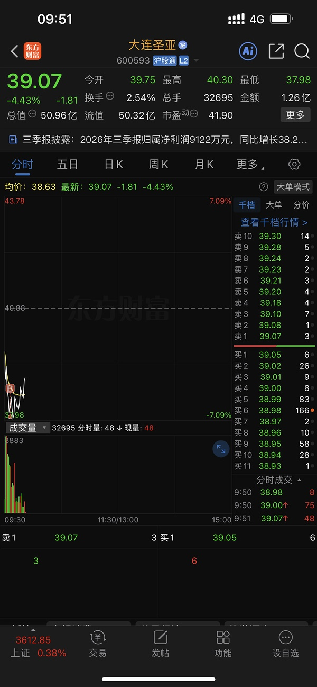  ⊳ （引用 @仓部加措）哈哈就是想问楼手动成交的是多少

- (2026-11-02 09:52:10) uu你去科技就是最大的错误

你就是玩垃圾的料🤣  ⊳ （引用 @只想搞钱）小辣鸡们我回来了

- (2026-11-02 09:52:47) 挂xxz涨停了 575  ⊳ （引用 @Lyra）涨停再出吗

- (2026-11-02 09:53:41) 有额外买的1344  ⊳ （引用 @shirla）幸福有单子吗楼楼

- (2026-11-02 09:55:39) 小明来个地天板看看实力

- (2026-11-02 09:56:19) 不着急今天不看  ⊳ （引用 @小鸡哔哔哔）楼楼sy什么位置买回呀

- (2026-11-02 09:59:52) 幸福上周的
今天没有  ⊳ （引用 @该用户已过期）你手速怎么这么快？我那仨冰雪买的都费劲🤣🤣

- (2026-11-02 10:00:47) 买不到的uu就是一个字贪

我今天都不看什么价格 bbbbbb就完事了  ⊳ （引用 @一直在摸🐟）设条件单 反弹买入

- (2026-11-02 10:05:53) 大连现在有两个单子了
如果你不在状态
一定搞不清楚  ⊳ （引用 @Eleven）大连有条件单吗，好像没看到

- (2026-11-02 10:08:25) 哈哈哈哈哈哈  ⊳ （引用 @我爱牛肉火锅）这个横店好不值当啊，一个涨停换俩跌停

- (2026-11-02 10:09:09) 中影还是慢工出细活
sy还是激情澎湃
幸福气氛组还不到位 不如光线

- (2026-11-02 10:09:36) 如果情绪好的话
今天芒果应该直接高开的吧  ⊳ （引用 @不知道还能说啥）中影还是慢工出细活
sy还是激情澎湃
幸福气氛组还不到位 不如光线

- (2026-11-02 10:10:25) 机器人来了  ⊳ （引用 @点-重生炒垃圾）等下午的宇航员，今天没钱做T

- (2026-11-02 10:11:08) 最近楼里科技股有个特色
只要哪个被连续点名有点强

很快就会大幅度补跌😂  ⊳ （引用 @六倍做多退休）我的妈呀 唯科这个补跌也很吓人

- (2026-11-02 10:11:36) 妈妈一直在  ⊳ （引用 @木感情的打工人）耐心等妈

- (2026-11-02 10:13:26) [图] 宁王开始发挥自己应有的价值了

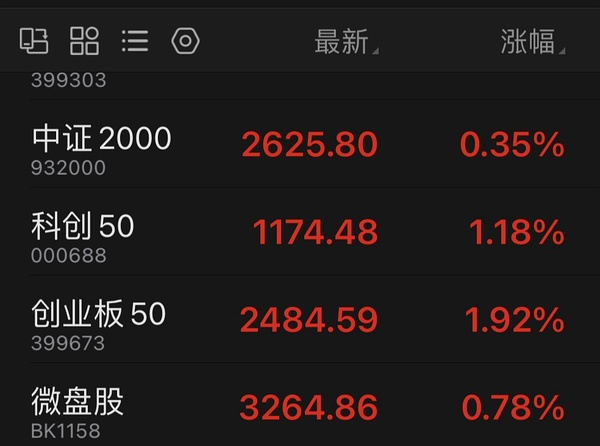

- (2026-11-02 10:14:18) uu你是玩垃圾的料 
咱应该术业有专攻  ⊳ （引用 @只想搞钱）就像之前的有研，我之前一直以为还挺强不咋跌拉的快，结果上周直接给我跌懵了

- (2026-11-02 10:16:10) sy现在走势有没有让大家想起之前的横盘奶茶？  ⊳ （引用 @我爱牛肉火锅）我的sy已经化身雪人了

- (2026-11-02 10:16:54) 还是老话
分散三个不要单独押注

而且冰雪正牌是双子星

其他都是山寨  ⊳ （引用 @该用户已过期）⛄️：压力好大呀🤣🤣

- (2026-11-02 10:18:55) 场外买债券的uu

利率债已经缓解
信用债还在挖
如果要配置债券
利率债先行
信用债买点靠后

- (2026-11-02 10:20:57) [图] 左侧这边难搞哦🤣🤣🤣

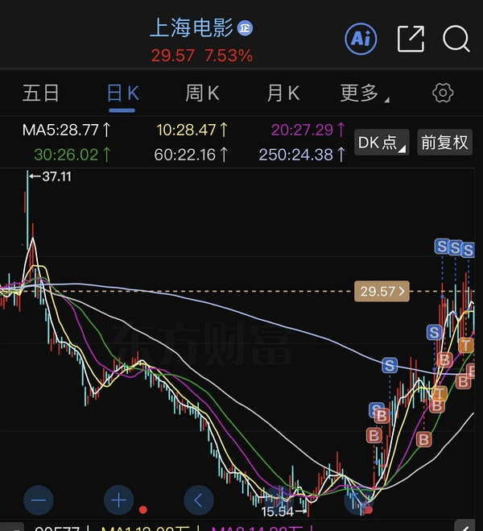  ⊳ （引用 @我爱牛肉火锅）希望是第一波被质疑的时候，当时咋说的来着，三天回收了那根大阳线好像 但感觉上影温和一点耶，第一波那就是还有的涨呀

- (2026-11-02 10:24:27) 趋势 动物昨晚发了

红利 进入右侧😂😂😂😂😂😂  ⊳ （引用 @木感情的打工人）比楼说的来晚了一些

- (2026-11-02 10:24:52) 是的
信用债还得跌😂😂😂  ⊳ （引用 @有人区生菜）不妙！那就意味着我买的那个还得跌……上面写着信用债120.94%

- (2026-11-02 10:26:06) 不贪心
垃圾消费我撤了 薅到一把😂

- (2026-11-02 10:26:46) 你周五没影响的吗 没影响的就没影响🤣  ⊳ （引用 @噜啦啦噜啦啦）不知道我那种，没啥大事，一天天的稳定涨0.01，0.02，0的那种是哪种债？

- (2026-11-02 10:27:22) 我也发现这个问题了哈哈

我又继续去手贱了🤣🤣🤣🤣🤣  ⊳ （引用 @我爱牛肉火锅）我发现了，每次你以为坑你的都是慢半拍救你啊

- (2026-11-02 10:29:02) 机器人😂😂😂  ⊳ （引用 @我爱牛肉火锅）军工？

- (2026-11-02 10:30:57) 他写了重新进入右侧 😂😂  ⊳ （引用 @想当富有的咸鱼）红利进右侧都很久了吧

- (2026-11-02 10:32:26) [图] 原来今天游戏哥哥那么厉害

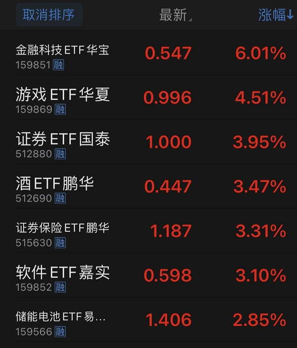

- (2026-11-02 10:35:10) 地产往下走

白酒在那边装逼😂😂😂😂😂

- (2026-11-02 10:36:42) 我讲一个客观的

如果是微盘股垃圾票行情 红利不会缺席

红利微盘是杠铃组合  ⊳ （引用 @木感情的打工人）ohno我不接受

- (2026-11-02 10:37:33) 不是  ⊳ （引用 @🅰失而复🉐😎）还是轮子？

- (2026-11-02 10:37:48) [图] 但是微盘股走势并不好了😂😂😂

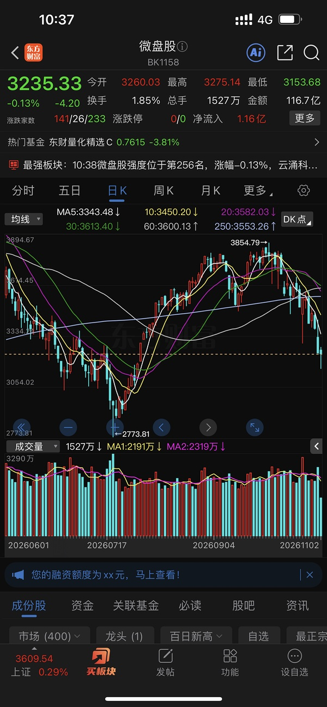  ⊳ （引用 @木感情的打工人）ohno我不接受

- (2026-11-02 10:38:40) 不是曾经啊就周四哈哈哈哈  ⊳ （引用 @我爱牛肉火锅）曾经爱过的埃斯顿？

- (2026-11-02 10:39:35) 👍👍👍👍👍👍  ⊳ （引用 @只想搞钱）我也在，已红嘿嘿

- (2026-11-02 10:40:31) 我以为本月开始会是中影😂  ⊳ （引用 @山中食人花）SY 30.2成交了
SY楼的眼光太好了 我夸它为电影王者

- (2026-11-02 10:42:29) 嗯嗯慢工出细活

中影就适合拿着

sy激情澎湃适合滚动bs  ⊳ （引用 @山中食人花）中影说 不急 这个月才开始 看谁是最终的本月王者 😂

- (2026-11-02 10:46:07) 一样的  ⊳ （引用 @仓部加措）楼楼涨停后是回落触发快还是开板触发快呀

- (2026-11-02 10:55:34) 如果有AI应用催化
电影将大放异彩🤣🤣🤣🤣  ⊳ （引用 @momo）🍊昨天说了软件还是在低位，如果有AI应用催化就有可能爆发，可以关注一下

- (2026-11-02 10:56:30) 上海电影（601595.SH）披露2026年三季报。前三季度公司实现营业收入4.99亿元，同比下降30.96%；归母净利润1851.40万元，同比下滑86.72%；扣非净利润为-907.28万元，同比由盈转亏，降幅107.94%。第三季度实现营收1.82亿元，同比下降49.63%；归母净利润325.86万元，同比下降96.20%；扣非净利润仅15.00万元，降幅高达99.81%。

哈哈哈哈哈哈 奖励涨停

- (2026-11-02 10:57:52) 只要是AI应用

游戏传媒不会缺席

因为这是在中国😂  ⊳ （引用 @momo）那还是电影爆发吧🫣毕竟楼里都在电影

## 🧠 投资风格分析
> 📏 增量更新指引：仅当今日发言确有新依据时才修订对应维度，无变化不强行重写；单维度修订建议 ≤150 字。

- 投资理念与方法：重视全球联动、机构行为与指数规则带来的被动买卖盘，先质疑公开数据真实性；以参与度判断行情性质，对高位腾空型科技股、小票垃圾票与微盘股保持戒心，关注业绩确定性与融资盘出清；操作留后手，坚持条件单与时间纪律，月末防守至上；偏好用筹码游戏逻辑处理传媒垃圾票，对miss业绩直接砍；以股债双爆/单爆情景推演倒推最终受益资产，并以股息率作为跨行业比较锚；今日进一步用科技股爆+长债爆/不爆两剧本分别指向消费/高股息，并关注食品饮料、家用电器股息率超4%、可脚踏两条船。
- 风险偏好：对高位腾空型科技股、小票垃圾票与微盘股保持戒心，认为融资盘爆仓式强卖是出清主要形式；对强势股补跌、月末微盘杀伤高度警惕，操作留后手；对传媒等垃圾票只做筹码游戏、不做价值投资；对债券拥挤交易与美元债/境内信用债违约保持警惕，视信用事件为风险偏好变量；新增关注美元债常不还、万科美元债违约与债券拥挤下资金躲债砍仓，并对周末政策消息保持“埋人”警惕。
- 交易与仓位：坚持条件单分档与预设时间表，将分散在十几只同题材小仓位合并到少数主攻标的，以「加大布局」而非新增资金方式提集中度。逢跌分批低吸但按价位设多档留后手；未站上五日线不当真，站上且拐头才加仓；月末提前设定总仓位滚动控制，防守至上；弱势板块不尾盘买入博次日反抽，改为次日早盘择机；反对无纪律加仓拉低成本，倾向留钱等更确定机会；涨停价手动挂单兑现；对已放弃旧方向不回头补仓。清仓bn转换xf，幸福配置满额与中影对等；计划sy和zy对等布局，幸福低配做情绪放大；强调右侧确认后加仓，耐心等确认信号。
- 心理特质：对持仓波动冷静，以低换手耐心持有避免手贱；月末/冰点等时点记忆清晰，强调纪律边界；看到他人不守计划会直接点出；对无价值吐槽情绪自我屏蔽；反复强调严格执行计划、防守至上；对已放弃旧方向不念旧不回头；把换仓视为对弱者的惩罚而非情绪操作；对自身手贱行为有清醒认知并主动惩罚。新增：对市场节奏有清晰时间感（"11月不搞这些东西"），能自嘲手贱但不失控；以"慢就是快"校准耐心，拒绝冲动。

> ⚠️ 本板块由 Actions 全自动增量更新（复用当日发言与今日总览），每次仅在内容足够支撑时才改动。

## 🏷️ 昵称映射表
### 📖 昵称规律（供 AI 判断新昵称时参考）
【昵称命名规律（用于推断未知新昵称）】
- 拼音首字母缩写：取标的/基金名汉字拼音首字母串（含数字代码），多为 ETF/股票代码口语化｜示例：yl=引力传媒｜zy=掌阅科技｜sj=视觉中国｜cc=华安文体健康混合｜C50=创业板50ETF｜k50=科创50｜kun=昆仑万维｜xhxc=新瀚新材｜zxfc=中欣氟材
- 小/老+姓氏代指：「小X」「老X」通常指姓 X 的标的或该标的的基金经理；「X兄弟」多为同系基金｜示例：小惠=惠发食品｜老莫=万家品质生活(莫海波)｜小华=华夏全球科技先锋(QDII)A｜小华兄弟=华夏移动互联(QDII)｜小浦=浦银安盛全球智能科技(QDII)A｜小广=广发全球精选(QDII)A｜小远=华宝致远(QDII)C｜招招=招商银行｜小德=德明利｜赵姨=兆易创新｜露露=泸州老窖｜空调=格力电器
- 戏称/黑话→题材板块：生活化比喻或黑话对应某个题材/板块，而非单一标的；出现时多指板块方向｜示例：卖国=PCB板块(英伟达AI链)｜爱国=国产自主(半导体设备/芯片)｜奶茶=易点天下｜老师=中文在线｜蓝色=蓝色光标｜宇航员=航空航天板块｜华子=华泰保兴安悦债券｜国际=国际复材｜巨无霸=长鑫科技等重大IPO
- 谐音/取字：昵称含标的名关键字（取一字或谐音），多为 A 股个股或基金简称｜示例：万华=万华化学｜东百=东百集团｜宝=保利发展｜讨饭/亚洲讨饭/建信新兴=建信新兴市场(QDII)A｜华宝zy=华宝致远(QDII)A
- 机构/基金经理昵称：以基金公司名、经理姓、或平台代称指代对应基金产品｜示例：周经理=中欧新趋势混合(LOF)A｜张经理=信澳匠心回报混合A｜网易云/音乐世家=富国全球科技互联网股票(QDII)A｜国富亚洲=国富亚洲机会股票(QDII)A｜国泰纳指=国泰纳斯达克100指数(QDII)｜易方达全球=易方达全球成长精选混合(QDII)A｜浦银安盛=浦银安盛全球智能科技(QDII)A

### 📋 已收录映射
| 昵称 | 对应名称 |
|------|----------|
| C50 | 创业板50ETF |
| cc | 华安文体健康混合A |
| k50 | 科创50 |
| kun | 昆仑万维 |
| sj | 视觉中国 |
| xhxc | 新瀚新材 |
| yl | 引力传媒 |
| zxfc | 中欣氟材 |
| zy | 掌阅科技 |
| 万华 | 万华化学 |
| 东百 | 东百集团 |
| 亚洲讨饭 | 建信新兴市场混合(QDII)A |
| 保利发展 | 保利发展 |
| 华子 | 华泰保兴安悦债券 |
| 华宝 zy | 华宝致远混合(QDII)A |
| 华宝zy | 华宝致远混合(QDII)A |
| 卖国 | PCB、光模块、通信板块（英伟达AI产业链） |
| 周经理 | 中欧新趋势混合(LOF)A |
| 国富亚洲 | 国富亚洲机会股票(QDII)A |
| 国泰纳指 | 国泰纳斯达克100指数(QDII) |
| 奶茶 | 易点天下 |
| 宇航员 | 航空航天板块 |
| 宝 | 保利发展 |
| 小华 | 华夏全球科技先锋混合(QDII)A |
| 小华兄弟 | 华夏移动互联混合(QDII) |
| 小广 | 广发全球精选股票(QDII)A |
| 小德 | 德明利 |
| 小惠 | 惠发食品 |
| 小浦 | 浦银安盛全球智能科技(QDII)A |
| 小远 | 华宝致远混合(QDII)C |
| 巨无霸 | 长鑫科技等重大IPO企业 |
| 建信新兴 | 建信新兴市场混合(QDII)A |
| 张经理 | 信澳匠心回报混合A |
| 招招 | 招商银行 |
| 易方达全球 | 易方达全球成长精选混合(QDII)A |
| 浦银安盛 | 浦银安盛全球智能科技(QDII)A |
| 爱国 | 国产自主（半导体设备/芯片制造） |
| 空调 | 格力电器 |
| 网易云 | 富国全球科技互联网股票(QDII)A |
| 老师 | 中文在线 |
| 老莫 | 万家品质生活混合A(519195) |
| 蓝色 | 蓝色光标 |
| 讨饭 | 建信新兴市场混合(QDII)A |
| 赵姨 | 兆易创新 |
| 赵哥 | 兆易创新 |
| 露露 | 泸州老窖 |
| 安安 | 安记食品 |
| 音乐世家 | 富国全球科技互联网股票(QDII)A |
| 老伯伯 | 铜冠铜箔 |
| nk | 景顺长城纳斯达克科技ETF联接(QDII)A |
| bk | 易方达标普信息科技指数(QDII-LOF)A |
| txx | 天下秀 |
| 媛媛 | 今世缘 |
| uu | 友友、网友们 |
| 温暖老师 | 某个特别牛逼的散户 |
| 余老师 | 余利，某牛逼投资者 |
| ycm | 粤传媒 |
| 江老师 | 江琪（投资博主） |
| 水果老师 | 投资博主 |
| 小爱 | 我爱我家 |
| ty | 天娱数科 |
| bn | 博纳影业 |
| sy | 上海电影 |
| CBS | 长白山 |
| 东哥 | 东百集团 |
| 芒果 | 芒果超媒 |
| 阿中 | 中国电影 |
| 欢欢 | 欢瑞世纪 |
| 雪人 | 雪人集团 |
| 大连 | 大连圣亚 |
| 幸福 | 幸福蓝海 |
| 小粤 | 粤传媒 |
| 阿博 | 博纳影业 |
| 创成长 | 创业板成长etf |

> ⚠️ 以下为 LLM **建议**，未自动写入状态文件。请人工确认后，本地编辑 `state.json` 的 `nickname_map` / `positions`，或 `nickname_rules.json` 的 `rules` 并 push 生效。

## 持仓建议（待你确认）
- **债券(中债/利率债)**（）〔加仓〕— 依据：我最终选择疯狂加仓债券😂😂😂😂😂 …… 是中债
- **美债**（）〔持有〕— 依据：美债国庆之前买好了
- **大连圣亚**（）〔加仓〕— 依据：加仓大连 cbs …… 大连第三笔 cbs第二笔了 …… 大连4074
- **长白山**（）〔加仓〕— 依据：加仓大连 cbs …… cbs 3644
- **雪人集团**（）〔买入〕— 依据：触发卖出周五sy买入雪人 …… 雪人挂单1374 …… 雪人1374
- **中国电影(中影)**（）〔持有〕— 依据：中影还是慢工出细活 …… 中影就适合拿着
- **宁德时代(宁王)**（）〔持有〕— 依据：宁王开始发挥自己应有的价值了

## 新昵称映射建议（待你确认）
- `宁王` = 宁德时代
- `董阿姨` = 格力电器
- `光线` = 光线传媒
- `游戏哥哥` = 游戏板块
- `机器人` = 机器人板块
- `nana` = 纳斯达克100指数(纳指)

## 新昵称规律建议（待你确认）
- 【债券配置】配置债券顺序：利率债先行，信用债买点靠后；当前利率债已缓解、信用债还在挖 ｜示例：利率债先行；信用债买点靠后 ｜依据：如果要配置债券 利率债先行 信用债买点靠后……利率债已经缓解 信用债还在挖
- 【题材正牌】冰雪题材正牌是双子星（长白山、大连圣亚），其他都是山寨 ｜示例：长白山、大连圣亚为冰雪正牌双子星 ｜依据：冰雪正牌是双子星 其他都是山寨
- 【交易手法】中影适合拿着不动，上海电影(sy)激情澎湃适合滚动做T(bs) ｜示例：中影慢工出细活；sy适合滚动bs ｜依据：中影就适合拿着 sy激情澎湃适合滚动bs
- 【杠铃组合】微盘股/垃圾票行情下红利不会缺席，红利+微盘是杠铃组合；但当前微盘走势不佳 ｜示例：红利微盘杠铃组合 ｜依据：如果是微盘股垃圾票行情 红利不会缺席 红利微盘是杠铃组合 但是微盘股走势并不好了
- 【剧本推演】科技股爆+长债爆→走2015-16剧本胜者是消费；科技股爆+长债不爆→走2021-22剧本胜者是高股息；食品饮料、家用电器股息率超4%可脚踏两条船 ｜示例：科技爆+长债爆=消费胜；长债不爆=高股息胜 ｜依据：如果科技股爆掉以后，再爆掉长债，那就是走2015-2016的剧本，最终的赢家是消费……食品饮料，二是家用电器，股息率都超过4%
- 【板块反应】楼里科技股只要被连续点名走强，很快就大幅补跌 ｜示例：连续点名→大幅补跌 ｜依据：最近楼里科技股有个特色 只要哪个被连续点名有点强 很快就会大幅度补跌

*🤖 自动生成于 2026-11-02 11:03:59 ｜ 豆瓣楼主发言追踪*