# 📋 楼主每日发言推送

> **推送日期**：2026-11-02 ｜ **执行时间**：2026-11-02 16:06:23 ｜ **监控用户**：`不知道还能说啥`
> **追踪模式**：`topic`（用户主页广播·豆瓣话题）

## 📊 持仓追踪
> 上次更新：2026-11-02 ｜ 基于楼主发言持续追踪（共 13 项）

| 标的 | 状态 | 类型 | 现价 | 提及 |
|------|------|------|------|------|
| 招商银行 | 持有 | 红利/银行 | 43.18（-0.85%） | 继续持有，大金融仅银行 |
| 长白山 | 持有 |  | 35.68（-0.56%） | 分笔加仓第二笔，挂单3644 |
| 雪人集团 | 持有 |  | 13.83（0.07%） | 触发卖出条件，挂单1374成交 |
| 上海电影 | 持有 |  | 30.25（10.00%） | 挂单买入，sy走势引其注意 |
| 幸福蓝海 | 持有 |  | 13.03（11.37%） | “幸福配置满额 对等”；中影维持核心仓位，均不靠融… |
| 粤传媒 | 持有 |  | 10.27（9.96%） | 暂无 |
| 大连圣亚 | 持有 |  | 40.34（-1.32%） | 分笔加仓，已买两笔，挂单4074 |
| 博纳影业(bn) | 卖出 |  | 暂无 | 已决定清仓bn转换xf |
| 博纳影业（bn） | 持有 |  | 暂无 | 「减仓bn 买入中影」；bn跌到60日线。 |
| bn（博纳影业） | 持有 |  | 暂无 | 清仓bn转换xf（幸福蓝海），“清仓bn转换xf” |
| 中国电影（中影） | 买入 |  | 暂无 | 10.28；持有，"我够了"，不再加仓 |
| 中韩半导体ETF | 买入 |  | 暂无 | 10.28；持有，等溢价率超20%再卖 |
| 中影（中国电影） | 买入 |  | 暂无 | 10.29；昨日换仓进来 |

> ⚠️ 执行任务时如发现新操作，请更新 `state.json` 的 `positions`。成本价和市值有数据才填，没有则保留「暂无」。

## 🌅 今日总览
### 📌 市场背景
（本次 LLM 未产出，建议重跑）

### 📌 今日操作
（本次 LLM 未产出，建议重跑）

### 📌 今日议题
（本次 LLM 未产出，建议重跑）

### 📌 看好板块/方向
（本次 LLM 未产出，建议重跑）

### 📌 风险提示
（本次 LLM 未产出，建议重跑）

## 📊 本次结果
- **今日发言**：271 条
- **累计存档**：19092 条

## 📝 该最新广播作者发言聚合（共 271 条）
### 其他讨论（提及 201 次，占比 74%）2026-10-31 09:03:29
- 我在车上给我女朋友看这个 她依然觉得大A是提款机😂😂😂

如果科技股爆掉以后，再爆掉长债，那就是走2015-2016的剧本，最终的赢家是消费。

如果科技股爆掉以后长债爆不掉，那就是走2021-2022的剧本，最终的赢家是高股息。

但是，
- 马上抵达😂😂😂
- 他这个如果其实说的是长债爆还是不爆了😂😂😂😂😂

### 友友、网友们（提及 10 次，占比 4%）2026-11-01 19:22:12
- uu弱了
豆瓣现在top1
- 周五融资盘越来越脆弱了

警惕本周五uu们

我这周五不会再手贱了
- uu你去科技就是最大的错误

你就是玩垃圾的料🤣

### 上海电影（提及 10 次，占比 4%）2026-11-02 08:46:44
- 还有sy 雪人
- 加仓大连 cbs
触发卖出周五sy买入雪人
- sy无敌

### 幸福蓝海（提及 9 次，占比 3%）2026-11-02 09:50:50
- 幸福降临 太爽了
- 幸福上周的
今天没有
- 我对幸福不满意

### 雪人集团（提及 8 次，占比 3%）2026-11-02 09:39:56
- 你雪人又不是没买过急啥呢
- 雪人挂单1374
- 大连4074
雪人1374

### 大连圣亚（提及 6 次，占比 2%）2026-11-02 09:42:21
- 大连第三笔 cbs第二笔了
- 大连现在有两个单子了
如果你不在状态
一定搞不清楚
- 大连重返五日线上方

### 芒果超媒（提及 6 次，占比 2%）2026-11-02 10:09:36
- 如果情绪好的话
今天芒果应该直接高开的吧
- 芒果7/31带队一次黑猴子
今天还是他的原因是吗！
- 芒果7/31开始的传媒行情也因为他的黑猴子登陆卫视

两次都是因为芒果
他自己缺不够强势😂

### 华安文体健康混合A（提及 4 次，占比 1%）2026-11-02 11:01:47
- 利率债全线回暖

30债尝试反包

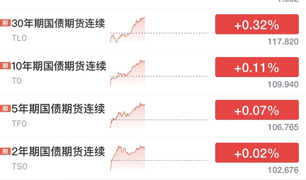
- 市场正在演绎我们的预期🤣
“AI不应用 AI个毛线”

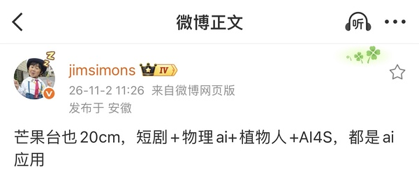
- 第二个沈阳是因为羊吧？

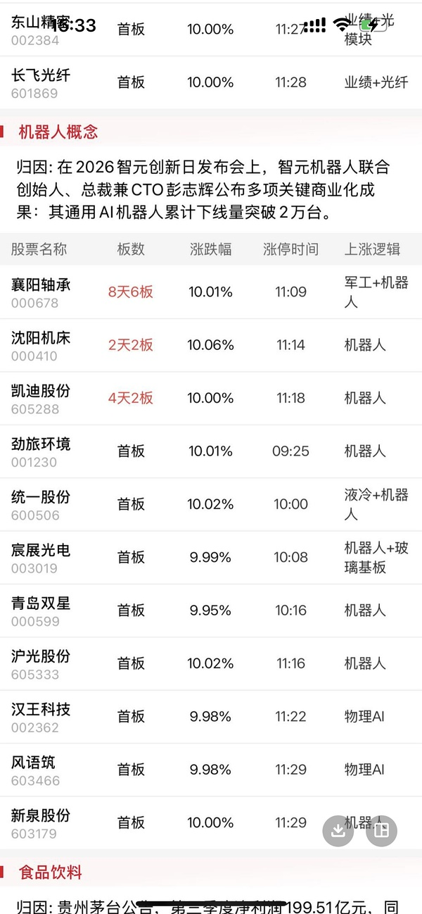

### 中文在线（提及 3 次，占比 1%）2026-11-01 22:05:31
- 让我们看看王老师🤣

- 王老师这个例子我现身说法🤣
我们本来是只有个播

在24年下半年加入做团播后为了搭建新的几个直播间和装修设备等等 现金流也是大幅度减少 但这并不是公司在变差🤣反而现在更好了 和王老师的例子异曲同工
- 港股阅文集团单边走强，午后涨超15%

香港的中文老师啊😂

### 易点天下（提及 2 次，占比 1%）2026-11-02 10:16:10
- sy现在走势有没有让大家想起之前的横盘奶茶？
- 不要让我再去想什么奶茶
不要让我再去PK什么光线
幸福你应该让我们幸福到家啊

### 航空航天板块（提及 2 次，占比 1%）2026-11-02 11:07:33
- 既然宇航员不给力
让机器人来呗
- 宇航员

### 格力电器（提及 1 次，占比 0%）2026-10-31 09:45:22
- 董阿姨最近一个月买了11.5万股空调哈哈哈

### 江琪（投资博主）（提及 1 次，占比 0%）2026-11-01 22:11:49
- 江老师现在账户今年-40%😂😂😂😂

### 投资博主（提及 1 次，占比 0%）2026-11-02 08:38:32
- 有中字头必有银行🤣🤣🤣
余老师只先看整个Q4都是微盘红利
水果老师又把明年看完了

### 招商银行（提及 1 次，占比 0%）2026-11-02 08:58:21
- 以前招招宁波是唯一两个pb一直处在1以上的
现在全都破净😂😂😂😂😂

### 博纳影业（提及 1 次，占比 0%）2026-11-02 11:35:36
- 他们炒作的还是AI漫剧
和我们目的不太一样🤣🤣🤣🤣

大家有bn的应该怒喷
中影和幸福其实和漫剧短剧完全无关

### 科创50（提及 1 次，占比 0%）2026-11-02 14:05:13
- 太子爷还没解禁
k50还没纳入

### 蓝色光标（提及 1 次，占比 0%）2026-11-02 14:07:00
- 比蓝色牛逼啊

我觉得来了

### 中韩半导体ETF（提及 1 次，占比 0%）2026-11-02 14:48:14
- 中韩半导体ETF华泰柏瑞成交额突破200亿
截至发稿时间，中韩半导体ETF华泰柏瑞（513310）成交额突破200亿元位列今日股票型ETF成交榜首。

### 天下秀（提及 1 次，占比 0%）2026-11-02 15:01:54
- txx也是我合作伙伴😂😂😂😂😂

### 掌阅科技（提及 1 次，占比 0%）2026-11-02 15:08:21
- zy没单子的 慢就是快
等他快了再研究
复仇者联盟和流浪地球可都是zy🤣🤣🤣🤣🤣

xf明天1544是能触到的
不要小看他哦 
幸福可是之前被量化高度控盘的
可以随心所欲的

### 📄 全部发言（共 271 条）
- (2026-10-31 09:03:29) 我在车上给我女朋友看这个 她依然觉得大A是提款机😂😂😂

如果科技股爆掉以后，再爆掉长债，那就是走2015-2016的剧本，最终的赢家是消费。

如果科技股爆掉以后长债爆不掉，那就是走2021-2022的剧本，最终的赢家是高股息。

但是，这轮行情有两个比较贼的行业，一是食品饮料，二是家用电器，股息率都超过4%，和银行属于同一档次，这俩哥们儿可以脚踏两条船。

- (2026-10-31 09:03:46) 马上抵达😂😂😂  ⊳ （引用 @momo）希望楼楼的迪士尼底➕楼里没设投票➕呆老师的天象，都能成为翅膀扑腾扑腾的带我们美基往上飞

- (2026-10-31 09:10:26) 他这个如果其实说的是长债爆还是不爆了😂😂😂😂😂  ⊳ （引用 @六倍做多退休）老师别这样 俺们真不中 看的人真是心慌慌

- (2026-10-31 09:12:56) 这已经发生了 不需要如果 😂  ⊳ （引用 @momo）老师还带安慰了我们一下，而我们只看到了“科技爆掉”这四个字

- (2026-10-31 09:14:18) 这样的话 ANT还能如期IPO吗  ⊳ （引用 @六倍做多退休）美股昨天涨幅第一的是农药板块啊 好地狱

- (2026-10-31 09:16:29) [图] 昨晚还在说黄金nana谁少亏谁孙子

nana是凌晨的孙子！

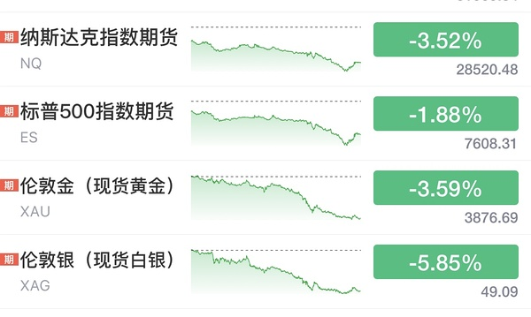  ⊳ （引用 @VVV坚定持有VVV）其实还是V起来了一些的🤔
所有自选只有一个红的

- (2026-10-31 09:45:22) [图] 董阿姨最近一个月买了11.5万股空调哈哈哈

- (2026-10-31 09:49:18) 稳稳的
那个事件被放大了
你可以查一下
美元债我们经常不还的
我昨天以为是内地债券违约
印度在美国发行美元债 好多公司都是最后赖掉
所以境内公司发行美元债总是利息高的吓人  ⊳ （引用 @momo）格力还要接盘华发呢

- (2026-10-31 09:52:35) 去年就递表了啊
ANT openai都是去年递表  ⊳ （引用 @家不住海边）妈呀。搜了下 都是说11月中或11月底就能上了
美国速度吗 不是才交了申请吗

- (2026-10-31 09:55:52) 应该是这个原因
万科美元债也是违约的
但是和债券太拥挤确实也有关系
最近资金都躲债券里趁机一把砍

国内地方zf债券违约我记得有过 有家煤炭公司是国内债券违约 那次影响更大  ⊳ （引用 @momo）那是因为华发是纯国资的，地方zf背书，所以这件事这么大

- (2026-10-31 22:24:47) [图] 看这个吧
投资美国的果然都不爱慢慢的🤣

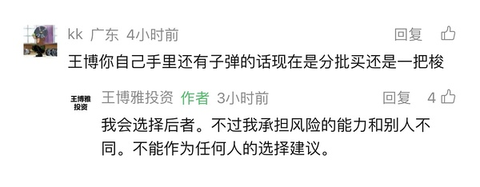  ⊳ （引用 @VVV坚定持有VVV）是的！我已经很久不看他了，这两天终于有人味了😂

- (2026-10-31 22:28:34) [图] 今天看到这个
就想到一个字
干

- (2026-11-01 12:50:08) [图] 美债快速下行 
市场大幅度抹去第三次加息预期

- (2026-11-01 16:05:43) 通过金融市场下跌来遏制加息  ⊳ （引用 @稀里不糊涂）楼之前说了什么阴谋论

- (2026-11-01 16:07:22) 周末出政策都是埋人的  ⊳ （引用 @木感情的打工人）等来的不是政策，是开会

- (2026-11-01 17:22:41) 闪迪、英特尔、英伟达、SK海力士暗盘集体拉升  ⊳ （引用 @六倍做多退休）川子喊大伙买科技股了😂大伙买吗

- (2026-11-01 17:23:37) [图] 原来新浪就能看那么多暗盘 新浪真牛逼

  ⊳ （引用 @六倍做多退休）假号哈哈哈哈

- (2026-11-01 17:25:03) [图] 原来ant一直都在默默交易啊

- (2026-11-01 19:12:00) 让我们再把炒垃圾发挥出来😂  ⊳ （引用 @Milumio发财版）都有点害怕开盘了😭

- (2026-11-01 19:16:20) 就算其他你都忘了
2025.4.7你还不知道是什么情况嘛
最终只是12%吗  ⊳ （引用 @家不住海边）越弹越少啊

- (2026-11-01 19:17:54) 小熊猫的数据结论也是错的  ⊳ （引用 @海贼）我咋感觉这条信息在胡说八道…没有啥必然联系呢。24年2月那波反弹不是在千股//跌停的冰点后才反弹的吗

- (2026-11-01 19:18:11) 你又要被删了  ⊳ （引用 @半闲公子）不要在垃圾市场里翻垃圾。大家保重身体。以前都会安慰说都会回来的。现在也不敢按摩，因为不知道这次缅A的下限。😮‍💨

- (2026-11-01 19:19:20) 哈哈我在迪士尼回来的路上
我女朋友P照片 我研究债券
我最终选择疯狂加仓债券😂😂😂😂😂  ⊳ （引用 @我爱牛肉火锅）退休uu说他投资的很分散，然后上周五被一锅端了

- (2026-11-01 19:22:12) uu弱了
豆瓣现在top1  ⊳ （引用 @温妤哦）你不说我咋知道在哪看啊！

- (2026-11-01 19:25:27) 24年2月是易下台 反转 不过就是你说的冰点触发了
2025.4.7大家知道是为什么
2025.9也是口嗨关税 后面taco
和座谈会都毫无关系😂😂😂  ⊳ （引用 @海贼）对呀，我还去看了日k图，觉得他这个数据日期还有反弹幅度包括逻辑都很奇怪。反正我印象中24年2月和25年4月都是冰点后反弹的。说实话就算没有这些什么会不会的，到楼判断的冰点条件市场我觉得自然都会反弹了，不认同这个因果联系😂

- (2026-11-01 19:48:36) 是中债

美债国庆之前买好了  ⊳ （引用 @木感情的打工人）美债吗，易方达还是哪个

- (2026-11-01 19:51:32) [图] 

  ⊳ （引用 @木感情的打工人）记者今日从相关渠道了解到，一家国有超大型银行近日计划向中国国新、中国诚通两家央企新增股票回购增持贷款额度，单家新增额度或可达到1000亿元。据悉，此次新增的再贷款额度规模，或将超过2024年该政策工具设立时该行向上述主体发放的首期额度。

- (2026-11-01 20:01:40) 是看好经济不会起色

昨天那个pmi已经验证了 🤣🤣  ⊳ （引用 @木感情的打工人）你看好印度接下来继续降息是嘛

- (2026-11-01 20:21:36) 不瞒你说
美国的加仓目标我也都在一个个看
包括易方达57的美国+3%日本的配比也在我恐慌飙升时候的狙击范围里😂  ⊳ （引用 @VVV坚定持有VVV）什么？加仓！（bushi哈哈哈哈哈哈

- (2026-11-01 22:05:31) [图] 让我们看看王老师🤣

  ⊳ （引用 @VVV坚定持有VVV）发生什么了，江老师一下子这么悲观🫢

- (2026-11-01 22:11:49) 江老师现在账户今年-40%😂😂😂😂  ⊳ （引用 @木感情的打工人）价投印度科技，江老师一定是知道我们不知消息，不然怎么会说出这种话😂

- (2026-11-01 22:19:10) 王老师这个例子我现身说法🤣
我们本来是只有个播

在24年下半年加入做团播后为了搭建新的几个直播间和装修设备等等 现金流也是大幅度减少 但这并不是公司在变差🤣反而现在更好了 和王老师的例子异曲同工  ⊳ （引用 @VVV坚定持有VVV）让我来看看坚定多头的看法，找点高兴的感觉🤣

- (2026-11-01 22:22:38) 应该稳稳的😂

红利ETF10月也就2-5%收益  ⊳ （引用 @点-重生炒垃圾）冰雪收益能打赢红利不😂😂😂

- (2026-11-01 22:24:02) 我要等等看 
他选举完是taco还是攻击伊朗

其实最重要的连续加息已经不存在了
这一波下跌不是没有意义
意义非常大啊  ⊳ （引用 @VVV坚定持有VVV）王老师说下周有更大机会，就等着买了！

- (2026-11-01 22:26:33) 😂😂😂😂😂😂😂😂  ⊳ （引用 @VVV坚定持有VVV）哈哈哈哈哈哈誓死追随老米🤣

- (2026-11-01 22:29:18) 等选举呀

之前看过报道 临近选举taco反而会损失更多的选票  ⊳ （引用 @VVV坚定持有VVV）他好久没taco了不知道在等啥🤔
不过没关系对我们多头来说，结果都一样，就是买入🤣

- (2026-11-01 23:18:46) 大幅削弱了加息预期
目前非但抹掉了未来第三次加息的预期
甚至第二次再加息的预期都不足60%了
理论上12月就可能是本轮最后一次加息
这是最最重要的 没有之一  ⊳ （引用 @momo）差生想问楼楼意义是什么😭

- (2026-11-02 08:38:32) 有中字头必有银行🤣🤣🤣
余老师只先看整个Q4都是微盘红利
水果老师又把明年看完了  ⊳ （引用 @VVV坚定持有VVV）有啊，小微盘买诺安，中字头去买中特估？

- (2026-11-02 08:40:34) 机构主导的科技行情散户玩的怎么样🤣  ⊳ （引用 @momo）这种散根本没得玩啊

- (2026-11-02 08:41:50) 铠侠股价大跌，业绩指引暗示需求增长或将放缓
周一，日本存储芯片制造商铠侠控股的股价一度暴跌15%。

此前，该公司给出的谨慎业绩指引令投资者大失所望，再次引发市场对人工智能（AI）驱动的爆发式增长可能正在放缓的担忧。这家总部位于东京的企业上周五表示，预计12月季度的营业利润为2万亿日元（约合127亿美元），低于分析师普遍预期的2.35万亿日元。该预测暗示，其业绩较9月季度的1.99万亿日元几乎没有增长。

- (2026-11-02 08:46:44) 还有sy 雪人  ⊳ （引用 @摇头晃脑小脑斧）复习条件单，大连44.39，还有啥吗

- (2026-11-02 08:47:42) 是的
搞到现在中特估还没把银行的pb拉到1 
依然都是破净状态  ⊳ （引用 @VVV坚定持有VVV）是的，23年应该是第一次听这个概念🤔

- (2026-11-02 08:48:34) 两市融资余额减少413.4亿元
截至10月30日，上交所融资余额报11989.02亿元，较前一交易日减少192.87亿元；深交所融资余额报11089.1亿元，较前一交易日减少220.53亿元；两市合计23078.12亿元，较前一交易日减少413.4亿元。

- (2026-11-02 08:48:56) 周五融资盘越来越脆弱了

警惕本周五uu们

我这周五不会再手贱了  ⊳ （引用 @不知道还能说啥）两市融资余额减少413.4亿元
截至10月30日，上交所融资余额报11989.02亿元，较前一交易日减少192.87亿元；深交所融资余额报11089.1亿元，较前一交易日减少220.53亿元；两市合计23078.12亿元，较前一交易日减少4

- (2026-11-02 08:58:21) 以前招招宁波是唯一两个pb一直处在1以上的
现在全都破净😂😂😂😂😂  ⊳ （引用 @我爱牛肉火锅）谷子地评招的三季报好像说招有提高分红的潜力，但专业的词好多，我看不懂😂

- (2026-11-02 09:02:42) [图] 融资盘顶不住了

- (2026-11-02 09:25:28) 哈哈近几年我第一次场内额外充值🤣  ⊳ （引用 @VVV坚定持有VVV）中韩真棒啊

- (2026-11-02 09:29:09) 新华传媒跌停走出2连板
新华传媒跌停走出2连板，2天累计跌幅达19.0%。

- (2026-11-02 09:31:37) bbbbb

- (2026-11-02 09:38:08) 加仓大连 cbs
触发卖出周五sy买入雪人

- (2026-11-02 09:39:56) 你雪人又不是没买过急啥呢  ⊳ （引用 @红烧肉肉）太着急果然不太好啊

- (2026-11-02 09:40:19) 还没 等等

这是一起跌  ⊳ （引用 @shirla）xxz割了吗楼楼

- (2026-11-02 09:42:21) 大连第三笔 cbs第二笔了  ⊳ （引用 @一直在摸🐟）楼cbs和大连是直接上仓位了吗

- (2026-11-02 09:43:28) sy无敌  ⊳ （引用 @仓部加措）哇这波上海跟雪人切换吃爽了啊

- (2026-11-02 09:45:52) 雪人挂单1374

- (2026-11-02 09:48:16) 大连4074
雪人1374  ⊳ （引用 @我爱牛肉火锅）楼刚b冰雪的条件单有了吗？

- (2026-11-02 09:48:25) 我已经都买好了  ⊳ （引用 @仓部加措）楼楼手动接大连是多少呀

- (2026-11-02 09:49:01) cbs 3644  ⊳ （引用 @我爱牛肉火锅）楼刚b冰雪的条件单有了吗？

- (2026-11-02 09:49:27) 早上太爽了！！！！！！！

- (2026-11-02 09:49:31) 爽爽爽  ⊳ （引用 @不知道还能说啥）早上太爽了！！！！！！！

- (2026-11-02 09:50:50) 幸福降临 太爽了

- (2026-11-02 09:51:12) [图] 不知道没看 直接bbbbbb

  ⊳ （引用 @仓部加措）哈哈就是想问楼手动成交的是多少

- (2026-11-02 09:52:10) uu你去科技就是最大的错误

你就是玩垃圾的料🤣  ⊳ （引用 @只想搞钱）小辣鸡们我回来了

- (2026-11-02 09:52:47) 挂xxz涨停了 575  ⊳ （引用 @Lyra）涨停再出吗

- (2026-11-02 09:53:41) 有额外买的1344  ⊳ （引用 @shirla）幸福有单子吗楼楼

- (2026-11-02 09:55:39) 小明来个地天板看看实力

- (2026-11-02 09:56:19) 不着急今天不看  ⊳ （引用 @小鸡哔哔哔）楼楼sy什么位置买回呀

- (2026-11-02 09:59:52) 幸福上周的
今天没有  ⊳ （引用 @该用户已过期）你手速怎么这么快？我那仨冰雪买的都费劲🤣🤣

- (2026-11-02 10:00:47) 买不到的uu就是一个字贪

我今天都不看什么价格 bbbbbb就完事了  ⊳ （引用 @一直在摸🐟）设条件单 反弹买入

- (2026-11-02 10:05:53) 大连现在有两个单子了
如果你不在状态
一定搞不清楚  ⊳ （引用 @Eleven）大连有条件单吗，好像没看到

- (2026-11-02 10:08:25) 哈哈哈哈哈哈  ⊳ （引用 @我爱牛肉火锅）这个横店好不值当啊，一个涨停换俩跌停

- (2026-11-02 10:09:09) 中影还是慢工出细活
sy还是激情澎湃
幸福气氛组还不到位 不如光线

- (2026-11-02 10:09:36) 如果情绪好的话
今天芒果应该直接高开的吧  ⊳ （引用 @不知道还能说啥）中影还是慢工出细活
sy还是激情澎湃
幸福气氛组还不到位 不如光线

- (2026-11-02 10:10:25) 机器人来了  ⊳ （引用 @点-重生炒垃圾）等下午的宇航员，今天没钱做T

- (2026-11-02 10:11:08) 最近楼里科技股有个特色
只要哪个被连续点名有点强

很快就会大幅度补跌😂  ⊳ （引用 @六倍做多退休）我的妈呀 唯科这个补跌也很吓人

- (2026-11-02 10:11:36) 妈妈一直在  ⊳ （引用 @木感情的打工人）耐心等妈

- (2026-11-02 10:13:26) [图] 宁王开始发挥自己应有的价值了

- (2026-11-02 10:14:18) uu你是玩垃圾的料 
咱应该术业有专攻  ⊳ （引用 @只想搞钱）就像之前的有研，我之前一直以为还挺强不咋跌拉的快，结果上周直接给我跌懵了

- (2026-11-02 10:16:10) sy现在走势有没有让大家想起之前的横盘奶茶？  ⊳ （引用 @我爱牛肉火锅）我的sy已经化身雪人了

- (2026-11-02 10:16:54) 还是老话
分散三个不要单独押注

而且冰雪正牌是双子星

其他都是山寨  ⊳ （引用 @该用户已过期）⛄️：压力好大呀🤣🤣

- (2026-11-02 10:18:55) 场外买债券的uu

利率债已经缓解
信用债还在挖
如果要配置债券
利率债先行
信用债买点靠后

- (2026-11-02 10:20:57) [图] 左侧这边难搞哦🤣🤣🤣

  ⊳ （引用 @我爱牛肉火锅）希望是第一波被质疑的时候，当时咋说的来着，三天回收了那根大阳线好像 但感觉上影温和一点耶，第一波那就是还有的涨呀

- (2026-11-02 10:24:27) 趋势 动物昨晚发了

红利 进入右侧😂😂😂😂😂😂  ⊳ （引用 @木感情的打工人）比楼说的来晚了一些

- (2026-11-02 10:24:52) 是的
信用债还得跌😂😂😂  ⊳ （引用 @有人区生菜）不妙！那就意味着我买的那个还得跌……上面写着信用债120.94%

- (2026-11-02 10:26:06) 不贪心
垃圾消费我撤了 薅到一把😂

- (2026-11-02 10:26:46) 你周五没影响的吗 没影响的就没影响🤣  ⊳ （引用 @噜啦啦噜啦啦）不知道我那种，没啥大事，一天天的稳定涨0.01，0.02，0的那种是哪种债？

- (2026-11-02 10:27:22) 我也发现这个问题了哈哈

我又继续去手贱了🤣🤣🤣🤣🤣  ⊳ （引用 @我爱牛肉火锅）我发现了，每次你以为坑你的都是慢半拍救你啊

- (2026-11-02 10:29:02) 机器人😂😂😂  ⊳ （引用 @我爱牛肉火锅）军工？

- (2026-11-02 10:30:57) 他写了重新进入右侧 😂😂  ⊳ （引用 @想当富有的咸鱼）红利进右侧都很久了吧

- (2026-11-02 10:32:26) [图] 原来今天游戏哥哥那么厉害

- (2026-11-02 10:35:10) 地产往下走

白酒在那边装逼😂😂😂😂😂

- (2026-11-02 10:36:42) 我讲一个客观的

如果是微盘股垃圾票行情 红利不会缺席

红利微盘是杠铃组合  ⊳ （引用 @木感情的打工人）ohno我不接受

- (2026-11-02 10:37:33) 不是  ⊳ （引用 @🅰失而复🉐😎）还是轮子？

- (2026-11-02 10:37:48) [图] 但是微盘股走势并不好了😂😂😂

  ⊳ （引用 @木感情的打工人）ohno我不接受

- (2026-11-02 10:38:40) 不是曾经啊就周四哈哈哈哈  ⊳ （引用 @我爱牛肉火锅）曾经爱过的埃斯顿？

- (2026-11-02 10:39:35) 👍👍👍👍👍👍  ⊳ （引用 @只想搞钱）我也在，已红嘿嘿

- (2026-11-02 10:40:31) 我以为本月开始会是中影😂  ⊳ （引用 @山中食人花）SY 30.2成交了
SY楼的眼光太好了 我夸它为电影王者

- (2026-11-02 10:42:29) 嗯嗯慢工出细活

中影就适合拿着

sy激情澎湃适合滚动bs  ⊳ （引用 @山中食人花）中影说 不急 这个月才开始 看谁是最终的本月王者 😂

- (2026-11-02 10:46:07) 一样的  ⊳ （引用 @仓部加措）楼楼涨停后是回落触发快还是开板触发快呀

- (2026-11-02 10:55:34) 如果有AI应用催化
电影将大放异彩🤣🤣🤣🤣  ⊳ （引用 @momo）🍊昨天说了软件还是在低位，如果有AI应用催化就有可能爆发，可以关注一下

- (2026-11-02 10:56:30) 上海电影（601595.SH）披露2026年三季报。前三季度公司实现营业收入4.99亿元，同比下降30.96%；归母净利润1851.40万元，同比下滑86.72%；扣非净利润为-907.28万元，同比由盈转亏，降幅107.94%。第三季度实现营收1.82亿元，同比下降49.63%；归母净利润325.86万元，同比下降96.20%；扣非净利润仅15.00万元，降幅高达99.81%。

哈哈哈哈哈哈 奖励涨停

- (2026-11-02 10:57:52) 只要是AI应用

游戏传媒不会缺席

因为这是在中国😂  ⊳ （引用 @momo）那还是电影爆发吧🫣毕竟楼里都在电影

- (2026-11-02 11:01:47) [图] 利率债全线回暖

30债尝试反包

- (2026-11-02 11:03:47) 哈哈哈哈哈哈哈哈  ⊳ （引用 @我爱牛肉火锅）温暖老师的慈文又被你押中了

- (2026-11-02 11:04:18) 增长的 你去仔细看呀😂  ⊳ （引用 @赛博朋克2077）为什么博纳业绩也很差，只有惩罚😭

- (2026-11-02 11:04:52) 我对幸福不满意  ⊳ （引用 @该用户已过期）幸福搞快点，干饭光线

- (2026-11-02 11:05:42) 没有 加速以后才有不过他喜欢走N字 你们可以自己掌握哈哈  ⊳ （引用 @shirla）ZY没有条件单吧？

- (2026-11-02 11:06:42) [图] 我今天还奖励了他10月卓越的贡献
有惩罚也有奖励🤣🤣🤣

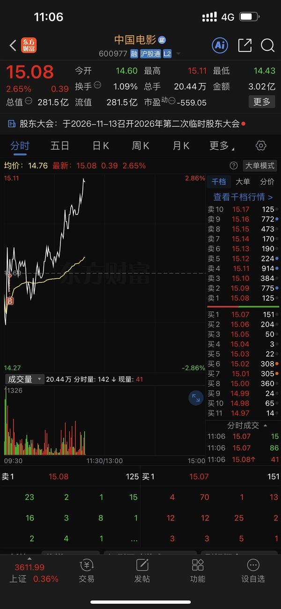  ⊳ （引用 @shirla）ZY没有条件单吧？

- (2026-11-02 11:07:33) 既然宇航员不给力
让机器人来呗

- (2026-11-02 11:08:10) AI漫剧概念持续走强，海看股份20cm涨停，芒果超媒涨超12%，上海电影、奥飞娱乐、龙版传媒等多股封板，华策影视、百纳千成、捷成股份涨超6%。

- (2026-11-02 11:08:18) 还在玩这个啊😂😂  ⊳ （引用 @不知道还能说啥）AI漫剧概念持续走强，海看股份20cm涨停，芒果超媒涨超12%，上海电影、奥飞娱乐、龙版传媒等多股封板，华策影视、百纳千成、捷成股份涨超6%。

- (2026-11-02 11:08:36) 国情吧
中国人娱乐为主🤣  ⊳ （引用 @点-重生炒垃圾）电影我真的哭死，软件跌的时候比他们少，软件涨的时候他们也不输

- (2026-11-02 11:09:20) uu还是改回满载而归吧

- (2026-11-02 11:10:20) [图] 进入十一月最猛的是我了吧 🤣🤣🤣

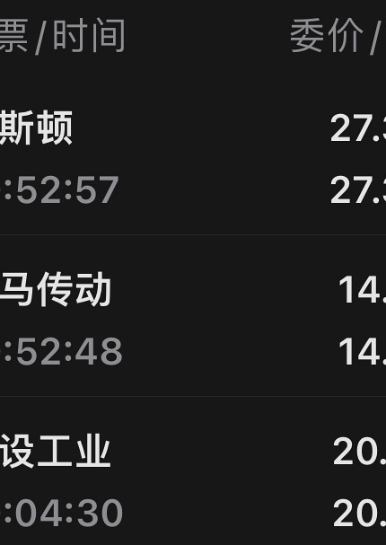

- (2026-11-02 11:11:55) 刚刚-8去了  ⊳ （引用 @只想搞钱）我正在看中马！哈哈你每次领先一步

- (2026-11-02 11:12:58) Meta与中国企业合作开发人形机器人？傅利叶回应
近日有消息称，Meta已与中国机器人公司傅利叶合作，在大约三个月内打造出一款人形机器人原型，双方已经在开发第二个版本。这款机器人在Meta内部被称为Max，重约48公斤，用于内部研究和实验。Meta机器人产品副总裁Li-Chen Miller还在傅利叶位于上海的工厂待了近两个月。对此，傅利叶创始人、CEO顾捷回复记者称，暂不方便回复。（一财）

- (2026-11-02 11:13:13) 11月了
狠狠干  ⊳ （引用 @只想搞钱）低买也太爽了吧

- (2026-11-02 11:13:35) 有人督促幸福也行😂😂😂  ⊳ （引用 @我爱牛肉火锅）光线发疯了

- (2026-11-02 11:13:43) 👍👍👍👍👍👍👍👍  ⊳ （引用 @小白吐司）我也回老朋友了哈哈

- (2026-11-02 11:14:25) 反正十月底防守

今日十一月就一个字 干

我们之前就这么说的  ⊳ （引用 @Aaa摆烂咸鱼🥳）周五周六被恐慌情绪影响的无比严重，周日把自己哄好了，今天开盘竟然有点兴奋😂😂

- (2026-11-02 11:17:01) 难道整个下半年都是传媒？

- (2026-11-02 11:17:05) 😂😂😂😂😂😂😂😂  ⊳ （引用 @不知道还能说啥）难道整个下半年都是传媒？

- (2026-11-02 11:18:00) 传媒牛逼啊😂  ⊳ （引用 @🅰失而复🉐😎）其它两个没跟上🤣

- (2026-11-02 11:18:13) 难道我们五六月就在布局下半年风口行业？😂  ⊳ （引用 @稀里不糊涂）今天传媒真的好强

- (2026-11-02 11:18:55) 还好我是看好电影的
这样我还是有传媒的
😂😂😂😂😂

不然还挺尴尬哈哈

- (2026-11-02 11:19:43) 这个打野

电影冰雪主要的  ⊳ （引用 @shirla）没跟上😂😂这个玩几天呀，我还是蹲守电影冰雪中

- (2026-11-02 11:20:52) 看不过来了 笑死  ⊳ （引用 @🅰失而复🉐😎）这20快的很啊，传媒就电影跟了🤣

- (2026-11-02 11:21:38) 已经有一个20的😂  ⊳ （引用 @🅰失而复🉐😎）芒果还是领头羊😇

- (2026-11-02 11:22:08) 芒果7/31带队一次黑猴子
今天还是他的原因是吗！  ⊳ （引用 @点-重生炒垃圾）芒果到底是不是因为那个综艺涨的啊，太火了

- (2026-11-02 11:23:18) 又是游戏传媒那些共振指数啊？  ⊳ （引用 @点-重生炒垃圾）芒果到底是不是因为那个综艺涨的啊，太火了

- (2026-11-02 11:24:47) 我给大家高兴一下
我才刚红😂😂😂😂😂

因为我账户本来有军工的 我去掉了换的机器人们  ⊳ （引用 @我爱牛肉火锅）中韩！！！，不敢想你今天持仓有多红

- (2026-11-02 11:25:32) 嗯 至少垃圾消费不吸引我了😂😂😂😂😂  ⊳ （引用 @🅰失而复🉐😎）真猛，后面可能还要调整仓位吧，不能放过它们🤣

- (2026-11-02 11:26:06) 中韩半导体已经马上10%溢价了😂

- (2026-11-02 11:26:35) 过不了两天大概就要10:30开盘了  ⊳ （引用 @不知道还能说啥）中韩半导体已经马上10%溢价了😂

- (2026-11-02 11:28:12) 对大家重要的是今天基金也应该不错😂  ⊳ （引用 @我爱牛肉火锅）万一你的机器人明天起连板呢，他们还怪好的，等你隔天能买了才开始起飞

- (2026-11-02 11:29:29) [图] 小银行率先崩盘

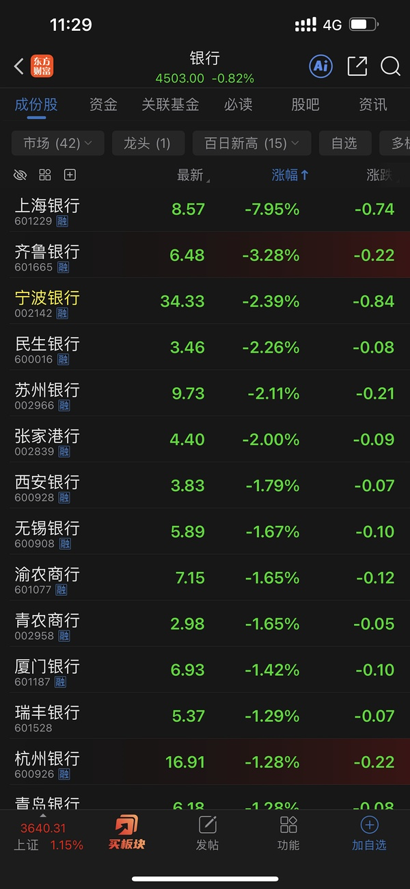

- (2026-11-02 11:29:47) 融资盘今天来了？  ⊳ （引用 @家不住海边）来说。蓝色怎输那么多。气。喜欢黄色 不爱蓝色是吧

- (2026-11-02 11:30:16) 楼主也确实没有钱分🤣  ⊳ （引用 @momo）楼主之前就说不去了

- (2026-11-02 11:32:15) 11:31:30【午评：创业板指半日涨超3% AI漫剧、白酒概念集体爆发】

喝酒看剧？？？楼里uu周末好像是这么干的😂

- (2026-11-02 11:32:36) 故事反映了大家的实操🤣🤣🤣🤣🤣  ⊳ （引用 @不知道还能说啥）11:31:30【午评：创业板指半日涨超3% AI漫剧、白酒概念集体爆发】

喝酒看剧？？？楼里uu周末好像是这么干的😂

- (2026-11-02 11:34:10) 如果是这样
你们应该让我早点陪我女朋友去迪士尼的
亏的钱都能去很久了

- (2026-11-02 11:35:36) 他们炒作的还是AI漫剧
和我们目的不太一样🤣🤣🤣🤣

大家有bn的应该怒喷
中影和幸福其实和漫剧短剧完全无关  ⊳ （引用 @泡芙好吃）sy真强 xf快上啊

- (2026-11-02 11:35:56) 宇航员  ⊳ （引用 @点-重生炒垃圾）游戏etf8+了，今年是游戏跌的多，还是宇航员跌的多

- (2026-11-02 11:36:41) [图] 游戏20几

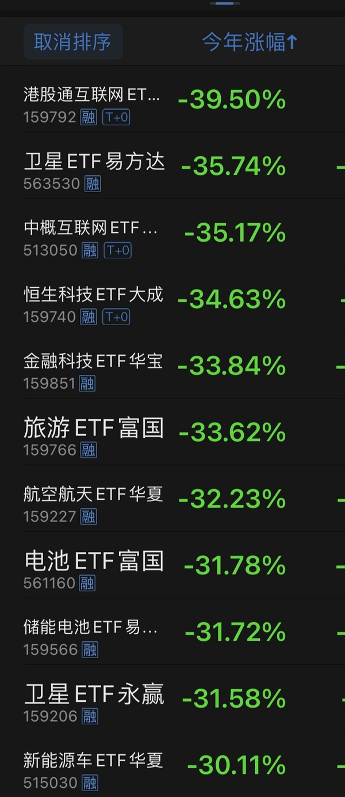  ⊳ （引用 @点-重生炒垃圾）游戏etf8+了，今年是游戏跌的多，还是宇航员跌的多

- (2026-11-02 11:38:15) 他们开会开了吗

没看到消息啊

- (2026-11-02 11:38:25) 不过今天买的很疯狂 1000也买了  ⊳ （引用 @不知道还能说啥）他们开会开了吗

没看到消息啊

- (2026-11-02 11:40:30) 美国人说了算的😂  ⊳ （引用 @稀里不糊涂）希望今天就是底，不要再大跌了，真的受不住

- (2026-11-02 11:41:33) 芒果7/31开始的传媒行情也因为他的黑猴子登陆卫视

两次都是因为芒果
他自己缺不够强势😂  ⊳ （引用 @momo）芒果股吧全是后会有期 接事业运接大芒果

- (2026-11-02 11:43:49) 今日板块爆发最直接的外部催化，源于海外短剧赛道扎实的落地数据。

据央视财经报道，目前国内已有约10家企业成功建立海外短剧平台，十余款出海短剧应用上线了AI漫剧专属频道，海外AI漫剧活跃用户整体已突破1.5亿大关，且海外短剧付费应用前十名中中国厂商独占九席。这种终端需求在海外市场的率先验证，构成了本轮产业叙事与纯粹题材炒作的根本分野。

与此同时，产业供给侧的去劣存优出清进程也在加速推进。红果等主流平台一次性处置了超2万部低质同质化短剧，短剧版权中心3.0版更是将单剧时长与收益实现了强绑定，平台补贴机制正式由“铺量模式”转向“单部质量与时长考核”。

券商研报指出，AI正驱动互动影游由传统的买断制小众市场走向平台化分发，AI影视亦由前期的降本验证阶段跨入真正的需求验证阶段。

- (2026-11-02 11:45:18) 而今日游戏板块源于DeepSeek Harness团队于10月31日晚间发布了《Super-agent设计探索》，提出了一套具备更强自主性的Agent全新架构。

游戏一侧的逻辑在于AI大幅压低研发与买量成本，叠加出海市场份额的持续提升，巨人网络与世纪华通的报表已为此提供了印证；影视与出版一侧反映的是内容IP资产在AI新产能赋能下的价值重估，龙版传媒与果麦文化等标的同步强劲走高；platform平台一侧则是海看股份这类IPTV与OTT运营商，直接对接AI影视内容的分发入口。  ⊳ （引用 @不知道还能说啥）今日板块爆发最直接的外部催化，源于海外短剧赛道扎实的落地数据。

据央视财经报道，目前国内已有约10家企业成功建立海外短剧平台，十余款出海短剧应用上线了AI漫剧专属频道，海外AI漫剧活跃用户整体已突破1.5亿大关，且海外短剧付费应用前十名中

- (2026-11-02 11:49:36) [图] 我买了很多的😂
我觉得这一跌把妈妈会干预债券的风险也化解了

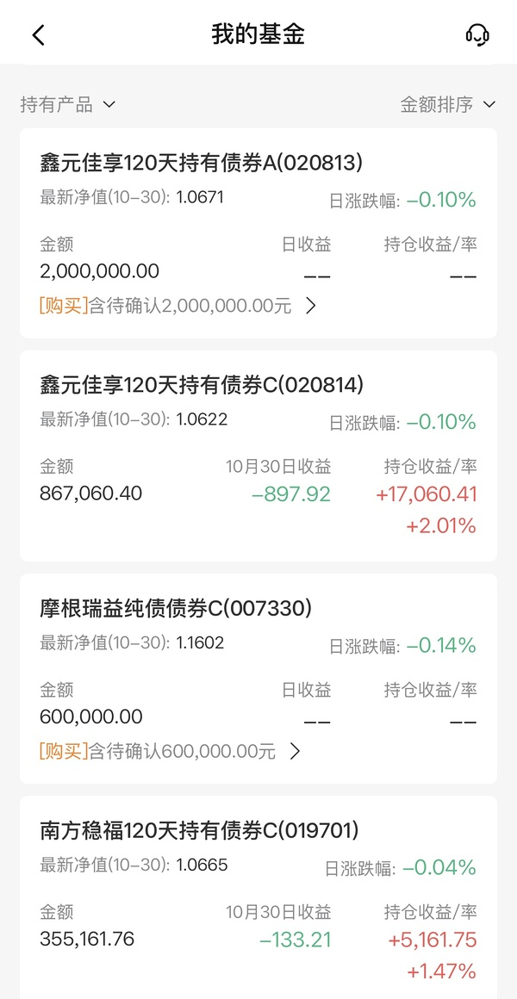  ⊳ （引用 @六倍做多退休）今天还买中债吗 刚好有一笔钱

- (2026-11-02 11:50:20) 游戏是DS消息  ⊳ （引用 @点-重生炒垃圾）哦哦，你之前说的ai游戏

- (2026-11-02 11:56:28) 如果不是开盘情绪低迷
芒果应该开盘就会大幅度高开😂  ⊳ （引用 @混乱中立同人女）只顾着磕cp没想到要赚钱 我这个脑子啊真的是！唉！

- (2026-11-02 11:59:08) [图] 😂我今天看了
除了银行永续债还在大跌特跌 大部分都缓解了压力
周末看人家应对赎回 银行永续债流动性最好 全都在抛售

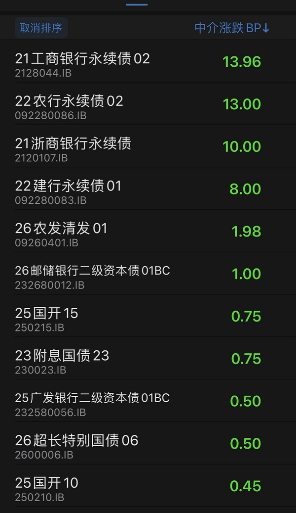  ⊳ （引用 @六倍做多退休）ok那我也买这个

- (2026-11-02 12:04:06) 居然有大科技涨停了！！！  ⊳ （引用 @点-重生炒垃圾）盘面上，热点快速轮动，白酒概念股集体爆发，皇台酒业2连板，水井坊、金种子酒涨停；

AI漫剧概念震荡走高，海看股份、华是科技、芒果超媒20CM涨停，奥飞娱乐、大晟文化、龙版传媒、浙文影业涨停；

零售股广百股份、合百集团、百大集团涨停；

- (2026-11-02 12:16:55) 我不知道啊😂😂😂😂😂
之前机器人共振到一次过
接着看吧
由于没有业绩压力了
接下来很长时间垃圾票都可以各种画大饼讲故事啦  ⊳ （引用 @仓部加措）元旦前的主线又是传媒啦？

- (2026-11-02 12:17:23) 结婚钱啊 要买房子的😂上海房子你懂的  ⊳ （引用 @仓部加措）再一次被楼楼的财力震撼！！

- (2026-11-02 12:20:17) 但我之前恒科 nana也是差不多配置投的🤣

你看我从来不说不玩了 
继续玩啊 这次还充值了中韩半导体笑死🤣  ⊳ （引用 @VVV坚定持有VVV）我又算了下楼说的股债比，又结合结婚想了下
楼还带我们玩，人真好啊🥹

- (2026-11-02 12:24:13) 绝味的东西现在很贵啊
我每次路过看线下门店都没啥人空空荡荡
现在良品铺子 来伊份 百草味都是他的竞品吧？  ⊳ （引用 @点-重生炒垃圾）还不如鸡爪，垃圾啊

- (2026-11-02 12:27:34) 1，先打回20%溢价再看
2，我非常看好AI 没有任何动摇
而且因为金融市场下跌 加息预期骤降 我更看好了！  ⊳ （引用 @钱多多）中韩拿着不动吗？

- (2026-11-02 12:35:27) 我主要是听我女朋友她要买了就得买😂😂😂😂
如果自己看的话
你可以看趋势动物那个小程序和冰山的楼市数据结合
不要看新闻和tjj数字🤣🤣🤣🤣🤣🤣
而且一线城市都还在出政策 那肯定是没见底  ⊳ （引用 @小鱼）楼买房的时候能不能说一下啊，我想换房，又不敢乱动😂买房踩错可比买大a亏得多了，我一等在等时机。

- (2026-11-02 12:39:31) 中韩半导体还是韩国占大头 而且偏向海外
和大A纯科技有点不一样

怎么说呢
大A可能偏向看到美国确定开启降息
但是海外市场可能确定加息尾声就上攻
但是大A爆发力不容小觑 大家都体会过的
足够让大家忘记“本来的大A”  ⊳ （引用 @饺饺饺子）所以我可以拿着eft不动是么 我已经从拿一两年变成拿 3  4 年了
但是昨天突然水果老师要清科技 动摇我了

- (2026-11-02 12:45:11) [图] 市场正在演绎我们的预期🤣
“AI不应用 AI个毛线”

- (2026-11-02 12:46:53) 近日，据“中国新闻网”，红果短剧同时登上台湾APP Store与Google Play两个应用商店免费应用下载榜榜首，与之同时，有台湾民众退订Netflix。

红果短剧在台湾地区下载表现亮眼，也凸显出短剧在当地具备不小的市场潜力。

- (2026-11-02 12:50:07) 看看今晚谁牛逼😂  ⊳ （引用 @点-重生炒垃圾）招商更厉害，掌阅又涨停了

- (2026-11-02 12:50:46) [图] 

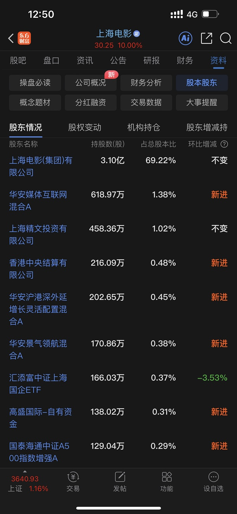  ⊳ （引用 @山中食人花）难怪SY厉害 都被基金买到第一持仓了
要真是炒垃圾都想买点诺安微盘了 赚个十个点我也满足了

- (2026-11-02 12:51:11) 华安：包了

- (2026-11-02 12:52:35) [图] 牛逼 北向资金也在买妇联？翻倍增持😂😂😂

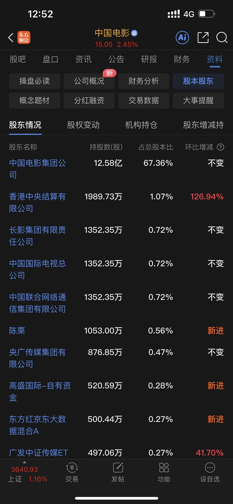

- (2026-11-02 12:52:56) 高盛挺爱看电影啊  ⊳ （引用 @不知道还能说啥）牛逼 北向资金也在买妇联？翻倍增持😂😂😂

- (2026-11-02 12:55:04) 嗯
可能一开始我交易目的只是主题炒作
现在也许有专业人士认为是行业反转点😂😂  ⊳ （引用 @Aaa摆烂咸鱼🥳）其实正在慢慢往这上面转，现在是不是还属于要信早信阶段

- (2026-11-02 12:58:48) 红果是不是本轮ＡＩ的国民级应用？

类似当年互联网早就了QQ 也是免费的

- (2026-11-02 13:00:34) 呃

- (2026-11-02 13:00:43) 全是火箭发射  ⊳ （引用 @不知道还能说啥）呃

- (2026-11-02 13:01:53) 传媒妹妹对游戏哥哥不服  ⊳ （引用 @木感情的打工人）影视etf涨停？

- (2026-11-02 13:02:06) 这一波妹妹就是力压哥哥！  ⊳ （引用 @不知道还能说啥）传媒妹妹对游戏哥哥不服

- (2026-11-02 13:03:53) 是市场跳水了哈哈  ⊳ （引用 @该用户已过期）冰雪被吸了🤣🤣

- (2026-11-02 13:11:41) yes幸福🤣

- (2026-11-02 13:11:53) 逆势火箭发射哈哈哈哈  ⊳ （引用 @该用户已过期）幸福了

- (2026-11-02 13:14:00) 十一月了

就是电影来了  ⊳ （引用 @该用户已过期）超过1个点了！棒🎉

- (2026-11-02 13:15:19) 不要让我再去想什么奶茶
不要让我再去PK什么光线
幸福你应该让我们幸福到家啊

- (2026-11-02 13:16:35) 幸福的条件单应该是15.44

如果上周疯狂加仓的 可以1344兑现

够清楚了吧  ⊳ （引用 @一啖砂糖一啖屎）全清吗？

- (2026-11-02 13:21:59) 电影+冰雪 🤣

- (2026-11-02 13:23:31) 今天买的兑现了
这笔利润很高啊🤣

- (2026-11-02 13:24:58) 不是我厉害
是11月就是玩这种东西😂  ⊳ （引用 @🧋今天25了吗）9个多点，楼楼超厉害！！

- (2026-11-02 13:25:35) 大连重返五日线上方

- (2026-11-02 13:26:37) 虽然市场跳水了
但是我们账户更好了

- (2026-11-02 13:27:50) 大连也触发了

- (2026-11-02 13:28:36) 还没完
幸福那边跃跃欲试呢

- (2026-11-02 13:34:16) 我去接回大连了

雪人不接  ⊳ （引用 @仓部加措）楼的条件单好强啊都触发啦

- (2026-11-02 13:35:56) 因为冰山又涨停了  ⊳ （引用 @Lyra）啊这么快就接吗🤣

- (2026-11-02 13:37:05) 大连本来就还有一个单子  ⊳ （引用 @11）接了今天还有单子不

- (2026-11-02 13:38:28) 芒果和我说我看错了
又开始后会有期了😂  ⊳ （引用 @奇遇）上周跌停捞了点风语筑和txx，捞完才看到楼说行情结束了，当时心都碎了🤣

- (2026-11-02 13:43:24) 进入11月第一天 涨停数量超100个

大家也都是因为十月底保持防守🤣🤣🤣

- (2026-11-02 13:43:39) 一旦进入十一月
干就一个字  ⊳ （引用 @不知道还能说啥）进入11月第一天 涨停数量超100个

大家也都是因为十月底保持防守🤣🤣🤣

- (2026-11-02 13:44:25) 十一月了

狠狠的干😂大家不谋而合  ⊳ （引用 @只想搞钱）真百股涨停了

- (2026-11-02 13:45:02) 幸福1544那边上面有个大缺口 如果能打掉的话就无限遐想了  ⊳ （引用 @山中食人花）幸福今天真的让人幸福了 
每天都像今天一样开心就好了

- (2026-11-02 13:46:13) 我已经85%了

我说过下个月狠狠的干的  ⊳ （引用 @仓部加措）楼楼计划打到8成么

- (2026-11-02 13:46:43) 多只创业板金融科技ETF涨超10%，金融科技ETF逼近涨停
创业板金融科技ETF华泰柏瑞涨幅扩大至10%，金融科技ETF华夏、金融科技ETF天弘等多只金融科技ETF逼近涨停。

- (2026-11-02 13:47:07) 你在说笑话了
你看不到美国夜盘可以看看韩国

还有我们中韩半导体  ⊳ （引用 @高手云集上钻）A股可以引领美股吗

- (2026-11-02 13:48:03) 触发可能不一定说好事

到时候你们还得追🤣  ⊳ （引用 @九九归一）xf有机会触发吗！

- (2026-11-02 13:48:35) 🤣🤣🤣🤣🤣🤣🤣🤣🤣  ⊳ （引用 @高手云集上钻）我这不是在许愿吗

- (2026-11-02 13:48:51) 让大连来偷
雪人还没接哈哈哈  ⊳ （引用 @半闲公子）bn也涨停吧，然后⛄️偷个尾盘，今天就是拿到大结果了😂

- (2026-11-02 13:49:59) 传媒那个30cm的要涨停了😂😂😂

- (2026-11-02 13:50:09) 2只影视ETF触及涨停
影视ETF银华、影视ETF国泰触及涨停，成分股上芒果超媒、海看股份20cm涨停。

- (2026-11-02 13:50:15) 游戏哥哥out  ⊳ （引用 @不知道还能说啥）2只影视ETF触及涨停
影视ETF银华、影视ETF国泰触及涨停，成分股上芒果超媒、海看股份20cm涨停。

- (2026-11-02 13:52:43) 差不多  ⊳ （引用 @momo）楼现在是电影多还是冰雪多啊

- (2026-11-02 13:54:02) 中影还是沉浸在自己慢就是快的节奏里 
两耳不闻窗外事😂

- (2026-11-02 13:54:49) 没有 他阻力不在这里
是33那边 盘后我会开新单子  ⊳ （引用 @Lyra）忘记问了，楼楼涨停的sy是不是还没清啊

- (2026-11-02 13:56:25) [图] 109876😂

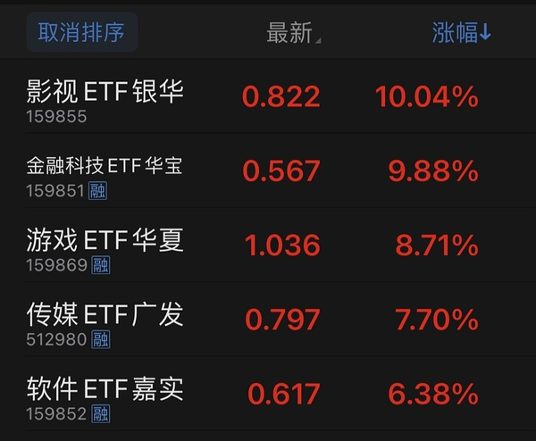

- (2026-11-02 13:59:56) 大家觉得今天融资盘买了还是继续“玩尼玛”🤣

- (2026-11-02 14:01:23) uu你再读一遍第二第三个字

在以前正常情况的这一天也是这样的呀  ⊳ （引用 @momo）上周五吓尿了  把博纳和奶茶减了很多只留了一点 然后今天。。。。。

- (2026-11-02 14:05:13) 太子爷还没解禁
k50还没纳入  ⊳ （引用 @问一下能不能瘦）半导体楼你看是反转嘛

- (2026-11-02 14:05:33) 其实市场主线就是AI应用
底下分支轮动
大行情！

- (2026-11-02 14:06:01) 波波已经-4🤣
没有高股息保护的已经挨揍  ⊳ （引用 @六倍做多退休）银行板块是爆量上影线吗

- (2026-11-02 14:07:00) 比蓝色牛逼啊

我觉得来了  ⊳ （引用 @vio）我觉得还没来，奶茶今天比不过其他20cm的

- (2026-11-02 14:07:22) 接都接了  ⊳ （引用 @小鸡哔哔哔）大连什么位置接呀

- (2026-11-02 14:09:19) 美国跳水

韩国跳水

- (2026-11-02 14:10:27) 十月底资金都是防守的

大家的共识

今天共识狠狠干😂😂😂😂😂😂😂  ⊳ （引用 @一直在摸🐟）到底出了啥政策利好

- (2026-11-02 14:12:45) 妈妈今天大小都买了  ⊳ （引用 @我爱牛肉火锅）不知道妈妈今天买了啥，就防指数下滑了吗？

- (2026-11-02 14:13:31) 我sy 幸福又不差啊  ⊳ （引用 @momo）楼楼今天短剧这么强，考虑回去玩吗

- (2026-11-02 14:17:48) 市场20cm有点多 还有一大批15%+的
这是融资盘喜欢的玩意😂
所以我觉得他们来了  ⊳ （引用 @404找回了）我押买了，才周一让他们喘口气吧，其实是我还有奶茶

- (2026-11-02 14:18:21) 哈哈 断 贷 风波

后面行长被抓  ⊳ （引用 @六倍做多退休）我22年买够了  😂我那时候好像还没遇到楼 但是应该成本跟楼差不多 因为也是生吃了一坨利空

- (2026-11-02 14:19:10) 有的

但是现在票那么多 也无所谓😂  ⊳ （引用 @点-重生炒垃圾）上影今天卖光了，有接不回来的风险吗

- (2026-11-02 14:19:23) 不需要  ⊳ （引用 @小灰灰）楼啊，场外中基和美基今天有操作吗？

- (2026-11-02 14:23:06) 信念需要人家给没用啊

我双休日还在看如果恐慌指数飙升 我能增配什么  ⊳ （引用 @小灰灰）明年什么时候能回本啊，楼能给我点信念，让我面对今晚美基的收益吗

- (2026-11-02 14:24:13) 就像我五六月说AI不应用 AI个毛
拿住传媒就是拿住收益

那时候信的寥寥无几啊 离开传媒的都不少  ⊳ （引用 @小灰灰）明年什么时候能回本啊，楼能给我点信念，让我面对今晚美基的收益吗

- (2026-11-02 14:26:23) 因为再也没有业绩干扰了
下次发业绩要一月份预告了  ⊳ （引用 @赛博朋克2077）127家涨停，牛回速归

- (2026-11-02 14:27:14) 难道你忘了他们早上送钱的大方了  ⊳ （引用 @👑）我这个冰雪三子排排坐在持仓倒数

- (2026-11-02 14:34:35) 明天雪人跌破60日线回接

- (2026-11-02 14:34:48) 应该是低于13.4  ⊳ （引用 @不知道还能说啥）明天雪人跌破60日线回接

- (2026-11-02 14:35:45) 有很多uu手里没底仓
今天这一个拉升可能吃不到收益
因为明天又可能跌没了🤣🤣🤣🤣  ⊳ （引用 @不知道还能说啥）明天雪人跌破60日线回接

- (2026-11-02 14:36:51) 预估-6.5🤣  ⊳ （引用 @六倍做多退休）小远-3.95%

- (2026-11-02 14:39:35) sy设置32.44清仓
明天sy如果大跌就不对 
所以小跌没意思 大跌又不对 我不接

- (2026-11-02 14:41:59) 大连三笔了 暂时不买
只有44.39卖一笔的单子

cbs只有两笔大跌还能加仓 不过必须是大跌了  ⊳ （引用 @奶茶今天40了吗）双子星怎么看呢，楼楼

- (2026-11-02 14:42:37) 冰雪钱留着都没花完呢😂  ⊳ （引用 @该用户已过期）出来的给电影还是冰雪？

- (2026-11-02 14:42:51) 公募不可以的  ⊳ （引用 @点-重生炒垃圾）基金经理会不会给美国科技买做空保险，这样就跌的少，哈哈哈感觉美股工具多

- (2026-11-02 14:44:03) 大连2笔已经准备锁了！

我之前预计大连是sy模式 cbs是中影模式😂  ⊳ （引用 @我爱牛肉火锅）楼，大概啥时候你会锁仓😂😂，加速吗？

- (2026-11-02 14:48:01) 1544呀 幸福一直就这个单子

1344是针对加仓的 如果你不贪就不要变  ⊳ （引用 @红烧肉肉）幸福勒？今天没触发明天幸福的条件单是多少吖？

- (2026-11-02 14:48:14) 中韩半导体ETF华泰柏瑞成交额突破200亿
截至发稿时间，中韩半导体ETF华泰柏瑞（513310）成交额突破200亿元位列今日股票型ETF成交榜首。

- (2026-11-02 14:48:35) 得到了市场的共识

所以不可能再回到1%溢价😂😂😂  ⊳ （引用 @不知道还能说啥）中韩半导体ETF华泰柏瑞成交额突破200亿
截至发稿时间，中韩半导体ETF华泰柏瑞（513310）成交额突破200亿元位列今日股票型ETF成交榜首。

- (2026-11-02 14:49:16) 超过任何一只个股成交了  ⊳ （引用 @不知道还能说啥）中韩半导体ETF华泰柏瑞成交额突破200亿
截至发稿时间，中韩半导体ETF华泰柏瑞（513310）成交额突破200亿元位列今日股票型ETF成交榜首。

- (2026-11-02 14:53:03) 肯定不是呀哈哈哈哈哈

距离复仇者还早  ⊳ （引用 @shirla）1544是不是也是清仓啊

- (2026-11-02 14:55:06) 🤣没事的
很高兴看到光线也好起来了
这意味着选择范围更多了  ⊳ （引用 @shirla）好哒好哒，这么看的话XF和ZY我仓位还偏低

- (2026-11-02 14:56:34) 双子星是四笔  ⊳ （引用 @爱拔酱）冰雪三个都各准备三笔吗？

- (2026-11-02 15:00:13) 15-20%是他常规呢

现在场外这个申购只给5元 而且这产品是唯一的

不像nana有十几个  ⊳ （引用 @shirla）有20%溢价的可能吗🤣🤣🤣

- (2026-11-02 15:01:54) txx也是我合作伙伴😂😂😂😂😂  ⊳ （引用 @我爱牛肉火锅）下次高低买点你的合作商

- (2026-11-02 15:04:18) 主要的我发了

雪人1494一半 （这次没涨停清仓）

跌破60日线回接今天的  ⊳ （引用 @山中食人花）坐等楼盘后条件单呢
还是要严格操作 有时候自己灵机一动就是拉高成本

- (2026-11-02 15:08:21) zy没单子的 慢就是快
等他快了再研究
复仇者联盟和流浪地球可都是zy🤣🤣🤣🤣🤣

xf明天1544是能触到的
不要小看他哦 
幸福可是之前被量化高度控盘的
可以随心所欲的  ⊳ （引用 @山中食人花）okk  谢谢楼 明天我着重看冰雪
电影只有ZY和XF 应该是达不到条件单了

- (2026-11-02 15:10:12) 我贪 cbs我关掉了 不买第三次的情况下就这样了  ⊳ （引用 @该用户已过期）cbs还是36.44不变？

- (2026-11-02 15:11:31) 我知道上海可转债是尾盘连续竞价 不停交易
但是深圳不一样😂  ⊳ （引用 @六倍做多退休）我现在转债都卖不明白了 2.57分后竟然卖不出去要3点才能卖

- (2026-11-02 15:12:14) [图] 哈哈哈哈哈哈哈哈哈哈哈哈哈 果然如此

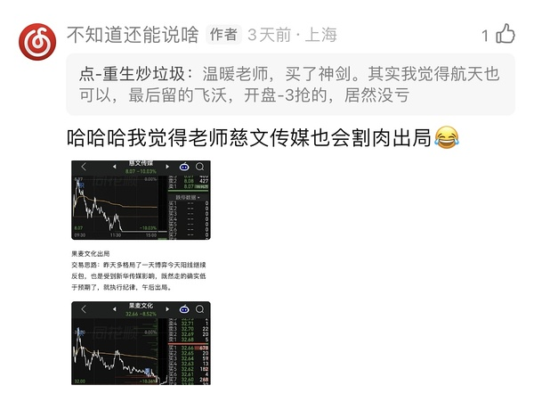  ⊳ （引用 @点-重生炒垃圾）慈文止损

- (2026-11-02 15:13:09) 是只有一份 只不过雪人我没那么划分几笔😂
雪人主打交易
我还是看中大连他们  ⊳ （引用 @shirla）诶？我雪人怎么只剩一份了。。。

- (2026-11-02 15:14:25) 今天涨停票里
注定有跨年大妖王啦
情绪转折被市场首选的了  ⊳ （引用 @点-重生炒垃圾）温暖老师，总的来说，机器人、医药、短剧AI穿越可能性较大，消费、航天、生肖等等轮动跟随。

- (2026-11-02 15:19:08) 这一次是我们收盘后
nana进一步跳水了

- (2026-11-02 15:20:11) IPO肯定是放缓了
他们要面子不会说这个
实际行动是的
没有新股申购了  ⊳ （引用 @点-重生炒垃圾）所以今天开会开了啥，什么都没出来。。。。说把长江延迟都没有

- (2026-11-02 15:20:20) 没  ⊳ （引用 @六倍做多退休）江老师今天有啥动静吗

- (2026-11-02 15:20:41) 新债都没有了😂😂😂😂  ⊳ （引用 @不知道还能说啥）IPO肯定是放缓了
他们要面子不会说这个
实际行动是的
没有新股申购了

- (2026-11-02 15:22:08) 港股阅文集团单边走强，午后涨超15%

香港的中文老师啊😂

- (2026-11-02 15:24:43) 你记得你能拆五次卖是最重要的
比如开盘卖一点 尾盘卖一点 中间随心所欲一点

你去看那个新股ipo预测的号
如果开盘价远远高于他预测的高风险价格还高很多很多
那你开盘就多走一点  ⊳ （引用 @精神状态要稳定）楼，第一次中新股，想问下新股怎么卖比较好

- (2026-11-02 15:30:01) 今天有特殊性吧
今天正好11月了 
周五晚上美国大跌开盘情绪萎靡
叠加妈妈今天大举买入1000注入流动性  ⊳ （引用 @点-重生炒垃圾）你统计过这几次地天行情没，我咋记得最近三个月地天，第二天板块行情不咋地

- (2026-11-02 15:31:17) [图] 双向奔赴哈哈哈哈

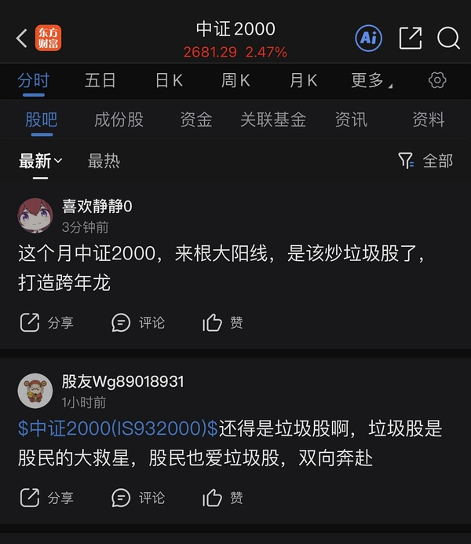

- (2026-11-02 15:34:53) 还没研究😂😂
但如果我看的话会偏向今天起来的新面孔 虽然我还没看  ⊳ （引用 @点-重生炒垃圾）哈哈哈，重点是传媒计划表！！！有没有新选手

- (2026-11-02 15:36:02) 你的那个泉阳泉也是因为羊是吗😂  ⊳ （引用 @六倍做多退休）-30%割不下手吗哈哈哈

- (2026-11-02 15:36:24) [图] 第二个沈阳是因为羊吧？

- (2026-11-02 15:39:02) 一个天哥 一个药明应该是辨识度最高的Q3公里加仓主要对象吧😂😂😂😂😂  ⊳ （引用 @六倍做多退休）药明也是绿色的 现在远离公募重仓真的很要紧

- (2026-11-02 15:42:12) [图] 之前我给葱uu一个表
应该有比诺安更好的
诺安规模是敌人 

我没研究
大家有兴趣的可以比较下

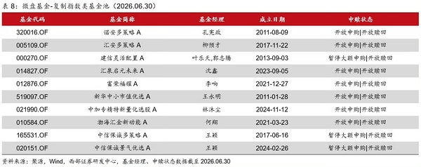  ⊳ （引用 @速派女孩将发财）今天诺安还没比过2000呢 被双创压制了 等科技弱下去就很好了 

- (2026-11-02 15:43:20) 复制微盘股指数基金池筛选方法为：在每个季度末，计算过去一年微盘股基金的日收益率序列与万得微盘股指数相关性，选择最近四期相关系数的平均值在0.95以上，且当期100亿元市值以上股票的持仓权重总和不超过2%的基金

他们筛选出来是图上这些  ⊳ （引用 @不知道还能说啥）之前我给葱uu一个表
应该有比诺安更好的
诺安规模是敌人 

我没研究
大家有兴趣的可以比较下

- (2026-11-02 15:50:39) 这段话是告诉你图表上的基金是如何筛选出来的呀  ⊳ （引用 @高手云集上钻）这是给ai的指令吗？我看了两遍都没有都没有读通顺这段话是要干嘛😂

- (2026-11-02 15:51:59) 130个涨停 上次这样是哪天？😂  ⊳ （引用 @点-重生炒垃圾）好多涨停票

- (2026-11-02 15:53:34) [图] 翻到了 我一天天手动翻的

8.4日

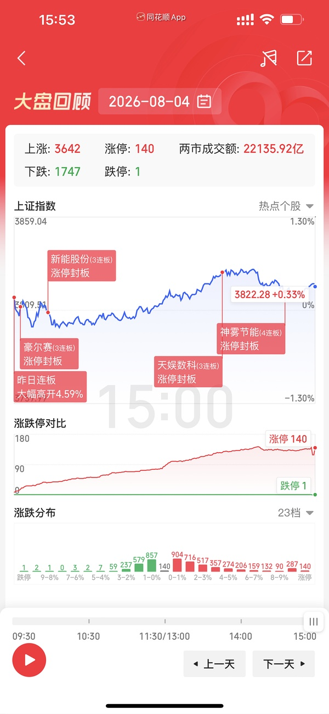  ⊳ （引用 @不知道还能说啥）130个涨停 上次这样是哪天？😂

- (2026-11-02 15:56:08) 2000连阳
翻到日子我就想起来了
我们2000就靠后来那一周拉收益的
题材百花齐放？传媒那时候不错的  ⊳ （引用 @点-重生炒垃圾）8月5号，还真别说，真反弹了一段双创

## 🧠 投资风格分析
> 📏 增量更新指引：仅当今日发言确有新依据时才修订对应维度，无变化不强行重写；单维度修订建议 ≤150 字。

- 投资理念与方法：重视全球联动、机构行为与指数规则带来的被动买卖盘，先质疑公开数据真实性；以参与度判断行情性质，对高位腾空型科技股、小票垃圾票与微盘股保持戒心，关注业绩确定性与融资盘出清；操作留后手，坚持条件单与时间纪律，月末防守至上；偏好用筹码游戏逻辑处理传媒垃圾票，对miss业绩直接砍；以股债双爆/单爆情景推演倒推最终受益资产，并以股息率作为跨行业比较锚；今日进一步用科技股爆+长债爆/不爆两剧本分别指向消费/高股息，并关注食品饮料、家用电器股息率超4%、可脚踏两条船。
- 风险偏好：对高位腾空型科技股、小票垃圾票与微盘股保持戒心，认为融资盘爆仓式强卖是出清主要形式；对强势股补跌、月末微盘杀伤高度警惕，操作留后手；对传媒等垃圾票只做筹码游戏、不做价值投资；对债券拥挤交易与美元债/境内信用债违约保持警惕，视信用事件为风险偏好变量；新增关注美元债常不还、万科美元债违约与债券拥挤下资金躲债砍仓，并对周末政策消息保持“埋人”警惕。
- 交易与仓位：坚持条件单分档与预设时间表，将分散在十几只同题材小仓位合并到少数主攻标的，以「加大布局」而非新增资金方式提集中度。逢跌分批低吸但按价位设多档留后手；未站上五日线不当真，站上且拐头才加仓；月末提前设定总仓位滚动控制，防守至上；弱势板块不尾盘买入博次日反抽，改为次日早盘择机；反对无纪律加仓拉低成本，倾向留钱等更确定机会；涨停价手动挂单兑现；对已放弃旧方向不回头补仓。清仓bn转换xf，幸福配置满额与中影对等；计划sy和zy对等布局，幸福低配做情绪放大；强调右侧确认后加仓，耐心等确认信号。
- 心理特质：对持仓波动冷静，以低换手耐心持有避免手贱；月末/冰点等时点记忆清晰，强调纪律边界；看到他人不守计划会直接点出；对无价值吐槽情绪自我屏蔽；反复强调严格执行计划、防守至上；对已放弃旧方向不念旧不回头；把换仓视为对弱者的惩罚而非情绪操作；对自身手贱行为有清醒认知并主动惩罚。新增：对市场节奏有清晰时间感（"11月不搞这些东西"），能自嘲手贱但不失控；以"慢就是快"校准耐心，拒绝冲动。

> ⚠️ 本板块由 Actions 全自动增量更新（复用当日发言与今日总览），每次仅在内容足够支撑时才改动。

## 🏷️ 昵称映射表
### 📖 昵称规律（供 AI 判断新昵称时参考）
【昵称命名规律（用于推断未知新昵称）】
- 拼音首字母缩写：取标的/基金名汉字拼音首字母串（含数字代码），多为 ETF/股票代码口语化｜示例：yl=引力传媒｜zy=掌阅科技｜sj=视觉中国｜cc=华安文体健康混合｜C50=创业板50ETF｜k50=科创50｜kun=昆仑万维｜xhxc=新瀚新材｜zxfc=中欣氟材
- 小/老+姓氏代指：「小X」「老X」通常指姓 X 的标的或该标的的基金经理；「X兄弟」多为同系基金｜示例：小惠=惠发食品｜老莫=万家品质生活(莫海波)｜小华=华夏全球科技先锋(QDII)A｜小华兄弟=华夏移动互联(QDII)｜小浦=浦银安盛全球智能科技(QDII)A｜小广=广发全球精选(QDII)A｜小远=华宝致远(QDII)C｜招招=招商银行｜小德=德明利｜赵姨=兆易创新｜露露=泸州老窖｜空调=格力电器
- 戏称/黑话→题材板块：生活化比喻或黑话对应某个题材/板块，而非单一标的；出现时多指板块方向｜示例：卖国=PCB板块(英伟达AI链)｜爱国=国产自主(半导体设备/芯片)｜奶茶=易点天下｜老师=中文在线｜蓝色=蓝色光标｜宇航员=航空航天板块｜华子=华泰保兴安悦债券｜国际=国际复材｜巨无霸=长鑫科技等重大IPO
- 谐音/取字：昵称含标的名关键字（取一字或谐音），多为 A 股个股或基金简称｜示例：万华=万华化学｜东百=东百集团｜宝=保利发展｜讨饭/亚洲讨饭/建信新兴=建信新兴市场(QDII)A｜华宝zy=华宝致远(QDII)A
- 机构/基金经理昵称：以基金公司名、经理姓、或平台代称指代对应基金产品｜示例：周经理=中欧新趋势混合(LOF)A｜张经理=信澳匠心回报混合A｜网易云/音乐世家=富国全球科技互联网股票(QDII)A｜国富亚洲=国富亚洲机会股票(QDII)A｜国泰纳指=国泰纳斯达克100指数(QDII)｜易方达全球=易方达全球成长精选混合(QDII)A｜浦银安盛=浦银安盛全球智能科技(QDII)A

### 📋 已收录映射
| 昵称 | 对应名称 |
|------|----------|
| C50 | 创业板50ETF |
| cc | 华安文体健康混合A |
| k50 | 科创50 |
| kun | 昆仑万维 |
| sj | 视觉中国 |
| xhxc | 新瀚新材 |
| yl | 引力传媒 |
| zxfc | 中欣氟材 |
| zy | 掌阅科技 |
| 万华 | 万华化学 |
| 东百 | 东百集团 |
| 亚洲讨饭 | 建信新兴市场混合(QDII)A |
| 保利发展 | 保利发展 |
| 华子 | 华泰保兴安悦债券 |
| 华宝 zy | 华宝致远混合(QDII)A |
| 华宝zy | 华宝致远混合(QDII)A |
| 卖国 | PCB、光模块、通信板块（英伟达AI产业链） |
| 周经理 | 中欧新趋势混合(LOF)A |
| 国富亚洲 | 国富亚洲机会股票(QDII)A |
| 国泰纳指 | 国泰纳斯达克100指数(QDII) |
| 奶茶 | 易点天下 |
| 宇航员 | 航空航天板块 |
| 宝 | 保利发展 |
| 小华 | 华夏全球科技先锋混合(QDII)A |
| 小华兄弟 | 华夏移动互联混合(QDII) |
| 小广 | 广发全球精选股票(QDII)A |
| 小德 | 德明利 |
| 小惠 | 惠发食品 |
| 小浦 | 浦银安盛全球智能科技(QDII)A |
| 小远 | 华宝致远混合(QDII)C |
| 巨无霸 | 长鑫科技等重大IPO企业 |
| 建信新兴 | 建信新兴市场混合(QDII)A |
| 张经理 | 信澳匠心回报混合A |
| 招招 | 招商银行 |
| 易方达全球 | 易方达全球成长精选混合(QDII)A |
| 浦银安盛 | 浦银安盛全球智能科技(QDII)A |
| 爱国 | 国产自主（半导体设备/芯片制造） |
| 空调 | 格力电器 |
| 网易云 | 富国全球科技互联网股票(QDII)A |
| 老师 | 中文在线 |
| 老莫 | 万家品质生活混合A(519195) |
| 蓝色 | 蓝色光标 |
| 讨饭 | 建信新兴市场混合(QDII)A |
| 赵姨 | 兆易创新 |
| 赵哥 | 兆易创新 |
| 露露 | 泸州老窖 |
| 安安 | 安记食品 |
| 音乐世家 | 富国全球科技互联网股票(QDII)A |
| 老伯伯 | 铜冠铜箔 |
| nk | 景顺长城纳斯达克科技ETF联接(QDII)A |
| bk | 易方达标普信息科技指数(QDII-LOF)A |
| txx | 天下秀 |
| 媛媛 | 今世缘 |
| uu | 友友、网友们 |
| 温暖老师 | 某个特别牛逼的散户 |
| 余老师 | 余利，某牛逼投资者 |
| ycm | 粤传媒 |
| 江老师 | 江琪（投资博主） |
| 水果老师 | 投资博主 |
| 小爱 | 我爱我家 |
| ty | 天娱数科 |
| bn | 博纳影业 |
| sy | 上海电影 |
| CBS | 长白山 |
| 东哥 | 东百集团 |
| 芒果 | 芒果超媒 |
| 阿中 | 中国电影 |
| 欢欢 | 欢瑞世纪 |
| 雪人 | 雪人集团 |
| 大连 | 大连圣亚 |
| 幸福 | 幸福蓝海 |
| 小粤 | 粤传媒 |
| 阿博 | 博纳影业 |
| 创成长 | 创业板成长etf |

> ⚠️ 以下为 LLM **建议**，未自动写入状态文件。请人工确认后，本地编辑 `state.json` 的 `nickname_map` / `positions`，或 `nickname_rules.json` 的 `rules` 并 push 生效。

## 持仓建议（待你确认）
- **大连圣亚**（SH600593）〔加仓〕— 依据：加仓大连 cbs / 大连第三笔 cbs第二笔了 / 大连2笔已经准备锁了
- **长白山**（SH603099）〔加仓〕— 依据：cbs第二笔了 / cbs只有两笔大跌还能加仓
- **雪人集团**（SZ002639）〔持有〕— 依据：还有sy 雪人 / 触发卖出周五sy买入雪人 / 雪人挂单1374

*🤖 自动生成于 2026-11-02 16:06:23 ｜ 豆瓣楼主发言追踪*