# 📋 楼主每日发言推送

> **推送日期**：2026-11-03 ｜ **执行时间**：2026-11-03 16:02:42 ｜ **监控用户**：`不知道还能说啥`
> **追踪模式**：`topic`（用户主页广播·豆瓣话题）

## 📊 持仓追踪
> 上次更新：2026-11-03 ｜ 基于楼主发言持续追踪（共 12 项）

| 标的 | 状态 | 类型 | 现价 | 提及 |
|------|------|------|------|------|
| 招商银行 | 持有 | 红利/银行 | 42.69（-1.13%） | 上午低点买入 |
| 长白山 | 持有 |  | 36.07（1.09%） | 分笔加仓第二笔，挂单3644 |
| 雪人集团 | 持有 |  | 14.18（2.53%） | 1494卖、涨停S一半，维持60日线节奏 |
| 上海电影 | 持有 |  | 30.59（1.12%） | 昨天已卖出，不接回，待观察反馈 |
| 幸福蓝海 | 持有 |  | 13.03（0.00%） | 1344回接，涨停价1494挂单卖出一半 |
| 粤传媒 | 持有 |  | 10.42（1.46%） | 暂无 |
| 大连圣亚 | 持有 |  | 41.95（3.99%） | 右侧初期，等冲击大阴线跌停套牢区 |
| 博纳影业（bn） | 持有 |  | 暂无 | 「减仓bn 买入中影」；bn跌到60日线。 |
| bn（博纳影业） | 卖出 |  | 暂无 | 昨天已和xxz一起跑路 |
| 中国电影（中影） | 持有 |  | 暂无 | 昨天批量b三个冰雪、三个机器人，还加仓中影 |
| 中韩半导体ETF | 买入 |  | 暂无 | 溢价率逼近13%，等明日10:30开盘 |
| 中影（中国电影） | 买入 |  | 暂无 | 10.29；昨日换仓进来 |

> ⚠️ 执行任务时如发现新操作，请更新 `state.json` 的 `positions`。成本价和市值有数据才填，没有则保留「暂无」。

## 🌅 今日总览
### 📌 市场背景
市场背景：今日发言呈现全球联动+国内政策转向特征。「两市融资余额减少127.04亿元」显示融资盘被动出清加速。「慢牛 降速」「微盘领衔 科创垫底」刻画结构性分化格局。「所有IPO暂停 连可转债都没了🤣」透露监管政策重大转向信号。「北京时间明天下午2点才结束所有投票」指向美国选举时点。「周五债市危难以后 债券性价比比红利高」反映股债跷跷板重估。

### 📌 今日操作
| 操作 | 标的 | 详情 |
|---|---|---|
| ✅ 买回 | 幸福 | 1344回接，涨停价1494挂单卖出一半 |
| ⏭️ 观望 | sy（上海电影）| 昨天已卖出，不接回，待观察反馈 |
| ✅ 加仓 | 债券（华子）| 双休日调节后昨天狠狠加仓 |
| ⏭️ 持有 | 中韩半导体ETF | 溢价率逼近13%，等明日10:30开盘 |
| ✅ 抄底 | 招行（招商银行）| 上午低点买入 |
| ⏭️ 持有 | 大连圣亚 | 右侧初期，等冲击大阴线跌停套牢区 |
| ⏭️ 持有 | 雪人集团 | 1494卖、涨停S一半，维持60日线节奏 |
| ❌ 已离场 | bn（博纳影业）| 昨天已和xxz一起跑路 |
| ✅ 加仓 | 中影 | 昨天批量b三个冰雪、三个机器人，还加仓中影

### 📌 今日议题
| 议题 | 态度 | 核心观点 | 关键引用 |
|---|---|---|---|
| 《影之刃零》国产3A成功 | 💬讨论 | 72小时销量破400万份，验证国产3A工业化能力 | 「三天爆卖10亿！《影之刃零》验证国产3A工业化能力」 |
| 两市融资余额减少 | 📉中性偏空 | 融资盘出清是被动强卖，非主动去杠杆，出清仍在进行 | 「居然还不是融资盘」「两市融资余额减少127.04亿元」 |
| 中韩半导体溢价套利 | 💬讨论 | 溢价率12-13%，明日或纳入10:30开盘ETF，抓溢价回归机会 | 「中韩半导体溢价率逼近13」「欢迎他明天加入10:30开盘ETF行列啦」 |
| 新股IPO暂停 | 📈看多（政策面） | 监管全面叫停IPO及可转债，资金聚焦存量博弈 | 「所有IPO暂停 连可转债都没了」 |
| 白酒/光伏/新能源 | 💬讨论 | 公募基金严重欠配+连续下跌，等待硬科技资金承接 | 「一定要当下公募基金严重欠配的老牌的各路王者」 |
| 宁德时代救科创50 | 💬讨论 | 科创垫底但C50靠宁王撑住，大盘蓝筹承接科技资金 | 「差的2%就是宁王救的」「300和双创的交集票连续资金注入」 |
| sy（上海电影）走势预判 | 💬讨论 | 33是重要卡点，高难度，若未触发单子建议今天要走 | 「SY 33还是高难度哦」「sy很容易开大阴线」 |
| 债市 vs 红利性价比 | 📈看多债券 | 周五债灾后排查修复，站在明年角度债性价比高于红利 | 「债券性价比比红利高」「经过这次债灾的回调债券性价比高于目前位置的红利」 |
| 全球联动 | 💬讨论 | 美国选举、韩国大跌、港股收紧，外部变量主导 | 「全球联动」「北京时间明天下午2点才结束所有投票」 |

### 📌 看好板块/方向
- **游戏/影视传媒**：《影之刃零》72小时破10亿销售验证国产3A能力，短期催化传媒板块情绪
- **白酒/光伏/新能源**：公募基金严重欠配+连续下跌+容量大，若硬科技资金溢出有望承接
- **被抛弃的硬科技容量票**：如通策医疗等走势跌成狗但公募欠配方向，等待回流
- **债券（30债为主）**：周五债灾后排查修复，明年视角下债券性价比高于红利

### 📌 风险提示
「北京时间明天下午2点才结束所有投票」——美国选举结果明晚或后天出炉，可能引发市场剧烈波动
「中韩半导体溢价率逼近13」——高溢价率可能随时回归，ETF套利窗口有限
「韩国综指收跌3.59%」——全球联动下外部市场恐慌可能传导A股
「sy很容易开大阴线」——高位票一旦转向下行速度极快，需严守纪律
「周五债市危难以后」——债券市场脆弱，拥挤交易随时可能再次踩踏
「强势股补跌威力 茅台都走出了小票的那种气势」——高位抱团一旦松动杀伤力大

## 📊 本次结果
- **今日发言**：200 条
- **累计存档**：19300 条

## 📝 该最新广播作者发言聚合（共 200 条）
### 其他讨论（提及 157 次，占比 78%）2026-11-03 08:04:27
- okk 时刻准备着
- 选举回避
- 三天爆卖10亿！《影之刃零》验证国产3A工业化能力

《影之刃零》72小时销量破400万份

11月2日，国产3A游戏《影之刃零》官方宣布，游戏发售72小时销量突破400万份。该作PC数字标准版定价268元、豪华版328元，按标准版定价计算

### 上海电影（提及 8 次，占比 4%）2026-11-03 10:14:18
- sy符合预期
今天不会给舒服摸
给了就不对
- sy的钱保留

我们还得给sy

sy卡33也并不意味就结束了
- 我猜sy会在接下来模拟这一段 来消磨33+

纯猜

### 友友、网友们（提及 7 次，占比 4%）2026-11-03 10:28:29
- 又燃起来了uu们
- 我锁了
uu们做零花钱套利也好的
- 你问楼里uu还有多少人场内在抄底科技的😂有没有科技援军

### 幸福蓝海（提及 6 次，占比 3%）2026-11-03 09:45:32
- 大家幸福的1344触发的是不是很完美

你们出发后就回落了
- 应该没什么问题 幸福被资金激活了
- 回接1344的幸福 2毛差价 不要白不要

### 雪人集团（提及 4 次，占比 2%）2026-11-03 09:31:25
- 雪人就是打60日线
- 雪人老规矩 1494
- 不是

雪人很快要不一样了

### 粤传媒（提及 3 次，占比 2%）2026-11-03 11:42:13
- 其实不是这个
应该是
大连 cbs和雪人的配置问题
上个月计划是4-3-3组合或者4-4-2组合

uu贴图是目前走势看下来
大连会接近sy进攻型 cbs是中影慢悠悠模式 
雪人大概率类似ycm 来回倒腾
大家可以根据目前的特点 自己做规划
- 我觉得雪人现在暂时就是ycm的样子
不断的在60日线和年线来回😂😂
对手贱人很友好
能进进出出来来回回 而且弹性也很大

但是我觉得雪人最后会冲出这段枷锁🤣🤣🤣🤣
- 我觉得我们三个冰雪安全度都挺高的
即使单日买错了 稍微等等问题也不大
大连cbs是刚被疯狂A杀过的 资金出清还是干净的
雪人剩在位置低 类似ycm特性
这样看很明显看到雪人很低很低

- 你看中移动 空调就知道红利没完呢
只是银行拥挤释放😂😂😂😂😂

### 科创50（提及 2 次，占比 1%）2026-11-03 10:24:10
- 其实今天硬科技依然很柔弱
为什么c50是红的k50是绿的

只是因为c50有大哥大 宁德时代
- 这样的话 
除了太子爷12月纳入k50以及1月的解禁相对消息负面
没有长江那玩意的干扰了

### 芒果超媒（提及 2 次，占比 1%）2026-11-03 10:26:59
- 等你月末看
芒果都不知道排在哪个角落里🤣🤣🤣
- 我昨天看7/31日那次芒果也就强硬了两天 
后面就都是盘中脉冲的弱势了🤣

### 大连圣亚（提及 2 次，占比 1%）2026-11-03 10:54:18
- 大连进入右侧

应该要开始逐渐进攻大阴线跌停套牢区

但是首次大概率遇阻
- 一个右侧
一个五日线都没拿到
当然有区别的

所以我有三分大连啊🤣🤣🤣🤣cbs还少一分

### 华泰保兴安悦债券（提及 1 次，占比 0%）2026-11-03 11:09:27
- 那个美债啊🤣🤣🤣🤣🤣🤣美债之前国庆之前位置也不错的 加息预期被完全打满了

中债就不推荐了
大家风险偏好不一样
我自己也有保守的和激进的分散配置

就比如超级激进的满仓30债的你看华子🤣🤣🤣🤣

### 华宝致远混合(QDII)C（提及 1 次，占比 0%）2026-11-03 11:32:05
- 只是备选
还有个银华海外数字经济 是纯美 比傻大个和小远好
但是也就500块

还是希望到时候有我们手里的纯美开额度😂😂😂

### 江琪（投资博主）（提及 1 次，占比 0%）2026-11-03 14:48:00
- 江老师买它是因为他是科技材料哈哈哈

你看看他走势 就知道 他是科技股 7.1见顶🤣

### 华安文体健康混合A（提及 1 次，占比 0%）2026-11-03 15:50:42
- 连可转债都没了🤣🤣🤣🤣🤣全部叫停

上面认真了

然而这次是全球联动 目前这样的政策只能帮助我们炒垃圾和玩跌了五六年的东西😂😂😂

 okk 时刻准备着  ⊳ （引用 @moli）悠悠抄底的四个点位

- (2026-11-03 08:04:52) 选举回避  ⊳ （引用 @家不住海边）又怎了吗小丑国

- (2026-11-03 08:06:25) 三天爆卖10亿！《影之刃零》验证国产3A工业化能力

《影之刃零》72小时销量破400万份

11月2日，国产3A游戏《影之刃零》官方宣布，游戏发售72小时销量突破400万份。该作PC数字标准版定价268元、豪华版328元，按标准版定价计算，其全球销售收入已突破10亿元。

据悉，《影之刃零》是一款采用虚幻5引擎打造的暗黑武侠动作冒险游戏。玩家将化身心脏遭受重创的剑客，在仅余66天的生命里逃亡于刀光剑影之间，并试图粉碎一桩笼罩武林的惊天阴谋。

数据与口碑方面，截至昨日，《影之刃零》在Steam平台最高同时在线人数突破83万，连续四天走高，创下2026年Steam单人游戏同时在线人数新高；玩家评价超4万条，好评率约90%，已升至“特别好评”区间。

- (2026-11-03 08:48:09) 慢牛

降速  ⊳ （引用 @Waiting一下）对人民币升值踩刹车了吗

- (2026-11-03 08:50:49) 居然还不是融资盘

两市融资余额减少127.04亿元
截至11月2日，上交所融资余额报11922.48亿元，较前一交易日减少66.54亿元；深交所融资余额报11028.6亿元，较前一交易日减少60.5亿元；两市合计22951.08亿元，较前一交易日减少127.04亿元

- (2026-11-03 09:18:18) 现在吃苦 后面享福  ⊳ （引用 @点-重生炒垃圾）要死啊，那老美也抹去今年全部涨幅了

- (2026-11-03 09:19:48) 这样下去
明天开始中韩就可能10:30开盘了

- (2026-11-03 09:22:38) 哈哈哈哈哈  ⊳ （引用 @木感情的打工人）离谱，还慢牛呢。😂

- (2026-11-03 09:22:57) 旧的不去 新的不来🤣  ⊳ （引用 @点-重生炒垃圾）果然卖飞才是对传媒最好的祝福

- (2026-11-03 09:23:57) 昨天那么多传媒涨停
今天两连板没几个
低于预期

- (2026-11-03 09:31:25) 雪人就是打60日线

- (2026-11-03 09:35:19) 稍微多几分钱 你们昨天雪球s也有不错的差价的  ⊳ （引用 @momo）挂的13.39没买到

- (2026-11-03 09:38:09) 雪人老规矩 1494

- (2026-11-03 09:42:09) 全球联动  ⊳ （引用 @木感情的打工人）创业板没有底？

- (2026-11-03 09:42:35) 真漂亮

- (2026-11-03 09:43:16) 中韩半导体溢价率12%

- (2026-11-03 09:43:40) 3094

不要盘中问单子  ⊳ （引用 @YuanZi💕）楼 艾斯顿条件单多少啊

- (2026-11-03 09:45:32) 大家幸福的1344触发的是不是很完美

你们出发后就回落了

- (2026-11-03 09:47:04) 应该没什么问题 幸福被资金激活了  ⊳ （引用 @该用户已过期）吉吉国王了🤣🤣盯着雪人都没注意到它成交了，发现之后看sy拉了赶紧接回

- (2026-11-03 09:48:23) 我在恋爱中😂😂😂  ⊳ （引用 @只想搞钱）惠惠来了

- (2026-11-03 09:49:32) 你看工行  ⊳ （引用 @我爱牛肉火锅）哇，好幸福

- (2026-11-03 09:50:02) 回接1344的幸福 2毛差价 不要白不要

- (2026-11-03 09:52:35) 中韩半导体溢价率逼近13

- (2026-11-03 09:53:25) 欢迎他明天加入10:30开盘ETF行列啦  ⊳ （引用 @我爱牛肉火锅）小中韩不会本周就达成20%吧？

- (2026-11-03 09:54:32) 妈妈买的极为疯狂

- (2026-11-03 09:54:51) 各大ETF 继续火力全开  ⊳ （引用 @不知道还能说啥）妈妈买的极为疯狂

- (2026-11-03 09:55:27) [图] 微盘领衔
科创垫底

- (2026-11-03 09:57:13) 需要想念奶茶吗

不需要呀🤣

- (2026-11-03 09:59:15) [图] 和楼里买理财的播报一下

信用债已经开始修复

利率债马上对周五完成反包

债斯达克

- (2026-11-03 10:03:29) 我今天出不去啊
收盘看  ⊳ （引用 @mimimomo）设多少钱出

- (2026-11-03 10:04:10) [图] 微盘股厉害哦

- (2026-11-03 10:04:50) 现在应该是1494卖今天
涨停卖一半  ⊳ （引用 @问一下能不能瘦）楼是不是今天的买入+之前的半仓呀

- (2026-11-03 10:05:05) 不用理会 专心炒垃圾  ⊳ （引用 @樱桃小丸犊子）这是什么，我落课了？

- (2026-11-03 10:08:27) 原来军工要在11月玩啊

- (2026-11-03 10:10:54) 十月底资金还是太防守了😂  ⊳ （引用 @lacey）🤣🤣10月买还是早了

- (2026-11-03 10:12:21) [图] 空调高管最近都在买

  ⊳ （引用 @公主要发财）话说，空调还是很稳

- (2026-11-03 10:13:25) 不要偷懒不开幸福1544哦

- (2026-11-03 10:14:18) sy符合预期
今天不会给舒服摸
给了就不对

- (2026-11-03 10:15:59) sy的钱保留

我们还得给sy

sy卡33也并不意味就结束了

- (2026-11-03 10:17:01) 我们还会有其他英雄给我们打收益的😂😂  ⊳ （引用 @不知道还能说啥）sy的钱保留

我们还得给sy

sy卡33也并不意味就结束了

- (2026-11-03 10:18:21) 昨天和xxz一起跑路了

正在恋爱中  ⊳ （引用 @想当富有的咸鱼）楼你的小明还在吗

- (2026-11-03 10:20:10) [图] 我猜sy会在接下来模拟这一段 来消磨33+

纯猜

- (2026-11-03 10:21:41) 中影有资金密集进入了😂😂😂

- (2026-11-03 10:21:51) 你要改变风格吗  ⊳ （引用 @不知道还能说啥）中影有资金密集进入了😂😂😂

- (2026-11-03 10:23:11) [图] 30债大放异彩😂😂

- (2026-11-03 10:24:10) 其实今天硬科技依然很柔弱
为什么c50是红的k50是绿的

只是因为c50有大哥大 宁德时代

- (2026-11-03 10:24:32) 我昨天给你示范了  ⊳ （引用 @momo）可以那我啥时候再加点zy

- (2026-11-03 10:25:36) 等看完收盘啊  ⊳ （引用 @仓部加措）Sy提前设置多少回接么

- (2026-11-03 10:26:59) 等你月末看
芒果都不知道排在哪个角落里🤣🤣🤣  ⊳ （引用 @红红火火的anya）老芒果就是这波的大哥大，希望成为1月份的蓝标，带带传媒

- (2026-11-03 10:27:49) 中影之前规律是跌破10日线摸

现在被资金激活以后就得重新探索了🤣  ⊳ （引用 @momo）马上买

- (2026-11-03 10:28:29) 又燃起来了uu们

- (2026-11-03 10:28:40) 这个问题你29年之前不需要问  ⊳ （引用 @Three-2W）楼楼，太久没来了，想问一下那些基都还继续持有吗😭

- (2026-11-03 10:29:11) SY 33还是高难度哦
无法跟进板块了😂😂😂

- (2026-11-03 10:30:07) 88

但是只要机器人上冲我去掉 就又会变低  ⊳ （引用 @稀里不糊涂）楼，你几成仓了

- (2026-11-03 10:30:55) 你可以挂这个价格  ⊳ （引用 @速派女孩将发财）楼 大连是不是没有卖出的单子呀 今天涨停44.49也达不到呀

- (2026-11-03 10:32:33) 那你不在状态
我一直说的是金毛离任 他要2029.1月  ⊳ （引用 @高手云集上钻）我记得上次说的是2027年末，突然就29年了，谁在害我们

- (2026-11-03 10:33:15) 昨天批量b三个冰雪 三个机器人 还加仓中影都要花钱的呀🤣🤣🤣🤣🤣🤣🤣  ⊳ （引用 @西西西西）居然就默默88了 我才缓缓上到50

- (2026-11-03 10:37:30) 10:37:12【多只宽基ETF显著放量 上证50ETF华夏（510050）成交额环比上一日增超1.5倍】财联社11月3日电，据财联社盯盘数据显示，开盘1小时，多只宽基ETF显著放量，上证50ETF华夏（510050）成交超70亿，环比上一日增超1.5倍，沪深300ETF华泰柏瑞（510300）、创业板ETF易方达（159915）、科创50ETF华夏（588000）均成交超65亿元。(来自财联社APP)

- (2026-11-03 10:38:12) 周五债市危难以后
债券性价比比红利高  ⊳ （引用 @木感情的打工人）科技在等银行信号📶

- (2026-11-03 10:39:27) [图] 这两天被大幅抛售的永续债 二级资本债券今天都开始修复

  ⊳ （引用 @不知道还能说啥）周五债市危难以后
债券性价比比红利高

- (2026-11-03 10:40:27) 我今天才买
当然没有
他收盘跌停和收盘涨停
对于我盘后设置自然不一样😂  ⊳ （引用 @想当富有的咸鱼）我也去谈个恋爱，就这个便宜还买得起😂有S条件单吗楼

- (2026-11-03 10:41:52) 今天到不了
4437是涨停 你可以直接挂  ⊳ （引用 @momo）大连是4439吗

- (2026-11-03 10:44:13) [图] 你买略微激进的就有
我手里也有

  ⊳ （引用 @木感情的打工人）年化有5+？

- (2026-11-03 10:47:10) 新股N皇冠大涨超427%，触发二次临停。

- (2026-11-03 10:47:30) 没新股IPO了🤣🤣🤣🤣  ⊳ （引用 @稀里不糊涂）又炒作次新了？

- (2026-11-03 10:48:24) 这次引诱不了我
我这边目标物一大堆
足够赚钱了🤣🤣🤣🤣  ⊳ （引用 @稀里不糊涂）沈鼓今天6个点

- (2026-11-03 10:52:08) [图] 

  ⊳ （引用 @西西西西）搬砖中雪人弹提醒了 心情都变好了

- (2026-11-03 10:54:18) 大连进入右侧

应该要开始逐渐进攻大阴线跌停套牢区

但是首次大概率遇阻

- (2026-11-03 10:55:01) 冰雪为我们而生
给了我们低位足够的筹码积攒  ⊳ （引用 @不知道还能说啥）大连进入右侧

应该要开始逐渐进攻大阴线跌停套牢区

但是首次大概率遇阻

- (2026-11-03 10:55:35) 我锁了
uu们做零花钱套利也好的  ⊳ （引用 @不要满仓！！！）啊 cbs不是锁仓了吗

- (2026-11-03 10:58:29) 我画过图  ⊳ （引用 @momo）那什么时候加 最后一笔呢

- (2026-11-03 10:59:37) 幸福本月涨幅反超sy

- (2026-11-03 11:03:00) 零花钱倒计时了
玩不了几天友好了  ⊳ （引用 @我超爱哭的）⛄️这个零花钱每天很友好啊

- (2026-11-03 11:03:52) 难道你不想要主升浪？  ⊳ （引用 @momo）不要啊我哭😭

- (2026-11-03 11:06:23) 主要是明年科技线反攻
红利日子不会特别好过
但是债券不一样
站在明年角度
所以我觉得经过这次债 灾的回调
债券性价比高于目前位置的红利

其实今年债券就大胜红利了  ⊳ （引用 @moli）那么问题来了，怎么选有性价比😂

- (2026-11-03 11:09:27) 那个美债啊🤣🤣🤣🤣🤣🤣美债之前国庆之前位置也不错的 加息预期被完全打满了

中债就不推荐了
大家风险偏好不一样
我自己也有保守的和激进的分散配置

就比如超级激进的满仓30债的你看华子🤣🤣🤣🤣  ⊳ （引用 @moli）还是买之前那个易方达债基吗😳还是有什么能捞这次债灾的

- (2026-11-03 11:11:14) [图] AI应用七兄弟的游戏哥哥最近上来了

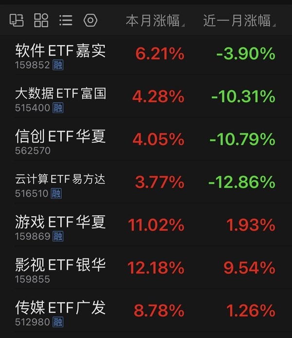

- (2026-11-03 11:12:40) 20cm冰雪气氛组就留给大家自己发挥了🤣🤣🤣🤣  ⊳ （引用 @葱）哇大连这光头光脚大阳线，好看的，不愧是楼选

- (2026-11-03 11:13:31) 招行再次完成了五周线回踩

- (2026-11-03 11:17:55) 你不结合上下文  ⊳ （引用 @momo（富姐版））哎？不是猛干整个11月吗 还有别的小垃圾接力冰雪 我又缺课了？  感觉又回到了读书的时候 明明爬楼了但是怎么感觉好像和没爬一样

- (2026-11-03 11:18:48) 👍👍👍👍👍  ⊳ （引用 @仓部加措）[该回复已被删除]

- (2026-11-03 11:19:39) 你看中移动 空调就知道红利没完呢
只是银行拥挤释放😂😂😂😂😂  ⊳ （引用 @仓部加措）[该回复已被删除]

- (2026-11-03 11:32:05) 只是备选
还有个银华海外数字经济 是纯美 比傻大个和小远好
但是也就500块

还是希望到时候有我们手里的纯美开额度😂😂😂  ⊳ （引用 @六倍做多退休）楼 后期vix如果飙升的话 美基准备买哪一个 易方达？ 准备准备了 

- (2026-11-03 11:32:26) 这是跟消费的  ⊳ （引用 @momo）那中免有望爬起来了 ？

- (2026-11-03 11:32:44) 中字头和中免无关
已经多次验证过了  ⊳ （引用 @momo）那中免有望爬起来了 ？

- (2026-11-03 11:33:57) 如果宁德时代从上个月开始就发挥自己应有的作用就好了😂😂😂  ⊳ （引用 @六倍做多退休）科创50真腰斩了

- (2026-11-03 11:34:48) 消费大票足够承接科技的资金

毕竟这可是2020超级抱团过的
外加宁德时代为首的电池光伏线

市场重回6年前  ⊳ （引用 @点-重生炒垃圾）是的是稳稳站上60线，消费机构票全动了今天，爱姐今天也被原谅了

- (2026-11-03 11:35:49) 证券日报网讯11月2日，迎驾贡酒发布公告称，公司股票于2026年10月29日、2026年10月30日、2026年11月2日连续3个交易日内日收盘价格涨幅偏离值累计达20%，符合上海证券交易所股票交易异常波动的相关标准。

傻傻的盈盈 不是垃圾没经验 这怕啥啊 这都-5🤣

- (2026-11-03 11:36:06) 因为这已经被抱团了啊

不能买抱团的  ⊳ （引用 @点-重生炒垃圾）只有药明被开除

- (2026-11-03 11:37:12) 一定要当下公募基金严重欠配的老牌的各路王者哈哈哈

而且走势必须是跌成狗的才能证明完全被公募基金之前抛弃了🤣🤣🤣🤣🤣  ⊳ （引用 @点-重生炒垃圾）只有药明被开除

- (2026-11-03 11:38:39) 所以现在跌成狗的行业将获得优势🤣🤣  ⊳ （引用 @点-重生炒垃圾）光伏也走的很好，爱旭走N了

- (2026-11-03 11:41:55) 是的 时间到了  ⊳ （引用 @404找回了）都开始押注今年跨年妖了，往年也是这么早启动吗

- (2026-11-03 11:42:13) 其实不是这个
应该是
大连 cbs和雪人的配置问题
上个月计划是4-3-3组合或者4-4-2组合

uu贴图是目前走势看下来
大连会接近sy进攻型 cbs是中影慢悠悠模式 
雪人大概率类似ycm 来回倒腾
大家可以根据目前的特点 自己做规划

这个月在冰雪 电影足够玩了  ⊳ （引用 @半闲公子）对，谢谢uu

- (2026-11-03 11:43:07) 是的！ 大家抓中韩的那种机会😂😂😂  ⊳ （引用 @山中食人花）娜娜现在还有8个点的溢价率
要是老美大跌溢价到时候没了 
是不是可以买场内了呀

- (2026-11-03 11:47:27) 我也没钱
你看到了 我钱都去买债券了哈哈哈

我就留了9万给美国飙恐慌😂😂😂😂打完拉倒  ⊳ （引用 @六倍做多退休）😂准备买入就躺平是吧 好可惜 我现在就羡慕大伙有很多本金 我伤心就伤心在没有那么多本金 

- (2026-11-03 11:49:08) [图] 如果大家能抓到nana 1%溢价
就会收获中韩半导体这样的结果

即使中韩半导体最近五日下跌4.5%
但是并不影响ETF上涨5.7%

而这个差异就是之前错误的溢价率被我们抓到了！

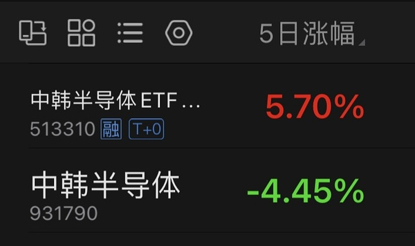  ⊳ （引用 @山中食人花）娜娜现在还有8个点的溢价率
要是老美大跌溢价到时候没了 
是不是可以买场内了呀

- (2026-11-03 11:53:02) [图] 最好的嘉实 国泰 广发目前溢价都在15%以上
想要拿到1%痴心妄想了
如果这三个任意一只溢价率能接近5% 就等于中韩半导体那个1%了

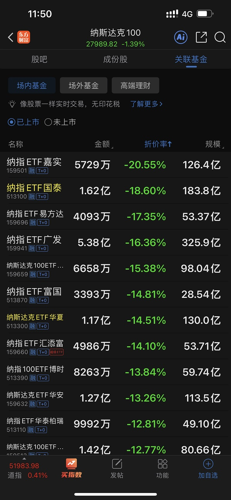  ⊳ （引用 @山中食人花）看着就遗憾 我那天犹豫没有买！！！
已将娜娜置顶 随时关注呢

- (2026-11-03 11:56:20) 我也好奇 为什么大家不肯卖了让我接盘  ⊳ （引用 @吃五包螺蛳粉）其实我也好奇 如果亏损要这么多为什么不卖了

- (2026-11-03 12:05:10) 打仗之后
发生过几件大事
和那会不一样了

1，进一步追海外税
2，全民封杀🐯等一系列渠道
3，香港保险收紧

半年后大家对大A的情绪变了除外
这三件事都会大幅提高溢价  ⊳ （引用 @哄哄🐮）😂天啦，我刚刚正在找ai按照早上uu发的纳指点位图（叠加溢价如果下跌的情况）算怎么设置交易单，讨论的时候想起来之前打仗的溢价最低是在4%左右

- (2026-11-03 12:07:47) 我们的A基金投资还没少于2年预期的
nana 22年买的25年才走完
恒科 23年买的也是去年才走  ⊳ （引用 @得偿所愿）我看错了 我以为27前

- (2026-11-03 12:10:47) [图] 大西洋做啥的😂

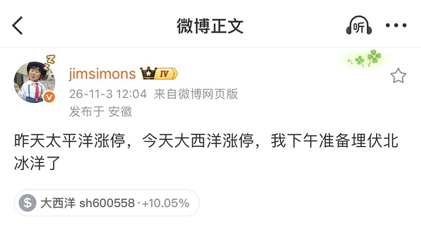

- (2026-11-03 12:15:57) 周五我债券净值更新也让我心慌慌😂😂
最终经过我双休日的调节和研究
昨天狠狠加仓哈哈哈哈🤣🤣🤣🤣🤣🤣🤣🤣🤣  ⊳ （引用 @VVV坚定持有VVV）那就是之前楼里讨论过的，投入金额超出能承受的范围了吧🤔那就该趁反弹调整仓位了，不然就是折磨自己

- (2026-11-03 12:18:39) 牛逼  ⊳ （引用 @我爱牛肉火锅）我就说我没记错，天才

- (2026-11-03 12:21:50) [图] 21年至今6次反弹分布

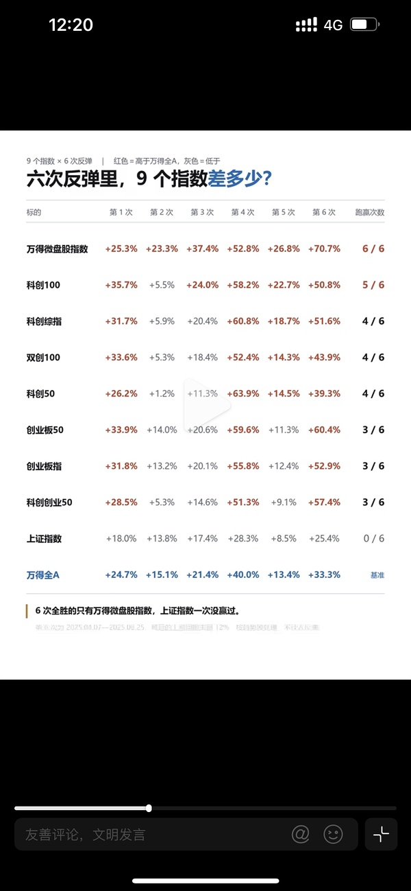

- (2026-11-03 12:22:55) 38倍nana
而且nana一直横盘涨不动的样子
接近大半年没啥收益  ⊳ （引用 @moli）25年是为啥走来着

- (2026-11-03 12:23:26) [图] 21年6次反弹行业分布

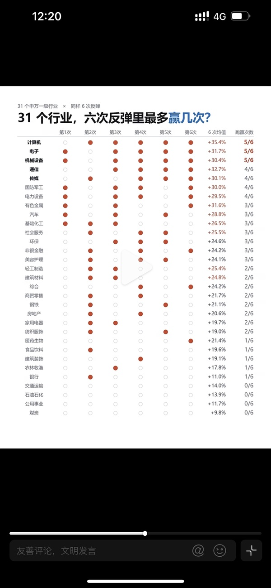  ⊳ （引用 @不知道还能说啥）21年至今6次反弹分布

- (2026-11-03 12:25:40) 嗯毛衣战打下去了估值😂  ⊳ （引用 @moli）结果回头看又成了买点？😓

- (2026-11-03 12:26:43) 现在的机会接近22年
22年俄乌大战 油价飙升 加息周期

遗憾的是目前nana没啥额度
四年前买的是随心所欲  ⊳ （引用 @moli）结果回头看又成了买点？😓

- (2026-11-03 12:33:57) [图] 然而这是楼友先说的 为什么不卖😂😂😂

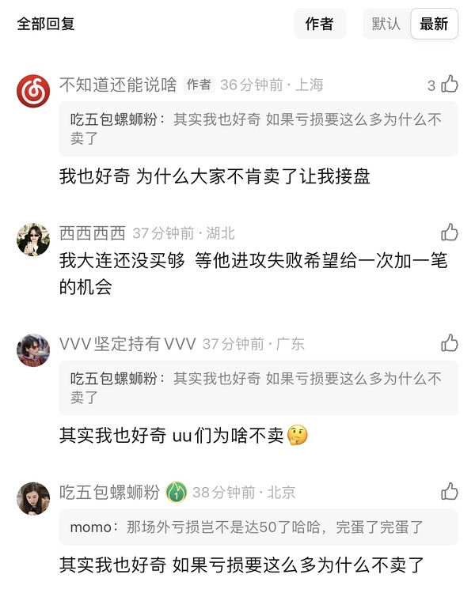  ⊳ （引用 @六倍做多退休）我根本不认识悠悠啊 她是谁我都不知道 但是我觉得没有必要对楼u说出为什么不卖这种话 

- (2026-11-03 12:46:37) [图] 没啥区别
你6/3买华夏兄弟也是30%
买建信是-25

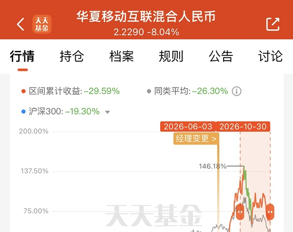  ⊳ （引用 @酸奶不舔盖）天啦，我很久没敢看zfb了我网易云都-30了，还有机会回本吗？但是我刚看是不是现在网易云前10持仓都没有网抑云了

- (2026-11-03 13:01:29) 不会
这是科技
只能接受科技涨的强度不能接受跌的力度嘛🤣
这就像我们玩小垃圾 吃两个跌停难道就觉得回来很慢嘛🤣🤣🤣🤣🤣  ⊳ （引用 @🅰失而复🉐😎）这浮亏后面不补，回来也费老劲了

- (2026-11-03 13:10:47) [图] 茅台魔咒威力太大了

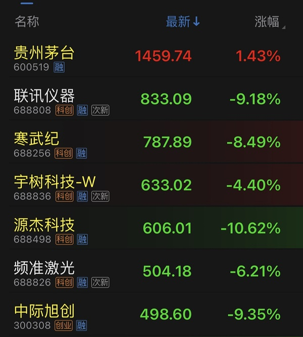

- (2026-11-03 13:15:13) [图] 强势股补跌威力

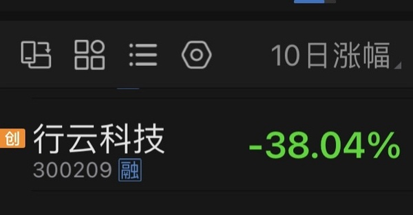

- (2026-11-03 13:19:53) 上午抄底招行的那个小伙伴又赢了

- (2026-11-03 13:21:32) 快讯：科创50指数跌幅扩大至4% 创指跌超2%

差的2%就是宁王救的

- (2026-11-03 13:23:30) 白酒 光伏也拉的停不下来  ⊳ （引用 @红红火火的anya）中际跌的止不住了

- (2026-11-03 13:28:47) 6/23日到了  ⊳ （引用 @扶我起来还能买）怎么感觉zy砸这一下有点刻意了

- (2026-11-03 13:31:43) 你问楼里uu还有多少人场内在抄底科技的😂有没有科技援军  ⊳ （引用 @稀里不糊涂）科技好吓人啊，又是5个点的跌幅

- (2026-11-03 13:32:50) 😂😂😂😂😂😂😂你真猛  ⊳ （引用 @木感情的打工人）我。。。

- (2026-11-03 13:35:09) 我们的英雄们来了

- (2026-11-03 13:35:29) 很遗憾
我们场内冰雪就喜欢这种垃圾行情😂😂  ⊳ （引用 @不知道还能说啥）我们的英雄们来了

- (2026-11-03 13:36:06) 如果科技很好
场内对我们主打的冰雪其实并不有利  ⊳ （引用 @不知道还能说啥）很遗憾
我们场内冰雪就喜欢这种垃圾行情😂😂

- (2026-11-03 13:37:39) 不是

雪人很快要不一样了  ⊳ （引用 @赛博朋克2077）雪人是涨停全出了是嘛

- (2026-11-03 13:39:03) 😂😂😂能对冲掉吗  ⊳ （引用 @木感情的打工人）😅

- (2026-11-03 13:39:47) 按照目前市场情况

创综估计更好 去年4.7我们玩的东西  ⊳ （引用 @木感情的打工人）😅

- (2026-11-03 13:42:05) 个人看法
今天雪人就维持这样挺好的
不要触发可能是好事
就像昨天的sy🤣🤣🤣

- (2026-11-03 13:46:16) 冰雪以前也最喜欢 市场接近崩盘时候逆势反拉
确实有这个特色  ⊳ （引用 @点-重生炒垃圾）今天午后板块是冰雪啊

- (2026-11-03 13:48:04) 嗯
主要是选举他们容易规避  ⊳ （引用 @稀里不糊涂）科技倒t是对的，现在美国盘前是不是不好啊

- (2026-11-03 13:50:43) sy距离我们卖出都快跌没8%了😂😂😂😂

- (2026-11-03 13:51:44) 我去掉了中马 留下了他！  ⊳ （引用 @YuanZi💕）艾斯顿你支棱一下

- (2026-11-03 13:52:22) 这个走势明天也接不了😂  ⊳ （引用 @Lyra）今天先不接对吧？

- (2026-11-03 13:54:02) 白酒新能源涨的也慢  ⊳ （引用 @稀里不糊涂）比白酒新能源报团那波跌的都快

- (2026-11-03 13:55:48) [图] 寒武纪含蓄😂

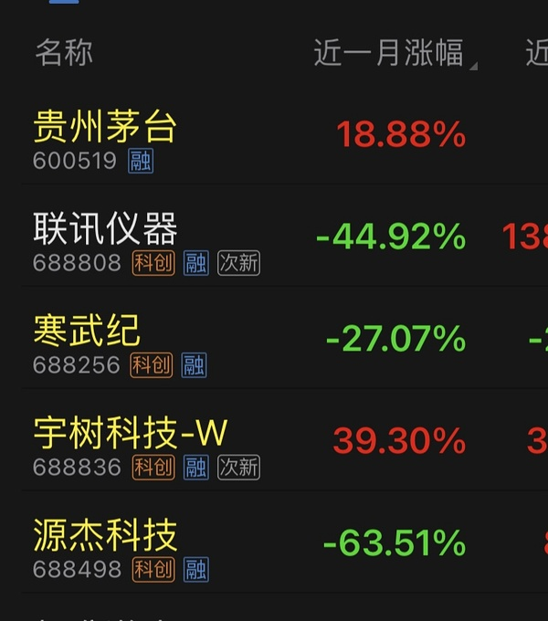  ⊳ （引用 @点-重生炒垃圾）今天创新药跌的不比科技少啊，心痛

- (2026-11-03 13:56:15) 一个月就没了63%😂😂😂😂😂😂  ⊳ （引用 @不知道还能说啥）寒武纪含蓄😂

- (2026-11-03 13:57:46) [图] 开盘我觉得不好

但我卖出幸福后还是回接了😂😂😂😂

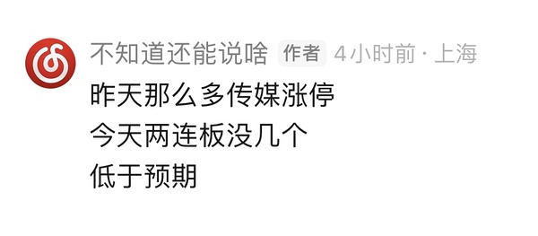  ⊳ （引用 @点-重生炒垃圾）传媒是不是可以暂时不管了，那个浙江影业像吃独食，等他们前排走完，后面都散了，还要再等他们吃独食的倒。龙版上面有个缺口，随时倒下的感觉。

- (2026-11-03 13:59:25) 所以妈妈是没用的

但是有妈妈会强化宁德时代 白酒 光伏那种被公募抛弃的东西 这些没卖盘 有妈妈注入流动性就会厉害  ⊳ （引用 @一切都会过去的）老美根本不止跌

- (2026-11-03 14:02:12) 😂😂😂😂😂😂😂😂

这种只能靠uu们的聪明才智去玩了哈哈  ⊳ （引用 @我爱牛肉火锅）羊传羊，已经到这种地步了😄

- (2026-11-03 14:04:47) 群牛逼啊

一群羊  ⊳ （引用 @我爱牛肉火锅）别跟我说刚刚那个直线拉板的利群，是因为半边有羊，那是真无语了

- (2026-11-03 14:07:03) 从一只羊玩到一群羊了…………  ⊳ （引用 @YuanZi💕）怪不得群兴玩具一下子也直线

- (2026-11-03 14:07:38) 我昨天看7/31日那次芒果也就强硬了两天 
后面就都是盘中脉冲的弱势了🤣  ⊳ （引用 @点-重生炒垃圾）还好有冰雪，不然今天要崩溃

- (2026-11-03 14:09:43) 传媒高潮时候都不太行

老传媒人的感悟😂

所以你昨天让我看 第一是太多涨停 第二我觉得好的我肯定买不到 买到的肯定是坑哈哈哈哈  ⊳ （引用 @点-重生炒垃圾）到最后都不如中影，我就剩中影了

- (2026-11-03 14:10:47) 电影冰雪人是不是今天还红的好好的

我因为有手贱的东西 折损不少收益哈哈哈哈

- (2026-11-03 14:12:21) 都没用的
天王老子来了也没用

美国人说了算  ⊳ （引用 @木感情的打工人）事到如今，陛下到底下令逮谁，别再摇摆了

- (2026-11-03 14:13:05) 哈哈哈哈哈哈哈哈哈哈哈哈哈哈哈  ⊳ （引用 @家不住海边）服了。 这脑子是怎么长的 想象力还怪丰富的

- (2026-11-03 14:15:07) 北京时间明天下午2点才结束所有投票

最终结果可能要明天晚上或者我们后天了  ⊳ （引用 @稀里不糊涂）美国怎样才能好啊，中期选举今天就结束吗

- (2026-11-03 14:17:47) [图] 大哥笑看一切😂😂😂😂

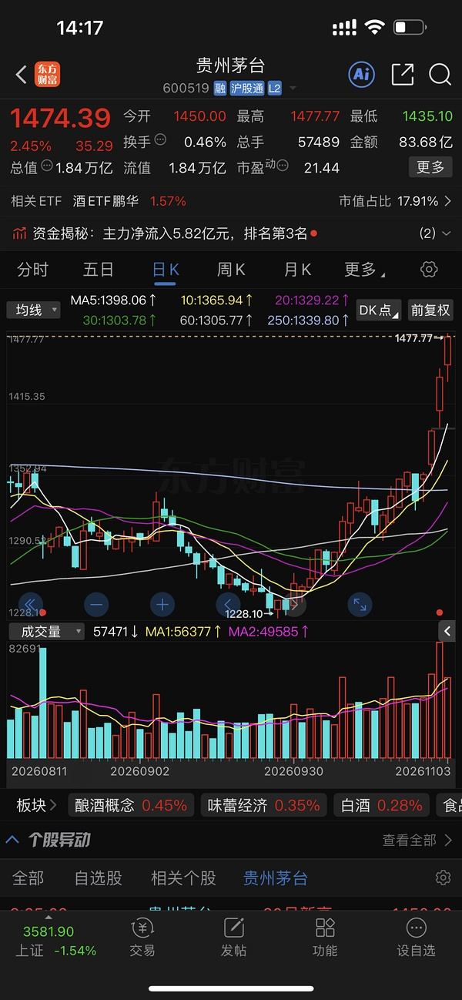  ⊳ （引用 @木感情的打工人）😫😫😫😫

- (2026-11-03 14:18:05) 茅台都走出了小票的那种气势  ⊳ （引用 @不知道还能说啥）大哥笑看一切😂😂😂😂

- (2026-11-03 14:19:45) 👍👍👍👍👍👍  ⊳ （引用 @点-重生炒垃圾）港股消费股延续升势，海底捞涨超6%，蒙牛乳业、呷哺呷哺、华润啤酒涨3%，泡泡玛特、古茗涨2%。

- (2026-11-03 14:21:39) [图] 

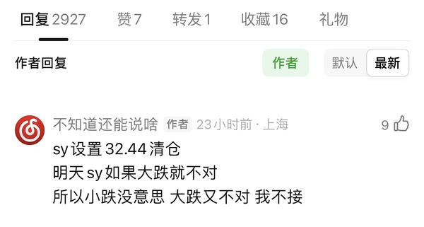  ⊳ （引用 @我要努力回本）楼楼sy都卖了吗？还是有留着，我昨天没看到他的条件单，没卖成😂😂😂

- (2026-11-03 14:22:37) 和我们炒垃圾没什么关系
不要因为科技不行影响我们垃圾票出手

- (2026-11-03 14:24:59) 祝福本月收益20%+😂  ⊳ （引用 @我爱牛肉火锅）是的，纯冰雪，安心思密达

- (2026-11-03 14:25:54) 33是极为有难度的重要卡点  ⊳ （引用 @我要努力回本）谢谢啦

- (2026-11-03 14:28:32) sy
如果没设置单子没走
我依然建议今天要走

sy很容易开大阴线

- (2026-11-03 14:29:08) 今天大幅度偏离了五日十日线  ⊳ （引用 @不知道还能说啥）sy
如果没设置单子没走
我依然建议今天要走

sy很容易开大阴线

- (2026-11-03 14:29:55) 他们已经晚上一群羊了🤣🤣🤣  ⊳ （引用 @只想搞钱）襄阳也是太牛了，还能红

- (2026-11-03 14:30:27) 嗯要分开

sy明天不接哦 要观望下他反馈  ⊳ （引用 @该用户已过期）楼，后面回sy 你还是会买之前同样的金额吗？分笔买？

- (2026-11-03 14:30:47) 美国小幅火箭发射  ⊳ （引用 @🧋今天25了吗）来奶了？

- (2026-11-03 14:31:46) 我自己已经把科技分组都放到最后去了

成功率太低 索性不看了😂😂😂😂😂  ⊳ （引用 @柚又）早上没买到雪人，然后灵机一动加仓了半导体，真不能手贱，如果我是一个只有冰雪的小女孩，不敢想有多幸福

- (2026-11-03 14:32:25) 注射到宁德 对我们有那么一点点帮助 少跌点😂😂😂😂😂😂😂😂😂😂😂  ⊳ （引用 @葱）我算看明白了，阿妈BBB那些双创效用就是给点生理盐水，注射进去对本尊没什么起色，不过会让本来就牛逼的冰雪又红那么一点，所以忌讳去强留弱啊……

- (2026-11-03 14:32:38) 韩国综指收跌3.59%
韩国综指收跌3.59%，报5648.79点。日本股市休市。

- (2026-11-03 14:35:51) 先观望啊 我明天肯定不接😂你们可以尝试博弈 他再度挑战33  ⊳ （引用 @🅰失而复🉐😎）哪天再去-8吗🤣

- (2026-11-03 14:36:56) A股上证50指数尾盘翻红，创业板指跌幅收窄至1.6%。

- (2026-11-03 14:40:07) 300和双创的交集票 但不是科技的公募基金之前不买的 看来很厉害🤣连续资金注入  ⊳ （引用 @葱）报：阿妈还在B300和双创，所以大家的账户应该好看些了hhhhhhhh

- (2026-11-03 14:42:15) uu你把日线图缩小点看中影 
我相信你看了 就不会有这个B😂  ⊳ （引用 @哄哄🐮）风险加大还是算了，在冰雪里面浪更好吧

- (2026-11-03 14:43:34) 我不知道啊 我没看

开局两连板数量太少 传媒不够强势  ⊳ （引用 @Aaa摆烂咸鱼🥳）楼，我还有点芒果，是不是得跑了

- (2026-11-03 14:48:00) 江老师买它是因为他是科技材料哈哈哈

你看看他走势 就知道 他是科技股 7.1见顶🤣  ⊳ （引用 @速派女孩将发财）新宙邦怎么还不发力？？？？ 不是搞电池的吗？？？ 还是前面涨太多了 

- (2026-11-03 14:49:02) 还正常 反弹新高就往后退 进二退一  ⊳ （引用 @we）中影呢

- (2026-11-03 14:53:11) 60日线
我1344价格就是这么来的  ⊳ （引用 @momo）幸福那怎么了

- (2026-11-03 14:55:40) 今天回接的幸福修改单子 14.34卖出

- (2026-11-03 14:56:03) 你好懂我 我刚设置完 1434  ⊳ （引用 @稀里不糊涂）楼你回接的还设置13.44卖吗

- (2026-11-03 14:56:46) 一个右侧
一个五日线都没拿到
当然有区别的

所以我有三分大连啊🤣🤣🤣🤣cbs还少一分  ⊳ （引用 @仓部加措）最后十分钟大连冲刺，长白一点不动啊😂

- (2026-11-03 14:58:06) 慢就是快 他执行的很好！！  ⊳ （引用 @ü）对，9月末到现在，zy感觉都是这样的节奏，从12块多到15了哈哈哈哈

- (2026-11-03 14:59:17) 奖励强者  ⊳ （引用 @爱拔酱）那我我蹲楼加cbs那一份
自己不折腾了

- (2026-11-03 15:00:54) 3+1滚动 现在暂时2+1滚动  ⊳ （引用 @想当富有的咸鱼）大连你最后打算三份还是四份啊

- (2026-11-03 15:01:14) 人家20cm  ⊳ （引用 @👑）[该回复已被删除]

- (2026-11-03 15:01:50) no
1494卖今天的
涨停S一半  ⊳ （引用 @点-重生炒垃圾）雪人的条件单明天要改吗？

- (2026-11-03 15:02:56) 不变  ⊳ （引用 @该用户已过期）大连不变吧？

- (2026-11-03 15:04:21) 我觉得雪人现在暂时就是ycm的样子
不断的在60日线和年线来回😂😂
对手贱人很友好
能进进出出来来回回 而且弹性也很大

但是我觉得雪人最后会冲出这段枷锁🤣🤣🤣🤣  ⊳ （引用 @点-重生炒垃圾）好的

- (2026-11-03 15:08:58) asd改2994
但是我还有建设工业的 如果那个明天很牛逼走了
我很可能一起就走的😂

恋爱1048
如果看到直线拉涨停 直接手动卖  ⊳ （引用 @timing）楼 恋爱脑跟埃明天条件单是多少啊 来抄作业啦😁

- (2026-11-03 15:09:21) 没有  ⊳ （引用 @👑）cbs有单子吗😅

- (2026-11-03 15:12:44) 大跌的时候😂就像昨天那种
如果搭配科技正好大涨时候 简直完美 这种情况我肯定也继续买

还有就是等他冲击大阴线遇阻回落时候  ⊳ （引用 @该用户已过期）楼，之前钱没到，现在仓位低，还想再买点大连，啥时候比较合适啊？🤣🤣

- (2026-11-03 15:17:12) 🤣不行啊
我手贱的经验是

你一旦钱没地方用了
去找大跌的东西  ⊳ （引用 @该用户已过期）昨天没钱😐昨天还想买zy来着……所以今天有钱激情冲高了🤣🤣后来冷静认了80%的错
那我再等等吧，谢谢楼

- (2026-11-03 15:17:55) 我昨天钱没地方用了
去的-8-6机器人 今天这样跌都安然无恙
虽然影响了今天收益🤣  ⊳ （引用 @该用户已过期）昨天没钱😐昨天还想买zy来着……所以今天有钱激情冲高了🤣🤣后来冷静认了80%的错
那我再等等吧，谢谢楼

- (2026-11-03 15:20:33) 中影十月底我亲眼看到 跌的不多哈哈哈 挺耐揍的🤣  ⊳ （引用 @shirla）好的谢谢楼楼老师！ZY也可以依样画葫芦吧哈哈

- (2026-11-03 15:22:03) [图] 楼里uu这个月现在是不是赢2000了😂

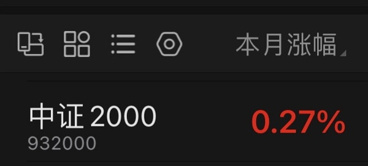

- (2026-11-03 15:24:37) [图] 我觉得我们三个冰雪安全度都挺高的
即使单日买错了 稍微等等问题也不大
大连cbs是刚被疯狂A杀过的 资金出清还是干净的
雪人剩在位置低 类似ycm特性
这样看很明显看到雪人很低很低

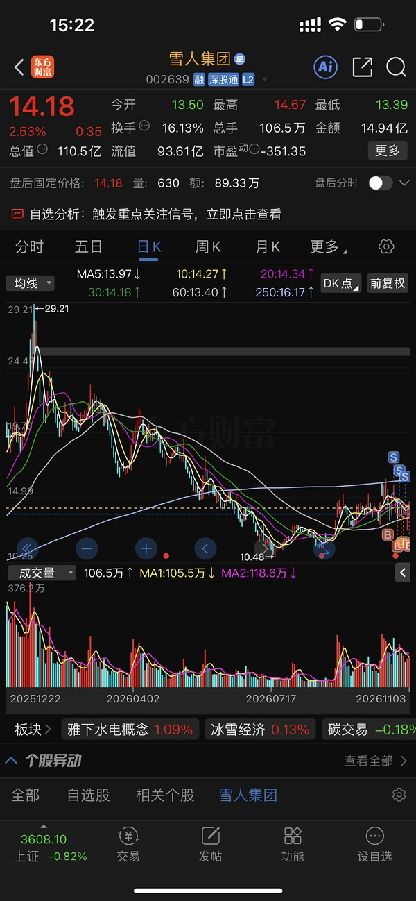  ⊳ （引用 @该用户已过期）每次都是新开始🤣🤣我要是记得之前收益可能就会想着有利润垫更贪心，最后被打个大的

- (2026-11-03 15:32:18) 奶茶昨天+9 幸福+11
奶茶今天-4 幸福0

这不就6%差距拉开了🤣
楼里uu们大部分都把前任当狗
现在奶茶也是😂😂😂😂😂

- (2026-11-03 15:36:04) 我也都同意
但就一点点不一样
美债也真的有一部分原因是加息预期大幅度降低了
市场几乎不定价第三次加息了
只有两次定价目前  ⊳ （引用 @点-重生炒垃圾）坚定看多美股。资本开支鬼故事是鬼扯，AI公司债务增加18%，账面收益增加了30%，只要盈利超过债务就没什么好担心的。而且美股，尤其是科技股今年表现超预期，例如，在美债收益居高不下的那个月，依然坚挺。但是仍然建议多组合配置让自己睡得着，他自己

- (2026-11-03 15:37:05) 感觉和白酒光伏新能源医疗器械一个道理

公募基金严重欠配的连续下跌的容量大的能接硬科技资金的东西  ⊳ （引用 @速派女孩将发财）截至目前，南向资金净买入额达200亿港元。
是不是都去买恒科了 我朋友今天也在说想买腾讯了

- (2026-11-03 15:39:14) 哇
通策医疗怎么样了😂  ⊳ （引用 @qiu啾）爱尔眼科加入几连涨了。

- (2026-11-03 15:41:46) [图] 是的 而且三月你看概率也不高
市场依然有机会12月就是最后一次加息
因为明年6月以后的预期其实都是虚无缥缈的

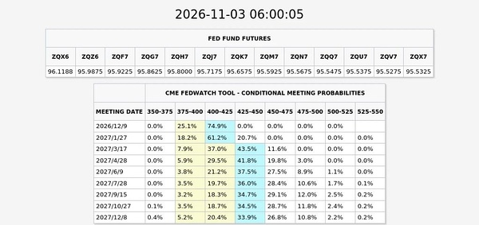  ⊳ （引用 @稀里不糊涂）12月一次加上明年3月一次？

- (2026-11-03 15:47:02) 新股发行暂停的消息是不是有uu发过了

我看到人家金融机构讨论了 这消息属实

- (2026-11-03 15:48:38) 这样的话 
除了太子爷12月纳入k50以及1月的解禁相对消息负面
没有长江那玩意的干扰了  ⊳ （引用 @不知道还能说啥）新股发行暂停的消息是不是有uu发过了

我看到人家金融机构讨论了 这消息属实

- (2026-11-03 15:48:50) 所有IPO暂停  ⊳ （引用 @点-重生炒垃圾）是的，所有的吗？还是单指长江存储？

- (2026-11-03 15:50:42) [图] 连可转债都没了🤣🤣🤣🤣🤣全部叫停

上面认真了

然而这次是全球联动 目前这样的政策只能帮助我们炒垃圾和玩跌了五六年的东西😂😂😂

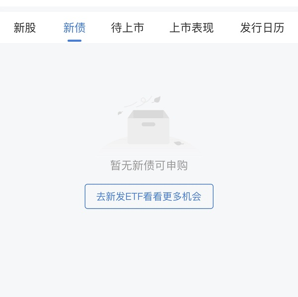  ⊳ （引用 @点-重生炒垃圾）长江存储这玩意是很晦气，一期大基金就全军覆没就他一个独苗

- (2026-11-03 15:52:01) 充分说明香港更垃圾
至少我们知道不好了 这个得停
香港之前还在加大IPO力度  ⊳ （引用 @安然致富神秘人）哈哈哈怎么不接着奏乐接着舞了

- (2026-11-03 15:53:50) 最终 宇航员几个 一个都没能上市啊😂  ⊳ （引用 @点-重生炒垃圾）中间怎么那么自信就想把长江抬出来，真无语

- (2026-11-03 15:54:25) 我们场内都在顶级里😂

- (2026-11-03 15:55:37) 白酒昨天才进入右侧？
茅台已经走的六亲不认😂😂😂😂

- (2026-11-03 16:00:04) 立昂微(605358.SH)公布，公司于近日收到控股股东一致行动人宁波泓祥和创业投资合伙企业（有限合伙）、宁波泓万企业管理合伙企业（有限合伙）、上海金瑞达资产管理股份有限公司的告知函，前述股东通过集中竞价方式合计减少公司股份770万股，占公司总股本的1%。

## 🧠 投资风格分析
> 📏 增量更新指引：仅当今日发言确有新依据时才修订对应维度，无变化不强行重写；单维度修订建议 ≤150 字。

- 投资理念与方法：重视全球联动、机构行为与指数规则带来的被动买卖盘，先质疑公开数据真实性；以参与度判断行情性质，对高位腾空型科技股、小票垃圾票与微盘股保持戒心，关注业绩确定性与融资盘出清；操作留后手，坚持条件单与时间纪律，月末防守至上；偏好用筹码游戏逻辑处理传媒垃圾票，对miss业绩直接砍；以股债双爆/单爆情景推演倒推最终受益资产，并以股息率作为跨行业比较锚；今日进一步用科技股爆+长债爆/不爆两剧本分别指向消费/高股息，并关注食品饮料、家用电器股息率超4%、可脚踏两条船。新增：对ETF溢价率保持敏感，关注溢价风险带来的调整时点（如中韩半导体10:30开盘预期）。
- 风险偏好：对高位腾空型科技股、小票垃圾票与微盘股保持戒心，认为融资盘爆仓式强卖是出清主要形式；对强势股补跌、月末微盘杀伤高度警惕，操作留后手；对传媒等垃圾票只做筹码游戏、不做价值投资；对债券拥挤交易与美元债/境内信用债违约保持警惕，视信用事件为风险偏好变量；新增关注美元债常不还、万科美元债违约与债券拥挤下资金躲债砍仓，并对周末政策消息保持“埋人”警惕。
- 交易与仓位：坚持条件单分档与预设时间表，将分散在十几只同题材小仓位合并到少数主攻标的，以「加大布局」而非新增资金方式提集中度。逢跌分批低吸但按价位设多档留后手；未站上五日线不当真，站上且拐头才加仓；月末提前设定总仓位滚动控制，防守至上；弱势板块不尾盘买入博次日反抽，改为次日早盘择机；反对无纪律加仓拉低成本，倾向留钱等更确定机会；涨停价手动挂单兑现；对已放弃旧方向不回头补仓。清仓bn转换xf，幸福配置满额与中影对等；计划sy和zy对等布局，幸福低配做情绪放大；强调右侧确认后加仓，耐心等确认信号。新增：习惯批量处理同质化小仓位（如批量卖冰雪、机器人），以腾出资金集中到确定性更高的标的（如中影）。
- 心理特质：对持仓波动冷静，以低换手耐心持有避免手贱；月末/冰点等时点记忆清晰，强调纪律边界；看到他人不守计划会直接点出；对无价值吐槽情绪自我屏蔽；反复强调严格执行计划、防守至上；对已放弃旧方向不念旧不回头；把换仓视为对弱者的惩罚而非情绪操作；对自身手贱行为有清醒认知并主动惩罚。新增：市场情绪乐观时以自嘲化解（「我在恋爱中😂😂😂」「旧的不去新的不来🤣」），对追涨杀跌的冲动有自觉抵抗（「这次引诱不了我 我这边目标物一大堆 足够赚钱了」）。

> ⚠️ 本板块由 Actions 全自动增量更新（复用当日发言与今日总览），每次仅在内容足够支撑时才改动。

## 🏷️ 昵称映射表
### 📖 昵称规律（供 AI 判断新昵称时参考）
【昵称命名规律（用于推断未知新昵称）】
- 拼音首字母缩写：取标的/基金名汉字拼音首字母串（含数字代码），多为 ETF/股票代码口语化｜示例：yl=引力传媒｜zy=掌阅科技｜sj=视觉中国｜cc=华安文体健康混合｜C50=创业板50ETF｜k50=科创50｜kun=昆仑万维｜xhxc=新瀚新材｜zxfc=中欣氟材
- 小/老+姓氏代指：「小X」「老X」通常指姓 X 的标的或该标的的基金经理；「X兄弟」多为同系基金｜示例：小惠=惠发食品｜老莫=万家品质生活(莫海波)｜小华=华夏全球科技先锋(QDII)A｜小华兄弟=华夏移动互联(QDII)｜小浦=浦银安盛全球智能科技(QDII)A｜小广=广发全球精选(QDII)A｜小远=华宝致远(QDII)C｜招招=招商银行｜小德=德明利｜赵姨=兆易创新｜露露=泸州老窖｜空调=格力电器
- 戏称/黑话→题材板块：生活化比喻或黑话对应某个题材/板块，而非单一标的；出现时多指板块方向｜示例：卖国=PCB板块(英伟达AI链)｜爱国=国产自主(半导体设备/芯片)｜奶茶=易点天下｜老师=中文在线｜蓝色=蓝色光标｜宇航员=航空航天板块｜华子=华泰保兴安悦债券｜国际=国际复材｜巨无霸=长鑫科技等重大IPO
- 谐音/取字：昵称含标的名关键字（取一字或谐音），多为 A 股个股或基金简称｜示例：万华=万华化学｜东百=东百集团｜宝=保利发展｜讨饭/亚洲讨饭/建信新兴=建信新兴市场(QDII)A｜华宝zy=华宝致远(QDII)A
- 机构/基金经理昵称：以基金公司名、经理姓、或平台代称指代对应基金产品｜示例：周经理=中欧新趋势混合(LOF)A｜张经理=信澳匠心回报混合A｜网易云/音乐世家=富国全球科技互联网股票(QDII)A｜国富亚洲=国富亚洲机会股票(QDII)A｜国泰纳指=国泰纳斯达克100指数(QDII)｜易方达全球=易方达全球成长精选混合(QDII)A｜浦银安盛=浦银安盛全球智能科技(QDII)A

### 📋 已收录映射
| 昵称 | 对应名称 |
|------|----------|
| C50 | 创业板50ETF |
| cc | 华安文体健康混合A |
| k50 | 科创50 |
| kun | 昆仑万维 |
| sj | 视觉中国 |
| xhxc | 新瀚新材 |
| yl | 引力传媒 |
| zxfc | 中欣氟材 |
| zy | 掌阅科技 |
| 万华 | 万华化学 |
| 东百 | 东百集团 |
| 亚洲讨饭 | 建信新兴市场混合(QDII)A |
| 保利发展 | 保利发展 |
| 华子 | 华泰保兴安悦债券 |
| 华宝 zy | 华宝致远混合(QDII)A |
| 华宝zy | 华宝致远混合(QDII)A |
| 卖国 | PCB、光模块、通信板块（英伟达AI产业链） |
| 周经理 | 中欧新趋势混合(LOF)A |
| 国富亚洲 | 国富亚洲机会股票(QDII)A |
| 国泰纳指 | 国泰纳斯达克100指数(QDII) |
| 奶茶 | 易点天下 |
| 宇航员 | 航空航天板块 |
| 宝 | 保利发展 |
| 小华 | 华夏全球科技先锋混合(QDII)A |
| 小华兄弟 | 华夏移动互联混合(QDII) |
| 小广 | 广发全球精选股票(QDII)A |
| 小德 | 德明利 |
| 小惠 | 惠发食品 |
| 小浦 | 浦银安盛全球智能科技(QDII)A |
| 小远 | 华宝致远混合(QDII)C |
| 巨无霸 | 长鑫科技等重大IPO企业 |
| 建信新兴 | 建信新兴市场混合(QDII)A |
| 张经理 | 信澳匠心回报混合A |
| 招招 | 招商银行 |
| 易方达全球 | 易方达全球成长精选混合(QDII)A |
| 浦银安盛 | 浦银安盛全球智能科技(QDII)A |
| 爱国 | 国产自主（半导体设备/芯片制造） |
| 空调 | 格力电器 |
| 网易云 | 富国全球科技互联网股票(QDII)A |
| 老师 | 中文在线 |
| 老莫 | 万家品质生活混合A(519195) |
| 蓝色 | 蓝色光标 |
| 讨饭 | 建信新兴市场混合(QDII)A |
| 赵姨 | 兆易创新 |
| 赵哥 | 兆易创新 |
| 露露 | 泸州老窖 |
| 安安 | 安记食品 |
| 音乐世家 | 富国全球科技互联网股票(QDII)A |
| 老伯伯 | 铜冠铜箔 |
| nk | 景顺长城纳斯达克科技ETF联接(QDII)A |
| bk | 易方达标普信息科技指数(QDII-LOF)A |
| txx | 天下秀 |
| 媛媛 | 今世缘 |
| uu | 友友、网友们 |
| 温暖老师 | 某个特别牛逼的散户 |
| 余老师 | 余利，某牛逼投资者 |
| ycm | 粤传媒 |
| 江老师 | 江琪（投资博主） |
| 水果老师 | 投资博主 |
| 小爱 | 我爱我家 |
| ty | 天娱数科 |
| bn | 博纳影业 |
| sy | 上海电影 |
| CBS | 长白山 |
| 东哥 | 东百集团 |
| 芒果 | 芒果超媒 |
| 阿中 | 中国电影 |
| 欢欢 | 欢瑞世纪 |
| 雪人 | 雪人集团 |
| 大连 | 大连圣亚 |
| 幸福 | 幸福蓝海 |
| 小粤 | 粤传媒 |
| 阿博 | 博纳影业 |
| 创成长 | 创业板成长etf |

> ⚠️ 以下为 LLM **建议**，未自动写入状态文件。请人工确认后，本地编辑 `state.json` 的 `nickname_map` / `positions`，或 `nickname_rules.json` 的 `rules` 并 push 生效。

## 持仓建议（待你确认）
- **中国电影**（）〔加仓〕— 依据：昨天批量b三个冰雪 三个机器人 还加仓中影都要花钱的呀

*🤖 自动生成于 2026-11-03 16:02:42 ｜ 豆瓣楼主发言追踪*