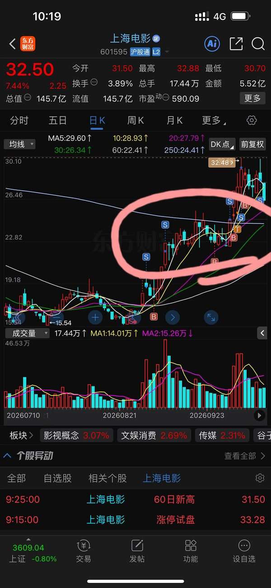
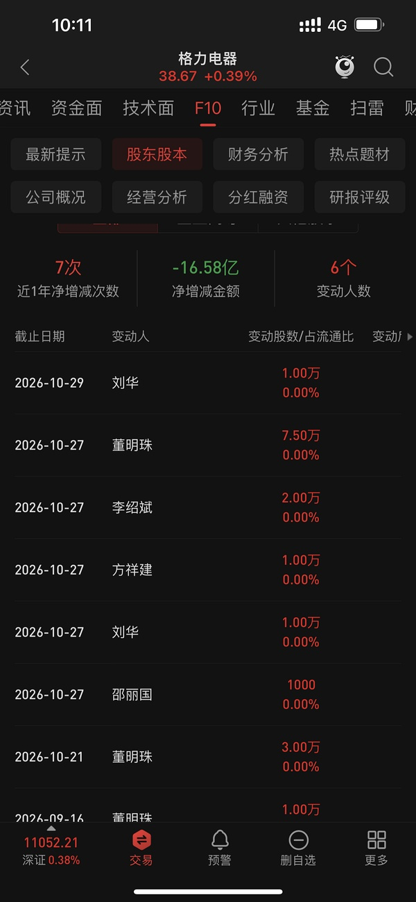
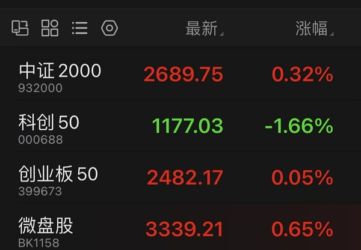
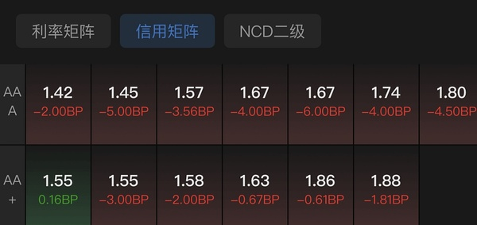
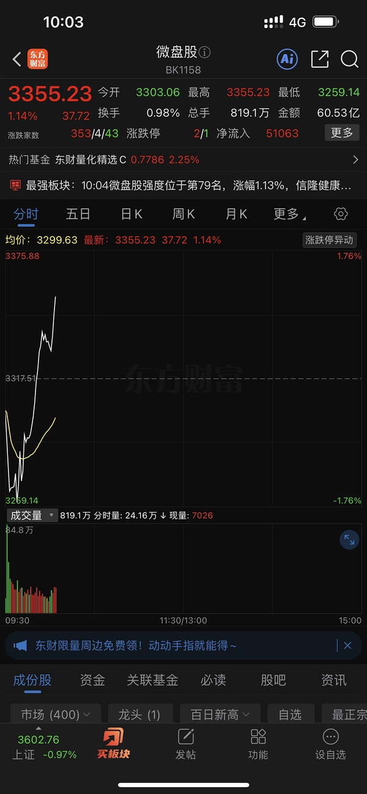
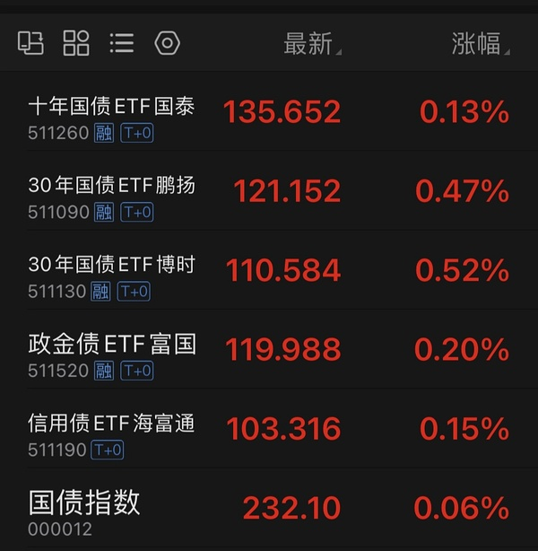
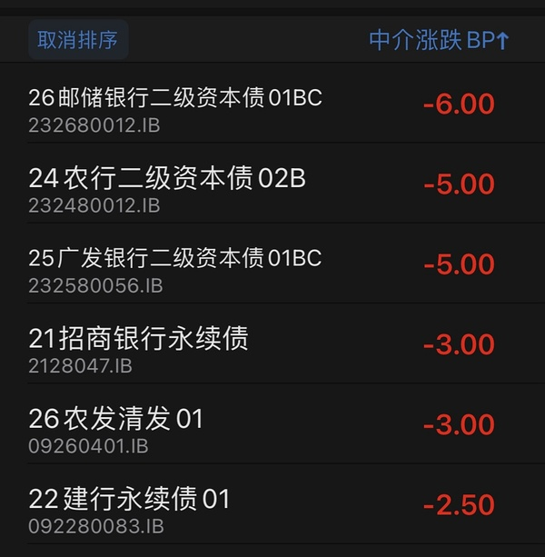
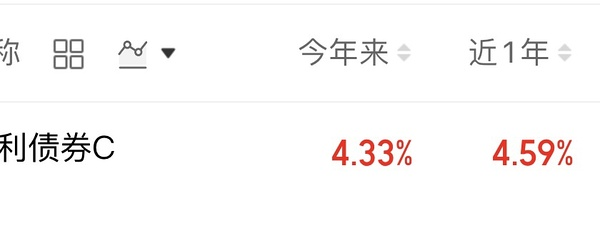
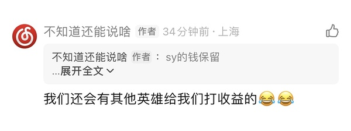

# 📋 楼主每日发言推送

> **推送日期**：2026-11-03 ｜ **执行时间**：2026-11-03 11:02:55 ｜ **监控用户**：`不知道还能说啥`
> **追踪模式**：`topic`（用户主页广播·豆瓣话题）

## 📊 持仓追踪
> 上次更新：2026-11-03 ｜ 基于楼主发言持续追踪（共 12 项）

| 标的 | 状态 | 类型 | 现价 | 提及 |
|------|------|------|------|------|
| 招商银行 | 持有 | 红利/银行 | 42.23（-2.20%） | 继续持有，大金融仅银行 |
| 长白山 | 持有 |  | 36.32（1.79%） | 分笔加仓第二笔，挂单3644 |
| 雪人集团 | 持有 |  | 14.04（1.52%） | 1494卖出，涨停则卖一半 |
| 上海电影 | 持有 |  | 31.65（4.63%） | 逢高减仓，保留仓位，33以上不追 |
| 幸福蓝海 | 持有 |  | 13.39（2.76%） | 1344触发低吸，回接2毛差价；挂1544止盈 |
| 粤传媒 | 持有 |  | 10.61（3.31%） | 暂无 |
| 大连圣亚 | 持有 |  | 41.67（3.30%） | 分笔加仓，已买两笔，挂单4074 |
| 博纳影业（bn） | 持有 |  | 暂无 | 「减仓bn 买入中影」；bn跌到60日线。 |
| bn（博纳影业） | 持有 |  | 暂无 | 清仓bn转换xf（幸福蓝海），“清仓bn转换xf” |
| 中国电影（中影） | 持有 |  | 暂无 | 加仓 |
| 中韩半导体ETF | 买入 |  | 暂无 | 持有，等溢价率超20%再卖 |
| 中影（中国电影） | 买入 |  | 暂无 | 10.29；昨日换仓进来 |

> ⚠️ 执行任务时如发现新操作，请更新 `state.json` 的 `positions`。成本价和市值有数据才填，没有则保留「暂无」。

## 🌅 今日总览
### 📌 市场背景
市场背景：今日市场整体呈现「慢牛降速」格局，微盘股领涨而科创垫底，硬科技表现偏弱；两市融资余额减少127亿但未现融资盘恐慌性出逃；债券市场在周五危难后开始修复，信用债率先企稳、利率债即将反包，债券性价比阶段性优于红利。

### 📌 今日操作
| 操作 | 标的 | 详情 |
|---|---|---|
| ✅ | 雪人集团 | 1494卖出，涨停则卖一半 |
| ✅ | 幸福蓝海 | 1344触发低吸，回接2毛差价；挂1544止盈 |
| ✅ | sy(上海电影) | 逢高减仓，保留仓位，33以上不追 |
| ❌ | 冰雪 | 批量卖出三个 |
| ❌ | 机器人 | 批量卖出三个 |
| ✅ | 中影 | 加仓 |
| ⏭️ | bn(博纳影业) | 已清仓转换xf（历史操作沿用）|

### 📌 今日议题
议题：市场节奏判断
态度：➡️中性
核心观点：慢牛但降速，十月底资金偏防守，月末观察后续动向
关键引用：「慢牛 / 降速」
「十月底资金还是太防守了😂」
议题：融资盘与杠杆资金
态度：➡️中性
核心观点：两市融资余额减少127亿，但并非融资盘恐慌性出逃，市场出清形式温和
关键引用：「居然还不是融资盘」
「两市融资余额减少127.04亿元」
议题：ETF与市场结构
态度：➡️中性
核心观点：宽基ETF放量明显，但结构分化严重——微盘领涨、科创垫底，创业板靠宁德时代撑住而非真强
关键引用：「微盘领衔 科创垫底」
「c50是红的k50是绿的 只是因为c50有大哥大 宁德时代」
议题：债券市场
态度：📈看多
核心观点：周五债市危难后开始修复，信用债先企稳、利率债即将反包，债券性价比阶段性超越红利
关键引用：「信用债已经开始修复」
「债券性价比比红利高」
议题：中韩半导体ETF
态度：➡️中性
核心观点：溢价率高达12%-13%，预计明日可能调整为10:30开盘，需警惕溢价风险
关键引用：「中韩半导体溢价率12%」
「明天开始中韩就可能10:30开盘了」
议题：传媒板块轮动
态度：📉看空短期
核心观点：昨日传媒多股涨停，今日连板数量低于预期，sy卡33位高难度难以跟进，板块轮动过快无法追涨
关键引用：「昨天那么多传媒涨停 今天两连板没几个 低于预期」
「无法跟进板块了😂😂😂」
议题：军工板块时机
态度：📈看多（布局思维）
核心观点：判断军工将在11月启动，当前处于提前布局观察期
关键引用：「原来军工要在11月玩啊」
议题：格力电器(空调)
态度：📈看多
核心观点：高管近期持续买入，释放积极信号
关键引用：「空调高管最近都在买」

### 📌 看好板块/方向
- **债券（信用债/利率债）**：周五危难后修复确立，性价比超越红利，永续债和二级资本债已企稳
- **微盘股**：今日领涨市场，流动性充裕下仍有机会
- **军工（11月布局）**：判断10月底资金防守为主，11月可能启动
- **中影（阿中）**：资金密集进入，跌破10日线规律被打破后重新探索空间
- **格力电器(空调)**：高管持续买入，价值防御配置

### 📌 风险提示
「中韩半导体溢价率逼近13」——ETF高溢价存在套利砸盘风险，10:30开盘调整后需警惕流动性冲击
「微盘领衔 科创垫底」——结构性分化严重，硬科技（科创50）虚火不足，追高需警惕补跌
「昨天批量b三个冰雪 三个机器人」——连续减仓显示对冰雪、机器人板块短期走势谨慎，避免盲目追高同类题材
「sy卡33也并不意味就结束了」——上海电影在33+高位追入风险大，已明确不追
「选举回避」——提示政治事件期间市场可能存在不确定性，需保持仓位弹性

## 📊 本次结果
- **今日发言**：72 条
- **累计存档**：19164 条

## 📝 该最新广播作者发言聚合（共 72 条）
### 其他讨论（提及 55 次，占比 76%）2026-11-03 08:04:27
- okk 时刻准备着
- 选举回避
- 三天爆卖10亿！《影之刃零》验证国产3A工业化能力

《影之刃零》72小时销量破400万份

11月2日，国产3A游戏《影之刃零》官方宣布，游戏发售72小时销量突破400万份。该作PC数字标准版定价268元、豪华版328元，按标准版定价计算

### 幸福蓝海（提及 4 次，占比 6%）2026-11-03 09:45:32
- 大家幸福的1344触发的是不是很完美

你们出发后就回落了
- 应该没什么问题 幸福被资金激活了
- 回接1344的幸福 2毛差价 不要白不要

### 上海电影（提及 4 次，占比 6%）2026-11-03 10:14:18
- sy符合预期
今天不会给舒服摸
给了就不对
- sy的钱保留

我们还得给sy

sy卡33也并不意味就结束了
- 我猜sy会在接下来模拟这一段 来消磨33+

纯猜

### 雪人集团（提及 2 次，占比 3%）2026-11-03 09:31:25
- 雪人就是打60日线
- 雪人老规矩 1494

### 友友、网友们（提及 2 次，占比 3%）2026-11-03 10:28:29
- 又燃起来了uu们
- 我锁了
uu们做零花钱套利也好的

### 易点天下（提及 1 次，占比 1%）2026-11-03 09:57:13
- 需要想念奶茶吗

不需要呀🤣

### 格力电器（提及 1 次，占比 1%）2026-11-03 10:12:21
- 空调高管最近都在买

### 科创50（提及 1 次，占比 1%）2026-11-03 10:24:10
- 其实今天硬科技依然很柔弱
为什么c50是红的k50是绿的

只是因为c50有大哥大 宁德时代

### 芒果超媒（提及 1 次，占比 1%）2026-11-03 10:26:59
- 等你月末看
芒果都不知道排在哪个角落里🤣🤣🤣

### 大连圣亚（提及 1 次，占比 1%）2026-11-03 10:54:18
- 大连进入右侧

应该要开始逐渐进攻大阴线跌停套牢区

但是首次大概率遇阻

### 📄 全部发言（共 72 条）
- (2026-11-03 08:04:27) okk 时刻准备着  ⊳ （引用 @moli）悠悠抄底的四个点位

- (2026-11-03 08:04:52) 选举回避  ⊳ （引用 @家不住海边）又怎了吗小丑国

- (2026-11-03 08:06:25) 三天爆卖10亿！《影之刃零》验证国产3A工业化能力

《影之刃零》72小时销量破400万份

11月2日，国产3A游戏《影之刃零》官方宣布，游戏发售72小时销量突破400万份。该作PC数字标准版定价268元、豪华版328元，按标准版定价计算，其全球销售收入已突破10亿元。

据悉，《影之刃零》是一款采用虚幻5引擎打造的暗黑武侠动作冒险游戏。玩家将化身心脏遭受重创的剑客，在仅余66天的生命里逃亡于刀光剑影之间，并试图粉碎一桩笼罩武林的惊天阴谋。

数据与口碑方面，截至昨日，《影之刃零》在Steam平台最高同时在线人数突破83万，连续四天走高，创下2026年Steam单人游戏同时在线人数新高；玩家评价超4万条，好评率约90%，已升至“特别好评”区间。

- (2026-11-03 08:48:09) 慢牛

降速  ⊳ （引用 @Waiting一下）对人民币升值踩刹车了吗

- (2026-11-03 08:50:49) 居然还不是融资盘

两市融资余额减少127.04亿元
截至11月2日，上交所融资余额报11922.48亿元，较前一交易日减少66.54亿元；深交所融资余额报11028.6亿元，较前一交易日减少60.5亿元；两市合计22951.08亿元，较前一交易日减少127.04亿元

- (2026-11-03 09:18:18) 现在吃苦 后面享福  ⊳ （引用 @点-重生炒垃圾）要死啊，那老美也抹去今年全部涨幅了

- (2026-11-03 09:19:48) 这样下去
明天开始中韩就可能10:30开盘了

- (2026-11-03 09:22:38) 哈哈哈哈哈  ⊳ （引用 @木感情的打工人）离谱，还慢牛呢。😂

- (2026-11-03 09:22:57) 旧的不去 新的不来🤣  ⊳ （引用 @点-重生炒垃圾）果然卖飞才是对传媒最好的祝福

- (2026-11-03 09:23:57) 昨天那么多传媒涨停
今天两连板没几个
低于预期

- (2026-11-03 09:31:25) 雪人就是打60日线

- (2026-11-03 09:35:19) 稍微多几分钱 你们昨天雪球s也有不错的差价的  ⊳ （引用 @momo）挂的13.39没买到

- (2026-11-03 09:38:09) 雪人老规矩 1494

- (2026-11-03 09:42:09) 全球联动  ⊳ （引用 @木感情的打工人）创业板没有底？

- (2026-11-03 09:42:35) 真漂亮

- (2026-11-03 09:43:16) 中韩半导体溢价率12%

- (2026-11-03 09:43:40) 3094

不要盘中问单子  ⊳ （引用 @YuanZi💕）楼 艾斯顿条件单多少啊

- (2026-11-03 09:45:32) 大家幸福的1344触发的是不是很完美

你们出发后就回落了

- (2026-11-03 09:47:04) 应该没什么问题 幸福被资金激活了  ⊳ （引用 @该用户已过期）吉吉国王了🤣🤣盯着雪人都没注意到它成交了，发现之后看sy拉了赶紧接回

- (2026-11-03 09:48:23) 我在恋爱中😂😂😂  ⊳ （引用 @只想搞钱）惠惠来了

- (2026-11-03 09:49:32) 你看工行  ⊳ （引用 @我爱牛肉火锅）哇，好幸福

- (2026-11-03 09:50:02) 回接1344的幸福 2毛差价 不要白不要

- (2026-11-03 09:52:35) 中韩半导体溢价率逼近13

- (2026-11-03 09:53:25) 欢迎他明天加入10:30开盘ETF行列啦  ⊳ （引用 @我爱牛肉火锅）小中韩不会本周就达成20%吧？

- (2026-11-03 09:54:32) 妈妈买的极为疯狂

- (2026-11-03 09:54:51) 各大ETF 继续火力全开  ⊳ （引用 @不知道还能说啥）妈妈买的极为疯狂

- (2026-11-03 09:55:27) [图] 微盘领衔
科创垫底

- (2026-11-03 09:57:13) 需要想念奶茶吗

不需要呀🤣

- (2026-11-03 09:59:15) [图] 和楼里买理财的播报一下

信用债已经开始修复

利率债马上对周五完成反包

债斯达克

- (2026-11-03 10:03:29) 我今天出不去啊
收盘看  ⊳ （引用 @mimimomo）设多少钱出

- (2026-11-03 10:04:10) [图] 微盘股厉害哦

- (2026-11-03 10:04:50) 现在应该是1494卖今天
涨停卖一半  ⊳ （引用 @问一下能不能瘦）楼是不是今天的买入+之前的半仓呀

- (2026-11-03 10:05:05) 不用理会 专心炒垃圾  ⊳ （引用 @樱桃小丸犊子）这是什么，我落课了？

- (2026-11-03 10:08:27) 原来军工要在11月玩啊

- (2026-11-03 10:10:54) 十月底资金还是太防守了😂  ⊳ （引用 @lacey）🤣🤣10月买还是早了

- (2026-11-03 10:12:21) [图] 空调高管最近都在买

  ⊳ （引用 @公主要发财）话说，空调还是很稳

- (2026-11-03 10:13:25) 不要偷懒不开幸福1544哦

- (2026-11-03 10:14:18) sy符合预期
今天不会给舒服摸
给了就不对

- (2026-11-03 10:15:59) sy的钱保留

我们还得给sy

sy卡33也并不意味就结束了

- (2026-11-03 10:17:01) 我们还会有其他英雄给我们打收益的😂😂  ⊳ （引用 @不知道还能说啥）sy的钱保留

我们还得给sy

sy卡33也并不意味就结束了

- (2026-11-03 10:18:21) 昨天和xxz一起跑路了

正在恋爱中  ⊳ （引用 @想当富有的咸鱼）楼你的小明还在吗

- (2026-11-03 10:20:10) [图] 我猜sy会在接下来模拟这一段 来消磨33+

纯猜

- (2026-11-03 10:21:41) 中影有资金密集进入了😂😂😂

- (2026-11-03 10:21:51) 你要改变风格吗  ⊳ （引用 @不知道还能说啥）中影有资金密集进入了😂😂😂

- (2026-11-03 10:23:11) [图] 30债大放异彩😂😂

- (2026-11-03 10:24:10) 其实今天硬科技依然很柔弱
为什么c50是红的k50是绿的

只是因为c50有大哥大 宁德时代

- (2026-11-03 10:24:32) 我昨天给你示范了  ⊳ （引用 @momo）可以那我啥时候再加点zy

- (2026-11-03 10:25:36) 等看完收盘啊  ⊳ （引用 @仓部加措）Sy提前设置多少回接么

- (2026-11-03 10:26:59) 等你月末看
芒果都不知道排在哪个角落里🤣🤣🤣  ⊳ （引用 @红红火火的anya）老芒果就是这波的大哥大，希望成为1月份的蓝标，带带传媒

- (2026-11-03 10:27:49) 中影之前规律是跌破10日线摸

现在被资金激活以后就得重新探索了🤣  ⊳ （引用 @momo）马上买

- (2026-11-03 10:28:29) 又燃起来了uu们

- (2026-11-03 10:28:40) 这个问题你29年之前不需要问  ⊳ （引用 @Three-2W）楼楼，太久没来了，想问一下那些基都还继续持有吗😭

- (2026-11-03 10:29:11) SY 33还是高难度哦
无法跟进板块了😂😂😂

- (2026-11-03 10:30:07) 88

但是只要机器人上冲我去掉 就又会变低  ⊳ （引用 @稀里不糊涂）楼，你几成仓了

- (2026-11-03 10:30:55) 你可以挂这个价格  ⊳ （引用 @速派女孩将发财）楼 大连是不是没有卖出的单子呀 今天涨停44.49也达不到呀

- (2026-11-03 10:32:33) 那你不在状态
我一直说的是金毛离任 他要2029.1月  ⊳ （引用 @高手云集上钻）我记得上次说的是2027年末，突然就29年了，谁在害我们

- (2026-11-03 10:33:15) 昨天批量b三个冰雪 三个机器人 还加仓中影都要花钱的呀🤣🤣🤣🤣🤣🤣🤣  ⊳ （引用 @西西西西）居然就默默88了 我才缓缓上到50

- (2026-11-03 10:37:30) 10:37:12【多只宽基ETF显著放量 上证50ETF华夏（510050）成交额环比上一日增超1.5倍】财联社11月3日电，据财联社盯盘数据显示，开盘1小时，多只宽基ETF显著放量，上证50ETF华夏（510050）成交超70亿，环比上一日增超1.5倍，沪深300ETF华泰柏瑞（510300）、创业板ETF易方达（159915）、科创50ETF华夏（588000）均成交超65亿元。(来自财联社APP)

- (2026-11-03 10:38:12) 周五债市危难以后
债券性价比比红利高  ⊳ （引用 @木感情的打工人）科技在等银行信号📶

- (2026-11-03 10:39:27) [图] 这两天被大幅抛售的永续债 二级资本债券今天都开始修复

  ⊳ （引用 @不知道还能说啥）周五债市危难以后
债券性价比比红利高

- (2026-11-03 10:40:27) 我今天才买
当然没有
他收盘跌停和收盘涨停
对于我盘后设置自然不一样😂  ⊳ （引用 @想当富有的咸鱼）我也去谈个恋爱，就这个便宜还买得起😂有S条件单吗楼

- (2026-11-03 10:41:52) 今天到不了
4437是涨停 你可以直接挂  ⊳ （引用 @momo）大连是4439吗

- (2026-11-03 10:44:13) [图] 你买略微激进的就有
我手里也有

  ⊳ （引用 @木感情的打工人）年化有5+？

- (2026-11-03 10:47:10) 新股N皇冠大涨超427%，触发二次临停。

- (2026-11-03 10:47:30) 没新股IPO了🤣🤣🤣🤣  ⊳ （引用 @稀里不糊涂）又炒作次新了？

- (2026-11-03 10:48:24) 这次引诱不了我
我这边目标物一大堆
足够赚钱了🤣🤣🤣🤣  ⊳ （引用 @稀里不糊涂）沈鼓今天6个点

- (2026-11-03 10:52:08) [图] 

  ⊳ （引用 @西西西西）搬砖中雪人弹提醒了 心情都变好了

- (2026-11-03 10:54:18) 大连进入右侧

应该要开始逐渐进攻大阴线跌停套牢区

但是首次大概率遇阻

- (2026-11-03 10:55:01) 冰雪为我们而生
给了我们低位足够的筹码积攒  ⊳ （引用 @不知道还能说啥）大连进入右侧

应该要开始逐渐进攻大阴线跌停套牢区

但是首次大概率遇阻

- (2026-11-03 10:55:35) 我锁了
uu们做零花钱套利也好的  ⊳ （引用 @不要满仓！！！）啊 cbs不是锁仓了吗

- (2026-11-03 10:58:29) 我画过图  ⊳ （引用 @momo）那什么时候加 最后一笔呢

- (2026-11-03 10:59:37) 幸福本月涨幅反超sy

## 🧠 投资风格分析
> 📏 增量更新指引：仅当今日发言确有新依据时才修订对应维度，无变化不强行重写；单维度修订建议 ≤150 字。

- 投资理念与方法：重视全球联动、机构行为与指数规则带来的被动买卖盘，先质疑公开数据真实性；以参与度判断行情性质，对高位腾空型科技股、小票垃圾票与微盘股保持戒心，关注业绩确定性与融资盘出清；操作留后手，坚持条件单与时间纪律，月末防守至上；偏好用筹码游戏逻辑处理传媒垃圾票，对miss业绩直接砍；以股债双爆/单爆情景推演倒推最终受益资产，并以股息率作为跨行业比较锚；今日进一步用科技股爆+长债爆/不爆两剧本分别指向消费/高股息，并关注食品饮料、家用电器股息率超4%、可脚踏两条船。新增：对ETF溢价率保持敏感，关注溢价风险带来的调整时点（如中韩半导体10:30开盘预期）。
- 风险偏好：对高位腾空型科技股、小票垃圾票与微盘股保持戒心，认为融资盘爆仓式强卖是出清主要形式；对强势股补跌、月末微盘杀伤高度警惕，操作留后手；对传媒等垃圾票只做筹码游戏、不做价值投资；对债券拥挤交易与美元债/境内信用债违约保持警惕，视信用事件为风险偏好变量；新增关注美元债常不还、万科美元债违约与债券拥挤下资金躲债砍仓，并对周末政策消息保持“埋人”警惕。
- 交易与仓位：坚持条件单分档与预设时间表，将分散在十几只同题材小仓位合并到少数主攻标的，以「加大布局」而非新增资金方式提集中度。逢跌分批低吸但按价位设多档留后手；未站上五日线不当真，站上且拐头才加仓；月末提前设定总仓位滚动控制，防守至上；弱势板块不尾盘买入博次日反抽，改为次日早盘择机；反对无纪律加仓拉低成本，倾向留钱等更确定机会；涨停价手动挂单兑现；对已放弃旧方向不回头补仓。清仓bn转换xf，幸福配置满额与中影对等；计划sy和zy对等布局，幸福低配做情绪放大；强调右侧确认后加仓，耐心等确认信号。新增：习惯批量处理同质化小仓位（如批量卖冰雪、机器人），以腾出资金集中到确定性更高的标的（如中影）。
- 心理特质：对持仓波动冷静，以低换手耐心持有避免手贱；月末/冰点等时点记忆清晰，强调纪律边界；看到他人不守计划会直接点出；对无价值吐槽情绪自我屏蔽；反复强调严格执行计划、防守至上；对已放弃旧方向不念旧不回头；把换仓视为对弱者的惩罚而非情绪操作；对自身手贱行为有清醒认知并主动惩罚。新增：市场情绪乐观时以自嘲化解（「我在恋爱中😂😂😂」「旧的不去新的不来🤣」），对追涨杀跌的冲动有自觉抵抗（「这次引诱不了我 我这边目标物一大堆 足够赚钱了」）。

> ⚠️ 本板块由 Actions 全自动增量更新（复用当日发言与今日总览），每次仅在内容足够支撑时才改动。

## 🏷️ 昵称映射表
### 📖 昵称规律（供 AI 判断新昵称时参考）
【昵称命名规律（用于推断未知新昵称）】
- 拼音首字母缩写：取标的/基金名汉字拼音首字母串（含数字代码），多为 ETF/股票代码口语化｜示例：yl=引力传媒｜zy=掌阅科技｜sj=视觉中国｜cc=华安文体健康混合｜C50=创业板50ETF｜k50=科创50｜kun=昆仑万维｜xhxc=新瀚新材｜zxfc=中欣氟材
- 小/老+姓氏代指：「小X」「老X」通常指姓 X 的标的或该标的的基金经理；「X兄弟」多为同系基金｜示例：小惠=惠发食品｜老莫=万家品质生活(莫海波)｜小华=华夏全球科技先锋(QDII)A｜小华兄弟=华夏移动互联(QDII)｜小浦=浦银安盛全球智能科技(QDII)A｜小广=广发全球精选(QDII)A｜小远=华宝致远(QDII)C｜招招=招商银行｜小德=德明利｜赵姨=兆易创新｜露露=泸州老窖｜空调=格力电器
- 戏称/黑话→题材板块：生活化比喻或黑话对应某个题材/板块，而非单一标的；出现时多指板块方向｜示例：卖国=PCB板块(英伟达AI链)｜爱国=国产自主(半导体设备/芯片)｜奶茶=易点天下｜老师=中文在线｜蓝色=蓝色光标｜宇航员=航空航天板块｜华子=华泰保兴安悦债券｜国际=国际复材｜巨无霸=长鑫科技等重大IPO
- 谐音/取字：昵称含标的名关键字（取一字或谐音），多为 A 股个股或基金简称｜示例：万华=万华化学｜东百=东百集团｜宝=保利发展｜讨饭/亚洲讨饭/建信新兴=建信新兴市场(QDII)A｜华宝zy=华宝致远(QDII)A
- 机构/基金经理昵称：以基金公司名、经理姓、或平台代称指代对应基金产品｜示例：周经理=中欧新趋势混合(LOF)A｜张经理=信澳匠心回报混合A｜网易云/音乐世家=富国全球科技互联网股票(QDII)A｜国富亚洲=国富亚洲机会股票(QDII)A｜国泰纳指=国泰纳斯达克100指数(QDII)｜易方达全球=易方达全球成长精选混合(QDII)A｜浦银安盛=浦银安盛全球智能科技(QDII)A

### 📋 已收录映射
| 昵称 | 对应名称 |
|------|----------|
| C50 | 创业板50ETF |
| cc | 华安文体健康混合A |
| k50 | 科创50 |
| kun | 昆仑万维 |
| sj | 视觉中国 |
| xhxc | 新瀚新材 |
| yl | 引力传媒 |
| zxfc | 中欣氟材 |
| zy | 掌阅科技 |
| 万华 | 万华化学 |
| 东百 | 东百集团 |
| 亚洲讨饭 | 建信新兴市场混合(QDII)A |
| 保利发展 | 保利发展 |
| 华子 | 华泰保兴安悦债券 |
| 华宝 zy | 华宝致远混合(QDII)A |
| 华宝zy | 华宝致远混合(QDII)A |
| 卖国 | PCB、光模块、通信板块（英伟达AI产业链） |
| 周经理 | 中欧新趋势混合(LOF)A |
| 国富亚洲 | 国富亚洲机会股票(QDII)A |
| 国泰纳指 | 国泰纳斯达克100指数(QDII) |
| 奶茶 | 易点天下 |
| 宇航员 | 航空航天板块 |
| 宝 | 保利发展 |
| 小华 | 华夏全球科技先锋混合(QDII)A |
| 小华兄弟 | 华夏移动互联混合(QDII) |
| 小广 | 广发全球精选股票(QDII)A |
| 小德 | 德明利 |
| 小惠 | 惠发食品 |
| 小浦 | 浦银安盛全球智能科技(QDII)A |
| 小远 | 华宝致远混合(QDII)C |
| 巨无霸 | 长鑫科技等重大IPO企业 |
| 建信新兴 | 建信新兴市场混合(QDII)A |
| 张经理 | 信澳匠心回报混合A |
| 招招 | 招商银行 |
| 易方达全球 | 易方达全球成长精选混合(QDII)A |
| 浦银安盛 | 浦银安盛全球智能科技(QDII)A |
| 爱国 | 国产自主（半导体设备/芯片制造） |
| 空调 | 格力电器 |
| 网易云 | 富国全球科技互联网股票(QDII)A |
| 老师 | 中文在线 |
| 老莫 | 万家品质生活混合A(519195) |
| 蓝色 | 蓝色光标 |
| 讨饭 | 建信新兴市场混合(QDII)A |
| 赵姨 | 兆易创新 |
| 赵哥 | 兆易创新 |
| 露露 | 泸州老窖 |
| 安安 | 安记食品 |
| 音乐世家 | 富国全球科技互联网股票(QDII)A |
| 老伯伯 | 铜冠铜箔 |
| nk | 景顺长城纳斯达克科技ETF联接(QDII)A |
| bk | 易方达标普信息科技指数(QDII-LOF)A |
| txx | 天下秀 |
| 媛媛 | 今世缘 |
| uu | 友友、网友们 |
| 温暖老师 | 某个特别牛逼的散户 |
| 余老师 | 余利，某牛逼投资者 |
| ycm | 粤传媒 |
| 江老师 | 江琪（投资博主） |
| 水果老师 | 投资博主 |
| 小爱 | 我爱我家 |
| ty | 天娱数科 |
| bn | 博纳影业 |
| sy | 上海电影 |
| CBS | 长白山 |
| 东哥 | 东百集团 |
| 芒果 | 芒果超媒 |
| 阿中 | 中国电影 |
| 欢欢 | 欢瑞世纪 |
| 雪人 | 雪人集团 |
| 大连 | 大连圣亚 |
| 幸福 | 幸福蓝海 |
| 小粤 | 粤传媒 |
| 阿博 | 博纳影业 |
| 创成长 | 创业板成长etf |

> ⚠️ 以下为 LLM **建议**，未自动写入状态文件。请人工确认后，本地编辑 `state.json` 的 `nickname_map` / `positions`，或 `nickname_rules.json` 的 `rules` 并 push 生效。

## 持仓建议（待你确认）
- **格力电器**（SZ000651）〔观察〕— 依据：空调高管最近都在买
- **冰雪（疑似个股）**（）〔买入〕— 依据：昨天批量b三个冰雪 三个机器人 还加仓中影都要花钱的呀🤣🤣🤣🤣🤣🤣🤣

## 新昵称映射建议（待你确认）
- `冰雪` = 无法推断的昵称，可能是某只个股或ETF

## 新昵称规律建议（待你确认）
- 【字母缩写代指买入】英文字母'b'在网络语境中可代指'buy'（买入）操作 ｜示例：批量b三个冰雪 ｜依据：昨天批量b三个冰雪 三个机器人 还加仓中影都要花钱的呀
- 【昵称缩写-动作代称】bb/b=买入（buy），cc=持有，dd=定投等 ｜示例：b=买入 ｜依据：昨天批量b三个冰雪

*🤖 自动生成于 2026-11-03 11:02:55 ｜ 豆瓣楼主发言追踪*