# 📋 楼主每日发言推送

> **推送日期**：2026-11-04 ｜ **执行时间**：2026-11-04 16:04:03 ｜ **监控用户**：`不知道还能说啥`
> **追踪模式**：`topic`（用户主页广播·豆瓣话题）

## 📊 持仓追踪
> 上次更新：2026-11-04 ｜ 基于楼主发言持续追踪（共 12 项）

| 标的 | 状态 | 类型 | 现价 | 提及 |
|------|------|------|------|------|
| 招商银行 | 持有 | 红利/银行 | 42.54（-0.35%） | 上午低点买入 |
| 长白山 | 持有 |  | 37.09（2.83%） | 分笔加仓第二笔，挂单3644 |
| 雪人集团 | 持有 |  | 14.86（4.80%） | 计划明日15.84卖一半，回踩五日线附近加仓 |
| 上海电影 | 持有 |  | 31.11（1.70%） | 昨天已卖出，不接回，待观察反馈 |
| 幸福蓝海 | 持有 |  | 13.28（1.92%） | 1344回接，涨停价1494挂单卖出一半 |
| 粤传媒 | 持有 |  | 10.74（3.07%） | 暂无 |
| 大连圣亚 | 持有 |  | 42.24（0.69%） | 早盘“s的雪儿买入大连”，大连满额四笔 |
| 博纳影业（bn） | 持有 | 传媒 | 5.60（1.27%） | 「减仓bn 买入中影」；bn跌到60日线。 |
| 中国电影（中影） | 持有 |  | 15.07（0.74%） | 昨天批量b三个冰雪、三个机器人，还加仓中影 |
| 中韩半导体ETF | 持有 |  | 3.922（6.84%） | 已开2494条件单，形势不好会手动处理 |
| 埃斯顿（asd） | 卖出 |  | 暂无 | 11.4；已做T，今日不再卖出 |
| 易方达全球 | 买入 |  | 暂无 | 11.4；新买观察仓，套两天后回本 |

> ⚠️ 执行任务时如发现新操作，请更新 `state.json` 的 `positions`。成本价和市值有数据才填，没有则保留「暂无」。

## 🌅 今日总览
### 📌 市场背景
今日发言围绕全球联动、融资盘出清与垃圾/科技轮动展开：楼主称「如果美国连跌 那今天就是假的」，并强调「大A别装了 美股进一步大跳水」；同时记录「两市融资余额较上日减少320.82亿元」「宽基型ETF资金净流入858亿元」，认为融资盘爆仓式出清与宽基资金流入并存。盘面上，「科技很容易大跳水 反拉消费」，而「生肖最终都会是惨无人道的A杀」，羊字辈批量跌停、冰雪与垃圾食品接力、中韩半导体ETF天量高溢价成为当日焦点；楼主判断A股短期仍受美股AI硬件走势主导，「全球联动 A并不孤立」。

### 📌 今日操作
| 操作 | 标的 | 详情 |
|---|---|---|
| ✅ | 埃斯顿（asd） | 低开低吸，日内做T约5个点；后称“做过T了，今天无法再出” |
| ✅ | 未具名跌停标的 | 与asd一起跌停买入，称“今天亏不了钱，明天再说” |
| ✅ | 中韩半导体ETF | 特意充值买在招行账户，当作场外基金持有，等20%溢价再看 |
| ✅ | 易方达全球 | 新买观察仓，套两天后回本 |
| ✅ | 大连圣亚 | 早盘“s的雪儿买入大连”，大连满额四笔 |
| ✅ | 纳指相关小额 | 看到-2期货“怒买了300块” |
| ⏭️ | 雪人集团 | 计划明日15.84卖一半，回踩五日线附近加仓 |
| ⏭️ | 中韩半导体ETF | 已开2494条件单，形势不好会手动处理 |
| ⏭️ | 冰雪/大连 | 大连若卡缺口且其他冰雪走强，考虑手动走 |
| ❌ | 埃斯顿（asd） | 已做T，今日不再卖出 |
| ❌ | 羊字辈 | 明确“这个我不提倡玩”，提醒别碰 |

### 📌 今日议题
| 议题 | 态度 | 核心观点 | 关键引用 |
|---|---|---|---|
| 全球联动与A股真伪 | ➡️中性 | A股短期受美股AI硬件走势主导，美股连阳则A股科技为真，连跌则今日为假 | 「如果美国连跌 那今天就是假的」「全球联动 A并不孤立」 |
| 生肖“羊”字辈炒作 | 📉看空 | 生肖概念最终多A杀，不提倡参与，尤其别因不愿割肉变成“价值投资” | 「生肖最终都会是惨无人道的A杀」「这个我不提倡玩」 |
| 融资盘与宽基ETF资金 | 💬讨论 | 融资余额大降显示爆仓式出清，宽基ETF大额净流入提供增量 | 「两市融资余额较上日减少320.82亿元」「宽基型ETF资金净流入858亿元」 |
| 科技与冰雪/消费轮动 | 📈看多冰雪 | 科技容易大跳水反拉消费，冰雪是十一月较稳方向，但科技仍受美股AI硬件牵引 | 「科技很容易大跳水 反拉消费」「老老实实买冰雪不会差」 |
| 中韩半导体ETF溢价与天量 | 💬讨论 | 成交创天量、溢价受控，仍看好AI硬件低位，但盘中需看美国期货与韩国走势 | 「成交超262亿 刷新历史天量」「很难回到7%以内的溢价率」 |
| 黄金与降息周期 | ➡️中性 | 黄金四因素框架中降息周期最关键，但当前四因素有逆转迹象，黄金多头转空头 | 「降息周期是最关键的」「现在1234都有逆转」 |
| 美债与利率 | 📈看多美债 | 真正避险工具是美债，民主党胜选压低加息预期，利好估值溢价 | 「真正的避险工具：美债」「美债是一切」 |
| 机器人低开博弈 | 💬讨论 | 机器人是“垃圾”短线玩法，低开幅度大时日内捞利润最高，但不宜恋战 | 「今天机器人低开幅度最大 日内捞一把利润最高」「机器人都是骗子 足够垃圾」 |
| 传媒内部分化 | ➡️中性 | 奶茶、yl等有短线强度，但蓝色偏垃圾；传媒只宜筹码游戏，不宜追高上头 | 「20之前的yl就是牛逼」「奶茶现在还会让你们上头」 |

### 📌 看好板块/方向
- **冰雪/旅游消费**：楼主称“电影+冰雪 十一月开局非常棒”“冬天一定会来”“老老实实买冰雪不会差”，并把雪人、大连、cbs视为十一月重点。
- **机器人（短线垃圾博弈）**：认为“机器人都是骗子 足够垃圾”，但“今天机器人低开幅度最大 日内捞一把利润最高”，asd低吸做T、xhxc异动是短线机会。
- **垃圾食品/消费**：称“接下来可能是垃圾食品商场接力”“垃圾食品来了”，并把冰雪归入消费。
- **中韩半导体ETF/AI硬件**：称“中韩半导体准备火箭发射”“很多股票赢不了中韩半导体ETF”，认为“只要你看好AI硬件 现在的位置依然很低”。
- **美债/长债**：强调“真正的避险工具：美债”“30年国债三连阳再创新高”，把美债视为利率与避险核心。
- **黄金白银（利率交易）**：称“黄金白银反馈利率直截了当”，但也提示四因素逆转与黄金多头变空头。
- **红利（招行、空调）**：称“在妈妈帮助下 招行空调都红了”，作为防御仓观察。
- **香港科网**：称“目测就是提升了香港科网股吧”，近一周跌幅不大。

### 📌 风险提示
- 「生肖最终都会是惨无人道的A杀」——楼主明确不提倡玩羊，生肖题材退潮后回撤惨烈，别因不愿割肉变“价值投资”。
- 「科技很容易大跳水 反拉消费」——科技高开不宜盲目追，盘中易跳水并反拉消费。
- 「融资盘又是接近300亿」「都爆了 这个又创造今年记录前几了」——融资盘爆仓式出清仍在，强势股补跌风险需防。
- 「成交超262亿 刷新历史天量」「12%溢价怕个毛啊？」——中韩半导体ETF天量高溢价，波动与溢价收敛风险大。
- 「现在1234都有逆转」「黄金多头变空头了」——黄金四因素框架出现逆转信号，黄金白银不宜线性看多。
- 「大A别装了 美股进一步大跳水」——A股短期仍看美股脸色，若美国连跌，A股当日强势可能是假的。
- 「今天微盘股很垃圾」——微盘与垃圾股情绪波动大，月末/退潮时杀伤明显。
- 「30年国债三连阳再创新高」「今天30债颤抖了」——债券拥挤交易需防波动，信用事件是风险偏好变量。
- 「奶茶现在还会让你们上头」——传媒短线强度易诱多，只宜筹码游戏，不宜追高。
- 「赚多了我就浪了」「只要不贪心乱浪」——盈利后松弛冲动是楼主自认的主要操作风险。

## 📊 本次结果
- **今日发言**：283 条
- **累计存档**：19601 条

## 📝 该最新广播作者发言聚合（共 283 条）
### 其他讨论（提及 228 次，占比 81%）2026-11-04 06:46:12
- AMD盘后大涨6% 

AMD首席执行官苏姿丰：我们预计2027年PC市场出货量将出现两位数百分比下降。
- 超微电脑盘后大涨6%

超微电脑(SMCI.US)周二公布2027财年第一季度财报。受人工智能数据中心基础设施需求推动，公司季度营收创下历史新高，同比接近增长3倍，净利润同比增长逾8倍。不过，公司经营活动现金流仍为负值，且毛利率较上一季度明
- 单日历史第三 昨日宽基型ETF资金净流入858亿元

同花顺iFinD数据显示，2026年11月3日，ETF资金整体净流入798.54亿元，股票型净流入837.59亿元，宽基型净流入858.85亿元(为单日净流入历史第三高)。当日ETF资金

### 友友、网友们（提及 13 次，占比 5%）2026-11-04 09:49:20
- 中影没有

我以为那个uu说的涨越😂
- uu状态牛逼啊
- 当早上uu吐槽机器人大跌
可是好机会

### 雪人集团（提及 9 次，占比 3%）2026-11-04 10:18:32
- 昨天雪人触发了

手动涨停挂出
- 没看哎 没有吧
雪人都没30
- 去一边休息去吧
看我们雪人表演

### 大连圣亚（提及 8 次，占比 3%）2026-11-04 11:02:32
- 大连今天10/22高点都没刷新

弱了
- 大连弱了
不敢进攻大阴线
- 早上s的雪儿买入大连

-1.4

### 易点天下（提及 6 次，占比 2%）2026-11-04 09:48:10
- 幸福给我去干翻奶茶呀
- 幸福你干翻sy已经无法让人满足幸福了

速度去干翻奶茶
- 奶茶午后会翻绿吗😂😂😂😂

### 埃斯顿（提及 6 次，占比 2%）2026-11-04 10:01:57
- 今天asd低吸完美

asd大低开之王😂😂😂
- 吗的asd做过T了
上冲我也触发不了了😂
- 我asd做过零花钱
今天无法再出了
没抄底的uu们还是可以按照计划出😂

### 华安文体健康混合A（提及 3 次，占比 1%）2026-11-04 10:01:15
- 这次你在cc了？
我在北方了😂😂😂😂
- 30年国债三连阳再创新高

债斯达克

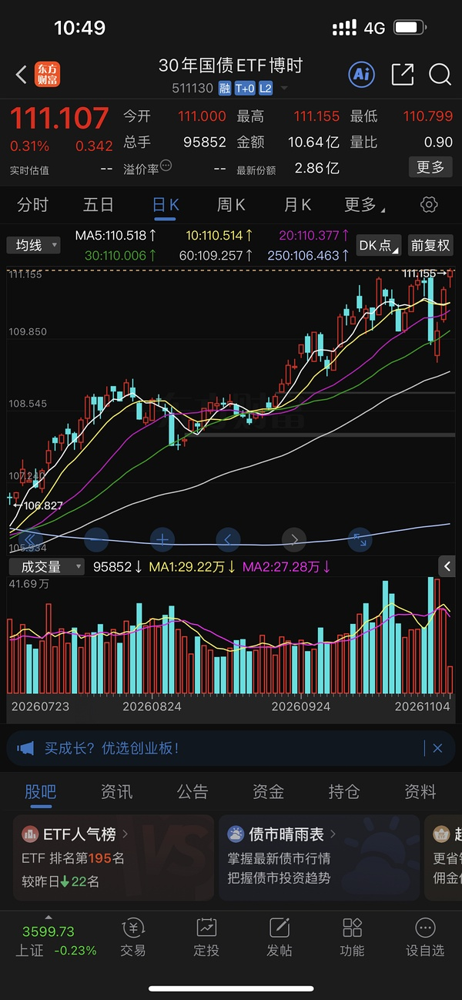
- 看我标题

### 中韩半导体ETF（提及 2 次，占比 1%）2026-11-04 13:51:48
- 很多股票
赢不了中韩半导体ETF
- 14:19:50【中韩半导体ETF华泰柏瑞（513310）成交超262亿 刷新历史天量】财联社11月4日电，中韩半导体ETF华泰柏瑞（513310）午后涨超6%，成交额突破262亿元，刷新此前在2026年7月29日创下的259.8亿元的成交

### 保利发展（提及 1 次，占比 0%）2026-11-04 07:52:39
- 历史数据显示，生肖概念股的大涨之后往往是大幅回撤。

据不完全梳理，圣龙股份2023年9月底以来一度收获十四连板，股价从10.9元涨至55.68元/股，2024年2月即跌至22.98元/股；川发龙蟒2024年10月以来股价一度从10元下方涨

### 上海电影（提及 1 次，占比 0%）2026-11-04 09:32:12
- sy和幸福杠上了啊

### 引力传媒（提及 1 次，占比 0%）2026-11-04 09:33:02
- 20之前的yl就是牛逼

### 新瀚新材（提及 1 次，占比 0%）2026-11-04 10:00:41
- 今天是机器人了
xhxc来了

### 格力电器（提及 1 次，占比 0%）2026-11-04 11:26:07
- 在妈妈帮助下 招行空调都红了

### 长白山（提及 1 次，占比 0%）2026-11-04 12:53:32
- 美国总统特朗普在与CBS News的通话中，向民主党在中期选举中获胜表示祝贺。“我想说的是，祝贺民主党，我期待与你们合作，共同为我们的国家努力，”他表示。此外，特朗普谈及伊朗战争时称，“基本上，我说什么时候结束，它就什么时候结束。我说结束的

### 创业板50ETF（提及 1 次，占比 0%）2026-11-04 14:42:19
- cc前两天证明有点调仓
应该不会那么亮眼😂
目测接近C50
看看能不能超过50

### 中文在线（提及 1 次，占比 0%）2026-11-04 15:59:24
- 如果你们看的老师都说同一个位置
那这个位置肯定到不了 🤣🤣🤣
大家会提前跑

就像这次都看双头 自然就没有

### 📄 全部发言（共 283 条）
- (2026-11-04 06:46:12) AMD盘后大涨6% 

AMD首席执行官苏姿丰：我们预计2027年PC市场出货量将出现两位数百分比下降。

- (2026-11-04 06:48:49) 超微电脑盘后大涨6%

超微电脑(SMCI.US)周二公布2027财年第一季度财报。受人工智能数据中心基础设施需求推动，公司季度营收创下历史新高，同比接近增长3倍，净利润同比增长逾8倍。不过，公司经营活动现金流仍为负值，且毛利率较上一季度明显下滑。

- (2026-11-04 07:52:39) 历史数据显示，生肖概念股的大涨之后往往是大幅回撤。

据不完全梳理，圣龙股份2023年9月底以来一度收获十四连板，股价从10.9元涨至55.68元/股，2024年2月即跌至22.98元/股；川发龙蟒2024年10月以来股价一度从10元下方涨至22.23元/股，但此后震荡下挫，2025年1月一度跌至11.88元/股；湖北广电曾从3.49元涨至13元/股，此后跌回3.05元/股，回撤幅度达77%；兔宝宝一度从5元附近涨至近17元/股，涨幅超过两倍，随后在三个月内跌回起点。

值得一提的是，面对股价异动，“羊”字辈上市公司密集发布风险提示，本月便有10家公司相继公告“降温”。

其中，阳光照明已连续两日发布股票交易异常波动公告，公司称目前生产经营情况一切正常，并提示广大投资者“理性投资，注意投资风险”。

东方海洋昨晚公告称，近期公司股票价格大幅攀升，换手率和成交额急剧增加，远高于前期水平，存在市场情绪过热情形。

公司还直言，基本面未发生重大变化，净利润仍处于持续亏损状态，存在股价偏离上市公司基本面和合理估值区间的风险。

海洋王的“自我降温”则更为密集。自10月19日以来，公司已四度发布相关公告，坦言公司股价已严重偏离基本面，存在市场情绪过热、非理性炒作风险，投资者参与交易可能面临较大风险。公司还特别澄清，不属于“核电”概念，也与“深海科技”概念无关。

此外，泉阳泉、华阳国际、澳洋健康、盛洋科技、大洋电机、光洋股份、邵阳液压等多股近期也分别发布公告，均确认不存在应披未披重大事项，并提示投资者理性投资、注意投资风险。

- (2026-11-04 07:53:45) 单日历史第三 昨日宽基型ETF资金净流入858亿元

同花顺iFinD数据显示，2026年11月3日，ETF资金整体净流入798.54亿元，股票型净流入837.59亿元，宽基型净流入858.85亿元(为单日净流入历史第三高)。当日ETF资金净流入榜单排名前3依次为：华泰柏瑞沪深300ETF（510300）净流入130.12亿元，华夏上证科创板50成份ETF（588000）净流入112.24亿元，华夏上证50ETF（510050）净流入103.10亿元。

- (2026-11-04 07:55:21) 彭博：华fa公司债已按时完成兑付

- (2026-11-04 08:00:29) 目测就是提升了香港科网股吧
近一周跌幅不大的也只有香港 
当然韩国也不错他本来就有  ⊳ （引用 @VVV坚定持有VVV）这个网易云到底去哪儿了🤔

- (2026-11-04 08:02:05) [图] 黄金多头变空头了😂

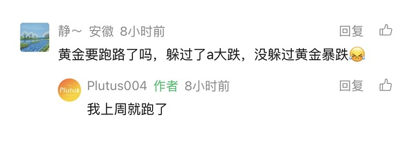  ⊳ （引用 @moli）难得没跳水

- (2026-11-04 08:03:09) 韩国综合股价指数（KOSPI）开盘上涨2.4%，至5786.13点。SK海力士涨4.8%，三星电子涨3.6%。

昨天场内中韩半导体尾盘资金落荒而逃 判断错误

- (2026-11-04 08:04:09) 由于没有收盘超过10%溢价 今天还是一起9:30开盘🤣  ⊳ （引用 @不知道还能说啥）韩国综合股价指数（KOSPI）开盘上涨2.4%，至5786.13点。SK海力士涨4.8%，三星电子涨3.6%。

昨天场内中韩半导体尾盘资金落荒而逃 判断错误

- (2026-11-04 08:09:28) [图] 融资盘又是接近300亿啊 沪150

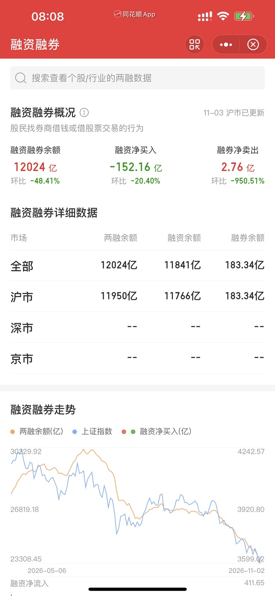

- (2026-11-04 08:09:44) 以前都能玩到12月 估计后面会缩小范围吧  ⊳ （引用 @家不住海边）羊要结束了吗

- (2026-11-04 08:23:06) 美国在跳水哈哈  ⊳ （引用 @点-重生炒垃圾）看来真的恢复了，💚💚💚ai，没有负反馈

- (2026-11-04 08:44:29) 没有  ⊳ （引用 @已注销）uu们⛄️是不是也锁了

- (2026-11-04 08:45:07) 等15:00点再拉升  ⊳ （引用 @跑丢的橙子）纳指期货怎么闪崩了，起床的时候还好好的

- (2026-11-04 08:49:08) 两市融资余额较上日减少320.82亿元
截至11月3日，上交所融资余额报11766.22亿元，较前一交易日减少156.26亿元；深交所融资余额报10864.04亿元，较前一交易日减少164.56亿元；两市合计22630.26亿元，较前一交易日减少320.82亿元。

- (2026-11-04 08:49:28) 都爆了 这个又创造今年记录前几了  ⊳ （引用 @不知道还能说啥）两市融资余额较上日减少320.82亿元
截至11月3日，上交所融资余额报11766.22亿元，较前一交易日减少156.26亿元；深交所融资余额报10864.04亿元，较前一交易日减少164.56亿元；两市合计22630.26亿元，较前一交易

- (2026-11-04 09:08:31) 所以涨跌和指引根本无关🤣🤣🤣  ⊳ （引用 @momo）啊😧我怎么感觉这说了句不好的话

- (2026-11-04 09:09:32) 1，美元替代美元走弱
2，中美对抗升级
3，降息周期
4，全球央行购金  ⊳ （引用 @点-重生炒垃圾）说实话，我到现在都不知道黄金之前的逻辑是啥，现在的逻辑又是啥

- (2026-11-04 09:10:53) 没有需要担心科技高开的必要了  ⊳ （引用 @山中食人花）小韩绿了

- (2026-11-04 09:13:08) 4200要狠狠IPO呀
现在IPO停
说法肯定得变

- (2026-11-04 09:15:30) [图] 真正的避险工具：美债

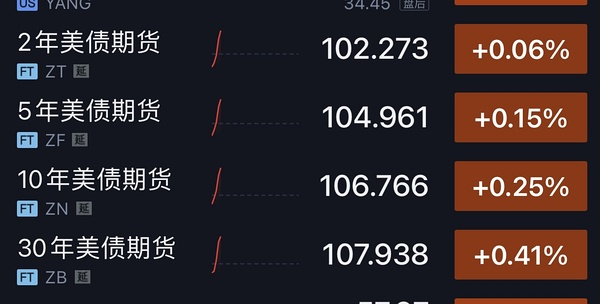

- (2026-11-04 09:16:10) 现在1234都有逆转

第四个有几个国家在卖黄金 你可以搜新闻  ⊳ （引用 @momo）楼楼，这是缺一不可吗？还是只要满足其中一条即可？

- (2026-11-04 09:17:13) 我个人觉得
降息周期是最关键的

参考22年油下 黄金下 因为美国还在加息
此后降息了就转涨了  ⊳ （引用 @momo）楼楼，这是缺一不可吗？还是只要满足其中一条即可？

- (2026-11-04 09:26:14) 美国反弹

- (2026-11-04 09:26:30) 不接  ⊳ （引用 @momo）雪人多少接啊楼楼

- (2026-11-04 09:27:13) 昨天的没有出啊  ⊳ （引用 @momo）雪人多少接啊楼楼

- (2026-11-04 09:32:12) sy和幸福杠上了啊

- (2026-11-04 09:33:02) 20之前的yl就是牛逼  ⊳ （引用 @YuanZi💕）妈呀

- (2026-11-04 09:33:14) 20内所向披靡哈哈哈  ⊳ （引用 @家不住海边）yl？
有这本事。

- (2026-11-04 09:33:43) 大A别装了
美股进一步大跳水

- (2026-11-04 09:34:29) 牛逼 ！！！  ⊳ （引用 @🅰失而复🉐😎）偷了一把🤣

- (2026-11-04 09:39:25) nana-1.8还好吗  ⊳ （引用 @we）哪里看到的 夜盘也还好呀

- (2026-11-04 09:41:23) 大A在那装啥呢  ⊳ （引用 @稀里不糊涂）娜娜跌超2个点

- (2026-11-04 09:43:04) [图] 映射昨天美股🤣

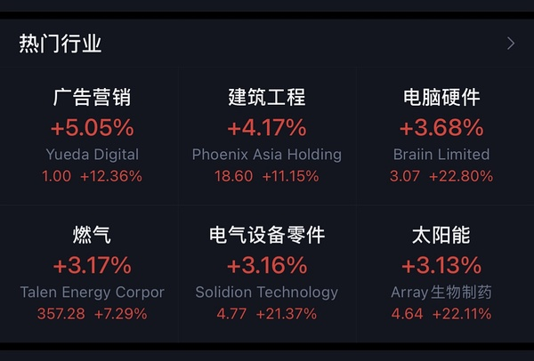  ⊳ （引用 @稀里不糊涂）奶茶今天这么猛

- (2026-11-04 09:45:28) 缺口之前不还有个爆量针？那个先是大问题  ⊳ （引用 @kk）楼，zy快到上面缺口了，有没讲究？😢

- (2026-11-04 09:46:07) 固态电池概念延续强势 紫竹高科3连板
固态电池概念延续昨日强势，紫竹高科3连板，新亚制程、圣阳股份触及涨停，海博思创、紫建电子、尚水智能、武汉蓝电跟涨。

- (2026-11-04 09:48:10) 幸福给我去干翻奶茶呀

- (2026-11-04 09:49:20) 中影没有

我以为那个uu说的涨越😂  ⊳ （引用 @shirla）1561，zy有条件单吗楼楼

- (2026-11-04 09:49:58) uu状态牛逼啊  ⊳ （引用 @🅰失而复🉐😎）🤣

- (2026-11-04 09:51:17) 大A预判美国期货是假摔？

- (2026-11-04 09:51:51) 消费一起  ⊳ （引用 @🅰失而复🉐😎）拉科技了🤣

- (2026-11-04 09:52:16) 垃圾现在根本不怕科技🤣🤣🤣🤣🤣  ⊳ （引用 @🅰失而复🉐😎）拉科技了🤣

- (2026-11-04 09:59:15) 电影+冰雪
十一月开局非常棒

- (2026-11-04 09:59:42) 只要不乱浪 稳稳的赚钱  ⊳ （引用 @不知道还能说啥）电影+冰雪
十一月开局非常棒

- (2026-11-04 10:00:41) 今天是机器人了
xhxc来了  ⊳ （引用 @点-重生炒垃圾）雪人

- (2026-11-04 10:01:15) 这次你在cc了？
我在北方了😂😂😂😂  ⊳ （引用 @点-重生炒垃圾）长城能涨停吗？

- (2026-11-04 10:01:57) 今天asd低吸完美

asd大低开之王😂😂😂

- (2026-11-04 10:03:47) 找到一个同步的
我T了 差不多5个点🤣🤣🤣  ⊳ （引用 @YuanZi💕）艾斯顿加油 -5b了一手 做个t

- (2026-11-04 10:05:22) 吗的asd做过T了
上冲我也触发不了了😂

- (2026-11-04 10:06:29) 笑死
美国跳水 大A刚刚装逼
现在美国拉升 大A科技跳水

- (2026-11-04 10:07:46) 大家别着急 一个个轮流来🤣  ⊳ （引用 @小确幸）神剑今天能冲一下吗？昨天捞了点

- (2026-11-04 10:08:44) 幸福你干翻sy已经无法让人满足幸福了

速度去干翻奶茶

- (2026-11-04 10:09:13) 光线也来了 超绝低位😂

- (2026-11-04 10:09:57) 今天机器人低开幅度最大 日内捞一把利润最高哎

- (2026-11-04 10:10:58) 当大家嫌弃cbs

cbs就来了

不要单独押注

- (2026-11-04 10:11:52) 重要的是我的钱已经在下一个地方了😂  ⊳ （引用 @只想搞钱）想着说跟着t，卖了才反应过来你是-5买的我是-4那我应该再高点卖😂

- (2026-11-04 10:15:28) 我和你说吧

你最好别希望他触发  ⊳ （引用 @小鸡哔哔哔）大连会触发吗

- (2026-11-04 10:16:49) 当早上uu吐槽机器人大跌
可是好机会  ⊳ （引用 @稀里不糊涂）asd日内这都10个点了

- (2026-11-04 10:17:20) 十一月是玩垃圾的
机器人不会缺席 机器人都是骗子 足够垃圾  ⊳ （引用 @🅰失而复🉐😎）机器人偷家😏

- (2026-11-04 10:18:32) 昨天雪人触发了

手动涨停挂出

- (2026-11-04 10:18:41) 15.6  ⊳ （引用 @不知道还能说啥）昨天雪人触发了

手动涨停挂出

- (2026-11-04 10:19:15) 大家都不是欢乐豆
提前做好准备
不要盘中再做反应  ⊳ （引用 @今夕何夕）雪人有单么？14.94？

- (2026-11-04 10:20:09) 我asd做过零花钱
今天无法再出了
没抄底的uu们还是可以按照计划出😂

- (2026-11-04 10:20:26) 大家自己看着办哈
我出不去了  ⊳ （引用 @不知道还能说啥）我asd做过零花钱
今天无法再出了
没抄底的uu们还是可以按照计划出😂

- (2026-11-04 10:21:29) 涨停本来的一半  ⊳ （引用 @赛博朋克2077）我忘了是涨停全出还是出上一笔买的😭

- (2026-11-04 10:21:51) 不  ⊳ （引用 @仓部加措）今天回落接雪人么

- (2026-11-04 10:22:21) 我有三笔 有一笔挂条件单了的
两笔锁了  ⊳ （引用 @扶我起来还能买）不知道是记错了还是记岔了，我看楼大连有想锁仓的意思，就没挂单了😂

- (2026-11-04 10:22:41) 对不起中马
我昨天卖了😂  ⊳ （引用 @YuanZi💕）asd冲呀！！

- (2026-11-04 10:22:49) 对不起 马哥  ⊳ （引用 @不知道还能说啥）对不起中马
我昨天卖了😂

- (2026-11-04 10:23:44) 那建设工业在干嘛呢？？  ⊳ （引用 @不知道还能说啥）对不起 马哥

- (2026-11-04 10:24:02) 马哥我辜负了😂😂😂😂😂😂  ⊳ （引用 @赛博朋克2077）我今天终于回本了，感谢马哥

- (2026-11-04 10:25:47) 没缺口啊
15是22号的强力买点 套牢盘😂  ⊳ （引用 @木感情的打工人）原来刚才是☃️进攻缺口失败

- (2026-11-04 10:26:05) 有差价了拿回来不就行了  ⊳ （引用 @好起来了）啊啊啊啊啊雪人点快了，清仓了

- (2026-11-04 10:26:17) 哪个科技股走的好的🤣  ⊳ （引用 @👑）东山精密走的好垃圾啊

- (2026-11-04 10:26:59) SK海力士跌幅扩大至4.5％，三星电子跌幅达3％。

- (2026-11-04 10:27:12) 大家手里消费不要轻举妄动

科技很容易大跳水 反拉消费  ⊳ （引用 @不知道还能说啥）SK海力士跌幅扩大至4.5％，三星电子跌幅达3％。

- (2026-11-04 10:27:21) 大A在装逼  ⊳ （引用 @不知道还能说啥）大家手里消费不要轻举妄动

科技很容易大跳水 反拉消费

- (2026-11-04 10:27:56) 当然冰雪也是消费  ⊳ （引用 @不知道还能说啥）大家手里消费不要轻举妄动

科技很容易大跳水 反拉消费

- (2026-11-04 10:28:40) 所以其实楼里的uu喜欢的是中影模式
收益全部拿足
还不会激情猛干倒亏  ⊳ （引用 @超级无敌迷你装）雪人🐮🐮不过要吸取经验，以前总是第一波轻仓大赚，第二波上大仓位倒亏

- (2026-11-04 10:29:04) 这一次我在20冰雪了🤣🤣🤣🤣  ⊳ （引用 @速派女孩将发财）龙江来了 雪人准备第二波！！！

- (2026-11-04 10:30:45) 👍👍👍👍👍👍👍

你今天去襄阳了吗  ⊳ （引用 @只想搞钱）一边吐槽一边买

- (2026-11-04 10:31:26) 冰雪可没有月13%涨幅  ⊳ （引用 @🧋今天25了吗）我在幸福有点不幸福🥀🥀

- (2026-11-04 10:32:36) 那我期待你感叹襄阳又来了😂  ⊳ （引用 @只想搞钱）没敢去，我把钱加给轮子了，怕🐑不行

- (2026-11-04 10:33:52) 哦你看得120分钟线

日线没有  ⊳ （引用 @木感情的打工人）我这有一根灰色的

- (2026-11-04 10:34:40) 襄阳冲啊
把机器人全部带上涨停

- (2026-11-04 10:35:55) 嗯 但是赚多了我就浪了 😅  ⊳ （引用 @🅰失而复🉐😎）是不是有盖子压着

- (2026-11-04 10:36:32) 没看哎 没有吧
雪人都没30  ⊳ （引用 @仓部加措）楼楼大连利润垫有接近30%了么

- (2026-11-04 10:36:51) 楼里uu春哥的图也漂亮！

- (2026-11-04 10:37:12) 😂只要不贪心乱浪 这就是十一月赚钱秘籍  ⊳ （引用 @-却行）🤣这个月靠冰雪已经11%了

- (2026-11-04 10:38:53) 11月4日，此前大涨的A股“羊”字辈今日批量跌停，截至发稿，百洋股份、澳洋健康、泉阳泉、海阳科技、阳光乳业、华阳国际、红太阳、阳光照明跌停，题材全面退潮。

从全线涨停到集体跌停，仅隔一个交易日

就在上一交易日（11月3日），A股“羊”字辈还被资金爆炒，大面积涨停：太阳能、大西洋、鲁阳节能、岳阳兴长、圣阳股份、华阳国际、阳光照明、东方海洋等涨停，明阳电路、长阳科技、久之洋涨超10%，七匹狼一度两连板并引爆“狼吃羊”话题。

- (2026-11-04 10:41:15) 那必须的哈哈

中马也强  ⊳ （引用 @👑）asd真强啊

- (2026-11-04 10:41:46) 今天我买了  ⊳ （引用 @👑）刚刚那个买羊的uu，买了吗😅

- (2026-11-04 10:42:11) 这个我都忘了😂😂😂  ⊳ （引用 @速派女孩将发财）昨天我们选的太阳线缆怎么回事！！不争气

- (2026-11-04 10:44:00) 他再跳我就浮亏了  ⊳ （引用 @西西西西）晶雪吗

- (2026-11-04 10:44:12) 缺口威力牛哦 大意了  ⊳ （引用 @🅰失而复🉐😎）这跳的也太🙃

- (2026-11-04 10:44:39) 连续两根缺口遇阻

唤醒了xxz惨烈的回忆😂😂😂😂  ⊳ （引用 @🅰失而复🉐😎）这跳的也太🙃

- (2026-11-04 10:47:36) 按照目前盘面
科技等待崩盘（无视nana-2有用吗）
接下来可能是垃圾食品商场接力啊

- (2026-11-04 10:48:39) 快讯：A股三大指数集体翻绿 下跌个股超3300只

- (2026-11-04 10:49:52) [图] 30年国债三连阳再创新高

债斯达克

- (2026-11-04 10:50:06) 10年国债昨天就历史新高  ⊳ （引用 @不知道还能说啥）30年国债三连阳再创新高

债斯达克

- (2026-11-04 10:51:20) 我跌停买的 和asd一起上的 今天亏不了钱 明天再说🤣🤣🤣  ⊳ （引用 @🅰失而复🉐😎）襄阳垃圾了机器人跳了🤣

- (2026-11-04 10:53:00) 我猜你还有第二个食品😂  ⊳ （引用 @🅰失而复🉐😎）恋爱脑冲😎

- (2026-11-04 10:53:53) 周五和周一给机会了  ⊳ （引用 @噜啦啦噜啦啦）呜呜呜呜，怕高，把华子卖了，是我不懂事了

- (2026-11-04 10:54:19) 今天能高开就已经奇迹了  ⊳ （引用 @YuanZi💕）科技给我跳绿了😑

- (2026-11-04 10:56:51) 今天的高点是昨天的热门买点 我看了🤣🤣🤣🤣  ⊳ （引用 @该用户已过期）上影翻绿

- (2026-11-04 10:57:58) 今天是羊全死了吗
还有活口在嗨的吗😂😂

- (2026-11-04 11:02:32) 大连今天10/22高点都没刷新

弱了

- (2026-11-04 11:02:52) 去一边休息去吧
看我们雪人表演  ⊳ （引用 @不知道还能说啥）大连今天10/22高点都没刷新

弱了

- (2026-11-04 11:05:13) 雪人也是小垃圾🤣🤣🤣🤣🤣  ⊳ （引用 @404找回了）跳水把雪人换去了小辣鸡

- (2026-11-04 11:05:58) 军工早上冲过啦😂  ⊳ （引用 @点-重生炒垃圾）主力想好了吗？赶紧吃药喝酒打军工

- (2026-11-04 11:06:24) yes 恋爱中

- (2026-11-04 11:07:17) 那必须的 今天还给了更好的价格😂😂  ⊳ （引用 @想喝冰淇淋红茶）恋爱脑突然一条直线

- (2026-11-04 11:08:32) 牛逼  ⊳ （引用 @点-重生炒垃圾）我买的了哈哈哈，刚刚特别巧

- (2026-11-04 11:09:35) [图] 我提醒的还是到位的 垃圾食品来了

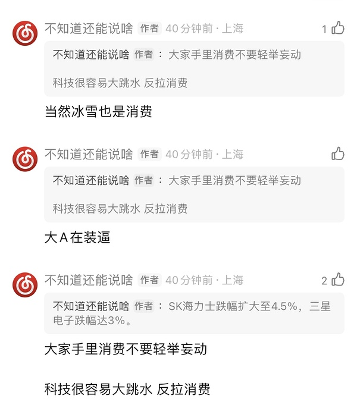

- (2026-11-04 11:11:30) 那上午先垃圾食品

午后强化旅游板块 带动冰雪  ⊳ （引用 @🅰失而复🉐😎）来的有点早了🤣

- (2026-11-04 11:12:51) 但是我们科技今天还在装逼哎  ⊳ （引用 @404找回了）笑死，就是看到这句马上行动了

- (2026-11-04 11:17:46) 三大指数都下跌的 道琼斯也没有反向  ⊳ （引用 @点-重生炒垃圾）扪心自问，你不觉得老美科技在假摔吗？😂😂😂感觉NANA跳水才不正常

- (2026-11-04 11:19:13) 现在恐慌6%涨幅 不太慌🤣  ⊳ （引用 @我爱牛肉火锅）早上给我推送恐慌指数期货拉升了，不知道是不是有消息

- (2026-11-04 11:19:57) 妈妈买的极为疯狂

- (2026-11-04 11:20:08) 确实是牛逼  ⊳ （引用 @不知道还能说啥）妈妈买的极为疯狂

- (2026-11-04 11:24:46) [图] 和上礼拜策略变化了小票也是狂买

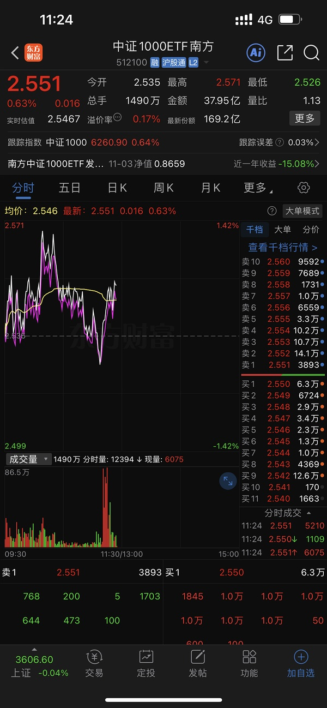  ⊳ （引用 @木感情的打工人）拿着我的社保装大方

- (2026-11-04 11:26:07) 在妈妈帮助下 招行空调都红了

- (2026-11-04 11:31:52) [图] 哈哈哈哈 羊被一锅端了

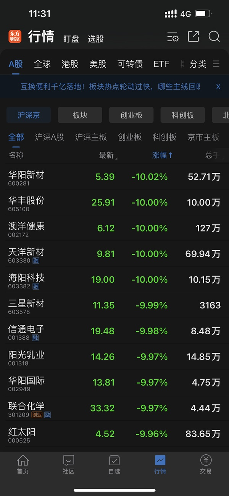  ⊳ （引用 @该用户已过期）襄阳要去躺板板了

- (2026-11-04 11:32:34) 奶茶午后会翻绿吗😂😂😂😂

- (2026-11-04 11:34:49) 肯定会有活下来的羊
后面就是逐步淘汰赛

就像那次龙一开始无数个
最终只剩下圣龙股份  ⊳ （引用 @该用户已过期）那今年的跨年妖股该没有羊了吧🤣🤣

- (2026-11-04 11:38:16) 今天妈妈有点牛逼 不好判断哈哈哈  ⊳ （引用 @该用户已过期）马上菲姐来狙你🤣🤣

- (2026-11-04 11:39:21) 妈妈和昨天一样
50 300 500 1000各路全部火力全开  ⊳ （引用 @🅰失而复🉐😎）靠，还真的🤧

- (2026-11-04 11:40:07) 大家凭手气刮奖😂  ⊳ （引用 @🅰失而复🉐😎）给机会😏

- (2026-11-04 11:50:12) 那是因为激进加息0一路加到5%
23年也是白登 不加息了就反攻了  ⊳ （引用 @moli）22年的美股吗拜登时期

- (2026-11-04 11:57:52) 美国国债大幅上涨，收益率全线下跌，5年期国债收益率领跌，下跌7个基点至4.69%。基准10年期国债收益率下跌6个基点至4.90%。

消息面上，民主党即将掌控众议院，从而降低特朗普政府进一步扩大赤字立法的可能性。鉴于美国债务规模已达约40万亿美元，债券投资者一直对美国的财政走向感到不安，而政治僵局能够降低政府增加支出或减税的风险。

- (2026-11-04 11:58:20) 奶茶现在还会让你们上头😂😂😂😂😂  ⊳ （引用 @高手云集上钻）早上差点看到7个点上头就b，幸好突然被其他事打岔了

- (2026-11-04 12:05:23) 这两个还正好贴合当下市场 公募欠配😂😂  ⊳ （引用 @发财喵）美美民主党好像更支持新能源光伏储能这些…
会被一财那个嘉宾说对吗😬😬😬

- (2026-11-04 12:05:58) 11月4日消息，阿里内测AI影视创作台“Looogen（逻辑智片）”，主打“有逻辑，自成片”。

据了解，这款产品主要面向短剧与视频制作的本地Agent，通过对话即可完成剧本拆集、镜头设计、角色服装场景素材生成等，尝试搭建AI片场生产线。

- (2026-11-04 12:08:57) 龙版三连板了
第三波😂  ⊳ （引用 @点-重生炒垃圾）停停，一滴都没了

- (2026-11-04 12:11:00) 龙版标杆
中信出版负责情绪

和之前一样 他们找回了当时的搭配  ⊳ （引用 @点-重生炒垃圾）还想着打缺口会怂😅😅😅直接过

- (2026-11-04 12:20:17) 贷款利率1% 沪深300股息率3%
这钱咋亏😂😂😂😂😂  ⊳ （引用 @fff好无聊）鉴于妈妈这么长时间的守护以及这么大的总进货量，我虽然不相信妈妈的为人，但是我相信妈妈不会让自己亏钱

- (2026-11-04 12:23:20) 我已经希望今天浪出去的能揍我一下 给我泼一盆冷水清醒一下了😂😂😂😂😂不然后面自己双手更难控制哈哈哈哈哈  ⊳ （引用 @🅰失而复🉐😎）我今天准备去的，但是我昨晚的预期是它绿🤣

- (2026-11-04 12:27:49) [图] 不知道他啥券商
看来大家差不多
东方财富就是满融-40%电话追保 不充值就强平

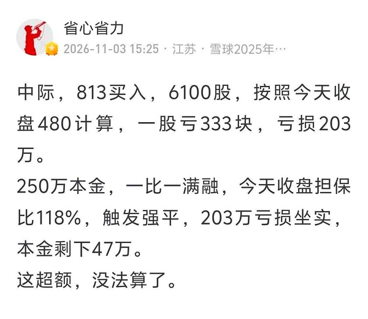

- (2026-11-04 12:31:17) [图] 

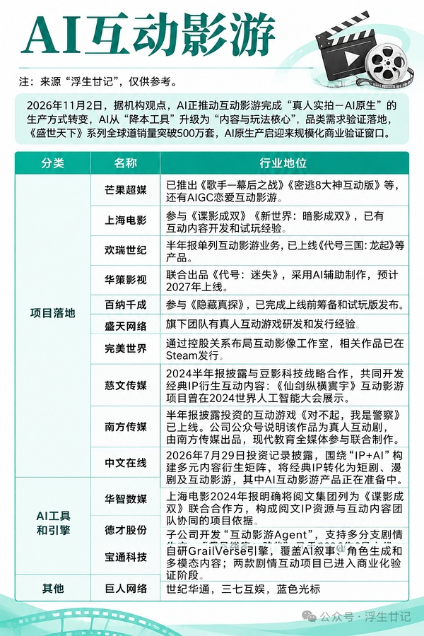

- (2026-11-04 12:33:51) 不要再来问这个问题了
哪怕现在又来一个口罩 美国人全死了
也是找东西加仓  ⊳ （引用 @酸奶不舔盖）咱们说的美基投资到2029金毛任期结束，应该是不管共和党有没有输掉中期选举吧？

- (2026-11-04 12:38:17) 现在确实是没有最最合适的额度又大一点的
只能矮子里拔高个
继续等待中  ⊳ （引用 @小鱼）楼加哪个呀😂我现在定投建信和国富，限额大的我都不敢买，被华夏伤透了，怕瞎买大a。

- (2026-11-04 12:45:21) 美国在反弹  ⊳ （引用 @木感情的打工人）川子啊

- (2026-11-04 12:46:14) 哈哈一只羊变成了一群羊  ⊳ （引用 @qiu啾）你昨天没爬楼吗，我昨天就在说🐏扩散了，还发了北京商报的图

- (2026-11-04 12:47:03) 这次是妈妈的预判吗

妈妈完全可以跟随崩盘之后再疯狂买买买买  ⊳ （引用 @点-重生炒垃圾）妈妈早已看透一切

- (2026-11-04 12:49:38) 民主党赢
美债收益率下 加息预期会进一步降低  ⊳ （引用 @木感情的打工人）川子啊

- (2026-11-04 12:53:32) 美国总统特朗普在与CBS News的通话中，向民主党在中期选举中获胜表示祝贺。“我想说的是，祝贺民主党，我期待与你们合作，共同为我们的国家努力，”他表示。此外，特朗普谈及伊朗战争时称，“基本上，我说什么时候结束，它就什么时候结束。我说结束的时候，它就会结束。”

- (2026-11-04 12:53:59) 大白话

我想美股什么时候好 就什么时候好  ⊳ （引用 @不知道还能说啥）美国总统特朗普在与CBS News的通话中，向民主党在中期选举中获胜表示祝贺。“我想说的是，祝贺民主党，我期待与你们合作，共同为我们的国家努力，”他表示。此外，特朗普谈及伊朗战争时称，“基本上，我说什么时候结束，它就什么时候结束。我说结束的

- (2026-11-04 12:54:25) 美股期货是因为这句话拉升的  ⊳ （引用 @不知道还能说啥）美国总统特朗普在与CBS News的通话中，向民主党在中期选举中获胜表示祝贺。“我想说的是，祝贺民主党，我期待与你们合作，共同为我们的国家努力，”他表示。此外，特朗普谈及伊朗战争时称，“基本上，我说什么时候结束，它就什么时候结束。我说结束的

- (2026-11-04 12:54:46) 中韩半导体准备火箭发射  ⊳ （引用 @木感情的打工人）民主党好像也不支持打伊朗？

- (2026-11-04 12:55:15) 特朗普谈及伊朗战争时称，“基本上，我说什么时候结束，它就什么时候结束。我说结束的时候，它就会结束。”

这个图就对应这句😂  ⊳ （引用 @VVV坚定持有VVV）哈哈哈哈哈哈哈哈哈哈哈哈哈哈哈哈哈哈哈哈哈哈哈加仓！

- (2026-11-04 12:58:16) 我今天看到-2期货
怒买了300块😅  ⊳ （引用 @VVV坚定持有VVV）🤣昨晚已经先加一步了，让我看看妈妈预判准不准

- (2026-11-04 12:59:15) 其实现在nana已经完全触发了4年前我定投nana的要求

遗憾的是这一次没有额度让我自由发挥  ⊳ （引用 @VVV坚定持有VVV）他不过就是想要诺贝尔和平奖，就给他吧，又怎么了
对全球古茗都好🥹

- (2026-11-04 13:00:25) 妈妈真厉害啊  ⊳ （引用 @VVV坚定持有VVV）🤣昨晚已经先加一步了，让我看看妈妈预判准不准

- (2026-11-04 13:01:50) 先买全线进攻型选手😂  ⊳ （引用 @山中食人花）楼买的正好是没啥额度的
我看咱们浦姐现在还是一千没关门呢

- (2026-11-04 13:07:19) [图] 谁是错的

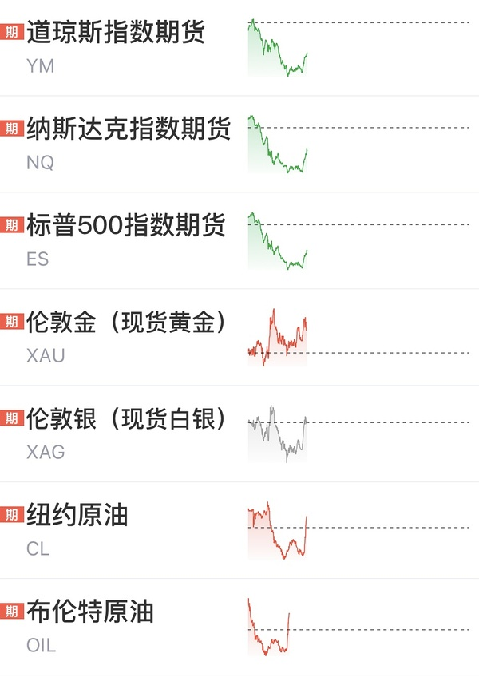

- (2026-11-04 13:11:10) 下次看到他下跌提醒我 我也去🤣锁掉一部分钱 防止浪没边  ⊳ （引用 @稀里不糊涂）想买点光线

- (2026-11-04 13:18:51) nana-2时候我们也是红的🤣提前量  ⊳ （引用 @速派女孩将发财）隔壁娜娜快拉红了 我们怎么还在跳水

- (2026-11-04 13:20:10) 两个食品羊跌停带崩🤣  ⊳ （引用 @ü）安安和xxz需要上强心针

- (2026-11-04 13:21:09) 今天恋爱很有价值哦

- (2026-11-04 13:21:15) 这也是恋爱的特色  ⊳ （引用 @不知道还能说啥）今天恋爱很有价值哦

- (2026-11-04 13:21:51) 和白酒一样 符合目前市场情况

就像炒垃圾一样玩就好 别看基本面  ⊳ （引用 @西西西西）阴暗电源这算是转向了吗

- (2026-11-04 13:22:23) 专一  ⊳ （引用 @仓部加措）楼楼来光伏么

- (2026-11-04 13:22:49) 不买 这个够了  ⊳ （引用 @👑）楼楼会买吗，跟随一下

- (2026-11-04 13:23:24) 跌停20+  ⊳ （引用 @点-重生炒垃圾）宇航员废物啊，沪工炸板了

- (2026-11-04 13:24:41) 今天微盘股很垃圾  ⊳ （引用 @速派女孩将发财）-8进去已经被埋 但是消费人不到最后不放弃

- (2026-11-04 13:25:32) 冰雪喜欢市场崩盘一塌糊涂😂😂😂😂😂😂  ⊳ （引用 @🅰失而复🉐😎）冰不行了🤣

- (2026-11-04 13:26:47) [图] 他们反应真快

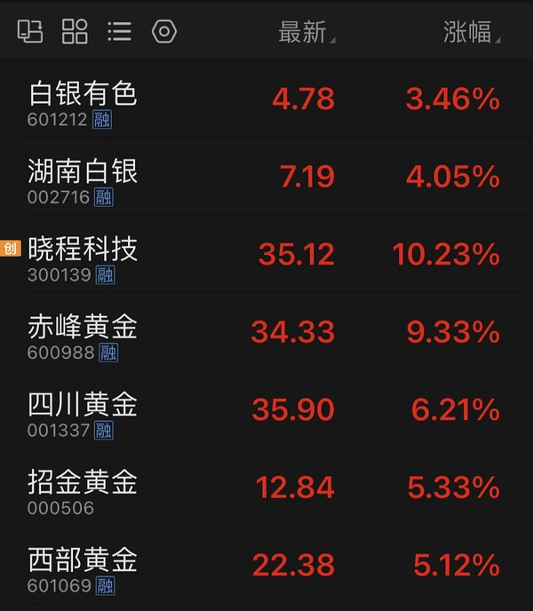  ⊳ （引用 @不知道还能说啥）民主党赢
美债收益率下 加息预期会进一步降低

- (2026-11-04 13:27:11) 因为民主党会让加息预期下降😂大A人家确实效率  ⊳ （引用 @ekiwang）资源类的金银拉这么猛😲

- (2026-11-04 13:27:50) 虽然民主党遏制一些ai
但是加息预期会大幅降低

怎么不是好事呢🤣  ⊳ （引用 @VVV坚定持有VVV）纳指期货都要翻红了🤣看今晚能不能买到跌

- (2026-11-04 13:28:37) 大连弱了
不敢进攻大阴线  ⊳ （引用 @问一下能不能瘦）我们雪人的s真棒

- (2026-11-04 13:30:34) 美债不买帐的
美债是一切  ⊳ （引用 @麦子）楼楼为啥呢，感觉川普一直想降息，他赢了不是更有有利于降低加息预期吗？

- (2026-11-04 13:31:58) 早上s的雪儿买入大连

-1.4

- (2026-11-04 13:32:40) 大连满额四笔  ⊳ （引用 @不知道还能说啥）早上s的雪儿买入大连

-1.4

- (2026-11-04 13:33:21) 谢谢uu  ⊳ （引用 @梳碧湖砍柴人）大连居然绿了

- (2026-11-04 13:35:53) 事件在一件件落地了  ⊳ （引用 @温妤哦）这是坏端端的好起来了吗😂

- (2026-11-04 13:36:38) 不以涨喜 不以跌悲  ⊳ （引用 @有空青年胃不饱）大盘好嗨啊 楼

- (2026-11-04 13:37:30) [图] 民主党最大赢家

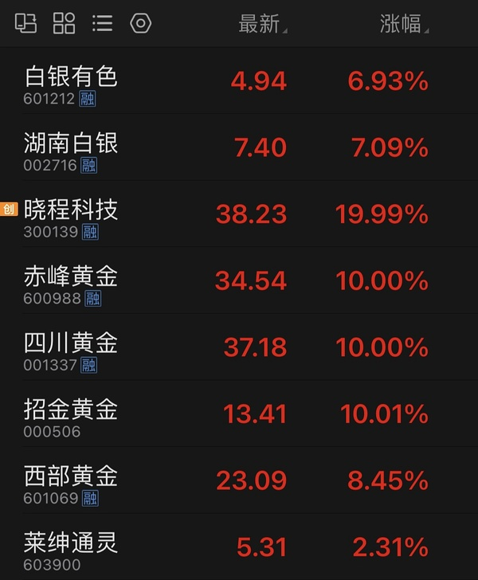

- (2026-11-04 13:38:41) 做交易不要看成本

成本会束缚你交易  ⊳ （引用 @momo）楼楼现在成本多少呀

- (2026-11-04 13:40:03) [图] 大家回答

- (2026-11-04 13:42:09) 😂以为至少晚上才好转  ⊳ （引用 @点-重生炒垃圾）还是早上那句话，扪心自问，难道不觉得老美科技是在假摔吗？哈哈哈哈

- (2026-11-04 13:42:24) 肯定科技啊
看看半导体ETF  ⊳ （引用 @稀里不糊涂）今天芯朋涨机器人？？？

- (2026-11-04 13:43:04) 大A春节后也不用担心 大A可是人来疯

这一次你只要相信美国 因为是全球联动

大A也会跟进  ⊳ （引用 @温妤哦）预料中但也超跌了！但是跌还不是最可怕的，最可怕的是根本不知道他啥时候好起来🥲小美是不担心，但是大a跌了好多

- (2026-11-04 13:44:24) 😂😂😂😂😂😂😂😂  ⊳ （引用 @一切都会过去的）妈：我提前预判你说我装逼？

- (2026-11-04 13:46:03) 等11/17 好像是这天
英伟达发业绩 重新点燃硬科技  ⊳ （引用 @海贼）卧槽硬科技回来了

- (2026-11-04 13:47:02) [图] 黄金格格不入

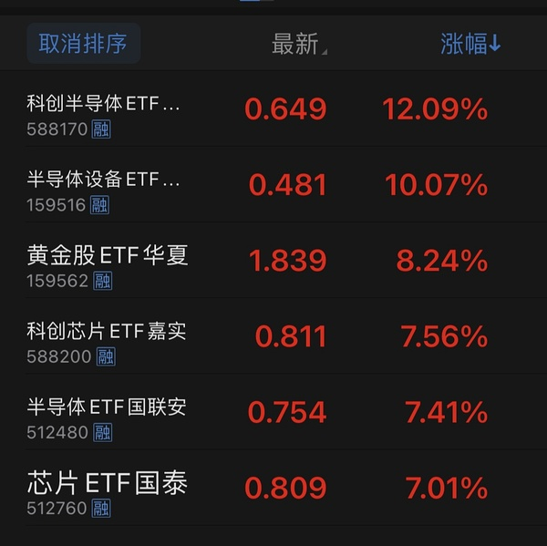

- (2026-11-04 13:47:25) 迪士尼许愿如何哈哈

毕竟在美国人的地方 许愿美国  ⊳ （引用 @VVV坚定持有VVV）中韩！太牛了

- (2026-11-04 13:47:31) 稳稳的  ⊳ （引用 @暴富¥(´･ᴗ･`)$）中韩溢价13%了

- (2026-11-04 13:47:46) 让我们欢迎中韩半导体加入10:30开盘ETF行列  ⊳ （引用 @高手云集上钻）中韩半导体溢价12了

- (2026-11-04 13:48:28) 增量资金来了  ⊳ （引用 @一直在摸🐟）科技狂拉 冰雪也没反向呐

- (2026-11-04 13:49:20) asd我被动持股了

你们自己决定今天走不走哦🤣我有单子的2994 但是卖不掉

- (2026-11-04 13:50:12) 就是昨天的  ⊳ （引用 @momo）楼楼今天b的大连有条件单吗

- (2026-11-04 13:51:48) 很多股票
赢不了中韩半导体ETF

- (2026-11-04 13:52:03) 我场内也算是有科技人属性😂  ⊳ （引用 @不知道还能说啥）很多股票
赢不了中韩半导体ETF

- (2026-11-04 13:53:51) 不需要担心 cbs告诉你了  ⊳ （引用 @momo）哦哦我也有点担心。

- (2026-11-04 13:55:07) 楼里uu又反转了？

还担心科技狙击冰雪了？

你们是不是180度的有点双面人了

- (2026-11-04 13:55:30) 中午还在问卖不卖
昨天还在吵架卖不卖  ⊳ （引用 @不知道还能说啥）楼里uu又反转了？

还担心科技狙击冰雪了？

你们是不是180度的有点双面人了

- (2026-11-04 13:59:00) [图] 

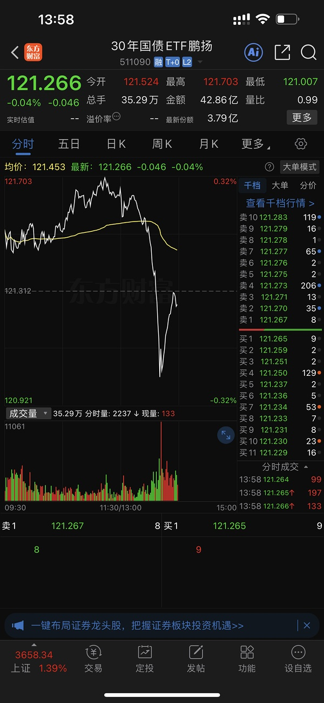

- (2026-11-04 13:59:43) 冬天一定会来
白酒那种消费确实有麻烦  ⊳ （引用 @葱）有个很简单的逻辑，就是科技上面应该一层一层套着的人，但是冰雪没有，因为已经过去一年了hhhhh

- (2026-11-04 14:01:07) 这就是大A难搞的地方
因为压抑许久肯定非常暴力

只要前两天割肉一定就是认输了 😂  ⊳ （引用 @云小朵飘啊飘）半设eft都快20涨停了，真夸张😅

- (2026-11-04 14:01:45) 大连因为今天自己遇阻大阴线了

- (2026-11-04 14:03:01) 只能熬
暴力反攻是必然😂  ⊳ （引用 @momo）我要是昨天认亏清仓的我现在会吐血

- (2026-11-04 14:03:47) 新买的易方达套了两天一把回本？😂😂😂😂
我就买了观察的

- (2026-11-04 14:04:01) 嗯缺口 我冲动了😅😅😅  ⊳ （引用 @西西西西）晶雪今天也是遇阻了吧

- (2026-11-04 14:04:32) 中韩半导体不如当初了
12%溢价怕个毛啊？

- (2026-11-04 14:05:07) 笑死我的羊起来了哦

- (2026-11-04 14:05:17) 怎么还有心思玩羊啊  ⊳ （引用 @不知道还能说啥）笑死我的羊起来了哦

- (2026-11-04 14:05:46) 要信早信
要割早割  ⊳ （引用 @哄哄🐮）😂幸好割得早，不然真的会呕血。

- (2026-11-04 14:07:56) 今晚龙虎榜不会都是家人朋友吧哈哈哈哈  ⊳ （引用 @摇头晃脑小脑斧）襄阳冲啊

- (2026-11-04 14:08:10) 哈哈哈哈哈哈 我还在  ⊳ （引用 @只想搞钱）Asd是持仓涨幅最大的了结果也卖飞哈哈

- (2026-11-04 14:09:07) 蓝色确实垃圾
奶茶都要10%了

- (2026-11-04 14:09:20) 不知道买什么参与
这玩意也真不错哦😂  ⊳ （引用 @一直在摸🐟）2000增强都+5了😂

- (2026-11-04 14:10:21) [图] 看我标题

  ⊳ （引用 @城事）今天这剧本，我感觉我都有点懵。

- (2026-11-04 14:12:12) 没信心的uu该考虑要不要减仓了！
没信心的uu该考虑要不要减仓了！
没信心的uu该考虑要不要减仓了！

- (2026-11-04 14:16:04) 中韩半导体居然控制10%溢价 那么缩了？

- (2026-11-04 14:16:24) 再反带大连  ⊳ （引用 @该用户已过期）⛄️冲

- (2026-11-04 14:16:49) 听说有人担心科技吸血冰雪

雪人给大家展示

- (2026-11-04 14:17:18) 15%半导体ETF都对冰雪无可奈何  ⊳ （引用 @不知道还能说啥）听说有人担心科技吸血冰雪

雪人给大家展示

- (2026-11-04 14:18:35) 好事啊
雪儿也许主升浪呢  ⊳ （引用 @momomomomomo哒）雪人差1分涨停😂

- (2026-11-04 14:19:16) 那个16.33的价格没阻力

雪人有可能继续进攻的

不管触发不触发 都无所谓

- (2026-11-04 14:20:09) 14:19:50【中韩半导体ETF华泰柏瑞（513310）成交超262亿 刷新历史天量】财联社11月4日电，中韩半导体ETF华泰柏瑞（513310）午后涨超6%，成交额突破262亿元，刷新此前在2026年7月29日创下的259.8亿元的成交额历史纪录。(来自财联社APP)

- (2026-11-04 14:20:24) 人太多了 不团结

有些人害怕溢价  ⊳ （引用 @不知道还能说啥）14:19:50【中韩半导体ETF华泰柏瑞（513310）成交超262亿 刷新历史天量】财联社11月4日电，中韩半导体ETF华泰柏瑞（513310）午后涨超6%，成交额突破262亿元，刷新此前在2026年7月29日创下的259.8亿元的成交

- (2026-11-04 14:20:51) 冬天是一定会来的
和白酒不一样😂  ⊳ （引用 @花道最爱拉面）冰雪也旱地拔葱啊

- (2026-11-04 14:21:32) 雪人我昨天说了
昨天不触发可能是好事
今天就是验证

现在我其实也不希望他涨停

- (2026-11-04 14:22:26) 谢谢雪儿 带动了我气氛组😂😂😂😂  ⊳ （引用 @不知道还能说啥）雪人我昨天说了
昨天不触发可能是好事
今天就是验证

现在我其实也不希望他涨停

- (2026-11-04 14:23:07) 大家互相帮助
必须大连也会帮助你们  ⊳ （引用 @不知道还能说啥）谢谢雪儿 带动了我气氛组😂😂😂😂

- (2026-11-04 14:23:29) 等英伟达财报重新引爆行情了  ⊳ （引用 @we）原来中期选举的利空是这样子的 哈哈哈

- (2026-11-04 14:24:04) 那你换的好哈哈哈  ⊳ （引用 @山中食人花）雪人真的太好了 
一会版 一会大跌
从科创换回来我一点不遗憾 ！！

- (2026-11-04 14:24:37) 现在才14:24分哈哈

uu而且你是cbs市场IP哎！！！  ⊳ （引用 @椰椰谷谷）雪儿就在这里收盘吧，明日再继续高歌猛进

- (2026-11-04 14:25:31) 全球联动！
只要美国连阳 很多问题都会逆转

筹码结构是因为没人买 全是卖
美国七连阳会没人买A股科技吗 就逆转筹码问题了  ⊳ （引用 @稀里不糊涂）小a科技也能跟着涨吗，筹码结构问题是不是不存在了

- (2026-11-04 14:27:32) [图] 根据这个指数的

韩国收盘了 15个中国半导体在影响指数的

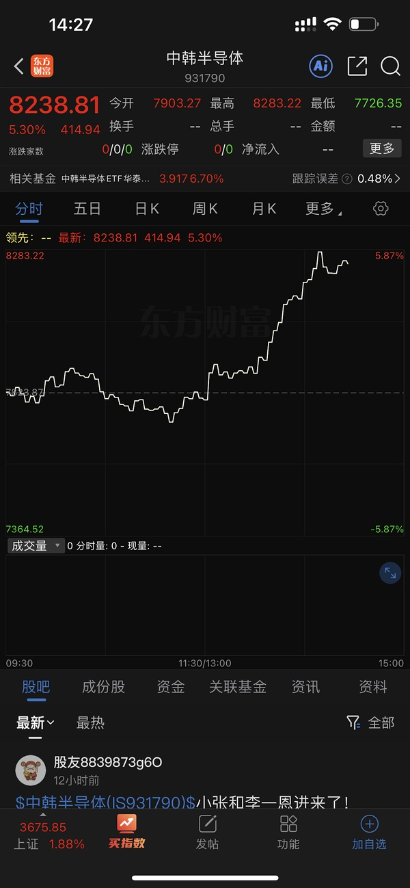  ⊳ （引用 @一切都会过去的）看不懂中韩半导体的溢价😂

- (2026-11-04 14:29:51) 人家收盘了  ⊳ （引用 @麦子）就大A嗨，日韩反应不大啊

- (2026-11-04 14:30:16) 你看看黄金白银在交易中的
日韩结束了呀  ⊳ （引用 @麦子）就大A嗨，日韩反应不大啊

- (2026-11-04 14:31:02) 奶茶不知道的以为10%涨停呢

- (2026-11-04 14:31:22) 23.5  ⊳ （引用 @👑）现在平均股价多少啊

- (2026-11-04 14:32:48) 你看uu们心马上就荡漾了
这个月老老实实买冰雪不会差的🤣  ⊳ （引用 @高手云集上钻）国庆之后买冰雪，我将把这句话和不准在大A买科技作为家训传给未来的小猫小狗

- (2026-11-04 14:33:12) 😂应该来了吧  ⊳ （引用 @404找回了）楼你点我🥲再次问出那个问题，融资盘今天来吗

- (2026-11-04 14:34:12) [图] 如果科技继续反攻 传媒一般
你看不继续的 不共振

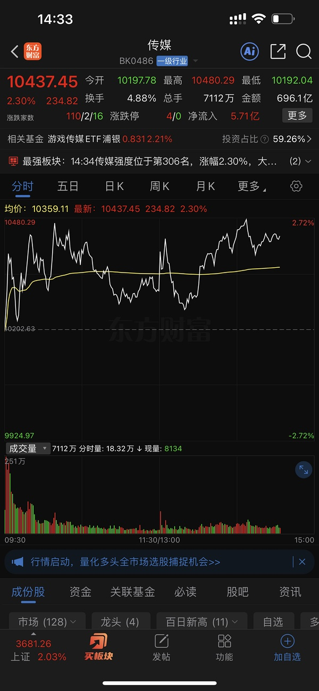  ⊳ （引用 @momo📈📈📈）也不知在磨叽啥。。。

- (2026-11-04 14:34:57) 嗯 反正是跟踪这个指数的

15个韩国15个中国

韩国占比略多一点  ⊳ （引用 @一切都会过去的）原来是这么看！因为今天小a半导体很强所以溢价没涨

- (2026-11-04 14:37:14) 好好好  ⊳ （引用 @稀里不糊涂）机器人共振了

- (2026-11-04 14:38:14) 新的存储之王  ⊳ （引用 @VVV坚定持有VVV）是啊！我还跟楼讨论来着，我问楼是不是打新中的，楼说不是，网易云十分看好硬件！

- (2026-11-04 14:39:35) uu们心态要放平哦
虽然今天我们垃圾不如别人了
但是科技前几天血洗我们也逆势走强的
既要又要是不可能的
好在大家还有场外的

- (2026-11-04 14:42:19) cc前两天证明有点调仓
应该不会那么亮眼😂
目测接近C50
看看能不能超过50  ⊳ （引用 @Victoria）期待畅畅今晚更新

- (2026-11-04 14:42:31) [图] 哈哈哈哈哈哈

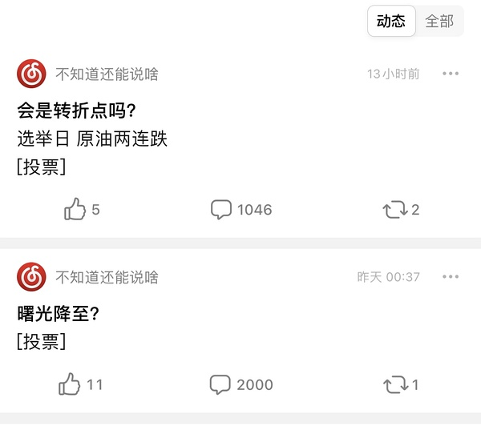  ⊳ （引用 @已注销）再来三天场外国内基应该都能回本了！怎么突然爆拉了

- (2026-11-04 14:43:19) 今天-2期货时候
恐慌指数就6%
飙不起来😅  ⊳ （引用 @shirla）谨记小a原来的样子，别上头哈哈。那按这个节奏还有vix飙升让我们买吗，是不是无了

- (2026-11-04 14:45:05) [图] 现在没有
五日线箭头往下的 你肉眼也能看到五日线没拐头
不过明天不跌就拐头了

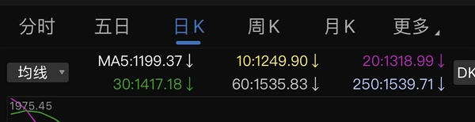  ⊳ （引用 @momo）楼楼，今天KC50算5日线拐头向上了吗

- (2026-11-04 14:45:51) uu你忘记了7.21日吗  ⊳ （引用 @moli）这像不像当年的924😂😂

- (2026-11-04 14:46:16) 今天不如7.21日吧
大家已经忘记了吗  ⊳ （引用 @不知道还能说啥）uu你忘记了7.21日吗

- (2026-11-04 14:47:33) 今天级别还不如7/21日 🤣  ⊳ （引用 @sickid）今天科技是20啊，科创半导体

- (2026-11-04 14:48:46) 靠
他不带我晶雪

刚刚雪儿会带

垃圾冰山吃独食  ⊳ （引用 @速派女孩将发财）冰山尾盘封板 太强了

- (2026-11-04 14:49:23) 这取决于美国

全球联动  ⊳ （引用 @木感情的打工人）思细级恐，像721的话，还得再跌半个月刚好等英伟达？

- (2026-11-04 14:50:17) 我还是那句老话

全球联动 A并不孤立

跌的多 反弹也更暴力

大A是疯子
足够让人忘记A本来的样子
也会足够让人厌恶  ⊳ （引用 @shirla）当头一盆冷水🤣🤣🤣

- (2026-11-04 14:51:44) 今年那么多新面孔啊😂😂😂😂😂  ⊳ （引用 @速派女孩将发财）　据21财经雷达，冰雪经济概念盘中震荡回升，冰山冷热盘中走出5天3板，截至午间收盘，冰山冷热炸板，奥雅股份、欧亚集团、雪人集团等跟涨。 通告又出现新名字了 加购观察

- (2026-11-04 14:52:00) 晚点我研究看看 都不熟悉  ⊳ （引用 @速派女孩将发财）　据21财经雷达，冰雪经济概念盘中震荡回升，冰山冷热盘中走出5天3板，截至午间收盘，冰山冷热炸板，奥雅股份、欧亚集团、雪人集团等跟涨。 通告又出现新名字了 加购观察

- (2026-11-04 14:52:33) 而这个是利好没想到吧🤣🤣🤣🤣  ⊳ （引用 @高手云集上钻）我甚至在微博看博主们讨论德州变蓝，这回真的是老美事事关心了

- (2026-11-04 14:53:35) 也是中国最有门面的科技股了😂😂一哥  ⊳ （引用 @VVV坚定持有VVV）跟小广以前的智谱一样？那我从今天开始不骂扫把鑫了，是我们的鑫头宝

- (2026-11-04 14:56:01) 晶雪没亏钱🤣🤣🤣🤣🤣
我的羊赚了5%了
不知道明天啥样

我浪都没浪出事😅😅😅😅  ⊳ （引用 @🅰失而复🉐😎）🐶东西🪓️

- (2026-11-04 14:56:34) 牛逼啊 襄阳  ⊳ （引用 @不知道还能说啥）晶雪没亏钱🤣🤣🤣🤣🤣
我的羊赚了5%了
不知道明天啥样

我浪都没浪出事😅😅😅😅

- (2026-11-04 14:57:33) 6%利润垫
不知道能不能全身而退哈哈哈  ⊳ （引用 @凯恩拿下金球😋）襄阳这个尾盘拉的

- (2026-11-04 14:59:51) 雪人明天开单15.84卖一半
回踩五日线附近加仓 他好几根线都在差不多地方

- (2026-11-04 15:00:54) 大连没变化

cbs我锁了 所以一直没有  ⊳ （引用 @不知道还能说啥）雪人明天开单15.84卖一半
回踩五日线附近加仓 他好几根线都在差不多地方

- (2026-11-04 15:02:02) 今天雪人的例子也是很好的教科书

以后我们挂涨停也降价1分钱 

1分钱不吃亏

- (2026-11-04 15:04:07) 我和asd一起捞的哈哈  ⊳ （引用 @momo）🤣🤣楼的🐏不会就是襄阳吧

- (2026-11-04 15:04:36) 看明天了🤣现在纸面富贵  ⊳ （引用 @🅰失而复🉐😎）我后面进的也红了，有点那天asd的感觉了🤣

- (2026-11-04 15:05:38) 擅长科技的uu又能发挥了
我就不掺和了
就靠中韩半导体和大家并肩作战😂😂😂

- (2026-11-04 15:07:00) 不做的
我特意充值买在了招行账户的

等20%溢价了再看走不走
我就当买了个场外基金  ⊳ （引用 @shirla）楼楼这个每天做T不？

- (2026-11-04 15:08:23) 知道民主党获胜利好加息预期降低

没想到黄金白银那么嗨

场内我们黄金白银股票更嗨  ⊳ （引用 @🅰失而复🉐😎）😎

- (2026-11-04 15:11:31) 只要你看好AI硬件
现在的位置依然很低

不过这个ETF现在大热门 成交量就看得出
所以应该很难回到7%以内的溢价率了

盘中你只能根据美国期货和韩国走势找机会买  ⊳ （引用 @momo）楼主我认真的 现在再上点中韩行吗  (我是变脸王 溢价1%内最好iknow但是我又开始贪了)

- (2026-11-04 15:13:37) 是的  ⊳ （引用 @扶我起来还能买）楼楼 恋爱脑是照旧么

- (2026-11-04 15:14:29) 全都是科创半导体ETF手下败将😂

- (2026-11-04 15:17:20) 你们看 大A就这样
你让基金经理上周调仓到白酒那种地方去
确实少跌了两天  涨了两天
但是没高兴两天 现在就迷茫了
规模大的 调仓都需要一段时间的 现在尴尬的一笔😂

- (2026-11-04 15:19:25) [图] 今天30债颤抖了🤣🤣🤣🤣

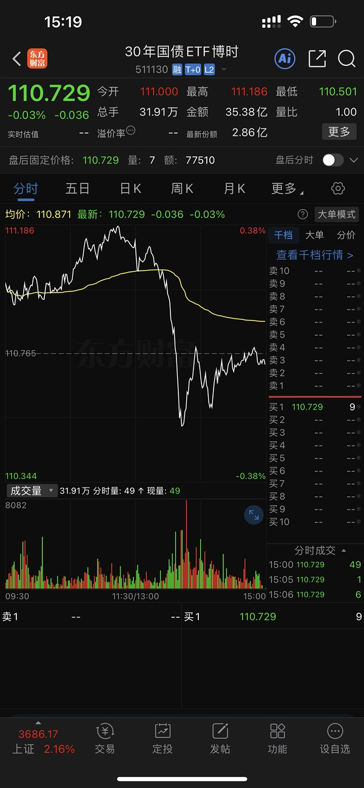  ⊳ （引用 @moli）「远古巨阳」，笑死

- (2026-11-04 15:21:32) [图] 那个ETF疯子 正常买这些也没20哈哈哈

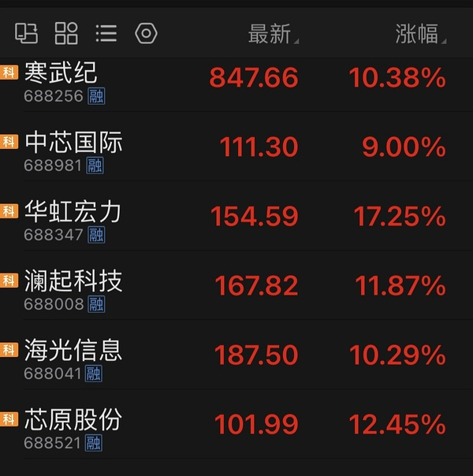  ⊳ （引用 @点-重生炒垃圾）这个几个不是半导体😂😂😂他们要做的可以做，后面轮到这个了就牛逼了，我要贯彻id

- (2026-11-04 15:23:47) 我开了2494 但是如果形势不好 我会手动的

就是比如如果其他冰雪很牛逼 他还是卡缺口 我就走了  ⊳ （引用 @爱拔酱）楼晶雪明天挂多少？

- (2026-11-04 15:26:15) 嗯嗯  ⊳ （引用 @木感情的打工人）大连还是44+吧

- (2026-11-04 15:29:25) 当你看A股真假本身就不对

美国决定走势 大A靠妈靠爸能改变一两天走势 终究还是要跟美国ai硬件走势 不止我们如此 韩国日本都一样

如果美国连阳 那A就是真的
如果美国连跌 那今天就是假的  ⊳ （引用 @momo）科技是真的还是骗人的😳

- (2026-11-04 15:33:49) 这个我不提倡玩
自己把握🤔

尤其不愿意割肉的跌了会变价值投资的 别碰羊啊😂
生肖最终都会是惨无人道的A杀 没有一个例外的  ⊳ （引用 @菡之）楼楼襄阳挂多少

- (2026-11-04 15:35:23) 我上次摸lulu也没回本🤣  ⊳ （引用 @我爱牛肉火锅）昨晚模拟盘摸了点英特尔，这个坑货，加上盘前-5%了

- (2026-11-04 15:38:33) 美国国债大幅上涨，收益率全线下跌，5年期国债收益率领跌，下跌7个基点至4.69%。基准10年期国债收益率下跌6个基点至4.90%。

消息面上，民主党即将掌控众议院，从而降低特朗普政府进一步扩大赤字立法的可能性。鉴于美国债务规模已达约40万亿美元，债券投资者一直对美国的财政走向感到不安，而政治僵局能够降低政府增加支出或减税的风险。  ⊳ （引用 @momo）差生又来了，想问下楼楼，请问民主党全胜为什么会使得美债利率下降呢？

- (2026-11-04 15:42:17) 民主党来了 
后续高利率不会维持了 就不会压制科技股估值

降息周期容易有估值溢价
本来的20倍的给30倍估值
加息周期里20倍就是20倍甚至更少

即使民主党让ai有受损 但是后续压低利率 估值溢价就能回归

（今天黄金白银反馈利率直截了当）

事务有两面性🤣🤣🤣🤣  ⊳ （引用 @木感情的打工人）话说民主党会在德州阻碍AI发展，感觉后续美国ai会比较曲折啊哈哈

- (2026-11-04 15:45:10) 😂看昨天融资盘数据 又是融资盘大批量爆仓导致的  ⊳ （引用 @momo）楼楼我说出来你别笑我，我前几天还问c50能不能加呢信心很足的样子，昨天心态突然崩了转到招商体育文化去了😂真是造化弄人

- (2026-11-04 15:54:07) 他们不是喜欢低利率 是要遏制财政扩张😂
美国人都是发国债扩张财政为主  影响美债走势  ⊳ （引用 @moli）民主党为何喜欢低利率

- (2026-11-04 15:55:10) 牛逼 今天居然波动率大降啊  ⊳ （引用 @fff好无聊）而且！我特意去看了！今天下午期指波动率都没起来

- (2026-11-04 15:59:24) 如果你们看的老师都说同一个位置
那这个位置肯定到不了 🤣🤣🤣
大家会提前跑

就像这次都看双头 自然就没有  ⊳ （引用 @饺饺饺子）按照平均股价指数算 好像水果老师说的位置应该也差不多在这个位置

## 🧠 投资风格分析
> 📏 增量更新指引：仅当今日发言确有新依据时才修订对应维度，无变化不强行重写；单维度修订建议 ≤150 字。

- 投资理念与方法：重视全球联动、机构行为与指数规则带来的被动买卖盘，先质疑公开数据真实性；以参与度判断行情性质，对高位腾空型科技股、小票垃圾票与微盘股保持戒心，关注业绩确定性与融资盘出清；操作留后手，坚持条件单与时间纪律；以股债双爆/单爆情景推演倒推受益资产，并以股息率作比较锚；建立黄金四因素框架（美元替代、中美对抗、降息周期、全球央行购金），判断金价关键在降息周期，并视美债为真正避险工具；对ETF溢价率敏感。今日新增：强调“全球联动 A并不孤立”，认为A股短期仍受美股AI硬件走势主导；民主党胜选降低加息预期可带来估值溢价；交易不应被成本束缚。
- 风险偏好：对高位腾空型科技股、小票垃圾票与微盘股保持戒心，认为融资盘爆仓式强卖是出清主要形式；对强势股补跌、月末微盘杀伤高度警惕，操作留后手；对传媒等垃圾票只做筹码游戏、不做价值投资；对债券拥挤交易与美元债/境内信用债违约保持警惕，视信用事件为风险偏好变量；关注美元债常不还、万科美元债违约与债券拥挤下资金躲债砍仓，并对周末政策消息保持“埋人”警惕。今日新增：明确生肖概念最终多A杀、不提倡玩羊；对科技高开跳水、中韩半导体ETF天量高溢价保持警惕；黄金四因素逆转时不宜线性看多。
- 交易与仓位：坚持条件单分档与预设时间表，分散小仓位合并到少数主攻标的，以“加大布局”而非新增资金方式提集中度；逢跌分批低吸但按价位设多档留后手；未站上五日线不当真，站上且拐头才加仓；月末提前设定总仓位防守至上；弱势板块不尾盘买入，改为次日早盘择机；反对无纪律加仓拉低成本；涨停价手动挂单兑现；对已放弃方向不回头。今日新增：挂涨停也降价1分钱；多笔仓位分设条件单与锁仓，做T后不再追同一标的；以“跌停低吸→日内T”赚零花钱；雪人计划15.84卖一半、回踩五日线加仓。
- 心理特质：对持仓波动冷静，以低换手耐心持有避免手贱；月末/冰点等时点记忆清晰，强调纪律边界；看到他人不守计划会直接点出；对无价值吐槽情绪自我屏蔽；反复强调严格执行计划、防守至上；对已放弃旧方向不念旧不回头；把换仓视为对弱者的惩罚而非情绪操作；对自身手贱行为有清醒认知并主动惩罚。今日新增：坦承“赚多了我就浪了”，以“只要不贪心乱浪”为赚钱秘籍，并希望被泼冷水以控制双手；对成本束缚交易有自觉。

> ⚠️ 本板块由 Actions 全自动增量更新（复用当日发言与今日总览），每次仅在内容足够支撑时才改动。

## 🏷️ 昵称映射表
### 📖 昵称规律（供 AI 判断新昵称时参考）
【昵称命名规律（用于推断未知新昵称）】
- 拼音首字母缩写：取标的/基金名汉字拼音首字母串（含数字代码），多为 ETF/股票代码口语化｜示例：yl=引力传媒｜zy=掌阅科技｜sj=视觉中国｜cc=华安文体健康混合｜C50=创业板50ETF｜k50=科创50｜kun=昆仑万维｜xhxc=新瀚新材｜zxfc=中欣氟材
- 小/老+姓氏代指：「小X」「老X」通常指姓 X 的标的或该标的的基金经理；「X兄弟」多为同系基金｜示例：小惠=惠发食品｜老莫=万家品质生活(莫海波)｜小华=华夏全球科技先锋(QDII)A｜小华兄弟=华夏移动互联(QDII)｜小浦=浦银安盛全球智能科技(QDII)A｜小广=广发全球精选(QDII)A｜小远=华宝致远(QDII)C｜招招=招商银行｜小德=德明利｜赵姨=兆易创新｜露露=泸州老窖｜空调=格力电器
- 戏称/黑话→题材板块：生活化比喻或黑话对应某个题材/板块，而非单一标的；出现时多指板块方向｜示例：卖国=PCB板块(英伟达AI链)｜爱国=国产自主(半导体设备/芯片)｜奶茶=易点天下｜老师=中文在线｜蓝色=蓝色光标｜宇航员=航空航天板块｜华子=华泰保兴安悦债券｜国际=国际复材｜巨无霸=长鑫科技等重大IPO
- 谐音/取字：昵称含标的名关键字（取一字或谐音），多为 A 股个股或基金简称｜示例：万华=万华化学｜东百=东百集团｜宝=保利发展｜讨饭/亚洲讨饭/建信新兴=建信新兴市场(QDII)A｜华宝zy=华宝致远(QDII)A
- 机构/基金经理昵称：以基金公司名、经理姓、或平台代称指代对应基金产品｜示例：周经理=中欧新趋势混合(LOF)A｜张经理=信澳匠心回报混合A｜网易云/音乐世家=富国全球科技互联网股票(QDII)A｜国富亚洲=国富亚洲机会股票(QDII)A｜国泰纳指=国泰纳斯达克100指数(QDII)｜易方达全球=易方达全球成长精选混合(QDII)A｜浦银安盛=浦银安盛全球智能科技(QDII)A

### 📋 已收录映射
| 昵称 | 对应名称 |
|------|----------|
| C50 | 创业板50ETF |
| cc | 华安文体健康混合A |
| k50 | 科创50 |
| kun | 昆仑万维 |
| sj | 视觉中国 |
| xhxc | 新瀚新材 |
| yl | 引力传媒 |
| zxfc | 中欣氟材 |
| zy | 掌阅科技 |
| 万华 | 万华化学 |
| 东百 | 东百集团 |
| 亚洲讨饭 | 建信新兴市场混合(QDII)A |
| 保利发展 | 保利发展 |
| 华子 | 华泰保兴安悦债券 |
| 华宝 zy | 华宝致远混合(QDII)A |
| 华宝zy | 华宝致远混合(QDII)A |
| 卖国 | PCB、光模块、通信板块（英伟达AI产业链） |
| 周经理 | 中欧新趋势混合(LOF)A |
| 国富亚洲 | 国富亚洲机会股票(QDII)A |
| 国泰纳指 | 国泰纳斯达克100指数(QDII) |
| 奶茶 | 易点天下 |
| 宇航员 | 航空航天板块 |
| 宝 | 保利发展 |
| 小华 | 华夏全球科技先锋混合(QDII)A |
| 小华兄弟 | 华夏移动互联混合(QDII) |
| 小广 | 广发全球精选股票(QDII)A |
| 小德 | 德明利 |
| 小惠 | 惠发食品 |
| 小浦 | 浦银安盛全球智能科技(QDII)A |
| 小远 | 华宝致远混合(QDII)C |
| 巨无霸 | 长鑫科技等重大IPO企业 |
| 建信新兴 | 建信新兴市场混合(QDII)A |
| 张经理 | 信澳匠心回报混合A |
| 招招 | 招商银行 |
| 易方达全球 | 易方达全球成长精选混合(QDII)A |
| 浦银安盛 | 浦银安盛全球智能科技(QDII)A |
| 爱国 | 国产自主（半导体设备/芯片制造） |
| 空调 | 格力电器 |
| 网易云 | 富国全球科技互联网股票(QDII)A |
| 老师 | 中文在线 |
| 老莫 | 万家品质生活混合A(519195) |
| 蓝色 | 蓝色光标 |
| 讨饭 | 建信新兴市场混合(QDII)A |
| 赵姨 | 兆易创新 |
| 赵哥 | 兆易创新 |
| 露露 | 泸州老窖 |
| 安安 | 安记食品 |
| 音乐世家 | 富国全球科技互联网股票(QDII)A |
| 老伯伯 | 铜冠铜箔 |
| nk | 景顺长城纳斯达克科技ETF联接(QDII)A |
| bk | 易方达标普信息科技指数(QDII-LOF)A |
| txx | 天下秀 |
| 媛媛 | 今世缘 |
| uu | 友友、网友们 |
| 温暖老师 | 某个特别牛逼的散户 |
| 余老师 | 余利，某牛逼投资者 |
| ycm | 粤传媒 |
| 江老师 | 江琪（投资博主） |
| 水果老师 | 投资博主 |
| 小爱 | 我爱我家 |
| ty | 天娱数科 |
| bn | 博纳影业 |
| sy | 上海电影 |
| CBS | 长白山 |
| 东哥 | 东百集团 |
| 芒果 | 芒果超媒 |
| 阿中 | 中国电影 |
| 欢欢 | 欢瑞世纪 |
| 雪人 | 雪人集团 |
| 大连 | 大连圣亚 |
| 幸福 | 幸福蓝海 |
| 小粤 | 粤传媒 |
| 阿博 | 博纳影业 |
| 创成长 | 创业板成长etf |
| asd | 埃斯顿 |

> ⚠️ 以下为 LLM **建议**，未自动写入状态文件。请人工确认后，本地编辑 `state.json` 的 `nickname_map` / `positions`，或 `nickname_rules.json` 的 `rules` 并 push 生效。

## 持仓建议（待你确认）
- **埃斯顿**（002747）〔买入/持有〕— 依据：今天asd低吸完美；asd我被动持股了；我跌停买的 和asd一起上的
- **易方达全球成长精选混合(QDII)A**（）〔买入/观察〕— 依据：新买的易方达套了两天一把回本？我就买了观察的
- **纳斯达克100指数(QDII)**（）〔买入/观察〕— 依据：我今天看到-2期货 怒买了300块；nana已经完全触发了4年前我定投nana的要求
- **晶雪节能**（301010）〔持有〕— 依据：晶雪没亏钱；靠 他不带我晶雪 刚刚雪儿会带 垃圾冰山吃独食

## 新昵称映射建议（待你确认）
- `nana` = 纳斯达克100指数(QDII)
- `中马` = 中马传动
- `马哥` = 中马传动
- `晶雪` = 晶雪节能
- `冰山` = 冰山冷热
- `襄阳` = 襄阳轴承
- `lulu` = 泸州老窖
- `龙版` = 龙版传媒
- `中影` = 中国电影
- `雪儿` = 雪人集团
- `幸福` = 幸福蓝海
- `大连` = 大连圣亚

## 新昵称规律建议（待你确认）
- 【全球联动】A股科技最终跟随美国AI硬件走势，韩日同样；美国连阳则A股科技真，美国连跌则A股科技假。 ｜示例：美国决定走势 大A靠妈靠爸能改变一两天走势 终究还是要跟美国ai硬件走势 不止我们如此 韩国日本都一样 ｜依据：美国决定走势 大A靠妈靠爸能改变一两天走势 终究还是要跟美国ai硬件走势 不止我们如此 韩国日本都一样；如果美国连阳 那A就是真的 如果美国连跌 那今天就是假的
- 【生肖题材】生肖概念股最终都是惨无人道的A杀，没有例外；大涨之后往往是大幅回撤。 ｜示例：圣龙股份十四连板后跌至22.98元；川发龙蟒从22.23元跌至11.88元；湖北广电回撤77%；兔宝宝三个月跌回起点。 ｜依据：生肖最终都会是惨无人道的A杀 没有一个例外的；历史数据显示：生肖概念股的大涨之后往往是大幅回撤
- 【冰雪/消费与科技跷跷板】科技大跳水时资金反拉消费/冰雪；冰雪喜欢市场崩盘一塌糊涂，垃圾小票在科技弱势时反而走强。 ｜示例：科技很容易大跳水 反拉消费；冰雪喜欢市场崩盘一塌糊涂；垃圾现在根本不怕科技 ｜依据：科技很容易大跳水 反拉消费；冰雪喜欢市场崩盘一塌糊涂；垃圾现在根本不怕科技
- 【降息与科技估值】降息周期容易给科技股估值溢价，加息周期压制估值；民主党获胜降低加息预期，利好科技估值与黄金白银。 ｜示例：20倍的给30倍估值；加息周期里20倍就是20倍甚至更少；今天黄金白银反馈利率直截了当 ｜依据：民主党来了 后续高利率不会维持了 就不会压制科技股估值；降息周期容易有估值溢价 本来的20倍的给30倍估值 加息周期里20倍就是20倍甚至更少
- 【融资盘与下跌】融资盘大批量爆仓是下跌重要推手；两市融资余额单日大幅减少时需警惕强卖出清。 ｜示例：两市融资余额较上日减少320.82亿元；看昨天融资盘数据 又是融资盘大批量爆仓导致的 ｜依据：两市融资余额较上日减少320.82亿元；看昨天融资盘数据 又是融资盘大批量爆仓导致的
- 【ETF溢价与交易】热门ETF溢价率高企、成交天量时难回低溢价，盘中根据美国期货和韩国走势找机会；挂涨停可降价1分钱。 ｜示例：中韩半导体ETF成交超262亿刷新历史天量；以后我们挂涨停也降价1分钱 1分钱不吃亏 ｜依据：中韩半导体ETF华泰柏瑞成交超262亿 刷新历史天量；以后我们挂涨停也降价1分钱 1分钱不吃亏
- 【债市避险】30年国债、10年国债创新高体现债市避险拥挤；美债才是真正避险工具。 ｜示例：30年国债三连阳再创新高 债斯达克；10年国债昨天就历史新高；真正的避险工具：美债 ｜依据：30年国债三连阳再创新高 债斯达克；10年国债昨天就历史新高；真正的避险工具：美债

*🤖 自动生成于 2026-11-04 16:04:03 ｜ 豆瓣楼主发言追踪*