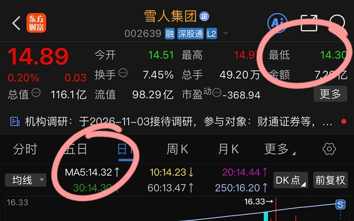
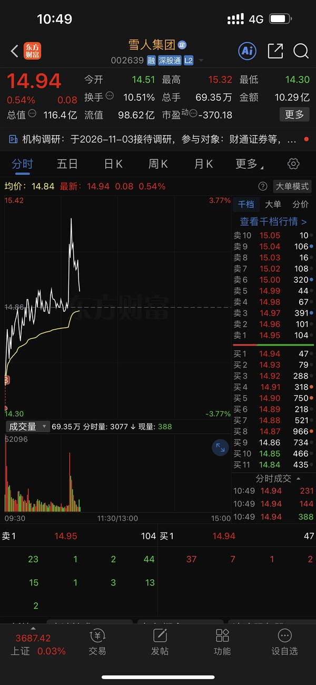
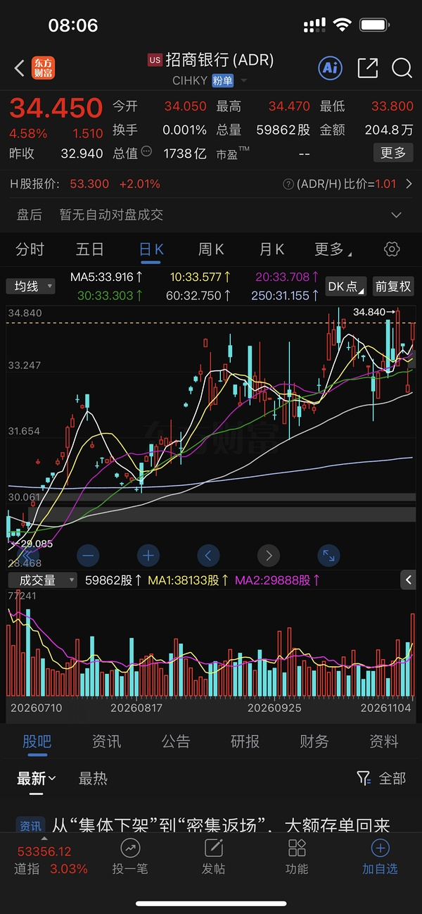
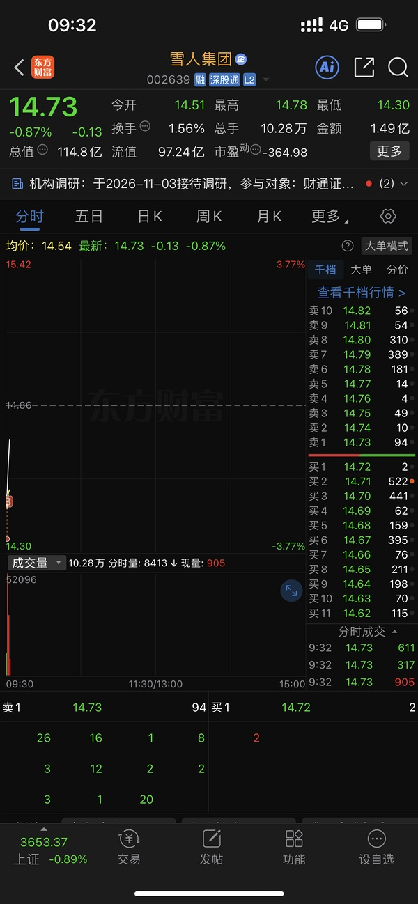

# 📋 楼主每日发言推送

> **推送日期**：2026-11-05 ｜ **执行时间**：2026-11-05 11:03:00 ｜ **监控用户**：`不知道还能说啥`
> **追踪模式**：`topic`（用户主页广播·豆瓣话题）

## 📊 持仓追踪
> 上次更新：2026-11-05 ｜ 基于楼主发言持续追踪（共 12 项）

| 标的 | 状态 | 类型 | 现价 | 提及 |
|------|------|------|------|------|
| 招商银行 | 持有 | 红利/银行 | 42.07（-1.10%） | 美股ADR昨晚大涨4.5%（被动受益，非今日主动操… |
| 长白山 | 持有 |  | 37.46（1.00%） | 分笔加仓第二笔，挂单3644 |
| 雪人集团 | 持有 |  | 14.88（0.13%） | 回踩五日线14.28，盘中最低14.3（虚拟价格，… |
| 上海电影 | 卖出 |  | 31.90（2.54%） | 明确不接：除非打到20日线以内、大跌5%左右才试水… |
| 幸福蓝海 | 持有 |  | 13.38（0.75%） | 1344回接，涨停价1494挂单卖出一半 |
| 粤传媒 | 持有 |  | 10.91（1.58%） | 暂无 |
| 大连圣亚 | 持有 |  | 41.99（-0.59%） | 未接雪人的可转向大连（『没接到雪人的其实转头可以去… |
| 博纳影业（bn） | 持有 | 传媒 | 5.83（4.11%） | 「减仓bn 买入中影」；bn跌到60日线。 |
| 中国电影（中影） | 持有 |  | 15.69（4.11%） | 不可动，随时可能炒作『复仇者联盟』（『中影是不能动… |
| 中韩半导体ETF | 持有 |  | 3.957（0.89%） | 意义显现，『跌都不会跌』『中韩半导体价值就在这里』… |
| 易方达全球 | 买入 |  | 暂无 | 11.4；新买观察仓，套两天后回本 |
| asd（埃斯顿） | 买入 |  | 暂无 | 11.5；今日-3.5%，楼主称『又送钱』（暗示低吸或加仓）… |

> ⚠️ 执行任务时如发现新操作，请更新 `state.json` 的 `positions`。成本价和市值有数据才填，没有则保留「暂无」。

## 🌅 今日总览
### 📌 市场背景
市场背景：民主党横扫国会，美股债齐涨，油价遭遇年内最惨烈单日跌幅之一。恐慌指数大跌20%收盘，金融股（美/欧银行）拐头重新向上，科技硬件与情绪面脱钩。「民主党横扫国会！美股债齐涨」「恐慌指数大跌20%收盘」「美国的银行股/欧洲的银行股都拐头重新向上了」。美元下、美债下、外资被动配置，南向资金绕开公募基金去科网股。恒生科技指数涨4.0%（现报4102.63点），A股早盘受外围-5%低开但未同步大跌（楼主指『那是因为他们-5 我们还没开盘而已』）。两市融资余额较上日增加13.29亿元，资金面仍偏暖。

### 📌 今日操作
| 操作 | 标的 | 详情 |
| --- | --- | --- |
| ⏭️ | 雪人集团 | 回踩五日线14.28，盘中最低14.3（虚拟价格，实际14.36可成交）；楼主自述已按原计划买入一半（『反正我今天买的就是本来的一半』），未追高 |
| ⏭️ | 大连圣亚 | 未接雪人的可转向大连（『没接到雪人的其实转头可以去大连』），楼主自述将大连额度先打满（『我把大连额度先打满 也是尽量规避手贱』），规避手贱 |
| ✅ | asd（埃斯顿） | 今日-3.5%，楼主称『又送钱』（暗示低吸或加仓），但后续『我马上机器人S一些』，并在小羊（机器人）卡高点时『带着asd零花钱一起撤了』，实为减仓/做T |
| ❌ | 上海电影（sy） | 明确不接：除非打到20日线以内、大跌5%左右才试水（『除非打到20日线以内 大跌5%左右 试试水』『不然不接sy 需要继续观望』） |
| ⏭️ | 中影 | 不可动，随时可能炒作『复仇者联盟』（『中影是不能动的』） |
| ⏭️ | 招商银行（招招） | 美股ADR昨晚大涨4.5%（被动受益，非今日主动操作） |
| ✅ | 仓位 | 已加至95%，『我要找东西卖了』——确认满仓状态，计划减仓降仓位 |
| ⏭️ | 中韩半导体ETF | 意义显现，『跌都不会跌』『中韩半导体价值就在这里』——持有观察，不加仓 |

### 📌 今日议题
| 议题 | 态度 | 核心观点 | 关键引用 |
| --- | --- | --- | --- |
| 雪人集团回踩五日线 | 📈看多 | 五日线挂单教学：五日均线浮动，对强势股要留空间（14.28为五日线，盘中最低14.3），挂单需高几分才成交 | 「五日线14.28 今天最低14.3」「14.3其实是虚拟价格 所以uu交易不了的」 |
| 中韩半导体ETF | 📈看多 | 具有“跌都不会跌”的防御价值，可有效对冲科技股波动 | 「跌都不会跌 中韩半导体价值就在这里」 |
| 传媒板块 | 📉看空 | 早上冲高是“傻缺”行为，大热时应躲开，容易高位套人 | 「传媒非要早上冲 傻缺」「传媒会教大家 大热躲开的价值」 |
| 电影+冰雪板块 | 📈看多 | 只要不贪心外面，电影和冰雪板块内部轮动（不是这个来就是那个来）表现稳健 | 「电影+冰雪还是很稳健 不是这个来就是那个来」 |
| 港股红利/银行 | 📈看多 | 公募欠配、南向资金绕道，可类比白酒新能源逻辑，现时点看好港股红利和银行 | 「美元下美债下 外资被动配置」「现在香港好 不如考虑香港红利 香港银行」 |
| 国产替代（爱国） | 📈看多 | 国产自主（半导体设备/芯片制造）方向值得关注 | 「爱国 = 国产自主（半导体设备/芯片制造）」 |
| 机器人概念 | 💬讨论 | 今日机器人行情不错，但楼主已在高点部分减仓（小羊卡高点撤退） | 「机器人行情非常不错👍」「小羊卡高点 我也撤退了」 |
| 招商银行（招招） | 📈看多 | 美股ADR大涨4.5%，显示海外资金青睐，映射A股信心 | 「昨天晚上招招美股adr大涨4.5%」 |
| 恒生科技 | 📈看多 | 港股科网具公募欠配逻辑，类比白酒新能源，可顺理成章上涨 | 「你把恒科理解为白酒新能源就能理解」「这也是公募欠配」 |
| 上海电影（sy） | 📉看空 | 明确不接，除非大幅回调至20日线附近，观望等待 | 「反正应该不会接sy」「除非打到20日线以内 大跌5%左右 试试水」 |
| 大宗商品/油价 | 📉看空 | 油价暴跌（年内最惨烈单日跌幅之一）压低通胀预期，利好债市 | 「油价下挫压低通胀预期，美债迎来强劲买盘」 |
| 市场情绪与赚钱效应 | 💬讨论 | 赚钱效应好就加仓干，转差马上降仓，盯紧融资盘 | 「现在赚钱效应好就赶紧干 差了马上降仓」 |
| 自己管住手 | 💬讨论 | 明确要控制仓位，避免手贱，希望被泼冷水 | 「95%仓位了 我要找东西卖了」 |

### 📌 看好板块/方向
- **招行/银行（招招）**：美股ADR大涨4.5%，海外资金认可；美国、欧洲银行股均拐头向上，金融股有望受益
- **中韩半导体ETF**：防御性强，跌不动，可作为组合稳定器
- **电影+冰雪板块**：内部分化轮动，稳健不贪心外，表现持续
- **港股科网/恒生科技**：公募欠配、南向资金绕道、外资被动配置，类比白酒新能源逻辑
- **港股红利/银行**：香港市场优于A股，资金面改善
- **国产替代（爱国）**：半导体设备/芯片制造方向，政策与自主可控逻辑
- **机器人概念**：短期市场热点，但楼主已在高点部分减仓（仅短线参与，非长期持仓方向）
- **招商银行ADR**：海外投资者态度转好，间接支持A股持仓

### 📌 风险提示
- 「传媒非要早上冲 傻缺」——大热板块避免追高，警惕冲高回落套人
- 「20日线到了的 多线都在那里」——若跌破关键均线支撑，可能引发技术性抛压
- 「你们都是情绪交易 我相信你昨天并不准备买这个」——提示避免因盘中波动做出非计划交易
- 「现在赚钱效应好就赶紧干 差了马上降仓」——市场情绪转变快，需紧盯赚钱效应决定仓位
- 「95%仓位了 我要找东西卖了」——满仓操作风险高，缺乏现金应对突发回调
- 「中影是不能动的 随时炒作复仇者联盟」——提示重大事件（如电影上映/政策）可能引发异动，需保持持仓灵活性
- 「美元下美债下 外资被动配置」——若美元/美债走势逆转，外资流向可能反转

## 📊 本次结果
- **今日发言**：90 条
- **累计存档**：19691 条

## 📝 该最新广播作者发言聚合（共 90 条）
### 其他讨论（提及 70 次，占比 78%）2026-11-05 00:32:18
- 今天nana有欺骗性
早上我觉得就是晚上这样子
所以才说大A装B
但是nana掩盖掉了🤣🤣🤣🤣
- 159719
- 哈哈哈哈哈哈哈

### 友友、网友们（提及 4 次，占比 4%）2026-11-05 10:23:58
- uu们
雪人大家的第二份教科书

很多uu的五日线挂单是错的

- 楼里uu满多昨天就在了😂
- 14.3其实是虚拟价格 所以uu交易不了的
看图 隔空的 我是14.36才可以

### 雪人集团（提及 3 次，占比 3%）2026-11-05 09:35:34
- 你们看雪人是不是回踩五日线
- 没接到雪人的其实转头可以去大连
- 雪人回踩五日线极为到位 而且确实触碰

### 易点天下（提及 3 次，占比 3%）2026-11-05 09:41:31
- 祝福奶茶幸福
- 即使没有也必须要说

蓝色永远是奶茶的弟弟
- 猜测芒果资金去了奶茶
高切低

### 埃斯顿（提及 3 次，占比 3%）2026-11-05 09:43:45
- 今天asd-3.5又送钱了吗
- 小羊弱了
asd给我干翻小羊
- 小羊卡高点 我也撤退了
带着asd零花钱一起撤了
我降降仓位

### 大连圣亚（提及 3 次，占比 3%）2026-11-05 10:05:45
- cbs这几天好
只是因为他都没到大阴线
而且他还有个缺口

大连是没有缺口的
- 大连是上面大阴线问题 A杀后遗症 不急
- 我把大连额度先打满 也是尽量规避手贱

### 上海电影（提及 2 次，占比 2%）2026-11-05 08:43:46
- 除非打到20日线以内 大跌5%左右 试试水
不然不接sy 需要继续观望
- 对
反正应该不会接sy

### 招商银行（提及 1 次，占比 1%）2026-11-05 08:07:03
- 昨天晚上招招美股adr大涨4.5%😂😂😂😂

### 华安文体健康混合A（提及 1 次，占比 1%）2026-11-05 09:32:22
- 

### 📄 全部发言（共 90 条）
- (2026-11-05 00:32:18) 今天nana有欺骗性
早上我觉得就是晚上这样子
所以才说大A装B
但是nana掩盖掉了🤣🤣🤣🤣  ⊳ （引用 @点-重生炒垃圾）科技真是早割早超生，免得今天空欢喜一场😅😅😅

- (2026-11-05 00:38:41) 159719  ⊳ （引用 @点-重生炒垃圾）中字头的一般是啥etf和资金，水果说有资金为明年做准备，难道是主动etf配的？

- (2026-11-05 00:39:00) 哈哈哈哈哈哈哈  ⊳ （引用 @VVV坚定持有VVV）倒也不用这么照顾我那300块😂

- (2026-11-05 00:40:35) 主动ETF没几个钱啊
可能有些公募基金砍科技要找东西买  ⊳ （引用 @点-重生炒垃圾）收到🥳🥳🥳

- (2026-11-05 00:41:30) 明天是检验美🐔七巨头含量的一天😂😂😂  ⊳ （引用 @点-重生炒垃圾）收到🥳🥳🥳

- (2026-11-05 00:55:37) 没有😂非常专一手里的  ⊳ （引用 @我爱牛肉火锅）不知道楼这两天有没有偷偷摸黄金白银股🤔🤔🤔

- (2026-11-05 08:01:07) 美国的银行股
欧洲的银行股
都拐头重新向上了  ⊳ （引用 @moli）笑死，教堂这个很形象了

- (2026-11-05 08:02:57) 恐慌指数大跌20%收盘
说明恐慌指数代表的情绪和硬件无关😂

- (2026-11-05 08:07:03) [图] 昨天晚上招招美股adr大涨4.5%😂😂😂😂

  ⊳ （引用 @我爱牛肉火锅）招:我胡汉三又回来了

- (2026-11-05 08:13:42) 民主党横扫国会！美股债齐涨

美国中期选举结果落地，风险资产迎来大幅反弹。民主党意外横扫参众两院，市场将政治格局切换解读为地缘风险降温与政策掣肘双重利好，推动股票、债券走高，油价则遭遇年内最惨烈单日跌幅之一。

对政策最敏感的板块领涨。金融股中，摩根大通涨4.20%，高盛涨3.59%，摩根士丹利涨4.25%。医疗保健与可选消费同步走高，国防股则逆势下跌，市场担心民主党会收紧五角大楼的预算。

油价下挫压低通胀预期，美债迎来强劲买盘

原油急跌直接传导至通胀预期，10年期美债盈亏平衡通胀率跌至8月以来最低水平，为美债提供了基本面支撑。

10年期美债收益率下行7个基点至4.89%，连续守住5%关口下方，创下两个月来的最低收盘水平。分析人士认为，债市还受益于另一层政治逻辑：民主党掌控国会将制约特朗普政府扩大财政赤字的空间，压缩了长端债券中蕴含的供给溢价。

- (2026-11-05 08:14:45) 分析师称，本周五公布的非农就业数据是目前的关键短期催化剂，如果数据超出预期，可能会引发美联储政策路径的重大调整。  ⊳ （引用 @不知道还能说啥）民主党横扫国会！美股债齐涨

美国中期选举结果落地，风险资产迎来大幅反弹。民主党意外横扫参众两院，市场将政治格局切换解读为地缘风险降温与政策掣肘双重利好，推动股票、债券走高，油价则遭遇年内最惨烈单日跌幅之一。

对政策最敏感的板块领涨。金融

- (2026-11-05 08:23:17) 昨天满说明问题的
纳斯达克指数的硬件含量并不高😂  ⊳ （引用 @点-重生炒垃圾）悟了，昨天七巨头涨蓝党，跌英伟达这种串子，再杀马斯克这种老红家的

- (2026-11-05 08:43:46) 除非打到20日线以内 大跌5%左右 试试水
不然不接sy 需要继续观望  ⊳ （引用 @shirla）楼楼雪人SY今天都接不？

- (2026-11-05 08:44:37) 跑不赢我们美国基金的水平
2023年也跑不过nana指数的水平  ⊳ （引用 @点-重生炒垃圾）但的胜率咋样，老是听说

- (2026-11-05 08:47:48) 两市融资余额较上日增加13.29亿元
截至11月4日，上交所融资余额报11776.07亿元，较前一交易日增加9.85亿元；深交所融资余额报10867.48亿元，较前一交易日增加3.44亿元；两市合计22643.55亿元，较前一交易日增加13.29亿元。  ⊳ （引用 @VVV坚定持有VVV）9亿呢，好多啊

- (2026-11-05 08:50:07) 对
反正应该不会接sy  ⊳ （引用 @shirla）20日线那得-8了哇？

- (2026-11-05 08:50:35) 他过去几次回退
都要退到20日线的  ⊳ （引用 @shirla）20日线那得-8了哇？

- (2026-11-05 09:23:05) 那是因为他们-5 我们还没开盘而已  ⊳ （引用 @暴富¥(´･ᴗ･`)$）中韩停牌了，溢价15

- (2026-11-05 09:27:26) 股票只有科技股能涨呗😂😂😂  ⊳ （引用 @👑）我要是科技人我也想清仓不干了，过山车一样的扇十几巴掌给个枣子再扇巴掌，场外我就当存款放几年算了

- (2026-11-05 09:31:53) 你也不看那边-5 我们没开盘  ⊳ （引用 @问一下能不能瘦）楼 你的中韩半导体溢价16了。好快就要到20了

- (2026-11-05 09:32:22) [图] 

  ⊳ （引用 @一直在摸🐟）雪儿来接

- (2026-11-05 09:33:39) 20日线到了的🤣🤣多线都在那里  ⊳ （引用 @我爱牛肉火锅）啊啊啊啊啊啊啊，你怎么偷跑我设的5日线

- (2026-11-05 09:34:14) 五日线14.28
今天最低14.3  ⊳ （引用 @问一下能不能瘦）我挂了25 没买上

- (2026-11-05 09:35:34) 你们看雪人是不是回踩五日线

- (2026-11-05 09:40:51) 哈哈一样的👍👍👍👍  ⊳ （引用 @A-Rubbit）虽然没接到雪人，但是接到了低点的大连和cbs😂

- (2026-11-05 09:41:31) 祝福奶茶幸福

- (2026-11-05 09:43:45) 今天asd-3.5又送钱了吗

- (2026-11-05 09:44:33) 这个来不及😂😂😂忘了  ⊳ （引用 @西西西西）接了一点晶雪 千万不要让我失望哇

- (2026-11-05 09:45:18) 小羊 带带机器人兄弟姐妹呀

- (2026-11-05 09:51:25) 95%仓位了
我要找东西卖了

- (2026-11-05 09:52:27) 今天早上低开光线有人去吗

- (2026-11-05 09:52:44) 09:52:24 财联社11月5日电，恒生科技指数延续上涨，涨幅扩大至4.0%，现报4102.63点。(来自财联社APP)  ⊳ （引用 @木感情的打工人）涨停了

- (2026-11-05 09:53:14) 昨天我说下跌提醒我
没有人提醒我
我只能提醒自己🤣  ⊳ （引用 @该用户已过期）你去了？

- (2026-11-05 09:54:45) 没接到雪人的其实转头可以去大连  ⊳ （引用 @该用户已过期）🤣🤣应该也提醒我们，哈哈哈
楼里要么忙着没接到⛄️
要么感慨或骂之前的传媒大爆发，根本顾不上它

- (2026-11-05 09:55:24) 基本上昨天说啥就做啥
😂  ⊳ （引用 @爱拔酱）楼不吭声就是在大买特买，而我早上还在不停刷新楼，看有什么最新消息

- (2026-11-05 10:03:04) 今天其他羊如何？

- (2026-11-05 10:03:43) 不着急看看其他羊如何  ⊳ （引用 @momo）襄阳被甩飞了😅

- (2026-11-05 10:04:00) 机器人行情非常不错👍  ⊳ （引用 @momo）襄阳被甩飞了😅

- (2026-11-05 10:04:46) 我马上机器人S一些 这里那里s一些就没那么多了  ⊳ （引用 @该用户已过期）楼95%仓位了，你现在多少？我现在就50出头

- (2026-11-05 10:05:45) cbs这几天好
只是因为他都没到大阴线
而且他还有个缺口

大连是没有缺口的

- (2026-11-05 10:06:13) 我十月底反复说的
11月狠狠的干🤣🤣🤣  ⊳ （引用 @该用户已过期）🤣🤣你真是太猛了，我才50出头……现在谨慎的是我了

- (2026-11-05 10:07:38) 美元下美债下
外资被动配置

多一个流入资金
外加南向资金绕开公募基金去科网股
类似白酒新能源顺理成章  ⊳ （引用 @Cher）恒科编制不好，中概科网那些，这次是真的吗？

- (2026-11-05 10:10:23) 小羊弱了
asd给我干翻小羊  ⊳ （引用 @YuanZi💕）asd破个30看看

- (2026-11-05 10:14:56) 那你不是9.22我们大减仓时候你就赚了 😂  ⊳ （引用 @番茄炒鸡蛋）如果奶茶不卖的话，我已经全仓回本了。强颜欢笑

- (2026-11-05 10:15:18) 大连是上面大阴线问题 A杀后遗症 不急  ⊳ （引用 @木感情的打工人）大连有10.30规律。。？

- (2026-11-05 10:16:41) 即使没有也必须要说

蓝色永远是奶茶的弟弟

- (2026-11-05 10:17:42) 你心态怎么了？
我不觉得  ⊳ （引用 @公主要发财）大连这几天在搞我们心态，今天会不会来个出其不意？

- (2026-11-05 10:18:10) 等cbs到了10.19跌停价也会这样的  ⊳ （引用 @公主要发财）大连这几天在搞我们心态，今天会不会来个出其不意？

- (2026-11-05 10:20:27) 猜测芒果资金去了奶茶
高切低

- (2026-11-05 10:23:58) [图] uu们
雪人大家的第二份教科书

很多uu的五日线挂单是错的

- (2026-11-05 10:24:31) 雪人回踩五日线极为到位 而且确实触碰  ⊳ （引用 @不知道还能说啥）uu们
雪人大家的第二份教科书

很多uu的五日线挂单是错的

- (2026-11-05 10:25:45) 你们知道中韩半导体优势了嘛🤣

- (2026-11-05 10:26:42) 我还是那句老话
到月末一看
很多传媒月涨幅可能比不过中影涨幅🤣

- (2026-11-05 10:27:40) 小羊卡高点 我也撤退了
带着asd零花钱一起撤了
我降降仓位

- (2026-11-05 10:28:08) 你把恒科理解为白酒新能源就能理解
其实和韩国无关

这也是公募欠配  ⊳ （引用 @moli）恒科难道就是三倍做空韩国？

- (2026-11-05 10:28:31) 五日线是浮动的  ⊳ （引用 @红烧肉肉）早上看的时候不是这个价格的，挂的30没买到（还以为自己加了几分能买到）....

- (2026-11-05 10:28:59) 所以这是教科书教学：让你知道五日线是浮动 对强势股要留有空间  ⊳ （引用 @红烧肉肉）早上看的时候不是这个价格的，挂的30没买到（还以为自己加了几分能买到）....

- (2026-11-05 10:29:45) 👍👍👍👍👍  ⊳ （引用 @not bad）设置的条件单 还是买入最低点了 哈哈 条件单不错

- (2026-11-05 10:30:28) 在我们恒科赚50%时候 香港科网股可是公募重仓哦 后来都砍掉了  ⊳ （引用 @moli）公募不是欠配国内就好了，还能欠配恒科？

- (2026-11-05 10:31:27) 跌都不会跌

中韩半导体价值就在这里  ⊳ （引用 @🅰失而复🉐😎）T0来了

- (2026-11-05 10:32:56) 我昨天就在了😂每次都是冲高回落  ⊳ （引用 @点-重生炒垃圾）我今天新进的🤣🤣🤣见面礼

- (2026-11-05 10:33:33) 现在香港好
不如考虑香港红利 香港银行  ⊳ （引用 @云水河西）我还买了点银行😂真的毫无信心，但是也可能市场就打我这种人

- (2026-11-05 10:33:59) 中马漂亮啊

- (2026-11-05 10:35:22) 今天其他几个也是啊  ⊳ （引用 @momo）网易云今天又6个月新低了

- (2026-11-05 10:35:59) 我不负责中影买单哦
中影是不能动的
随时炒作复仇者联盟  ⊳ （引用 @仓部加措）Zy好强，设置了64前高扭出去了😂

- (2026-11-05 10:36:09) 内蒙古大草原多美啊

- (2026-11-05 10:36:44) 建设工业今天到底军工还是机器人啊？  ⊳ （引用 @点-重生炒垃圾）哈哈哈哈哈军工

- (2026-11-05 10:37:06) 长龙来个15+看看实力  ⊳ （引用 @点-重生炒垃圾）哈哈哈哈哈军工

- (2026-11-05 10:37:59) 哈哈哈哈哈哈哈  ⊳ （引用 @点-重生炒垃圾）卧槽无法判断，机器人也这个时候拉升

- (2026-11-05 10:38:25) 传媒非要早上冲 傻缺

都是后来者牛逼  ⊳ （引用 @点-重生炒垃圾）每天都是科技先行，题材收尾啊

- (2026-11-05 10:39:43) 万科火箭发射😅  ⊳ （引用 @点-重生炒垃圾）每天都是科技先行，题材收尾啊

- (2026-11-05 10:40:44) 我去  ⊳ （引用 @点-重生炒垃圾）卧槽，我昨天说的华发，真的6个点了

- (2026-11-05 10:41:19) 楼里uu满多昨天就在了😂  ⊳ （引用 @we）有去晶雪的吗

- (2026-11-05 10:42:26) 炒垃圾 😂😂😂😂 确实没啥好看的

都知道机器人骗单子 传媒不赚钱 地产没出路 消费降级无起色🤣不影响股票上涨  ⊳ （引用 @点-重生炒垃圾）资金完全不讲基本面啊，只是一味地拉低

- (2026-11-05 10:44:10) 因为昨天爆量是下午开始的
早上数据失真  ⊳ （引用 @稀里不糊涂）5000亿来了

- (2026-11-05 10:44:30) 昨天在的今天冲能卖

先手  ⊳ （引用 @🅰失而复🉐😎）😏

- (2026-11-05 10:47:17) 你在做梦

白日梦做做就行 别当真 

安心炒垃圾  ⊳ （引用 @稀里不糊涂）行吧，那看来今天还好，也没有很夸张，不过小a真能如江所说的走独立自主吗

- (2026-11-05 10:48:03) 现在赚钱效应好就赶紧干
差了马上降仓
就那么简单  ⊳ （引用 @稀里不糊涂）行吧，那看来今天还好，也没有很夸张，不过小a真能如江所说的走独立自主吗

- (2026-11-05 10:49:10) 你提高几分就会成交了
14.3转瞬即逝  ⊳ （引用 @lacey）今天给⛄️设置的14.30没触发，连着两天了，uu们知道为啥不

- (2026-11-05 10:49:52) [图] 14.3其实是虚拟价格 所以uu交易不了的
看图 隔空的 我是14.36才可以

  ⊳ （引用 @棠糖）挂低了，早上最低就是14.3

- (2026-11-05 10:50:26) 我中午可以和大家解释为什么会这样  ⊳ （引用 @不知道还能说啥）14.3其实是虚拟价格 所以uu交易不了的
看图 隔空的 我是14.36才可以

- (2026-11-05 10:50:49) 是的  ⊳ （引用 @问一下能不能瘦）同志们 楼今天买的⛄️也l是15.84的卖单嘛

- (2026-11-05 10:51:28) 楼里有uu早上上头追传媒的吗😂😂😂😂

- (2026-11-05 10:51:57) 传媒会教大家 大热躲开的价值  ⊳ （引用 @Aaa摆烂咸鱼🥳）买了点txx

- (2026-11-05 10:53:06) 阻力位啊 你忘记我们本来都是设置啥价格了嘛  ⊳ （引用 @今天也要开心鸭）雪人怎么坠这么快

- (2026-11-05 10:53:40) 反正我今天买的就是本来的一半
对我没区别
反正就卖那点钱  ⊳ （引用 @爱拔酱）嗯？15.84卖今天的+持仓的一半？

- (2026-11-05 10:54:15) 你们都是情绪交易
我相信你昨天并不准备买这个  ⊳ （引用 @Aaa摆烂咸鱼🥳）这个txx我弄三次了，每次都是高买低卖，次次不长记性

- (2026-11-05 10:57:10) 光伏！！！！！！！！！  ⊳ （引用 @花道最爱拉面）点老师，迈为这板是跟宇航员还是光伏啊

- (2026-11-05 10:59:47) 只要不贪心外面的 
电影+冰雪还是很稳健
不是这个来就是那个来😂

- (2026-11-05 11:00:50) 我把大连额度先打满 也是尽量规避手贱  ⊳ （引用 @不知道还能说啥）只要不贪心外面的 
电影+冰雪还是很稳健
不是这个来就是那个来😂

## 🧠 投资风格分析
> 📏 增量更新指引：仅当今日发言确有新依据时才修订对应维度，无变化不强行重写；单维度修订建议 ≤150 字。

- 投资理念与方法：重视全球联动、机构行为与指数规则带来的被动买卖盘，先质疑公开数据真实性；以参与度判断行情性质，对高位腾空型科技股、小票垃圾票与微盘股保持戒心，关注业绩确定性与融资盘出清；操作留后手，坚持条件单与时间纪律；以股债双爆/单爆情景推演倒推受益资产，并以股息率作比较锚；建立黄金四因素框架（美元替代、中美对抗、降息周期、全球央行购金），判断金价关键在降息周期，并视美债为真正避险工具；对ETF溢价率敏感。今日新增：强调“全球联动 A并不孤立”，认为A股短期仍受美股AI硬件走势主导；民主党胜选降低加息预期可带来估值溢价；交易不应被成本束缚。
- 风险偏好：对高位强势股（如上海电影）保持观望，仅在回调至20日线附近（约-5%）才考虑接回，不愿追高；对传媒等纯题材板块采取“大热躲开”态度，认为追高风险大于收益；对科技股高开跳水保持警惕，关注美债收益率上行与政策风险（民主党获胜压制财政空间）；对中韩半导体ETF的防御性认可，但警惕其天量高溢价；整体风险偏好偏防御，宁可错过不可追高，并倾向于在赚钱效应转换时迅速降仓。
- 交易与仓位：严格执行预先设定的条件单与时间纪律，将五日线视为浮动支撑而非固定价位，对强势股挂单预留空间（如雪人14.28五日线，须挂高至14.36才能成交）；分档低吸并考虑虚拟价格陷阱（盘口显示的跌停/低价可能无法实际成交），强调先手优势（昨日建仓今日才能卖）；深度满仓（95%）时会主动寻找减仓标的以保留灵活性，并以“降仓位”来规避手贱。倾向在强势板块高点部分止盈（如小羊卡高点撤退），做T后不再追同一标的，转投其他机会。
- 心理特质：对自身手贱行为有清醒认知，并主动采取惩罚性措施（如将大连额度打满以限制操作空间）；深知“赚多了就浪”，因此主动寻求外部监督（希望被泼冷水）并反复强调“只要不贪心乱浪”是赚钱核心；对情绪交易保持警惕，认为大多数人盘中追涨是“情绪交易”而非计划内操作，并公开指出以提醒他人（如昨日下跌无人提醒，只能自我约束）；能够果断接受高切低（资金从芒果流向奶茶），并承认市场博弈（炒垃圾）的合理性，保持务实心态。

> ⚠️ 本板块由 Actions 全自动增量更新（复用当日发言与今日总览），每次仅在内容足够支撑时才改动。

## 🏷️ 昵称映射表
### 📖 昵称规律（供 AI 判断新昵称时参考）
【昵称命名规律（用于推断未知新昵称）】
- 拼音首字母缩写：取标的/基金名汉字拼音首字母串（含数字代码），多为 ETF/股票代码口语化｜示例：yl=引力传媒｜zy=掌阅科技｜sj=视觉中国｜cc=华安文体健康混合｜C50=创业板50ETF｜k50=科创50｜kun=昆仑万维｜xhxc=新瀚新材｜zxfc=中欣氟材
- 小/老+姓氏代指：「小X」「老X」通常指姓 X 的标的或该标的的基金经理；「X兄弟」多为同系基金｜示例：小惠=惠发食品｜老莫=万家品质生活(莫海波)｜小华=华夏全球科技先锋(QDII)A｜小华兄弟=华夏移动互联(QDII)｜小浦=浦银安盛全球智能科技(QDII)A｜小广=广发全球精选(QDII)A｜小远=华宝致远(QDII)C｜招招=招商银行｜小德=德明利｜赵姨=兆易创新｜露露=泸州老窖｜空调=格力电器
- 戏称/黑话→题材板块：生活化比喻或黑话对应某个题材/板块，而非单一标的；出现时多指板块方向｜示例：卖国=PCB板块(英伟达AI链)｜爱国=国产自主(半导体设备/芯片)｜奶茶=易点天下｜老师=中文在线｜蓝色=蓝色光标｜宇航员=航空航天板块｜华子=华泰保兴安悦债券｜国际=国际复材｜巨无霸=长鑫科技等重大IPO
- 谐音/取字：昵称含标的名关键字（取一字或谐音），多为 A 股个股或基金简称｜示例：万华=万华化学｜东百=东百集团｜宝=保利发展｜讨饭/亚洲讨饭/建信新兴=建信新兴市场(QDII)A｜华宝zy=华宝致远(QDII)A
- 机构/基金经理昵称：以基金公司名、经理姓、或平台代称指代对应基金产品｜示例：周经理=中欧新趋势混合(LOF)A｜张经理=信澳匠心回报混合A｜网易云/音乐世家=富国全球科技互联网股票(QDII)A｜国富亚洲=国富亚洲机会股票(QDII)A｜国泰纳指=国泰纳斯达克100指数(QDII)｜易方达全球=易方达全球成长精选混合(QDII)A｜浦银安盛=浦银安盛全球智能科技(QDII)A

### 📋 已收录映射
| 昵称 | 对应名称 |
|------|----------|
| C50 | 创业板50ETF |
| cc | 华安文体健康混合A |
| k50 | 科创50 |
| kun | 昆仑万维 |
| sj | 视觉中国 |
| xhxc | 新瀚新材 |
| yl | 引力传媒 |
| zxfc | 中欣氟材 |
| zy | 掌阅科技 |
| 万华 | 万华化学 |
| 东百 | 东百集团 |
| 亚洲讨饭 | 建信新兴市场混合(QDII)A |
| 保利发展 | 保利发展 |
| 华子 | 华泰保兴安悦债券 |
| 华宝 zy | 华宝致远混合(QDII)A |
| 华宝zy | 华宝致远混合(QDII)A |
| 卖国 | PCB、光模块、通信板块（英伟达AI产业链） |
| 周经理 | 中欧新趋势混合(LOF)A |
| 国富亚洲 | 国富亚洲机会股票(QDII)A |
| 国泰纳指 | 国泰纳斯达克100指数(QDII) |
| 奶茶 | 易点天下 |
| 宇航员 | 航空航天板块 |
| 宝 | 保利发展 |
| 小华 | 华夏全球科技先锋混合(QDII)A |
| 小华兄弟 | 华夏移动互联混合(QDII) |
| 小广 | 广发全球精选股票(QDII)A |
| 小德 | 德明利 |
| 小惠 | 惠发食品 |
| 小浦 | 浦银安盛全球智能科技(QDII)A |
| 小远 | 华宝致远混合(QDII)C |
| 巨无霸 | 长鑫科技等重大IPO企业 |
| 建信新兴 | 建信新兴市场混合(QDII)A |
| 张经理 | 信澳匠心回报混合A |
| 招招 | 招商银行 |
| 易方达全球 | 易方达全球成长精选混合(QDII)A |
| 浦银安盛 | 浦银安盛全球智能科技(QDII)A |
| 爱国 | 国产自主（半导体设备/芯片制造） |
| 空调 | 格力电器 |
| 网易云 | 富国全球科技互联网股票(QDII)A |
| 老师 | 中文在线 |
| 老莫 | 万家品质生活混合A(519195) |
| 蓝色 | 蓝色光标 |
| 讨饭 | 建信新兴市场混合(QDII)A |
| 赵姨 | 兆易创新 |
| 赵哥 | 兆易创新 |
| 露露 | 泸州老窖 |
| 安安 | 安记食品 |
| 音乐世家 | 富国全球科技互联网股票(QDII)A |
| 老伯伯 | 铜冠铜箔 |
| nk | 景顺长城纳斯达克科技ETF联接(QDII)A |
| bk | 易方达标普信息科技指数(QDII-LOF)A |
| txx | 天下秀 |
| 媛媛 | 今世缘 |
| uu | 友友、网友们 |
| 温暖老师 | 某个特别牛逼的散户 |
| 余老师 | 余利，某牛逼投资者 |
| ycm | 粤传媒 |
| 江老师 | 江琪（投资博主） |
| 水果老师 | 投资博主 |
| 小爱 | 我爱我家 |
| ty | 天娱数科 |
| bn | 博纳影业 |
| sy | 上海电影 |
| CBS | 长白山 |
| 东哥 | 东百集团 |
| 芒果 | 芒果超媒 |
| 阿中 | 中国电影 |
| 欢欢 | 欢瑞世纪 |
| 雪人 | 雪人集团 |
| 大连 | 大连圣亚 |
| 幸福 | 幸福蓝海 |
| 小粤 | 粤传媒 |
| 阿博 | 博纳影业 |
| 创成长 | 创业板成长etf |
| asd | 埃斯顿 |

> ⚠️ 以下为 LLM **建议**，未自动写入状态文件。请人工确认后，本地编辑 `state.json` 的 `nickname_map` / `positions`，或 `nickname_rules.json` 的 `rules` 并 push 生效。

## 持仓建议（待你确认）
- **易点天下**（SZ301171）〔持有〕— 依据：祝福奶茶幸福；猜测芒果资金去了奶茶 高切低
- **大连圣亚**（SH600593）〔加仓〕— 依据：我把大连额度先打满 也是尽量规避手贱；没接到雪人的其实转头可以去大连
- **159719（ETF）**（159719）〔观察〕— 依据：159719

## 新昵称映射建议（待你确认）
- `nana` = 纳斯达克100指数（纳指）

## 新昵称规律建议（待你确认）
- 【技术纪律】强势股回踩五日线判断需考虑五日线浮动，应留空间，不能机械挂单 ｜示例：雪人回踩五日线极为到位 而且确实触碰；五日线是浮动的；对强势股要留有空间 ｜依据：你们看雪人是不是回踩五日线；雪人回踩五日线极为到位；五日线是浮动的；所以这是教科书教学：让你知道五日线是浮动 对强势股要留有空间
- 【交易节奏】传媒板块早上冲高不追，大热要躲开，后来者更强 ｜示例：传媒非要早上冲 傻缺；都是后来者牛逼；传媒会教大家 大热躲开的价值 ｜依据：传媒非要早上冲 傻缺；都是后来者牛逼；传媒会教大家 大热躲开的价值
- 【交易节奏】先手优势：昨日已布局的标的，今日冲高可卖出兑现 ｜示例：昨天在的今天冲能卖 先手 ｜依据：昨天在的今天冲能卖 先手
- 【仓位管理】赚钱效应好就积极干，变差马上降仓 ｜示例：现在赚钱效应好就赶紧干 差了马上降仓 就那么简单 ｜依据：现在赚钱效应好就赶紧干 差了马上降仓 就那么简单
- 【持仓策略】电影+冰雪组合稳健轮动，不贪心外部机会 ｜示例：电影+冰雪还是很稳健 不是这个来就是那个来 ｜依据：只要不贪心外面的 电影+冰雪还是很稳健 不是这个来就是那个来
- 【接回条件】上海电影（sy）需等打到20日线以内、大跌约5%才考虑试水，否则观望 ｜示例：除非打到20日线以内 大跌5%左右 试试水 不然不接sy 需要继续观望 ｜依据：除非打到20日线以内 大跌5%左右 试试水 不然不接sy 需要继续观望；他过去几次回退 都要退到20日线的
- 【技术形态】A杀后遗症且上方有大阴线/缺口的标的不急，等形态修复 ｜示例：大连是上面大阴线问题 A杀后遗症 不急；cbs因为没到大阴线且还有缺口 ｜依据：大连是上面大阴线问题 A杀后遗症 不急；cbs这几天好 只是因为他都没到大阴线 而且他还有个缺口；大连是没有缺口的

*🤖 自动生成于 2026-11-05 11:03:00 ｜ 豆瓣楼主发言追踪*