# 📋 楼主每日发言推送

> **推送日期**：2026-11-05 ｜ **执行时间**：2026-11-05 16:03:28 ｜ **监控用户**：`不知道还能说啥`
> **追踪模式**：`topic`（用户主页广播·豆瓣话题）

## 📊 持仓追踪
> 上次更新：2026-11-05 ｜ 基于楼主发言持续追踪（共 11 项）

| 标的 | 状态 | 类型 | 现价 | 提及 |
|------|------|------|------|------|
| 招商银行 | 持有 | 红利/银行 | 42.54（0.00%） | 美股ADR昨晚大涨4.5%（被动受益，非今日主动操… |
| 长白山 | 持有 |  | 38.25（3.13%） | 分笔加仓第二笔，挂单3644 |
| 雪人集团 | 持有 |  | 14.81（-0.34%） | 回踩五日线14.28，最低14.3，14.36「侥… |
| 上海电影 | 持有 |  | 32.51（4.50%） | 计划：20日线升至29、下周5周线29.7，「跌破… |
| 幸福蓝海 | 持有 |  | 13.87（4.44%） | 「取消了幸福14.34单子 直接开15.44那单了… |
| 粤传媒 | 持有 |  | 11.06（2.98%） | 暂无 |
| 大连圣亚 | 持有 |  | 42.11（-0.31%） | 「我把大连额度先打满 也是尽量规避手贱」 |
| 博纳影业（bn） | 持有 | 传媒 | 6.16（10.00%） | 「减仓bn 买入中影」；bn跌到60日线。 |
| 中国电影（中影） | 持有 |  | 15.82（4.98%） | 不可动，随时可能炒作『复仇者联盟』（『中影是不能动… |
| 中韩半导体ETF | 持有 |  | 3.787（-3.44%） | 意义显现，『跌都不会跌』『中韩半导体价值就在这里』… |
| asd（埃斯顿） | 买入 |  | 29.85（1.22%） | 11.5；「带着asd零花钱一起撤了」，随小羊一同减出 |

> ⚠️ 执行任务时如发现新操作，请更新 `state.json` 的 `positions`。成本价和市值有数据才填，没有则保留「暂无」。

## 🌅 今日总览
### 📌 市场背景
今日发言以海外风险偏好回升为主线：「民主党横扫国会！美股债齐涨」「恐慌指数大跌20%收盘」，并同步提示「韩国KOSPI指数日内重挫6%」与「两市融资余额较上日增加13.29亿元」。楼主强调「抛开美股分析大A双创都是耍流氓」，认为「大A装B」但被外盘掩盖，短期走势仍受美股AI硬件与七巨头表现牵引（「明天是检验美🐔七巨头含量的一天」）。同时对指数与被动资金敏感，提及「主动ETF没几个钱啊」「一大批ETF都有妈妈」。

### 📌 今日操作
| 操作 | 标的 | 详情 |
| --- | --- | --- |
| ✅ | 雪人集团（雪人） | 回踩五日线14.28，最低14.3，14.36「侥幸买到」，并讲解隔空盘口与虚拟价格 |
| ✅ | 小羊 | 「小羊卡高点 我也撤退了」，卡高点部分止盈 |
| ✅ | asd（埃斯顿） | 「带着asd零花钱一起撤了」，随小羊一同减出 |
| ✅ | 机器人/军工 | 「我把机器人军工能卖的都清了」「前面清了昨天买的军工」，降低明天总仓位 |
| ✅ | 大连圣亚（大连） | 「我把大连额度先打满 也是尽量规避手贱」 |
| ⏭️ | sy（上海电影） | 计划：20日线升至29、下周5周线29.7，「跌破29.7买入」「等一个29的sy 等不到也拉倒」 |
| ⏭️ | 幸福蓝海（幸福） | 「取消了幸福14.34单子 直接开15.44那单了」 |
| ❌ | 中影（中国电影） | 「中影是不能动的」，随时炒作复仇者联盟，不卖 |

### 📌 今日议题
| 议题 | 态度 | 核心观点 | 关键引用 |
| --- | --- | --- | --- |
| 传媒板块 | 📉看空 | 传媒早盘冲高是情绪交易，大热应躲开，后来者才牛 | 「传媒非要早上冲 傻缺」「传媒会教大家 大热躲开的价值」 |
| 中影/复仇者联盟 | 📈看多 | 中影筹码博弈、爆量加速，是本月主力持仓 | 「中影轻轻松松刷新6/23日高点」「中影是不能动的」 |
| 中韩半导体 | 📈看多 | 抗跌属性突出，是防御性价值所在 | 「跌都不会跌 中韩半导体价值就在这里」 |
| 恒科/香港科网 | 📈看多 | 公募欠配、容量大、位置低，可当AI应用承接 | 「科网股天下吧 公募基金欠配 位置足够低」 |
| 雪人五日线教学 | 💬讨论 | 五日线浮动、隔空与虚拟价格，强势股挂单须留空间 | 「五日线是浮动的」「14.3其实是虚拟价格」 |
| 小羊/asd机器人 | 💬讨论 | 卡高点撤退、降仓位规避手贱 | 「小羊卡高点 我也撤退了」「我降降仓位」 |
| sy（上海电影） | ➡️中性 | 不接，等回调到20日线内大跌5%才试水 | 「除非打到20日线以内 大跌5%左右 试试水」 |
| 大连 vs cbs | 💬讨论 | 大连受跌停阴线压制属A杀后遗症，cbs因未到大阴线更稳 | 「大连是进攻跌停阴线受阻」「cbs还差得远」 |
| 幸福 vs 光线 | 📈看多 | 幸福月涨幅更高，想象空间大，不急 | 「幸福月涨幅比sy多哦」「幸福有很大的想象空间」 |
| 黄金/白银 | ➡️中性 | 黄金股装B、白银翻绿，白银更快 | 「要杀黄金了」「还是白银快」 |
| 主升浪模式 | 💬讨论 | 主升浪收益快但需及时收手，多数人更适合进二退一 | 「主升浪好做 但是重点是及时收手」 |

### 📌 看好板块/方向
- **电影（中影、幸福、博纳）**：复仇者联盟+流浪地球双线布局，中影爆量加速刷新前高，「电影+冰雪还是很稳健」。
- **冰雪（雪人、大连、cbs）**：雪人为五日线教科书，大连额度打满、cbs近期较稳。
- **香港科网/恒科**：公募欠配、容量大、位置低，腾讯阿里当AI应用承接；「今天最后赢家是香港🇭🇰」。
- **香港红利/香港银行**：「现在香港好 不如考虑香港红利 香港银行」。
- **中韩半导体**：抗跌价值，认为「跌都不会跌」。
- **白银**：「还是白银快」，用于对比黄金。
- **煤炭/山西煤矿**：提及「山西煤矿增产 有消息面」。
- **机器人**：盘中「机器人行情非常不错」，但已减仓处理。

### 📌 风险提示
- 「95%仓位了 我要找东西卖了」——满仓需主动减仓保留灵活性。
- 「小羊卡高点 我也撤退了」——强势品种高点需及时止盈，防A杀。
- 「传媒非要早上冲 傻缺」——早盘情绪冲高追入易被套。
- 「逆周期反情绪 容易收割你懂的」——反情绪操作存在被收割风险。
- 「主升浪好做……A杀开始还容易在抄底 收益抹去倒亏也很快」——主升浪回撤风险大。
- 「参考博纳刷屏三星堆 要小心啊」——刷屏式炒作需警惕。
- 「上周五太惨了 直接干废我一个礼拜的艰难防守」——防守被破坏代价高。
- 「韩国KOSPI指数日内重挫6%」——外部市场冲击传导风险。

## 📊 本次结果
- **今日发言**：223 条
- **累计存档**：19837 条

## 📝 该最新广播作者发言聚合（共 223 条）
### 其他讨论（提及 176 次，占比 79%）2026-11-05 00:32:18
- 今天nana有欺骗性
早上我觉得就是晚上这样子
所以才说大A装B
但是nana掩盖掉了🤣🤣🤣🤣
- 159719
- 哈哈哈哈哈哈哈

### 友友、网友们（提及 9 次，占比 4%）2026-11-05 10:23:58
- uu们
雪人大家的第二份教科书

很多uu的五日线挂单是错的

- 楼里uu满多昨天就在了😂
- 14.3其实是虚拟价格 所以uu交易不了的
看图 隔空的 我是14.36才可以

### 大连圣亚（提及 7 次，占比 3%）2026-11-05 10:05:45
- cbs这几天好
只是因为他都没到大阴线
而且他还有个缺口

大连是没有缺口的
- 大连是上面大阴线问题 A杀后遗症 不急
- 我把大连额度先打满 也是尽量规避手贱

### 上海电影（提及 5 次，占比 2%）2026-11-05 08:43:46
- 除非打到20日线以内 大跌5%左右 试试水
不然不接sy 需要继续观望
- 对
反正应该不会接sy
- 明天sy 20日线提升到28.9附近
下周sy 5周线提升到29.4附近

### 招商银行（提及 4 次，占比 2%）2026-11-05 08:07:03
- 昨天晚上招招美股adr大涨4.5%😂😂😂😂

- 你的招行回本路上了😂😂😂

空调和招招 中国移动他们都差不多时间日内开拉
- 你的招招要翻红了

### 雪人集团（提及 4 次，占比 2%）2026-11-05 09:35:34
- 你们看雪人是不是回踩五日线
- 没接到雪人的其实转头可以去大连
- 雪人回踩五日线极为到位 而且确实触碰

### 易点天下（提及 4 次，占比 2%）2026-11-05 09:41:31
- 祝福奶茶幸福
- 即使没有也必须要说

蓝色永远是奶茶的弟弟
- 猜测芒果资金去了奶茶
高切低

### 幸福蓝海（提及 4 次，占比 2%）2026-11-05 13:20:00
- 支持干翻

我还是幸福比较多的 当然中影更关键
- 幸福是疯子
我估计大家现在的骂
以后卖飞还是骂

幸福有很大的想象空间 不要急
- 光线今天无法证明自己比幸福好
那你得不到更多奖励的哦🤣

### 埃斯顿（提及 3 次，占比 1%）2026-11-05 09:43:45
- 今天asd-3.5又送钱了吗
- 小羊弱了
asd给我干翻小羊
- 小羊卡高点 我也撤退了
带着asd零花钱一起撤了
我降降仓位

### 华安文体健康混合A（提及 2 次，占比 1%）2026-11-05 09:32:22
- 

- 我先提醒自己明天

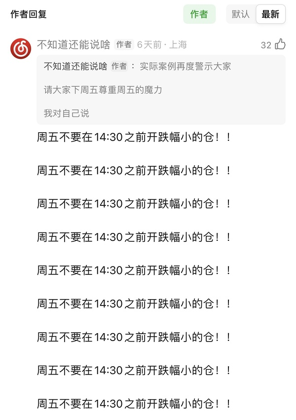

### 中文在线（提及 2 次，占比 1%）2026-11-05 11:02:59
- 点老师在大小姐吗
- 点老师看这个 hf也是冰雪啊？笑死

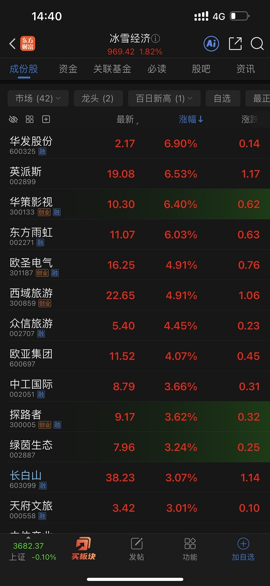

### 科创50（提及 1 次，占比 0%）2026-11-05 11:09:48
- 这个uu比的肯定是k50呗
创业板可不需要纳入太子爷

### 保利发展（提及 1 次，占比 0%）2026-11-05 13:16:19
- 保利发展火箭发射😂😂😂😂

### 博纳影业（提及 1 次，占比 0%）2026-11-05 13:31:36
- 怎么就陌生了 bn一直这样子啊

### 📄 全部发言（共 223 条）
- (2026-11-05 00:32:18) 今天nana有欺骗性
早上我觉得就是晚上这样子
所以才说大A装B
但是nana掩盖掉了🤣🤣🤣🤣  ⊳ （引用 @点-重生炒垃圾）科技真是早割早超生，免得今天空欢喜一场😅😅😅

- (2026-11-05 00:38:41) 159719  ⊳ （引用 @点-重生炒垃圾）中字头的一般是啥etf和资金，水果说有资金为明年做准备，难道是主动etf配的？

- (2026-11-05 00:39:00) 哈哈哈哈哈哈哈  ⊳ （引用 @VVV坚定持有VVV）倒也不用这么照顾我那300块😂

- (2026-11-05 00:40:35) 主动ETF没几个钱啊
可能有些公募基金砍科技要找东西买  ⊳ （引用 @点-重生炒垃圾）收到🥳🥳🥳

- (2026-11-05 00:41:30) 明天是检验美🐔七巨头含量的一天😂😂😂  ⊳ （引用 @点-重生炒垃圾）收到🥳🥳🥳

- (2026-11-05 00:55:37) 没有😂非常专一手里的  ⊳ （引用 @我爱牛肉火锅）不知道楼这两天有没有偷偷摸黄金白银股🤔🤔🤔

- (2026-11-05 08:01:07) 美国的银行股
欧洲的银行股
都拐头重新向上了  ⊳ （引用 @moli）笑死，教堂这个很形象了

- (2026-11-05 08:02:57) 恐慌指数大跌20%收盘
说明恐慌指数代表的情绪和硬件无关😂

- (2026-11-05 08:07:03) [图] 昨天晚上招招美股adr大涨4.5%😂😂😂😂

  ⊳ （引用 @我爱牛肉火锅）招:我胡汉三又回来了

- (2026-11-05 08:13:42) 民主党横扫国会！美股债齐涨

美国中期选举结果落地，风险资产迎来大幅反弹。民主党意外横扫参众两院，市场将政治格局切换解读为地缘风险降温与政策掣肘双重利好，推动股票、债券走高，油价则遭遇年内最惨烈单日跌幅之一。

对政策最敏感的板块领涨。金融股中，摩根大通涨4.20%，高盛涨3.59%，摩根士丹利涨4.25%。医疗保健与可选消费同步走高，国防股则逆势下跌，市场担心民主党会收紧五角大楼的预算。

油价下挫压低通胀预期，美债迎来强劲买盘

原油急跌直接传导至通胀预期，10年期美债盈亏平衡通胀率跌至8月以来最低水平，为美债提供了基本面支撑。

10年期美债收益率下行7个基点至4.89%，连续守住5%关口下方，创下两个月来的最低收盘水平。分析人士认为，债市还受益于另一层政治逻辑：民主党掌控国会将制约特朗普政府扩大财政赤字的空间，压缩了长端债券中蕴含的供给溢价。

- (2026-11-05 08:14:45) 分析师称，本周五公布的非农就业数据是目前的关键短期催化剂，如果数据超出预期，可能会引发美联储政策路径的重大调整。  ⊳ （引用 @不知道还能说啥）民主党横扫国会！美股债齐涨

美国中期选举结果落地，风险资产迎来大幅反弹。民主党意外横扫参众两院，市场将政治格局切换解读为地缘风险降温与政策掣肘双重利好，推动股票、债券走高，油价则遭遇年内最惨烈单日跌幅之一。

对政策最敏感的板块领涨。金融

- (2026-11-05 08:23:17) 昨天满说明问题的
纳斯达克指数的硬件含量并不高😂  ⊳ （引用 @点-重生炒垃圾）悟了，昨天七巨头涨蓝党，跌英伟达这种串子，再杀马斯克这种老红家的

- (2026-11-05 08:43:46) 除非打到20日线以内 大跌5%左右 试试水
不然不接sy 需要继续观望  ⊳ （引用 @shirla）楼楼雪人SY今天都接不？

- (2026-11-05 08:44:37) 跑不赢我们美国基金的水平
2023年也跑不过nana指数的水平  ⊳ （引用 @点-重生炒垃圾）但的胜率咋样，老是听说

- (2026-11-05 08:47:48) 两市融资余额较上日增加13.29亿元
截至11月4日，上交所融资余额报11776.07亿元，较前一交易日增加9.85亿元；深交所融资余额报10867.48亿元，较前一交易日增加3.44亿元；两市合计22643.55亿元，较前一交易日增加13.29亿元。  ⊳ （引用 @VVV坚定持有VVV）9亿呢，好多啊

- (2026-11-05 08:50:07) 对
反正应该不会接sy  ⊳ （引用 @shirla）20日线那得-8了哇？

- (2026-11-05 08:50:35) 他过去几次回退
都要退到20日线的  ⊳ （引用 @shirla）20日线那得-8了哇？

- (2026-11-05 09:23:05) 那是因为他们-5 我们还没开盘而已  ⊳ （引用 @暴富¥(´･ᴗ･`)$）中韩停牌了，溢价15

- (2026-11-05 09:27:26) 股票只有科技股能涨呗😂😂😂  ⊳ （引用 @👑）我要是科技人我也想清仓不干了，过山车一样的扇十几巴掌给个枣子再扇巴掌，场外我就当存款放几年算了

- (2026-11-05 09:31:53) 你也不看那边-5 我们没开盘  ⊳ （引用 @问一下能不能瘦）楼 你的中韩半导体溢价16了。好快就要到20了

- (2026-11-05 09:32:22) [图] 

  ⊳ （引用 @一直在摸🐟）雪儿来接

- (2026-11-05 09:33:39) 20日线到了的🤣🤣多线都在那里  ⊳ （引用 @我爱牛肉火锅）啊啊啊啊啊啊啊，你怎么偷跑我设的5日线

- (2026-11-05 09:34:14) 五日线14.28
今天最低14.3  ⊳ （引用 @问一下能不能瘦）我挂了25 没买上

- (2026-11-05 09:35:34) 你们看雪人是不是回踩五日线

- (2026-11-05 09:40:51) 哈哈一样的👍👍👍👍  ⊳ （引用 @A-Rubbit）虽然没接到雪人，但是接到了低点的大连和cbs😂

- (2026-11-05 09:41:31) 祝福奶茶幸福

- (2026-11-05 09:43:45) 今天asd-3.5又送钱了吗

- (2026-11-05 09:44:33) 这个来不及😂😂😂忘了  ⊳ （引用 @西西西西）接了一点晶雪 千万不要让我失望哇

- (2026-11-05 09:45:18) 小羊 带带机器人兄弟姐妹呀

- (2026-11-05 09:51:25) 95%仓位了
我要找东西卖了

- (2026-11-05 09:52:27) 今天早上低开光线有人去吗

- (2026-11-05 09:52:44) 09:52:24 财联社11月5日电，恒生科技指数延续上涨，涨幅扩大至4.0%，现报4102.63点。(来自财联社APP)  ⊳ （引用 @木感情的打工人）涨停了

- (2026-11-05 09:53:14) 昨天我说下跌提醒我
没有人提醒我
我只能提醒自己🤣  ⊳ （引用 @该用户已过期）你去了？

- (2026-11-05 09:54:45) 没接到雪人的其实转头可以去大连  ⊳ （引用 @该用户已过期）🤣🤣应该也提醒我们，哈哈哈
楼里要么忙着没接到⛄️
要么感慨或骂之前的传媒大爆发，根本顾不上它

- (2026-11-05 09:55:24) 基本上昨天说啥就做啥
😂  ⊳ （引用 @爱拔酱）楼不吭声就是在大买特买，而我早上还在不停刷新楼，看有什么最新消息

- (2026-11-05 10:03:04) 今天其他羊如何？

- (2026-11-05 10:03:43) 不着急看看其他羊如何  ⊳ （引用 @momo）襄阳被甩飞了😅

- (2026-11-05 10:04:00) 机器人行情非常不错👍  ⊳ （引用 @momo）襄阳被甩飞了😅

- (2026-11-05 10:04:46) 我马上机器人S一些 这里那里s一些就没那么多了  ⊳ （引用 @该用户已过期）楼95%仓位了，你现在多少？我现在就50出头

- (2026-11-05 10:05:45) cbs这几天好
只是因为他都没到大阴线
而且他还有个缺口

大连是没有缺口的

- (2026-11-05 10:06:13) 我十月底反复说的
11月狠狠的干🤣🤣🤣  ⊳ （引用 @该用户已过期）🤣🤣你真是太猛了，我才50出头……现在谨慎的是我了

- (2026-11-05 10:07:38) 美元下美债下
外资被动配置

多一个流入资金
外加南向资金绕开公募基金去科网股
类似白酒新能源顺理成章  ⊳ （引用 @Cher）恒科编制不好，中概科网那些，这次是真的吗？

- (2026-11-05 10:10:23) 小羊弱了
asd给我干翻小羊  ⊳ （引用 @YuanZi💕）asd破个30看看

- (2026-11-05 10:14:56) 那你不是9.22我们大减仓时候你就赚了 😂  ⊳ （引用 @番茄炒鸡蛋）如果奶茶不卖的话，我已经全仓回本了。强颜欢笑

- (2026-11-05 10:15:18) 大连是上面大阴线问题 A杀后遗症 不急  ⊳ （引用 @木感情的打工人）大连有10.30规律。。？

- (2026-11-05 10:16:41) 即使没有也必须要说

蓝色永远是奶茶的弟弟

- (2026-11-05 10:17:42) 你心态怎么了？
我不觉得  ⊳ （引用 @公主要发财）大连这几天在搞我们心态，今天会不会来个出其不意？

- (2026-11-05 10:18:10) 等cbs到了10.19跌停价也会这样的  ⊳ （引用 @公主要发财）大连这几天在搞我们心态，今天会不会来个出其不意？

- (2026-11-05 10:20:27) 猜测芒果资金去了奶茶
高切低

- (2026-11-05 10:23:58) [图] uu们
雪人大家的第二份教科书

很多uu的五日线挂单是错的

- (2026-11-05 10:24:31) 雪人回踩五日线极为到位 而且确实触碰  ⊳ （引用 @不知道还能说啥）uu们
雪人大家的第二份教科书

很多uu的五日线挂单是错的

- (2026-11-05 10:25:45) 你们知道中韩半导体优势了嘛🤣

- (2026-11-05 10:26:42) 我还是那句老话
到月末一看
很多传媒月涨幅可能比不过中影涨幅🤣

- (2026-11-05 10:27:40) 小羊卡高点 我也撤退了
带着asd零花钱一起撤了
我降降仓位

- (2026-11-05 10:28:08) 你把恒科理解为白酒新能源就能理解
其实和韩国无关

这也是公募欠配  ⊳ （引用 @moli）恒科难道就是三倍做空韩国？

- (2026-11-05 10:28:31) 五日线是浮动的  ⊳ （引用 @红烧肉肉）早上看的时候不是这个价格的，挂的30没买到（还以为自己加了几分能买到）....

- (2026-11-05 10:28:59) 所以这是教科书教学：让你知道五日线是浮动 对强势股要留有空间  ⊳ （引用 @红烧肉肉）早上看的时候不是这个价格的，挂的30没买到（还以为自己加了几分能买到）....

- (2026-11-05 10:29:45) 👍👍👍👍👍  ⊳ （引用 @not bad）设置的条件单 还是买入最低点了 哈哈 条件单不错

- (2026-11-05 10:30:28) 在我们恒科赚50%时候 香港科网股可是公募重仓哦 后来都砍掉了  ⊳ （引用 @moli）公募不是欠配国内就好了，还能欠配恒科？

- (2026-11-05 10:31:27) 跌都不会跌

中韩半导体价值就在这里  ⊳ （引用 @🅰失而复🉐😎）T0来了

- (2026-11-05 10:32:56) 我昨天就在了😂每次都是冲高回落  ⊳ （引用 @点-重生炒垃圾）我今天新进的🤣🤣🤣见面礼

- (2026-11-05 10:33:33) 现在香港好
不如考虑香港红利 香港银行  ⊳ （引用 @云水河西）我还买了点银行😂真的毫无信心，但是也可能市场就打我这种人

- (2026-11-05 10:33:59) 中马漂亮啊

- (2026-11-05 10:35:22) 今天其他几个也是啊  ⊳ （引用 @momo）网易云今天又6个月新低了

- (2026-11-05 10:35:59) 我不负责中影买单哦
中影是不能动的
随时炒作复仇者联盟  ⊳ （引用 @仓部加措）Zy好强，设置了64前高扭出去了😂

- (2026-11-05 10:36:09) 内蒙古大草原多美啊

- (2026-11-05 10:36:44) 建设工业今天到底军工还是机器人啊？  ⊳ （引用 @点-重生炒垃圾）哈哈哈哈哈军工

- (2026-11-05 10:37:06) 长龙来个15+看看实力  ⊳ （引用 @点-重生炒垃圾）哈哈哈哈哈军工

- (2026-11-05 10:37:59) 哈哈哈哈哈哈哈  ⊳ （引用 @点-重生炒垃圾）卧槽无法判断，机器人也这个时候拉升

- (2026-11-05 10:38:25) 传媒非要早上冲 傻缺

都是后来者牛逼  ⊳ （引用 @点-重生炒垃圾）每天都是科技先行，题材收尾啊

- (2026-11-05 10:39:43) 万科火箭发射😅  ⊳ （引用 @点-重生炒垃圾）每天都是科技先行，题材收尾啊

- (2026-11-05 10:40:44) 我去  ⊳ （引用 @点-重生炒垃圾）卧槽，我昨天说的华发，真的6个点了

- (2026-11-05 10:41:19) 楼里uu满多昨天就在了😂  ⊳ （引用 @we）有去晶雪的吗

- (2026-11-05 10:42:26) 炒垃圾 😂😂😂😂 确实没啥好看的

都知道机器人骗单子 传媒不赚钱 地产没出路 消费降级无起色🤣不影响股票上涨  ⊳ （引用 @点-重生炒垃圾）资金完全不讲基本面啊，只是一味地拉低

- (2026-11-05 10:44:10) 因为昨天爆量是下午开始的
早上数据失真  ⊳ （引用 @稀里不糊涂）5000亿来了

- (2026-11-05 10:44:30) 昨天在的今天冲能卖

先手  ⊳ （引用 @🅰失而复🉐😎）😏

- (2026-11-05 10:47:17) 你在做梦

白日梦做做就行 别当真 

安心炒垃圾  ⊳ （引用 @稀里不糊涂）行吧，那看来今天还好，也没有很夸张，不过小a真能如江所说的走独立自主吗

- (2026-11-05 10:48:03) 现在赚钱效应好就赶紧干
差了马上降仓
就那么简单  ⊳ （引用 @稀里不糊涂）行吧，那看来今天还好，也没有很夸张，不过小a真能如江所说的走独立自主吗

- (2026-11-05 10:49:10) 你提高几分就会成交了
14.3转瞬即逝  ⊳ （引用 @lacey）今天给⛄️设置的14.30没触发，连着两天了，uu们知道为啥不

- (2026-11-05 10:49:52) [图] 14.3其实是虚拟价格 所以uu交易不了的
看图 隔空的 我是14.36才可以

  ⊳ （引用 @棠糖）挂低了，早上最低就是14.3

- (2026-11-05 10:50:26) 我中午可以和大家解释为什么会这样  ⊳ （引用 @不知道还能说啥）14.3其实是虚拟价格 所以uu交易不了的
看图 隔空的 我是14.36才可以

- (2026-11-05 10:50:49) 是的  ⊳ （引用 @问一下能不能瘦）同志们 楼今天买的⛄️也l是15.84的卖单嘛

- (2026-11-05 10:51:28) 楼里有uu早上上头追传媒的吗😂😂😂😂

- (2026-11-05 10:51:57) 传媒会教大家 大热躲开的价值  ⊳ （引用 @Aaa摆烂咸鱼🥳）买了点txx

- (2026-11-05 10:53:06) 阻力位啊 你忘记我们本来都是设置啥价格了嘛  ⊳ （引用 @今天也要开心鸭）雪人怎么坠这么快

- (2026-11-05 10:53:40) 反正我今天买的就是本来的一半
对我没区别
反正就卖那点钱  ⊳ （引用 @爱拔酱）嗯？15.84卖今天的+持仓的一半？

- (2026-11-05 10:54:15) 你们都是情绪交易
我相信你昨天并不准备买这个  ⊳ （引用 @Aaa摆烂咸鱼🥳）这个txx我弄三次了，每次都是高买低卖，次次不长记性

- (2026-11-05 10:57:10) 光伏！！！！！！！！！  ⊳ （引用 @花道最爱拉面）点老师，迈为这板是跟宇航员还是光伏啊

- (2026-11-05 10:59:47) 只要不贪心外面的 
电影+冰雪还是很稳健
不是这个来就是那个来😂

- (2026-11-05 11:00:50) 我把大连额度先打满 也是尽量规避手贱  ⊳ （引用 @不知道还能说啥）只要不贪心外面的 
电影+冰雪还是很稳健
不是这个来就是那个来😂

- (2026-11-05 11:01:39) [图] 现在是香港红利超级V😂😂

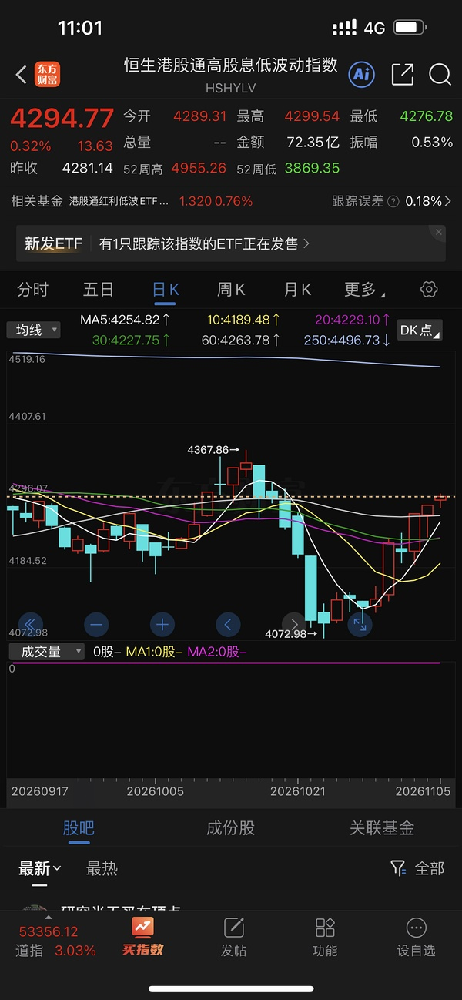  ⊳ （引用 @木感情的打工人）昨晚江老师特意点名了

- (2026-11-05 11:02:46) 跟的
昨天+2你忘了吗
他们+2昨天白天没涨 盘前-1

合计还是+1  ⊳ （引用 @哄哄🐮）😂现在纳指etf不跟期货了？

- (2026-11-05 11:02:59) 点老师在大小姐吗  ⊳ （引用 @点-重生炒垃圾）白酒来啦，大小姐火箭发射

- (2026-11-05 11:04:00) 奥特维 阿特斯都是昨天开始的吧  ⊳ （引用 @花道最爱拉面）它晚一天启动，但是真是猛

- (2026-11-05 11:04:15) [图] 

  ⊳ （引用 @一根鸭脖子）一忍再忍 没买，昨天没计划买的今天宁可错过也不出手

- (2026-11-05 11:04:25) 👍👍👍👍👍👍👍👍👍👍👍👍

- (2026-11-05 11:07:08) 现在本月14% 剩余20天稳住打一根18+ 就可以月涨幅30%🤣我一点也不急  ⊳ （引用 @奶茶今天40了吗）幸福什么时候报道

- (2026-11-05 11:08:49) 他还是黄金概念呢哈哈哈哈哈  ⊳ （引用 @小白吐司）今天买了点峨眉山刚才发现它也属于冰雪吗哈哈

- (2026-11-05 11:09:48) 这个uu比的肯定是k50呗
创业板可不需要纳入太子爷  ⊳ （引用 @稀里不糊涂）我感觉今天挺强的，都预计低开的，科技还高走给机会减仓了

- (2026-11-05 11:10:26) 当你看到消息面开始多次提及复仇者联盟
然后中影有爆量加速迹象时候
要重点关注了  ⊳ （引用 @点-重生炒垃圾）中影啥时候离场啊，我一直没设置条件单

- (2026-11-05 11:10:50) 😂😂😂😂😂😂😂😂😂😂😂  ⊳ （引用 @点-重生炒垃圾）余力又赢了，香港红利性价比更高

- (2026-11-05 11:11:07) 这个年内还是负的 不过也没负多少  ⊳ （引用 @木感情的打工人）你对象又赚了😂

- (2026-11-05 11:13:22) 😂😂😂下个月吗  ⊳ （引用 @爱拔酱）早上看到唐尼，美队，雷神要来首映！我要去港汇看复仇者大楼

- (2026-11-05 11:14:36) [图] 今天最后赢家是香港🇭🇰

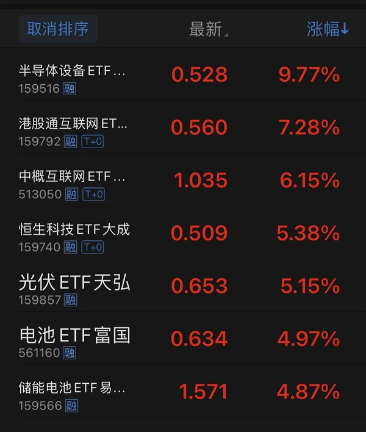

- (2026-11-05 11:16:34) 中影轻轻松松刷新6/23日高点

- (2026-11-05 11:16:40) 朝着大缺口前进  ⊳ （引用 @不知道还能说啥）中影轻轻松松刷新6/23日高点

- (2026-11-05 11:17:33) 科网股天下吧😂
容量大 公募基金欠配 位置足够低  ⊳ （引用 @点-重生炒垃圾）香港创新药连电池都打不过啊

- (2026-11-05 11:19:09) 腾讯阿里那种也是消费股
位置还低 容量又大 也是公募抛弃许久
还能当ai应用😂
太适合目前情景了  ⊳ （引用 @一直在摸🐟）做鸭都+5

- (2026-11-05 11:21:24) 皇氏有  ⊳ （引用 @游游）黄台也没有b点啊

- (2026-11-05 11:23:43) 同比数据有点失真 昨天是午后才爆量的  ⊳ （引用 @某豆用户饱腹版）今天这个放量是何意味

- (2026-11-05 11:26:52) 反正现在也没事
我给你举个例子 
今天早上14.36 14.35 14.34 14.33 14.32 14.31 14.30都有100手挂单
当股价运行到14.36时候 突然有个人他急于甩货 14.30卖出600手

你这个应该都懂 只能成交600手 这时候会成交的就是14.36到14.31的全部100手买单

14.30无法成交 价高者得 

这时候就分时图就会出现隔空

因为其实没有完成过14.30的价格实际成交  ⊳ （引用 @lacey）感谢楼楼 蹲蹲中午

- (2026-11-05 11:30:36) [图] 今天现实情况
有人在14.51时候就挂出类似14.30的单子
14.51到14.35全部价高者得

因此今天雪人实际盘口上最低交易价格14.35

条件单不可能触发14.35以下价格因为根本就没有出现过

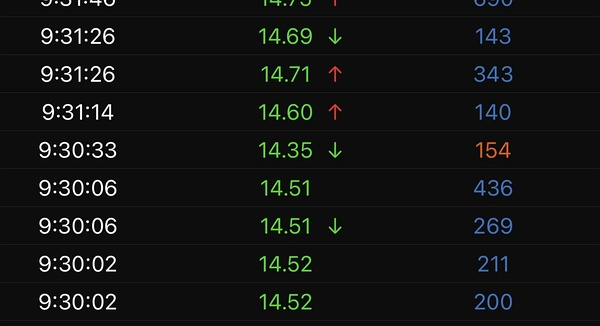  ⊳ （引用 @不知道还能说啥）反正现在也没事
我给你举个例子 
今天早上14.36 14.35 14.34 14.33 14.32 14.31 14.30都有100手挂单
当股价运行到14.36时候 突然有个人他急于甩货 14.30卖出600手

你这个应该都懂 只能成

- (2026-11-05 11:30:53) 牛奶不重要 是皇🤣🤣🤣  ⊳ （引用 @游游）没看牛奶错亿！

- (2026-11-05 11:33:12) [图] 不是大家app软件有问题
就是有人突然挂低价卖导致的 
我是14.36侥幸买到了
如果14.34也不会买到
分时图隔空b

大家有时候看到隔空S 就是反过来的情况

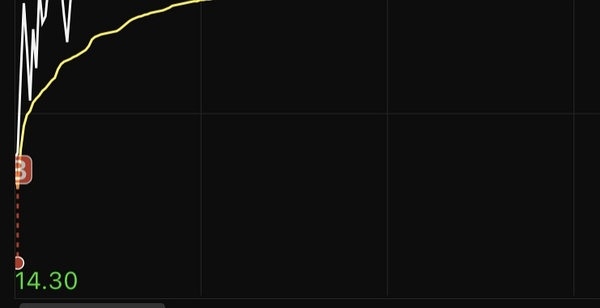  ⊳ （引用 @不知道还能说啥）今天现实情况
有人在14.51时候就挂出类似14.30的单子
14.51到14.35全部价高者得

因此今天雪人实际盘口上最低交易价格14.35

条件单不可能触发14.35以下价格因为根本就没有出现过

- (2026-11-05 11:33:36) 一个不用你操心的股票你都骂😂  ⊳ （引用 @乖乖是只嘤嘤怪）我骂了他两天了 

- (2026-11-05 11:34:55) 他有卡异动的问题  ⊳ （引用 @游游）阳光又又又板了 襄阳今天怎么不🐏

- (2026-11-05 11:35:41) 说明他不适合你
你嫌弃慢 不匹配他🤣  ⊳ （引用 @乖乖是只嘤嘤怪）看他瘟鸡一样 昨天差点清了

- (2026-11-05 11:39:57) 小伙伴
昨天那边20%
他们因为10cm封顶 折价了10%！！！！！！！！！  ⊳ （引用 @Waiting一下）这些都是带任务的

- (2026-11-05 11:41:52) 咱们国庆之前就重仓布局国庆档
国庆档没什么声浪
拿住继续布局复仇者联盟
如果没有声浪
继续布局流浪地球  ⊳ （引用 @乖乖是只嘤嘤怪）主要他也不跌加也加不了

- (2026-11-05 11:43:20) 你的招行回本路上了😂😂😂

空调和招招 中国移动他们都差不多时间日内开拉  ⊳ （引用 @木感情的打工人）对哦，我给忘了

- (2026-11-05 11:49:55) 主升浪好做 但是重点是及时收手
但是往往情绪亢奋 做不到这点
因此主升浪收益来的很快 A杀开始还容易在抄底 收益抹去倒亏也很快

uu们性格和果断性都不一样
并不是所有人都适合做主升浪
很多uu我观察下来
就适合中影这样的进二退一模式 波动低 幅度可控 不引起情绪波澜  ⊳ （引用 @生动的羊）更适合做主升😂

- (2026-11-05 12:12:53) 明天sy 20日线提升到28.9附近
下周sy 5周线提升到29.4附近

- (2026-11-05 12:16:24) [图] 由于1000有妈妈不断注入
罕见的1000比2000牛逼了
大家本月跑赢没？

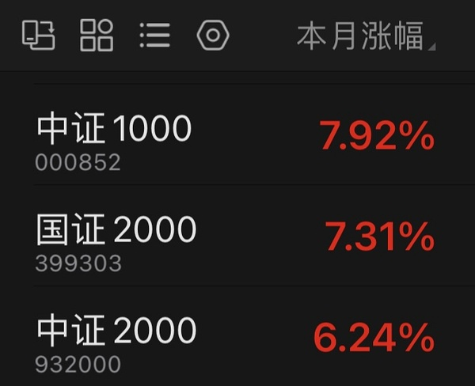

- (2026-11-05 12:18:36) 🤣要保持到月末  ⊳ （引用 @该用户已过期）微赢

- (2026-11-05 12:33:26) 又在做白日梦了
上个月我们大胜 是依靠下半个月的防守  ⊳ （引用 @哎呀哎呀）能这样保持到月末就牛了🥺🥺🥺

- (2026-11-05 12:34:45) 这个月11/27周五 11/30月末我不会再犯错🤔🤔🤔🤔  ⊳ （引用 @该用户已过期）月末要大赢！🤣🤣

- (2026-11-05 12:36:49) [图] 我先提醒自己明天

  ⊳ （引用 @该用户已过期）已截图，11.27和30开盘就发给你🤣🤣

- (2026-11-05 12:37:01) 谢谢😂😂😂  ⊳ （引用 @该用户已过期）已截图，11.27和30开盘就发给你🤣🤣

- (2026-11-05 12:38:30) 👍👍👍👍👍厉害啊  ⊳ （引用 @qiu啾）昨晚我研究了下，拉的线🧵，开盘盯着买的

- (2026-11-05 12:40:46) 上周五太惨了 直接干废我一个礼拜的艰难防守  ⊳ （引用 @该用户已过期）哈哈哈哈😂我明天也管住手，今天还是强上了点大连和⛄️，就一点点🤣🤣

- (2026-11-05 12:44:07) 😂我已经基本上构思好了
明天不会买其他乱七八糟的东西

明天就等一个29的sy 等不到也拉倒  ⊳ （引用 @该用户已过期）那天我等于回撤了两天的收益🤣🤣周五就得老实，明天继续

- (2026-11-05 13:09:48) 跳水和我们无关
我收益扩大了

- (2026-11-05 13:11:17) 👍👍👍👍👍👍
今天新华传媒回来了？  ⊳ （引用 @点-重生炒垃圾）我今天犯贱掏龙版了😣😣😣

- (2026-11-05 13:12:47) 我不想重复我有多看好复仇者联盟流浪地球  ⊳ （引用 @梳碧湖砍柴人）楼是多了军工和传媒吗

- (2026-11-05 13:13:02) 20溢价到了吗  ⊳ （引用 @随便吧）楼楼，中韩走了吗，20溢价走吗🧐

- (2026-11-05 13:15:39) 不看好ai的其实一直都不是我
我拿的很稳 毫无波澜  ⊳ （引用 @随便吧）哈哈还没，等20🫣

- (2026-11-05 13:16:19) 保利发展火箭发射😂😂😂😂

- (2026-11-05 13:17:07) 你旅游时候都能如此灵活操作😂😂😂  ⊳ （引用 @sickid）我昨天买了点小爱

- (2026-11-05 13:17:40) 有万科就是真
不带万科玩就假哈哈  ⊳ （引用 @我爱牛肉火锅）dc
又来了吗？宝4%

- (2026-11-05 13:18:49) 光线有没有见面礼好感度就看今天了🤣🤣🤣🤣  ⊳ （引用 @该用户已过期）你现在电影冰雪啥比例？我冰2倍影

- (2026-11-05 13:19:12) 带了他玩就行哈哈哈哈  ⊳ （引用 @我爱牛肉火锅）它也4%，没涨停🤔

- (2026-11-05 13:20:00) 支持干翻

我还是幸福比较多的 当然中影更关键  ⊳ （引用 @该用户已过期）哈哈哈哈，应该会给🤣🤣我们幸福后来居上了，干翻光线了

- (2026-11-05 13:24:21) 幸福是疯子
我估计大家现在的骂
以后卖飞还是骂

幸福有很大的想象空间 不要急  ⊳ （引用 @该用户已过期）下一步干翻zy，20的干不过10的，要不要脸啊🤣🤣

- (2026-11-05 13:25:04) 口气大一些
给我干翻奶茶  ⊳ （引用 @该用户已过期）下一步干翻zy，20的干不过10的，要不要脸啊🤣🤣

- (2026-11-05 13:26:53) 祝福他  ⊳ （引用 @🧋今天25了吗）bn板了

- (2026-11-05 13:27:02) 这个月就集中电影冰雪好好做
期待圆满十一月🤣  ⊳ （引用 @该用户已过期）不急，先骂骂再说🤣毕竟我已经三进宫它了，割了2回了

- (2026-11-05 13:29:01) 低位想着触发不是好事

只要他拉一个15+ 你后面再也没有低成本优势  ⊳ （引用 @嘻嘻子）午觉醒来，xf能不能触发一下子

- (2026-11-05 13:31:36) 怎么就陌生了 bn一直这样子啊  ⊳ （引用 @游游）bn变得好陌生 凡拓又来了

- (2026-11-05 13:34:26) 要杀黄金了

- (2026-11-05 13:37:49) 山西煤矿增产 有消息面  ⊳ （引用 @想当富有的咸鱼）再次感慨一句，油跌算了，煤跌的幅度居然也差不多

- (2026-11-05 13:38:19) [图] 

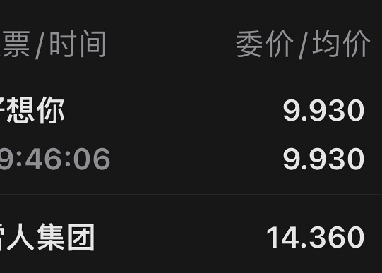  ⊳ （引用 @🅰失而复🉐😎）每天都在等你🫠

- (2026-11-05 13:38:58) 重要的是你的钱离开后去了哪里  ⊳ （引用 @游游）我在的时候他就不中了😤

- (2026-11-05 13:39:25) 不讲基本面了
筹码游戏中  ⊳ （引用 @一直在摸🐟）油价这么贵 还能红啊

- (2026-11-05 13:40:07) 你还有其他的呢🤣  ⊳ （引用 @该用户已过期）怪不得能干到95%🤣🤣打野的我就只买了一笔，没加过

- (2026-11-05 13:40:54) 咱们其实6月就知道了😂

- (2026-11-05 13:41:50) 创业板翻绿正常
没涨多少

马上科创5%翻绿  ⊳ （引用 @👑）创业板都翻绿了，ong

- (2026-11-05 13:43:21) 等尾盘  ⊳ （引用 @🅰失而复🉐😎）冰怎么没反

- (2026-11-05 13:43:38) 😂😂😂😂😂😂😂大A的装逼到此结束了  ⊳ （引用 @sickid）科创综指翻绿

- (2026-11-05 13:44:54) 白日梦  ⊳ （引用 @点-重生炒垃圾）大A的独立行情靠的是什么？？？

- (2026-11-05 13:46:29) 抛开美股分析大A双创都是耍流氓

白日梦做做就行 当真就是人格分裂了  ⊳ （引用 @一切都会过去的）最后还是在装逼😅

- (2026-11-05 13:48:05) 你的招招要翻红了  ⊳ （引用 @木感情的打工人）传媒里面轮着来啊，zx出版也绿了

- (2026-11-05 13:48:39) 黄金股也在装b
白银股已经翻绿  ⊳ （引用 @我爱牛肉火锅）这句可以跟那句大a本来什么样并列吗？

- (2026-11-05 13:49:13) 你的招招
我的招招
我女朋友的招招🤣  ⊳ （引用 @木感情的打工人）确实

- (2026-11-05 13:49:32) 我有单子  ⊳ （引用 @🅰失而复🉐😎）要不要T，还是等明天周五😏

- (2026-11-05 13:50:00) 我把机器人军工能卖的都清了  ⊳ （引用 @稀里不糊涂）军工也绿了

- (2026-11-05 13:50:28) 市场越乱越好  ⊳ （引用 @🅰失而复🉐😎）我也设了

- (2026-11-05 13:51:21) 其实我的东西本质都是大消费  ⊳ （引用 @稀里不糊涂）专注冰雪传媒了，还有些消费吧

- (2026-11-05 13:52:19) 三天从114到94😂😂😂😂总会有反弹的  ⊳ （引用 @一直在摸🐟）这破油咋又拉起来了

- (2026-11-05 13:52:49) 你去看2022俄乌最终油下跌也是N字下跌  ⊳ （引用 @一直在摸🐟）这破油咋又拉起来了

- (2026-11-05 13:53:14) [图] 情绪你知道的
昨天我就说了

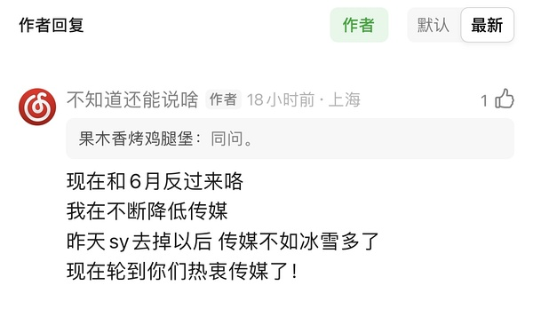  ⊳ （引用 @扶我起来还能买）uu们今天外面蛮多人在买传媒的 不知是好是坏 群里一帮人在买入

- (2026-11-05 13:54:09) uu记得保护收益是你12月继续大赚的前提  ⊳ （引用 @只想搞钱）我今天反而买了军工…最近赚钱效益好久就浪了应该专注的

- (2026-11-05 13:58:27) 韩国KOSPI指数日内重挫6%，SK海力士跌超10%，三星电子跌超8%。

- (2026-11-05 14:03:54) 这也急？
我们都没买满 急啥呀 
今天电影打底  ⊳ （引用 @👑）比起科技反弹，我竟然更希望冰雪快弹呀额

- (2026-11-05 14:04:59) 热
但不沸腾  ⊳ （引用 @家不住海边）传媒很热吗。 因为在里面。 我有点看不清了。

- (2026-11-05 14:06:49) 电影也是传媒分之
但也是大消费分之

而且我们并没去慈文传媒那种高位的
我们在执行慢就是快  ⊳ （引用 @生动的羊）咱们zy沾边传媒不

- (2026-11-05 14:07:42) 还是白银快😂  ⊳ （引用 @we）杀的也太快了吧

- (2026-11-05 14:08:48) 呃
大连是进攻跌停阴线受阻
cbs是距离那根阴线都没有  ⊳ （引用 @公主要发财）今年长白山想当队长

- (2026-11-05 14:10:25) cbs：看吧 只要我偷懒 人家还会觉得我厉害呢  ⊳ （引用 @我爱牛肉火锅）就是，懒鬼，明明到39都没阻力 这个家伙

- (2026-11-05 14:11:27) 有妈妈无限子弹确实牛逼👍

- (2026-11-05 14:11:40) 牛逼啊  ⊳ （引用 @sickid）谢谢青云给的见面礼，20了

- (2026-11-05 14:13:17) 全部横扫啊  ⊳ （引用 @安然致富神秘人）科创吗哈哈

- (2026-11-05 14:13:38) 哈哈哈哈哈  ⊳ （引用 @我爱牛肉火锅）又想到另一个勤快的倒霉蛋小远了

- (2026-11-05 14:15:27) 努力啥呀
你们自己看10/19日大阴线跌停

大连都摸过了
cbs还差得远

努力的是大连啊  ⊳ （引用 @混乱中立同人女）阿白真的好努力

- (2026-11-05 14:16:27) 妈妈不买股票的 ETF啊  ⊳ （引用 @想当富有的咸鱼）NONONO，妈妈没扫红利

- (2026-11-05 14:20:13) 科创半导体ETF华夏成交创历史最高纪录

科创半导体ETF华夏（588170）今日爆量成交，截至发稿时间成交额突破137亿元较昨日全天放量47%，并刷新该ETF历史最高成交记录。该ETF当前涨幅为4.17%，前三大持仓分别为华海清科（持仓占比11.10%）、中科飞测（持仓占比10.76%)、中微公司（持仓占比10.19%）。

- (2026-11-05 14:20:45) 你方唱罢我登场😂😂😂

- (2026-11-05 14:21:42) 秀肌肉呢  ⊳ （引用 @木感情的打工人）妈妈干啥啊

- (2026-11-05 14:22:34) 就是的
一大批ETF都有妈妈  ⊳ （引用 @我爱牛肉火锅）科创半导体ETF华夏成交创历史最高纪录
科创半导体ETF华夏（588170）今日爆量成交，截至发稿时间成交额突破137亿元较昨日全天放量47%，并刷新该ETF历史最高成交记录。该ETF当前涨幅为4.17%，前三大持仓分别为华海清科（持仓占比

- (2026-11-05 14:23:11) 逆周期反情绪
容易收割你懂的  ⊳ （引用 @木感情的打工人）我们果然喜欢逆周期

- (2026-11-05 14:24:29) 有用啊
不是钱进来了吗
融资盘昨天都流入了

到时候美国反弹 我们大跌 也说不了😂😂😂  ⊳ （引用 @点-重生炒垃圾）妈妈逆周期能有用吗？这么坚决

- (2026-11-05 14:25:19) 你看看我投票为什么就开了三只🤣🤣🤣🤣🤣🤣  ⊳ （引用 @👑）继续祈祷今天美鸡红，场外加加油啊

- (2026-11-05 14:27:20) uu是不是没看韩国跌多少 😂  ⊳ （引用 @👑）打错了，今晚美鸡红，昨天绿的我知道

- (2026-11-05 14:28:28) 参考博纳刷屏三星堆
要小心啊

- (2026-11-05 14:31:19) 没变 继续看好才加的  ⊳ （引用 @扶我起来还能买）楼楼 刚看到你今天加了恋爱脑 单子没变吧

- (2026-11-05 14:32:27) [图] 时间到了

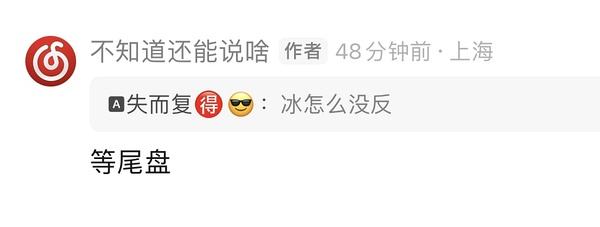  ⊳ （引用 @摇头晃脑小脑斧）冰雪！（一阵强有力的音乐响起

- (2026-11-05 14:33:55) 晶雪这个🐶
他一定要大连或者冰山才跟  ⊳ （引用 @🅰失而复🉐😎）我长白山的收益貌似超越大连了🤣

- (2026-11-05 14:34:42) 老话 别触发比较好
大连加速以后你很难买了  ⊳ （引用 @💡）大连能触发一下吗❤️期待🥺

- (2026-11-05 14:40:31) [图] 点老师看这个 hf也是冰雪啊？笑死

  ⊳ （引用 @点-重生炒垃圾）给科技打样？反弹就三天？

- (2026-11-05 14:42:25) 前面清了昨天买的军工😂
降低明天的总仓位
原因你知道的  ⊳ （引用 @不要满仓！！！）楼军工还有吗

- (2026-11-05 14:43:17) 👍👍👍👍

大A又在骗自己了  ⊳ （引用 @木感情的打工人）由于我们肯定大致支持数据中心建设，假如西大的数据中心不够用的话，全球只能来东大采购Token了

- (2026-11-05 14:45:09) 幸福月涨幅比sy多哦  ⊳ （引用 @kk）xf还没有走电影行情，短剧涨跟着吃点，短剧跌也会跟着跌😂

- (2026-11-05 14:45:32) 7  ⊳ （引用 @timing）楼现在仓位来到几层啊

- (2026-11-05 14:46:11) 不至于吧
我早上还是20+走的呢也没超过呢  ⊳ （引用 @游游）额襄阳憋了一天尾盘拉了

- (2026-11-05 14:48:04) 上周五主要是上午我手贱了😂  ⊳ （引用 @timing）上周五打得太痛了 我下午也立马降到6.5了🤣🤣🤣

- (2026-11-05 14:48:53) 光线今天无法证明自己比幸福好
那你得不到更多奖励的哦🤣

- (2026-11-05 14:50:44) 那个冰山玩了老半天
依然无法证明自己不是双头啊😂😂😂😂

- (2026-11-05 14:51:53) 我们玩的时候尖顶都是多少来着  ⊳ （引用 @嗯嗯你对了）奶茶这换手都19了，明天看起来会很刺激啊

- (2026-11-05 14:57:05) 楼里uu是不是11月还没绿过

让我们迎接11月首个周五的挑战

- (2026-11-05 14:57:32) 让我们看看新的一月的第一个周五有多高的难度  ⊳ （引用 @不知道还能说啥）楼里uu是不是11月还没绿过

让我们迎接11月首个周五的挑战

- (2026-11-05 14:59:05) 科技人就算开始绿的
昨天都有可能直接超过我们垃圾人收益率
我没阴阳😂  ⊳ （引用 @点-重生炒垃圾）怀疑你在阴阳。。。。

- (2026-11-05 15:00:09) 冰雪出战！！  ⊳ （引用 @VVV坚定持有VVV）是的，能不能让我红一周🤩

- (2026-11-05 15:00:31) 今天全部还给你了🤣  ⊳ （引用 @赛博朋克2077）我因为bn
绿了一天

- (2026-11-05 15:00:47) [图] 

  ⊳ （引用 @明白人）🥹这周五能破先例，周五能加仓吗

- (2026-11-05 15:02:04) 我也这么觉得
明天冰雪带收益率😂😂😂  ⊳ （引用 @爱拔酱）我手里只有冰雪和电影了
今天靠电影，明天轮到冰雪

- (2026-11-05 15:05:47) 由于午后价格提升好多 重新按了计算器
20日线29了
下周五周线29.7

跌破29.7买入
对应明天下跌8.6%🤣
符合周五不是大跌不买的要求  ⊳ （引用 @不知道还能说啥）明天sy 20日线提升到28.9附近
下周sy 5周线提升到29.4附近

- (2026-11-05 15:07:21) 其他是的
有一个不一样
我取消了幸福14.34单子
直接开15.44那单了  ⊳ （引用 @该用户已过期）楼，条件单都还是之前的价格吗？

- (2026-11-05 15:11:54) 还记得我们上周找100+涨停后走势
果然有持续性😂😂😂😂情绪惯性还是有的  ⊳ （引用 @点-重生炒垃圾）你创新药走没，我有点怕跟着科技回调，走完了

- (2026-11-05 15:13:36) [图] 厉害 👍👍👍👍

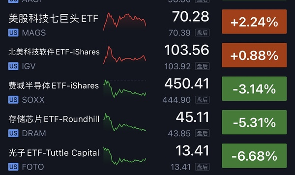  ⊳ （引用 @vio）小远-0.15

- (2026-11-05 15:14:47) 我泼冷水都有uu追买顶点科创半导体😂😂😂  ⊳ （引用 @🧋今天25了吗）怎么刚收盘就泼凉水🥺

- (2026-11-05 15:32:21) 小伙伴 那是1月底的事情  ⊳ （引用 @我的场外不是梦）那我们网易云同学。。。。。

- (2026-11-05 15:34:15) 四个月后 从赚50点80点变成回本了？？  ⊳ （引用 @我的场外不是梦）我希望每一个小小的低频的煽动都能助力我的网易云即日反弹，可惜十连阳都回不了本

- (2026-11-05 15:39:31) 为什么是四个月后？？
你们投资那么短的吗

我四年前nana赚到80%多可是用了差不多30个月  ⊳ （引用 @我的场外不是梦）4个月后真的能赚50点吗哈哈哈，还是我没看懂楼楼说的

- (2026-11-05 15:41:37) 你6月买的 现在不是四个月后？

四个月前买你是为了赚0.5%嘛
现在就为了回本了！  ⊳ （引用 @我的场外不是梦）啊不是你说四个月后的吗，你看我差生真是阅读理解都做不会啊！！

## 🧠 投资风格分析
> 📏 增量更新指引：仅当今日发言确有新依据时才修订对应维度，无变化不强行重写；单维度修订建议 ≤150 字。

- 投资理念与方法：强调全球联动，认为脱离美股分析A股双创是耍流氓，短期受美股AI硬件与七巨头走势牵引；重视公募欠配、容量大、位置低等被动资金逻辑，将科网类比白酒新能源的公募回补路径；以赚钱效应决定加减仓，好就赶紧干、差就马上降仓；对指数与ETF被动买盘、融资余额敏感。
- 风险偏好：对纯题材与早盘冲高板块坚持大热躲开，不愿追高；认可主升浪收益快但强调及时收手，认为多数人更适合中影式进二退一、波动低幅度可控的模式；对高位强势股仅在回调至20日线附近才考虑接回，宁可错过不追高。
- 交易与仓位：严格执行条件单与时间纪律，以五日线为浮动支撑而非固定价位，对强势股挂单需预留空间；深刻理解盘口隔空与虚拟价格（极端低价未必实际成交，价高者得，条件单不会触发未成交价）。95%深度满仓时会主动减仓保留灵活性，用「打满额度」等方式限制手贱，倾向在强势板块高点部分止盈后降仓。
- 心理特质：对自身手贱行为有清醒认知，并主动采取惩罚性措施（如将大连额度打满以限制操作空间）；深知“赚多了就浪”，因此主动寻求外部监督（希望被泼冷水）并反复强调“只要不贪心乱浪”是赚钱核心；对情绪交易保持警惕，认为大多数人盘中追涨是“情绪交易”而非计划内操作，并公开指出以提醒他人（如昨日下跌无人提醒，只能自我约束）；能够果断接受高切低（资金从芒果流向奶茶），并承认市场博弈（炒垃圾）的合理性，保持务实心态。

> ⚠️ 本板块由 Actions 全自动增量更新（复用当日发言与今日总览），每次仅在内容足够支撑时才改动。

## 🏷️ 昵称映射表
### 📖 昵称规律（供 AI 判断新昵称时参考）
【昵称命名规律（用于推断未知新昵称）】
- 拼音首字母缩写：取标的/基金名汉字拼音首字母串（含数字代码），多为 ETF/股票代码口语化｜示例：yl=引力传媒｜zy=掌阅科技｜sj=视觉中国｜cc=华安文体健康混合｜C50=创业板50ETF｜k50=科创50｜kun=昆仑万维｜xhxc=新瀚新材｜zxfc=中欣氟材
- 小/老+姓氏代指：「小X」「老X」通常指姓 X 的标的或该标的的基金经理；「X兄弟」多为同系基金｜示例：小惠=惠发食品｜老莫=万家品质生活(莫海波)｜小华=华夏全球科技先锋(QDII)A｜小华兄弟=华夏移动互联(QDII)｜小浦=浦银安盛全球智能科技(QDII)A｜小广=广发全球精选(QDII)A｜小远=华宝致远(QDII)C｜招招=招商银行｜小德=德明利｜赵姨=兆易创新｜露露=泸州老窖｜空调=格力电器
- 戏称/黑话→题材板块：生活化比喻或黑话对应某个题材/板块，而非单一标的；出现时多指板块方向｜示例：卖国=PCB板块(英伟达AI链)｜爱国=国产自主(半导体设备/芯片)｜奶茶=易点天下｜老师=中文在线｜蓝色=蓝色光标｜宇航员=航空航天板块｜华子=华泰保兴安悦债券｜国际=国际复材｜巨无霸=长鑫科技等重大IPO
- 谐音/取字：昵称含标的名关键字（取一字或谐音），多为 A 股个股或基金简称｜示例：万华=万华化学｜东百=东百集团｜宝=保利发展｜讨饭/亚洲讨饭/建信新兴=建信新兴市场(QDII)A｜华宝zy=华宝致远(QDII)A
- 机构/基金经理昵称：以基金公司名、经理姓、或平台代称指代对应基金产品｜示例：周经理=中欧新趋势混合(LOF)A｜张经理=信澳匠心回报混合A｜网易云/音乐世家=富国全球科技互联网股票(QDII)A｜国富亚洲=国富亚洲机会股票(QDII)A｜国泰纳指=国泰纳斯达克100指数(QDII)｜易方达全球=易方达全球成长精选混合(QDII)A｜浦银安盛=浦银安盛全球智能科技(QDII)A

### 📋 已收录映射
| 昵称 | 对应名称 |
|------|----------|
| C50 | 创业板50ETF |
| cc | 华安文体健康混合A |
| k50 | 科创50 |
| kun | 昆仑万维 |
| sj | 视觉中国 |
| xhxc | 新瀚新材 |
| yl | 引力传媒 |
| zxfc | 中欣氟材 |
| zy | 掌阅科技 |
| 万华 | 万华化学 |
| 东百 | 东百集团 |
| 亚洲讨饭 | 建信新兴市场混合(QDII)A |
| 保利发展 | 保利发展 |
| 华子 | 华泰保兴安悦债券 |
| 华宝 zy | 华宝致远混合(QDII)A |
| 华宝zy | 华宝致远混合(QDII)A |
| 卖国 | PCB、光模块、通信板块（英伟达AI产业链） |
| 周经理 | 中欧新趋势混合(LOF)A |
| 国富亚洲 | 国富亚洲机会股票(QDII)A |
| 国泰纳指 | 国泰纳斯达克100指数(QDII) |
| 奶茶 | 易点天下 |
| 宇航员 | 航空航天板块 |
| 宝 | 保利发展 |
| 小华 | 华夏全球科技先锋混合(QDII)A |
| 小华兄弟 | 华夏移动互联混合(QDII) |
| 小广 | 广发全球精选股票(QDII)A |
| 小德 | 德明利 |
| 小惠 | 惠发食品 |
| 小浦 | 浦银安盛全球智能科技(QDII)A |
| 小远 | 华宝致远混合(QDII)C |
| 巨无霸 | 长鑫科技等重大IPO企业 |
| 建信新兴 | 建信新兴市场混合(QDII)A |
| 张经理 | 信澳匠心回报混合A |
| 招招 | 招商银行 |
| 易方达全球 | 易方达全球成长精选混合(QDII)A |
| 浦银安盛 | 浦银安盛全球智能科技(QDII)A |
| 爱国 | 国产自主（半导体设备/芯片制造） |
| 空调 | 格力电器 |
| 网易云 | 富国全球科技互联网股票(QDII)A |
| 老师 | 中文在线 |
| 老莫 | 万家品质生活混合A(519195) |
| 蓝色 | 蓝色光标 |
| 讨饭 | 建信新兴市场混合(QDII)A |
| 赵姨 | 兆易创新 |
| 赵哥 | 兆易创新 |
| 露露 | 泸州老窖 |
| 安安 | 安记食品 |
| 音乐世家 | 富国全球科技互联网股票(QDII)A |
| 老伯伯 | 铜冠铜箔 |
| nk | 景顺长城纳斯达克科技ETF联接(QDII)A |
| bk | 易方达标普信息科技指数(QDII-LOF)A |
| txx | 天下秀 |
| 媛媛 | 今世缘 |
| uu | 友友、网友们 |
| 温暖老师 | 某个特别牛逼的散户 |
| 余老师 | 余利，某牛逼投资者 |
| ycm | 粤传媒 |
| 江老师 | 江琪（投资博主） |
| 水果老师 | 投资博主 |
| 小爱 | 我爱我家 |
| ty | 天娱数科 |
| bn | 博纳影业 |
| sy | 上海电影 |
| CBS | 长白山 |
| 东哥 | 东百集团 |
| 芒果 | 芒果超媒 |
| 阿中 | 中国电影 |
| 欢欢 | 欢瑞世纪 |
| 雪人 | 雪人集团 |
| 大连 | 大连圣亚 |
| 幸福 | 幸福蓝海 |
| 小粤 | 粤传媒 |
| 阿博 | 博纳影业 |
| 创成长 | 创业板成长etf |
| asd | 埃斯顿 |

> ⚠️ 以下为 LLM **建议**，未自动写入状态文件。请人工确认后，本地编辑 `state.json` 的 `nickname_map` / `positions`，或 `nickname_rules.json` 的 `rules` 并 push 生效。

## 持仓建议（待你确认）
- **雪人集团**（002639）〔买入〕— 依据：我是14.36侥幸买到了；雪人回踩五日线极为到位
- **大连圣亚**（600593）〔加仓〕— 依据：我把大连额度先打满 也是尽量规避手贱
- **幸福蓝海**（300528）〔加仓〕— 依据：我取消了幸福14.34单子；直接开15.44那单了
- **中国电影**（600977）〔持有〕— 依据：今天电影打底；中影是不能动的；中影更关键
- **上海电影**（601595）〔观察〕— 依据：明天就等一个29的sy 等不到也拉倒；跌破29.7买入
- **易点天下**（301171）〔观察〕— 依据：祝福奶茶幸福；口气大一些 给我干翻奶茶
- **中韩半导体ETF**（513310）〔持有〕— 依据：你们知道中韩半导体优势了嘛；跌都不会跌
- **长白山**（603099）〔持有〕— 依据：cbs这几天好；等cbs到了10.19跌停价也会这样的
- **招商银行**（600036）〔持有〕— 依据：昨天晚上招招美股adr大涨4.5%；你的招招要翻红
- **博纳影业**（001330）〔持有〕— 依据：bn一直这样子啊

## 新昵称映射建议（待你确认）
- `nana` = 纳斯达克指数/纳指
- `光线` = 光线传媒
- `恒科` = 恒生科技指数
- `中马` = 中马传动

## 新昵称规律建议（待你确认）
- 【交易规则】五日线是浮动的，对强势股挂单要留有空间，不能死盯固定价位；条件单不可能触发未实际出现的价格，分时图隔空价格可能是虚拟价格。 ｜示例：雪人五日线14.28，实际挂14.36才成交；14.30为虚拟价格，盘口最低实际成交14.35 ｜依据：五日线是浮动的；对强势股要留有空间；14.3其实是虚拟价格；条件单不可能触发14.35以下价格
- 【交易纪律】主升浪收益来得快，但重点在及时收手；情绪亢奋时往往做不到，容易在A杀抄底中把收益抹去甚至倒亏。 ｜示例：主升浪好做 但是重点是及时收手；A杀开始还容易在抄底 收益抹去倒亏也很快 ｜依据：主升浪好做 但是重点是及时收手
- 【仓位管理】赚钱效应好就赶紧干，赚钱效应差了马上降仓；保护收益是下个月继续大赚的前提。 ｜示例：现在赚钱效应好就赶紧干 差了马上降仓；保护收益是你12月继续大赚的前提 ｜依据：现在赚钱效应好就赶紧干 差了马上降仓
- 【题材交易】大热躲开，传媒板块早盘冲高容易是陷阱，后来者反而更强。 ｜示例：传媒非要早上冲 傻缺；都是后来者牛逼；传媒会教大家大热躲开的价值 ｜依据：传媒非要早上冲 傻缺；都是后来者牛逼
- 【买入时机】低位不要老想着触发买入，强势股一旦拉出15+，后面就很难再拿到低成本优势。 ｜示例：低位想着触发不是好事；只要他拉一个15+ 你后面再也没有低成本优势 ｜依据：低位想着触发不是好事；只要他拉一个15+ 你后面再也没有低成本优势
- 【分析框架】分析A股双创不能抛开美股，全球联动下A股短期仍受美股AI硬件走势影响。 ｜示例：抛开美股分析大A双创都是耍流氓；昨天晚上招招美股adr大涨 ｜依据：抛开美股分析大A双创都是耍流氓
- 【板块逻辑】港股科网股可类比白酒新能源：公募欠配、位置低、容量大，还能当AI应用，适合当前资金情景。 ｜示例：腾讯阿里那种也是消费股 位置还低 容量又大 也是公募抛弃许久 还能当ai应用；科网股天下吧 容量大 公募基金欠配 位置足够低 ｜依据：你把恒科理解为白酒新能源就能理解；科网股天下吧 容量大 公募基金欠配 位置足够低
- 【资金面】ETF有“妈妈”（国家队/被动资金）无限子弹，融资盘流入和ETF爆量会形成承接。 ｜示例：一大批ETF都有妈妈；有妈妈无限子弹确实牛逼；科创半导体ETF华夏爆量成交 ｜依据：一大批ETF都有妈妈；有妈妈无限子弹确实牛逼
- 【交易规则】先手优势很重要：昨天已经在场的持仓，今天冲高才能卖出兑现。 ｜示例：昨天在的今天冲能卖；先手 ｜依据：昨天在的今天冲能卖 先手
- 【心理纪律】大多数盘中追涨属于情绪交易，并非计划内操作；要提前约束自己。 ｜示例：你们都是情绪交易 我相信你昨天并不准备买这个；昨天我说下跌提醒我 没有人提醒我 我只能提醒自己 ｜依据：你们都是情绪交易；我只能提醒自己
- 【配置思路】电影+冰雪是稳健组合，不是这个来就是那个来；中影属于进二退一模式，波动低、幅度可控。 ｜示例：只要不贪心外面的 电影+冰雪还是很稳健 不是这个来就是那个来；中影这样的进二退一模式 波动低 幅度可控 ｜依据：电影+冰雪还是很稳健；中影这样的进二退一模式

*🤖 自动生成于 2026-11-05 16:03:28 ｜ 豆瓣楼主发言追踪*