# 📋 楼主每日发言推送

> **推送日期**：2026-11-06 ｜ **执行时间**：2026-11-06 16:06:51 ｜ **监控用户**：`不知道还能说啥`
> **追踪模式**：`topic`（用户主页广播·豆瓣话题）

## 📊 持仓追踪
> 上次更新：2026-11-06 ｜ 基于楼主发言持续追踪（共 20 项）

| 标的 | 状态 | 类型 | 现价 | 提及 |
|------|------|------|------|------|
| 招商银行 | 底仓·多年持有不动·日常无操作 | 红利/银行 | 42.88（0.80%） | 多年前买入、作为底仓、平时完全不动（近期语料无痕迹… |
| 长白山 | 锁仓·分笔挂36.44 | 冰雪·正牌双子星 | 37.76（-1.28%） | 11-05 14:10「明明到39都没阻力」；他判… |
| 雪人集团 | 持有·14.36买入／15.84卖一半未触发 | 冰雪·交易仓 | 14.50（-2.09%） | 11:26-11:33 亲自教学『隔空成交』：挂1… |
| 上海电影 | 已按纪律卖出·空仓等回调 | 电影 | 35.76（10.00%） | 11-05 08:43「除非打到20日线以内 大跌… |
| 幸福蓝海 | 持有·卖单14.34上移至15.44 | 电影 | 14.67（5.77%） | 取消了14.34元的卖单，坚定持有，期待月底涨幅能… |
| 粤传媒 | 持有 |  | 11.25（1.72%） | 暂无 |
| 大连圣亚 | 持有·额度已打满 | 冰雪·正牌双子星 | 40.51（-3.80%） | 11-05 11:00「我把大连额度先打满 也是尽… |
| 博纳影业 | 持有小仓·给风险提醒 | 传媒 | 6.23（1.14%） | 14:28「参考博纳刷屏三星堆 要小心啊」——同一… |
| 中国电影 | 持有·不设条件单 | 电影·核心不动仓 | 16.01（1.20%） | 10:35「中影是不能动的 随时炒作复仇者联盟」；… |
| 中韩半导体ETF | 持有 |  | 3.541（-6.50%） | 意义显现，『跌都不会跌』『中韩半导体价值就在这里』… |
| 埃斯顿 | 持有 | 机器人 | 28.46（-4.66%） | 11.5；早上完成兑现，表示去掉机器人仓位，转为纯粹的消费/… |
| 晶雪节能 | 持有·卖单24.94 | 冰雪·山寨 | 21.84（0.32%） | 尚未进行T操作，观察是否能补上缺口，认为其在等大连… |
| 光线传媒 | 今日早盘低吸 | 电影·低位备选 | 12.38（-2.44%） | 14:48「光线今天无法证明自己比幸福好 那你得不… |
| 襄阳轴承 | 今日已卖（卡高点撤退） | 机器人/生肖羊 | 17.77（-9.98%） | 10:27「小羊卡高点 我也撤退了 带着asd零花… |
| 中马传动 | 归入『机器人能卖的都清』 | 机器人 | 15.58（-4.30%） | 13:50「我把机器人军工能卖的都清了」 |
| 建设工业 | 昨日买入·今日清掉 | 军工（与机器人互指） | 20.14（-4.32%） | 14:42「前面清了昨天买的军工 降低明天的总仓位… |
| 好想你 | 今日加仓·卖单10.48挂着未触发 | 食品（他叫『恋爱脑』） | 9.91（-2.84%） | 11-04 11:07「那必须的 今天还给了更好的… |
| 掌阅科技 | 待确认是否仍持有 | 传媒/AI应用 | 30.10（-2.87%） | 他本人对 zy 只回「慢就是快 他执行的很好」，无… |
| 纳斯达克ETF（513300） | 买入 |  | 暂无 | 11.6；用招行账户「打满了」，在博时/华夏间择优，放弃溢价… |
| 纳斯达克ETF (513300) | 买入 |  | 暂无 | 11.6；通过招行账户打满，利用美股暴跌杀溢价的机会入场，避… |

> ⚠️ 执行任务时如发现新操作，请更新 `state.json` 的 `positions`。成本价和市值有数据才填，没有则保留「暂无」。

## 🌅 今日总览
### 📌 市场背景
市场背景：今日美股纳指创史上最大单日市值损失，引发全球联动情绪，但楼主认为「美国人终于用了最令人不舒服的方式 提前结束加息周期」，加息预期骤降对长线是利好。A股方面，「下跌4400个 但是跌停只有2」，周五效应导致尾盘情绪不稳，整体呈现缩量调整态势。

### 📌 今日操作
| 操作 | 标的 | 详情 |
| :--- | :--- | :--- |
| ✅ 买入 | 纳斯达克ETF (513300) | 通过招行账户打满，利用美股暴跌杀溢价的机会入场，避开高溢价的国泰和NK，选择博时/华夏。 |
| ✅ 卖出 | 埃斯顿 (机器人) | 早上完成兑现，表示去掉机器人仓位，转为纯粹的消费/娱乐方向持仓。 |
| ⏭️ 持有 | 晶雪节能 | 尚未进行T操作，观察是否能补上缺口，认为其在等大连圣亚的信号。 |
| ⏭️ 持有 | 幸福蓝海 | 取消了14.34元的卖单，坚定持有，期待月底涨幅能超越上海电影。 |
| ❌ 放弃 | 纳指科技ETF (nk) | 因溢价率高达37%极易被杀，明确表示不符合操作逻辑而放弃。 |

### 📌 今日议题
| 议题 | 态度 | 核心观点 | 关键引用 |
| :--- | :--- | :--- | :--- |
| 纳指暴跌 | 📈看多 | 暴跌是由于AI监管担忧，但加息预期骤降是好事，提供了打满底仓的机会。 | 「加息预期骤降 其实是好事」 |
| 溢价率博弈 | 📉看空 | 极度警惕QDII高溢价，认为跌停开盘杀掉溢价反而是更安全的买点。 | 「37%的溢价率很容易杀的」 |
| 传媒跨年 | 📈看多 | 认同传媒板块有跨年行情，重点看好电影院线而非单纯短剧。 | 「温暖老师判断传媒跨年了 和我想的一样」 |
| 周五纪律 | ➡️中性 | 敬畏周五的波动，通过少看盘和退出登录来抑制交易冲动。 | 「今天是周五 我不敢说话」 |

### 📌 看好板块/方向
- **纳斯达克指数**：认为加息周期提前结束，暴跌是负面情绪发酵，指数打底具有长线价值。
- **影视传媒**：看好电影院线（中影、幸福蓝海、SY），认为其逻辑强于短剧，且有跨年预期。
- **冰雪旅游**：受春节9天假期利好，关注长白山、大连圣亚及配套的雪人、晶雪。

### 📌 风险提示
- 「nk 不行... 37%的溢价率很容易杀的」——警惕QDII基金过高溢价风险，溢价回落可能抵消底层资产涨幅。
- 「周五总是很有趣的 不到最后不知道胜败」——周五尾盘常有情绪杀跌，需保持操作克制。

## 📊 本次结果
- **今日发言**：248 条
- **累计存档**：20105 条

## 📝 该最新广播作者发言聚合（共 248 条）
### 其他讨论（提及 197 次，占比 79%）2026-11-06 01:26:36
- 周五指定有什么魔力！！！
- 哈哈 你们不是说的嘛
楼主想要的 一定会得到
- 我不需要了

### 友友、网友们（提及 10 次，占比 4%）2026-11-06 07:47:51
- -6.3收盘 目前期货-1（那个期货就是nana100 这个一直在浮动） 所以-7.3是正常开盘

如果跌停开就杀掉了2.7%溢价自然更好了

如果uu觉得会继续大跌 那今天买并不合适
这个看大家各自想法了
- uu们的机器人春哥都翻红了
- uu又去科技啦？

### 易方达标普信息科技指数(QDII-LOF)A（提及 5 次，占比 2%）2026-11-06 09:26:57
- bk给出指引 下跌6%

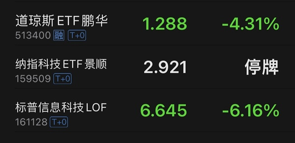
- 场内bk 收窄到-4.7
- bk收窄至-4

### 上海电影（提及 5 次，占比 2%）2026-11-06 09:58:42
- 你看sy9.9-10.8这一段时间走势
也是一开始两个涨停我们走了
后来也是磨时间
- sy确实牛逼
不愧是之前的大爱

切账户去了
- 幸福加油
希望月底我看涨幅榜时候
你能超越sy

### 幸福蓝海（提及 5 次，占比 2%）2026-11-06 13:52:41
- 今天你b幸福啦？
- 期待哦
我昨天是做了取消1434单子决定的
我相信幸福降临不遥远了😂😂😂
- 幸福终将降临

### 晶雪节能（提及 4 次，占比 2%）2026-11-06 09:48:24
- 冰山还是刷不出高点
晶雪还是打不过缺口😂
- 这个晶雪我还没T 是等来惊喜还是惊吓？
- 晶雪没补缺口！
冰山没打新高！

### 双义：股票=中国长城 / 基金=华安文体健康混合（用户 11-05 指认）（提及 3 次，占比 1%）2026-11-06 08:07:25
- 融资盘：qtmd 我买了又暴跌了

- 暂时还可以 韩国反弹不行啊

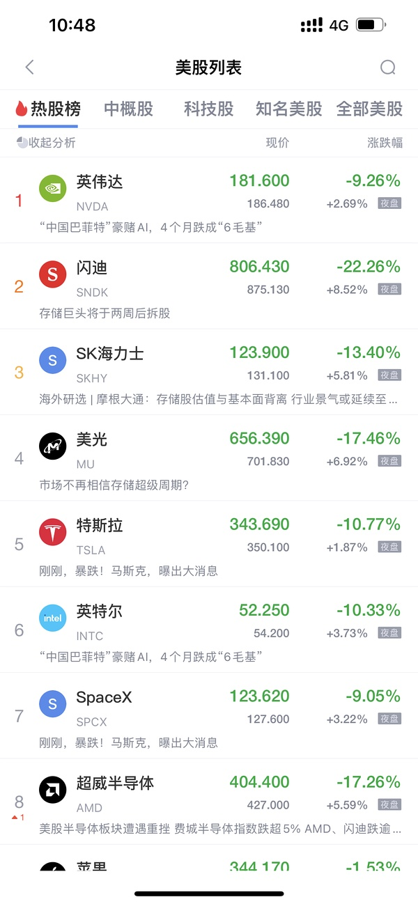
- 这是上周五的科创

今天正在模拟中

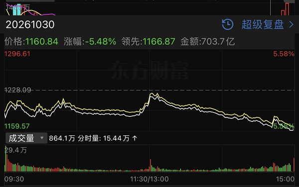

### 华宝致远混合(QDII)C（提及 2 次，占比 1%）2026-11-06 09:00:07
- 小远：鸡蛋分散到很多篮子了 货架打翻了
- 以后硬件暴力反弹
你们也别指望小远
盈亏同源😂😂😂

### 大连圣亚（提及 2 次，占比 1%）2026-11-06 11:20:42
- 晶雪 冰山都在等大连吗？？

你们不是很牛逼吗一个个的
- 大连和雪儿

### 航空航天板块（提及 2 次，占比 1%）2026-11-06 11:28:06
- 宇航员sj火箭发射
- 是不是看到nana跳水 所以资金拉宇航员了

与此同时雪儿也有小幅拉升

### 景顺长城纳斯达克科技ETF联接(QDII)A（提及 1 次，占比 0%）2026-11-06 07:30:51
- nk 不行

楼主老经验了 24年暑假就抄底过类似

但是现在这个37%的溢价率很容易杀的
他的溢价率不是常规溢价

因为楼主都玩过 知道杀溢价会什么样子

### 中文在线（提及 1 次，占比 0%）2026-11-06 11:18:46
- 王老师9点的判断非常准确

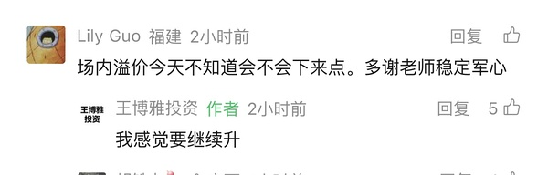

### 粤传媒（提及 1 次，占比 0%）2026-11-06 11:23:35
- ycm火箭发射

### 引力传媒（提及 1 次，占比 0%）2026-11-06 11:46:38
- yl本月把奶茶干翻了😂😂😂😂

### 富国全球科技互联网股票(QDII)A（提及 1 次，占比 0%）2026-11-06 12:10:12
- 区别不小 不建议 

我相信你自己也清楚 为什么网易云这一周远好于其他美国基金

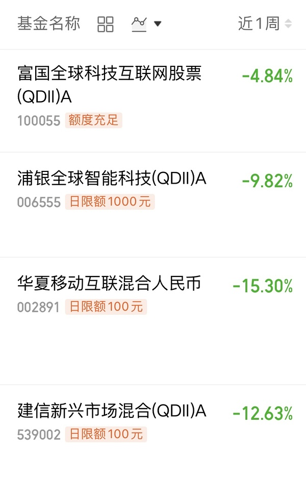

### 信澳匠心回报混合A（提及 1 次，占比 0%）2026-11-06 12:23:05
- 化学专家 张经理🤣

### 博纳影业（提及 1 次，占比 0%）2026-11-06 14:00:25
- bn无非就是套牢盘问题 毕竟A杀 大家终究都是一起的🤣

### 易点天下（提及 1 次，占比 0%）2026-11-06 14:51:10
- 奶茶本月29%
SY30%
幸福现在26% 
幸福需要继续努力 把他们都干翻

### 某个特别牛逼的散户（提及 1 次，占比 0%）2026-11-06 15:22:53
- 温暖老师判断传媒跨年了
和我想的一样
只不过我觉得是电影哈哈哈

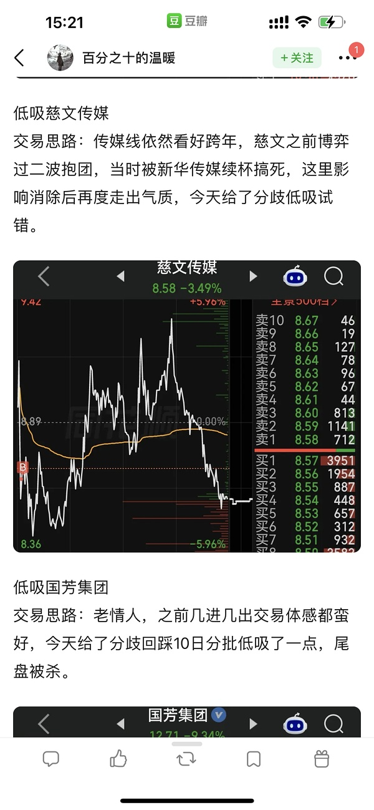

### 芒果超媒（提及 1 次，占比 0%）2026-11-06 15:26:13
- 这一次你没去芒果吗🤣🤣🤣🤣🤣

### 国产自主（半导体设备/芯片制造）（提及 1 次，占比 0%）2026-11-06 15:50:09
- 我也是爱国的一份子哦
我中韩半导体可是有45%左右爱国😂😂😂

### 📄 全部发言（共 248 条）
- (2026-11-06 01:26:36) 周五指定有什么魔力！！！  ⊳ （引用 @我爱牛肉火锅）谁要！自取！明天老印用得上

- (2026-11-06 07:04:57) 哈哈 你们不是说的嘛
楼主想要的 一定会得到  ⊳ （引用 @👑）绝了啊，五天跌了30%

看到大组说🇺🇸的，还是惊了💦💦💦
我也恐慌指数飙升了

- (2026-11-06 07:06:57) 我不需要了  ⊳ （引用 @👑）这额度能打开吗

- (2026-11-06 07:09:42) 我今天就会打满纳斯达克 所以我不再需要  ⊳ （引用 @👑）那楼想要的是啥(⊙o⊙)

- (2026-11-06 07:12:04) 是的
昨天路上已经翻阅了过去的操作
513300将重出江湖  ⊳ （引用 @🅰失而复🉐😎）场内？

- (2026-11-06 07:20:26) [图] 美国人终于用了最令人不舒服的方式 提前结束加息周期

市场直接抹去第二次加息概率

且12月加息概率骤降到70%以内

  ⊳ （引用 @VVV坚定持有VVV）还加息吗这回🤣

- (2026-11-06 07:23:37) 小伙伴
杀不了多少溢价的
因为美国-6.3收盘 目前盘前-1
这代表你-7.3开 溢价率持平
跌停是杀掉2.7%溢价

如果你认为这个位置好 溢价率没有什么可看的 因为直接买了
如果觉得这个位置不好 溢价率也没有什么还看到 因为你不买  ⊳ （引用 @仓部加措）加上杀溢价，楼估计跌几个点你挂单买

- (2026-11-06 07:25:15) 赚大钱了  ⊳ （引用 @momo）楼下一步想得到的是什么

- (2026-11-06 07:26:59) [图] 对比10/29日的
后面两栏的颜色都去掉了🤣🤣🤣🤣

  ⊳ （引用 @VVV坚定持有VVV）目的get✅

- (2026-11-06 07:27:50) 这个要等我结完婚 目前没想法  ⊳ （引用 @卿珩）也许33的招

- (2026-11-06 07:30:51) [图] nk 不行

楼主老经验了 24年暑假就抄底过类似

但是现在这个37%的溢价率很容易杀的
他的溢价率不是常规溢价

因为楼主都玩过 知道杀溢价会什么样子

  ⊳ （引用 @卿珩）楼楼只买纳指，不考虑纳科吗

- (2026-11-06 07:33:54) 今天她账户又要大赚了？？  ⊳ （引用 @VVV坚定持有VVV）哈哈哈哈哈哈哈最值得信任的财经博主：楼嫂

- (2026-11-06 07:39:31) 开盘的情绪估计无差别
后面会不一样 
还有2小时
大家积极备战😂  ⊳ （引用 @小肥肥）今天小a能有活口吗，防御是啥，冰雪，银行，军工，红利，消费，还是无差别

- (2026-11-06 07:45:48) 😂第一个不是本来的股票账户操作 你们不用参考  ⊳ （引用 @-却行）今天是场内513300+破29.7接回sy+等待冰雪 （）没有别的了吧

- (2026-11-06 07:47:51) -6.3收盘 目前期货-1（那个期货就是nana100 这个一直在浮动） 所以-7.3是正常开盘

如果跌停开就杀掉了2.7%溢价自然更好了

如果uu觉得会继续大跌 那今天买并不合适
这个看大家各自想法了  ⊳ （引用 @点-重生炒垃圾）nana一开盘就买吗？

- (2026-11-06 07:49:54) 美股收评|AI监管担忧引爆历史性抛售！纳指暴跌5.5%，创史上最大单日市值损失  ⊳ （引用 @小肥肥）昨晚到底啥原因啊，搞不懂，杀溢价

- (2026-11-06 07:50:07) 无计划 打满了！！  ⊳ （引用 @仓部加措）楼今天的大连跌破多少才会接呀

- (2026-11-06 07:54:04) 金融市场降温 消费预期下降 投资预期降温 财富效应降温

你应该懂的啊 我们不是一直说的吗 跌了不消费了  ⊳ （引用 @木感情的打工人）美股大跌为啥可以消化加息预期呀

- (2026-11-06 08:00:55) 这个妈妈好像能说了算
之前加息 RMB理都不理😂😂😂
美元飙升到102 我们RMB毫无反应

这几天贬值一些 还是因为妈妈外汇准备金提高了2% 自己弄的 😂  ⊳ （引用 @木感情的打工人）所以如果老美不加息，人民币有望继续升值，a子牛市基础还在

- (2026-11-06 08:02:29) 在一边偷着乐呢 

你们民主党赢了 市场横盘了😂美国人可是很看重美股的  ⊳ （引用 @山中食人花）昨天那么大跌 川子也不发言了  颓了吗

- (2026-11-06 08:02:53) 我们软件有问题吧？  ⊳ （引用 @🅰失而复🉐😎）这两货没睡醒😕

- (2026-11-06 08:03:17) 咋可能 估计我们软件数据有问题  ⊳ （引用 @海贼）韩国综合股价指数（KOSPI）开盘下跌2.2%，至5263.26点。 ？？？是错误了吗？为什么那么跌那么少😂

- (2026-11-06 08:04:08) 但是美国快拉红了  ⊳ （引用 @木感情的打工人）新闻播报了，日经指数-7

- (2026-11-06 08:07:25) [图] 融资盘：qtmd 我买了又暴跌了

- (2026-11-06 08:10:57) 这周都是全部扫
1000都在买  ⊳ （引用 @小肥肥）昨天国家队也买了科创？

- (2026-11-06 08:11:38) 不影响大家开盘操作A股 很好心呢  ⊳ （引用 @油炸花生）这些停牌1小时

- (2026-11-06 08:12:24) 来了来了

特朗普称美股大跌赖民主党

美国总统特朗普当地时间11月5日在社交媒体发帖称，“（美国）股市因本次（中期）选举结果遭遇史上最惨烈的交易日之一。记住，这不是共和党的锅，是那帮‘笨蛋民主党人’造成的。  ⊳ （引用 @山中食人花）hhhh 难怪不发言 可能在幸灾乐祸，前天特朗普集团还大跌呢

- (2026-11-06 08:24:03) 现在nana期货+0.3 昨夜-6.3
开盘-6是正常开 不带杀溢价
希望能杀一些

- (2026-11-06 08:24:26) 关键开盘是10:30 到时候还会浮动  ⊳ （引用 @不知道还能说啥）现在nana期货+0.3 昨夜-6.3
开盘-6是正常开 不带杀溢价
希望能杀一些

- (2026-11-06 08:32:16) 我买的是招行账户  ⊳ （引用 @钱多多多多多）楼楼，买场内nana不用拿太久是吧？

- (2026-11-06 08:35:11) 博时和华夏都不错

国泰虽然更好 但是溢价率略高于常规 我放弃  ⊳ （引用 @wait）上个月被杀的都没什么心情看盘和追帖了，阿美大跌，求问楼主今天准备打满的纳纳是哪只？场内还是场外？

- (2026-11-06 08:38:24) 你看美国期货 nana已经不可能跌停开盘了  ⊳ （引用 @shirla）收到！是剩下子弹都打掉对吧！

- (2026-11-06 08:38:47) 韩国综合股价指数（KOSPI）在停牌后恢复交易，跌幅收窄至5.4%。

- (2026-11-06 08:46:20) 如果选项好 我也不充值场内了 
就是这个问题得不到最好的答案 
说100 200的也肯定不是你要的  ⊳ （引用 @#🕳#）楼 请问下如果家人没有场内账户，场外纳全没额度，可以补点啥呀？🥲（之前的二十笔全跟着投完了）

- (2026-11-06 08:48:01) 加息预期骤降 其实是好事  ⊳ （引用 @moli）下跌理由不值一提🤔

- (2026-11-06 08:48:56) 100 200说了也是儿童车搞笑的😂😂😂  ⊳ （引用 @高手云集上钻）事已至此，楼楼场外美基又要买的吗，买完我就把app卸载了，我终于变成了一个不敢看收益率的人

- (2026-11-06 08:59:32) 😂  ⊳ （引用 @VVV坚定持有VVV）楼u发的那张估值甚至不是最终版🫠

- (2026-11-06 09:00:07) 小远：鸡蛋分散到很多篮子了 货架打翻了  ⊳ （引用 @VVV坚定持有VVV）楼u发的那张估值甚至不是最终版🫠

- (2026-11-06 09:00:48) 两市融资余额较上日增加66.21亿元
截至11月5日，上交所融资余额报11807.98亿元，较前一交易日增加31.91亿元；深交所融资余额报10901.79亿元，较前一交易日增加34.30亿元；两市合计22709.77亿元，较前一交易日增加66.21亿元。

- (2026-11-06 09:01:04) 美元美债收益率都是下
利好黄金😂  ⊳ （引用 @初筱玖）黄金都还好，没怎么恐慌

- (2026-11-06 09:02:09) 融资盘7/21日那次也被骗了  ⊳ （引用 @木感情的打工人）融资盘：尼玛躲了几个月，刚进来就挨打

- (2026-11-06 09:04:20) [图] 我那个账户绑定的银行好垃圾 9点才能充值 来了来了

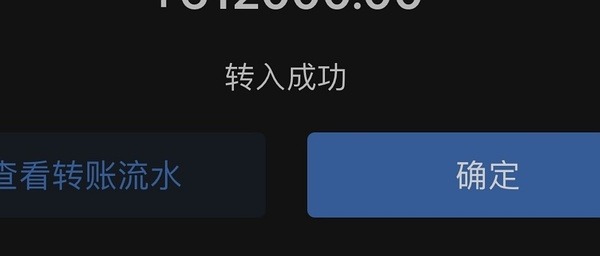  ⊳ （引用 @该用户已过期）我已紧急充值🥹🥹

- (2026-11-06 09:05:24) 你做短线的要考虑
我不用考虑
差不多就行了  ⊳ （引用 @蜡笔小闹心）楼打算啥时候杀回去，一开盘就进吗

- (2026-11-06 09:09:12) 说明跌的时候买的人不少😂  ⊳ （引用 @Victoria）怎么这时候关了

- (2026-11-06 09:10:55) 东升西落！  ⊳ （引用 @速派女孩将发财）【导读】以信心为锚，中国资本市场从“独立叙事”到“独立行情”
中国基金报记者 赵新亮
这两天，A股市场持续反弹，科创50、创业板指本周以来的累计涨幅分别达10.84%和6.35%，4800余只个股飘红。与之相比，外围市场则持续震荡调整，美股

- (2026-11-06 09:12:39) 也有个好处的

不会产能过剩了！  ⊳ （引用 @moli）关闭数据中心，难道企业就原地等死不赚钱了🤔
那就换别的法子赚钱

- (2026-11-06 09:15:24) 你有子弹也是100块😂  ⊳ （引用 @得偿所愿）看了眼华兄 晕过去了 楼楼这种情况没子弹了 熬着吗

- (2026-11-06 09:17:20) 第一个是➕😂😂😂😂😂😂😂😂  ⊳ （引用 @木感情的打工人）101.2w

- (2026-11-06 09:22:24) 这个你自己看了 我今天这个又要浮亏了  ⊳ （引用 @爱拔酱）楼我之前中韩没买
今天要不要捞一点
还是火力全部给nana

- (2026-11-06 09:26:44) 因为没开盘呀！  ⊳ （引用 @嗯嗯你对了）场内NANA这溢价，昨天看还是12点多😂

- (2026-11-06 09:26:57) [图] bk给出指引 下跌6%

- (2026-11-06 09:32:09) 哈哈哈哈牛逼  ⊳ （引用 @仓部加措）哎都没便宜捡

- (2026-11-06 09:41:07) 冰冰们来了

电影也不错

我们账户没什么损伤

- (2026-11-06 09:41:37) 雪人再度回踩五日线 给了昨天没有的朋友们  ⊳ （引用 @不知道还能说啥）冰冰们来了

电影也不错

我们账户没什么损伤

- (2026-11-06 09:41:46) 冰冰就喜欢这种局面  ⊳ （引用 @momo）冰雪们好强

- (2026-11-06 09:42:34) 为什么要反复问这个

科技崩盘和我们有什么关系啊  ⊳ （引用 @问一下能不能瘦）楼 雪人今天还是15.84的条件单么

- (2026-11-06 09:44:28) 场内bk 收窄到-4.7

- (2026-11-06 09:44:53) 我都是盘后说的呀

你看我哪次会修改  ⊳ （引用 @问一下能不能瘦）木有。我怕要改价格

- (2026-11-06 09:48:24) 冰山还是刷不出高点
晶雪还是打不过缺口😂

- (2026-11-06 09:49:06) 他们没妈  ⊳ （引用 @木感情的打工人）上证指数居然跌这么点，跟日本韩国不符合啊

- (2026-11-06 09:50:16) 中影在发挥自己的慢就是快🤣

- (2026-11-06 09:57:23) 不会的
观望几天以后 会有新的介入点  ⊳ （引用 @lacey）买不到的sy会不会变成白月光🤣🤣

- (2026-11-06 09:58:42) 你看sy9.9-10.8这一段时间走势
也是一开始两个涨停我们走了
后来也是磨时间  ⊳ （引用 @爱拔酱）sy看样子捡不到了
我钱不给他了

- (2026-11-06 09:59:00) 今天是周五
我不敢说话😂  ⊳ （引用 @k）账户是红的，感谢楼楼啊

- (2026-11-06 09:59:46) 现在4500家下跌

楼里大家期待本月全红🤣

- (2026-11-06 09:59:54) 难度还是有的  ⊳ （引用 @不知道还能说啥）现在4500家下跌

楼里大家期待本月全红🤣

- (2026-11-06 10:01:04) 上周五挨打伤痕被植入脑海
今天我不敢评论  ⊳ （引用 @we）冰雪可以期待谁先来

- (2026-11-06 10:02:28) 今天除了冰雪
旅游怎么样
昨天官宣春节9天假期的

- (2026-11-06 10:02:45) 我没打开看很多
我怕我手贱尽量少看🤣  ⊳ （引用 @不知道还能说啥）今天除了冰雪
旅游怎么样
昨天官宣春节9天假期的

- (2026-11-06 10:05:11) 杀的是国庆
接下来是春节呀
😂  ⊳ （引用 @木感情的打工人）难道还有a杀后的再次启动啊

- (2026-11-06 10:05:26) 10:03:45 财联社11月6日电，纳斯达克100指数期货涨幅扩大至1%，此前一度跌超1%。(来自财联社APP)

- (2026-11-06 10:05:42) bk收窄至-4  ⊳ （引用 @不知道还能说啥）10:03:45 财联社11月6日电，纳斯达克100指数期货涨幅扩大至1%，此前一度跌超1%。(来自财联社APP)

- (2026-11-06 10:06:01) 这意味着nana到时候开盘-5就是正常开  ⊳ （引用 @不知道还能说啥）bk收窄至-4

- (2026-11-06 10:06:34) 买得到的 他上面很困难 就翻回去看2月份  ⊳ （引用 @山中食人花）真的 白月光 我感觉我买不到了

- (2026-11-06 10:07:13) 下跌4400个
但是跌停只有2

- (2026-11-06 10:09:53) [图] 这就是事实啊

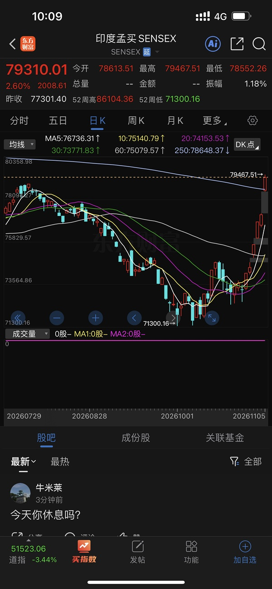  ⊳ （引用 @果木香烤鸡腿堡）所有的事情都只有一个走向 就是印度NO.1.。

- (2026-11-06 10:10:04) 大家看看真正的印度  ⊳ （引用 @不知道还能说啥）这就是事实啊

- (2026-11-06 10:11:04) 你们看今天双创反弹
没有带动传媒板块了

- (2026-11-06 10:12:22) 这个晶雪我还没T 是等来惊喜还是惊吓？  ⊳ （引用 @🅰失而复🉐😎）假装看不见🫣

- (2026-11-06 10:12:54) 主要是美国也确实在反弹1.2%了  ⊳ （引用 @木感情的打工人）说明双创来真的吗？😰

- (2026-11-06 10:13:02) 😂😂😂😂😂😂  ⊳ （引用 @小红）这太好笑了楼楼

- (2026-11-06 10:15:15) 😂确实牛逼  ⊳ （引用 @🅰失而复🉐😎）逆天了

- (2026-11-06 10:16:35) 传媒板块里面今天中影也蛮前面的
今天传媒整体不好

- (2026-11-06 10:16:47) 韩国KOSPI指数跌幅收窄至5%以内。三星电子现跌4.7%，SK海力士跌逾7%。  ⊳ （引用 @shirla）停牌真是耽误事儿啊！

- (2026-11-06 10:17:08) 吗的

bk收窄至-3%

- (2026-11-06 10:18:07) 就看午后情绪什么样了  ⊳ （引用 @点-重生炒垃圾）龙版终究在踩踏中倒下了

- (2026-11-06 10:18:54) 碳酸锂连续主力合约日内涨3%，现报93540.00元。

- (2026-11-06 10:20:42) 下跌家数反而4400变成了4750

- (2026-11-06 10:21:31) 周五总是很有趣的
不到最后不知道胜败🤣🤣🤣🤣  ⊳ （引用 @仓部加措）妈呀抄底收益巨减➖

- (2026-11-06 10:21:57) uu们的机器人春哥都翻红了

- (2026-11-06 10:22:25) 纳斯达克涨幅来到1.35

- (2026-11-06 10:23:08) 主要看美国走势吧😂  ⊳ （引用 @🅰失而复🉐😎）那天是不是也是看起来一点风险都没有😏

- (2026-11-06 10:23:46) 6.3-1.35
差不多-5  ⊳ （引用 @👑）最后不会0轴开吧

- (2026-11-06 10:28:29) sy确实牛逼
不愧是之前的大爱

切账户去了

- (2026-11-06 10:32:46) [图] 以后nana就和我大有关系了

本轮投资美国今天到此结束

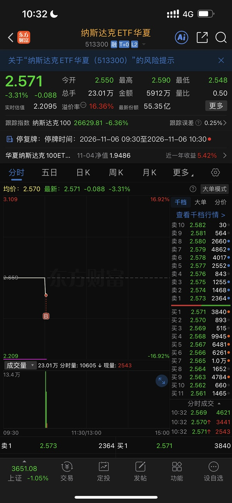

- (2026-11-06 10:33:14) 专心看股票了

- (2026-11-06 10:33:35) 谢谢 我们都是
你还日夜连轴赚呢😂  ⊳ （引用 @木感情的打工人）祝你早日赚大钱呀！

- (2026-11-06 10:34:07) [图] 🤣

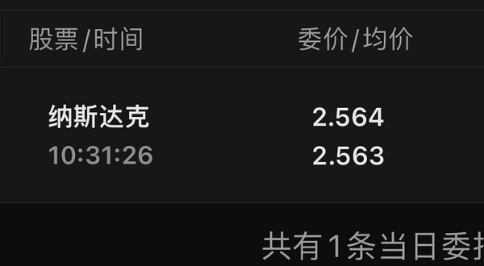  ⊳ （引用 @🅰失而复🉐😎）你也是这个价🤣

- (2026-11-06 10:34:51) 好的

恐慌指数70%看到了

我将不再期待任何东西了

让我们一起飞  ⊳ （引用 @木感情的打工人）笑鼠，我的夜班纳纳将与你同在

- (2026-11-06 10:37:24) 你看最低价
我根本没看到
又有人隔空单了  ⊳ （引用 @🅰失而复🉐😎）什么！！！我还以为我手快呢😇

- (2026-11-06 10:41:11) 幸福加油
希望月底我看涨幅榜时候
你能超越sy

- (2026-11-06 10:43:40) uu又去科技啦？  ⊳ （引用 @只想搞钱）半设也是拉起来这么多，果然要买科技还是买强一点的，回的也快

- (2026-11-06 10:46:27) 上周五美国期货午后跳水 😂  ⊳ （引用 @木感情的打工人）我感觉周五还是不操作比较好😂😂😂谁知道下午有啥鬼东西

- (2026-11-06 10:48:56) [图] 暂时还可以 韩国反弹不行啊

  ⊳ （引用 @木感情的打工人）对😂周五最容易盘面颠覆

- (2026-11-06 10:50:31) 科创50指数翻红 开盘一度跌逾5%

- (2026-11-06 10:50:45) 当然没有

ETF都没有

你买的海外的还想这个呢  ⊳ （引用 @恭喜发财）楼楼，我买了1.1W华夏纳指，20天后这笔钱有没有额度打新的？

- (2026-11-06 10:51:25) 立在明是嘴炮  ⊳ （引用 @木感情的打工人）韩国妈最没用

- (2026-11-06 10:52:34) 等几年后
大家回忆
可能又会出现那句话

“当时2026还不如全部场内都换成纳斯达克”  ⊳ （引用 @梳碧湖砍柴人）最终还是挪了钱来场内买娜娜，同步卖出还有利润的小广小浦，当换仓了

- (2026-11-06 10:53:12) 哈哈冰雪喜欢开盘那样的崩盘
不喜欢反弹🤣🤣🤣🤣  ⊳ （引用 @高手云集上钻）有人在抽我们冰雪的血啊厉娜（C50和畅畅可以抽）

- (2026-11-06 10:53:56) 韩国将放宽融资融券规则以遏制股市波动
韩国政府发表联合声明称，将暂时豁免证券公司必须持有价值至少相当于其保证金贷款140%的抵押品的规定，此举旨在防止强制抛售加剧股市波动。该豁免期将从11月9日起持续三个月。

韩国人要发动融资盘继续干  ⊳ （引用 @木感情的打工人）想知道鞠老师怎么看

- (2026-11-06 10:55:59) 我退出登录了😂😂😂😂  ⊳ （引用 @🅰失而复🉐😎）把握下午

- (2026-11-06 10:58:26) 一直都是4500-4700绿徘徊
没什么好着急的哈哈  ⊳ （引用 @木感情的打工人）辣鸡们有绷不住的趋势

- (2026-11-06 10:58:36) 👍👍👍👍👍  ⊳ （引用 @点-重生炒垃圾）卖到尖尖上了

- (2026-11-06 11:00:51) 主要是那个bk开盘是-6 基本扼杀了纳指大于-8的可能性🤣🤣🤣🤣
如果那个不是lof基金 其实还不错的  ⊳ （引用 @moli）笑死，我上班前充值进来场内，513300挂的跌停😂

- (2026-11-06 11:06:15) 哈哈卖单挂好了吗 我们很多东西是尾盘战神🤣  ⊳ （引用 @爱拔酱）今天操作到此为止、
我去进博会玩了~

- (2026-11-06 11:07:21) [图] 江老师发微博了

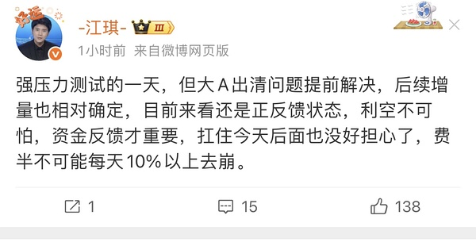

- (2026-11-06 11:10:12) 传媒板块昨天总换手6%
年初两次高点一个9%一次8.5%

热了
但不沸腾

因为总是今天这批明天那批换着打😂😂😂  ⊳ （引用 @云水河西）之前看到说传媒拥挤度上来了，没想到依然强势

- (2026-11-06 11:12:39) 晶雪没补缺口！
冰山没打新高！  ⊳ （引用 @一一）晶雪能不能把缺口打了

- (2026-11-06 11:17:42) [图] 

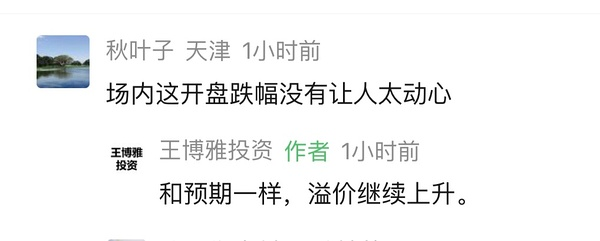

- (2026-11-06 11:18:46) [图] 王老师9点的判断非常准确

- (2026-11-06 11:20:42) 晶雪 冰山都在等大连吗？？

你们不是很牛逼吗一个个的

- (2026-11-06 11:22:11) [图] 没关注另外两个 10086牛逼哦

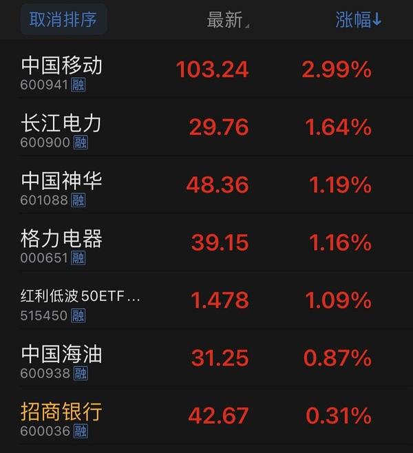  ⊳ （引用 @点-重生炒垃圾）今天运营商真是强劲啊

- (2026-11-06 11:23:06) 美国在跳水了！  ⊳ （引用 @木感情的打工人）带着我回本吧阿谷

- (2026-11-06 11:23:29) 我们也还有机会😂😂😂😂😂😂  ⊳ （引用 @我爱牛肉火锅）楼嫂今天红红的

- (2026-11-06 11:23:35) ycm火箭发射

- (2026-11-06 11:23:56) 进攻大阴线了  ⊳ （引用 @不知道还能说啥）ycm火箭发射

- (2026-11-06 11:24:10) 哈哈祝福
楼里有的人很多的  ⊳ （引用 @我爱牛肉火锅）ycm 火箭！

- (2026-11-06 11:25:41) 传媒
第一波是新华带的吧  ⊳ （引用 @点-重生炒垃圾）是传媒还是羊

- (2026-11-06 11:26:46) 让晶雪搞快点 就那么点缺口  ⊳ （引用 @🅰失而复🉐😎）日子又好了起来🤣

- (2026-11-06 11:28:06) 宇航员sj火箭发射

- (2026-11-06 11:28:37) 妈妈：真晦气 不让好好吃午饭  ⊳ （引用 @一切都会过去的）纳指跳了

- (2026-11-06 11:35:14) 是不是看到nana跳水 所以资金拉宇航员了

与此同时雪儿也有小幅拉升  ⊳ （引用 @速派女孩将发财）今天宇航员的火箭感觉预判了下午硬科技 因为宇航员才是垃圾中的垃圾 没有炒的时候才会炒这个 

- (2026-11-06 11:36:18) uu们 暂时11月全红达成没😂😂

还有2小时最难的时间考验

- (2026-11-06 11:40:36) [图] sy9月时候两连板后也离我们而去几天
最终中间高空走了一个小A倒车接人
那次原因应该是年线遇阻

这一次我们卖出后再度离开我们几天 还会高空小A吗
这一次也有东西可以抵挡 左侧2月初爆量针
SY迫近双头 看SY的表演了

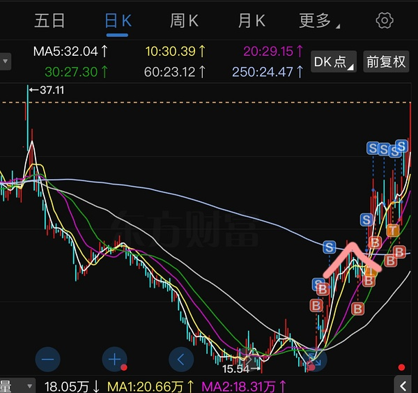

- (2026-11-06 11:45:54) [图] 11月首周 科创半导体领先
影视传媒游戏紧随其后

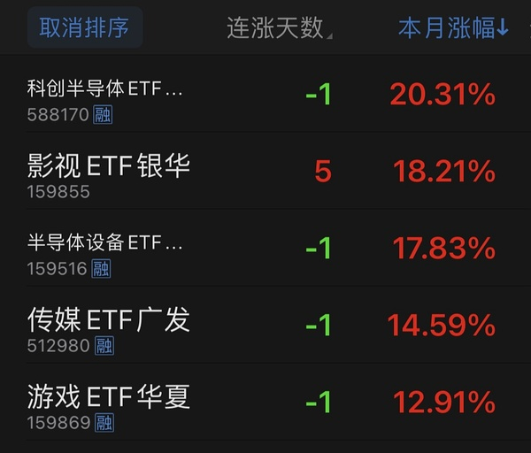

- (2026-11-06 11:46:38) yl本月把奶茶干翻了😂😂😂😂  ⊳ （引用 @家不住海边）早上一直光盯着yl了
就光站在。  眼睛不行了

- (2026-11-06 11:49:34) 还说了最关键的一句
珠海政府会陪伴华发走出困境  ⊳ （引用 @我爱牛肉火锅）珠海一千亿支持华发？

- (2026-11-06 11:52:23) [图] 应该是情绪问题吧

珠海资金上给了足够支持 且信心上说始终陪伴
周一抄底信用债非常正确 
之前被华发影响的银行永续债都收复了抛售😂图超级滑稽

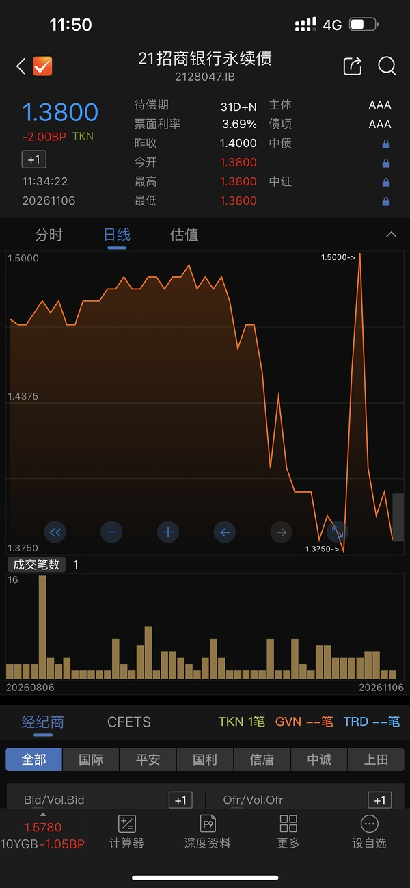  ⊳ （引用 @我爱牛肉火锅）感动！谢谢xx送来的债市黄金坑！谁给的假消息来着，周末刚看的猪脑又忘了

- (2026-11-06 11:53:44) [图] 这个最牛逼😂😂😂😂

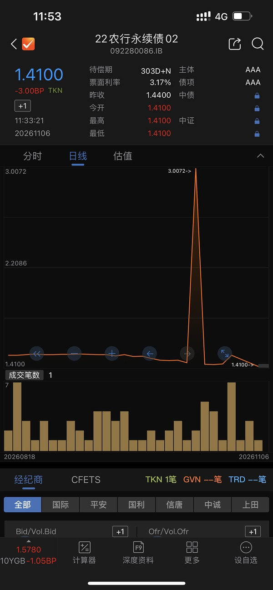  ⊳ （引用 @我爱牛肉火锅）感动！谢谢xx送来的债市黄金坑！谁给的假消息来着，周末刚看的猪脑又忘了

- (2026-11-06 11:57:07) 有新闻稿的 你可以搜一下

珠海华发集团在债券市场、资产盘活与产业转型的一系列动态持续受到资本市场关注。针对市场关心的流动性、债务兑付、转型路径等热点问题，珠海市国资委主任邹晖、华发集团董事长郭瑾接受南方财经独家采访。郭瑾在接受记者采访时表示，珠海已经出台一揽子国资支持方案，统筹千亿级资源，以市场化方式助力华发化解阶段性挑战，加快业务结构优化与产业转型步伐 。据采访披露，珠海市立足深化国资国企改革，围绕华发集团主业布局、资产盘活、流动性保障制定系统性支持举措，通过资源整合重组、市场化资产交易等方式落地推进。

珠海市国资委主任邹晖在采访中明确，华发集团当前遭遇的困难，是地产行业周期下行叠加历史遗留包袱共同带来的阶段性挑战，并非基本面长期失序。在珠海全市经济稳进提质、高技术产业提速的大背景之下，珠海将持续优化国有资本布局，夯实地方国企“压舱石”作用。“我们不仅要用足用好现有资源，也将积极联动多方主体协同发力，全力支持华发优化经营结构、加快转型发展，有信心、有决心共同应对好当前的挑战。”邹晖表示 。  ⊳ （引用 @moli）在哪里可以看到

- (2026-11-06 11:59:26) 国债期货最高33倍杠杆拉满 很刺激的

像我们债券都是0.几波动 再博也没有心跳🤣

带上33倍杠杆就不一样了 plu就是带杠杆玩国债的

上周五30债-1% 他们单日最高可以亏损33%  ⊳ （引用 @我爱牛肉火锅）其实我只学到债的分级和久期*利差，至于每个债具体干嘛的感觉还是老复杂了，不知道有没有人去搏垃圾债

- (2026-11-06 12:06:20) 这是周二新闻！！信用债周二就开始强力修复了  ⊳ （引用 @点-重生炒垃圾）下午地产带带？

- (2026-11-06 12:06:56) 和美国一样的
发行新债就行了

我们印度也刚发行了新的国债  ⊳ （引用 @moli）那么问题来了，代价是什么🤣🤣🤣

- (2026-11-06 12:10:12) [图] 区别不小 不建议 

我相信你自己也清楚 为什么网易云这一周远好于其他美国基金

  ⊳ （引用 @欧葉）没有场内的能加场外网易云么  没限额呢

- (2026-11-06 12:12:41) 金毛满精的 加息预期从最开始的四次变成只剩一次了😂

- (2026-11-06 12:14:12) [图] 

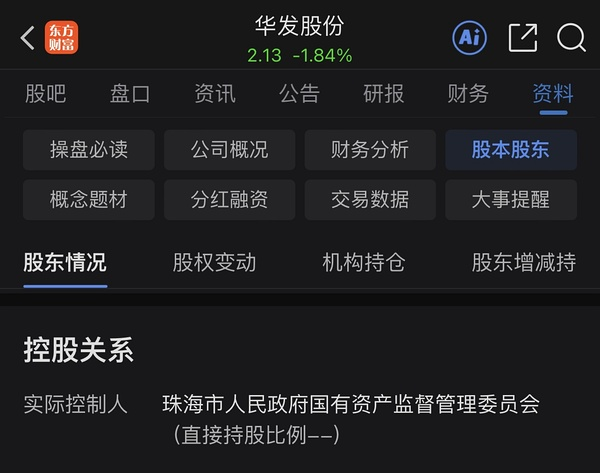  ⊳ （引用 @moli）为什么不给恒大碧桂园万科发😨

- (2026-11-06 12:18:30) [图] 我看了这个 没想到吧？😂😂😂

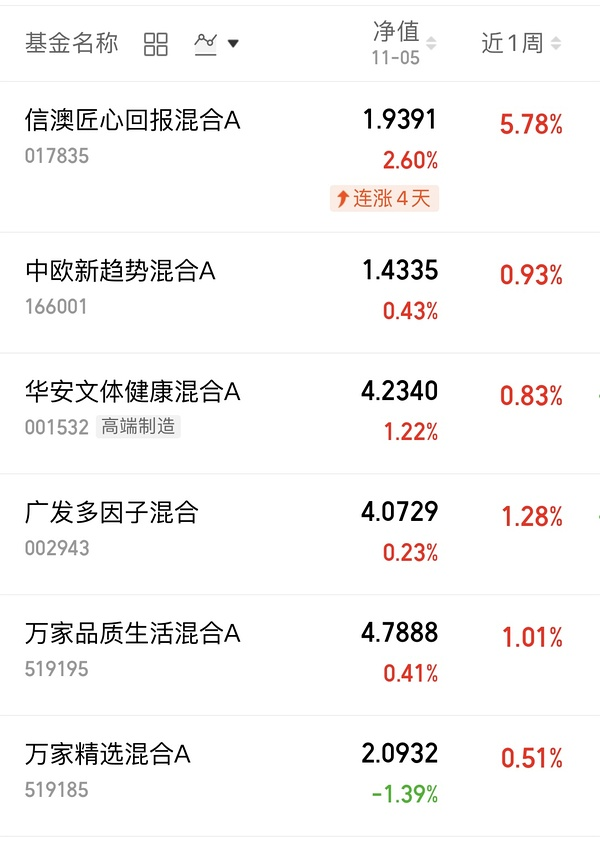  ⊳ （引用 @moli）还得是纯血国资亲儿子🤣

- (2026-11-06 12:20:22) [图] 场外买传媒基金的uu回本了没？

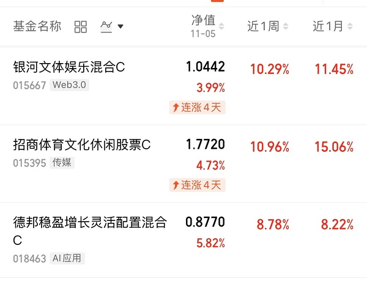

- (2026-11-06 12:23:05) 化学专家 张经理🤣  ⊳ （引用 @moli）风水轮流转，信澳这么出息😂（我已经忘了他是哪个经理了）

- (2026-11-06 12:28:28) 最近我没看
什么硬盘啊 手机啊 电脑啊降价没😂😂😂
股市杀存储
杀到生活里了没

- (2026-11-06 12:30:59) 还有2小时 继续坚持住  ⊳ （引用 @嘻嘻嘻嘻）达成了达成了 谢谢楼！

- (2026-11-06 12:31:49) token都卖到➕7直播间去了是吗  ⊳ （引用 @木感情的打工人）降个毛线啊，楼，我们算力根本抢不到资源，各种客户天天问我有没有910 950 巴拉巴拉的

- (2026-11-06 12:33:02) 那注定金融市场和线下实体市场有一个定价是错的🤣  ⊳ （引用 @一切都会过去的）并没有哦

- (2026-11-06 12:36:13) 13-15 就两个小时🤣  ⊳ （引用 @VVV坚定持有VVV）居然真的红色的，求求了再坚持三小时🙏🏻

- (2026-11-06 12:45:00) 11:38:47【11月6日午间涨停分析】财联社11月6日电，今日午盘全市场共26股涨停，连板股总数10只，11股封板未遂，封板率为70%（不含ST股、退市股）。焦点股方面，“羊”字辈的东方海洋13天8板、阳光照明12天7板，光伏概念股闽发铝业5连板，短剧概念股浙文影业5连板。(来自财联社APP)

- (2026-11-06 12:45:53) 哈哈哈哈哈哈 还是福建  ⊳ （引用 @我爱牛肉火锅）我才发现这个闽发居然变光伏了

- (2026-11-06 12:46:21) [图] 传媒消息面 有点滑稽 DuanJu

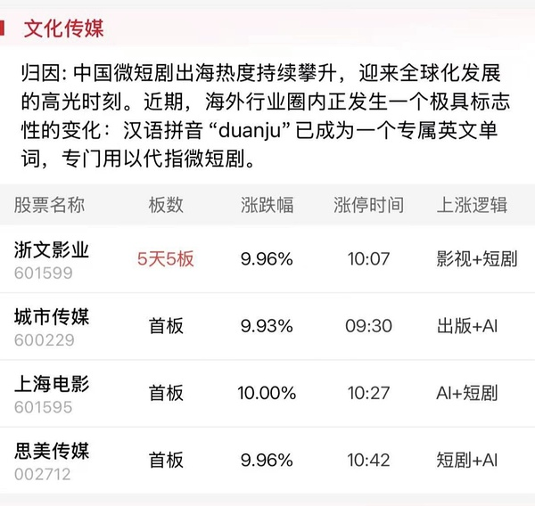

- (2026-11-06 12:49:03) 吓人的快
不吓人的慢吞吞  ⊳ （引用 @家不住海边）我也觉得吓人👻

- (2026-11-06 12:55:34) 确实厉害
随便一个消息就干

6月时候传媒无视一切消息 跌就一个字😂  ⊳ （引用 @稀里不糊涂）这个之前也有uu发过，没想到真炒作这个

- (2026-11-06 12:57:15) 当初不可能想到吧

这个东西距离赚钱变得那么近
反而AI距离赚钱变得更远了😂  ⊳ （引用 @木感情的打工人）招商还差6个点，回本在即

- (2026-11-06 13:08:34) 有些喜欢狠狠进攻
有些喜欢平稳
大家目标不一样
国富也挺好的  ⊳ （引用 @梳碧湖砍柴人）真给错了啊 我一直给的国富

- (2026-11-06 13:25:53) 和上周五进程一样
午后纳斯达克跳水

- (2026-11-06 13:33:07) [图] 期权波动率非常恐慌
但是我们股市也不放量 跌停也没几个

谁是错误定价😂😂😂

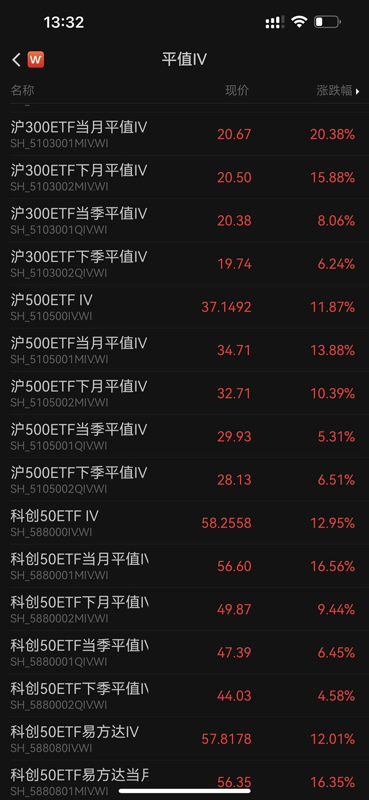

- (2026-11-06 13:38:52) 我们持仓本来就喜欢科技不好  ⊳ （引用 @momo）今天都已经做好挨打的准备了，结果竟然还好，不会是慢反应一拍憋个大的在后面吧

- (2026-11-06 13:42:20) 美国也反弹了  ⊳ （引用 @点-重生炒垃圾）妈来了

- (2026-11-06 13:45:39) uu厉害👍 通知很到位  ⊳ （引用 @是小号）Uu们，长盛环球放了1w额度

- (2026-11-06 13:47:35) 我不知道的😂

不过我已经没钱了 和我无关了  ⊳ （引用 @我爱牛肉火锅）这个可以买？我还说你怎么弃选它了

- (2026-11-06 13:47:53) 我昨天下午看我记得还是100  ⊳ （引用 @我爱牛肉火锅）这个可以买？我还说你怎么弃选它了

- (2026-11-06 13:49:20) 是的 他现在就是nana100  ⊳ （引用 @我爱牛肉火锅）我其实早上想问来着，忙着忙着又忘了，我记得之前有提过它跟踪nana来着

- (2026-11-06 13:51:56) 嗯嗯 是这样  ⊳ （引用 @梳碧湖砍柴人）那现在买她等于买没有溢价的娜娜？

- (2026-11-06 13:52:41) 今天你b幸福啦？  ⊳ （引用 @赛博朋克2077）如果今天幸福能来个20cm大长腿，真不知道这个周末过得有多幸福

- (2026-11-06 13:54:17) 期待哦
我昨天是做了取消1434单子决定的
我相信幸福降临不遥远了😂😂😂  ⊳ （引用 @赛博朋克2077）如果今天幸福能来个20cm大长腿，真不知道这个周末过得有多幸福

- (2026-11-06 13:55:29) [图] 我与你同在 
忍了一上午没忍住下午

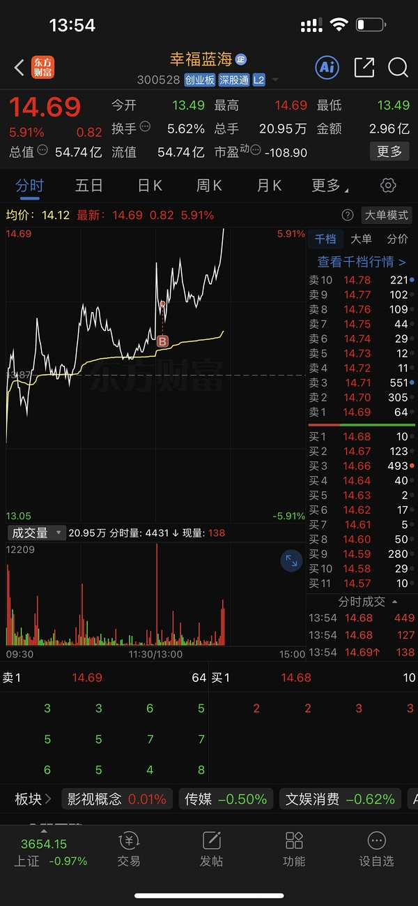  ⊳ （引用 @赛博朋克2077）B了嘿嘿

- (2026-11-06 13:56:05) 是的

- (2026-11-06 13:56:15) 手控制不住啊  ⊳ （引用 @🅰失而复🉐😎）你背叛了周五的组织😏

- (2026-11-06 13:56:58) 你是不是看年内了？
不要看年

C诞生没多久
A也是下半年换策略  ⊳ （引用 @👑）我红薯了一下是的，不知道a能不能买，感觉两个收益率差距还有大啊

- (2026-11-06 13:57:47) 因为A更换策略以后 才发行了C  ⊳ （引用 @👑）哦哦，那就都是这个，我看红薯说的是c严格按照娜娜的趋势走的

- (2026-11-06 13:58:22) 主要是我觉得留给sy的钱暂时花不出去了😂😂😂  ⊳ （引用 @木感情的打工人）居然是同时间控制不住……只不过我买了另一个

- (2026-11-06 13:59:39) uu还是太看不起传媒了😂😂😂😂  ⊳ （引用 @Z）上周五大跌换畅畅 哭死

- (2026-11-06 14:00:25) bn无非就是套牢盘问题 毕竟A杀 大家终究都是一起的🤣  ⊳ （引用 @木感情的打工人）我去的bn.看来完全就是幸福的跟班……

- (2026-11-06 14:01:13) 纳斯达克跳水加大

- (2026-11-06 14:01:38) 15.44是多少涨幅来着  ⊳ （引用 @momo）xf今天会触发吗😆

- (2026-11-06 14:01:48) 高级操作啊 👍👍👍

- (2026-11-06 14:02:46) 五日线  ⊳ （引用 @圈圈儿）楼楼，幸福蓝海没介入的要怎么进啊

- (2026-11-06 14:03:53) 👍👍👍👍👍期待  ⊳ （引用 @我爱牛肉火锅）11.32%

- (2026-11-06 14:04:47) 是的！我1434也是根据这一天设置的  ⊳ （引用 @🧋今天25了吗）幸福在消化9.3号的筹码吗🌚

- (2026-11-06 14:06:17) [图] 中国国债火箭发射
对应美国跳水

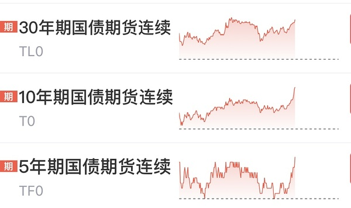

- (2026-11-06 14:07:31) 今天的羊只有最强的那两个活着吗
其他羊都躺下啦？

- (2026-11-06 14:09:55) 跌停开始增加了  ⊳ （引用 @不知道还能说啥）期权波动率非常恐慌
但是我们股市也不放量 跌停也没几个

谁是错误定价😂😂😂

- (2026-11-06 14:12:51) [图] 这是上周五的科创

今天正在模拟中

- (2026-11-06 14:15:58) 日韩双双-6

- (2026-11-06 14:19:13) 513100国泰脑子秀逗了
下午直接关盘了
人家NK 40%溢价率都还在交易
你国泰现在也不是溢价率最高的😂

- (2026-11-06 14:21:34) 没多
我早上机器人兑现了  ⊳ （引用 @momo）话说楼楼今天加了xf之后仓位来到多少了

- (2026-11-06 14:23:29) 原来baba代码也是9988

救救巴巴  ⊳ （引用 @赛博朋克2077）阿里巴巴😭我的富途账户真的亏损好多

- (2026-11-06 14:25:10) 时间到14:30了小伙伴们

- (2026-11-06 14:26:27) 其他九字辈如何  ⊳ （引用 @只想搞钱）九牧王牛，看着-8拉起来的

- (2026-11-06 14:27:10) 幸福终将降临

- (2026-11-06 14:28:23) [图] 不错 尽力了 和硬件瓜葛很少

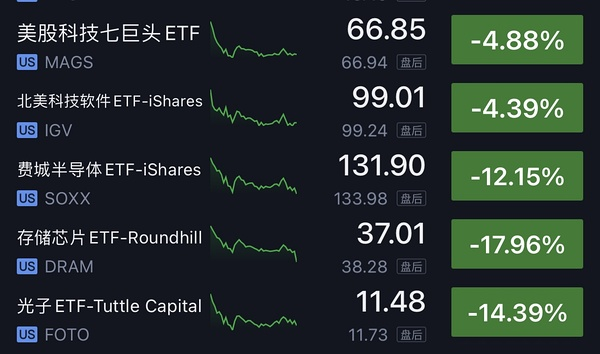  ⊳ （引用 @vio）小远 -5.02

- (2026-11-06 14:29:09) 以后硬件暴力反弹
你们也别指望小远
盈亏同源😂😂😂  ⊳ （引用 @不知道还能说啥）不错 尽力了 和硬件瓜葛很少

- (2026-11-06 14:31:10) 卖的不多 之前低于13加仓的一部分  ⊳ （引用 @赚大钱钱）幸福1544卖多少啊？我自个设的一半，现在有些舍不得🤣

- (2026-11-06 14:34:46) 是国内半导体一直在跳水
中韩指数-6  ⊳ （引用 @带薪养生中）中韩半导体杀溢价了

- (2026-11-06 14:38:49) 存钱罐 避免出去太浪了  ⊳ （引用 @夜空中最亮的星）楼你昨天摸的光线嘞？就放着？

- (2026-11-06 14:39:14) 不过这次少
中影幸福还是主要  ⊳ （引用 @夜空中最亮的星）楼你昨天摸的光线嘞？就放着？

- (2026-11-06 14:39:30) 今天可是周五🤣🤣🤣  ⊳ （引用 @只想搞钱）哦no我就工作五分钟怎么跳了这么多

- (2026-11-06 14:40:15) 👍👍👍👍👍👍👍👍👍👍

这几个月16%很不错啊  ⊳ （引用 @夜空中最亮的星）嘿嘿嘿~存钱罐已经浮盈16个点了，那我也放着

- (2026-11-06 14:41:01) 靠 我绿了…………  ⊳ （引用 @我爱牛肉火锅）红了4.5天，烈烈烈！

- (2026-11-06 14:41:37) 周五不是一直这样吗 上周五忘了吗  ⊳ （引用 @梳碧湖砍柴人）这是尾盘杀？

- (2026-11-06 14:42:28) 今天绿的不多 🤣 满意  ⊳ （引用 @我爱牛肉火锅）你也红了4.5天，谢谢，排名不分先后哈，禁止耍大牌

- (2026-11-06 14:43:11) 大连和雪儿  ⊳ （引用 @我爱牛肉火锅）快去看看谁害的

- (2026-11-06 14:44:38) 这是周五啊uu  ⊳ （引用 @只想搞钱）我靠这是咋地了

- (2026-11-06 14:46:47) uu你上周五账户怎么样  ⊳ （引用 @只想搞钱）我想着我都是小垃圾应该不怕周五的吧…真是小瞧了

- (2026-11-06 14:48:21) 会的
大跌加仓
就这样-1 -2就算了  ⊳ （引用 @momomomomomo哒）下周一会接冰雪吗🧐

- (2026-11-06 14:50:03) 🤣🤣🤣幸福没有让我的冲动成为炮灰  ⊳ （引用 @momo）谢谢xf，没有它我早绿了，死手下午又接了别的😇没有坚持到2.30

- (2026-11-06 14:51:10) 奶茶本月29%
SY30%
幸福现在26% 
幸福需要继续努力 把他们都干翻

- (2026-11-06 14:52:27) 等1544了
我今天机器人去掉了
做纯粹消费人了  ⊳ （引用 @shirla）加的这部分留着还是t掉啊楼楼

- (2026-11-06 14:53:22) 嗯没有钱了
最多中间有什么东西交换一下  ⊳ （引用 @一一一一小得力）突然想到是不是29年之前再也没有场外作业了！！！我们已经全部配置完啦！撒花！坐等开花结果！

- (2026-11-06 14:53:55) 这就是周五 没办法😂😂😂😂
也许换一天会不一样 但是今天我都不指望哈哈  ⊳ （引用 @🅰失而复🉐😎）该发挥的时候不发挥，真🐶

- (2026-11-06 14:54:18) 这应该是周五的面目😂😂😂😂😂  ⊳ （引用 @点-重生炒垃圾）网宿露出了他本来的面目加速下跌了

- (2026-11-06 14:56:00) [图] 尾盘30债加速上攻

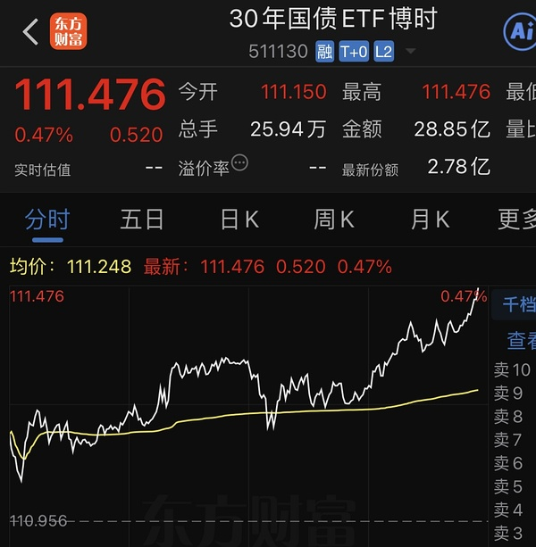

- (2026-11-06 14:57:49) 可以管cbs借一下的🤣🤣🤣🤣🤣🤣🤣🤣🤣  ⊳ （引用 @👑）🥲都加满了

- (2026-11-06 14:58:22) 周五名不虚传
好在今天准备充分
少输当赢😂

- (2026-11-06 14:58:54) 大家是不是绝大多数都没能抵挡住周五强力的挑战终结连红了😂😂😂😂😂😂😂  ⊳ （引用 @不知道还能说啥）周五名不虚传
好在今天准备充分
少输当赢😂

- (2026-11-06 14:59:41) 绿在周五咱不灰心
下周再来！  ⊳ （引用 @不知道还能说啥）大家是不是绝大多数都没能抵挡住周五强力的挑战终结连红了😂😂😂😂😂😂😂

- (2026-11-06 15:00:41) 所以必要时可以稍微借一笔 用完归还  ⊳ （引用 @11）但是大连不是满了 cbs才两笔 我漏了什么课件吗

- (2026-11-06 15:01:28) nana好好学吧
债斯达克所向披靡  ⊳ （引用 @moli）竟然没有被我买崩

- (2026-11-06 15:03:43) 😂😂😂😂😂😂我下周一再看 今天这方面 准备不足  ⊳ （引用 @shirla）-0.44少输当赢！最后一分钟问CBS借了一份大连诶嘿嘿

- (2026-11-06 15:07:46) 我进步了
上周五我被血洗
今天-0.7🤣🤣🤣🤣  ⊳ （引用 @该用户已过期）今天-1.07%，吃完昨天的还倒贴50🥹🥹

- (2026-11-06 15:09:42) 害你的应该是周五哈哈哈哈哈哈 
你看我雪儿
已经连续两个礼拜周五尾盘慌不择路了😅😅  ⊳ （引用 @家不住海边）yl尾盘陷害我
垃圾。

- (2026-11-06 15:10:11) 冰雪女王们  ⊳ （引用 @VVV坚定持有VVV）到底是谁害我，我怎么-2还多🤔

- (2026-11-06 15:13:49) 周五一直都类似的走势 我已经习惯了  ⊳ （引用 @只想搞钱）日线跟上周五几乎一模一样哎

- (2026-11-06 15:15:20) 我这比较简单啊 需要考虑的并不多😂
我去掉机器人以后
手里只有吃喝玩乐了🤣🤣🤣🤣🤣🤣🤣🤣
滑雪看电影都是娱乐项目  ⊳ （引用 @🅰失而复🉐😎）周一咋打算

- (2026-11-06 15:19:23) 是的 我没钱了 今天花完了  ⊳ （引用 @👑）话说楼楼场外是不是彻底结束了

- (2026-11-06 15:21:53) 我抄完了
底留给大家抄了😂  ⊳ （引用 @moli）按照楼楼场外买完还要-25%的规律，是不是还可以留一笔抄你的底

- (2026-11-06 15:22:53) [图] 温暖老师判断传媒跨年了
和我想的一样
只不过我觉得是电影哈哈哈

  ⊳ （引用 @点-重生炒垃圾）温暖老师羊羊赚钱了，再战慈文和消费，已被国芳暗杀，温暖老师离开皇台了，希望周一白酒反杀

- (2026-11-06 15:25:39) 他回退我还是要的😂😂😂😂😂😂
不是周五我都是狠狠干的
今天没办法  ⊳ （引用 @点-重生炒垃圾）下周是不是不用管上影了

- (2026-11-06 15:26:13) 这一次你没去芒果吗🤣🤣🤣🤣🤣  ⊳ （引用 @点-重生炒垃圾）我找机会把幸福光纤补上。。。不给就算了

- (2026-11-06 15:29:47) SY：哥又是短剧又是电影  ⊳ （引用 @家不住海边）我觉得是短剧。  一家人齐齐整整吧

- (2026-11-06 15:34:31) 😂春节档电影PK春节家庭聚会看短剧？  ⊳ （引用 @🅰失而复🉐😎）春节档永不灭

- (2026-11-06 15:37:57) 美国比中国多
至于美国 如果你有选择余地自然应该指数打底 主动基强化 但你没有选择余地 所以这个问题没有意义  ⊳ （引用 @蓝桉。）有没有好心uu总结一下场外现在配置的比例呀？

- (2026-11-06 15:38:48) 打开你的同花顺 东方财富app 搜影视院线
里面有所有股票  ⊳ （引用 @Aaa摆烂咸鱼🥳）楼，bn，sy ，中y，幸福，光线都是电影吗

- (2026-11-06 15:40:28) 你难道没手痒更激情澎湃的吗😂😂😂😂  ⊳ （引用 @🅰失而复🉐😎）再买点枣子，和和美美过大年🤣

- (2026-11-06 15:42:45) 今天uu提醒了
环球开了一万额度  ⊳ （引用 @桑尼菌）楼今天加了美的纳etf是吗？基金好像都没啥额度，没有买的空间

- (2026-11-06 15:45:31) [图] 

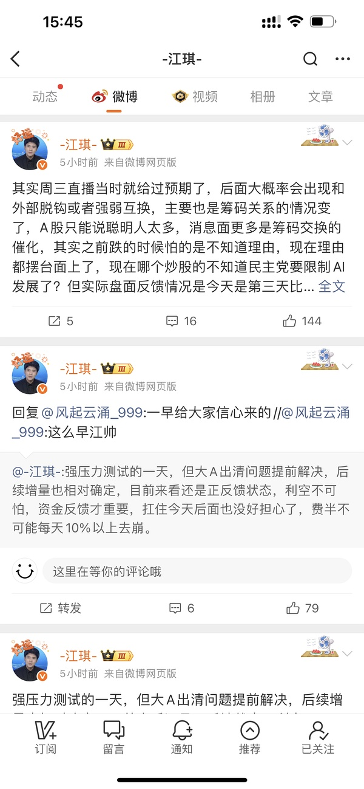

- (2026-11-06 15:48:40) 不用那么久
只要反弹几天大一点的 
大家马上情绪就变了😂  ⊳ （引用 @管⁢⁢理⁢员gua）楼楼 场外的基本配置完了，静待2029年（这么理解没错吧）有额度的情况下有余力配置nana

- (2026-11-06 15:50:09) 我也是爱国的一份子哦
我中韩半导体可是有45%左右爱国😂😂😂  ⊳ （引用 @点-重生炒垃圾）这信念感太强了啊，爱国真的要脱离国际一路向上吗？

- (2026-11-06 15:55:05) 印度！你去看  ⊳ （引用 @👑）🧏‍♀️全球现在哪里不是技术型熊市

- (2026-11-06 15:56:27) 我也有80%信心 
我今天nana是好买点
最多两三天负面发酵
民主党自己也要考虑2年后的选举
跌硬件没问题 美股指数是不能这样子的
为了反对而反对的政策影响到美股了 也得转换说辞  ⊳ （引用 @点-重生炒垃圾）这信念感太强了啊，爱国真的要脱离国际一路向上吗？

- (2026-11-06 15:57:25) 🤣🤣🤣🤣🤣  ⊳ （引用 @我爱牛肉火锅）真印度！严谨！

## 🧠 投资风格分析
> 📏 增量更新指引：仅当今日发言确有新依据时才修订对应维度，无变化不强行重写；单维度修订建议 ≤150 字。

- 投资理念与方法：强调全球联动，认为脱离美股分析A股双创是耍流氓，短期受美股AI硬件与七巨头走势牵引；重视公募欠配、容量大、位置低等被动资金逻辑。今日新增：关注美联储加息预期变化与美股期货盘前，以美股走势推演A股开盘情绪，并据此决定纳指ETF打满时点。
- 风险偏好：【整合历史要点与今日新依据后的完整描述】对纯题材与早盘冲高板块坚持大热躲开，不愿追高。对QDII/ETF溢价率高度敏感，认为高溢价是确定性风险，宁愿放弃优质标的也要选择溢价合理的品种。在市场极端恐慌时表现出极强的逆向思维，认为跌停杀溢价是买入良机，但在高位强势股回调时仅在关键均线附近才考虑接回。
- 交易与仓位：严格执行条件单与时间纪律，以五日线为浮动支撑而非固定价位；95%深度满仓时会主动减仓保留灵活性，用「打满额度」限制手贱。今日新增：操作果断，会直接用招行账户打满纳斯达克ETF（513300），并在具体产品间比较溢价率后择优（放弃溢价率略高的国泰，选博时/华夏）。
- 心理特质：【整合历史要点与今日新依据后的完整描述】对自身交易冲动有清醒认知，主动采取惩罚性措施限制操作空间（如打满额度、退出登录）。对特定时间节点（如周五）表现出高度敬畏，深知“赚多了就浪”的弱点，会通过物理隔离（少看盘）来维持纪律，避免在尾盘情绪波动中随意改口或操作，强调盘后发声以保持定力。

> ⚠️ 本板块由 Actions 全自动增量更新（复用当日发言与今日总览），每次仅在内容足够支撑时才改动。

## 🏷️ 昵称映射表
### 📖 昵称规律（供 AI 判断新昵称时参考）
【昵称命名规律（用于推断未知新昵称）】
- 拼音首字母缩写：取标的/基金名汉字拼音首字母串（含数字代码），多为 ETF/股票代码口语化｜示例：yl=引力传媒｜zy=掌阅科技｜sj=视觉中国｜cc=华安文体健康混合｜C50=创业板50ETF｜k50=科创50｜kun=昆仑万维｜xhxc=新瀚新材｜zxfc=中欣氟材
- 小/老+姓氏代指：「小X」「老X」通常指姓 X 的标的或该标的的基金经理；「X兄弟」多为同系基金｜示例：小惠=惠发食品｜老莫=万家品质生活(莫海波)｜小华=华夏全球科技先锋(QDII)A｜小华兄弟=华夏移动互联(QDII)｜小浦=浦银安盛全球智能科技(QDII)A｜小广=广发全球精选(QDII)A｜小远=华宝致远(QDII)C｜招招=招商银行｜小德=德明利｜赵姨=兆易创新｜露露=泸州老窖｜空调=格力电器
- 戏称/黑话→题材板块：生活化比喻或黑话对应某个题材/板块，而非单一标的；出现时多指板块方向｜示例：卖国=PCB板块(英伟达AI链)｜爱国=国产自主(半导体设备/芯片)｜奶茶=易点天下｜老师=中文在线｜蓝色=蓝色光标｜宇航员=航空航天板块｜华子=华泰保兴安悦债券｜国际=国际复材｜巨无霸=长鑫科技等重大IPO
- 谐音/取字：昵称含标的名关键字（取一字或谐音），多为 A 股个股或基金简称｜示例：万华=万华化学｜东百=东百集团｜宝=保利发展｜讨饭/亚洲讨饭/建信新兴=建信新兴市场(QDII)A｜华宝zy=华宝致远(QDII)A
- 机构/基金经理昵称：以基金公司名、经理姓、或平台代称指代对应基金产品｜示例：周经理=中欧新趋势混合(LOF)A｜张经理=信澳匠心回报混合A｜网易云/音乐世家=富国全球科技互联网股票(QDII)A｜国富亚洲=国富亚洲机会股票(QDII)A｜国泰纳指=国泰纳斯达克100指数(QDII)｜易方达全球=易方达全球成长精选混合(QDII)A｜浦银安盛=浦银安盛全球智能科技(QDII)A

### 📋 已收录映射
| 昵称 | 对应名称 |
|------|----------|
| C50 | 创业板50ETF |
| cc | 双义：股票=中国长城 / 基金=华安文体健康混合（用户 11-05 指认） |
| k50 | 科创50 |
| kun | 昆仑万维 |
| sj | 视觉中国 |
| xhxc | 新瀚新材（用户确认；代码待核） |
| yl | 引力传媒 |
| zxfc | 中欣氟材 |
| zy | 掌阅科技 |
| 万华 | 万华化学 |
| 东百 | 东百集团 |
| 亚洲讨饭 | 建信新兴市场混合(QDII)A |
| 保利发展 | 保利发展 |
| 华子 | 华泰保兴安悦债券 |
| 华宝 zy | 华宝致远混合(QDII)A |
| 华宝zy | 华宝致远混合(QDII)A |
| 卖国 | PCB、光模块、通信板块（英伟达AI产业链） |
| 周经理 | 中欧新趋势混合(LOF)A |
| 国富亚洲 | 国富亚洲机会股票(QDII)A |
| 国泰纳指 | 国泰纳斯达克100指数(QDII) |
| 奶茶 | 易点天下 |
| 宇航员 | 航空航天板块 |
| 宝 | 保利发展 |
| 小华 | 华夏全球科技先锋混合(QDII)A |
| 小华兄弟 | 华夏移动互联混合(QDII) |
| 小广 | 广发全球精选股票(QDII)A |
| 小德 | 德明利 |
| 小惠 | 惠发食品 |
| 小浦 | 浦银安盛全球智能科技(QDII)A |
| 小远 | 华宝致远混合(QDII)C |
| 巨无霸 | 长鑫科技等重大IPO企业 |
| 建信新兴 | 建信新兴市场混合(QDII)A |
| 张经理 | 信澳匠心回报混合A |
| 招招 | 招商银行 |
| 易方达全球 | 易方达全球成长精选混合(QDII)A |
| 浦银安盛 | 浦银安盛全球智能科技(QDII)A |
| 爱国 | 国产自主（半导体设备/芯片制造） |
| 空调 | 格力电器 |
| 网易云 | 富国全球科技互联网股票(QDII)A |
| 老师 | 中文在线 |
| 老莫 | 万家品质生活混合A(519195) |
| 蓝色 | 蓝色光标 |
| 讨饭 | 建信新兴市场混合(QDII)A |
| 赵姨 | 兆易创新 |
| 赵哥 | 兆易创新 |
| 露露 | 泸州老窖 |
| 安安 | 安记食品 |
| 音乐世家 | 富国全球科技互联网股票(QDII)A |
| 老伯伯 | 铜冠铜箔 |
| nk | 景顺长城纳斯达克科技ETF联接(QDII)A |
| bk | 易方达标普信息科技指数(QDII-LOF)A |
| txx | 天下秀 |
| 媛媛 | 今世缘 |
| uu | 友友、网友们 |
| 温暖老师 | 某个特别牛逼的散户 |
| 余老师 | 余利，某牛逼投资者 |
| ycm | 粤传媒 |
| 江老师 | 江琪（投资博主） |
| 水果老师 | 投资博主 |
| 小爱 | 我爱我家 |
| ty | 天娱数科 |
| bn | 博纳影业 |
| sy | 上海电影 |
| CBS | 长白山 |
| 东哥 | 东百集团 |
| 芒果 | 芒果超媒 |
| 阿中 | 中国电影 |
| 欢欢 | 欢瑞世纪 |
| 雪人 | 雪人集团 |
| 大连 | 大连圣亚 |
| 幸福 | 幸福蓝海 |
| 小粤 | 粤传媒 |
| 阿博 | 博纳影业 |
| 创成长 | 创业板成长etf |
| asd | 埃斯顿 |
| 恋爱脑 | 好想你 |
| 恋爱 | 好想你 |
| 小羊 | 襄阳轴承 |
| 中马 | 中马传动 |
| 晶雪 | 晶雪节能 |
| xf | 幸福蓝海 |
| 建设 | 建设工业 |
| 北方 | 北方导航/北方国际（未定，11-04「我在北方了」） |
| _ambiguity_note | 歧义未收敛（禁止当唯一映射）：轮子=巨轮智能/五洲新春；sj=视觉中国（传媒语境）/神剑股份（宇航员语境）；cc=中国长城/华安文体健康混合；北方=北方导航或北方国际；zy=掌阅科技（用户 11-05 确认原值正确）。证据分级：A=价格指纹三条以上实测命中；B=量级或单日命中/用户口述；C=仅昵称或语义，不得据此写『他持有』。 |

> ⚠️ 以下为 LLM **建议**，未自动写入状态文件。请人工确认后，本地编辑 `state.json` 的 `nickname_map` / `positions`，或 `nickname_rules.json` 的 `rules` 并 push 生效。

*🤖 自动生成于 2026-11-06 16:06:51 ｜ 豆瓣楼主发言追踪*