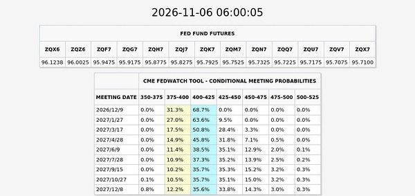
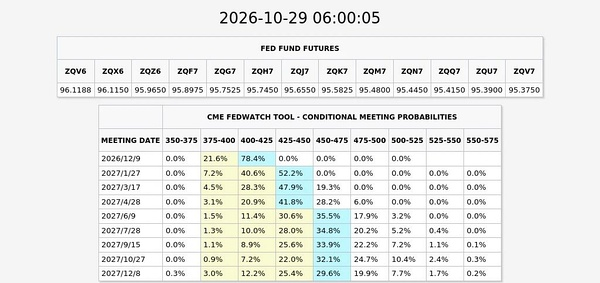
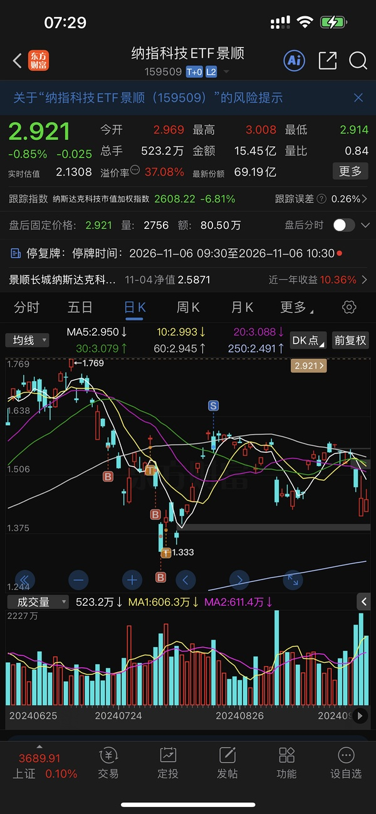
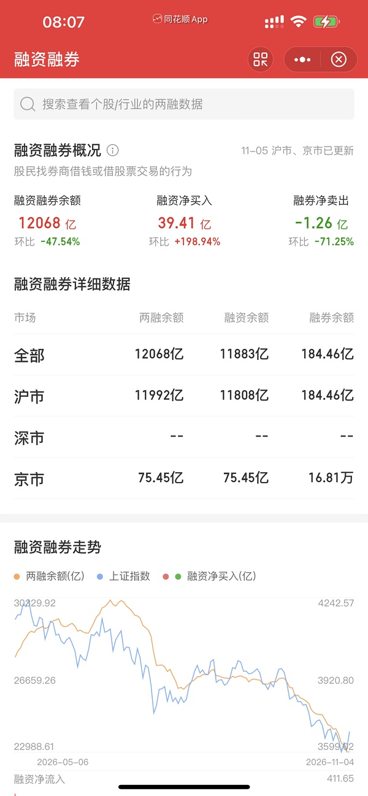

# 📋 楼主每日发言推送

> **推送日期**：2026-11-06 ｜ **执行时间**：2026-11-06 08:57:34 ｜ **监控用户**：`不知道还能说啥`
> **追踪模式**：`topic`（用户主页广播·豆瓣话题）

## 📊 持仓追踪
> 上次更新：2026-11-06 ｜ 基于楼主发言持续追踪（共 19 项）

| 标的 | 状态 | 类型 | 现价 | 提及 |
|------|------|------|------|------|
| 招商银行 | 底仓·多年持有不动·日常无操作 | 红利/银行 | 42.54（0.00%） | 多年前买入、作为底仓、平时完全不动（近期语料无痕迹… |
| 长白山 | 锁仓·分笔挂36.44 | 冰雪·正牌双子星 | 38.25（3.13%） | 11-05 14:10「明明到39都没阻力」；他判… |
| 雪人集团 | 持有·14.36买入／15.84卖一半未触发 | 冰雪·交易仓 | 14.81（-0.34%） | 11:26-11:33 亲自教学『隔空成交』：挂1… |
| 上海电影 | 已按纪律卖出·空仓等回调 | 电影 | 32.51（4.50%） | 11-05 08:43「除非打到20日线以内 大跌… |
| 幸福蓝海 | 持有·卖单14.34上移至15.44 | 电影 | 13.87（4.44%） | 11-05 15:07「我取消了幸福14.34单子… |
| 粤传媒 | 持有 |  | 11.06（2.98%） | 暂无 |
| 大连圣亚 | 持有·额度已打满 | 冰雪·正牌双子星 | 42.11（-0.31%） | 11-05 11:00「我把大连额度先打满 也是尽… |
| 博纳影业 | 持有小仓·给风险提醒 | 传媒 | 6.16（10.00%） | 14:28「参考博纳刷屏三星堆 要小心啊」——同一… |
| 中国电影 | 持有·不设条件单 | 电影·核心不动仓 | 15.82（4.98%） | 10:35「中影是不能动的 随时炒作复仇者联盟」；… |
| 中韩半导体ETF | 持有 |  | 3.787（-3.44%） | 意义显现，『跌都不会跌』『中韩半导体价值就在这里』… |
| 埃斯顿 | 零花钱仓今日卖出 | 机器人 | 29.85（1.22%） | 11.5；10:27 与襄阳同批撤退；他给机器人线的定性是「… |
| 晶雪节能 | 持有·卖单24.94 | 冰雪·山寨 | 21.77（-3.33%） | 11-05 14:33「晶雪这个🐶 他一定要大连或… |
| 光线传媒 | 今日早盘低吸 | 电影·低位备选 | 12.69（3.17%） | 14:48「光线今天无法证明自己比幸福好 那你得不… |
| 襄阳轴承 | 今日已卖（卡高点撤退） | 机器人/生肖羊 | 19.74（1.33%） | 10:27「小羊卡高点 我也撤退了 带着asd零花… |
| 中马传动 | 归入『机器人能卖的都清』 | 机器人 | 16.28（4.29%） | 13:50「我把机器人军工能卖的都清了」 |
| 建设工业 | 昨日买入·今日清掉 | 军工（与机器人互指） | 21.05（-1.41%） | 14:42「前面清了昨天买的军工 降低明天的总仓位… |
| 好想你 | 今日加仓·卖单10.48挂着未触发 | 食品（他叫『恋爱脑』） | 10.20（2.00%） | 11-04 11:07「那必须的 今天还给了更好的… |
| 掌阅科技 | 待确认是否仍持有 | 传媒/AI应用 | 30.99（2.82%） | 他本人对 zy 只回「慢就是快 他执行的很好」，无… |
| 纳斯达克ETF（513300） | 买入 |  | 暂无 | 11.6；「我今天就会打满纳斯达克」「513300将重出江湖… |

> ⚠️ 执行任务时如发现新操作，请更新 `state.json` 的 `positions`。成本价和市值有数据才填，没有则保留「暂无」。

## 🌅 今日总览
### 📌 市场背景
今日发言聚焦美股暴跌与加息预期变化：「纳指暴跌5.5%，创史上最大单日市值损失」，市场担忧AI监管；「美国人终于用了最令人不舒服的方式 提前结束加息周期」，且「12月加息概率骤降到70%以内」。楼主判断「开盘的情绪估计无差别 后面会不一样」，并提及韩国KOSPI在停牌后恢复交易、跌幅收窄至5.4%；特朗普称美股大跌赖民主党。

### 📌 今日操作
| 操作 | 标的 | 详情 |
|---|---|---|
| ✅ | 纳斯达克ETF（513300） | 「我今天就会打满纳斯达克」「513300将重出江湖」，用招行账户打满 |
| ✅ | 博时/华夏纳指产品 | 称「博时和华夏都不错」，作为打满工具；「国泰虽然更好 但是溢价率略高于常规 我放弃」 |
| ⏭️ | nk（景顺长城纳斯达克科技ETF联接） | 明确「nk 不行」，37%溢价率容易被杀，不买 |

### 📌 今日议题
| 议题 | 态度 | 核心观点 | 关键引用 |
|---|---|---|---|
| 美股暴跌与加息预期 | 💬讨论 | 加息预期骤降是好事，但美股历史性抛售引发全球情绪冲击 | 「美国人终于用了最令人不舒服的方式 提前结束加息周期」「12月加息概率骤降到70%以内」 |
| 纳斯达克ETF溢价率 | 💬讨论 | 溢价率高低决定买点，跌停杀溢价更划算；看好位置则不必纠结溢价 | 「跌停是杀掉2.7%溢价」「如果认为这个位置好 溢价率没有什么可看的」 |
| nk（景顺长城纳指科技） | 📉看空 | nk不行，37%溢价率很容易被杀 | 「nk 不行」「37%的溢价率很容易杀的」 |
| A股开盘情绪 | ➡️中性 | 开盘情绪无差别，后面会分化 | 「开盘的情绪估计无差别 后面会不一样」 |
| 美国政治与美股 | 💬讨论 | 特朗普甩锅民主党，民主党赢后市场横盘 | 「特朗普称美股大跌赖民主党」「你们民主党赢了 市场横盘了」 |
| 消费与财富效应 | 💬讨论 | 金融市场降温会压制消费和投资预期 | 「金融市场降温 消费预期下降」「财富效应降温」 |

### 📌 看好板块/方向
- **纳斯达克/美股科技**：明确「我今天就会打满纳斯达克」「513300将重出江湖」，以纳指ETF作为主要进攻方向；
- **博时、华夏纳指产品**：称「博时和华夏都不错」，在具体ETF间比较溢价率后择优。

### 📌 风险提示
- 「37%的溢价率很容易杀的」——高溢价纳指产品存在杀溢价风险，买入前需评估溢价水平；
- 「跌停是杀掉2.7%溢价」——跌停开盘会直接抹去部分溢价，需结合位置判断是否更划算；
- 「如果uu觉得会继续大跌 那今天买并不合适」——若判断美股继续下跌，当日打满并不合适；
- 「融资盘：qtmd 我买了又暴跌了」——融资盘在暴跌中受损，杠杆资金风险放大；
- 「开盘的情绪估计无差别」——开盘可能无差别下杀，个股分化要等盘中。

## 📊 本次结果
- **今日发言**：36 条
- **累计存档**：19873 条

## 📝 该最新广播作者发言聚合（共 36 条）
- (2026-11-06 01:26:36) 周五指定有什么魔力！！！  ⊳ （引用 @我爱牛肉火锅）谁要！自取！明天老印用得上

- (2026-11-06 07:04:57) 哈哈 你们不是说的嘛
楼主想要的 一定会得到  ⊳ （引用 @👑）绝了啊，五天跌了30%

看到大组说🇺🇸的，还是惊了💦💦💦
我也恐慌指数飙升了

- (2026-11-06 07:06:57) 我不需要了  ⊳ （引用 @👑）这额度能打开吗

- (2026-11-06 07:09:42) 我今天就会打满纳斯达克 所以我不再需要  ⊳ （引用 @👑）那楼想要的是啥(⊙o⊙)

- (2026-11-06 07:12:04) 是的
昨天路上已经翻阅了过去的操作
513300将重出江湖  ⊳ （引用 @🅰失而复🉐😎）场内？

- (2026-11-06 07:20:26) [图] 美国人终于用了最令人不舒服的方式 提前结束加息周期

市场直接抹去第二次加息概率

且12月加息概率骤降到70%以内

  ⊳ （引用 @VVV坚定持有VVV）还加息吗这回🤣

- (2026-11-06 07:23:37) 小伙伴
杀不了多少溢价的
因为美国-6.3收盘 目前盘前-1
这代表你-7.3开 溢价率持平
跌停是杀掉2.7%溢价

如果你认为这个位置好 溢价率没有什么可看的 因为直接买了
如果觉得这个位置不好 溢价率也没有什么还看到 因为你不买  ⊳ （引用 @仓部加措）加上杀溢价，楼估计跌几个点你挂单买

- (2026-11-06 07:25:15) 赚大钱了  ⊳ （引用 @momo）楼下一步想得到的是什么

- (2026-11-06 07:26:59) [图] 对比10/29日的
后面两栏的颜色都去掉了🤣🤣🤣🤣

  ⊳ （引用 @VVV坚定持有VVV）目的get✅

- (2026-11-06 07:27:50) 这个要等我结完婚 目前没想法  ⊳ （引用 @卿珩）也许33的招

- (2026-11-06 07:30:51) [图] nk 不行

楼主老经验了 24年暑假就抄底过类似

但是现在这个37%的溢价率很容易杀的
他的溢价率不是常规溢价

因为楼主都玩过 知道杀溢价会什么样子

  ⊳ （引用 @卿珩）楼楼只买纳指，不考虑纳科吗

- (2026-11-06 07:33:54) 今天她账户又要大赚了？？  ⊳ （引用 @VVV坚定持有VVV）哈哈哈哈哈哈哈最值得信任的财经博主：楼嫂

- (2026-11-06 07:39:31) 开盘的情绪估计无差别
后面会不一样 
还有2小时
大家积极备战😂  ⊳ （引用 @小肥肥）今天小a能有活口吗，防御是啥，冰雪，银行，军工，红利，消费，还是无差别

- (2026-11-06 07:45:48) 😂第一个不是本来的股票账户操作 你们不用参考  ⊳ （引用 @-却行）今天是场内513300+破29.7接回sy+等待冰雪 （）没有别的了吧

- (2026-11-06 07:47:51) -6.3收盘 目前期货-1（那个期货就是nana100 这个一直在浮动） 所以-7.3是正常开盘

如果跌停开就杀掉了2.7%溢价自然更好了

如果uu觉得会继续大跌 那今天买并不合适
这个看大家各自想法了  ⊳ （引用 @点-重生炒垃圾）nana一开盘就买吗？

- (2026-11-06 07:49:54) 美股收评|AI监管担忧引爆历史性抛售！纳指暴跌5.5%，创史上最大单日市值损失  ⊳ （引用 @小肥肥）昨晚到底啥原因啊，搞不懂，杀溢价

- (2026-11-06 07:50:07) 无计划 打满了！！  ⊳ （引用 @仓部加措）楼今天的大连跌破多少才会接呀

- (2026-11-06 07:54:04) 金融市场降温 消费预期下降 投资预期降温 财富效应降温

你应该懂的啊 我们不是一直说的吗 跌了不消费了  ⊳ （引用 @木感情的打工人）美股大跌为啥可以消化加息预期呀

- (2026-11-06 08:00:55) 这个妈妈好像能说了算
之前加息 RMB理都不理😂😂😂
美元飙升到102 我们RMB毫无反应

这几天贬值一些 还是因为妈妈外汇准备金提高了2% 自己弄的 😂  ⊳ （引用 @木感情的打工人）所以如果老美不加息，人民币有望继续升值，a子牛市基础还在

- (2026-11-06 08:02:29) 在一边偷着乐呢 

你们民主党赢了 市场横盘了😂美国人可是很看重美股的  ⊳ （引用 @山中食人花）昨天那么大跌 川子也不发言了  颓了吗

- (2026-11-06 08:02:53) 我们软件有问题吧？  ⊳ （引用 @🅰失而复🉐😎）这两货没睡醒😕

- (2026-11-06 08:03:17) 咋可能 估计我们软件数据有问题  ⊳ （引用 @海贼）韩国综合股价指数（KOSPI）开盘下跌2.2%，至5263.26点。 ？？？是错误了吗？为什么那么跌那么少😂

- (2026-11-06 08:04:08) 但是美国快拉红了  ⊳ （引用 @木感情的打工人）新闻播报了，日经指数-7

- (2026-11-06 08:07:25) [图] 融资盘：qtmd 我买了又暴跌了

- (2026-11-06 08:10:57) 这周都是全部扫
1000都在买  ⊳ （引用 @小肥肥）昨天国家队也买了科创？

- (2026-11-06 08:11:38) 不影响大家开盘操作A股 很好心呢  ⊳ （引用 @油炸花生）这些停牌1小时

- (2026-11-06 08:12:24) 来了来了

特朗普称美股大跌赖民主党

美国总统特朗普当地时间11月5日在社交媒体发帖称，“（美国）股市因本次（中期）选举结果遭遇史上最惨烈的交易日之一。记住，这不是共和党的锅，是那帮‘笨蛋民主党人’造成的。  ⊳ （引用 @山中食人花）hhhh 难怪不发言 可能在幸灾乐祸，前天特朗普集团还大跌呢

- (2026-11-06 08:24:03) 现在nana期货+0.3 昨夜-6.3
开盘-6是正常开 不带杀溢价
希望能杀一些

- (2026-11-06 08:24:26) 关键开盘是10:30 到时候还会浮动  ⊳ （引用 @不知道还能说啥）现在nana期货+0.3 昨夜-6.3
开盘-6是正常开 不带杀溢价
希望能杀一些

- (2026-11-06 08:32:16) 我买的是招行账户  ⊳ （引用 @钱多多多多多）楼楼，买场内nana不用拿太久是吧？

- (2026-11-06 08:35:11) 博时和华夏都不错

国泰虽然更好 但是溢价率略高于常规 我放弃  ⊳ （引用 @wait）上个月被杀的都没什么心情看盘和追帖了，阿美大跌，求问楼主今天准备打满的纳纳是哪只？场内还是场外？

- (2026-11-06 08:38:24) 你看美国期货 nana已经不可能跌停开盘了  ⊳ （引用 @shirla）收到！是剩下子弹都打掉对吧！

- (2026-11-06 08:38:47) 韩国综合股价指数（KOSPI）在停牌后恢复交易，跌幅收窄至5.4%。

- (2026-11-06 08:46:20) 如果选项好 我也不充值场内了 
就是这个问题得不到最好的答案 
说100 200的也肯定不是你要的  ⊳ （引用 @#🕳#）楼 请问下如果家人没有场内账户，场外纳全没额度，可以补点啥呀？🥲（之前的二十笔全跟着投完了）

- (2026-11-06 08:48:01) 加息预期骤降 其实是好事  ⊳ （引用 @moli）下跌理由不值一提🤔

- (2026-11-06 08:48:56) 100 200说了也是儿童车搞笑的😂😂😂  ⊳ （引用 @高手云集上钻）事已至此，楼楼场外美基又要买的吗，买完我就把app卸载了，我终于变成了一个不敢看收益率的人

## 🧠 投资风格分析
> 📏 增量更新指引：仅当今日发言确有新依据时才修订对应维度，无变化不强行重写；单维度修订建议 ≤150 字。

- 投资理念与方法：强调全球联动，认为脱离美股分析A股双创是耍流氓，短期受美股AI硬件与七巨头走势牵引；重视公募欠配、容量大、位置低等被动资金逻辑。今日新增：关注美联储加息预期变化与美股期货盘前，以美股走势推演A股开盘情绪，并据此决定纳指ETF打满时点。
- 风险偏好：对纯题材与早盘冲高板块坚持大热躲开，不愿追高；高位强势股仅在回调至20日线附近才考虑接回。今日新增：对QDII/ETF溢价率高度敏感，认为高溢价容易被杀，跌停开杀溢价反而更好；若判断美股继续大跌则当日买入不合适。
- 交易与仓位：严格执行条件单与时间纪律，以五日线为浮动支撑而非固定价位；95%深度满仓时会主动减仓保留灵活性，用「打满额度」限制手贱。今日新增：操作果断，会直接用招行账户打满纳斯达克ETF（513300），并在具体产品间比较溢价率后择优（放弃溢价率略高的国泰，选博时/华夏）。
- 心理特质：对自身手贱行为有清醒认知，并主动采取惩罚性措施（如将大连额度打满以限制操作空间）；深知“赚多了就浪”，因此主动寻求外部监督（希望被泼冷水）并反复强调“只要不贪心乱浪”是赚钱核心；对情绪交易保持警惕，认为大多数人盘中追涨是“情绪交易”而非计划内操作，并公开指出以提醒他人（如昨日下跌无人提醒，只能自我约束）；能够果断接受高切低（资金从芒果流向奶茶），并承认市场博弈（炒垃圾）的合理性，保持务实心态。

> ⚠️ 本板块由 Actions 全自动增量更新（复用当日发言与今日总览），每次仅在内容足够支撑时才改动。

## 🏷️ 昵称映射表
### 📖 昵称规律（供 AI 判断新昵称时参考）
【昵称命名规律（用于推断未知新昵称）】
- 拼音首字母缩写：取标的/基金名汉字拼音首字母串（含数字代码），多为 ETF/股票代码口语化｜示例：yl=引力传媒｜zy=掌阅科技｜sj=视觉中国｜cc=华安文体健康混合｜C50=创业板50ETF｜k50=科创50｜kun=昆仑万维｜xhxc=新瀚新材｜zxfc=中欣氟材
- 小/老+姓氏代指：「小X」「老X」通常指姓 X 的标的或该标的的基金经理；「X兄弟」多为同系基金｜示例：小惠=惠发食品｜老莫=万家品质生活(莫海波)｜小华=华夏全球科技先锋(QDII)A｜小华兄弟=华夏移动互联(QDII)｜小浦=浦银安盛全球智能科技(QDII)A｜小广=广发全球精选(QDII)A｜小远=华宝致远(QDII)C｜招招=招商银行｜小德=德明利｜赵姨=兆易创新｜露露=泸州老窖｜空调=格力电器
- 戏称/黑话→题材板块：生活化比喻或黑话对应某个题材/板块，而非单一标的；出现时多指板块方向｜示例：卖国=PCB板块(英伟达AI链)｜爱国=国产自主(半导体设备/芯片)｜奶茶=易点天下｜老师=中文在线｜蓝色=蓝色光标｜宇航员=航空航天板块｜华子=华泰保兴安悦债券｜国际=国际复材｜巨无霸=长鑫科技等重大IPO
- 谐音/取字：昵称含标的名关键字（取一字或谐音），多为 A 股个股或基金简称｜示例：万华=万华化学｜东百=东百集团｜宝=保利发展｜讨饭/亚洲讨饭/建信新兴=建信新兴市场(QDII)A｜华宝zy=华宝致远(QDII)A
- 机构/基金经理昵称：以基金公司名、经理姓、或平台代称指代对应基金产品｜示例：周经理=中欧新趋势混合(LOF)A｜张经理=信澳匠心回报混合A｜网易云/音乐世家=富国全球科技互联网股票(QDII)A｜国富亚洲=国富亚洲机会股票(QDII)A｜国泰纳指=国泰纳斯达克100指数(QDII)｜易方达全球=易方达全球成长精选混合(QDII)A｜浦银安盛=浦银安盛全球智能科技(QDII)A

### 📋 已收录映射
| 昵称 | 对应名称 |
|------|----------|
| C50 | 创业板50ETF |
| cc | 双义：股票=中国长城 / 基金=华安文体健康混合（用户 11-05 指认） |
| k50 | 科创50 |
| kun | 昆仑万维 |
| sj | 视觉中国 |
| xhxc | 新瀚新材（用户确认；代码待核） |
| yl | 引力传媒 |
| zxfc | 中欣氟材 |
| zy | 掌阅科技 |
| 万华 | 万华化学 |
| 东百 | 东百集团 |
| 亚洲讨饭 | 建信新兴市场混合(QDII)A |
| 保利发展 | 保利发展 |
| 华子 | 华泰保兴安悦债券 |
| 华宝 zy | 华宝致远混合(QDII)A |
| 华宝zy | 华宝致远混合(QDII)A |
| 卖国 | PCB、光模块、通信板块（英伟达AI产业链） |
| 周经理 | 中欧新趋势混合(LOF)A |
| 国富亚洲 | 国富亚洲机会股票(QDII)A |
| 国泰纳指 | 国泰纳斯达克100指数(QDII) |
| 奶茶 | 易点天下 |
| 宇航员 | 航空航天板块 |
| 宝 | 保利发展 |
| 小华 | 华夏全球科技先锋混合(QDII)A |
| 小华兄弟 | 华夏移动互联混合(QDII) |
| 小广 | 广发全球精选股票(QDII)A |
| 小德 | 德明利 |
| 小惠 | 惠发食品 |
| 小浦 | 浦银安盛全球智能科技(QDII)A |
| 小远 | 华宝致远混合(QDII)C |
| 巨无霸 | 长鑫科技等重大IPO企业 |
| 建信新兴 | 建信新兴市场混合(QDII)A |
| 张经理 | 信澳匠心回报混合A |
| 招招 | 招商银行 |
| 易方达全球 | 易方达全球成长精选混合(QDII)A |
| 浦银安盛 | 浦银安盛全球智能科技(QDII)A |
| 爱国 | 国产自主（半导体设备/芯片制造） |
| 空调 | 格力电器 |
| 网易云 | 富国全球科技互联网股票(QDII)A |
| 老师 | 中文在线 |
| 老莫 | 万家品质生活混合A(519195) |
| 蓝色 | 蓝色光标 |
| 讨饭 | 建信新兴市场混合(QDII)A |
| 赵姨 | 兆易创新 |
| 赵哥 | 兆易创新 |
| 露露 | 泸州老窖 |
| 安安 | 安记食品 |
| 音乐世家 | 富国全球科技互联网股票(QDII)A |
| 老伯伯 | 铜冠铜箔 |
| nk | 景顺长城纳斯达克科技ETF联接(QDII)A |
| bk | 易方达标普信息科技指数(QDII-LOF)A |
| txx | 天下秀 |
| 媛媛 | 今世缘 |
| uu | 友友、网友们 |
| 温暖老师 | 某个特别牛逼的散户 |
| 余老师 | 余利，某牛逼投资者 |
| ycm | 粤传媒 |
| 江老师 | 江琪（投资博主） |
| 水果老师 | 投资博主 |
| 小爱 | 我爱我家 |
| ty | 天娱数科 |
| bn | 博纳影业 |
| sy | 上海电影 |
| CBS | 长白山 |
| 东哥 | 东百集团 |
| 芒果 | 芒果超媒 |
| 阿中 | 中国电影 |
| 欢欢 | 欢瑞世纪 |
| 雪人 | 雪人集团 |
| 大连 | 大连圣亚 |
| 幸福 | 幸福蓝海 |
| 小粤 | 粤传媒 |
| 阿博 | 博纳影业 |
| 创成长 | 创业板成长etf |
| asd | 埃斯顿 |
| 恋爱脑 | 好想你 |
| 恋爱 | 好想你 |
| 小羊 | 襄阳轴承 |
| 中马 | 中马传动 |
| 晶雪 | 晶雪节能 |
| xf | 幸福蓝海 |
| 建设 | 建设工业 |
| 北方 | 北方导航/北方国际（未定，11-04「我在北方了」） |
| _ambiguity_note | 歧义未收敛（禁止当唯一映射）：轮子=巨轮智能/五洲新春；sj=视觉中国（传媒语境）/神剑股份（宇航员语境）；cc=中国长城/华安文体健康混合；北方=北方导航或北方国际；zy=掌阅科技（用户 11-05 确认原值正确）。证据分级：A=价格指纹三条以上实测命中；B=量级或单日命中/用户口述；C=仅昵称或语义，不得据此写『他持有』。 |

> ⚠️ 以下为 LLM **建议**，未自动写入状态文件。请人工确认后，本地编辑 `state.json` 的 `nickname_map` / `positions`，或 `nickname_rules.json` 的 `rules` 并 push 生效。

## 持仓建议（待你确认）
- **纳斯达克ETF**（513300）〔买入〕— 依据：我今天就会打满纳斯达克；513300将重出江湖；无计划 打满了！！

## 新昵称映射建议（待你确认）
- `nana100` = 纳斯达克100期货
- `nana` = 纳斯达克100期货/纳指期货
- `妈妈` = 央行

## 新昵称规律建议（待你确认）
- 【仓位表达】发言“打满/重出江湖/我不再需要”表示将某标的买至满仓或重新启用，应视为买入/加仓信号 ｜示例：我今天就会打满纳斯达克；513300将重出江湖；无计划 打满了！！ ｜依据：我今天就会打满纳斯达克；513300将重出江湖；无计划 打满了！！
- 【基金比较】比较博时/华夏/国泰等基金公司产品时，仅表示在筛选，未明确买入前不视为持仓 ｜示例：博时和华夏都不错；国泰虽然更好 但是溢价率略高于常规 我放弃 ｜依据：博时和华夏都不错 国泰虽然更好 但是溢价率略高于常规 我放弃

*🤖 自动生成于 2026-11-06 08:57:34 ｜ 豆瓣楼主发言追踪*