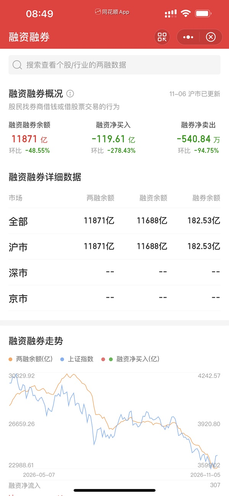

# 📋 楼主每日发言推送

> **推送日期**：2026-11-07 ｜ **执行时间**：2026-11-07 16:01:31 ｜ **监控用户**：`不知道还能说啥`
> **追踪模式**：`topic`（用户主页广播·豆瓣话题）

## 📊 持仓追踪
> 上次更新：2026-11-07 ｜ 基于楼主发言持续追踪（共 20 项）

| 标的 | 状态 | 类型 | 现价 | 提及 |
|------|------|------|------|------|
| 招商银行 | 底仓·多年持有不动·日常无操作 | 红利/银行 | 42.88（0.80%） | 多年前买入、作为底仓、平时完全不动（近期语料无痕迹… |
| 长白山 | 持有两笔·锁仓（11-02 第二笔买单 36.44 已成交） | 冰雪·正牌双子星 | 37.76（-1.28%） | 11-02 09:38「加仓大连 cbs 触发卖出… |
| 雪人集团 | 持有·14.36买入／15.84卖一半未触发 | 冰雪·交易仓 | 14.50（-2.09%） | 11-06 09:41「雪人再度回踩五日线 给了昨… |
| 上海电影 | 仍空仓·29.7买条件未触发 | 电影 | 35.76（10.00%） | 11-06 全天最低31.00＞他设的29.7接回… |
| 幸福蓝海 | 持有·今日下午加仓·卖单15.44未触发 | 电影 | 14.67（5.77%） | 11-06 13:54 截图（幸福蓝海分时带B买入… |
| 粤传媒 | 持有（沿用原仓·本轮未复核） |  | 11.25（1.72%） | 11-06 11:23「ycm火箭发射」＋11:2… |
| 大连圣亚 | 持有·额度已打满·今日未加 | 冰雪·正牌双子星 | 40.51（-3.80%） | 11-06 07:50「无计划 打满了！！」（问：… |
| 博纳影业 | 持有小仓 | 传媒 | 6.23（1.14%） | 11-06 无新自证；当日最高6.47<涨停6.7… |
| 中国电影 | 持有·不设条件单·与幸福并称主力仓 | 电影·核心不动仓 | 16.01（1.20%） | 11-06 09:50「中影在发挥自己的慢就是快」… |
| 中韩半导体ETF | 持有 |  | 3.541（-6.50%） | 11-06 14:34「是国内半导体一直在跳水 中… |
| 埃斯顿 | 已清（归入今日『机器人去掉』） | 机器人 | 28.46（-4.66%） | 11.5；11-06 14:21「没多 我早上机器人兑现了」… |
| 晶雪节能 | 持有·卖单24.94未触发 | 冰雪·山寨 | 21.84（0.32%） | 11-06 09:48「晶雪还是打不过缺口」、11… |
| 光线传媒 | 持有小仓·他称『存钱罐』 | 电影·低位备选 | 12.38（-2.44%） | 11-06 14:38「存钱罐 避免出去太浪了」（… |
| 襄阳轴承 | 已卖（11-05 卡高点撤退，今日跌停） | 机器人/生肖羊 | 17.77（-9.98%） | 11-06 收 17.77＝跌停；他 11-05 … |
| 中马传动 | 已清 | 机器人 | 15.58（-4.30%） | 11-06 归入『机器人去掉了』；当日 −4.30… |
| 建设工业 | 已清（11-05） | 军工（与机器人互指） | 20.14（-4.32%） | 11-06 无新痕迹 |
| 好想你 | 持有·卖单10.48未触发 | 食品（他叫『恋爱脑』） | 9.91（-2.84%） | 11-06 最高10.10<10.48 未触发；1… |
| 掌阅科技 | 待确认是否仍持有 | 传媒/AI应用 | 30.10（-2.87%） | 11-06 无新痕迹 |
| 纳斯达克ETF华夏 | 今日打满买入（招行账户·9点后转入资金） | QDII·场内纳指 | 2.577（-3.08%） | 11.6；07:12「513300将重出江湖」→09:04 … |
| 纳指科技ETF景顺 | 今日明确不买；2024-07/08 有 B/S/T 成交痕迹 | QDII·场内（今日未买） | 2.813（-3.70%） | 11.6；07:30「nk 不行 楼主老经验了 24年暑假就… |

> ⚠️ 执行任务时如发现新操作，请更新 `state.json` 的 `positions`。成本价和市值有数据才填，没有则保留「暂无」。

## 🌅 今日总览
### 📌 市场背景
今日发言未系统论述整体市场，仅提及「融资盘延续周五传统」「五六月刚经历过」，并转述港交所前三季度IPO募资同比翻倍、全球第二的业绩信息。

### 📌 今日操作
| 操作 | 标的 | 详情 |
| --- | --- | --- |
| ⏭️ | 无 | 今日发言未提及具体买卖操作，仅有对招商银行性价比的回顾性评论 |

### 📌 今日议题
| 议题 | 态度 | 核心观点 | 关键引用 |
| --- | --- | --- | --- |
| 招商银行股息率与性价比 | 📈看多 | 当前42元招行股息率4.8%远高于货币基金1.5%以下，比四年前32元时（股息率3.8% vs 货基2.2-2.5%）性价比更高 | 「现在42元的招行可比当年32性价比高多了」「现在招行虽然42 但是股息率4.8%」 |
| 融资盘与周五传统 | 💬讨论 | 提及融资盘延续周五传统，且五六月刚经历过类似情况，但未展开判断 | 「融资盘延续周五传统」「五六月刚经历过」 |
| 港交所IPO业绩 | 💬讨论 | 转述港交所前三季度营收利润创历史同期新高，IPO募资3884亿港元同比翻倍、全球第二，内地科技企业赴港上市带动收入 | 「港交所前九个月营收、股东利润双双刷新历史同期最高」「合计募资3884亿港元，募资规模同比翻倍」 |

### 📌 看好板块/方向
- **银行（高股息红利）**：招商银行当前股息率4.8%，显著高于货币基金收益率（1.5%以下），认为其性价比优于四年前32元时。

### 📌 风险提示
- 「融资盘延续周五传统」——提及融资盘在周五的惯性行为，可能带来短期市场波动。
- 「五六月刚经历过」——暗示类似融资盘扰动此前曾发生，需留意历史重演。

## 📊 本次结果
- **今日发言**：7 条
- **累计存档**：20112 条

## 📝 该最新广播作者发言聚合（共 7 条）
- (2026-11-07 08:49:49) 👍厉害啊  ⊳ （引用 @fafa大财）周末拿第一了☝️

- (2026-11-07 08:50:03) [图] 融资盘延续周五传统

- (2026-11-07 09:18:58) 五六月刚经历过  ⊳ （引用 @momo）什么时候我才能经历一回暴涨，我回去复习一下2022了

- (2026-11-07 10:52:27) 我四年前买的招行 32元 股息率3.8% 那时候货币基金2.2-2.5%收益率

现在招行虽然42 但是股息率4.8% 而现在货币基金稳定1.5%都没几个

现在42元的招行可比当年32性价比高多了  ⊳ （引用 @一切都会过去的）红利估值还偏低的😂

- (2026-11-07 10:56:56) 现在也是年少啊🤣因为现在比之前性价比更高啊  ⊳ （引用 @一切都会过去的）年少不知红利好😂

- (2026-11-07 11:41:41) 11月6日，港交所正式发布截至9月30日的前三季度业绩公告。财报显示，港交所前九个月营收、股东利润双双刷新历史同期最高，IPO募资热火朝天成主因。

IPO上市业务方面，前三季度118家（主板116家＋GEM 2家）新公司登陆港交所，合计募资3884亿港元，募资规模同比翻倍，全球排名第二；中际旭创、立讯精密等大批内地科技企业赴港上市，带动上市费收入大涨35%至9.01亿港元。

- (2026-11-07 12:50:07) 真的  ⊳ （引用 @家不住海边）上海没有古茗 （是真古茗
真的假的

## 🧠 投资风格分析
> 📏 增量更新指引：仅当今日发言确有新依据时才修订对应维度，无变化不强行重写；单维度修订建议 ≤150 字。

- 投资理念与方法：【整合历史要点与今日新依据后的完整描述】强调全球联动，同时注重股息率与货币基金收益率的相对性价比，倾向于用机会成本衡量长期持仓价值（如对比招行不同时期股息率与货基收益）。
- 风险偏好：【整合历史要点与今日新依据后的完整描述】对纯题材与早盘冲高板块坚持大热躲开，不愿追高。对QDII/ETF溢价率高度敏感，认为高溢价是确定性风险，宁愿放弃优质标的也要选择溢价合理的品种。在市场极端恐慌时表现出极强的逆向思维，认为跌停杀溢价是买入良机，但在高位强势股回调时仅在关键均线附近才考虑接回。
- 交易与仓位：严格执行条件单与时间纪律，以五日线为浮动支撑而非固定价位；95%深度满仓时会主动减仓保留灵活性，用「打满额度」限制手贱。今日新增：操作果断，会直接用招行账户打满纳斯达克ETF（513300），并在具体产品间比较溢价率后择优（放弃溢价率略高的国泰，选博时/华夏）。
- 心理特质：【整合历史要点与今日新依据后的完整描述】对自身交易冲动有清醒认知，主动采取惩罚性措施限制操作空间（如打满额度、退出登录）。对特定时间节点（如周五）表现出高度敬畏，深知“赚多了就浪”的弱点，会通过物理隔离（少看盘）来维持纪律，避免在尾盘情绪波动中随意改口或操作，强调盘后发声以保持定力。

> ⚠️ 本板块由 Actions 全自动增量更新（复用当日发言与今日总览），每次仅在内容足够支撑时才改动。

## 🏷️ 昵称映射表
### 📖 昵称规律（供 AI 判断新昵称时参考）
【昵称命名规律（用于推断未知新昵称）】
- 拼音首字母缩写：取标的/基金名汉字拼音首字母串（含数字代码），多为 ETF/股票代码口语化｜示例：yl=引力传媒｜zy=掌阅科技｜sj=视觉中国｜cc=华安文体健康混合｜C50=创业板50ETF｜k50=科创50｜kun=昆仑万维｜xhxc=新瀚新材｜zxfc=中欣氟材
- 小/老+姓氏代指：「小X」「老X」通常指姓 X 的标的或该标的的基金经理；「X兄弟」多为同系基金｜示例：小惠=惠发食品｜老莫=万家品质生活(莫海波)｜小华=华夏全球科技先锋(QDII)A｜小华兄弟=华夏移动互联(QDII)｜小浦=浦银安盛全球智能科技(QDII)A｜小广=广发全球精选(QDII)A｜小远=华宝致远(QDII)C｜招招=招商银行｜小德=德明利｜赵姨=兆易创新｜露露=泸州老窖｜空调=格力电器
- 戏称/黑话→题材板块：生活化比喻或黑话对应某个题材/板块，而非单一标的；出现时多指板块方向｜示例：卖国=PCB板块(英伟达AI链)｜爱国=国产自主(半导体设备/芯片)｜奶茶=易点天下｜老师=中文在线｜蓝色=蓝色光标｜宇航员=航空航天板块｜华子=华泰保兴安悦债券｜国际=国际复材｜巨无霸=长鑫科技等重大IPO
- 谐音/取字：昵称含标的名关键字（取一字或谐音），多为 A 股个股或基金简称｜示例：万华=万华化学｜东百=东百集团｜宝=保利发展｜讨饭/亚洲讨饭/建信新兴=建信新兴市场(QDII)A｜华宝zy=华宝致远(QDII)A
- 机构/基金经理昵称：以基金公司名、经理姓、或平台代称指代对应基金产品｜示例：周经理=中欧新趋势混合(LOF)A｜张经理=信澳匠心回报混合A｜网易云/音乐世家=富国全球科技互联网股票(QDII)A｜国富亚洲=国富亚洲机会股票(QDII)A｜国泰纳指=国泰纳斯达克100指数(QDII)｜易方达全球=易方达全球成长精选混合(QDII)A｜浦银安盛=浦银安盛全球智能科技(QDII)A

### 📋 已收录映射
| 昵称 | 对应名称 |
|------|----------|
| C50 | 创业板50ETF |
| cc | 双义：股票=中国长城 / 基金=华安文体健康混合（用户 11-05 指认） |
| k50 | 科创50 |
| kun | 昆仑万维 |
| sj | 视觉中国 |
| xhxc | 新瀚新材（用户确认；代码待核） |
| yl | 引力传媒 603598（对手盘，非他持仓）｜11-06 A级：本月+37.15%＞奶茶 |
| zxfc | 中欣氟材 |
| zy | 掌阅科技 |
| 万华 | 万华化学 |
| 东百 | 东百集团 |
| 亚洲讨饭 | 建信新兴市场混合(QDII)A |
| 保利发展 | 保利发展 |
| 华子 | 华泰保兴安悦债券 |
| 华宝 zy | 华宝致远混合(QDII)A |
| 华宝zy | 华宝致远混合(QDII)A |
| 卖国 | PCB、光模块、通信板块（英伟达AI产业链） |
| 周经理 | 中欧新趋势混合(LOF)A |
| 国富亚洲 | 国富亚洲机会股票(QDII)A |
| 国泰纳指 | 国泰纳斯达克100指数(QDII) |
| 奶茶 | 易点天下 301171（对手盘，非他持仓）｜11-06 A级：本月+29.51%＝他报『奶茶本月29%』 |
| 宇航员 | 航空航天板块 |
| 宝 | 保利发展 |
| 小华 | 华夏全球科技先锋混合(QDII)A |
| 小华兄弟 | 华夏移动互联混合(QDII) |
| 小广 | 广发全球精选股票(QDII)A |
| 小德 | 德明利 |
| 小惠 | 惠发食品 |
| 小浦 | 浦银安盛全球智能科技(QDII)A |
| 小远 | 华宝致远混合(QDII)C｜11-06 降级为『只在盯』：『你们也别指望小远』是评论他人持仓句式 |
| 巨无霸 | 长鑫科技等重大IPO企业 |
| 建信新兴 | 建信新兴市场混合(QDII)A |
| 张经理 | 信澳匠心回报混合A |
| 招招 | 招商银行 |
| 易方达全球 | 易方达全球成长精选混合(QDII)A |
| 浦银安盛 | 浦银安盛全球智能科技(QDII)A |
| 爱国 | 国产自主（半导体设备/芯片制造） |
| 空调 | 格力电器 |
| 网易云 | 富国全球科技互联网股票(QDII)A |
| 老师 | 中文在线 |
| 老莫 | 万家品质生活混合A(519195) |
| 蓝色 | 蓝色光标 |
| 讨饭 | 建信新兴市场混合(QDII)A |
| 赵姨 | 兆易创新 |
| 赵哥 | 兆易创新 |
| 露露 | 泸州老窖 |
| 安安 | 安记食品 |
| 音乐世家 | 富国全球科技互联网股票(QDII)A |
| 老伯伯 | 铜冠铜箔 |
| nk | 纳指科技ETF景顺 159509（联接=景顺长城纳斯达克科技ETF联接A）｜11-06 A级：截图溢价率37.08%＝他口述『37%的溢价率』 |
| bk | 标普信息科技LOF 161128（场外=易方达标普信息科技QDII-LOF）｜11-06 A级：当日开盘-6.16%＝他『bk给出指引 下跌6%』 |
| txx | 天下秀 |
| 媛媛 | 今世缘 |
| uu | 友友、网友们 |
| 温暖老师 | 某个特别牛逼的散户 |
| 余老师 | 余利，某牛逼投资者 |
| ycm | 粤传媒 002181（11-06『祝福 楼里有的人很多的』＝他人持有为主，他自证不足） |
| 江老师 | 江琪（投资博主） |
| 水果老师 | 投资博主 |
| 小爱 | 我爱我家 |
| ty | 天娱数科 |
| bn | 博纳影业 |
| sy | 上海电影 |
| CBS | 长白山 |
| 东哥 | 东百集团 |
| 芒果 | 芒果超媒 |
| 阿中 | 中国电影 |
| 欢欢 | 欢瑞世纪 |
| 雪人 | 雪人集团 |
| 大连 | 大连圣亚 |
| 幸福 | 幸福蓝海 |
| 小粤 | 粤传媒 |
| 阿博 | 博纳影业 |
| 创成长 | 创业板成长etf |
| asd | 埃斯顿 |
| 恋爱脑 | 好想你 |
| 恋爱 | 好想你 |
| 小羊 | 襄阳轴承 |
| 中马 | 中马传动 |
| 晶雪 | 晶雪节能 |
| xf | 幸福蓝海 |
| 建设 | 建设工业 |
| 北方 | 北方导航/北方国际（未定，11-04「我在北方了」） |
| _ambiguity_note | 歧义未收敛（禁止当唯一映射）：轮子=巨轮智能/五洲新春；sj=视觉中国（传媒语境）/神剑股份（宇航员语境）；cc=中国长城/华安文体健康混合；北方=北方导航或北方国际；zy=掌阅科技（用户 11-05 确认原值正确）。证据分级：A=价位/均线/月涨幅实测命中；B=量级或单日命中/用户口述；C=仅昵称或语义，不得据此写『他持有』；沿用原仓=本轮未复核，不写进结论正文。11-06 新增两条判据：①条件单四位数要先按同时段动词行判买卖方向（cbs 3644 是买单不是卖单）；②『祝福/你们/你的X』句式＝评论他人持仓，不是他的操作。 |
| nana场内 | 513300 纳斯达克ETF华夏（他弃 513100 国泰、513390 博时）｜11-06 委托2.564/均价2.563 |
| 雪儿 | 雪人集团 002639（推断）｜11-06『大连和雪儿』＝当日两大拖累；连续两个周五尾盘冲高回落 |
| 存钱罐 | 光线传媒 300251（他自述『不过这次少』＝小仓） |
| 枣子 | 好想你 002582（红枣主营，11-06 楼里『再买点枣子』他接话） |
| 王老师 | 人：王博雅投资（专看 QDII 场内溢价），不是标的｜11-06『王老师9点的判断非常准确』 |
| 印度 | 自嘲代指中国（推断，勿当事实）｜11-06『我们印度也刚发行了新的国债』 |
| 10086 | 中国移动（他当指标用，非持仓）｜11-06『没关注另外两个 10086牛逼哦』 |

> ⚠️ 以下为 LLM **建议**，未自动写入状态文件。请人工确认后，本地编辑 `state.json` 的 `nickname_map` / `positions`，或 `nickname_rules.json` 的 `rules` 并 push 生效。

## 持仓建议（待你确认）
- **招商银行**（SH600036）〔持有〕— 依据：我四年前买的招行 32元 股息率3.8%……现在42元的招行可比当年32性价比高多了

## 新昵称规律建议（待你确认）
- 【估值/性价比判断】用股息率与货币基金收益率的利差判断红利股性价比，利差扩大即认为性价比更高，哪怕股价已上涨 ｜示例：招行32元时股息率3.8% vs 货基2.2-2.5%；42元时股息率4.8% vs 货基不到1.5% ｜依据：现在42元的招行可比当年32性价比高多了

*🤖 自动生成于 2026-11-07 16:01:31 ｜ 豆瓣楼主发言追踪*