# 📋 楼主每日发言推送

> **推送日期**：2026-11-09 ｜ **执行时间**：2026-11-09 22:03:49 ｜ **监控用户**：`不知道还能说啥`
> **追踪模式**：`topic`（用户主页广播·豆瓣话题）

## 📊 持仓追踪
> 上次更新：2026-11-09 ｜ 基于楼主发言持续追踪（共 22 项）

| 标的 | 状态 | 类型 | 现价 | 提及 |
|------|------|------|------|------|
| 招商银行 | 底仓·四年前 32 元买入·不动 | 红利/银行 | 43.01（0.30%） | 11-07 10:52「我四年前买的招行 32元 … |
| 长白山 | 持有 2 笔·锁仓（无单） | 冰雪·正牌双子星 | 40.10（6.20%） | 继续锁仓『cbs继续锁仓』，两笔资金可在cbs与大… |
| 雪人集团 | 持有 | 冰雪·交易仓 | 15.95（10.00%） | 触发S出一笔；计划沿五日线回接（『明天雪儿五日线会… |
| 上海电影 | 仍空仓·未回接（他说暂放弃） | 电影 | 38.70（8.22%） | 11-09 11:39「短期内估计没机会舒服拿了 … |
| 幸福蓝海 | 持有·今日 16.33 卖出一笔·下一单 18.44 | 电影 | 15.57（6.13%） | 挂单17.6涨停减一部分；『幸福18.44 接下来… |
| 粤传媒 | **已不持有（推断）** |  | 11.53（2.49%） | 暂无 |
| 大连圣亚 | 持有 4 笔·**今日撤掉 44.39 卖单、锁仓** | 冰雪·正牌双子星 | 44.20（9.11%） | 主动关闭条件单、锁仓等雪人接回再开；『大连我先关了… |
| 博纳影业 | 持有小仓（电影） | 传媒 | 6.37（2.25%） | 11-09 12:12「非电影传媒就留给大家玩了 … |
| 中国电影 | 持有·今日 15.11 加仓·卖单 15.84（≈16）未触发、盘后延续 | 电影·核心不动仓 | 15.36（-4.06%） | 15.84挂单，盘后延续条件单；『中影我买够了』 |
| 中韩半导体ETF | 持有 |  | 3.508（-0.93%） | 11-09 无新自述；当日 −0.93%，与 KO… |
| 埃斯顿 | 持有 | 机器人 | 29.41（3.34%） | 11.5；上周五早上已清掉，今日高开拿不回来 |
| 晶雪节能 | 持有 | 冰雪·山寨 | 26.21（20.01%） | 15%回落条件单触发，卖在约17.5%涨幅处；『晶… |
| 光线传媒 | 持有 | 电影·低位备选 | 12.18（-1.62%） | 上周已开始买入、过60日线；『今天那笔已经在光线了… |
| 襄阳轴承 | 已卖（11-05 卡高点） | 机器人/生肖羊 | 17.51（-1.46%） | 11-09 无新自述；10:57 起『羊』改指生肖… |
| 中马传动 | 已清（11-06） | 机器人 | 16.07（3.15%） | 同上（他清的是整条机器人线） |
| 建设工业 | 已清（11-05） | 军工（与机器人互指） | 20.48（1.69%） | 11-09 无新痕迹 |
| 好想你 | 持有·卖单未见（10.48 旧单状态待确认） | 食品（他叫『恋爱脑』） | 9.98（0.71%） | 10:01「我有吃喝各一个 吃的大家知道」＝吃的仍… |
| 掌阅科技 | 待确认（zy 双义） | 传媒/AI应用 | 29.82（-0.93%） | 暂无 |
| 纳斯达克ETF华夏 | 持有·场内纳指主仓 | QDII·场内纳指 | 2.578（0.04%） | 11.6；11-09 14:33/14:34「楼楼挑的纳指e… |
| 纳指科技ETF景顺 | 非持仓·只在盯（11-06 明确『nk 不行』37%溢价） | QDII·场内（观察，非持仓） | 2.799（-0.50%） | 11.6；07:30「nk 不行 楼主老经验了 24年暑假就… |
| 阳光乳业 | **今日已卖**（分时图 S 标记，约 13.5） | 食品·他叫『羊』/牛奶（喝的） | 13.35（1.14%） | 10:52「我和你一样1511 我去掉了羊来抄底」… |
| 申菱转债 | 买入 | 转债（小额试错） | 138.264（4.35%） | 11.9；133多买入150张，『试试看是市场错了还是海哥错… |

> ⚠️ 执行任务时如发现新操作，请更新 `state.json` 的 `positions`。成本价和市值有数据才填，没有则保留「暂无」。

## 🌅 今日总览
### 📌 市场背景
今日发言以盘面跟踪与消息面转贴为主：一边是融资盘退潮，『两市融资余额较上日减少235.10亿元』『融资盘延续周五传统』『五六月刚经历过』；另一边是题材结构性走强，『传媒无视利空消息面』『电影+冰雪 稳稳的』，而『微盘股大幅度跳水』『开盘就巅峰』『尾盘羊资金有出逃迹象』。海外扰动亦被点名：『这次美股下跌 让场内ETF溢价率又上了一个台阶』『vix暴涨 我们损失惨重的』。消息面转贴包括港交所前三季度IPO募资3884亿港元、欧洲多国抗议数据中心建设、集益威半导体科创板IPO已问询、神州半导体11月16日上会等。

### 📌 今日操作
| 操作 | 标的 | 详情 |
| --- | --- | --- |
| ✅ | 晶雪节能 | 15%回落条件单触发，卖在约17.5%涨幅处；『晶雪触发了 爽卖在17.5%』 |
| ✅ | 雪人集团 | 触发S出一笔；计划沿五日线回接（『明天雪儿五日线会自动提高到15.2那边』）；1584单今日未触发则不开涨停单 |
| ⏭️ | 大连圣亚 | 主动关闭条件单、锁仓等雪人接回再开；『大连我先关了』『锁仓大连就行』 |
| ⏭️ | 长白山（cbs） | 继续锁仓『cbs继续锁仓』，两笔资金可在cbs与大连间调配 |
| ⏭️ | 幸福蓝海 | 挂单17.6涨停减一部分；『幸福18.44 接下来都开这个』；接近16就S |
| ✅ | 光线传媒 | 上周已开始买入、过60日线；『今天那笔已经在光线了』，若幸福涨停S则资金还给幸福 |
| ⏭️ | 中国电影（中影） | 15.84挂单，盘后延续条件单；『中影我买够了』 |
| ✅ | 申菱转债 | 133多买入150张，『试试看是市场错了还是海哥错了』 |
| ✅ | 机器人（埃斯顿等） | 上周五早上已清掉，今日高开拿不回来 |
| ❌ | 非电影传媒 | 『非电影传媒就留给大家玩了 我一个都不会碰了』 |

### 📌 今日议题
| 议题 | 态度 | 核心观点 | 关键引用 |
| --- | --- | --- | --- |
| 招商银行性价比 | 📈看多 | 42元股息率4.8%对不足1.5%的货基，性价比高于四年前32元/3.8%对2.2-2.5% | 『现在42元的招行可比当年32性价比高多了』 |
| 融资盘周五规律 | ➡️中性 | 周五融资盘惯例性了结，五六月已有同款经历 | 『融资盘延续周五传统』『五六月刚经历过』 |
| 冰雪板块 | 📈看多 | 冰雪刚开始，但触发越少越好，触发会给uu后续追高埋隐患 | 『冰雪越不触发越好 不然uu们很容易后面激情追高』 |
| 电影方向 | 📈看多 | 幸福超预期后带动光线，光线周线有位置优势，中影是传媒提示 | 『电影+冰雪 稳稳的』『差20%对于光线来说和2%没啥区别』 |
| 非电影传媒/短剧 | 📉看空 | 只做电影逻辑，短剧等非电影传媒一个都不碰 | 『我有电影 我逻辑不是短剧』『我一个都不会碰了』 |
| 一致看多科技 | 📉谨慎 | 以6月看多科技的结局作为反向提醒 | 『6月都看多科技结局是什么？』 |
| AI基建 | 💬讨论 | 欧洲多地抗议数据中心扩张，AI基建遇现实阻力 | 『AI基建狂潮遭遇现实阻力！欧洲多国爆发抗议』 |
| QDII汇率对冲 | ➡️中性 | QDII已锁汇，汇率波动本无影响，升值也捞不到便宜 | 『他们锁汇的 本来就没有影响』 |
| 微盘/炒垃圾情绪 | 💬讨论 | 11-12月业绩真空期易炒垃圾微盘，但今日微盘开盘即巅峰 | 『开盘就巅峰』『11-12月容易炒垃圾炒微盘』 |
| 场内ETF溢价 | 💬讨论 | 美股下跌把场内ETF溢价率又推上一个台阶 | 『这次美股下跌 让场内ETF溢价率又上了一个台阶』 |
| 光伏 | 📈看多 | 本月表现强势 | 『光伏本月很牛逼啊』 |
| 跨年妖股猜想 | 💬讨论 | 大消费+农业+东方+羊+超低价超小市值要素集齐，猜东方海洋 | 『我猜跨年妖股就是那个东方海洋』 |

### 📌 看好板块/方向
- **冰雪（晶雪节能、雪人集团、大连圣亚、长白山）**：『冰雪才刚刚开始』『冰雪 电影 互相帮助 无敌十一月』，但强调不触发更利于后续
- **电影（幸福蓝海、光线传媒、中国电影）**：『电影+冰雪 稳稳的』『光线有位置优势 周线也是完美无瑕』，幸福超预期可激活光线资金
- **红利/银行（招商银行）**：42元股息率4.8%对不足1.5%的货基具备比较优势
- **光伏**：『光伏本月很牛逼啊』
- **大消费/农业玄学方向**：以东方海洋为标的的跨年妖股猜想，理由是低价小市值+消费农业+东方+羊要素集齐

### 📌 风险提示
- 「融资盘延续周五传统」「五六月刚经历过」——周五融资盘了结易引发尾盘跳水，需防重复踩踏
- 「微盘股大幅度跳水」「尾盘羊资金有出逃迹象」——炒垃圾/微盘情绪退潮风险
- 「冰雪越不触发越好 不然uu们很容易后面激情追高」——冰雪一旦大幅触发，后续追高者容易被套
- 「这次美股下跌 让场内ETF溢价率又上了一个台阶」——场内ETF溢价率抬升，追高溢价品种风险加大
- 「6月都看多科技结局是什么？」——一致看多方向的均值回归风险
- 「vix暴涨 我们损失惨重的」——海外波动传导风险
- 「雪人已经连续两个周五尾盘跳水」——个股尾盘规律性跳水风险
- 「半个月-90%」——高波动小票的极端回撤风险

## 📊 本次结果
- **今日发言**：281 条
- **累计存档**：20438 条

## 📝 该最新广播作者发言聚合（共 281 条）
### 其他讨论（提及 196 次，占比 70%）2026-11-07 08:49:49
- 👍厉害啊
- 融资盘延续周五传统

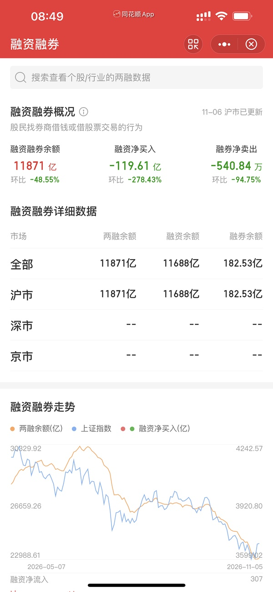
- 五六月刚经历过

### 大连圣亚（提及 13 次，占比 5%）2026-11-09 10:09:24
- 所以大连设置的也非常非常高
- 没想到吧
大连是最差的

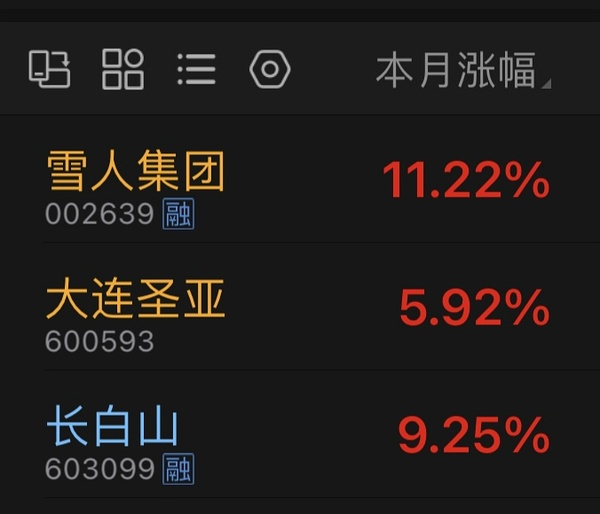
- 大连要触发要逼近涨停了🤣

### 雪人集团（提及 13 次，占比 5%）2026-11-09 11:02:46
- 看来你不是冰雪人
- 雪人如果不触发明天就能开更高的新高价格了

今天如果触发1584 不开涨停单哦
- 嗯
如果雪人和晶雪都触发
我将关闭大连的单子

### 幸福蓝海（提及 12 次，占比 4%）2026-11-09 09:38:46
- 漂亮啊幸福
- 幸福在业绩后就有资金做进攻了！🤣
- 幸福带着幸福降临

### 晶雪节能（提及 9 次，占比 3%）2026-11-09 09:54:30
- 恭喜晶雪补缺口了
全力进攻吧 来个15+看看实力
- 晶雪15+实力看看啊
- 晶雪15+稳如狗不

### 生肖羊概念组（带阳/洋的一篮子：东方海洋/日出东方/大东方/红太阳/澳洋健康/鲁阳节能/华阳国际/东方日升/阳光照明/九阳股份/阳光乳业/沈阳机床）｜11-09 14:04 他自己贴的分组｜**不是单只票，也不是『小羊』襄阳轴承**（提及 6 次，占比 2%）2026-11-09 10:07:49
- 羊
- 我和你一样1511
我去掉了羊来抄底
- 我猜跨年妖股就是那个东方海洋

大消费 农业 东方 羊 超低价 超小市值

所有要素集齐

### 易点天下 301171（对手盘，非他持仓）｜11-06 本月+29.51%（提及 5 次，占比 2%）2026-11-09 09:38:50
- 干翻了奶茶
- 奶茶现在不是被幸福干翻那么简单了
等着被光线也干翻了
- 你看奶茶怎么跳水的
光线有位置优势 周线也是完美无瑕

### 雪人集团 002639（推断）（提及 5 次，占比 2%）2026-11-09 13:56:54
- 何苦呢雪儿 就为了把我们这笔弄出去吗
- 雪儿在和皇台竞争今日换手率的龙虎榜 刚刚开开关关PK掉了阿皇

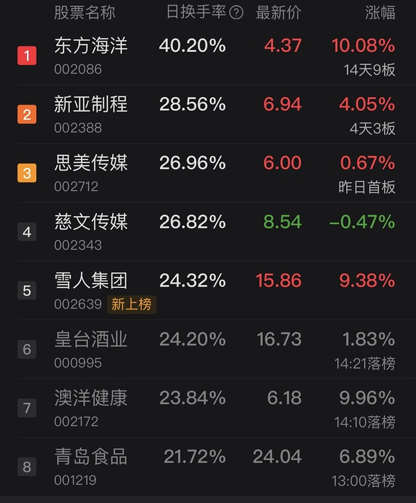
- 雪儿尾盘换手率被皇台反超
丢失了今天龙虎榜位置
傻孩子白忙一天

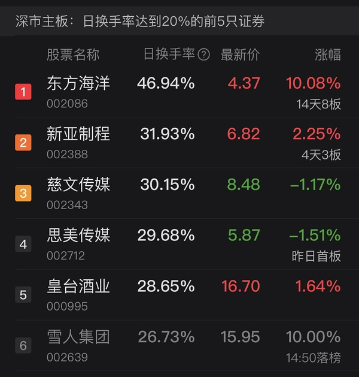

### 友友、网友们（提及 4 次，占比 1%）2026-11-09 10:09:11
- 冰雪越不触发越好
不然uu们很容易后面激情追高
- 楼里uu一直期待冰雪触发

冰雪的每次触发 都会给uu们后续激情追高埋下隐患
- uu你不适合中影
因为你一直会换仓
要找合适自己的票

### 双义：股票=中国长城 / 基金=华安文体健康混合（用户 11-05 指认）（提及 3 次，占比 1%）2026-11-09 08:18:43
- 9:30见

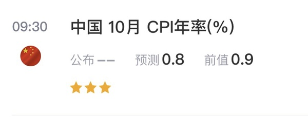
- 点老师一发
我看了一眼
这个就是无敌的🤣🤣🤣🤣

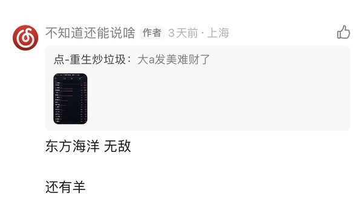
- 之前大组完全没人讨论传媒的
我们多次查看过的
但是现在不一样了

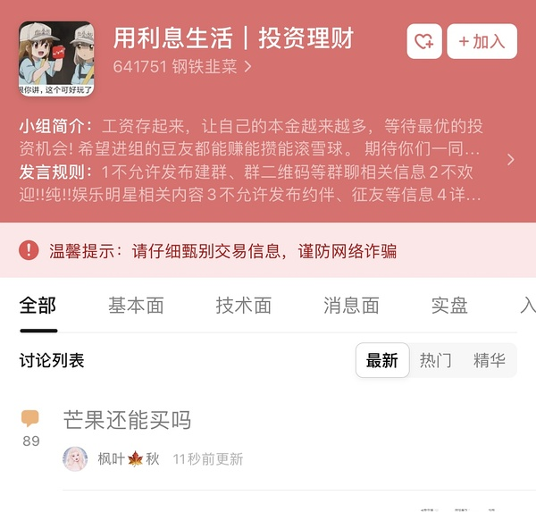

### 芒果超媒（提及 2 次，占比 1%）2026-11-09 09:44:13
- 我给幸福下一个目标
干翻芒果
- 月底芒果不会在前面 老套路😂

### 中文在线（提及 2 次，占比 1%）2026-11-09 14:43:35
- 老师们各种吹传媒 😂😂😂😂
- 老师今天标题就知道说啥了
而且开头就明确了😂😂😂

目前，基于机构筹码结构、未来指数调样和解禁市值三个维度的指标，软科技题材股和微盘股指数上方的阻力要远远小于硬科技（即上半年的光芯存）。

### 浦银安盛全球智能科技(QDII)A（提及 1 次，占比 0%）2026-11-08 08:32:35
- 小浦一个经理退休了

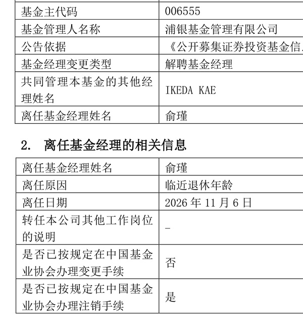

### 建设工业（提及 1 次，占比 0%）2026-11-08 08:35:37
- 😂😂😂😂

AI基建狂潮遭遇现实阻力！欧洲多国爆发抗议 要求暂停数据中心建设

针对数据中心建设的抗议浪潮正在欧洲多地蔓延。当地时间周六，多个国家的民众走上街头，表达对数据中心快速扩张可能带来的能源消耗、环境破坏及社会影响的担忧。

据悉，

### 航空航天板块（提及 1 次，占比 0%）2026-11-09 09:55:43
- 宇航员那个30cm又疯狂了

### 引力传媒 603598（对手盘，非他持仓）｜11-06 +37.15%；11-09 本月+37.79%（提及 1 次，占比 0%）2026-11-09 11:45:48
- 芒果 第一
sy 第三
yl 第四
幸福 第五

等月底再看🤣

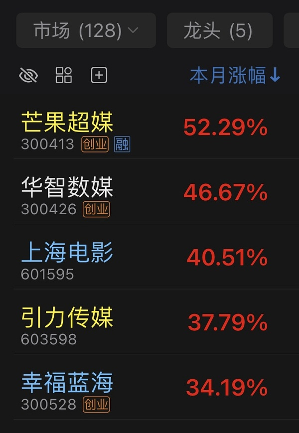

### 上海电影（提及 1 次，占比 0%）2026-11-09 11:46:41
- 不过sy有18%涨幅我们吃到的🤣🤣🤣

### 人：转债估值博主（不是标的）｜11-09 12:48「海哥周五那个新债…我买了点试试看是市场错了还是海哥错了」（提及 1 次，占比 0%）2026-11-09 12:48:37
- 海哥周五那个新债实际与预估差距老大了
我买了点试试看是市场错了还是海哥错了🤣

### 000995 皇台酒业｜11-09 与雪人 PK 当日换手率龙虎榜（提及 1 次，占比 0%）2026-11-09 14:28:43
- 刷换手率笑死 他和皇台PK龙虎榜呢 竞争很激烈
谁换手率高谁入围🤣🤣

### 余利，某牛逼投资者（提及 1 次，占比 0%）2026-11-09 16:15:04
- 余老师今天最后一段和趋势动物 隔空对应了😂😂😂

### 某个特别牛逼的散户（提及 1 次，占比 0%）2026-11-09 16:33:06
- 温暖老师看来也很看好这个赖皮股😂😂😂😂

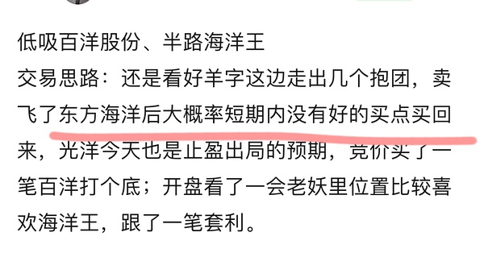

### 北方导航/北方国际（未定，11-04「我在北方了」）（提及 1 次，占比 0%）2026-11-09 17:33:10
- 随着11月北方多地滑雪场陆续开板，新一轮冰雪旅游季正在启动。旅游平台数据显示，今冬冰雪游预订热度已提前释放，热门冰雪航线、亲子机票及度假酒店预订均出现增长，旅游企业也反映，游客咨询时间较往年明显提前。

不过板块内标的整体体量偏小、资金承载

### 605179 一鸣食品｜11-09 10:07 有人问『喝的小明？』他答『羊』＝喝的已换成阳光乳业（提及 1 次，占比 0%）2026-11-09 17:42:42
- 24年东方带火市场情绪后创造了桂发祥 10连板 和小明的12连板彻底嗨翻天

所以结论不对哦 我刚看完

### 📄 全部发言（共 281 条）
- (2026-11-07 08:49:49) 👍厉害啊  ⊳ （引用 @fafa大财）周末拿第一了☝️

- (2026-11-07 08:50:03) [图] 融资盘延续周五传统

- (2026-11-07 09:18:58) 五六月刚经历过  ⊳ （引用 @momo）什么时候我才能经历一回暴涨，我回去复习一下2022了

- (2026-11-07 10:52:27) 我四年前买的招行 32元 股息率3.8% 那时候货币基金2.2-2.5%收益率

现在招行虽然42 但是股息率4.8% 而现在货币基金稳定1.5%都没几个

现在42元的招行可比当年32性价比高多了  ⊳ （引用 @一切都会过去的）红利估值还偏低的😂

- (2026-11-07 10:56:56) 现在也是年少啊🤣因为现在比之前性价比更高啊  ⊳ （引用 @一切都会过去的）年少不知红利好😂

- (2026-11-07 11:41:41) 11月6日，港交所正式发布截至9月30日的前三季度业绩公告。财报显示，港交所前九个月营收、股东利润双双刷新历史同期最高，IPO募资热火朝天成主因。

IPO上市业务方面，前三季度118家（主板116家＋GEM 2家）新公司登陆港交所，合计募资3884亿港元，募资规模同比翻倍，全球排名第二；中际旭创、立讯精密等大批内地科技企业赴港上市，带动上市费收入大涨35%至9.01亿港元。

- (2026-11-07 12:50:07) 真的  ⊳ （引用 @家不住海边）上海没有古茗 （是真古茗
真的假的

- (2026-11-08 08:32:35) [图] 小浦一个经理退休了

- (2026-11-08 08:35:37) 😂😂😂😂

AI基建狂潮遭遇现实阻力！欧洲多国爆发抗议 要求暂停数据中心建设

针对数据中心建设的抗议浪潮正在欧洲多地蔓延。当地时间周六，多个国家的民众走上街头，表达对数据中心快速扩张可能带来的能源消耗、环境破坏及社会影响的担忧。

据悉，来自欧洲15个国家的100多个民间组织和权益团体参与了此次联合行动，抗议能源消耗巨大的数据中心快速扩张，呼吁在建立更加明确的监管制度之前，暂停所有新的大型数据中心项目。据报道，约2000人周六在都柏林参加游行，约1300人在赫尔辛基集会，芬兰多个规模较小的城镇也举行了类似示威活动。  ⊳ （引用 @木感情的打工人）再次感慨，好牛的应用啊，潜力无穷，大家快去探索

- (2026-11-08 15:32:21) 年初远 现在往下回踩过了 明年就贴上了 明年五年线上去不少啊  ⊳ （引用 @木感情的打工人）楼，我这酷酷往灵光搬运笔记，发现年初还在说农行年线乖离率太大了要调整，谁能想到现在更远了？这要是真调整有点吓人啊

- (2026-11-08 15:34:44) 哈哈哈哈哈哈  ⊳ （引用 @moli）真假印度真放一起了

- (2026-11-08 15:35:32) 😂😂😂😂😂😂我记得  ⊳ （引用 @木感情的打工人）话说我还找到了，25年10月写的c50，分三段 2900/2700/2300 打满十笔，均价2640，当时还演绎的挺极端的😂😂😂

- (2026-11-08 16:15:26) 他们锁汇的 本来就没有影响 以后升值也捞不到便宜  ⊳ （引用 @木感情的打工人）楼，现在买美债基金是不是汇率风险很小了🤣

- (2026-11-08 16:29:53) 有的！去下面翻 他有外汇期货锁定合约  ⊳ （引用 @木感情的打工人）易方达不锁吧😨

- (2026-11-08 16:33:51) USD/CNH futures Dec26 

约定在2026年12月26日到期，按到期时离岸人民币汇率现金（或实物）交割的标准化美元兑离岸人民币远期合约

用来锁定汇率，对冲跨境资产/负债的汇率风险
QDII基金、外资北向资金：持有人民币资产，怕人民币贬值、换回美元时亏损 → 做多USD/CNH期货对冲（美元涨、期货赚钱抵消资产汇兑损失）  ⊳ （引用 @木感情的打工人）易方达不锁吧😨

- (2026-11-08 16:46:38) ai这就垃圾了

你自己看看RMB最近一年贬值多少 看看他们基金跌幅多少 而且还是最近一年美债跌成狗的情况下  ⊳ （引用 @木感情的打工人）ai说锁汇工具在，基本没用来锁汇率
变动额太小。报告里期货公允价值变动全年只有约 96 万元，占净值万分之三点五都不到——真要给 25 亿的美元资产对冲汇率，不可能只动这么点。
两份额收益差露馅了。人民币份额近一年约 -5.5%，美元份额同

- (2026-11-08 21:41:17) 据上交所官网消息，集益威半导体（上海）股份有限公司科创板IPO审核状态变更为“已问询”。

- (2026-11-08 22:22:50) 6月都看多科技结局是什么？  ⊳ （引用 @momo）这么多人看空我们的场外

- (2026-11-09 08:18:43) [图] 9:30见

- (2026-11-09 08:21:35) 你看预测还比上个月低😂  ⊳ （引用 @我爱牛肉火锅）等着揭秘国庆拼好假那个数据是不是因为这个了

- (2026-11-09 08:43:39) cpi好 消费基本面加强
cpi差 消费政策预期大
🤣  ⊳ （引用 @点-重生炒垃圾）擦，不会把我满手大消费带崩吧

- (2026-11-09 08:49:03) 两市融资余额较上日减少235.10亿元
截至11月6日，上交所融资余额报11688.37亿元，较前一交易日减少119.61亿元；深交所融资余额报10786.31亿元，较前一交易日减少115.49亿元；两市合计22474.68亿元，较前一交易日减少235.10亿元。

- (2026-11-09 09:25:39) 稳稳的

- (2026-11-09 09:33:13) 爽

- (2026-11-09 09:35:22) 传媒无视利空消息面

- (2026-11-09 09:38:34) 电影+冰雪 稳稳的

- (2026-11-09 09:38:46) 漂亮啊幸福

- (2026-11-09 09:38:50) 干翻了奶茶  ⊳ （引用 @不知道还能说啥）漂亮啊幸福

- (2026-11-09 09:39:40) 不排除15+🤣  ⊳ （引用 @我爱牛肉火锅）幸福今天要20%吗？

- (2026-11-09 09:40:40) 幸福在业绩后就有资金做进攻了！🤣  ⊳ （引用 @我爱牛肉火锅）果然疯得很😂😂😂

- (2026-11-09 09:41:43) 挂第二个单子 17.6涨停一笔减去一部分

- (2026-11-09 09:42:07) 幸福带着幸福降临

- (2026-11-09 09:42:56) 复仇者来了？
流浪地球来了？
消息推送了吗  ⊳ （引用 @小鸡哔哔哔）我给全买了，妈呀原来不是全仓。

- (2026-11-09 09:43:11) 你买的逻辑都没看到  ⊳ （引用 @小鸡哔哔哔）我给全买了，妈呀原来不是全仓。

- (2026-11-09 09:43:56) 直接挂呀  ⊳ （引用 @随便吧）楼楼，回落单还是直接挂呀

- (2026-11-09 09:44:13) 我给幸福下一个目标
干翻芒果  ⊳ （引用 @我爱牛肉火锅）影视传媒全来了

- (2026-11-09 09:46:17) 那肯定的
周五是传统跳水没办法  ⊳ （引用 @木感情的打工人）大连不错

- (2026-11-09 09:47:20) [图] 幸福高居本月第五名传媒

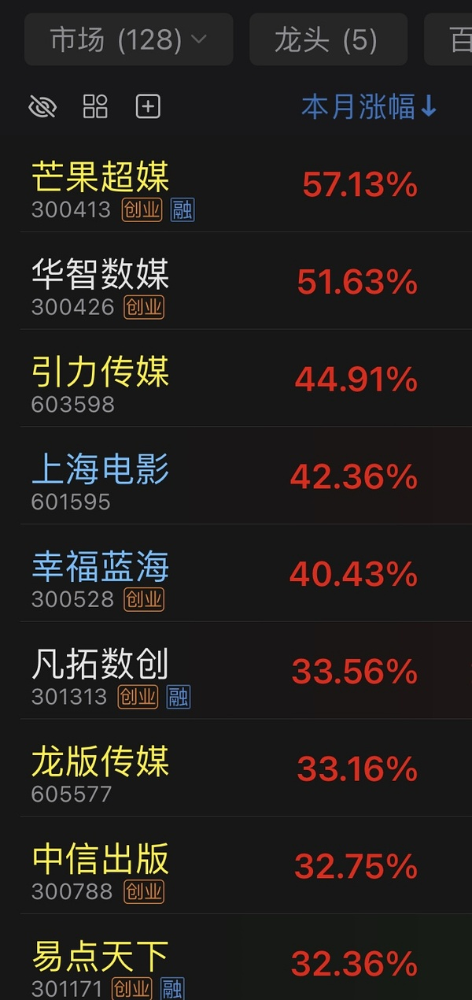

- (2026-11-09 09:48:07) 那我和你不一样
我给了光线  ⊳ （引用 @西西西西）紧急把s掉的幸福给奶茶了 奶茶冲！

- (2026-11-09 09:48:40) gx同路了 中影我买够了  ⊳ （引用 @该用户已过期）我反手去了中影和光线🤣🤣今天不太中用啊他俩

- (2026-11-09 09:50:00) 都是自己的钱 要用心啊 你还不熟悉都是收盘就给的吗  ⊳ （引用 @momo）冰雪有条件单吗

- (2026-11-09 09:52:50) 月底芒果不会在前面 老套路😂  ⊳ （引用 @哄哄🐮）😀还有10多个点就能干倒芒果了

- (2026-11-09 09:53:36) 接下来冰雪发力

- (2026-11-09 09:54:30) 恭喜晶雪补缺口了
全力进攻吧 来个15+看看实力

- (2026-11-09 09:55:43) 宇航员那个30cm又疯狂了  ⊳ （引用 @点-重生炒垃圾）总算跟上光线了

- (2026-11-09 09:57:23) 中影：一群傻东西 现在装逼 下半月又要都不行了

- (2026-11-09 09:58:16) 幸福属于等待幸福的人

- (2026-11-09 09:58:56) 从没放弃过幸福 幸福终会降临  ⊳ （引用 @不知道还能说啥）幸福属于等待幸福的人

- (2026-11-09 09:59:11) 稳稳的 🤣  ⊳ （引用 @赛博朋克2077）幸福我条件单都关了直接挂涨停的，不要辜负我

- (2026-11-09 09:59:50) 科技有我们电影冰雪涨的好吗

- (2026-11-09 10:00:38) 晶雪15+实力看看啊

- (2026-11-09 10:01:00) 我有吃喝各一个
吃的大家知道  ⊳ （引用 @木感情的打工人）本月继续这俩吗，吃喝老家回不回

- (2026-11-09 10:02:49) 吃喝不够强啊暂时  ⊳ （引用 @木感情的打工人）我没来得及吃喝

- (2026-11-09 10:05:09) 如果幸福打20 光线资金也很容易被激活 不着急

- (2026-11-09 10:07:49) 羊  ⊳ （引用 @一直在摸🐟）喝的小明？

- (2026-11-09 10:09:11) 冰雪越不触发越好
不然uu们很容易后面激情追高

- (2026-11-09 10:09:24) 所以大连设置的也非常非常高  ⊳ （引用 @不知道还能说啥）冰雪越不触发越好
不然uu们很容易后面激情追高

- (2026-11-09 10:10:44) 你们为什么盘后都不设置的
15:00结束你记忆都还在也不会干扰消息面  ⊳ （引用 @桑尼菌）雪人有条件单吗

- (2026-11-09 10:12:27) 奶茶现在不是被幸福干翻那么简单了
等着被光线也干翻了

- (2026-11-09 10:12:52) 差20%对于光线来说和2%没啥区别  ⊳ （引用 @不知道还能说啥）奶茶现在不是被幸福干翻那么简单了
等着被光线也干翻了

- (2026-11-09 10:13:19) 我上周已经开始买了
过60日线压制就去了  ⊳ （引用 @木感情的打工人）楼，那个光线你有底仓嘛

- (2026-11-09 10:15:19) 今天是
盘后可能会修改  ⊳ （引用 @好起来了）大连还是44.39 一笔s嘛

- (2026-11-09 10:16:13) 🤣🤣🤣🤣🤣🤣重要的是钱去了哪里  ⊳ （引用 @稀里不糊涂）谢谢楼，指南针亏的钱终于在xf手里拿回来了🥹🥹感动

- (2026-11-09 10:17:00) [图] 微盘股大幅度跳水

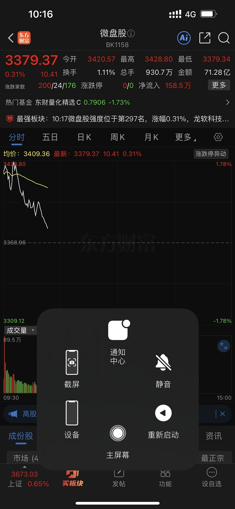

- (2026-11-09 10:20:08) 专业👍

幸福不划在短剧里  ⊳ （引用 @点-重生炒垃圾）【AI漫剧概念震荡拉升 文投控股涨停】AI漫剧概念震荡拉升，文投控股涨停，昆仑万维涨超10%，掌阅科技、海看股份、荣信文化、欢瑞世纪跟涨。

- (2026-11-09 10:21:43) 要贴五日线🤣🤣🤣🤣  ⊳ （引用 @momo）今天中影为什么不嗨

- (2026-11-09 10:22:20) 一直都不一样 只是今天？  ⊳ （引用 @红烧肉肉）ZY今天怎么和其他电影都不一样...

- (2026-11-09 10:22:57) 十日线安全度高  ⊳ （引用 @点-重生炒垃圾）踩五日线买安全吗？

- (2026-11-09 10:24:30) [图] 电池 半导体设备 光伏 地产末尾

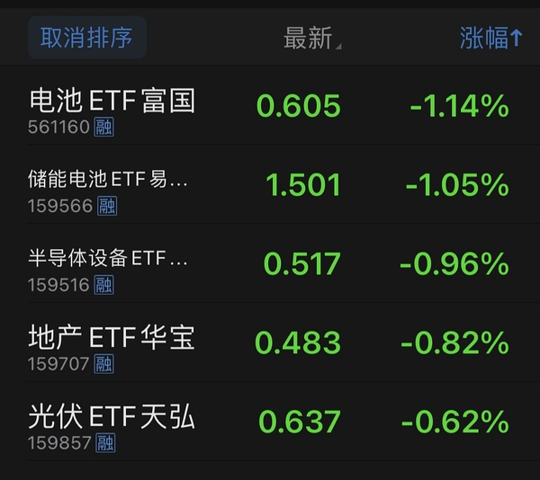

- (2026-11-09 10:28:09) 今天那笔已经在光线了
如果涨停S 是还给幸福  ⊳ （引用 @城事）楼楼幸福出来的钱还给幸福吗？

- (2026-11-09 10:33:26) 这次美股下跌
让场内ETF溢价率又上了一个台阶  ⊳ （引用 @🅰失而复🉐😎）还以为咋了呢🫠

- (2026-11-09 10:38:13) 这个不用看 这个情绪plus
自己贪心就要 不贪心就加大另外三个仓位足矣  ⊳ （引用 @momo（富姐版））你们啥时候去的晶雪  我缺课了？？

- (2026-11-09 10:38:39) 人家贴线走的
不会被市场扰乱走势  ⊳ （引用 @云水河西）牛又老丝儿，这是什么意思

- (2026-11-09 10:39:22) 那说明你根本不贪
上周机会都有  ⊳ （引用 @momo（富姐版））显然我是贪心的人 等个机会

- (2026-11-09 10:44:54) 中影五周线15.02 十日线15.1

- (2026-11-09 10:52:08) 我和你一样1511
我去掉了羊来抄底  ⊳ （引用 @该用户已过期）15.11隔空成交🤣🤣

- (2026-11-09 10:53:29) 不如留给明天 直接冲击大阴线  ⊳ （引用 @木感情的打工人）大连我懂你，你在等指数变绿再异军突起对吧😂

- (2026-11-09 10:55:49) [图] 你们不关注的吗

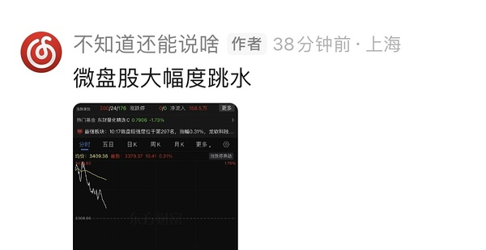  ⊳ （引用 @家不住海边）怎么回事啊

- (2026-11-09 10:57:08) 牛奶啊🥛  ⊳ （引用 @🅰失而复🉐😎）羊是谁

- (2026-11-09 10:58:48) [图] 40分钟前的

  ⊳ （引用 @momo）怎么突然跳如水了 特别是这个zy

- (2026-11-09 10:59:15) 然而冰冰最喜欢这种局面

- (2026-11-09 10:59:28) 别人跳水 我疯狂  ⊳ （引用 @不知道还能说啥）然而冰冰最喜欢这种局面

- (2026-11-09 11:01:30) 我猜跨年妖股就是那个东方海洋

大消费 农业 东方 羊 超低价 超小市值

所有要素集齐

- (2026-11-09 11:02:30) 接近16就S了  ⊳ （引用 @momo）楼这笔zy有条件单嘛

- (2026-11-09 11:02:46) 看来你不是冰雪人  ⊳ （引用 @momo）好了绿了，老实了

- (2026-11-09 11:05:08) 别忘了周五收盘我们说的哈

今天是冰雪带队账户🤣🤣🤣

电影有幸福超预期表现了哈哈

- (2026-11-09 11:05:28) 漂亮漂亮  ⊳ （引用 @不知道还能说啥）别忘了周五收盘我们说的哈

今天是冰雪带队账户🤣🤣🤣

电影有幸福超预期表现了哈哈

- (2026-11-09 11:05:45) 晶雪15+稳如狗不  ⊳ （引用 @🅰失而复🉐😎）⛄来了涨停一半

- (2026-11-09 11:06:08) 冰雪 电影 互相帮助 无敌十一月

- (2026-11-09 11:07:13) 那你慢了
我开盘就去了🤣🤣🤣🤣🤣  ⊳ （引用 @小鸡哔哔哔）买一手玩一玩

- (2026-11-09 11:08:47) 中影应该是传媒的提示🤣🤣🤣🤣  ⊳ （引用 @我爱牛肉火锅）这一周冰雪能不能你追我赶 谁也别输谁

- (2026-11-09 11:10:05) [图] 点老师一发
我看了一眼
这个就是无敌的🤣🤣🤣🤣

  ⊳ （引用 @冬天他一定会来）之前看好多抖音博主也在说这个是跨年腰鼓

- (2026-11-09 11:12:26) 你看奶茶怎么跳水的
光线有位置优势 周线也是完美无瑕  ⊳ （引用 @该用户已过期）倍被幸福冲昏了头脑，还同时去了光线，今天被狠狠背刺🤣🤣

- (2026-11-09 11:13:41) 恒生科技指数翻绿，盘初一度涨近2％。美团下滑近5％领跌，零跑汽车、比亚迪股份、比亚迪电子、小米集团走软。

- (2026-11-09 11:14:10) 楼里uu一直期待冰雪触发

冰雪的每次触发 都会给uu们后续激情追高埋下隐患  ⊳ （引用 @有人区生菜）还是得慢一点，慢一点…我也好多次追进去被毒打

- (2026-11-09 11:15:56) [图] 没想到吧
大连是最差的

  ⊳ （引用 @我爱牛肉火锅）雪人和大连好像杠上了

- (2026-11-09 11:17:02) 现在人人都看好传媒
我是撤退的 

我和大家一样 冰雪更多  ⊳ （引用 @11）啥 都要回踩一下的提示吗

- (2026-11-09 11:18:00) 一群傻缺😂😂😂  ⊳ （引用 @点-重生炒垃圾）周末各种建议，高配港股低配美股

- (2026-11-09 11:19:35) 我有电影 我逻辑不是短剧  ⊳ （引用 @we）传媒不是好早就清仓了嘛

- (2026-11-09 11:23:15) 雪人如果不触发明天就能开更高的新高价格了

今天如果触发1584 不开涨停单哦

- (2026-11-09 11:24:01) 光伏本月很牛逼啊  ⊳ （引用 @momo）五分之一冰雪人，二分之一光伏人（苦笑🥲）

- (2026-11-09 11:24:41) 你们没发现那么牛逼的多因素

到现在还没涨停吗😂😂😂😂😂😂😂  ⊳ （引用 @梳碧湖砍柴人）看到这买一手

- (2026-11-09 11:28:12) 别两个都触发🤣🤣🤣🤣🤣触发一个没事  ⊳ （引用 @一直在摸🐟）ball ball☃️不要触发

- (2026-11-09 11:28:39) 大连要触发要逼近涨停了🤣  ⊳ （引用 @一直在摸🐟）ball ball☃️不要触发

- (2026-11-09 11:28:57) 1584也接近今天涨停了  ⊳ （引用 @赛博朋克2077）这样的话我直接撤掉条件单等明天了😂

- (2026-11-09 11:29:49) 我晶雪是15%涨幅回落 到15+肯定会触发卖出了

- (2026-11-09 11:30:59) 就上周加仓的一笔
我有三笔
不会

冰雪才刚刚开始  ⊳ （引用 @赛博朋克2077）全部卖嘛

- (2026-11-09 11:32:45) 嗯
如果雪人和晶雪都触发
我将关闭大连的单子  ⊳ （引用 @🅰失而复🉐😎）清仓？

- (2026-11-09 11:37:20) [图] 绿在周五不灰心 下周再来 ☑️
上周最后都靠电影 本周靠冰冰 ☑️

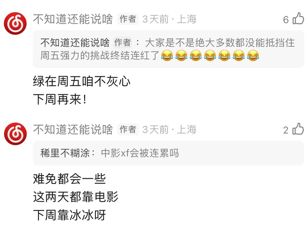

- (2026-11-09 11:39:04) 短期内估计没机会舒服拿了😂😂暂时放弃了  ⊳ （引用 @点-重生炒垃圾）sy懂事点，这周五周线贴贴，贴贴是不是不好，双头没化解？

- (2026-11-09 11:40:10) 如果一到四都红 周五绿一点无所谓了 就当是献祭了🤣  ⊳ （引用 @我爱牛肉火锅）周一翻倍还我了，我原谅它

- (2026-11-09 11:42:04) 😂😂😂😂😂😂😂😂😂
雪人已经连续两个周五尾盘跳水（在这之前的我也不知道 持有后连着两个周五尾盘大跳）  ⊳ （引用 @我爱牛肉火锅）冰雪比我先找到上四休三的工作了

- (2026-11-09 11:45:48) [图] 芒果 第一
sy 第三
yl 第四
幸福 第五

等月底再看🤣

- (2026-11-09 11:46:41) 不过sy有18%涨幅我们吃到的🤣🤣🤣  ⊳ （引用 @不知道还能说啥）芒果 第一
sy 第三
yl 第四
幸福 第五

等月底再看🤣

- (2026-11-09 11:52:25) 如果明天开盘比如光线-1 幸福-5那种
我还是会反切回来的
幸福优先级肯定高于光线 光线还没看到过10+

- (2026-11-09 12:11:25) 我们摄像师已经埋伏一个游戏票博中国队夺冠lol炒电竞了😂😂😂😂😂😂😂😂😂

- (2026-11-09 12:12:59) 非电影传媒就留给大家玩了

我一个都不会碰了🤣  ⊳ （引用 @只想搞钱）周五计划是冲高卖ycm，一看低开又性情买上了🥲

- (2026-11-09 12:16:22) 我也是 大幅超越周四收益  ⊳ （引用 @只想搞钱）翻倍！好厉害，我才刚回🤣

- (2026-11-09 12:18:26) 今天幸福表现了 后面中影表现🤣🤣🤣🤣  ⊳ （引用 @木感情的打工人）牛啊，我上周四跟今天差不多🤣

- (2026-11-09 12:21:30) 怎么可能
只有大Ａ喜欢炒垃圾  ⊳ （引用 @点-重生炒垃圾）买啥，哔哩哔哩？

- (2026-11-09 12:25:24) 游戏哥哥本来也是ai应用啊 如果有消息面刺激爆发确实有可能  ⊳ （引用 @西西西西）那是真的博个大的了

- (2026-11-09 12:29:58) 今天进决赛了  ⊳ （引用 @点-重生炒垃圾）哈哈哈我特地查了，滔搏是不是进四强了，止步八强

- (2026-11-09 12:39:35) 我和他说了
买什么10cm的 博20cm的呀🤣🤣🤣🤣🤣🤣🤣  ⊳ （引用 @木感情的打工人）这么牛批的结果，还埋伏什么游戏股，直接游戏etf，概念：游戏领域印度起韩国落🤣🤣🤣

- (2026-11-09 12:43:05) 晶雪就是强化他的🤣🤣🤣🤣🤣  ⊳ （引用 @🅰失而复🉐😎）死冰山又不做人，开盘就涨停😵

- (2026-11-09 12:45:43) [图] 但是涨幅也就那样

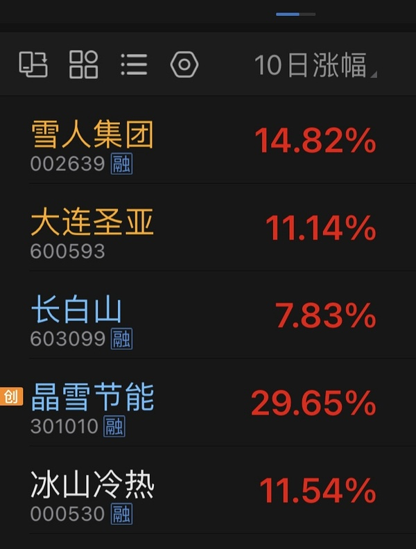  ⊳ （引用 @点-重生炒垃圾）怎么冰山还是老大🤣🤣🤣

- (2026-11-09 12:47:11) 先其他6巨头轮番表演

英伟达等到17号财报后反攻  ⊳ （引用 @点-重生炒垃圾）不会跌一串再涨吧

- (2026-11-09 12:48:37) 海哥周五那个新债实际与预估差距老大了
我买了点试试看是市场错了还是海哥错了🤣

- (2026-11-09 12:57:40) 我没看😂😂😂😂  ⊳ （引用 @🅰失而复🉐😎）去？

- (2026-11-09 12:58:53) 今天的中影挂单15.84
盘后也延续这个条件单

- (2026-11-09 13:07:09) 吗的债券又拉红了
场外加仓机会都不给

- (2026-11-09 13:09:30) 漂亮晶雪 别扭

- (2026-11-09 13:09:46) 大连我先关了

- (2026-11-09 13:10:00) 晶雪 雪人肯定会触发 我关掉大连  ⊳ （引用 @不知道还能说啥）大连我先关了

- (2026-11-09 13:10:25) 晶雪触发了 爽卖在17.5%  ⊳ （引用 @不知道还能说啥）晶雪 雪人肯定会触发 我关掉大连

- (2026-11-09 13:10:52) 大盘跳水
冰冰吃饱

- (2026-11-09 13:11:00) 我大连关了反正  ⊳ （引用 @仓部加措）雪人没扭！

- (2026-11-09 13:11:44) 冰山算个毛啊
你能20吗

- (2026-11-09 13:12:28) 太爽了  ⊳ （引用 @.）太爽了

- (2026-11-09 13:12:35) bdd火箭发射

- (2026-11-09 13:13:49) 大连讲究的
我们本来4439 他4438 也在阻止我们触发？🤣

- (2026-11-09 13:14:03) 然后直接封板  ⊳ （引用 @不知道还能说啥）大连讲究的
我们本来4439 他4438 也在阻止我们触发？🤣

- (2026-11-09 13:14:43) 然后直接拉板  ⊳ （引用 @冬天他一定会来）过了

- (2026-11-09 13:15:11) 冬天他一定会来

- (2026-11-09 13:15:26) 我们做了最确定的东西  ⊳ （引用 @不知道还能说啥）冬天他一定会来

- (2026-11-09 13:16:04) 是的
但我关闭了大连
雪人如果开会自动s一笔  ⊳ （引用 @momo）楼主晶雪触发条件单清仓了吗

- (2026-11-09 13:16:54) 没触发啊 开班才会

你们妞出去了？  ⊳ （引用 @山中食人花）楼 你大连关了 雪人还是触发了吧 ？

- (2026-11-09 13:17:55) 👍👍👍👍👍👍👍👍👍  ⊳ （引用 @扶我起来还能买）楼楼太感谢你了 周五看到你说大连锁仓后 尾盘我就放心多捞了 今天出掉后仓位和你保持一致啦

- (2026-11-09 13:20:07) 大连4
雪人3
cbs2  ⊳ （引用 @🧋今天25了吗）雪人现在一共b几笔了呀

- (2026-11-09 13:20:58) 让大家去吹传媒吧
6月也不知道他们在哪里

我们反正冰雪  ⊳ （引用 @🅰失而复🉐😎）这封单还能开板啊，除非被大盘连累

- (2026-11-09 13:21:58) 👍👍👍👍高级转换  ⊳ （引用 @Aaa摆烂咸鱼🥳）我只卖了一点雪人，给了bdd

- (2026-11-09 13:22:51) 那你比我牛逼
我17.5%触发了S🤣🤣🤣  ⊳ （引用 @一一）大连取消条件单，雪人开板才会s，晶雪板上清仓了，对吧 我都跟上了

- (2026-11-09 13:24:38) 哈哈我不知道

我设置的15%回落卖出来着  ⊳ （引用 @Aaa摆烂咸鱼🥳）楼，晶雪我就500股可以不动吗，贪了😂

- (2026-11-09 13:25:46) 差不多45左右 电影30+  ⊳ （引用 @momo）楼现在冰雪多少仓位啊

- (2026-11-09 13:26:35) 等以后中影牛逼的时候
就别说中影不接人了
他一直在接人

- (2026-11-09 13:28:45) 要在市场反攻
情绪亢奋
冰雪坠楼的时候  ⊳ （引用 @🅰失而复🉐😎）楼啥时候再去晶说一声哈😏

- (2026-11-09 13:29:58) 等盘后

而且有可能是做中转站  ⊳ （引用 @咔叽咪）楼，今天光线的条件单设多少呢？

- (2026-11-09 13:30:20) 你的问题不适用我

我还没出去  ⊳ （引用 @你是咸的美式吗）楼大连和雪人今天出去的计划什么价格接啊

- (2026-11-09 13:30:33) 可以回调再第二波啊  ⊳ （引用 @木感情的打工人）东方海洋14天8板了。。这要是跨年妖，准备板到过年吗

- (2026-11-09 13:32:15) 笑死 终于板上了😂  ⊳ （引用 @木感情的打工人）哦哦看到了他在尝试突破两年前的超级大上影线

- (2026-11-09 13:32:45) 大连现在也有差价啊哈哈  ⊳ （引用 @你是咸的美式吗）没注意条件单，哐哐哐出去好多🥲

- (2026-11-09 13:34:43) uu你不适合中影
因为你一直会换仓
要找合适自己的票  ⊳ （引用 @只想搞钱）我也是看着这图都想笑

- (2026-11-09 13:35:50) 原来是这样😂😂  ⊳ （引用 @sickid）今天寒王在发达难财？

- (2026-11-09 13:38:15) 李经理那条点赞那么多啊
不贪心就这个价格  ⊳ （引用 @不知道还能说啥）今天的中影挂单15.84
盘后也延续这个条件单

- (2026-11-09 13:39:40) 😂😂😂😂😂😂不吓人
中影不是垃圾小票 接近300亿市值的哈哈  ⊳ （引用 @木感情的打工人）19个人，吓不吓人

- (2026-11-09 13:41:01) 好了 雪人S了一笔

- (2026-11-09 13:43:25) 雪人五日线回接
今天也是明天也是

- (2026-11-09 13:43:53) 大家别忘了
雪人上周教过大家 五日线是浮动的哦🤣  ⊳ （引用 @不知道还能说啥）雪人五日线回接
今天也是明天也是

- (2026-11-09 13:46:03) 明天要差不多加3毛  ⊳ （引用 @🅰失而复🉐😎）今天是14.81

- (2026-11-09 13:47:23) 里面资金有强迫症 今天强制回踩😅😅😅😅  ⊳ （引用 @暴富¥(´･ᴗ･`)$）zy要站回5日线

- (2026-11-09 13:48:12) 晶雪回封20

- (2026-11-09 13:50:23) [图] 我呀
我买了133多

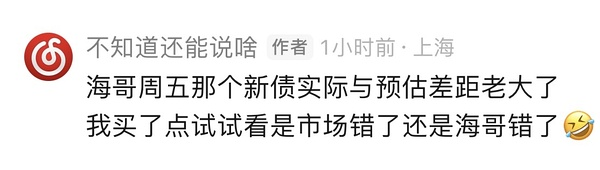  ⊳ （引用 @六倍做多退休）有人今天早上去海哥的申菱转债吗 这个好像也是送钱的 海哥预估150多

- (2026-11-09 13:53:32) 我没有盆
我就买了150张 试试看😂  ⊳ （引用 @六倍做多退休）厉害啊  真拿盆接

- (2026-11-09 13:56:54) 何苦呢雪儿 就为了把我们这笔弄出去吗

- (2026-11-09 13:59:17) 没事 我会有其他策略  ⊳ （引用 @lacey）看样子真是这么回事儿🫠🫠

- (2026-11-09 14:00:16) [图] 中影要加油啊 我转换要亏了😂

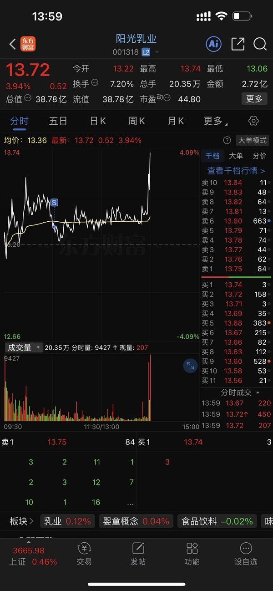  ⊳ （引用 @点-重生炒垃圾）纳纳期货要是绿了，就可以买我金字塔第二层400了

- (2026-11-09 14:01:20) 锁仓大连就行  ⊳ （引用 @爱拔酱）比如说？

- (2026-11-09 14:01:33) 我上周五早上机器人都清掉了  ⊳ （引用 @桔气冲天）楼Asd怎么操作今 好像没有变化是吧

- (2026-11-09 14:04:13) [图] 我周末终于把那批东西放到了一个组 方便看炒垃圾情绪😂😂

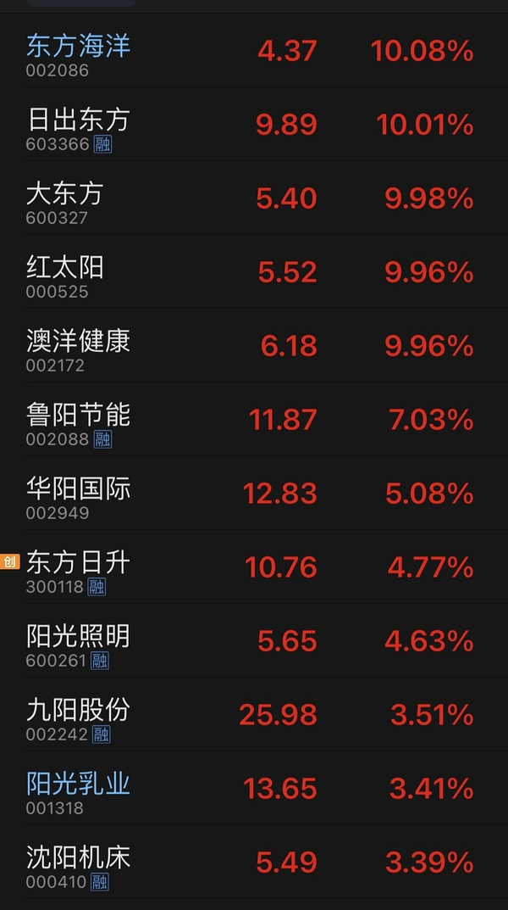

- (2026-11-09 14:04:53) 你可以把bdd加入备选  ⊳ （引用 @有人区生菜）☃️还有能接回来的风险吗

- (2026-11-09 14:05:02) 👍👍👍👍👍👍  ⊳ （引用 @momo）我接了

- (2026-11-09 14:06:16) 谢谢 漏了
那个在我的海洋经济分组里 忘记复制过来了哈哈哈  ⊳ （引用 @生动的羊）海洋王呢

- (2026-11-09 14:09:27) 周五我害怕午后大跳水😂
今天早上机器人都是高开
我拿不回来
不是不看好机器人
你们自己看  ⊳ （引用 @桔气冲天）好收到，旅游没跟上

- (2026-11-09 14:11:05) 今天时间过得有点慢啊
居然还有40分钟😂

- (2026-11-09 14:17:10) 在下面呢 他涨幅小 出现不了图里  ⊳ （引用 @momo）泉阳泉不算吗

- (2026-11-09 14:18:46) 早上买奶茶你看看要亏多少  ⊳ （引用 @该用户已过期）骂光线吧

- (2026-11-09 14:20:27) 记住这是你无可奈何的选择
有3+1可选 都不会去买它  ⊳ （引用 @Slow）002878吗

- (2026-11-09 14:21:39) 在冰雪呢消费  ⊳ （引用 @只想搞钱）一鸣被五日线压下去了，这波消费好弱，都没连板的

- (2026-11-09 14:23:29) [图] 雪儿在和皇台竞争今日换手率的龙虎榜 刚刚开开关关PK掉了阿皇

- (2026-11-09 14:24:03) 20  ⊳ （引用 @梳碧湖砍柴人）➕1是谁

- (2026-11-09 14:24:32) 冰雪现在是不是太晚了？  ⊳ （引用 @梳碧湖砍柴人）奥，20现在去会不会太晚了

- (2026-11-09 14:28:43) 刷换手率笑死 他和皇台PK龙虎榜呢 竞争很激烈
谁换手率高谁入围🤣🤣  ⊳ （引用 @一直在摸🐟）雪儿开开关关玩呢

- (2026-11-09 14:29:22) 没有啊…...  ⊳ （引用 @想喝冰淇淋红茶）海洋王楼楼也买了吗

- (2026-11-09 14:29:55) 这个组涉及市场炒作的情绪 今天良好  ⊳ （引用 @想喝冰淇淋红茶）海洋王楼楼也买了吗

- (2026-11-09 14:32:16) 上周买的  ⊳ （引用 @想当富有的咸鱼）这个雪人的3是今天五日线B了之后的吗

- (2026-11-09 14:32:51) 笑死
这个也很麻烦 他有传媒的属性
万一传媒后面杀有干扰😂😂😂😂😂
不到万不得已 我不去  ⊳ （引用 @葱）果不其然bdd是最难解密的😂

- (2026-11-09 14:33:27) 😂😂😂真的嘛 我去看看咋回事  ⊳ （引用 @康贝瑞拉）楼楼挑的纳指etf是今天纳指里唯一一个红的耶

- (2026-11-09 14:34:19) 确实哎
不愧是513300
当年的普通nana ETF之王！！！  ⊳ （引用 @康贝瑞拉）楼楼挑的纳指etf是今天纳指里唯一一个红的耶

- (2026-11-09 14:36:35) 大连获得过一次奖励的🤣🤣🤣🤣  ⊳ （引用 @想当富有的咸鱼）没想到CBS笔数反而落后了，大连真的又争又抢

- (2026-11-09 14:37:45) [图] 😂😂😂😂😂😂

- (2026-11-09 14:39:59) 下去了还会上来🤣  ⊳ （引用 @赛博朋克2077）今天减仓传媒算了，吓人

- (2026-11-09 14:43:12) 刷龙虎榜  ⊳ （引用 @点-重生炒垃圾）雪人在干嘛，我害怕烂板

- (2026-11-09 14:43:35) 老师们各种吹传媒 😂😂😂😂  ⊳ （引用 @该用户已过期）原来中文老师也回落了10个点

- (2026-11-09 14:45:10) 按照这个涨停收盘
明天雪人五日线将上行到15.21了

- (2026-11-09 14:46:01) 夜盘  ⊳ （引用 @六倍做多退休）老师们 请教一个问题 现在这三个数据 哪个数据是实时的😂

- (2026-11-09 14:47:07) 有时候他们想让你看龙虎榜
想让你获取信息  ⊳ （引用 @momo）差生提问啥意思

- (2026-11-09 14:47:40) [图] 你看右侧有时间🤣

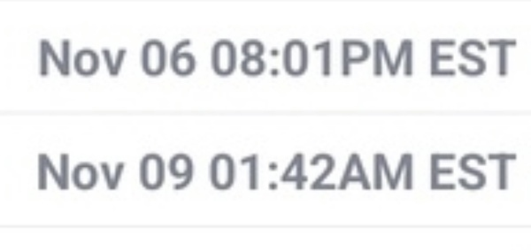  ⊳ （引用 @六倍做多退休）老师们 请教一个问题 现在这三个数据 哪个数据是实时的😂

- (2026-11-09 14:48:30) 是的
大连cbs才刚刚开始
而且今年启动很晚
也许还能搭配春节旅游档期  ⊳ （引用 @我爱牛肉火锅）不会，你跟楼比例现在不是一样吗？大连可能会偷懒但从不缺席的吧，冰雪还没疯起来吧（个人想法）

- (2026-11-09 14:49:28) 周五也是
就是方向不一样🤣  ⊳ （引用 @🅰失而复🉐😎）大连尾盘战神😎

- (2026-11-09 14:51:38) 无所谓😂😂😂😂😂
大连火箭发射是最重要的  ⊳ （引用 @🅰失而复🉐😎）你滴东方炸了，哈哈哈😂

- (2026-11-09 14:52:49) 撤了更希望他涨了  ⊳ （引用 @木感情的打工人）但是条件单不是撤了吗

- (2026-11-09 14:53:20) 是的
回到50那边前高再来看  ⊳ （引用 @鹿凛）楼主，如果我白天没时间看盘，是不是可以直接锁仓大连和cbs，感觉这么拿着不动也行

- (2026-11-09 14:54:17) 你看我也差不多只交易雪儿
大连cbs基本只买没卖过  ⊳ （引用 @鹿凛）楼主，如果我白天没时间看盘，是不是可以直接锁仓大连和cbs，感觉这么拿着不动也行

- (2026-11-09 14:55:07) 羊资金部分兑现跑路了🤣  ⊳ （引用 @游游）阳光照明你😓

- (2026-11-09 14:55:48) 他自己没事
把很多后排羊干翻了  ⊳ （引用 @🅰失而复🉐😎）一手的威力😇

- (2026-11-09 14:56:50) 幸福18.44 接下来都开这个

大连47.74（雪人接回来才开 不然锁仓）
cbs继续锁仓

- (2026-11-09 14:59:27) 有啊
大跌特跌就买
cbs那两笔我也可以给cbs我也可以给大连  ⊳ （引用 @果木香烤鸡腿堡）大连和cbs还有买的计划吗 等科技反攻的时候？

- (2026-11-09 15:01:14) [图] 雪儿尾盘换手率被皇台反超
丢失了今天龙虎榜位置
傻孩子白忙一天

- (2026-11-09 15:03:38) 不是

明天雪儿五日线会自动提高到15.2那边的
你别看现在的五日线

明天会去掉3号价格重新计算五日线的🤣

差不多-4%附近大家就得接了  ⊳ （引用 @叁仟世界鸦杀。）我才加了一毛 赶紧重新设置

- (2026-11-09 15:04:59) uu看来也刷新周四时候的收益率了🤣  ⊳ （引用 @momo）🥺🥺今天创本月最高收益，冰雪电影接下来再接再厉

- (2026-11-09 15:11:02) 这个不敢了 五日线圆弧形大拐弯😂  ⊳ （引用 @游游）仇人见了都释怀了😭

- (2026-11-09 15:12:02) [图] 确实
中影率先给了提示

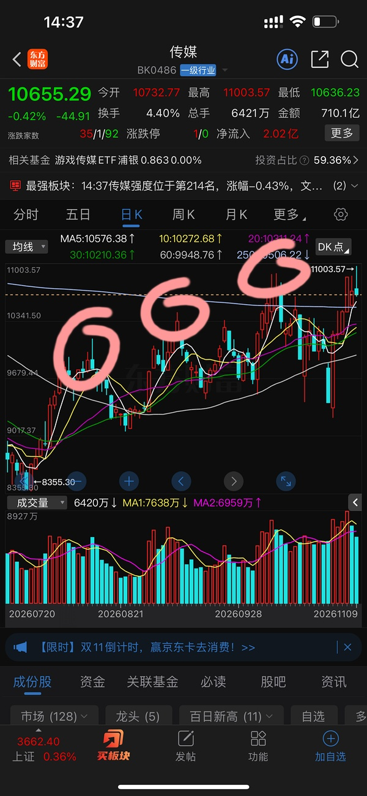  ⊳ （引用 @点-重生炒垃圾）温暖老师方向还是几个不变，短剧AI、机器人、医药、航天、消费、玄学老几样，新加入的光伏新能源，以及老老周日农业也开始走强加入战局，后面继续在这些里面轮动。
稍微注意下节奏的事短剧AI，高位几个连续多日冲高回落走势，加上场外干扰有点大，这条线

- (2026-11-09 15:20:22) [图] 推荐不了
因为我最心仪的每天只能买1000🤣
这次很多低波动的也遭遇了10/30日灾难性考验
值得你重新挖掘更好的
你可以关注这个 打开额度了也叫叫我

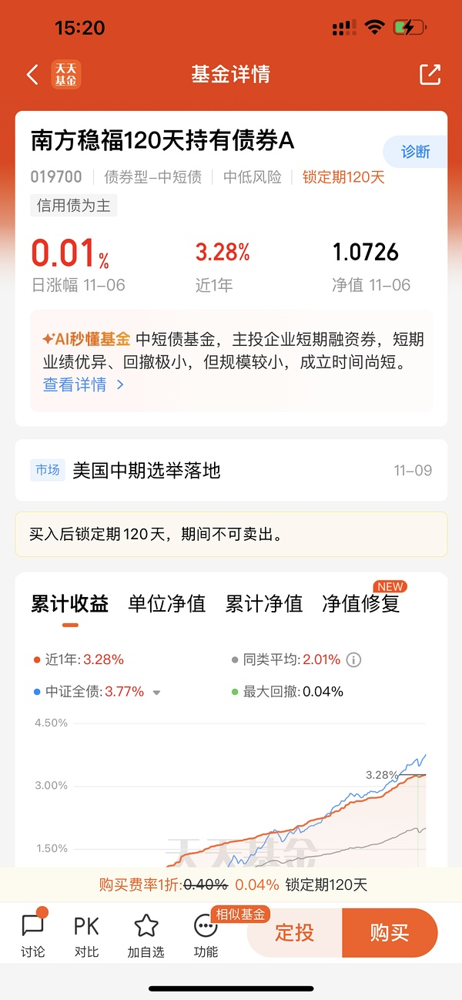  ⊳ （引用 @青唐）最近有笔小钱，a买完了美国也买完了，打算买买债。
楼楼之前说买中债是买哪个来着？还教了找中债的方法，有没有学霸uu有笔记借我学习一下，ballball了！😁😁😁

- (2026-11-09 15:20:53) 两者的比价  ⊳ （引用 @速派女孩将发财）这个偏离值怎么看呀 我没学懂

- (2026-11-09 15:23:57) [图] 以前这个gzh会更新的
现在不更新了
你们喂给ai试试看 让ai做

之前他们这么做的
我们精选A股47家北美算力链龙头（光模块、PCB、光纤光缆等方向）与41家国产算力链龙头（半导体产业链、存储等方向)，分别构建“北美算力链”与“国产算力链”指数，以观察算力行情内部的轮动情况和相对性价比。此前一轮AI硬件行情中（4-6月），国产算力链是引领行情的主力。北美算力链与国产算力链的比价最低回到了去年6月初、北美算力链大行情开始时的位置。而8月以来AI产业链的修复中，北美算力链开始领跑。两者比价目前仍在去年7月、今年2月时的低位。

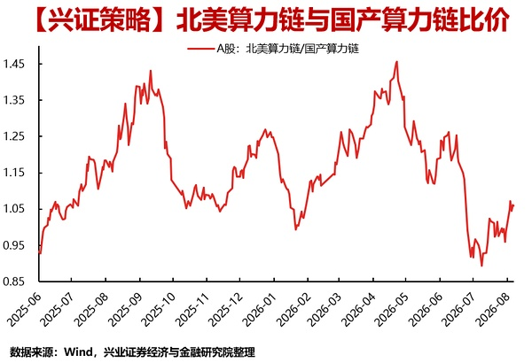  ⊳ （引用 @速派女孩将发财）这个偏离值怎么看呀 我没学懂

- (2026-11-09 15:27:05) 确实和硬件没有什么瓜葛
今天我图都贴主楼了哈哈哈  ⊳ （引用 @vio）小远0.76

- (2026-11-09 15:30:57) [图] 谁是错误的方向🥲

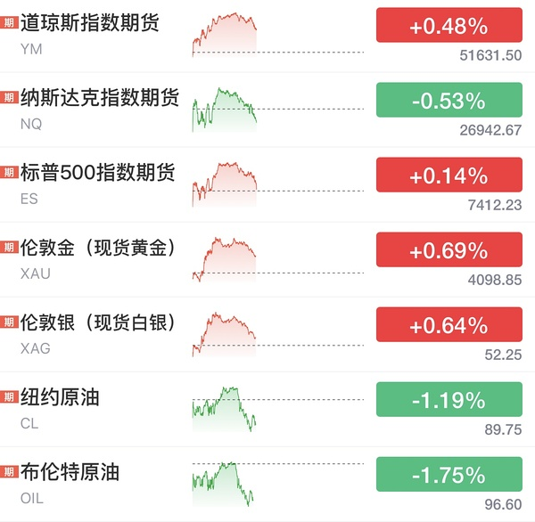

- (2026-11-09 15:32:26) 我懂 但我没图🤣🤣🤣做图的都断更了 笑死  ⊳ （引用 @速派女孩将发财）谢谢楼 你怎么什么都懂 手把手喂饭 我立刻启动我的同花顺

- (2026-11-09 15:48:46) 今天还涨的不行🤣🤣🤣工行2%  ⊳ （引用 @我爱牛肉火锅）招招又回调着回调着调到了43

- (2026-11-09 15:57:24) 快醒醒
已经变了
你是不是没更新新状况
如果6.3日买建信和华夏兄弟现在亏更多  ⊳ （引用 @茅五泸荣誉黑粉）我甚至觉得网易云不灵是因为我们楼里买太多了，影响了楼嫂的财运buff

- (2026-11-09 15:57:52) 在我没看到复仇者联盟消息刷屏之前都不是全出  ⊳ （引用 @11）幸福好高呀 是全出了吗

- (2026-11-09 15:59:20) [图] 不出
这两个地方可能兑现

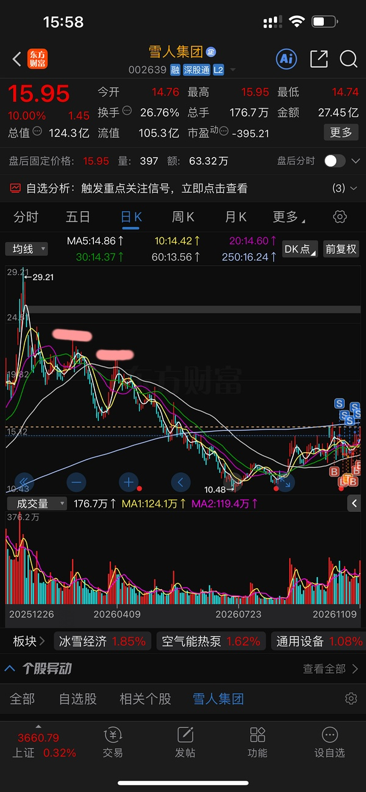  ⊳ （引用 @qiu啾）那楼楼16.33出吗

- (2026-11-09 16:00:46) 今天我这笔就是针对1633的呀  ⊳ （引用 @qiu啾）那楼楼16.33出吗

- (2026-11-09 16:04:59) [图] 雪儿1633那天
左边那个高点就是1633 圈圈是1590
所以我一直设置的保守的1584 针对的就是这一天🤣

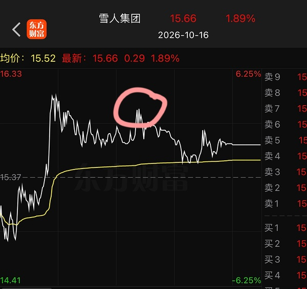  ⊳ （引用 @qiu啾）我懂啦

- (2026-11-09 16:13:06) 这次标题就直截了当了  ⊳ （引用 @速派女孩将发财）我懂了 又在不看好科技了

- (2026-11-09 16:13:31) 老师今天标题就知道说啥了
而且开头就明确了😂😂😂

目前，基于机构筹码结构、未来指数调样和解禁市值三个维度的指标，软科技题材股和微盘股指数上方的阻力要远远小于硬科技（即上半年的光芯存）。  ⊳ （引用 @我爱牛肉火锅）余力老师发文了！！

- (2026-11-09 16:15:04) 余老师今天最后一段和趋势动物 隔空对应了😂😂😂  ⊳ （引用 @速派女孩将发财）我懂了 又在不看好科技了

- (2026-11-09 16:16:33) 做科技的难道还能反科技的吗😂
无非一个先跌 现在建信华夏开始了补跌 
后来可能上涨也有先后  ⊳ （引用 @茅五泸荣誉黑粉）我知道网易云是细水长流型的，但也许它本来可以一鸣惊人呢🤣

- (2026-11-09 16:19:12) 微盘股今天就不太好
开盘就巅峰

而且尾盘羊资金有出逃迹象  ⊳ （引用 @点-重生炒垃圾）现在就剩6板独苗了，6进7失败了，会不会带崩尾盘啊

- (2026-11-09 16:22:07) [图] 之前大组完全没人讨论传媒的
我们多次查看过的
但是现在不一样了

- (2026-11-09 16:28:22) 没有 上周就有进攻迹象了 
如果1633直接过的话 得继续观望了  ⊳ （引用 @点-重生炒垃圾）雪人接的单子我知道，卖出的单子是啥，还要开高点吗？还是锁仓了？

- (2026-11-09 16:29:22) 😂😂😂😂😂😂骂的是A股居多  ⊳ （引用 @六倍做多退休）还有人在骂科技吗 

- (2026-11-09 16:33:06) [图] 温暖老师看来也很看好这个赖皮股😂😂😂😂

  ⊳ （引用 @点-重生炒垃圾）好吧，不担心接不到雪人了

- (2026-11-09 16:53:38) [图] 🤣居然刚刚走错的是黄金白银和股市

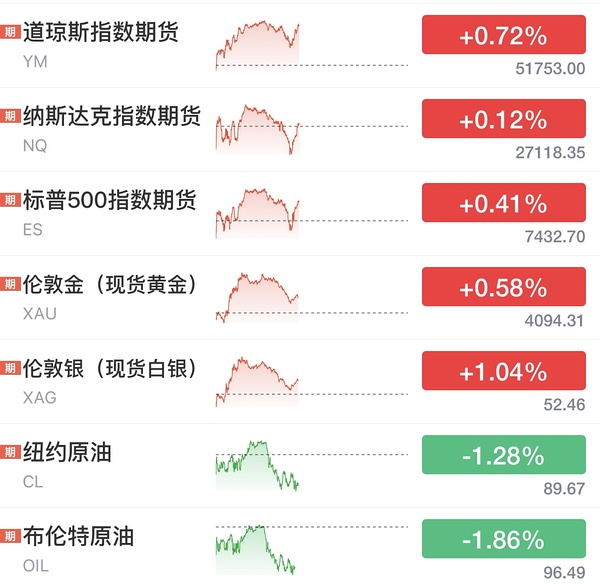  ⊳ （引用 @我爱牛肉火锅）得看接到的价格才好定卖出的单子吧

- (2026-11-09 16:55:34) [图] 今天3300红了和人家很不一样
估计后面肯定也有人家反弹多 3300反弹少的情况了

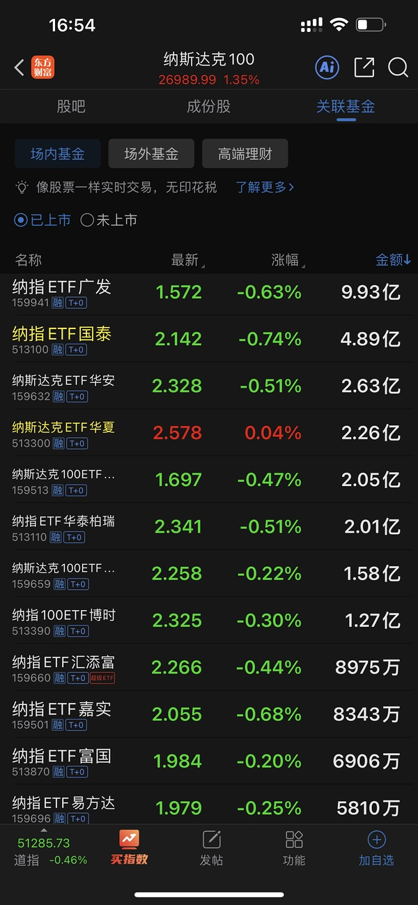

- (2026-11-09 16:57:56) 现在有ai了 这些没啥用了🤣  ⊳ （引用 @速派女孩将发财）楼 你真的是我见过把东方财富分组还有区间对比玩的最好的人 我现在都还经常筛选错

- (2026-11-09 16:58:51) 东方海洋：公司大健康板块不涉及药物研发

牛逼啊 你还是药？

- (2026-11-09 16:59:41) 他有点过分赖皮了😂😂😂  ⊳ （引用 @我爱牛肉火锅）比雪人还会串！纯血串子股

- (2026-11-09 17:00:20) 传媒不加仓
大概率用光线转换🤣  ⊳ （引用 @🅰失而复🉐😎）明天接不接幸福了还

- (2026-11-09 17:05:36) 奶茶和电影不一样 你这个转换还是不一样的
我光线和幸福都是电影
基本上不会反向 走势应该差不多的  ⊳ （引用 @西西西西）得 我得拿奶茶换了 痛亏五个点😭

- (2026-11-09 17:07:15) 香槟能喝上两天不
这现在每喝一次就醉倒啦😂😂😂😂  ⊳ （引用 @点-重生炒垃圾）连续两个周三科技香槟日，明天周二还给机会让科技周三开香槟吗

- (2026-11-09 17:13:59) [图] 晶雪把我们散户都弄出去了👍

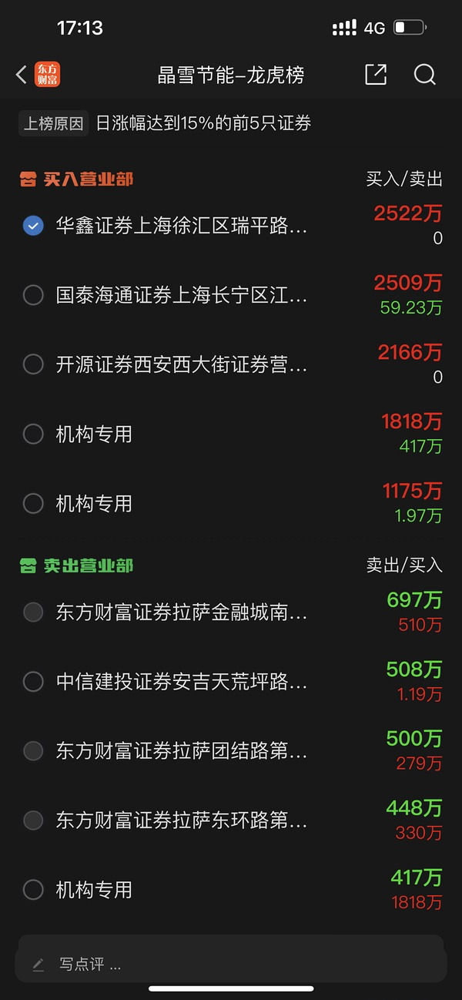

- (2026-11-09 17:14:08) 走势也确实好  ⊳ （引用 @家不住海边）芒果确实吸引了不少人啊。

- (2026-11-09 17:15:13) [图] 雪人也是

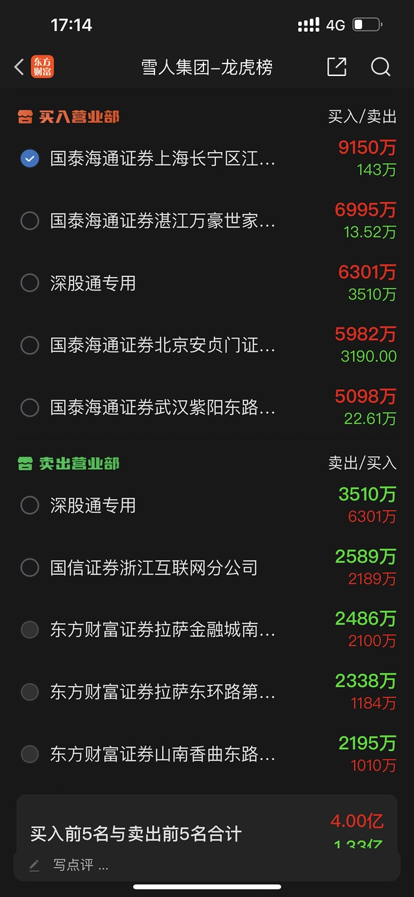  ⊳ （引用 @不知道还能说啥）晶雪把我们散户都弄出去了👍

- (2026-11-09 17:24:29) 就一次+20又开始了？

神州半导体IPO申请11月16日上会
上海证券交易所上市审核委员会定于2026年11月16日召开2026年第58次上市审核委员会审议会议。审议江苏神州半导体科技股份有限公司的首发事项。

- (2026-11-09 17:29:03) 先准备好
到时候一大堆一起IPO  ⊳ （引用 @长成大🌲）不是刚说停了嘛🤡

- (2026-11-09 17:29:34) 上周新增受理1家创业板企业
本期（11月2日—11月8日）新增受理1家创业板企业。截至11月8日，今年新增249家受理企业。其中上交所63家（主板11家，科创板52家），深交所81家（主板11家，创业板70家），北交所105家。截至11月8日，各板块在审企业共378家。其中上交所86家（主板20家，科创板66家），深交所95家（主板17家，创业板78家），北交所197家。

- (2026-11-09 17:31:09) 带有“东方”字样的个股曾于2024年11月受到资金热捧，一度带领“名字玄学”行情。彼时，日出东方、东方精工、大东方等均走出多日连板行情。

- (2026-11-09 17:31:33) 2024.11月

2026.11月

这个玩法还有特定时间的呢  ⊳ （引用 @不知道还能说啥）带有“东方”字样的个股曾于2024年11月受到资金热捧，一度带领“名字玄学”行情。彼时，日出东方、东方精工、大东方等均走出多日连板行情。

- (2026-11-09 17:33:10) 随着11月北方多地滑雪场陆续开板，新一轮冰雪旅游季正在启动。旅游平台数据显示，今冬冰雪游预订热度已提前释放，热门冰雪航线、亲子机票及度假酒店预订均出现增长，旅游企业也反映，游客咨询时间较往年明显提前。

不过板块内标的整体体量偏小、资金承载容量有限，叠加行情具备较强季节性属性，难以承接大规模主线资金，后续更大概率以阶段性轮动支线看待，但随冰雪季客流数据、天气等催化存在短线博弈机会。

- (2026-11-09 17:38:32) 牛逼 做什么的  ⊳ （引用 @点-重生炒垃圾）这个股票名字牛逼啊，记住了

- (2026-11-09 17:42:42) 24年东方带火市场情绪后创造了桂发祥 10连板 和小明的12连板彻底嗨翻天

所以结论不对哦 我刚看完  ⊳ （引用 @啊呆呆呆呆）他们说每次题材都尾声就是玩东方

- (2026-11-09 17:46:23) 应该是因为十月底业绩发完以后
有半年业绩真空期
所以是11-12月容易炒垃圾炒微盘 
垃圾就那些东西 😂
机器人 传媒以前也专门这时候玩
都是无比垃圾  ⊳ （引用 @啊呆呆呆呆）每年十二月是不是消费都会来一波

- (2026-11-09 17:48:27) [图] 4年呀😂😂😂😂我有案例🤣

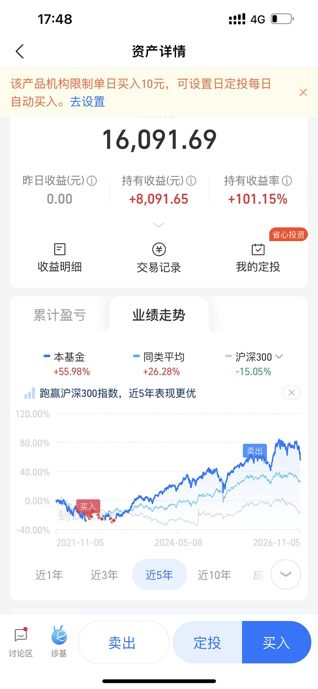  ⊳ （引用 @一一一一小得力）不瞒大家说我已经在做场内娜娜过多少年可以翻倍的美梦了

- (2026-11-09 17:51:30) 你看四年里会发生好几次让人难受的时间段😂
但每次卖出拉长时间全错了
而且这个错误是无法真金白银再弥补回来的😅  ⊳ （引用 @茅五泸荣誉黑粉）好，只要娜娜能翻倍，那我就能回本，四年就四年，我等得起🥲

- (2026-11-09 17:52:13) 字节跳动发布Seedream 5.5，上线豆包、豆包工作、即梦
字节跳动正式发布豆包图像创作模型 Seedream 5.5。据介绍，相较上一代 Seedream 5.0 Pro，新模型的生成速度大幅提升，同时增强了多轮编辑稳定性，原生支持透明素材生成，并针对图像真实感和小字渲染方面做了重点优化，更好地满足了专业创作场景对质量、稳定性与效率的要求。目前，豆包、豆包工作、即梦已同步接入Seedream 5.5，API 即将上线火山方舟。定价方面，Seedream 5.5 API 延续“输入图 + 输出图”两段计费结构，文本 Token 不产生费用。以2K方图编辑为例，单张成本在 0.28 元左右，不到 Seedream 5.0 Pro 一半。（新浪科技）

- (2026-11-09 17:59:23) 暂时从过往来看是
但是这毕竟取决于经理的人
和nana指数你去你也行还是不一样

就比如也许经理辞职了啥的
还是要保持关注的
当然这个关注也不是天天
几个礼拜总得看看  ⊳ （引用 @一一一一小得力）期待住了！主动管理🐔里能长期持有不抛的是不是只有国富和广发呀楼楼

- (2026-11-09 18:09:05) 华兄追了5%😂  ⊳ （引用 @vio）网易云-2.04

- (2026-11-09 18:11:54) 半个月-90%😂  ⊳ （引用 @点-重生炒垃圾）风月的回撤吓死人，抄底失败

- (2026-11-09 18:27:33) 四月应该不是
因为四月是年报+一季报
而且清明劫后又是五一临近
四月不是好好干的时间  ⊳ （引用 @柚子mm）楼楼，三四月是不是也玩垃圾

- (2026-11-09 18:50:49) 最后句😂😂😂😂  ⊳ （引用 @六倍做多退休）瑞银认为亚太科技股已经跌出机会，平均较 6 月高点跌 58%，2028 年预测市盈率从 23.7 倍压到 14.7 倍，三星与 SK 海力士的市净率只剩 0.79 与 0.98 倍，等于市场已经按 2028 年 AI 与存储周期反转在定价；

- (2026-11-09 19:23:16) [图] 海峡收费计划好像要没了

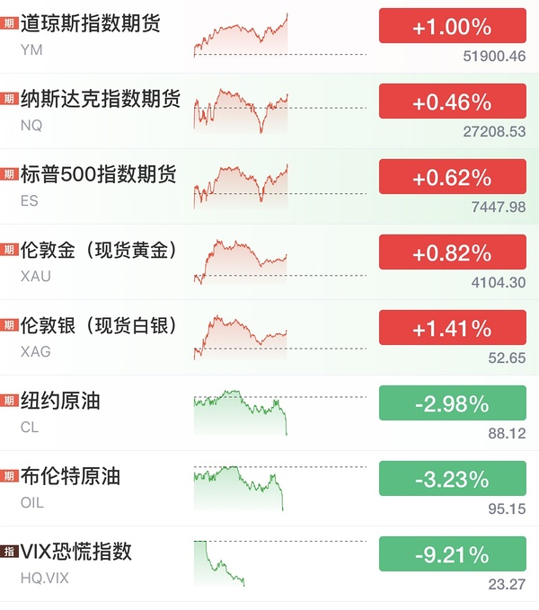

- (2026-11-09 19:23:57) 民主党对ai很负面
似乎对这个又是很正面😂  ⊳ （引用 @六倍做多退休）原油又开始直线了😂什么时候回到60哇 想要订机票了

- (2026-11-09 19:25:38) 美国和伊朗正考虑一项80亿美元协议，以重新开放霍尔木兹海峡。该报道称，美国总统特朗普预计将于周一会见卡塔尔首相，就伊朗提出的以释放80亿美元冻结资金为条件重新开放霍尔木兹海峡的提议进行磋商。

- (2026-11-09 19:26:07) 开关侠又开始了！  ⊳ （引用 @不知道还能说啥）美国和伊朗正考虑一项80亿美元协议，以重新开放霍尔木兹海峡。该报道称，美国总统特朗普预计将于周一会见卡塔尔首相，就伊朗提出的以释放80亿美元冻结资金为条件重新开放霍尔木兹海峡的提议进行磋商。

- (2026-11-09 19:40:54) 华夏兄弟今天赢得蛮轻松的

- (2026-11-09 19:50:10) vix暴涨 我们损失惨重的😂上周五就是
这次到28我觉得差不多

我觉得这次没有30+40+只是因为资金这一次没都在七巨头 最近6连年来第一次美国科技不是七巨头引领行情  ⊳ （引用 @我爱牛肉火锅）我今晚全仓梭哈做空vix期货，发挥我的反指之力祈祷vix暴涨

- (2026-11-09 19:51:47) [图] 

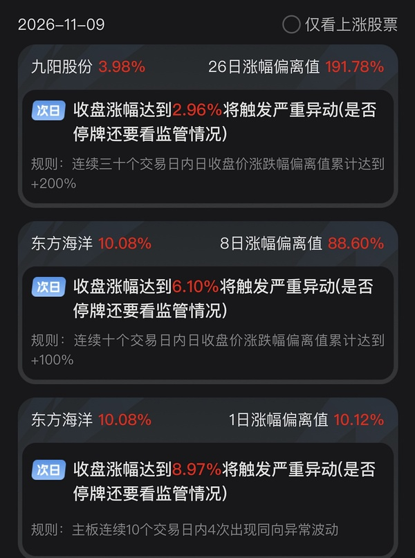

- (2026-11-09 20:01:40) 去年福建平平 被停牌过的呀哈哈

牛逼的是回调下来还有第二波 再回调 再第三波🤣  ⊳ （引用 @速派女孩将发财）是不是牛逼的跨年妖股都可以无视异动的🤣

- (2026-11-09 20:23:42) 等到时候看🤣也许冰雪让我无需花心  ⊳ （引用 @我爱牛肉火锅）二波你要去玩不？

- (2026-11-09 20:24:08) 没有卖单的 你仔细翻 我今天都发过了  ⊳ （引用 @momo（富姐版））雪儿明天计划依旧五日线接吗 开1633s？

- (2026-11-09 20:45:45) 现在怕了 我周五打满了😂😂😂  ⊳ （引用 @点-重生炒垃圾）原来楼主你也会害怕暴跌吗？🤣🤣🤣

## 🧠 投资风格分析
> 📏 增量更新指引：仅当今日发言确有新依据时才修订对应维度，无变化不强行重写；单维度修订建议 ≤150 字。

- 投资理念与方法：坚持机会成本量化比较，用股息率与货基收益率跨时间对照判断性价比：以四年前招行32元、股息率3.8%对货基2.2-2.5%为参照，认为当前42元、股息率4.8%对不足1.5%的货基更具吸引力；同时关注港交所IPO数据、海外宏观与产业事件等外部变量对估值的影响。并强调长周期视角：四年里会出现多次难受时段，但卖出拉长时间看往往全错；还归纳出11-12月业绩真空期易炒垃圾微盘的季节规律。
- 风险偏好：对纯题材与情绪化追高保持警惕，认为『冰雪越不触发越好，不然uu们很容易后面激情追高』，每次触发都为后续追高埋隐患；对QDII/ETF溢价率高度敏感，指出美股下跌让场内ETF溢价率又上台阶；对一致看多方向保持反思（如6月看多科技的结局）。同时严守能力圈，只做电影逻辑，明确不碰短剧等非电影传媒。
- 交易与仓位：偏好盘后预设条件单/挂单，认为15:00收盘后设置不受盘中消息干扰；对涨停品种分批减仓（幸福17.6涨停减一部分、晶雪15%回落触发卖在17.5%），对冰雪系采用『回落卖出+触发S一笔+五日线回接』的分层策略，并会主动关闭锁仓标的（大连、长白山）的条件单避免误触发，待雪人接回后才重开大连单；也会果断清掉短线机器人仓位腾挪资金。
- 心理特质：对时间节点和历史规律有条件反射式警觉：识别融资盘『周五传统』并联想五六月经历，用四年前招行与四年的难受时段做长周期对照，按历史高点（雪人1633/1590）反推保守挂单价1584；对连续两周的周五尾盘跳水会专门记录。面对基金经理退休等消息以😂吃瓜反应为主，不展开严肃分析。

> ⚠️ 本板块由 Actions 全自动增量更新（复用当日发言与今日总览），每次仅在内容足够支撑时才改动。

## 🏷️ 昵称映射表
### 📖 昵称规律（供 AI 判断新昵称时参考）
【昵称命名规律（用于推断未知新昵称）】
- 拼音首字母缩写：取标的/基金名汉字拼音首字母串（含数字代码），多为 ETF/股票代码口语化｜示例：yl=引力传媒｜zy=掌阅科技｜sj=视觉中国｜cc=华安文体健康混合｜C50=创业板50ETF｜k50=科创50｜kun=昆仑万维｜xhxc=新瀚新材｜zxfc=中欣氟材
- 小/老+姓氏代指：「小X」「老X」通常指姓 X 的标的或该标的的基金经理；「X兄弟」多为同系基金｜示例：小惠=惠发食品｜老莫=万家品质生活(莫海波)｜小华=华夏全球科技先锋(QDII)A｜小华兄弟=华夏移动互联(QDII)｜小浦=浦银安盛全球智能科技(QDII)A｜小广=广发全球精选(QDII)A｜小远=华宝致远(QDII)C｜招招=招商银行｜小德=德明利｜赵姨=兆易创新｜露露=泸州老窖｜空调=格力电器
- 戏称/黑话→题材板块：生活化比喻或黑话对应某个题材/板块，而非单一标的；出现时多指板块方向｜示例：卖国=PCB板块(英伟达AI链)｜爱国=国产自主(半导体设备/芯片)｜奶茶=易点天下｜老师=中文在线｜蓝色=蓝色光标｜宇航员=航空航天板块｜华子=华泰保兴安悦债券｜国际=国际复材｜巨无霸=长鑫科技等重大IPO
- 谐音/取字：昵称含标的名关键字（取一字或谐音），多为 A 股个股或基金简称｜示例：万华=万华化学｜东百=东百集团｜宝=保利发展｜讨饭/亚洲讨饭/建信新兴=建信新兴市场(QDII)A｜华宝zy=华宝致远(QDII)A
- 机构/基金经理昵称：以基金公司名、经理姓、或平台代称指代对应基金产品｜示例：周经理=中欧新趋势混合(LOF)A｜张经理=信澳匠心回报混合A｜网易云/音乐世家=富国全球科技互联网股票(QDII)A｜国富亚洲=国富亚洲机会股票(QDII)A｜国泰纳指=国泰纳斯达克100指数(QDII)｜易方达全球=易方达全球成长精选混合(QDII)A｜浦银安盛=浦银安盛全球智能科技(QDII)A

### 📋 已收录映射
| 昵称 | 对应名称 |
|------|----------|
| C50 | 创业板50ETF |
| cc | 双义：股票=中国长城 / 基金=华安文体健康混合（用户 11-05 指认） |
| k50 | 科创50 |
| kun | 昆仑万维 |
| sj | 视觉中国 |
| xhxc | 新瀚新材（用户确认；代码待核） |
| yl | 引力传媒 603598（对手盘，非他持仓）｜11-06 +37.15%；11-09 本月+37.79% |
| zxfc | 中欣氟材 |
| zy | 双义：他本人口径=603533 掌阅科技（用户 11-05 确认）；11-09 楼友两条『zy』按 16 元/电影语境指 600977 中国电影。引用必须带语境，不许收敛 |
| 万华 | 万华化学 |
| 东百 | 东百集团 |
| 亚洲讨饭 | 建信新兴市场混合(QDII)A |
| 保利发展 | 保利发展 |
| 华子 | 华泰保兴安悦债券 |
| 华宝 zy | 华宝致远混合(QDII)A |
| 华宝zy | 华宝致远混合(QDII)A |
| 卖国 | PCB、光模块、通信板块（英伟达AI产业链） |
| 周经理 | 中欧新趋势混合(LOF)A |
| 国富亚洲 | 国富亚洲机会股票(QDII)A |
| 国泰纳指 | 国泰纳斯达克100指数(QDII) |
| 奶茶 | 易点天下 301171（对手盘，非他持仓）｜11-06 本月+29.51% |
| 宇航员 | 航空航天板块 |
| 宝 | 保利发展 |
| 小华 | 华夏全球科技先锋混合(QDII)A |
| 小华兄弟 | 华夏移动互联混合(QDII) |
| 小广 | 广发全球精选股票(QDII)A |
| 小德 | 德明利 |
| 小惠 | 惠发食品 |
| 小浦 | 浦银安盛全球智能科技(QDII)A |
| 小远 | 华宝致远混合(QDII)C｜只在盯，未证他持有 |
| 巨无霸 | 长鑫科技等重大IPO企业 |
| 建信新兴 | 建信新兴市场混合(QDII)A |
| 张经理 | 信澳匠心回报混合A |
| 招招 | 招商银行 |
| 易方达全球 | 易方达全球成长精选混合(QDII)A |
| 浦银安盛 | 浦银安盛全球智能科技(QDII)A |
| 爱国 | 国产自主（半导体设备/芯片制造） |
| 空调 | 格力电器 |
| 网易云 | 富国全球科技互联网股票(QDII)A |
| 老师 | 中文在线 |
| 老莫 | 万家品质生活混合A(519195) |
| 蓝色 | 蓝色光标 |
| 讨饭 | 建信新兴市场混合(QDII)A |
| 赵姨 | 兆易创新 |
| 赵哥 | 兆易创新 |
| 露露 | 泸州老窖 |
| 安安 | 安记食品 |
| 音乐世家 | 富国全球科技互联网股票(QDII)A |
| 老伯伯 | 铜冠铜箔 |
| nk | 纳指科技ETF景顺 159509（联接=景顺长城纳斯达克科技ETF联接A）｜11-06 A级：截图溢价率37.08% |
| bk | 标普信息科技LOF 161128（场外=易方达标普信息科技QDII-LOF）｜11-06 A级 |
| txx | 天下秀 |
| 媛媛 | 今世缘 |
| uu | 友友、网友们 |
| 温暖老师 | 某个特别牛逼的散户 |
| 余老师 | 余利，某牛逼投资者 |
| ycm | 粤传媒 002181｜11-09 12:12「非电影传媒就留给大家玩了 我一个都不会碰了」→ 推断已不持有 |
| 江老师 | 江琪（投资博主） |
| 水果老师 | 投资博主 |
| 小爱 | 我爱我家 |
| ty | 天娱数科 |
| bn | 博纳影业 |
| sy | 上海电影 |
| CBS | 长白山 |
| 东哥 | 东百集团 |
| 芒果 | 芒果超媒 |
| 阿中 | 中国电影 |
| 欢欢 | 欢瑞世纪 |
| 雪人 | 雪人集团 |
| 大连 | 大连圣亚 |
| 幸福 | 幸福蓝海 |
| 小粤 | 粤传媒 |
| 阿博 | 博纳影业 |
| 创成长 | 创业板成长etf |
| asd | 埃斯顿 |
| 恋爱脑 | 好想你 |
| 恋爱 | 好想你 |
| 小羊 | 襄阳轴承 |
| 中马 | 中马传动 |
| 晶雪 | 晶雪节能 |
| xf | 幸福蓝海 |
| 建设 | 建设工业 |
| 北方 | 北方导航/北方国际（未定，11-04「我在北方了」） |
| _ambiguity_note | 歧义未收敛（禁止当唯一映射）：轮子=巨轮智能/五洲新春；sj=视觉中国（传媒语境）/神剑股份（宇航员语境）；cc=中国长城/华安文体健康混合；北方=北方导航或北方国际；zy=掌阅科技（用户 11-05 确认原值正确）。证据分级：A=价位/均线/月涨幅实测命中；B=量级或单日命中/用户口述；C=仅昵称或语义，不得据此写『他持有』；沿用原仓=本轮未复核，不写进结论正文。三条判据：①条件单四位数要先按同时段动词行判买卖方向（cbs 3644 是买单不是卖单）；②『祝福/你们/你的X』句式＝评论他人持仓，不是他的操作；③同一昵称在不同语境可指两只票（zy=掌阅/中影），按价位与板块取，不许收敛成一个。 |
| nana场内 | 513300 纳斯达克ETF华夏｜11-09 14:34「不愧是513300 当年的普通nana ETF之王」，当日唯一红的纳指ETF |
| 雪儿 | 雪人集团 002639（推断） |
| 存钱罐 | 光线传媒 300251（他自述小仓） |
| 枣子 | 好想你 002582 |
| 王老师 | 人：王博雅投资（QDII 场内溢价口径），不是标的 |
| 印度 | 自嘲代指中国（推断，勿当事实） |
| 10086 | 中国移动（他当指标用，非持仓） |
| 阳光乳业 | 001318 阳光乳业（他的『喝的』/牛奶）｜11-09 A级：13:59 分时截图 S 标记≈13.5＋10:52「我去掉了羊来抄底」 |
| 羊 | 生肖羊概念组（带阳/洋的一篮子：东方海洋/日出东方/大东方/红太阳/澳洋健康/鲁阳节能/华阳国际/东方日升/阳光照明/九阳股份/阳光乳业/沈阳机床）｜11-09 14:04 他自己贴的分组｜**不是单只票，也不是『小羊』襄阳轴承** |
| 小明 | 605179 一鸣食品｜11-09 10:07 有人问『喝的小明？』他答『羊』＝喝的已换成阳光乳业 |
| 皇台 | 000995 皇台酒业｜11-09 与雪人 PK 当日换手率龙虎榜 |
| 海哥 | 人：转债估值博主（不是标的）｜11-09 12:48「海哥周五那个新债…我买了点试试看是市场错了还是海哥错了」 |
| 申菱转债 | 123290（申菱环境 301018 的转债）｜11-09 13:50 买 150 张 @133 多 |

> ⚠️ 以下为 LLM **建议**，未自动写入状态文件。请人工确认后，本地编辑 `state.json` 的 `nickname_map` / `positions`，或 `nickname_rules.json` 的 `rules` 并 push 生效。

## 新昵称规律建议（待你确认）
- 【条件单与挂单设置】偏好盘后（15:00收盘后）预设条件单或挂单，避免盘中消息干扰；对涨幅敏感标的设置回落卖点（如晶雪15%回落卖出），对题材标的设置远高于现价的涨停挂单（如幸福17.6、大连4439等）。 ｜示例：挂第二个单子 17.6涨停一笔减去一部分 / 晶雪是15%涨幅回落 到15+肯定会触发卖出了 / 所以大连设置的也非常非常高 / 幸福18.44 接下来都开这个 大连47.74（雪人接回来才开 不然锁仓） ｜依据：多处分时讨论挂单价格与触发条件
- 【行业/题材轮动认知】认为传媒（电影+冰雪）在四季度具备季节性催化，但警惕一致看多后的追高风险；冰雪题材越不提前触发越好，以免友友后期激情追高。 ｜示例：冰雪越不触发越好 不然uu们很容易后面激情追高 / 传媒无视利空消息面 / 电影+冰雪 稳稳的 / 接下来冰雪发力 ｜依据：今日多次表达对传媒与冰雪板块的逻辑与风险控制
- 【持仓优先序与调仓原则】同板块内存在优先级排序（如幸福高于光线），若目标股大跌可反切回原仓位；资金有限的情况下集中布局确定性更高的标的。 ｜示例：如果明天开盘比如光线-1 幸福-5那种 我还是会反切回来的 幸福优先级肯定高于光线 / 传媒不加仓 大概率用光线转换 ｜依据：针对光线与幸福的对比讨论
- 【周五效应心理建设】接受周五常见跳水行情，视为‘献祭’，保持长期持股心态，避免短期恐慌。 ｜示例：周五是传统跳水没办法 / 绿在周五不灰心 下周再来 ☑️ / 如果一到四都红 周五绿一点无所谓了 就当是献祭了🤣 ｜依据：用户对周五市场规律的调侃与自我安慰

*🤖 自动生成于 2026-11-09 22:03:49 ｜ 豆瓣楼主发言追踪*