# 📋 楼主每日发言推送

> **推送日期**：2026-11-10 ｜ **执行时间**：2026-11-10 16:03:05 ｜ **监控用户**：`不知道还能说啥`
> **追踪模式**：`topic`（用户主页广播·豆瓣话题）

## 📊 持仓追踪
> 上次更新：2026-11-10 ｜ 基于楼主发言持续追踪（共 22 项）

| 标的 | 状态 | 类型 | 现价 | 提及 |
|------|------|------|------|------|
| 招商银行 | 底仓·四年前 32 元买入·不动 | 红利/银行 | 43.01（0.00%） | 11-07 10:52「我四年前买的招行 32元 … |
| 长白山 | 持有 | 冰雪·正牌双子星 | 39.07（-2.57%） | 「加仓大连cbs」；「计划4:4 实际5:3 已配… |
| 雪人集团 | 持有 | 冰雪·交易仓 | 16.10（0.94%） | 「cbs 大连都不接了 雪儿回踩五日线会接」 |
| 上海电影 | 仍空仓·未回接（他说暂放弃） | 电影 | 42.57（10.00%） | 11-09 11:39「短期内估计没机会舒服拿了 … |
| 幸福蓝海 | 持有·今日 16.33 卖出一笔·下一单 18.44 | 电影 | 15.30（-1.73%） | 「幸福18.44减半」，注明「明天触发不了 明天手… |
| 粤传媒 | **已不持有（推断）** |  | 12.00（4.08%） | 暂无 |
| 大连圣亚 | 持有 | 冰雪·正牌双子星 | 43.03（-2.65%） | 「做大连的差价」「现在大连5:3cbs 47.74… |
| 博纳影业 | 持有小仓（电影） | 传媒 | 6.82（7.06%） | 11-09 12:12「非电影传媒就留给大家玩了 … |
| 中国电影 | 持有·今日 15.11 加仓·卖单 15.84（≈16）未触发、盘后延续 | 电影·核心不动仓 | 16.13（5.01%） | 昨日由阳光乳业换入后持有，「我还有不少中影幸福 我… |
| 中韩半导体ETF | 持有 |  | 3.575（1.91%） | 11-09 无新自述；当日 −0.93%，与 KO… |
| 埃斯顿 | 持有 | 机器人 | 30.56（3.91%） | 11.5；上周五早上已清掉，今日高开拿不回来 |
| 晶雪节能 | 持有 | 冰雪·山寨 | 26.29（0.31%） | 15%回落条件单触发，卖在约17.5%涨幅处；『晶… |
| 光线传媒 | 持有 | 电影·低位备选 | 12.92（6.08%） | 「光线15.44减半」，为定价卖出，理由是「接近涨… |
| 襄阳轴承 | 已卖（11-05 卡高点） | 机器人/生肖羊 | 19.26（9.99%） | 11-09 无新自述；10:57 起『羊』改指生肖… |
| 中马传动 | 已清（11-06） | 机器人 | 16.60（3.30%） | 同上（他清的是整条机器人线） |
| 建设工业 | 已清（11-05） | 军工（与机器人互指） | 20.61（0.63%） | 11-09 无新痕迹 |
| 好想你 | 持有·卖单未见（10.48 旧单状态待确认） | 食品（他叫『恋爱脑』） | 10.17（1.90%） | 10:01「我有吃喝各一个 吃的大家知道」＝吃的仍… |
| 掌阅科技 | 待确认（zy 双义） | 传媒/AI应用 | 32.80（9.99%） | 暂无 |
| 纳斯达克ETF华夏 | 持有·场内纳指主仓 | QDII·场内纳指 | 2.669（3.53%） | 11.6；11-09 14:33/14:34「楼楼挑的纳指e… |
| 纳指科技ETF景顺 | 非持仓·只在盯（11-06 明确『nk 不行』37%溢价） | QDII·场内（观察，非持仓） | 2.896（3.47%） | 11.6；07:30「nk 不行 楼主老经验了 24年暑假就… |
| 阳光乳业 | **今日已卖**（分时图 S 标记，约 13.5） | 食品·他叫『羊』/牛奶（喝的） | 14.69（10.04%） | 10:52「我和你一样1511 我去掉了羊来抄底」… |
| 申菱转债 | 买入 | 转债（小额试错） | 145.400（5.16%） | 11.9；「我开了149.9」，「我加过一次仓位 所以开着」… |

> ⚠️ 执行任务时如发现新操作，请更新 `state.json` 的 `positions`。成本价和市值有数据才填，没有则保留「暂无」。

## 🌅 今日总览
### 📌 市场背景
今日发言围绕资金面、商品与场内溢价三条线索展开。资金面上，楼主以「两市融资余额较上日增加120.68亿元」为据，指出「融资盘流入百亿是信号」，并推断「周五融资盘是躲利息呢？周一迅速开干」。商品与地缘方面，特朗普称伊朗冲突「看到了结束的势头」，楼主顺势判断「100+原油不可持续🤣这是历史规律」。场内QDII方面，楼主盯着溢价与补涨，问「今天场内美国有没有3+涨幅 是否会杀一下溢价」，并提醒「nana场内又要开始拉升溢价率了」。盘中轮动明显：早盘「今天是机器人领衔」，随后「机器人是今天牺牲品」「影视反超领衔」「今天靠电影」；尾盘楼主称「市场跳水了」，并提到「微盘股昨天-1.3 今天+2.4」。可转债被楼主视为领先指标，「市场领先指标可转债 大幅度突破30日线 走的很漂亮」。

### 📌 今日操作
| 操作 | 标的 | 详情 |
|---|---|---|
| ✅ 加仓 | 大连圣亚 / 长白山 | 「加仓大连cbs」；「计划4:4 实际5:3 已配齐」，大连与长白山按5:3配齐 |
| ✅ 卖出 | 大连圣亚 | 「做大连的差价」「现在大连5:3cbs 47.74卖1份大连」，并称这笔「看作是雪儿替代」 |
| ✅ 买入 | 游戏方向（未点名） | 「我摄像大哥昨天去的 今天鼓吹我 我也进了一个」 |
| ⏭️ 挂单 | 幸福蓝海 | 「幸福18.44减半」，注明「明天触发不了 明天手动挂涨停」 |
| ⏭️ 挂单 | 光线传媒 | 「光线15.44减半」，为定价卖出，理由是「接近涨停了」 |
| ⏭️ 条件单 | 申菱转债 | 「我开了149.9」，「我加过一次仓位 所以开着」；「我要去兑现可转债了」 |
| ⏭️ 计划 | 雪人集团 | 「cbs 大连都不接了 雪儿回踩五日线会接」 |
| ❌ 不操作 | 传媒板块 | 「今天不加仓传媒」「不要增加传媒仓位哦」，资金已放在光线传媒 |
| ❌ 无持仓 | 引力传媒 | 「我没有yl了 有uu还在」 |

### 📌 今日议题
| 议题 | 态度 | 核心观点 | 关键引用 |
|---|---|---|---|
| 原油站上100 | 📉看空 | 按历史规律，100以上原油不可持续 | 「100+原油不可持续🤣这是历史规律」 |
| 融资盘回补 | 📈看多 | 单日流入百亿是信号，周五躲利息、周一迅速开干 | 「融资盘流入百亿是信号」「周五融资盘是躲利息呢？周一迅速开干」 |
| 场内美股ETF溢价 | ➡️中性 | 观察美股大涨后，场内是否先补上昨日落后或被杀溢价 | 「是否会杀一下溢价」「nana场内又要开始拉升溢价率了」 |
| 电影/影视传媒 | 📈看多 | 今日靠电影领衔，光线位置优势明显，但当下不加仓传媒 | 「今天靠电影」「光线传媒的低位优势不容小觑」 |
| 机器人 | ➡️中性 | 早盘领衔，尾盘成牺牲品 | 「今天是机器人领衔」「机器人是今天牺牲品」 |
| 双头形态个股 | 📉看空 | 见双头就暂时回避，不参与 | 「注意 双头 暂时回避」「这个双头我不会去的」 |
| 可转债 | 📈看多 | 可转债大幅突破30日线，是市场领先指标 | 「市场领先指标可转债 大幅度突破30日线 走的很漂亮」 |
| AI与传媒应用 | 💬讨论 | 对AI应用与传媒的关系有反复讨论，「无传媒无应用」 | 「AI不应用 AI个毛线」「还有第二句 无传媒无应用」 |
| 港股芯片新股 | 💬讨论 | 关注登临科技、芯德半导体周二在港交所上市的首日表现 | 「这两只新股的首日表现将成为香港新股市场的重要风向标」 |

### 📌 看好板块/方向
- **电影/影视传媒**：今日「影视反超领衔」「今天靠电影」，主打光线传媒、中国电影、幸福蓝海的轮动与低位优势。
- **冰雪（大连圣亚/长白山/雪人集团）**：回踩五日线即加仓的教科书位置，「大连cbs回踩五日线也是教科书啊」，并用差价操作降低持仓成本。
- **可转债**：被视为领先指标，「大幅度突破30日线」后仍持有申菱转债条件单。
- **黄金股**：反弹中更偏好黄金，明确「白银和铜不行」。
- **场内纳指ETF**：「还是我们3300棒」「3300完胜各路nana」，关注补涨与溢价。

### 📌 风险提示
- 「注意 双头 暂时回避」——对出现双头形态的个股直接回避，不预测形态终结。
- 「不要增加传媒仓位哦」「传媒板块打了两根针」——传媒短期有见顶迹象，不追加仓位。
- 「传媒票很久不看 一个礼拜都能从盈利50% 变成倒亏」——传媒回撤速度快，需防利润回吐。
- 「高位利好 总是不咋滴」——警惕高位利好消息兑现后走弱。
- 「也许会搞到停牌 让大家陪着一起吃面哦」——生肖羊、东方系等情绪票有炒作过热后停牌的风险。
- 「nana场内又要开始拉升溢价率了」——场内QDII溢价率抬升，追高有溢价回落风险。
- 「明天只要上涨0.95%就紧箍咒」——转债接近强赎临界，持仓需考虑兑现。

## 📊 本次结果
- **今日发言**：193 条
- **累计存档**：20660 条

## 📝 该最新广播作者发言聚合（共 193 条）
### 其他讨论（提及 145 次，占比 75%）2026-11-10 00:01:07
- 厉害👍
- 等这样三天就用你这四个字🤣
- 哈哈 只有上周五恐慌指数真正飙升了 从前都没有

### 大连圣亚（提及 8 次，占比 4%）2026-11-10 09:32:10
- 加仓大连cbs
- 没有

开大连47.74
- 是的

做大连的差价 

现在大连5:3cbs 47.74卖1份大连

### 幸福蓝海（提及 7 次，占比 4%）2026-11-10 09:54:34
- 幸福昨天出来的钱 现在在光线里呢

并没有额外的钱其实
- 我还有不少中影幸福 我不着急的 我甚至还有光线😂
- 你知道为什么幸福我没动手嘛
因为光线在努力让我看到他哈哈哈哈哈哈

我要观望下他们

### 双义：股票=中国长城 / 基金=华安文体健康混合（用户 11-05 指认）（提及 4 次，占比 2%）2026-11-10 09:10:50
- 反弹还是黄金股好 白银和铜不行

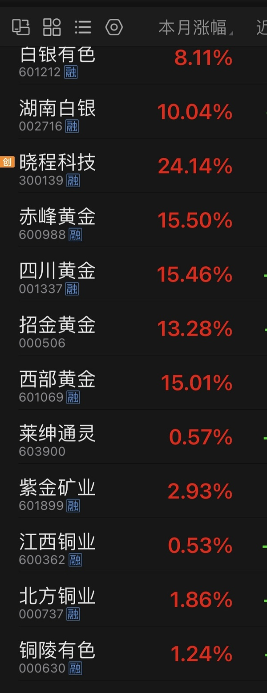
- 

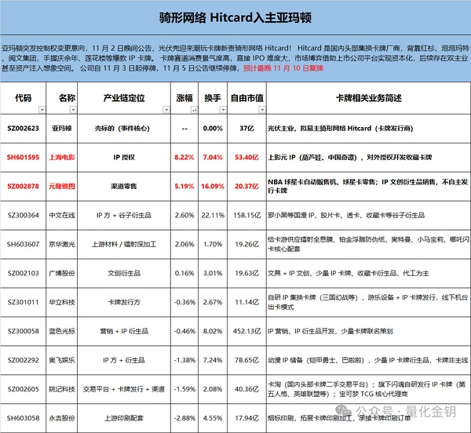
- 熟悉下情绪票们 目前还正常😂

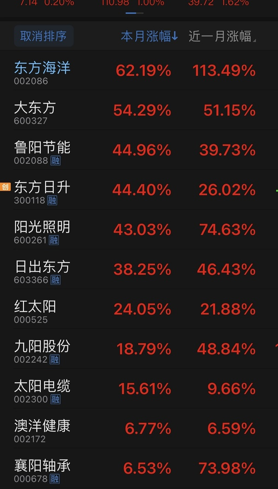

### 芒果超媒（提及 3 次，占比 2%）2026-11-10 09:13:02
- 融资盘在芒果

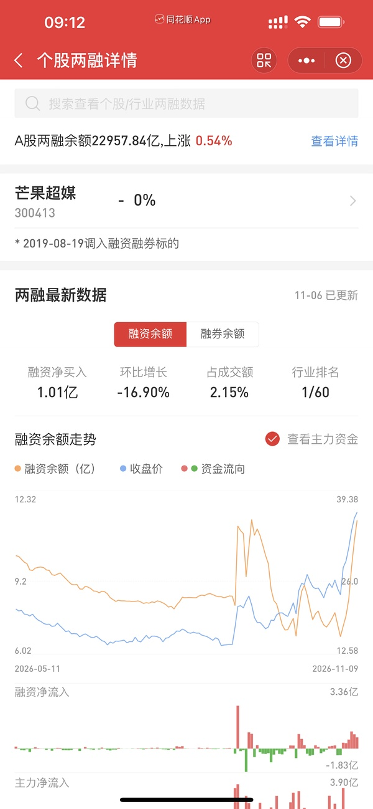
- 芒果率先翻绿跳水
- 融资盘在芒果干 融资盘没有感情🤣🤣🤣🤣

### 中文在线（提及 3 次，占比 2%）2026-11-10 09:14:13
- V老师去坐热气球了？
- 老师微盘股选的这三个 研究看看不

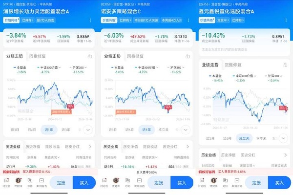
- 发财女孩你的ai 能分析出老师的这三个微盘股基金
近期谁更好吗

### 好想你（提及 3 次，占比 2%）2026-11-10 10:41:27
- 恋爱脑不着急

而且你看他们激情澎湃 但是其实没涨过🤣

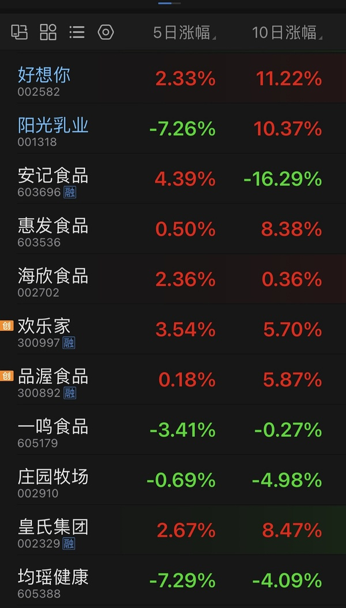
- 你借给冰雪了吧？
大连他们会回报你和你说 不要恋爱脑🤣
- 恋爱脑也是防守的一种方式

防守不是非要减仓的🤣🤣🤣🤣

而且就像6月半导体 其实已经不应该涨了
但是人家又涨了一个月
你提前减了 你就不会拿回来了

### 雪人集团 002639（推断）（提及 2 次，占比 1%）2026-11-10 07:49:44
- 雪儿摇身一变：可控核聚变🤣🤣🤣🤣🤣
- 按照这个收盘价
明天雪儿五日线差不多就是今天最低点

### 人：转债估值博主（不是标的）｜11-09 12:48「海哥周五那个新债…我买了点试试看是市场错了还是海哥错了」（提及 2 次，占比 1%）2026-11-10 09:29:35
- 海哥那个预估差别大的债还正好是科技线的液冷
- 海哥预估150+ 还是会到的

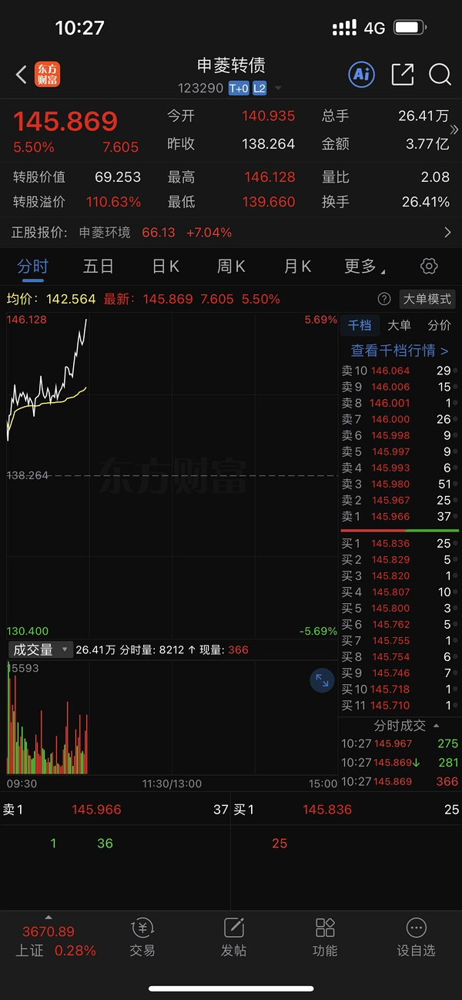

### 友友、网友们（提及 2 次，占比 1%）2026-11-10 10:30:43
- 纳斯达克开盘了uu们

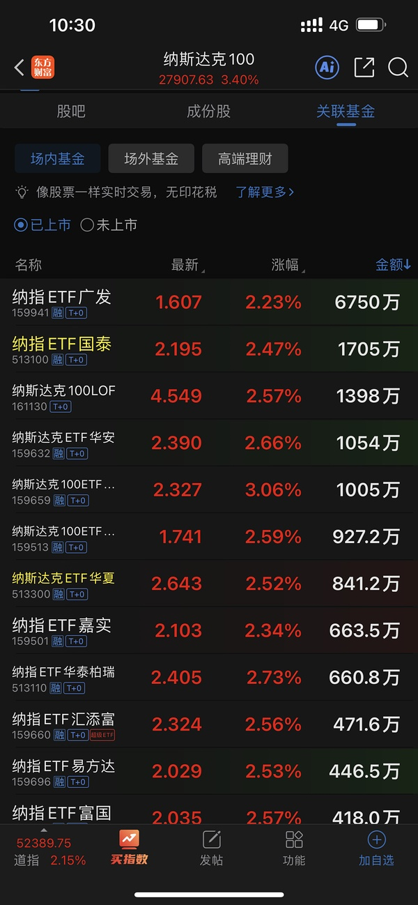
- uu们自己选择是否手工兑现哦？
不一样的选择结果有好有坏🤣

### 中国电影（提及 2 次，占比 1%）2026-11-10 10:42:48
- 中国电影火箭发射
- 阿中也别装了
昨天把人都搞出去了
准备进攻缺口了吧？🤣

### 生肖羊概念组（带阳/洋的一篮子：东方海洋/日出东方/大东方/红太阳/澳洋健康/鲁阳节能/华阳国际/东方日升/阳光照明/九阳股份/阳光乳业/沈阳机床）｜11-09 14:04 他自己贴的分组｜**不是单只票，也不是『小羊』襄阳轴承**（提及 2 次，占比 1%）2026-11-10 14:30:30
- 昨天清仓了啊

这个双头我不会去的😂都不如博羊和东方了
- 可能的 大A总是极致为主

不过那几个羊啊东方啊 也许会搞到停牌 让大家陪着一起吃面哦

### 某个特别牛逼的散户（提及 1 次，占比 1%）2026-11-10 09:46:05
- 温暖老师慈文传媒悲剧😂

### 光线传媒（提及 1 次，占比 1%）2026-11-10 10:14:56
- 光线传媒的低位优势不容小觑

打20% 图上都看不显著的🤣🤣

### 阳光乳业（提及 1 次，占比 1%）2026-11-10 10:27:30
- 那边阳光乳业涨停呀😂亏了1%

### 引力传媒 603598（对手盘，非他持仓）｜11-06 +37.15%；11-09 本月+37.79%（提及 1 次，占比 1%）2026-11-10 13:39:58
- 我没有yl了
有uu还在

### 513300 纳斯达克ETF华夏｜11-09 14:34「不愧是513300 当年的普通nana ETF之王」，当日唯一红的纳指ETF（提及 1 次，占比 1%）2026-11-10 13:44:09
- nana场内又要开始拉升溢价率了

### 航空航天板块（提及 1 次，占比 1%）2026-11-10 14:01:59
- 宇航员今天也牺牲品吗

### 科创50（提及 1 次，占比 1%）2026-11-10 14:14:46
- 为长鑫存储纳入k50做准备😂

### 雪人集团（提及 1 次，占比 1%）2026-11-10 14:25:22
- 不会只有雪人

### 昆仑万维（提及 1 次，占比 1%）2026-11-10 15:21:21
- 现在kun到底算在哪里我也分不清了哈哈哈

### 易点天下 301171（对手盘，非他持仓）｜11-06 本月+29.51%（提及 1 次，占比 1%）2026-11-10 15:38:02
- 广告今天那么好 但奶茶一般😂

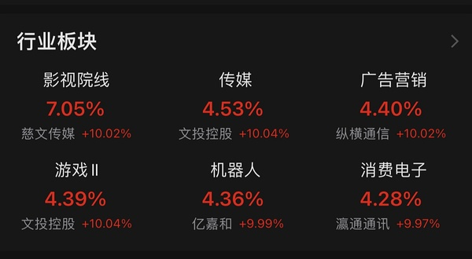

### 📄 全部发言（共 193 条）
- (2026-11-10 00:01:07) 厉害👍  ⊳ （引用 @我爱牛肉火锅）第一！！

- (2026-11-10 00:03:50) 等这样三天就用你这四个字🤣  ⊳ （引用 @输入一个昵称）未来可期！

- (2026-11-10 07:07:54) 哈哈 只有上周五恐慌指数真正飙升了 从前都没有  ⊳ （引用 @温妤哦）终于要坏端端的好起来了吗

- (2026-11-10 07:10:30) 英伟达：都已经不需要我了

- (2026-11-10 07:25:43) 是的 这句话我要再反复说一下

只要问题是油 那就不是问题！  ⊳ （引用 @Waiting一下）那现在充分说明就是油引起的一段时间的暴跌了

- (2026-11-10 07:49:44) 雪儿摇身一变：可控核聚变🤣🤣🤣🤣🤣  ⊳ （引用 @山中食人花）科技暴涨一天 雪儿大跌  让我用科创换雪儿
深圳也降温了 和冰雪概念更搭了

- (2026-11-10 07:58:44) 特朗普：目前看来没必要对伊朗采取军事行动 看到了结束的势头

- (2026-11-10 07:59:02) 特朗普在白宫向媒体发表讲话。

“我们只是维持现状，我们这么做实际上是应他们邻国的要求，” 特朗普又说。

“我们看到了这场冲突具备了走向结束的势头，” 他谈到伊朗时说。  ⊳ （引用 @不知道还能说啥）特朗普：目前看来没必要对伊朗采取军事行动 看到了结束的势头

- (2026-11-10 08:01:40) 100+原油不可持续🤣这是历史规律  ⊳ （引用 @木感情的打工人）taco了。。拯救美股

- (2026-11-10 08:06:00) 弱鸡韩国 5%都没有吗  ⊳ （引用 @我爱牛肉火锅）日经225指数上午开盘报59372.28点，涨幅1.02％。韩国综合股价指数（KOSPI）开盘上涨4.6％，至5247.22点。

- (2026-11-10 08:07:41) [图] 让我来看看 
今天场内美国有没有3+涨幅 是否会杀一下溢价
Mark一下昨天的
另外一群nana今天应该得先补上昨天的错误😂

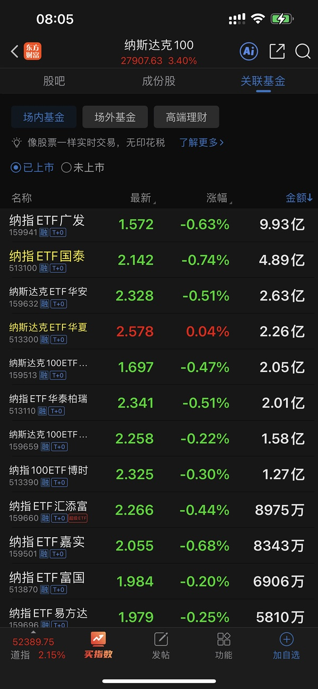

- (2026-11-10 08:17:20) 登临科技和芯德半导体周二将登陆港交所

两家芯片公司登临科技和芯德半导体周二将登陆港交所。GPU研发公司登临科技以每股231港元的价格发行了610万股股票，融资14.1亿港元，发行价处于价格区间的下限。半导体封装测试公司芯德半导体以每股8.88港元发行1.066亿股股票，融资9.46亿港元，发行价同样低于价格区间的上限。 这两只新股的首日表现将成为香港新股市场的重要风向标。  ⊳ （引用 @木感情的打工人）taco了。。拯救美股

- (2026-11-10 08:19:37) 让我们看看今天啥ETF还能超越科技ETF们的反弹😂  ⊳ （引用 @我爱牛肉火锅）韩国交易所对KOSPI指数触发熔断机制
韩国交易所对KOSPI指数启动程序化交易暂停机制，暂停程序化买盘。

这就熔断啦？

- (2026-11-10 08:37:58) 八部门：支持实体书店服务全民阅读，鼓励民营书店差异化发展  ⊳ （引用 @超级nice）楼楼在看什么书

- (2026-11-10 08:38:22) [图] 🤣🤣🤣🤣🤣🤣🤣🤣🤣🤣🤣🤣真人在玩

- (2026-11-10 08:39:37) 15.2附近  ⊳ （引用 @想当富有的咸鱼）雪人今天五日线多少来着，我挂92稳妥吗？早上挺忙的，我应该来不及它显现价格了挂

- (2026-11-10 08:39:53) [图] 融资盘：好好干

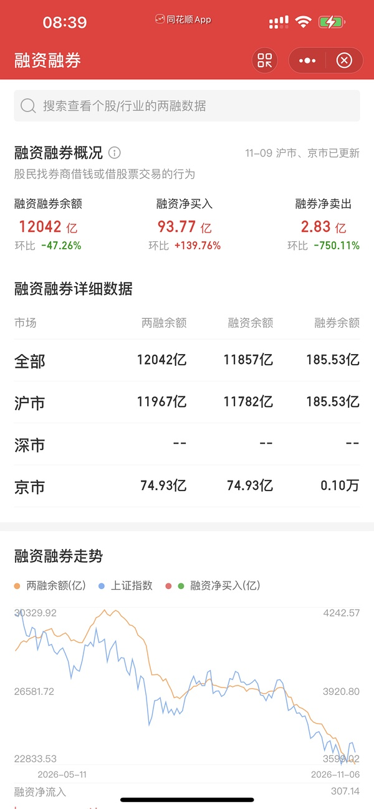

- (2026-11-10 08:40:35) 没想到吧？

周五融资盘是躲利息呢？周一迅速开干  ⊳ （引用 @不知道还能说啥）融资盘：好好干

- (2026-11-10 08:47:02) 两市融资余额较上日增加120.68亿元
截至11月9日，上交所融资余额报11781.90亿元，较前一交易日增加93.54亿元；深交所融资余额报10813.46亿元，较前一交易日增加27.14亿元；两市合计22595.36亿元，较前一交易日增加120.68亿元。

- (2026-11-10 08:47:19) 久违了 
融资盘流入百亿是信号  ⊳ （引用 @不知道还能说啥）两市融资余额较上日增加120.68亿元
截至11月9日，上交所融资余额报11781.90亿元，较前一交易日增加93.54亿元；深交所融资余额报10813.46亿元，较前一交易日增加27.14亿元；两市合计22595.36亿元，较前一交易日增

- (2026-11-10 08:48:23) 😂😂😂😂或许有可能是这么理解 全球联动  ⊳ （引用 @点-重生炒垃圾）融资盘，我懂vix含金量

- (2026-11-10 09:06:41) Anthropic拟通过首次公开募股筹集至多693亿美元，发行价区间为每股70至80美元。

- (2026-11-10 09:07:05) ①快舟六号可重复使用火箭拟2027年首飞回收，商业航天降本提速；

②谷歌发布新TPU叠加平头哥拟赴港IPO，国产算力芯片景气上行；

③上海印发医药产业高质量发展“十五五”规划，创新药迎政策利好；

④字节跳动发布豆包图像创作模型Seedream 5.5，AI图像创作能力跃升；

⑤阿里云上调Token Plan订阅额度，AI算力需求持续旺盛；

⑥山东印发造纸产业高质量发展行动计划，造纸产业迈向高端化。

- (2026-11-10 09:10:50) [图] 反弹还是黄金股好 白银和铜不行

- (2026-11-10 09:13:02) [图] 融资盘在芒果

  ⊳ （引用 @momo（富姐版））融资不要抛弃奶茶呀！

- (2026-11-10 09:14:13) V老师去坐热气球了？  ⊳ （引用 @VVV坚定持有VVV）史莱姆！

- (2026-11-10 09:15:29) 坐热气球确实要很早起来的😂  ⊳ （引用 @我爱牛肉火锅）土耳其现在4点多，老大

- (2026-11-10 09:16:59) 人家啥概念都有  ⊳ （引用 @yuyuyuyu）雪人怎么分组在商航里了

- (2026-11-10 09:18:36) 笑死
有种别撤单  ⊳ （引用 @🧋今天25了吗）幸福有本事就保持住让我换回来😅

- (2026-11-10 09:26:41) 五日线提高到15.3附近了

- (2026-11-10 09:29:35) 海哥那个预估差别大的债还正好是科技线的液冷

- (2026-11-10 09:30:02) 513300给了 🤣  ⊳ （引用 @momo）为啥周一a公子没有给丑股做指引

- (2026-11-10 09:32:10) 加仓大连cbs

- (2026-11-10 09:34:20) 光线在努力获取奖励 笑死

- (2026-11-10 09:34:48) 只要你棒棒的 奖励不会少 放心冲  ⊳ （引用 @不知道还能说啥）光线在努力获取奖励 笑死

- (2026-11-10 09:37:02) 昨天利空无视也挺厉害  ⊳ （引用 @红红火火的anya）传媒超出预期，以往这种长上影后续走势都很差

- (2026-11-10 09:37:54) 冲了 -3 -4正好  ⊳ （引用 @只想搞钱）大连我一早就买了😅

- (2026-11-10 09:40:16) 本轮双子星配置完成 ✅

- (2026-11-10 09:40:51) 光线等着我后面给你奖励
继续发挥  ⊳ （引用 @不知道还能说啥）只要你棒棒的 奖励不会少 放心冲

- (2026-11-10 09:42:45) 注意 双头 暂时回避  ⊳ （引用 @🅰失而复🉐😎）晶没搞🤧

- (2026-11-10 09:43:24) 你们人多也坑不了中影啊
准备出发兑现零花钱

- (2026-11-10 09:43:59) 这简直在送钱 😂😂😂😂  ⊳ （引用 @不知道还能说啥）你们人多也坑不了中影啊
准备出发兑现零花钱

- (2026-11-10 09:45:10) 没有 位置太低了  ⊳ （引用 @随便吧）楼楼，光线有条件单吗，昨天好像没看到🥰

- (2026-11-10 09:45:22) 没有

开大连47.74  ⊳ （引用 @🅰失而复🉐😎）大白刚买的有没有单子

- (2026-11-10 09:46:05) 温暖老师慈文传媒悲剧😂  ⊳ （引用 @点-重生炒垃圾）中影触发了

- (2026-11-10 09:46:10) 今天的  ⊳ （引用 @momo）出一笔还是两笔？

- (2026-11-10 09:47:00) 哈哈市场跳水了
冰冰时间又要来了  ⊳ （引用 @一直在摸🐟）就差雪人没接到了

- (2026-11-10 09:47:45) 你看中影五周线😂😂😂😂😂😂  ⊳ （引用 @暴富¥(´･ᴗ･`)$）这线也太标准了😂，主力强迫症不轻呀

- (2026-11-10 09:50:24) 留着

等午后再看  ⊳ （引用 @高手云集上钻）楼，中影触发了，留着还是去幸福

- (2026-11-10 09:53:06) 没有 他位置太低了 钱先存他那边 我容易手贱  ⊳ （引用 @chongchong）正好想问嘿嘿

- (2026-11-10 09:54:34) 幸福昨天出来的钱 现在在光线里呢

并没有额外的钱其实  ⊳ （引用 @selena）幸福要接吗

- (2026-11-10 09:55:24) 所以如果美股基金规模太大 其实不太是问题😂  ⊳ （引用 @六倍做多退休）达子昨天成交量5800亿人民币 流动性太强了。

- (2026-11-10 09:57:58) 传媒板块打了两根针

不要增加传媒仓位哦

- (2026-11-10 10:00:12) [图] 我保持观望

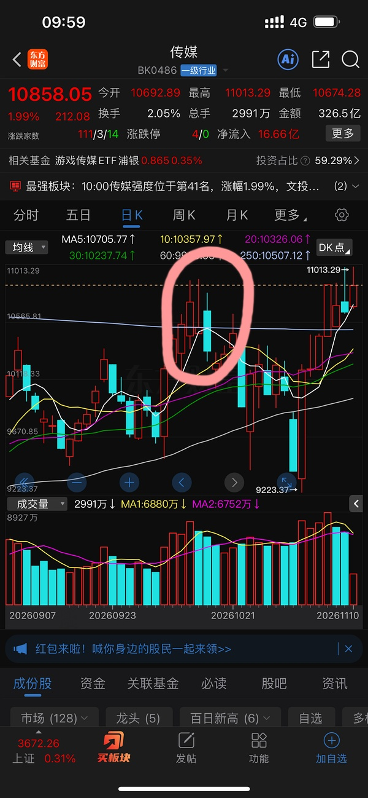  ⊳ （引用 @不知道还能说啥）传媒板块打了两根针

不要增加传媒仓位哦

- (2026-11-10 10:00:19) 牛逼  ⊳ （引用 @我爱牛肉火锅）金逸板了，要打院线了吗

- (2026-11-10 10:01:54) [图] 今天是机器人领衔

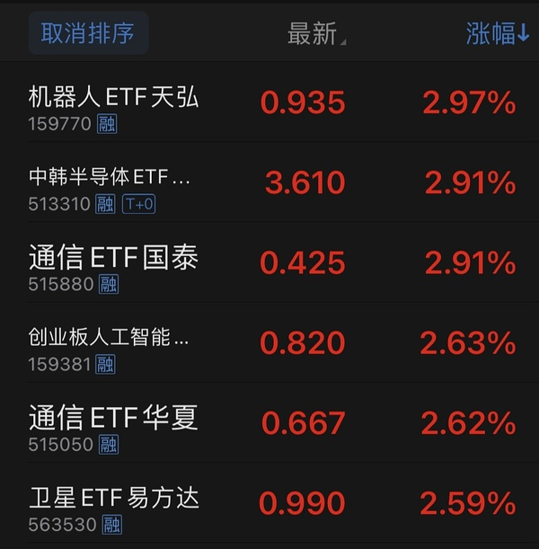

- (2026-11-10 10:03:23) 我先观望  ⊳ （引用 @🅰失而复🉐😎）下午按五日线附近买幸福？

- (2026-11-10 10:04:04) 我还有不少中影幸福 我不着急的 我甚至还有光线😂  ⊳ （引用 @🅰失而复🉐😎）下午按五日线附近买幸福？

- (2026-11-10 10:06:12) 你知道为什么幸福我没动手嘛
因为光线在努力让我看到他哈哈哈哈哈哈

我要观望下他们  ⊳ （引用 @🅰失而复🉐😎）我也是，昨天激情澎湃的BBB

- (2026-11-10 10:08:25) 光线是防守反击的极致代表了😂😂😂  ⊳ （引用 @🅰失而复🉐😎）以防反着来🤣

- (2026-11-10 10:08:43) 我们的电影也不赖 轮番上阵🤣  ⊳ （引用 @该用户已过期）你是不是仓位又很高了？🤣🤣我这波只有电影冰雪，一点传媒没买

- (2026-11-10 10:11:28) [图] 今天东方海洋不能涨6.6%🤣

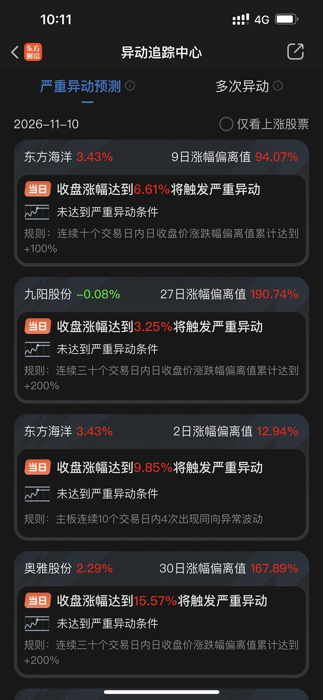

- (2026-11-10 10:13:46) 接不回来😂再找机会  ⊳ （引用 @Aaa摆烂咸鱼🥳）楼感觉asd走势也不错

- (2026-11-10 10:13:54) 双头！  ⊳ （引用 @只想搞钱）晶雪下去了

- (2026-11-10 10:14:56) 光线传媒的低位优势不容小觑

打20% 图上都看不显著的🤣🤣

- (2026-11-10 10:16:02) 冰山在呀  ⊳ （引用 @只想搞钱）她这种不会带跌其他冰雪吗？还是影响只是暂时的，马上就有新老大顶上

- (2026-11-10 10:16:49) 今天靠电影 笑死

反正双保险呗🤣🤣🤣  ⊳ （引用 @🅰失而复🉐😎）上周有一天也是这样的局面🤣

- (2026-11-10 10:19:44) 有个毛线关系😂😂😂
体育你还不如期待舒华体育 共创草坪 那种  ⊳ （引用 @果木香烤鸡腿堡）但我还是希望大连今天可以爆拉让我t一下hhh中超都逆袭夺冠了 不庆祝一下吗

- (2026-11-10 10:22:53) 昨天不是走了吗  ⊳ （引用 @we）晶雪是还拿着没动的吧

- (2026-11-10 10:25:25) 我还在计算昨天阳光换中影是否吃亏
总体还行 中影也有接近9%隔日利润🤣🤣🤣  ⊳ （引用 @该用户已过期）🤣🤣电影仓位少，顶不住了，绿了

- (2026-11-10 10:25:52) 赚份内的钱
牛的票多的是  ⊳ （引用 @🌼（躺平版））冰山为什么这么牛是不是因为不熟所以家人少

- (2026-11-10 10:26:35) 是的😂😂😂我100股都没有  ⊳ （引用 @we）看漏了 是清仓了吗

- (2026-11-10 10:27:30) 那边阳光乳业涨停呀😂亏了1%  ⊳ （引用 @该用户已过期）9%不能叫还行了🤣🤣这很行了！

- (2026-11-10 10:28:15) [图] 海哥预估150+ 还是会到的

- (2026-11-10 10:29:34) 🤣没事我不后悔
中影昨天送钱更令人放心
阳光毕竟是赌博哈哈哈哈哈  ⊳ （引用 @我爱牛肉火锅）但你中影出来还能去其他地方赚呢，谁知道下午是死羊还是活羊

- (2026-11-10 10:30:43) [图] 纳斯达克开盘了uu们

- (2026-11-10 10:31:17) 还是我们3300棒  ⊳ （引用 @不知道还能说啥）纳斯达克开盘了uu们

- (2026-11-10 10:32:10) [图] 先上桌

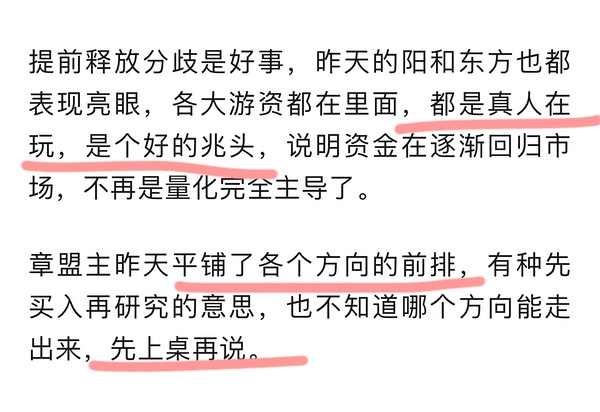  ⊳ （引用 @稀里不糊涂）机器人今天好强啊，我现在怎么感觉好多板块都能买，这就是修复行情吗

- (2026-11-10 10:33:25) 今天幸福1844是涨多少才能到来着

- (2026-11-10 10:34:36) okk  ⊳ （引用 @🅰失而复🉐😎）？

- (2026-11-10 10:35:14) 嗯因为纳斯达克涨了3+呢 他们没涨足  ⊳ （引用 @Victoria）溢价好像没有昨天高了

- (2026-11-10 10:39:17) 是的

做大连的差价 

现在大连5:3cbs 47.74卖1份大连  ⊳ （引用 @一颗牛奶糖）楼的cbs是直接锁的吗

- (2026-11-10 10:41:27) [图] 恋爱脑不着急

而且你看他们激情澎湃 但是其实没涨过🤣

  ⊳ （引用 @🅰失而复🉐😎）恋爱脑今天博个涨停呗😇

- (2026-11-10 10:42:37) [图] 早上的机器人不见了

影视反超领衔

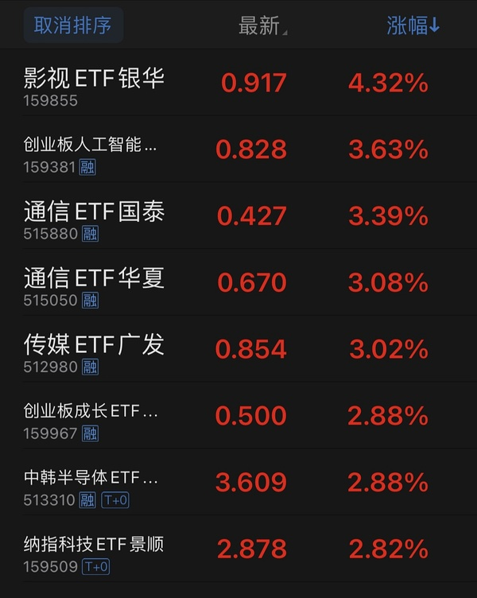

- (2026-11-10 10:42:48) 中国电影火箭发射

- (2026-11-10 10:43:10) 🤣🤣🤣🤣🤣🤣咱也不知道谁昨天送我们钱的

谢谢好心人  ⊳ （引用 @不知道还能说啥）中国电影火箭发射

- (2026-11-10 10:43:59) 我觉得今天大连也是好心人概率大🤣🤣🤣🤣  ⊳ （引用 @我爱牛肉火锅）小中影轻装上阵，涨更好了

- (2026-11-10 10:44:39) 光线你想要奖励 可是要干翻幸福才行哦
不然如何奖励你呢🤣🤣

- (2026-11-10 10:45:55) 你借给冰雪了吧？
大连他们会回报你和你说 不要恋爱脑🤣  ⊳ （引用 @🅰失而复🉐😎）我今天早上看它红着还跟它借钱了😇改天还给它

- (2026-11-10 10:49:52) 我今天这问题已经回复三次了😂
这个最近的缺口要15.9那边
暂时肯定是没有单子的

重视光线位置上无与伦比的优势
他打20%你都看不到大阳线的  ⊳ （引用 @👑）光线有条件单吗

- (2026-11-10 10:51:59) [图] 本月哥哥妹妹围攻半导体

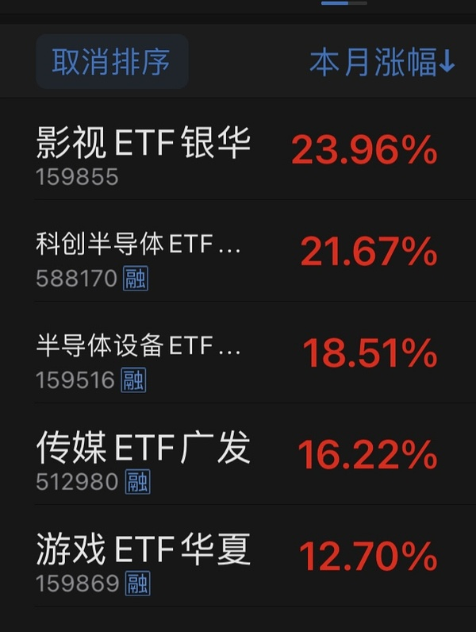

- (2026-11-10 10:53:13) 光线不动

这个位置很有可能后续其他传媒开A
他还有防守效果的  ⊳ （引用 @👑）谢谢楼楼，今天电脑豆瓣垮了，页面打不开，手机就没法实时跟楼

- (2026-11-10 10:54:52) 大连cbs回踩五日线也是教科书啊😂😂

- (2026-11-10 11:01:34) 也许我们午后账户会进一步升华的😂😂😂😂

- (2026-11-10 11:02:25) [图] 小东 你稳住啊 你不能6.6 别冲动

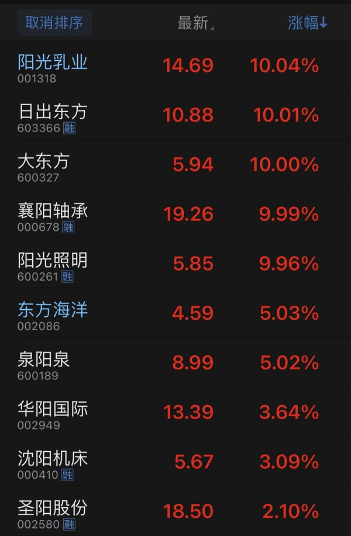

- (2026-11-10 11:07:18) 有没有可能
春节又爆了什么应用 app
回来上半年接着继续炒  ⊳ （引用 @只想搞钱）传媒是不是真要炒到跨年去哦

- (2026-11-10 11:08:28) [图] 年初我错过了光线
这一次我还会错过吗

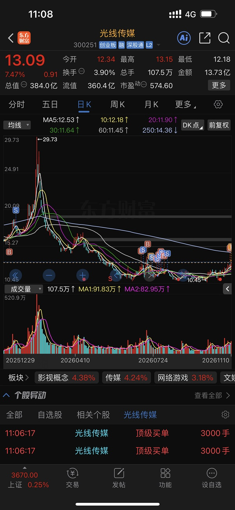

- (2026-11-10 11:09:12) 今天没有🤣收盘时候我看看  ⊳ （引用 @点-重生炒垃圾）这个没条件单吧，我昨天跟的

- (2026-11-10 11:09:49) 6月也有各种信息🤣🤣🤣🤣🤣🤣🤣  ⊳ （引用 @只想搞钱）就是感觉总还有各种消息，很容易爆，票也多来回炒

- (2026-11-10 11:11:04) AI不应用 AI个毛线

还有第二句

无传媒无应用  ⊳ （引用 @🅰失而复🉐😎）难道是第二个半导体😇

- (2026-11-10 11:12:28) 美国  ⊳ （引用 @🅰失而复🉐😎）跳水😇

- (2026-11-10 11:15:32) [图] 炸掉了华策

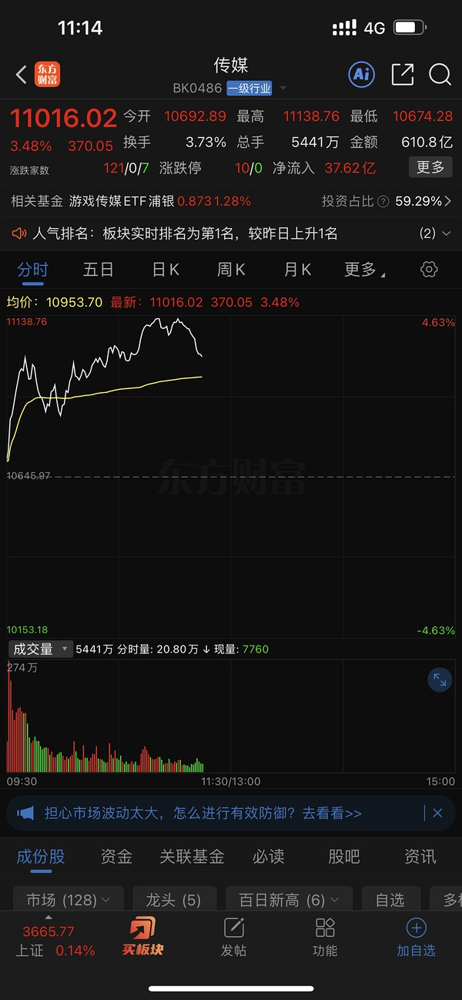  ⊳ （引用 @🅰失而复🉐😎）跳水😇

- (2026-11-10 11:16:15) 他双头 没有办法

短期回避😂😂  ⊳ （引用 @速派女孩将发财）邪恶晶雪？

- (2026-11-10 11:17:20) 拉高冰雪是防守的另外一种方式  ⊳ （引用 @momo）那我们光线和中影要避一避吗

- (2026-11-10 11:18:33) 恋爱脑也是防守的一种方式

防守不是非要减仓的🤣🤣🤣🤣

而且就像6月半导体 其实已经不应该涨了
但是人家又涨了一个月
你提前减了 你就不会拿回来了  ⊳ （引用 @momo）那我们光线和中影要避一避吗

- (2026-11-10 11:20:40) 我开了149.9  ⊳ （引用 @momo）楼楼那个债打算拿到海哥的预估价吗

- (2026-11-10 11:21:17) 我加过一次仓位
所以开着
如果没加我也不开了  ⊳ （引用 @扶我起来还能买）我看这几天恋爱脑好稳 偷懒没设单子🤣

- (2026-11-10 11:25:07) 龙版传媒：持续做大做强教辅图书业务

😂😂  ⊳ （引用 @不知道还能说啥）八部门：支持实体书店服务全民阅读，鼓励民营书店差异化发展

- (2026-11-10 11:38:34) [图] 场内的国泰弱爆了
3300完胜各路nana

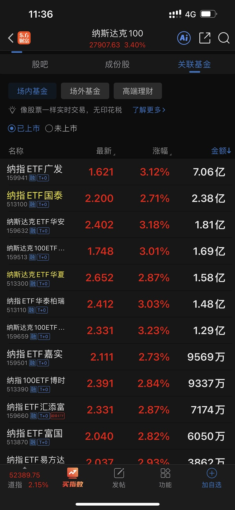  ⊳ （引用 @不知道还能说啥）让我来看看 
今天场内美国有没有3+涨幅 是否会杀一下溢价
Mark一下昨天的
另外一群nana今天应该得先补上昨天的错误😂

- (2026-11-10 11:38:56) 高位利好 总是不咋滴😂😂😂  ⊳ （引用 @点-重生炒垃圾）药明心里没有逼数，开盘就涨五个点，站上60日线，然后跳水都快绿了，无语死了，装逼遭雷劈

- (2026-11-10 11:45:17) [图] 

- (2026-11-10 11:45:30) 啥玩意

- (2026-11-10 11:48:22) 11月10日消息，京东正内测独立短剧产品“京东追剧福利社”。据了解，这款产品主打免费模式，和抖音快手信息流刷剧不同，这款产品强调看剧领福利、领优惠。

- (2026-11-10 11:52:41) AI动画创最快涨粉百万纪录 IP商业化已在进行中

AI动画《呱呱历险记》是近期的新晋爆款，单集播放破1.8亿、全网点赞超600万、单周涨粉百万，这一成绩也让其制作人郭紫翔一举成为最快涨粉百万的AI自媒体创作者。

郭紫翔并非动画科班出身，两个月前甚至还不会制作AI动画。仅靠一周时间自学AI工具，就做出了火遍海内外的AI原生IP。

《呱呱历险记》的主角是一只青蛙呱呱和一条蛇辣条，它的核心设定很简单：青蛙呱呱和小蛇辣条负责逃跑，鬣狗负责追赶。好看的是每次逃跑都能玩出新花样，“海陆空”变换，虽然有些地方确实很离谱，但又有点合理，引发了追更热潮。

这对天敌CP的冒险日常自9月发出第一条视频以来，不仅在抖音快速圈粉，拿到了单集1.8亿播放、650万+点赞、抖音单平台涨粉百万的亮眼成绩，更跨越了文化与语言的隔阂，在海外平台引发关注。作品被搬运到海外平台，搬运账号的粉丝体量并不大，点赞和播放却破亿。

- (2026-11-10 11:52:51) 你们知道嘛 这个我不知道😂😂😂😂😂  ⊳ （引用 @不知道还能说啥）AI动画创最快涨粉百万纪录 IP商业化已在进行中

AI动画《呱呱历险记》是近期的新晋爆款，单集播放破1.8亿、全网点赞超600万、单周涨粉百万，这一成绩也让其制作人郭紫翔一举成为最快涨粉百万的AI自媒体创作者。

郭紫翔并非动画科班出身

- (2026-11-10 11:53:51) [图] 老问题
谁错了

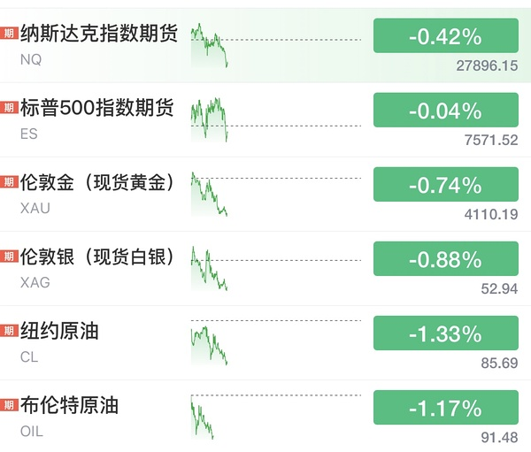  ⊳ （引用 @moli）娜娜期货跳水

- (2026-11-10 11:55:46) 好的 这不是光线就可以有消息面了嘛🤣  ⊳ （引用 @晕晕企鹅）前段时间刷到过，真的挺有创意的

- (2026-11-10 12:11:36) 🤣🤣🤣🤣🤣🤣🤣🤣  ⊳ （引用 @家不住海边）在广告里面插短剧😄

- (2026-11-10 12:13:16) [图] 今天预期数字开的蛮高的！

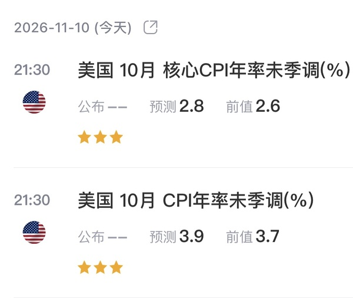  ⊳ （引用 @六倍做多退休）今天老美的cpi要摸着石头过河了 去年政府停摆没有相关数据

- (2026-11-10 12:18:37) 2026年10月，按美元计，中国出口同比35.2%，前值36.3%，预期33.5%;

进口同比41.6%，预期32%，前值31%;

贸易顺差为1052.8亿美元，前值1335.3亿美元，预期1258亿美元。

- (2026-11-10 12:51:05) 这个太假了
就是5楼有个滑冰的地方  ⊳ （引用 @家不住海边）还记得老朋友。新世界吗
刚才在翻 他也是冰雪哈哈

- (2026-11-10 12:54:30) 昨晚（11月9日），A股上市公司亚玛顿发布公告，Hitcard母公司骑形网络将以6.8亿元收购上市公司20%的股权，从而成为上市公司控股股东。Hitcard创始人赵云鹏将成为实际控制人。

值得注意的是，骑形网络及其实际控制人已出具承诺：36个月内，不向上市公司注入本人及本人关联方持有的资产，没有向上市公司注入资产的计划。在外界看来，3年内承诺不注入资产，属于规避IPO审核的监管硬性条件，近期的上市公司易主案例都有类似承诺（七腾借壳胜通，优必选借壳锋龙），但拿下上市公司控制权，一方面有概念支撑股价先行起飞，另一方面为36个月之后的资产注入留出了空间，也给骑形网络背后的红杉中国、泡泡玛特、阅文等投资人提供了另一条退出路径。

今日早间，亚玛顿开盘涨停，每股21.21元。而骑形网络的收购对价是每股17.61元，已有浮盈。  ⊳ （引用 @点-重生炒垃圾）这是啥新概念

- (2026-11-10 13:15:50) 笑死 我刚刚当面祝福我摄影20%游戏了 他也有20cm游戏了🤣🤣🤣🤣🤣

- (2026-11-10 13:19:20) 你们操作和我不一样

我说了 昨天的幸福已经在光线了

今天不加仓传媒 所以并没有钱能接  ⊳ （引用 @赚了就s）今天要回幸福吗

- (2026-11-10 13:23:47) 美国翻红  ⊳ （引用 @木感情的打工人）666科技来了？

- (2026-11-10 13:27:26) 光线靠自己赢得位置🤣  ⊳ （引用 @赚了就s）好的。因为昨天说光线中转。以为今天又那个光线转回幸福

- (2026-11-10 13:29:58) 五日线附近拿呀🤣  ⊳ （引用 @游游）早上冰雪还是接早啦

- (2026-11-10 13:30:37) 传媒票很久不看
一个礼拜都能从盈利50% 变成倒亏  ⊳ （引用 @朱想想）好久没看了，引力现在是什么单子？

- (2026-11-10 13:33:41) 我们还有一个独立走势的中影 🤣🤣🤣🤣  ⊳ （引用 @🅰失而复🉐😎）我们的仓和科技是反向的😏

- (2026-11-10 13:36:24) 我同事游戏还真的火箭发射了....  ⊳ （引用 @🅰失而复🉐😎）我们的仓和科技是反向的😏

- (2026-11-10 13:37:34) 固收+资金

的+ 正在去掉科技 重新+高股息

不是一路人  ⊳ （引用 @木感情的打工人）招行翻红

- (2026-11-10 13:38:30) 嗯 我也有了 但我不是这个😂
为了和他PK  ⊳ （引用 @Aaa摆烂咸鱼🥳）盛天？

- (2026-11-10 13:39:58) 我没有yl了
有uu还在  ⊳ （引用 @朱想想）票还是看的，就是最近太忙了，好久没登豆瓣，没跟单子，今天一看盈利了，看要不要做个差价，就来问问看🥹🥹🥹落下太多天，今天翻完也没翻到单子。你们是不是都卖了🥹🥹

- (2026-11-10 13:44:09) nana场内又要开始拉升溢价率了

- (2026-11-10 13:45:03) 机器人是今天牺牲品😂😂😂😂😂😂

- (2026-11-10 13:45:44) sw 9个点要擦掉了

玉树已经擦掉8个点  ⊳ （引用 @不知道还能说啥）机器人是今天牺牲品😂😂😂😂😂😂

- (2026-11-10 13:46:16) 你看来不懂我额外大幅度充值+买在招行账户是什么用意  ⊳ （引用 @九九归一）楼楼，场内的nana还卖吗？

- (2026-11-10 13:49:55) 微盘股昨天-1.3
今天+2.4

- (2026-11-10 13:54:05) [图] 老师微盘股选的这三个 研究看看不

  ⊳ （引用 @葱）那什么乖离率第一的含金量hhhh

- (2026-11-10 13:56:27) 明天五日线就15.4那边 靠近15.5了  ⊳ （引用 @问一下能不能瘦）突然发现 xr离五日线确实有点远呀

- (2026-11-10 13:58:11) [图] 熟悉下情绪票们 目前还正常😂

- (2026-11-10 13:59:36) 幸福明天五日线快速来到15附近

- (2026-11-10 14:01:59) 宇航员今天也牺牲品吗  ⊳ （引用 @点-重生炒垃圾）品渥今天也挺牛的

- (2026-11-10 14:03:01) 计划4:4
实际5:3
已配齐  ⊳ （引用 @想当富有的咸鱼）楼，你早上补了连和白，是把份数补对齐了吗？还是说还是原来的比例啊？

- (2026-11-10 14:04:25) 那倒也不是
因为今天雪儿没下来
大连那笔看作是雪儿替代  ⊳ （引用 @想当富有的咸鱼）大连靠自己多争取了一份啊

- (2026-11-10 14:09:47) 去的  ⊳ （引用 @该用户已过期）那雪儿再来接你，你还去不去？

- (2026-11-10 14:10:38) 这个阳包阴挺像10.29-10.30那三天放大版本😂  ⊳ （引用 @点-重生炒垃圾）原来今天是靠中影红的。。。。

- (2026-11-10 14:14:20) 我要去兑现可转债了 然后去浪了😂

- (2026-11-10 14:14:46) 为长鑫存储纳入k50做准备😂  ⊳ （引用 @点-重生炒垃圾）为啥中芯、海光和寒王这个权重是绿的，憋啥坏屁呢

- (2026-11-10 14:15:34) 厉害  ⊳ （引用 @只想搞钱）西部也来了

- (2026-11-10 14:16:53) 古井贡都3%了呀  ⊳ （引用 @家不住海边）妈呀 露露也要红了

- (2026-11-10 14:18:57) 今年不也是嘛
今年cbs10/20就买了
去年10/13建仓大连的

时间点几乎一模一样  ⊳ （引用 @家不住海边）看了下记录 上一年我们10月就完冰雪 好早啊

- (2026-11-10 14:19:54) 阿中也别装了
昨天把人都搞出去了
准备进攻缺口了吧？🤣

- (2026-11-10 14:22:19) [图] 市场领先指标可转债 大幅度突破30日线 走的很漂亮

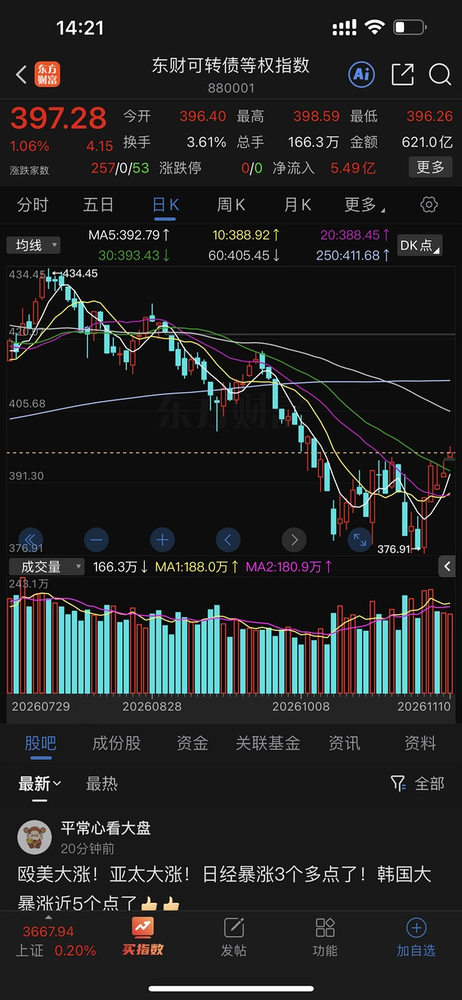

- (2026-11-10 14:24:08) [图] 影视蛮牛逼的 稳在4% 😂

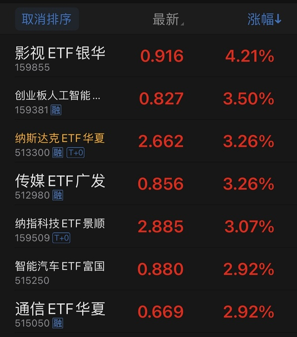

- (2026-11-10 14:24:36) 智能驾驶ETF很靠前😂  ⊳ （引用 @点-重生炒垃圾）【智能驾驶概念午后活跃 浙江世宝涨停】智能驾驶概念午后活跃，浙江世宝涨停，万集科技、豪恩汽电、锦江在线、路畅科技跟涨。消息面上，近日《广东省扩大消费实施方案》印发。其中提出，加力支持智能网联汽车发展，推动整车企业依规争取L3级自动驾驶车型准

- (2026-11-10 14:25:08) 虽然数据中心暂缓
但是明年降息会提高科技股估值

民主党喜忧参半  ⊳ （引用 @点-重生炒垃圾）【“蓝潮”拖累AI基建扩张速度？分析师：存量算力巨头将受益】知名科技分析师Dan Ives，若由于本月美国中期选举导致数据中心建设放缓，这对大型超大规模数据中心运营商来说可能是“巨大的利好”。他补充道：“本质上，蓝色浪潮将使大型科技公司的资

- (2026-11-10 14:25:22) 不会只有雪人  ⊳ （引用 @人间月）雪人还真直线了

- (2026-11-10 14:25:50) plus雪牛逼哦

- (2026-11-10 14:26:02) 你有种把双头直接干掉  ⊳ （引用 @不知道还能说啥）plus雪牛逼哦

- (2026-11-10 14:29:00) [图] 现在他们怎么都一个方向啊

亚太区资金总是乱搞😅

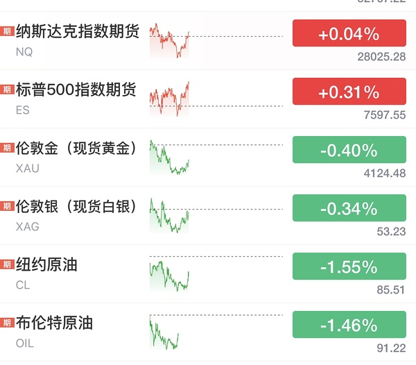

- (2026-11-10 14:30:30) 昨天清仓了啊

这个双头我不会去的😂都不如博羊和东方了  ⊳ （引用 @Aaa摆烂咸鱼🥳）楼你还有吗

- (2026-11-10 14:32:05) 昨天不是已经去了吗哈哈哈哈  ⊳ （引用 @青禾）dfhy要是要是压住了异动能去吗

- (2026-11-10 14:34:04) [图] 说明你周五没刷
很多好东西都在盘后
点老师一发 我一看 这个天时地利人和 牛逼的😂😂😂😂

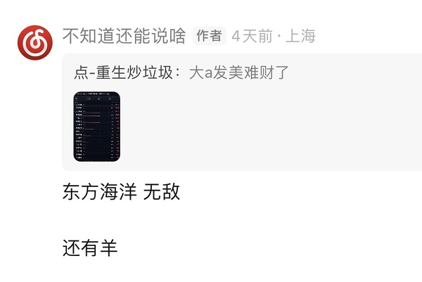  ⊳ （引用 @青禾）原来楼已经在了！昨天没刷到

- (2026-11-10 14:38:21) 我摄像大哥游戏都快10+了 
晚上加一场直播也会开开心心的吧😂

- (2026-11-10 14:39:26) 哈哈哈哈 我也这么觉得  ⊳ （引用 @momo）摄像大哥：今天的运镜将会非常华丽

- (2026-11-10 14:40:36) 大部分ETF今天涨幅不如nana！

- (2026-11-10 14:42:03) 上次1633卡年线直接跌个大的
今天1643卡年线 拭目以待
这次是否会不一样

- (2026-11-10 14:42:32) 只要不进去 就不会有紧箍咒😂  ⊳ （引用 @shirla）压异动的话明天是又没有紧箍咒啦？

- (2026-11-10 14:43:07) 芒果率先翻绿跳水

- (2026-11-10 14:43:41) 几年后大家又是那句话

“早知道当初全仓娜娜”  ⊳ （引用 @🅰失而复🉐😎）我说我怎么收益还可以，它贡献了4/1🤣

- (2026-11-10 14:45:22) 我存一下 盘后我来看看  ⊳ （引用 @木感情的打工人）灵光diy的重要指标，楼的精华😂😂

- (2026-11-10 14:46:53) uu们自己选择是否手工兑现哦？
不一样的选择结果有好有坏🤣  ⊳ （引用 @不知道还能说啥）上次1633卡年线直接跌个大的
今天1643卡年线 拭目以待
这次是否会不一样

- (2026-11-10 14:53:07) 按照这个收盘价
明天雪儿五日线差不多就是今天最低点

- (2026-11-10 14:59:34) 雪儿 cbs明天不开单
cbs 大连都不接了 雪儿回踩五日线会接

大连47.74卖今天的
幸福18.44减半（明天触发不了 明天手动挂涨停）
光线15.44减半（这个别回落了 定价卖出 接近涨停了）

- (2026-11-10 14:59:45) 我2点半就看好了😂  ⊳ （引用 @不知道还能说啥）雪儿 cbs明天不开单
cbs 大连都不接了 雪儿回踩五日线会接

大连47.74卖今天的
幸福18.44减半（明天触发不了 明天手动挂涨停）
光线15.44减半（这个别回落了 定价卖出 接近涨停了）

- (2026-11-10 15:01:40) [图] 明天只要上涨0.95%就紧箍咒

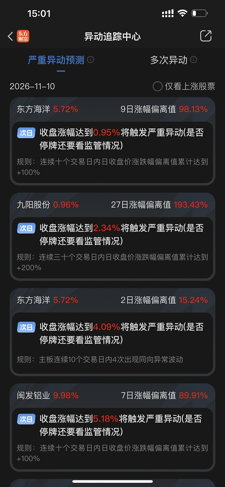  ⊳ （引用 @momo）dfhy 绕过异动了，尾盘买了点点看明天如何了

- (2026-11-10 15:02:20) 明天如果东方海洋冲刺大涨 我就先走了  ⊳ （引用 @不知道还能说啥）明天只要上涨0.95%就紧箍咒

- (2026-11-10 15:02:28) 😂😂😂😂😂😂  ⊳ （引用 @点-重生炒垃圾）希望明天楼主能说大连今天跟送钱没啥区别

- (2026-11-10 15:04:45) 卖不了挂9+  ⊳ （引用 @豆友193969986）那大连明天卖不了了吧

- (2026-11-10 15:05:20) 我这个单子要求开得很高啊
能出来绝对满足啊
不一定要浪出去的🤣🤣🤣🤣  ⊳ （引用 @🅰失而复🉐😎）电影出来，去哪里浪啊😏

- (2026-11-10 15:06:41) 明天周三后天周四
这两天如果能多赚点
那就不浪了

毕竟周五要亏钱的🤣🤣🤣🤣🤣🤣  ⊳ （引用 @🅰失而复🉐😎）电影出来，去哪里浪啊😏

- (2026-11-10 15:09:35) 我已经被我摄像大哥拉到游戏哥哥一个了😂

其实传媒里面还有个大妖股 而且是在很低位的
年初甚至停牌过的  ⊳ （引用 @该用户已过期）不可能🤣出来了你肯定去浪

- (2026-11-10 15:14:10) [图] 或许是因为他太大了 300亿市值 目前一般

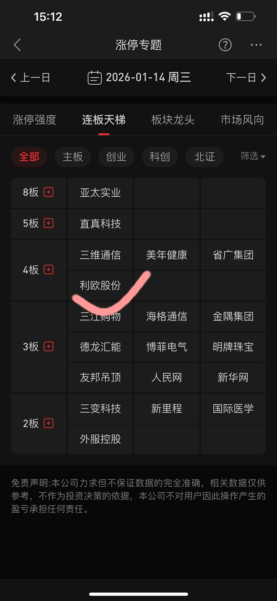  ⊳ （引用 @该用户已过期）妖股？快交出代码，哈哈哈🤣🤣

- (2026-11-10 15:16:47) [图] 我现在无暇顾及😂
而且我希望看到一次传媒大调整
我看看低位那几个的安全性如何 是否没涨的也不会跌 我得看一次

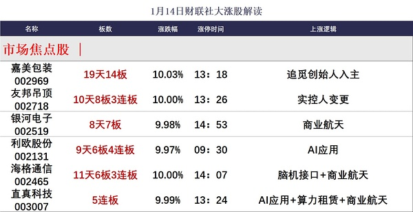  ⊳ （引用 @该用户已过期）今年在楼里见过它的名字🤣还不少次呢，有印象

我现在就一个原则：紧跟你🤣🤣

- (2026-11-10 15:18:33) 👍👍👍👍👍

我摄像大哥昨天去的🤣
今天鼓吹我 我也进了一个  ⊳ （引用 @发财喵）谢谢楼楼 昨天你提了下游戏 我买了个市值最小的薅了五个点跑路了哈哈

- (2026-11-10 15:19:51) 可能的 大A总是极致为主

不过那几个羊啊东方啊 也许会搞到停牌 让大家陪着一起吃面哦  ⊳ （引用 @该用户已过期）一直都防着大调整🤣会不会就不来了？

- (2026-11-10 15:21:21) 现在kun到底算在哪里我也分不清了哈哈哈  ⊳ （引用 @发财喵）昨天小助手提示有资金进昆仑了

- (2026-11-10 15:33:39) 这个是悖论 科技成交量上不去 就不行❌  ⊳ （引用 @稀里不糊涂）后面成交量突然猛猛上了估计就要撤退了吧，现在还处于不相信的状态

- (2026-11-10 15:38:02) [图] 广告今天那么好 但奶茶一般😂

- (2026-11-10 15:56:19) [图] 这个因素就是这次综合因素里最重要的一环哈哈

当下比2022年下半年便宜 且加息预期已经打满

这一次我直接all in

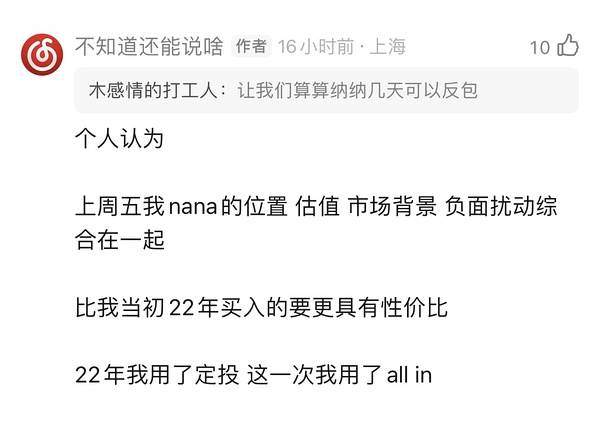  ⊳ （引用 @速派女孩将发财）打工人老师 你快把看前瞻PE的那个网址 就是退休老师发的那个网页加入你的灵光。nana现在pe都只有18.4，1.7%百分位。

- (2026-11-10 15:56:47) 融资盘在芒果干 融资盘没有感情🤣🤣🤣🤣  ⊳ （引用 @我爱牛肉火锅）难道融资盘怕了🤔

- (2026-11-10 15:58:06) [图] 发财女孩你的ai 能分析出老师的这三个微盘股基金
近期谁更好吗

  ⊳ （引用 @速派女孩将发财）打工人老师 你快把看前瞻PE的那个网址 就是退休老师发的那个网页加入你的灵光。nana现在pe都只有18.4，1.7%百分位。

## 🧠 投资风格分析
> 📏 增量更新指引：仅当今日发言确有新依据时才修订对应维度，无变化不强行重写；单维度修订建议 ≤150 字。

- 投资理念与方法：坚持机会成本与性价比比较，只赚份内的钱、不后悔错过机会（「赚份内的钱 牛的票多的是」「没事我不后悔」）。重视低位优势，认为光线低位时「打20%图上都看不显著」，宁愿持有低位防守品种也不追高。认为防守不等于减仓，可通过「拉高冰雪」「恋爱脑」等对冲品种实现；并以6月半导体为例，认为提前减仓会拿不回来，倾向让趋势走完。对利空被无视的品种给予正面评价（「昨天利空无视也挺厉害」）。
- 风险偏好：对纯题材与情绪化追高保持警惕，认为冰雪越不触发越好，不然「uu们很容易后面激情追高」，每次触发都为后续追高埋隐患；对QDII/ETF溢价率高度敏感，持续跟踪场内纳指ETF溢价是否被拉升或杀溢价；对一致看多的方向保持反思。严守能力圈，只做电影逻辑，明确不碰短剧等非电影传媒，并强调「今天不加仓传媒」，等待一次传媒大调整来检验低位品种的抗跌性。
- 交易与仓位：偏好盘后预设条件单与定价单，避免盘中消息干扰；对同一标的做分层与差价操作，如大连与长白山按5:3配比、47.74卖出一份大连做差价；回踩五日线视为教科书式加仓点。资金在同类持仓间腾挪而非新增，如幸福蓝海卖出后资金放在光线，明确「今天不加仓传媒」。对已加过仓的品种（申菱转债149.9）保留条件单，未加过则不开新单。减半仓位多用涨停价或定价卖出挂单执行。
- 心理特质：对时间节点与历史规律有强烈条件反射：用「历史规律」判断原油站上100不可持续；用6月半导体「已经不应该涨了但人家又涨了一个月」对照当前，提醒自己不要提前减仓；对融资盘有「周五躲利息、周一迅速开干」的周期记忆，并把百亿级融资流入当作信号而非噪音。对形态信号（双头）反应果断，用「暂时回避」代替纠缠。喜欢用身边人（摄像大哥、同事）的持仓表现做短期对照与情绪参照。

> ⚠️ 本板块由 Actions 全自动增量更新（复用当日发言与今日总览），每次仅在内容足够支撑时才改动。

## 🏷️ 昵称映射表
### 📖 昵称规律（供 AI 判断新昵称时参考）
【昵称命名规律（用于推断未知新昵称）】
- 拼音首字母缩写：取标的/基金名汉字拼音首字母串（含数字代码），多为 ETF/股票代码口语化｜示例：yl=引力传媒｜zy=掌阅科技｜sj=视觉中国｜cc=华安文体健康混合｜C50=创业板50ETF｜k50=科创50｜kun=昆仑万维｜xhxc=新瀚新材｜zxfc=中欣氟材
- 小/老+姓氏代指：「小X」「老X」通常指姓 X 的标的或该标的的基金经理；「X兄弟」多为同系基金｜示例：小惠=惠发食品｜老莫=万家品质生活(莫海波)｜小华=华夏全球科技先锋(QDII)A｜小华兄弟=华夏移动互联(QDII)｜小浦=浦银安盛全球智能科技(QDII)A｜小广=广发全球精选(QDII)A｜小远=华宝致远(QDII)C｜招招=招商银行｜小德=德明利｜赵姨=兆易创新｜露露=泸州老窖｜空调=格力电器
- 戏称/黑话→题材板块：生活化比喻或黑话对应某个题材/板块，而非单一标的；出现时多指板块方向｜示例：卖国=PCB板块(英伟达AI链)｜爱国=国产自主(半导体设备/芯片)｜奶茶=易点天下｜老师=中文在线｜蓝色=蓝色光标｜宇航员=航空航天板块｜华子=华泰保兴安悦债券｜国际=国际复材｜巨无霸=长鑫科技等重大IPO
- 谐音/取字：昵称含标的名关键字（取一字或谐音），多为 A 股个股或基金简称｜示例：万华=万华化学｜东百=东百集团｜宝=保利发展｜讨饭/亚洲讨饭/建信新兴=建信新兴市场(QDII)A｜华宝zy=华宝致远(QDII)A
- 机构/基金经理昵称：以基金公司名、经理姓、或平台代称指代对应基金产品｜示例：周经理=中欧新趋势混合(LOF)A｜张经理=信澳匠心回报混合A｜网易云/音乐世家=富国全球科技互联网股票(QDII)A｜国富亚洲=国富亚洲机会股票(QDII)A｜国泰纳指=国泰纳斯达克100指数(QDII)｜易方达全球=易方达全球成长精选混合(QDII)A｜浦银安盛=浦银安盛全球智能科技(QDII)A

### 📋 已收录映射
| 昵称 | 对应名称 |
|------|----------|
| C50 | 创业板50ETF |
| cc | 双义：股票=中国长城 / 基金=华安文体健康混合（用户 11-05 指认） |
| k50 | 科创50 |
| kun | 昆仑万维 |
| sj | 视觉中国 |
| xhxc | 新瀚新材（用户确认；代码待核） |
| yl | 引力传媒 603598（对手盘，非他持仓）｜11-06 +37.15%；11-09 本月+37.79% |
| zxfc | 中欣氟材 |
| zy | 双义：他本人口径=603533 掌阅科技（用户 11-05 确认）；11-09 楼友两条『zy』按 16 元/电影语境指 600977 中国电影。引用必须带语境，不许收敛 |
| 万华 | 万华化学 |
| 东百 | 东百集团 |
| 亚洲讨饭 | 建信新兴市场混合(QDII)A |
| 保利发展 | 保利发展 |
| 华子 | 华泰保兴安悦债券 |
| 华宝 zy | 华宝致远混合(QDII)A |
| 华宝zy | 华宝致远混合(QDII)A |
| 卖国 | PCB、光模块、通信板块（英伟达AI产业链） |
| 周经理 | 中欧新趋势混合(LOF)A |
| 国富亚洲 | 国富亚洲机会股票(QDII)A |
| 国泰纳指 | 国泰纳斯达克100指数(QDII) |
| 奶茶 | 易点天下 301171（对手盘，非他持仓）｜11-06 本月+29.51% |
| 宇航员 | 航空航天板块 |
| 宝 | 保利发展 |
| 小华 | 华夏全球科技先锋混合(QDII)A |
| 小华兄弟 | 华夏移动互联混合(QDII) |
| 小广 | 广发全球精选股票(QDII)A |
| 小德 | 德明利 |
| 小惠 | 惠发食品 |
| 小浦 | 浦银安盛全球智能科技(QDII)A |
| 小远 | 华宝致远混合(QDII)C｜只在盯，未证他持有 |
| 巨无霸 | 长鑫科技等重大IPO企业 |
| 建信新兴 | 建信新兴市场混合(QDII)A |
| 张经理 | 信澳匠心回报混合A |
| 招招 | 招商银行 |
| 易方达全球 | 易方达全球成长精选混合(QDII)A |
| 浦银安盛 | 浦银安盛全球智能科技(QDII)A |
| 爱国 | 国产自主（半导体设备/芯片制造） |
| 空调 | 格力电器 |
| 网易云 | 富国全球科技互联网股票(QDII)A |
| 老师 | 中文在线 |
| 老莫 | 万家品质生活混合A(519195) |
| 蓝色 | 蓝色光标 |
| 讨饭 | 建信新兴市场混合(QDII)A |
| 赵姨 | 兆易创新 |
| 赵哥 | 兆易创新 |
| 露露 | 泸州老窖 |
| 安安 | 安记食品 |
| 音乐世家 | 富国全球科技互联网股票(QDII)A |
| 老伯伯 | 铜冠铜箔 |
| nk | 纳指科技ETF景顺 159509（联接=景顺长城纳斯达克科技ETF联接A）｜11-06 A级：截图溢价率37.08% |
| bk | 标普信息科技LOF 161128（场外=易方达标普信息科技QDII-LOF）｜11-06 A级 |
| txx | 天下秀 |
| 媛媛 | 今世缘 |
| uu | 友友、网友们 |
| 温暖老师 | 某个特别牛逼的散户 |
| 余老师 | 余利，某牛逼投资者 |
| ycm | 粤传媒 002181｜11-09 12:12「非电影传媒就留给大家玩了 我一个都不会碰了」→ 推断已不持有 |
| 江老师 | 江琪（投资博主） |
| 水果老师 | 投资博主 |
| 小爱 | 我爱我家 |
| ty | 天娱数科 |
| bn | 博纳影业 |
| sy | 上海电影 |
| CBS | 长白山 |
| 东哥 | 东百集团 |
| 芒果 | 芒果超媒 |
| 阿中 | 中国电影 |
| 欢欢 | 欢瑞世纪 |
| 雪人 | 雪人集团 |
| 大连 | 大连圣亚 |
| 幸福 | 幸福蓝海 |
| 小粤 | 粤传媒 |
| 阿博 | 博纳影业 |
| 创成长 | 创业板成长etf |
| asd | 埃斯顿 |
| 恋爱脑 | 好想你 |
| 恋爱 | 好想你 |
| 小羊 | 襄阳轴承 |
| 中马 | 中马传动 |
| 晶雪 | 晶雪节能 |
| xf | 幸福蓝海 |
| 建设 | 建设工业 |
| 北方 | 北方导航/北方国际（未定，11-04「我在北方了」） |
| _ambiguity_note | 歧义未收敛（禁止当唯一映射）：轮子=巨轮智能/五洲新春；sj=视觉中国（传媒语境）/神剑股份（宇航员语境）；cc=中国长城/华安文体健康混合；北方=北方导航或北方国际；zy=掌阅科技（用户 11-05 确认原值正确）。证据分级：A=价位/均线/月涨幅实测命中；B=量级或单日命中/用户口述；C=仅昵称或语义，不得据此写『他持有』；沿用原仓=本轮未复核，不写进结论正文。三条判据：①条件单四位数要先按同时段动词行判买卖方向（cbs 3644 是买单不是卖单）；②『祝福/你们/你的X』句式＝评论他人持仓，不是他的操作；③同一昵称在不同语境可指两只票（zy=掌阅/中影），按价位与板块取，不许收敛成一个。 |
| nana场内 | 513300 纳斯达克ETF华夏｜11-09 14:34「不愧是513300 当年的普通nana ETF之王」，当日唯一红的纳指ETF |
| 雪儿 | 雪人集团 002639（推断） |
| 存钱罐 | 光线传媒 300251（他自述小仓） |
| 枣子 | 好想你 002582 |
| 王老师 | 人：王博雅投资（QDII 场内溢价口径），不是标的 |
| 印度 | 自嘲代指中国（推断，勿当事实） |
| 10086 | 中国移动（他当指标用，非持仓） |
| 阳光乳业 | 001318 阳光乳业（他的『喝的』/牛奶）｜11-09 A级：13:59 分时截图 S 标记≈13.5＋10:52「我去掉了羊来抄底」 |
| 羊 | 生肖羊概念组（带阳/洋的一篮子：东方海洋/日出东方/大东方/红太阳/澳洋健康/鲁阳节能/华阳国际/东方日升/阳光照明/九阳股份/阳光乳业/沈阳机床）｜11-09 14:04 他自己贴的分组｜**不是单只票，也不是『小羊』襄阳轴承** |
| 小明 | 605179 一鸣食品｜11-09 10:07 有人问『喝的小明？』他答『羊』＝喝的已换成阳光乳业 |
| 皇台 | 000995 皇台酒业｜11-09 与雪人 PK 当日换手率龙虎榜 |
| 海哥 | 人：转债估值博主（不是标的）｜11-09 12:48「海哥周五那个新债…我买了点试试看是市场错了还是海哥错了」 |
| 申菱转债 | 123290（申菱环境 301018 的转债）｜11-09 13:50 买 150 张 @133 多 |

> ⚠️ 以下为 LLM **建议**，未自动写入状态文件。请人工确认后，本地编辑 `state.json` 的 `nickname_map` / `positions`，或 `nickname_rules.json` 的 `rules` 并 push 生效。

## 持仓建议（待你确认）
- **大连圣亚**（600593）〔加仓〕— 依据：加仓大连cbs；做大连的差价 现在大连5:3cbs 47.74卖1份大连
- **东方海洋**（002086）〔观察〕— 依据：今天东方海洋不能涨6.6%🤣；明天如果东方海洋冲刺大涨 我就先走了

## 新昵称映射建议（待你确认）
- `小东` = 东方海洋
- `nana` = 513300 纳斯达克ETF华夏

## 新昵称规律建议（待你确认）
- 【昵称规律】小+取字，小东=东方海洋（取'东'字） ｜示例：小东 你稳住啊 ｜依据：今天东方海洋不能涨6.6%🤣；小东 你稳住啊 你不能6.6 别冲动

*🤖 自动生成于 2026-11-10 16:03:05 ｜ 豆瓣楼主发言追踪*