# 📋 楼主每日发言推送

> **推送日期**：2026-11-11 ｜ **执行时间**：2026-11-11 23:26:10 ｜ **监控用户**：`不知道还能说啥`
> **追踪模式**：`topic`（用户主页广播·豆瓣话题）

## 📊 持仓追踪
> 上次更新：2026-11-11 ｜ 基于楼主发言持续追踪（共 15 项）

| 标的 | 状态 | 类型 | 现价 | 提及 |
|------|------|------|------|------|
| 招商银行 | 底仓·四年前 32 元买入·不动 | 红利/银行 | 42.56（-1.05%） | 11-11 10:54「招招不经意间 打出五连阳」…；成本约32元 |
| 大连圣亚 | 持有 5 笔·11-10 加仓 1 笔·卖单 +9%（46.90）未触发·盘后继续开大涨幅 | 冰雪·正牌双子星 | 41.49（-3.58%） | 设置条件单+9%：“大连我开了9% 这个价格今天也… |
| 长白山 | 持有 3 笔·锁仓·不开单不接 | 冰雪·正牌双子星 | 37.83（-3.17%） | 11-10 09:32「加仓大连cbs」；14:5… |
| 雪人集团 | 持有 3 笔·11-11 买入 1 笔（−3多≈15.5）·卖单 17.19（当日+7%）未触发 | 冰雪·交易仓 | 15.59（-3.17%） | 设置条件单+7%：“我设置的很贪啊 雪儿+7” |
| 幸福蓝海 | 持有·卖单 18.44→17.94（11-11 盘后降 5 毛）未触发 | 电影 | 15.07（-1.50%） | 11-11 15:41「幸福降价5毛1794了 到… |
| 中国电影 | 持有·11-10 卖 1 笔 @15.84·剩余仓无单 | 电影·核心不动仓 | 15.97（-0.99%） | 11-10 09:43「你们人多也坑不了中影啊 准… |
| 光线传媒 | 持有·卖单 15.44（≈涨停·定价卖出）未触发·不加仓等猛拉 | 电影·低位备选 | 13.08（1.24%） | 11.6；“加仓要等等”，需“拉一次猛的让我完全心动” |
| 博纳影业 | 持有小仓 | 电影 | 6.59（-3.37%） | 11-11 13:58「博纳没动不应该啊😂」；14… |
| 好想你 | 持有·卖单 10.48 未触发（加过仓所以开着） | 食品（他叫『恋爱脑』） | 10.05（-1.18%） | “我只有恋爱脑 其他你们玩”，不扩展其他食品标的 |
| 纳斯达克ETF华夏 | 持有·不卖场内（继续炒溢价） | QDII·场内纳指 | 2.708（1.46%） | 11.6；11-11 08:14「昨天513300涨了3.5… |
| 中韩半导体ETF | 持有 | QDII·场内 | 3.690（3.22%） | 11-11 13:49「场内还有中韩半导体呢😂」；… |
| 申菱转债 | 持有 150 张·卖单 149.9 未触发 | 转债（小额试错） | 147.590（1.51%） | 11.9；11-10 10:28「海哥预估150+ 还是会到… |
| 盛天网络 | 11-11 买入 @≈11.00（跟摄像大哥一把） | 游戏·电竞 | 11.43（3.91%） | 11.11；11-11 11:29「不止 而且我跟了他一把 说… |
| 游戏自建仓 | 11-10 买入·持有·11-11 自述 +5% | 游戏·电竞 | 暂无 | 11.10；11-10 15:18「我摄像大哥昨天去的🤣 今天… |
| 美债场外基金 | 持有·国庆前买入·11-11 自述 +1.4% | 场外·美债 | 暂无 | 11-11 12:18「我国庆之前买的刚赚了1.4… |

> ⚠️ 执行任务时如发现新操作，请更新 `state.json` 的 `positions`。成本价和市值有数据才填，没有则保留「暂无」。

## 🌅 今日总览
### 📌 市场背景
今日发言围绕“多只通信ETF涨幅扩大至7%”“今天债券继续下跌😂”“微盘股 2000都被大幅度击败了”等现象展开：科技/通信CPO与游戏、机器人相对强势，微盘与部分消费、黄金有色白酒光伏偏弱，债市明显承压。外部方面，楼主关注“美股半导体股夜盘集体反弹”及“恐慌指数飙升过了 一切都顺起来了”，并提示场内纳指ETF溢价“全部nana都在15+了”。

### 📌 今日操作
| 操作 | 标的 | 详情 |
|---|---|---|
| ⏭️ | 工银超长债（发言称“工银这个能买的超长的”） | 打算买一点点，“最猛的”超长债品种，尚未确认成交 |
| ⏭️ | 雪人集团 | 设置条件单+7%：“我设置的很贪啊 雪儿+7” |
| ⏭️ | 大连圣亚 | 设置条件单+9%：“大连我开了9% 这个价格今天也到不了” |
| ⏭️ | 传媒仓位 | 连续第二天强调“不要增加传媒仓位”“我反正不加仓传媒”，但不等于清仓 |
| ⏭️ | 光线传媒 | “加仓要等等”，需“拉一次猛的让我完全心动” |
| ✅ | 游戏方向（未披露具体标的） | “昨天和今天摸了点”“我跟了他一把”，自购游戏+5，仍输给摄像大哥的涨停/+7 |
| ⏭️ | 场内nana/纳指ETF | 计划等场外额度打开后“申购场外的 然后卖场内高溢价的”，“开一万申购一万卖一万” |
| ❌ | 新增买入 | “我不会再买了 就这点钱了”“进攻的钱我已经上周五全部用完了” |
| ⏭️ | 好想你 | “我只有恋爱脑 其他你们玩”，不扩展其他食品标的 |

### 📌 今日议题
| 议题 | 态度 | 核心观点 | 关键引用 |
|---|---|---|---|
| 债市与央妈调控 | 💬讨论 | 央妈关注债市下行过快，不是不让下行，而是不能过快下行；今日债市仍大跌 | 「债不能过快下行」「今天债券继续下跌😂」 |
| 传媒仓位纪律 | ➡️中性 | 连续强调不增加传媒仓位，但不等于没有传媒；强行延缓调整可能加剧后续调整 | 「不要增加传媒仓位」「不增加传媒仓位和没有传媒是两回事」 |
| 冰雪双子星 | 📈看多 | 不担心冰雪双子星，雪儿完成“接人”任务；设置雪儿+7、大连+9条件单 | 「从不担心冰雪双子星」「雪儿今天不错啊」 |
| 科技反攻与全球联动 | 📈看多 | 美股硬科技若超级V反攻，大A科技及题材不会反向；但科技吃成交量，需放量 | 「全球联动」「大A那些大科技太吃成交量了」 |
| 游戏方向 | 📈看多 | 游戏哥哥接力，前排只有游戏是非科技；游戏ETF反超机器人 | 「游戏哥哥：我来也」「前排只有游戏是非科技」 |
| 机器人 | 📈看多 | 题材确实是机器人，相对其他题材更好，老牌标的过60日线 | 「题材确实是机器人」「相对是机器人好点」 |
| 微盘与题材分化 | 💬讨论 | 除机器人外，其他题材全输给中证2000；微盘股大幅扩大涨幅后被击败 | 「其他题材全输给了2000」「微盘股 2000都被大幅度击败了」 |
| 宇航员题材风险 | 📉看空 | 预判宇航员最终大批三连板跌停收尾，根本出不来 | 「宇航员最终是大批三连板跌停收尾」「根本出不来」 |
| 场内nana高溢价 | 💬讨论 | 场内纳指ETF溢价普遍15%+，设想场外低溢价申购、场内高溢价卖出的换仓/套利 | 「全部nana都在15+了」「开一万申购一万卖一万」 |
| 美股加息与美债 | 💬讨论 | 市场重新预期三次加息，12月不加息概率为0；美债回到4.75% | 「12月不加息概率为0」「美债回到4.75%」 |
| 消费与皇字辈炒作 | 📉看空 | 食品饮料11红110绿不算炒消费；皇台上市竞价不切实际，皇字辈炒作退潮 | 「11红110绿 这叫炒消费吗」「皇字辈out」 |

### 📌 看好板块/方向
- **科技/通信CPO（“易中天”）**：今日“多只通信ETF涨幅扩大至7%”“都去易中天了”，楼主认为若美股硬科技反攻，题材不会反向，但需成交量配合。
- **游戏**：“游戏哥哥：我来也”“前排只有游戏是非科技”，游戏ETF反超机器人；楼主自购游戏+5，关注电竞/主办比赛逻辑。
- **机器人**：“题材确实是机器人”“相对是机器人好点”，老牌三花、拓普过60日线，题材线中相对抗跌。
- **冰雪双子星/雪人**：“从不担心冰雪双子星”，雪儿完成接人任务；设置雪儿+7、大连+9条件单。
- **债券（超长债/美债）**：打算买一点点工银超长债；认为“债不能过快下行”，美债性价比高但波动大，需在降息预期兑现前卖出。
- **美股硬科技/纳指基金**：强调“全球联动”，对美股基金长期信心足；但需警惕场内nana高溢价。

### 📌 风险提示
- 「宇航员最终是大批三连板跌停收尾」——追高宇航员/连板题材的流动性与退潮风险。
- 「现在溢价率最低的也在14%了」——场内QDII/纳指ETF高溢价风险，楼主也提示“全部nana都在15+了”。
- 「雪儿最大风险是科技股暴力反攻」——冰雪与科技反向，科技反攻时冰雪可能承压。
- 「强行延缓 只会让调整加剧」——传媒若只靠日内大V延缓，后续调整可能更剧烈。
- 「大A那些大科技太吃成交量了」——科技反攻需持续放量，否则题材与双创难以和平共处。
- 「今天债券继续下跌😂」——债市受免税小作文、技术破位、股市拉升与赎回传闻等多重因素扰动。
- 「11红110绿 这叫炒消费吗」——消费/食品饮料内部极弱，炒作扩散不足。
- 「进100 出13」「融资盘不一样了」——融资盘结构分化，增量资金回归仍需观察。
- 「刷了一个18.88不知道是不是暗示拜拜」——皇字辈等纯炒作标的出现高位退潮信号。

## 📊 本次结果
- **今日发言**：308 条
- **累计存档**：21040 条

## 📝 该最新广播作者发言聚合（共 308 条）
### 其他讨论（提及 235 次，占比 76%）2026-11-11 07:40:21
- 重开了！
- 市场传部分券商分析师看多债市公众号文章被删除，进一步说明央妈确实对债市下行过快开始关注，10年国债破1.5825%历史新低以后，央妈才从资金到文章开始动手和指导，这次表现的比较温和，说明不是债不能下行，而是债不能过快下行！

慢牛
- 美债回到4.75%
市场重新预期还有三次加息 回到之前状态

12月一次 
1月3月一次
4-12月一次

依然比较差的情况都很有机会4月就结束加息周期

- 有没有消息面？fcc解除？
- 妹妹不知道在哪里 哥哥来了

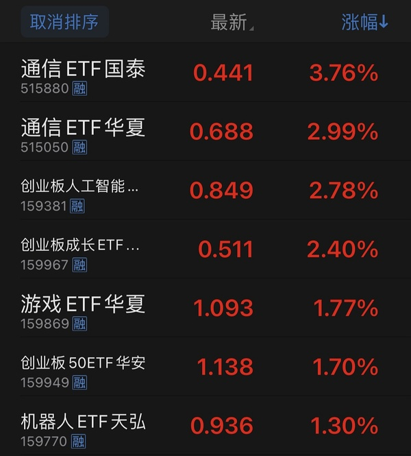

### 友友、网友们（提及 5 次，占比 2%）2026-11-11 08:21:37
- 希望uu之后回头看这是无与伦比的美妙操作🤣
- uu啊 传媒玩归玩 可别当真了哦🤣🤣🤣🤣🤣
- uu 你真是xjbc领域的智多星🤣🤣🤣🤣🤣🤣

### 大连圣亚（提及 4 次，占比 1%）2026-11-11 08:24:39
- 大连我开了9% 这个价格今天也到不了
- 去年大连确实是这样 因为他老是低开🤣🤣🤣
- 幸福降价5毛1794了  到不了本来的

大连到不了 我等会继续开大涨幅

### 上海电影（提及 4 次，占比 1%）2026-11-11 11:17:31
- 现在丢人的是芒果了
核心股票 20cm要被sy10cm干翻了😂
- 这个我不知道呀

当然我会在冰雪上吸取sy的教训
- 所以我还是很懂自己😂我手贱 明明白白
SY现在这个模式 襄阳那个模式
我们赚不到那么多钱
自己明确知道这一点
相反雪人这样上上下下的很明显大家赚的更多
成功率还高 信心也容易加强

自己还是得清楚认识自己
所以我不希望我们的冰雪复刻sy

### 新易盛＋中际旭创＋天孚通信（CPO三巨头合称）｜11-11 14:13「都去易中天了🤣」（非持仓）（提及 4 次，占比 1%）2026-11-11 11:20:51
- “易中天”集体上涨，新易盛涨超10%，中际旭创涨超9%，天孚通信涨超7%。
- 都去易中天了🤣
- “易中天”同日涨超13%！这次能否打破“次日必跌”的魔咒？

具体而言，据Wind数据梳理，今年下半年行情中（截至目前），当“易中天”单日平均涨幅超过7%，次日收涨概率为0。

这一次是“下半年”的重演，还是“上半年”的复苏？

答案可能很

### 中文在线（提及 4 次，占比 1%）2026-11-11 14:18:12
- 老师们 各路大V分析筹码问题

只要美国是真的

这个问题马上就不复存在
- 那第一个就是老师新买的

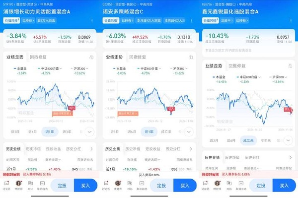
- 赵老师说APEC会议之前 大A保持强势

警惕由于大A科技股处于低位 进行业绩平滑洗澡
做差今年的业绩 
把本来明后年的商誉计提减值直接今年就释放

- 笑死 原来溢价率最高的国泰嘉实近一周数据垫底
3300脱颖而出
- 咱们3300还是近期数据最好的👍👍👍

### 中证2000指数（他当微盘股基准）｜11-11 11:11「除了机器人 今天其他题材全输给了2000」（提及 3 次，占比 1%）2026-11-11 11:11:50
- 科技不算的话

除了机器人
今天其他题材全输给了2000

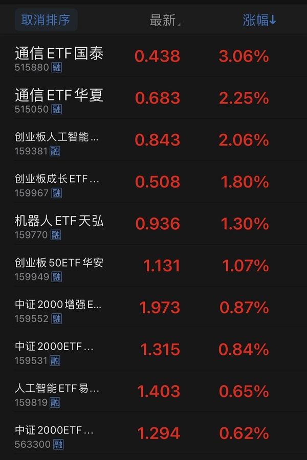
- 微盘股 2000都被大幅度击败了

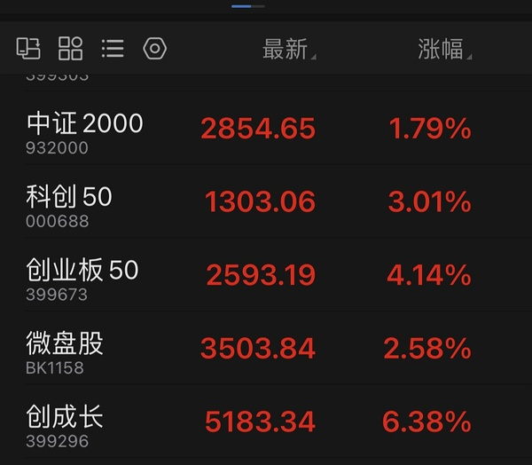
- 你怎么知道 

我把本来存着给明年A股冰点抄底2000和买中债美债的钱也先拿过来直接用了😂

### 300502 新易盛｜11-11 13:19「我那个买xys的女主播终于要开心了」＋13:21「她现在成本327了」→ **是女主播的仓，不是他的**（提及 3 次，占比 1%）2026-11-11 13:19:52
- 笑死了
今天我那个买xys的女主播终于要开心了
- 哈哈为什么真的是xys要更好啊？

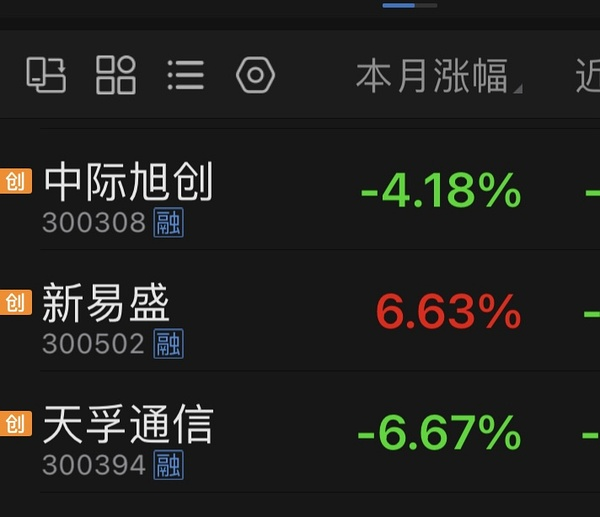
- 我之前和我女主播说你那xys涨70 80个点就和她收到嘉年华一样了 说来就来了🤣🤣🤣🤣

### 000530 冰山冷热｜11-11 10:16「万一冰山跌停 他能跌到哪里再去」＋10:27「今天把冰山 晶雪按死 大连 CBS 正统上位」（非持仓，冰雪板块的山寨对照）（提及 2 次，占比 1%）2026-11-11 10:16:41
- 没有 万一冰山跌停 他能跌到哪里再去
- 哈哈哈哈
也许人家今天稳住带动双子星
然后明天冰山深水 双子星再带动他起来🤣

### 埃斯顿（提及 2 次，占比 1%）2026-11-11 10:34:52
- 冲啊asd
- 我昨天去的另外一个
今天也吸到asd了🤣

### 航空航天板块（提及 2 次，占比 1%）2026-11-11 10:52:14
- 那最后的结局大部分人还是亏钱😂
宇航员最终是大批三连板跌停收尾 根本出不来🤣
- 也许真复刻去年宇航员呢🤣

### 招商银行（提及 2 次，占比 1%）2026-11-11 10:54:31
- 招招不经意间
打出五连阳😂
- 报

中国移动 空调 四大行 招招 快速跳水

### 000530 冰山冷热｜11-11 14:03「那冰冰准备」（同『冰山』，非持仓）（提及 2 次，占比 1%）2026-11-11 11:21:14
- 其实冰冰暂时很危险

这是大科技的反攻

微盘股也容易颤抖😂
- 那冰冰准备

### 幸福蓝海（提及 2 次，占比 1%）2026-11-11 13:39:12
- 我没交换给幸福已经是奖励他了哈哈
- 幸福两连绿
光线两连红

### 创业板50ETF（提及 2 次，占比 1%）2026-11-11 20:01:58
- 为什么买C
因为一开始买的都不是最佳选择呀
都存在后续换仓的可能
小华就出现了问题 C就赚了

你看uu们之前这个换那个 那个换这个
都还在搭配组合 自然应该选C

当我能确定买 且长时间持有的C50 CC我就都是A和I
如果nana能买 
- 还不止他们
之前易方达那种基金很明显也不在了😂

所以坚定看好C50 光
公募基金砍仓幅度很夸张啊
到时候又仔抱回来

### 建设工业（提及 1 次，占比 0%）2026-11-11 08:02:00
- 每年都有下半年和圣诞节的呀

越花越多了！

希望延缓数据中心建设既然做了 就加大裁员吧

### 纳斯达克100指数（他对照场内ETF溢价的基准）｜11-11 08:14「昨天513300涨了3.53% 但是nana100实际也就涨了3.4」（提及 1 次，占比 0%）2026-11-11 08:14:32
- 这个数学游戏越来越复杂了哈哈哈

昨天513300涨了3.53% 但是nana100实际也就涨了3.4
又多了0.13

昨晚下跌0.6 盘前暂时反弹0.4% 还要-0.2😂

正常应该-0.07开盘🤣🤣🤣

### 好想你（提及 1 次，占比 0%）2026-11-11 09:56:52
- 我只有恋爱脑
其他你们玩

### 大连圣亚600593＋长白山603099（他的正牌冰雪双仓）｜11-11 10:29「从不担心冰雪双子星」（提及 1 次，占比 0%）2026-11-11 10:29:46
- 从不担心冰雪双子星

### 芒果超媒（提及 1 次，占比 0%）2026-11-11 10:57:35
- 反超芒果

### CoreWeave（CRWV，美股AI算力）｜11-11 11:18「cw那玩意硬起来了 大家看夜盘数字」（提及 1 次，占比 0%）2026-11-11 11:18:51
- cw那玩意硬起来了 大家看夜盘数字

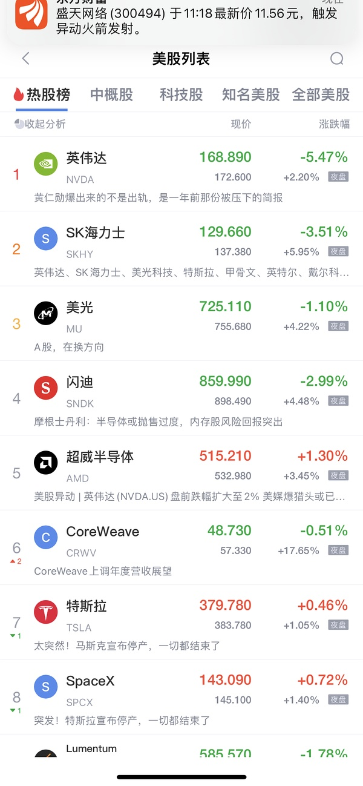

### 传媒板块拟人化（不是具体票）｜11-11 11:40「被传媒妹妹压制了」＋13:01「妹妹休息 哥哥接力？」（提及 1 次，占比 0%）2026-11-11 11:40:23
- 被传媒妹妹压制了🤣
不过也许哥哥知耻而后勇

### 605577 龙版传媒｜11-11 11:50「最早龙版也是因为自己每次公告文案都不一样才4连板就被监管」（讲监管规则，非持仓）（提及 1 次，占比 0%）2026-11-11 11:50:27
- 这一次很干净
我觉得很公平😂
大家一视同仁
最早龙版也是因为自己每次公告文案都不一样才4连板就被监管
目前紧箍咒续杯也是涉及各式各样的股票
没存在针对谁

### Anthropic（美股IPO）｜11-11 12:11「接下来是不是ant IPO也是利好」（提及 1 次，占比 0%）2026-11-11 12:11:33
- 恐慌指数飙升过了
一切都顺起来了

接下来是不是ant IPO也是利好
英伟达业绩再差也提前跌了 利空出尽是利好啊？🤣
加息鹰派昨晚预期拉满 后面是不是也都是利好？🤣
民主党狠话也放满了 利空出尽没？

### 保利发展（提及 1 次，占比 0%）2026-11-11 12:21:02
- 天猫双11 Token 今日打5折
据悉，今日，大模型厂商智谱、MiniMax、千问办公、阿里云、Qoder都在天猫打5折据介绍，消费者打开淘宝App搜索“Token”，即可进入天猫AI空间站的Token充值中心充值。其中 MiniMax的

### 引力传媒 603598（对手盘，非他持仓）｜11-06 +37.15%；11-09 本月+37.79%（提及 1 次，占比 0%）2026-11-11 12:34:12
- 你之前说的
不管短剧还是游戏什么的都得打广告营销
逻辑满分
市场正在演绎了🤣🤣🤣🤣

但是他们这一次居然真的放弃了蓝色和奶茶
你看宁愿先yl
现在高切低天下秀 和遥望都是抖音 小红薯大MCN
后面省广也很有可能被选中 抖音巨量引擎最大合作伙

### 游戏板块拟人化（不是具体票）｜11-11 12:58「游戏哥哥：我来也」＋13:01「妹妹休息 哥哥接力？」（提及 1 次，占比 0%）2026-11-11 12:58:44
- 游戏哥哥：我来也

### 博纳影业（提及 1 次，占比 0%）2026-11-11 14:01:02
- 人家同类的都冲了啊🤣bn弱了

### 华夏全球科技先锋混合(QDII)A（提及 1 次，占比 0%）2026-11-11 14:21:59
- 易方达不准
小华A还是很多的 没问题

### 生肖羊概念组（带阳/洋的一篮子：东方海洋/日出东方/大东方/红太阳/澳洋健康/鲁阳节能/华阳国际/东方日升/阳光照明/九阳股份/阳光乳业/沈阳机床）｜11-09 14:04 他自己贴的分组｜**不是单只票，也不是『小羊』襄阳轴承**（提及 1 次，占比 0%）2026-11-11 14:24:20
- 羊啊 东方啊没崩
投机资金暂时还都在😂😂

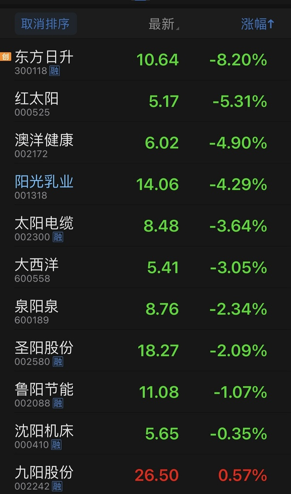

### 某个特别牛逼的散户（提及 1 次，占比 0%）2026-11-11 15:12:17
- 温暖老师分析的有道理啊
我也觉得传媒应该做一次明显的调整
但是今天日内大V😂😂😂😂

但我觉得虽迟但到 而且强行延缓 只会让调整加剧
不然只是柔和的调整

### 000995 皇台酒业｜11-09 与雪人 PK 当日换手率龙虎榜（提及 1 次，占比 0%）2026-11-11 17:33:36
- 皇台自己都打不出新高了🤣
刷了一个18.88不知道是不是暗示拜拜

皇字辈out😂😂😂😂😂😂😂

### 华宝致远混合(QDII)C｜只在盯，未证他持有（提及 1 次，占比 0%）2026-11-11 17:47:05
- 这两个估值确实是绿的
小远跟七巨头 主楼贴了-0.78还凑活🤣

### 513300 纳斯达克ETF华夏｜11-09 14:34「不愧是513300 当年的普通nana ETF之王」，当日唯一红的纳指ETF（提及 1 次，占比 0%）2026-11-11 20:07:53
- 这个消息足以证明当初看到这个消息 咱们判断nana会更难买到是对的

半年之前nana场内最低的溢价率大概在4-6%
现在这个数字提高到了16%
这还在nana最近不太好的情况下

### 📄 全部发言（共 308 条）
- (2026-11-11 07:40:21) 重开了！  ⊳ （引用 @momo📈📈📈）咦，怎么投票就结束了

- (2026-11-11 07:44:10) 市场传部分券商分析师看多债市公众号文章被删除，进一步说明央妈确实对债市下行过快开始关注，10年国债破1.5825%历史新低以后，央妈才从资金到文章开始动手和指导，这次表现的比较温和，说明不是债不能下行，而是债不能过快下行！

慢牛

- (2026-11-11 07:49:30) [图] 美债回到4.75%
市场重新预期还有三次加息 回到之前状态

12月一次 
1月3月一次
4-12月一次

依然比较差的情况都很有机会4月就结束加息周期

- (2026-11-11 07:49:46) 应该是因为今天美国休市？  ⊳ （引用 @我爱牛肉火锅）昨晚点进支付宝发现长盛不给买了，还好这两天多少买了一些

- (2026-11-11 07:53:00) 12月不加息概率为0🤣🤣🤣🤣🤣

只有88.5%加25和11.5%一次双倍加50  ⊳ （引用 @不知道还能说啥）美债回到4.75%
市场重新预期还有三次加息 回到之前状态

12月一次 
1月3月一次
4-12月一次

依然比较差的情况都很有机会4月就结束加息周期

- (2026-11-11 07:53:39) 那今天场内nana也许都不会绿😂😂😂😂😂  ⊳ （引用 @六倍做多退休）crwv业绩不错 终于没有给大巴掌了 

- (2026-11-11 07:58:26) 美联储官员古尔斯比：通胀是由成本端和需求端共同驱动的。

美国人能不能少吃点 少花点 ！！！！

- (2026-11-11 08:00:13) 这个一直都在
只是两次还是三次 市场一直摇摆  ⊳ （引用 @有人区生菜）怎么又开始加息了

- (2026-11-11 08:02:00) 每年都有下半年和圣诞节的呀

越花越多了！

希望延缓数据中心建设既然做了 就加大裁员吧  ⊳ （引用 @Waiting一下）美国人下半年节日多，就喜欢花钱，尤其是圣诞节左右😂😂

- (2026-11-11 08:05:07) [图] ETF追踪丨11月10日股票型ETF净赎回18亿元 资金减仓沪深300ETF华泰柏瑞

近一个月首次 无法获得净申购

- (2026-11-11 08:14:32) 这个数学游戏越来越复杂了哈哈哈

昨天513300涨了3.53% 但是nana100实际也就涨了3.4
又多了0.13

昨晚下跌0.6 盘前暂时反弹0.4% 还要-0.2😂

正常应该-0.07开盘🤣🤣🤣

- (2026-11-11 08:17:05) [图] 我打算买一点点工银这个能买的超长的 最猛的😂

  ⊳ （引用 @六倍做多退休）今天美债也买不了吧

- (2026-11-11 08:21:37) 希望uu之后回头看这是无与伦比的美妙操作🤣  ⊳ （引用 @fafa大财）今天去新岗位了，我要把场内全换成娜娜

- (2026-11-11 08:23:01) 笑死 进攻的钱我已经上周五全部用完了 一分都没有了🤣  ⊳ （引用 @shirla）我不买债了，我要进攻！

- (2026-11-11 08:24:39) 大连我开了9% 这个价格今天也到不了  ⊳ （引用 @🅰失而复🉐😎）这俩电影手动挂单送它们走😇

- (2026-11-11 08:25:17) 华泰证券：L3落地将是智驾产业重要里程碑

华泰证券研报称，L3落地将是智驾产业的重要里程碑，华泰证券认为L3准入与责任边界正在明确：大众中国在合肥获得L3道路测试牌照，L3能力最快于2027年下半年交付，Momenta预计L3/L4在2028年迎来拐点。L3在系统激活期间由系统执行驾驶任务，对制动、转向冗余与算力的要求更高，执行与决策环节的单车价值量有望随之提升。Robotaxi方面，上海拟将自动驾驶写入出租汽车条例，小鹏获广州全域L4示范运营资格，日本拟自12月起统一认证无方向盘L4车辆。

- (2026-11-11 08:25:59) 软银股价跌幅扩大至10%，此前公布财季亏损70亿美元。

- (2026-11-11 08:47:13) 两市融资余额较上日减少13.85亿元

截至11月10日，上交所融资余额报11743.95亿元，较前一交易日减少37.95亿元；深交所融资余额报10837.57亿元，较前一交易日增加24.10亿元；两市合计22581.52亿元，较前一交易日减少13.85亿元。

- (2026-11-11 08:47:24) 进100 出13

融资盘不一样了  ⊳ （引用 @不知道还能说啥）两市融资余额较上日减少13.85亿元

截至11月10日，上交所融资余额报11743.95亿元，较前一交易日减少37.95亿元；深交所融资余额报10837.57亿元，较前一交易日增加24.10亿元；两市合计22581.52亿元，较前一交易日

- (2026-11-11 09:12:13) 可以去看下去年12月日成交额巅峰大概是多少  ⊳ （引用 @锐不可丿当）早早早，楼楼昨天雪儿有点爆量了，会有风险嘛？

- (2026-11-11 09:13:23) 最近比尔阿克曼做什么股票啊？😂  ⊳ （引用 @木感情的打工人）微软市值超过英伟达了，不知道是不是一个风向标

- (2026-11-11 09:19:50) 雪儿最大风险是科技股暴力反攻  ⊳ （引用 @锐不可丿当）早早早，楼楼昨天雪儿有点爆量了，会有风险嘛？

- (2026-11-11 09:29:44) 爱利彼半导体启动IPO辅导
证监会网站披露，爱利彼半导体设备（上海）股份有限公司（以下简称“爱利彼半导体”）于2026年11月10日在上海证监局办理辅导备案登记，拟首次公开发行股票并上市，辅导券商为申万宏源证券承销保荐有限责任公司。

- (2026-11-11 09:31:40) 买入后开单7%涨幅

- (2026-11-11 09:35:42) 👍👍👍👍👍  ⊳ （引用 @钱包鼓鼓💰）15.6抄上了！

- (2026-11-11 09:36:11) 你要买 是卖1

卖才是买1  ⊳ （引用 @高手云集上钻）飞舞同花顺，我雪人挂的买入条件单是15.64，没成交，难道不能设置买一

- (2026-11-11 09:38:06) 重新强调

不要增加传媒仓位

这是我连续第二天提醒

- (2026-11-11 09:48:23) 我昨天就说了
不是今天  ⊳ （引用 @红红火火的anya）楼主，今天为啥不能买传媒呀

- (2026-11-11 09:48:45) 不增加传媒仓位和没有传媒是两回事  ⊳ （引用 @Aaa摆烂咸鱼🥳）楼，bn，中影，幸福也是传媒吧

- (2026-11-11 09:53:48) 要念名字

闽发
惠发

昨天S姐提示桂发  ⊳ （引用 @vio）小惠 这独食儿让你吃的

- (2026-11-11 09:56:52) 我只有恋爱脑
其他你们玩  ⊳ （引用 @有空青年胃不饱）楼看捞食品嘛今天

- (2026-11-11 09:57:03) 当日涨幅  ⊳ （引用 @纸飞机）这个7%涨幅是当前价7%还是按照昨日收盘价7%啊hhh，搞不清了

- (2026-11-11 09:58:27) 原来如此！！！  ⊳ （引用 @momo）日发也是涨停

- (2026-11-11 10:09:46) 位置优势😂  ⊳ （引用 @🅰失而复🉐😎）光线大放异彩了开始😏

- (2026-11-11 10:10:52) [图] 黄金 有色 白酒 光伏领跌

- (2026-11-11 10:12:51) 7天赢了6天
不要休息一下的吗  ⊳ （引用 @👑）怎么感觉都在发套啊

- (2026-11-11 10:15:06) [图] 历史总相似？

- (2026-11-11 10:16:16) [图] 今天微盘股玩到哪个方向去了？

- (2026-11-11 10:16:41) 没有 万一冰山跌停 他能跌到哪里再去  ⊳ （引用 @🅰失而复🉐😎）15.35卡五日线，话说那个晶去没去它在拉了

- (2026-11-11 10:18:38) 打开你的食品饮料板块

11红110绿 这叫炒消费吗😂  ⊳ （引用 @👑）消费小辣鸡算吗

- (2026-11-11 10:21:00) 相对是机器人好点  ⊳ （引用 @木感情的打工人）🤖吧

- (2026-11-11 10:23:11) [图] 还可以
比想象中好
没有-8以上票

- (2026-11-11 10:27:42) 哈哈哈哈
也许人家今天稳住带动双子星
然后明天冰山深水 双子星再带动他起来🤣  ⊳ （引用 @速派女孩将发财）既然都这样了 那我支持 今天把冰山 晶雪按死  大连 CBS 正统上位

- (2026-11-11 10:28:17) 11.9日基本都是涨停的 到底嘛😂  ⊳ （引用 @有人区生菜）休息这一天顶我前面几天

- (2026-11-11 10:29:46) 从不担心冰雪双子星  ⊳ （引用 @🅰失而复🉐😎）大白来了

- (2026-11-11 10:31:28) [图] 因为这个来了

  ⊳ （引用 @速派女孩将发财）CBS现在已经脱离冰山在独立行走了！

- (2026-11-11 10:31:49) 峨眉山直线拉板

- (2026-11-11 10:31:56) 他山上也有雪  ⊳ （引用 @不知道还能说啥）峨眉山直线拉板

- (2026-11-11 10:33:03) 现在溢价率最低的也在14%了😂  ⊳ （引用 @六倍做多退休）果然场内的nana溢价又高了😂 不愿意绿 爽

- (2026-11-11 10:33:50) 国台办：欢迎并支持更多台湾业者参与大陆微短剧创作

- (2026-11-11 10:33:54) …..  ⊳ （引用 @不知道还能说啥）国台办：欢迎并支持更多台湾业者参与大陆微短剧创作

- (2026-11-11 10:34:35) 峨眉山还有黄金概念呢🤣  ⊳ （引用 @点-重生炒垃圾）我还以为是猴

- (2026-11-11 10:34:52) 冲啊asd  ⊳ （引用 @只想搞钱）机器人拉升

- (2026-11-11 10:38:03) 山寨货肯定和山寨混一起  ⊳ （引用 @🅰失而复🉐😎）一看这三就是一路货色

- (2026-11-11 10:38:20) 那自然不是  ⊳ （引用 @硬糖）楼楼今天就捡了雪人吗

- (2026-11-11 10:40:58) 我反正不加仓传媒😂  ⊳ （引用 @木感情的打工人）放出来这种新闻是不是就是在找接盘的了😂

- (2026-11-11 10:42:20) [图] 微盘股大幅扩大涨幅

- (2026-11-11 10:43:15) [图] 题材确实是机器人 现在看到ETF前排了🤣

  ⊳ （引用 @点-重生炒垃圾）芒果又拉两个点

- (2026-11-11 10:43:47) [图] 有喜欢的吗🤣

  ⊳ （引用 @只想搞钱）对襄阳进行膜拜，替我的冰雪接一接

- (2026-11-11 10:45:12) 襄阳之前的图好骗人啊！  ⊳ （引用 @只想搞钱）对襄阳进行膜拜，替我的冰雪接一接

- (2026-11-11 10:45:39) 今天plus雪不敢😂😂  ⊳ （引用 @🅰失而复🉐😎）山寨来了

- (2026-11-11 10:49:16) [图] 3300还行 不过今天我不满意

- (2026-11-11 10:49:53) 哈哈哈国台办功劳 这也能喊话到短剧😂  ⊳ （引用 @sickid）谢谢欢瑞

- (2026-11-11 10:52:14) 那最后的结局大部分人还是亏钱😂
宇航员最终是大批三连板跌停收尾 根本出不来🤣  ⊳ （引用 @点-重生炒垃圾）你说会像去年宇航员一样，一直不敢上，最后爆到一月去吗

- (2026-11-11 10:53:53) [图] 黄金白银逃出去了
现在是喝酒吃药光伏垫底了😂

- (2026-11-11 10:54:31) 招招不经意间
打出五连阳😂

- (2026-11-11 10:56:00) [图] 也是三连阳啊

  ⊳ （引用 @🅰失而复🉐😎）科技😕有想过我的感受吗

- (2026-11-11 10:56:49) 哪个权重害的  ⊳ （引用 @点-重生炒垃圾）K50开始自杀了

- (2026-11-11 10:57:35) 反超芒果  ⊳ （引用 @哎呀哎呀）Sy你还回来吃饭吗🥹🥹🥹

- (2026-11-11 10:57:50) 银行板块延续强势格局，南京银行、长沙银行、成都银行创历史新高，工建农中交邮六大行齐升。据官媒报道，今年以来，险资差异化配置银行股，大型险企主要买入国有大型银行股份。

- (2026-11-11 10:58:59) [图] 今天这几个都不能爆发

- (2026-11-11 10:59:13) 你怎么还有白酒的😂  ⊳ （引用 @问一下能不能瘦）完了 我的白酒今天暴跌了

- (2026-11-11 11:00:32) 周末我听的都是 国产设备是科技首选😂  ⊳ （引用 @点-重生炒垃圾）设备吧，三个设备一起自杀，中微带头的

- (2026-11-11 11:01:46) 我今天去查询下
哪几家吹高配港股 低配美股的😂  ⊳ （引用 @我爱牛肉火锅）跟高配港股，低配美股的坐一桌去吧

- (2026-11-11 11:04:22) 只要往上火箭发射狂飙就得走😂  ⊳ （引用 @shirla）能苟住就不清对吧？哈哈

- (2026-11-11 11:08:23) 你现在和他道歉还来得及  ⊳ （引用 @问一下能不能瘦）比雪人争气多了

- (2026-11-11 11:09:28) 领涨的是机器人  ⊳ （引用 @Frances）关注的博主：你会觉得你今天有一些高位的票是阳为主啊，长得很乏力，原因就是因为可能要卡移动。第二个就是被列入重点监控的票，你会看到一个传媒的老大哥明天要到期出监管，你会发现今天传媒表现的比较强，这些都是正常的啊，这些都是所谓的由题材内部的人气

- (2026-11-11 11:09:53) 也许真复刻去年宇航员呢🤣  ⊳ （引用 @木感情的打工人）今天有希望回本吗，-2.8%

- (2026-11-11 11:11:50) [图] 科技不算的话

除了机器人
今天其他题材全输给了2000

- (2026-11-11 11:12:23) 你应该不知道plus雪是哪个  ⊳ （引用 @桑尼菌）昨天楼说5日线接雪人，今天没加吗

- (2026-11-11 11:13:12) 我开了17.19 
当日7%涨幅左右
也就是日内10%差价  ⊳ （引用 @🅰失而复🉐😎）楼你今天买入雪人的价格7卖，是16.6附近还是低点？

- (2026-11-11 11:14:08) -3多买的 +7 就是10%一个日内涨停呀🤣  ⊳ （引用 @我爱牛肉火锅）果然你说最贪的是你，我寻思我17够贪了

- (2026-11-11 11:16:29) 恐慌指数飙升真的刺激到了nana🤣🤣🤣🤣  ⊳ （引用 @六倍做多退休）期货nana真的好嗨 

- (2026-11-11 11:17:31) 现在丢人的是芒果了
核心股票 20cm要被sy10cm干翻了😂  ⊳ （引用 @我爱牛肉火锅）冲冲冲，跟幸福一起，要设备狗命！把科创50打成科创7.5

- (2026-11-11 11:18:51) [图] cw那玩意硬起来了 大家看夜盘数字

- (2026-11-11 11:20:02) 这个我不知道呀

当然我会在冰雪上吸取sy的教训  ⊳ （引用 @我爱牛肉火锅）话说上影这一轮是不是又是即梦的消息续上了，我记得去年也是这个即梦🤔🤔，不过那个破综艺也越来越难看了，接高开低走吧

- (2026-11-11 11:20:51) “易中天”集体上涨，新易盛涨超10%，中际旭创涨超9%，天孚通信涨超7%。

- (2026-11-11 11:21:14) 其实冰冰暂时很危险

这是大科技的反攻

微盘股也容易颤抖😂  ⊳ （引用 @不知道还能说啥）“易中天”集体上涨，新易盛涨超10%，中际旭创涨超9%，天孚通信涨超7%。

- (2026-11-11 11:22:12) [图] 国债：哥顶不住你们了

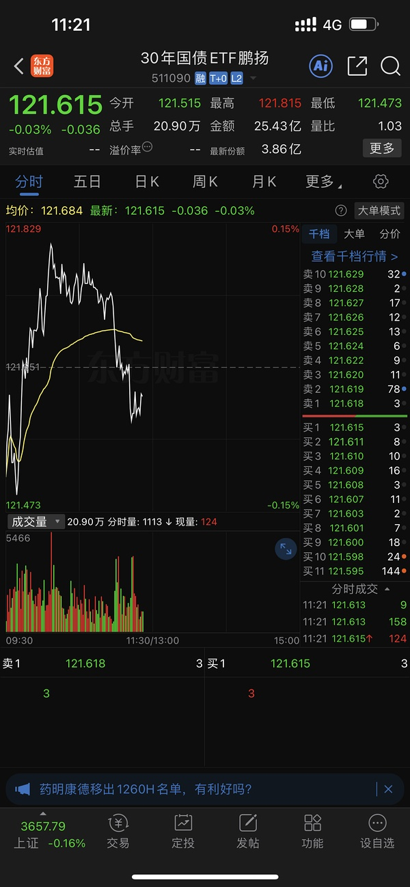  ⊳ （引用 @不知道还能说啥）“易中天”集体上涨，新易盛涨超10%，中际旭创涨超9%，天孚通信涨超7%。

- (2026-11-11 11:23:00) 有没有消息面？fcc解除？  ⊳ （引用 @点-重生炒垃圾）易三天干了30没有

- (2026-11-11 11:23:54) [图] 一群傻玩意
看看这边

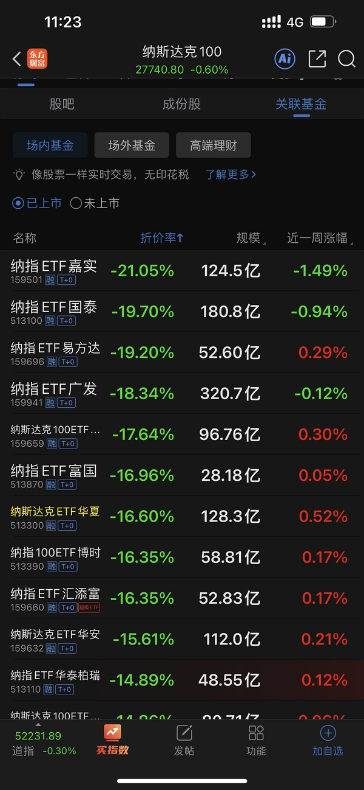  ⊳ （引用 @我爱牛肉火锅）报！中韩半导体溢价已不足5%

- (2026-11-11 11:24:37) 笑死 原来溢价率最高的国泰嘉实近一周数据垫底
3300脱颖而出  ⊳ （引用 @不知道还能说啥）一群傻玩意
看看这边

- (2026-11-11 11:25:13) 好的 全球联动 我们不会差的  ⊳ （引用 @点-重生炒垃圾）昨天有小作文，微软督促特朗普解除光模块限制，刚好昨天药明被解除了，就很可信。。。。。

- (2026-11-11 11:27:10) 我摄像眼光不错的🤣  ⊳ （引用 @只想搞钱）游戏

- (2026-11-11 11:28:17) 昨天我给他买了两杯星冰乐 两场直播干杯🤣  ⊳ （引用 @我爱牛肉火锅）继续华丽运镜~

- (2026-11-11 11:28:30) 游戏ETF反超了机器人

- (2026-11-11 11:28:56) [图] 妹妹不知道在哪里 哥哥来了

  ⊳ （引用 @不知道还能说啥）游戏ETF反超了机器人

- (2026-11-11 11:29:45) [图] 不止
而且我跟了他一把
说好了 亏了他还给我星冰乐😂😂😂😂

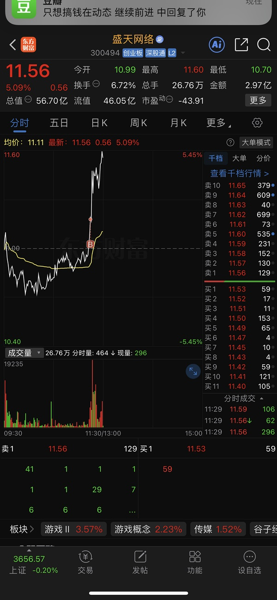  ⊳ （引用 @我爱牛肉火锅）你打野的游戏是不是也掏到了

- (2026-11-11 11:30:52) 我打野的不如他的
还是他的两个好😂😂😂😂

我菜  ⊳ （引用 @shirla）楼楼游戏打的哪个哇

- (2026-11-11 11:33:02) 我昨天买的不是啊 特意买的和他不一样 但我输了  ⊳ （引用 @🅰失而复🉐😎）原来是它

- (2026-11-11 11:33:20) [图] 15到45哦

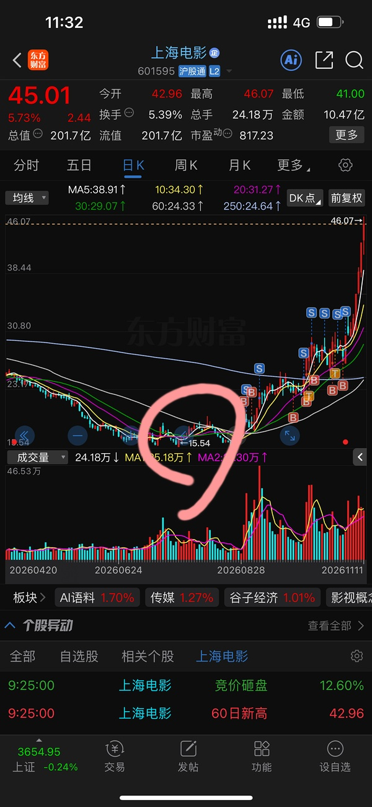  ⊳ （引用 @点-重生炒垃圾）我去，真的，比半导体还没，都没有挖坑区

- (2026-11-11 11:35:08) 东方海洋有点冲动啊
怎么拉红了🤣  ⊳ （引用 @shirla）我反正是跟不上，主打一个围观😂😂😂

- (2026-11-11 11:35:57) 今天不太行的时候
国台办都能喊话短剧
不得不服哦  ⊳ （引用 @点-重生炒垃圾）你这个图像那个，你永远不知道鱼尾行情的鱼尾有多大

- (2026-11-11 11:37:07) 光线给我30%+也行啊  ⊳ （引用 @我爱牛肉火锅）还好吃上了一些，不然就是光线2.0

- (2026-11-11 11:37:28) 你难道还不知道自己
这种走势你拿不住吗
不要学这个走势  ⊳ （引用 @只想搞钱）替冰雪接sy、襄阳走势

- (2026-11-11 11:39:17) 我们最喜欢的走势
就是今天涨停明天-5 后天+8 大后天又-3 然后又涨停 这种模式
因为大家手贱  ⊳ （引用 @只想搞钱）那接涨幅吧🥹

- (2026-11-11 11:40:23) 被传媒妹妹压制了🤣
不过也许哥哥知耻而后勇  ⊳ （引用 @啊呆呆呆呆）游戏板块这个月涨这么好，上次出去了就没回去，一看都要突破箱体了，这个月ETF都涨了二十个点。

- (2026-11-11 11:42:29) 去年大连确实是这样 因为他老是低开🤣🤣🤣  ⊳ （引用 @家不住海边）大连可以。吧

- (2026-11-11 11:44:45) [图] 不是啊

上交所五连板自动下发监管的！！！

之前九百也是啊

这是规则

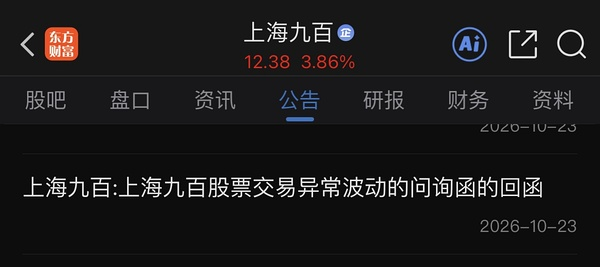  ⊳ （引用 @啊呆呆呆呆）那天传媒还是啥有个五板是不是又被点名了？感觉上面好爱压制AI应用。

- (2026-11-11 11:46:36) 挺好 这样12月电影还能续  ⊳ （引用 @我爱牛肉火锅）就是稍微显露一点颓势，那边起搏器就来了，一直要给它电起来，妈去缅北进修啦

- (2026-11-11 11:49:12) 今天晚上美股到底开盘吗

美债期货已经关闭了😂美股期货是在走的

- (2026-11-11 11:50:27) 这一次很干净
我觉得很公平😂
大家一视同仁
最早龙版也是因为自己每次公告文案都不一样才4连板就被监管
目前紧箍咒续杯也是涉及各式各样的股票
没存在针对谁  ⊳ （引用 @啊呆呆呆呆）我以为又被压制呢。

- (2026-11-11 11:51:01) 好的
不然建信又要放假不更新了🤣  ⊳ （引用 @我爱牛肉火锅）开盘，AI要是骗我它就死定了

- (2026-11-11 11:53:21) 所以我还是很懂自己😂我手贱 明明白白
SY现在这个模式 襄阳那个模式
我们赚不到那么多钱
自己明确知道这一点
相反雪人这样上上下下的很明显大家赚的更多
成功率还高 信心也容易加强

自己还是得清楚认识自己
所以我不希望我们的冰雪复刻sy  ⊳ （引用 @timing）去年老是低开买+7触发 超级爽的🤣🤣

- (2026-11-11 11:54:09) 但是该坐牢的都在坐了
其他的很多在规规矩矩绕异动🤣🤣🤣  ⊳ （引用 @啊呆呆呆呆）好像就媒体提了一下羊？

- (2026-11-11 11:54:57) [图] 东方海洋别浪了 0.08跌回去啊😂😂😂

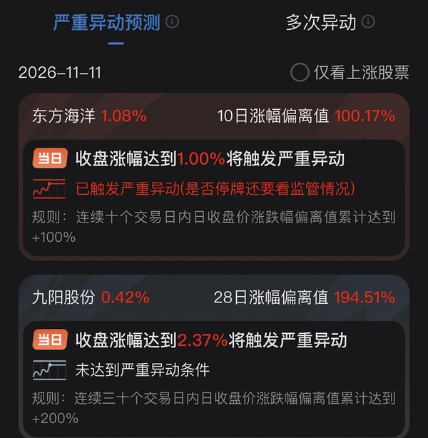

- (2026-11-11 12:08:08) 据英国《金融时报》报道，由于投资者需求强劲，Anthropic的承销投行正考虑将其IPO估值推高至1.5万亿美元以上；银行家可能在未来几天上调Anthropic的发行价，突破周二文件披露的70—78美元/股区间。

昨天晚上还是1万亿！

- (2026-11-11 12:09:30) 是不是有投顾带队买了
投顾还是喜欢那种慢悠悠的 波动小点  ⊳ （引用 @六倍做多退休）🤣大伙都看不上的傻大个华宝都只有200额度了哈哈哈

- (2026-11-11 12:11:33) 恐慌指数飙升过了
一切都顺起来了

接下来是不是ant IPO也是利好
英伟达业绩再差也提前跌了 利空出尽是利好啊？🤣
加息鹰派昨晚预期拉满 后面是不是也都是利好？🤣
民主党狠话也放满了 利空出尽没？

- (2026-11-11 12:14:23) 美股半导体股夜盘集体反弹，英伟达涨2.4%，闪迪涨4.62%。  ⊳ （引用 @不知道还能说啥）据英国《金融时报》报道，由于投资者需求强劲，Anthropic的承销投行正考虑将其IPO估值推高至1.5万亿美元以上；银行家可能在未来几天上调Anthropic的发行价，突破周二文件披露的70—78美元/股区间。

昨天晚上还是1万亿！

- (2026-11-11 12:18:11) 不是！
美债性价比高
但是美债波动大

美债你放不了几年 
明年下半年转为降息预期的话 债券会提前反应的 届时降息重新开始之前你就得卖出了
如果后续重新转为降息 目前美债很有买入价值 只是中间波动大
我国庆之前买的刚赚了1.4% 今天要抹掉很多………….  ⊳ （引用 @miumiu）请教一下楼楼，现在依然是国债大大大超美债性价比吗，有一笔中钱可以放几年想打债券了

- (2026-11-11 12:20:28) 应该大资金还是国内短债 你需要稳定的基石
部分资金投有一定波动的债券 放大部分收益 但同时这个波动在整体资金面前又不会影响你基石  ⊳ （引用 @miumiu）请教一下楼楼，现在依然是国债大大大超美债性价比吗，有一笔中钱可以放几年想打债券了

- (2026-11-11 12:21:02) 天猫双11 Token 今日打5折
据悉，今日，大模型厂商智谱、MiniMax、千问办公、阿里云、Qoder都在天猫打5折据介绍，消费者打开淘宝App搜索“Token”，即可进入天猫AI空间站的Token充值中心充值。其中 MiniMax的三款月卡全部5折，阿里云Token Plan 两款月卡5折起，智谱周卡5折起，千问办公基础版会员月卡首月3折起，Qoder月卡3.3折，低至19.9元。（新浪科技）  ⊳ （引用 @木感情的打工人）准备把港股卖了，买进纳纳把，懒得折腾了

- (2026-11-11 12:21:42) [图] 😂😂😂😂😂😂

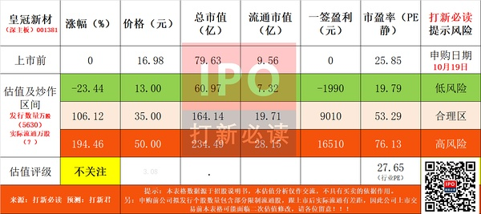  ⊳ （引用 @qiu啾）蛙趣，看到之前交流群打N皇冠的老哥105的成本，也不晓得他🈹了没得，41块了。他说他朋友给他说要涨到300

- (2026-11-11 12:24:33) 因为之前不是炒皇嘛 我确实看过
但我一看就是因为这个皇 他们第一天上市竞价开盘
就已经顶到了远远不切实际的价格😂😂
和神鼓一样 必将一地鸡毛  ⊳ （引用 @qiu啾）楼楼反应好快

- (2026-11-11 12:26:59) 那就玩不了了
消费降级
卷起来
😂  ⊳ （引用 @momo）人/民/日/报公众号：“Token”摆上电商货架，该怎么看？ 以后大消费请带token消费玩

- (2026-11-11 12:29:18) 国泰海通：世界模型加速迭代 望成文娱内容新引擎

国泰海通发布研究报告称，世界模型的本质突破在“可交互”，AI互动影游为文娱先锋，叠加XR设备回暖，打开内容新周期。

1)游戏：AI互动影游的"主战场"，降本增效与玩法创新双受益。
2)影视：AI短剧是互动影游的起点，内容供给成本大幅下降。
3)营销：AI素材生成降本最直接，商业化兑现最快的环节。

- (2026-11-11 12:30:32) 但我看好互动影游 却丢失了sy😂菜啊  ⊳ （引用 @木感情的打工人）楼：几个月前我就知道了，还用你在这里叨叨叨？🤣

- (2026-11-11 12:34:12) 你之前说的
不管短剧还是游戏什么的都得打广告营销
逻辑满分
市场正在演绎了🤣🤣🤣🤣

但是他们这一次居然真的放弃了蓝色和奶茶
你看宁愿先yl
现在高切低天下秀 和遥望都是抖音 小红薯大MCN
后面省广也很有可能被选中 抖音巨量引擎最大合作伙伴之一  ⊳ （引用 @家不住海边）华策也是涨的不错吧

- (2026-11-11 12:39:29) 我不这么觉得
因为里面的票一直都在往上走啊 
不说那几个20cm最强势的
包括机器人老牌的三花和拓普都过60日线了 走的很好啊
其他一大堆都很好 春哥也都在积极向上  ⊳ （引用 @柚子mm）楼楼，机器人老冲高回落什么意思？是不是现在风险大于机会？

- (2026-11-11 12:41:15) 😂😂😂😂😂😂😂😂😂  ⊳ （引用 @木感情的打工人）ai也乐观了。。最近有点缺钱，我问ai从哪里挪，ai让我挪稳定理财的，不要动招商体育文化……

- (2026-11-11 12:41:28) ai也看好传媒？  ⊳ （引用 @木感情的打工人）ai也乐观了。。最近有点缺钱，我问ai从哪里挪，ai让我挪稳定理财的，不要动招商体育文化……

- (2026-11-11 12:58:35) 腾讯“鹅次元”亮相！游戏多股涨停 

消息面上，11月10日，腾讯首款专属AI游戏陪伴Agent“鹅次元”近日开启内测。这款产品面向PC玩家，提供拟人化的AI陪伴和实时语音互动。“鹅次元”主打游戏场景实时陪伴，AI能够看到用户的游戏画面，并根据画面信息与人互动。

如果玩家在游戏中遇到不懂的东西，可以随时向这款AI陪伴提问。同时，这款产品支持PC/手机QQ陪伴聊天，还具备桌宠、一键更换壁纸、嘴替/变声等功能（即将上线）。

- (2026-11-11 12:58:44) 游戏哥哥：我来也  ⊳ （引用 @不知道还能说啥）腾讯“鹅次元”亮相！游戏多股涨停 

消息面上，11月10日，腾讯首款专属AI游戏陪伴Agent“鹅次元”近日开启内测。这款产品面向PC玩家，提供拟人化的AI陪伴和实时语音互动。“鹅次元”主打游戏场景实时陪伴，AI能够看到用户的游戏画面，并

- (2026-11-11 13:00:01) 昨天和今天摸了点😂  ⊳ （引用 @sickid）那你回机器人吗

- (2026-11-11 13:00:27) 全部火箭发射  ⊳ （引用 @不知道还能说啥）游戏哥哥：我来也

- (2026-11-11 13:01:16) 妹妹休息 哥哥接力？  ⊳ （引用 @木感情的打工人）有点厉害的东西

- (2026-11-11 13:02:55) 我摄像为了英雄联盟冠军而买的游戏
居然还是靠了腾讯哈哈哈哈  ⊳ （引用 @木感情的打工人）这。。

- (2026-11-11 13:04:50) 我那个摄像师今天还是继续加班吧

- (2026-11-11 13:05:19) 我收藏下
盘后我来看看🤣
现在办公室有点火热  ⊳ （引用 @速派女孩将发财）楼 我的AI分析三个基金来了 同花顺的AI真的有点东西。
我给她假设了前提：1. 诺安的基金不在考虑飘移的黑历史。2.在坚定看好Q4微盘的行情下选择。

如果你"坚定看好微盘股"——选鑫元鑫锐A。 理由：

策略纯度最高：市值因子排序+等权

- (2026-11-11 13:08:26) 我菜 这次不是我
我自己买的游戏就+5
他一个涨停一个+7🤣🤣🤣🤣🤣  ⊳ （引用 @发财喵）楼游戏好猛啊 你简直点金小手手

- (2026-11-11 13:09:53) 他和我分析的是
一定要买电竞相关的最好有主办比赛和电竞平台的🤣🤣🤣🤣他选的都是这个

因为他说英雄联盟夺冠还会嗨翻天一次  ⊳ （引用 @发财喵）楼游戏好猛啊 你简直点金小手手

- (2026-11-11 13:10:51) 今天我又要支付两杯星冰乐了看来  ⊳ （引用 @发财喵）哈哈哈那他加班也很开心

- (2026-11-11 13:15:38) 到底ccz牛逼还是通信牛逼？  ⊳ （引用 @木感情的打工人）通信etf不会涨停吧？？

- (2026-11-11 13:16:38) [图] 前排只有游戏是非科技👍

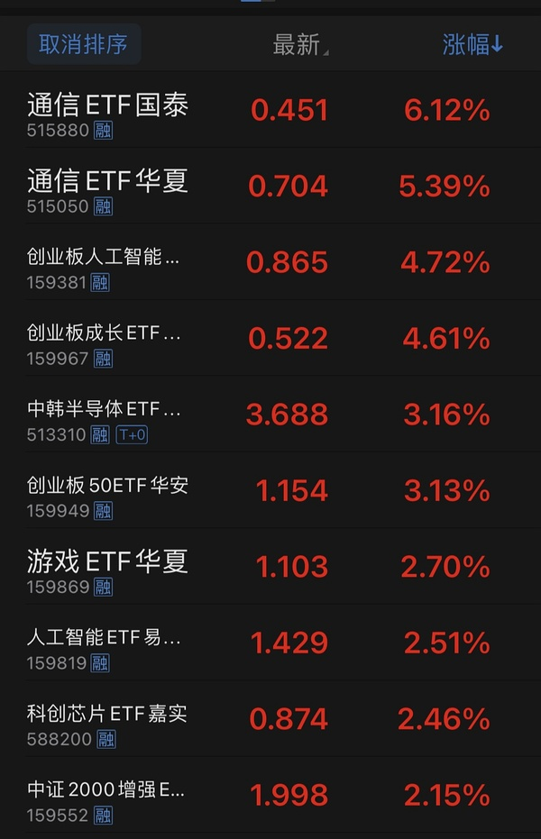

- (2026-11-11 13:17:11) 今天第一名！  ⊳ （引用 @木感情的打工人）通信哈哈哈

- (2026-11-11 13:19:52) 笑死了
今天我那个买xys的女主播终于要开心了  ⊳ （引用 @点-重生炒垃圾）太牛逼了

- (2026-11-11 13:21:22) 这就是民主党带来的好处是吗？  ⊳ （引用 @六倍做多退休）又要站在光里了🤣

- (2026-11-11 13:21:52) 人家补仓过了 她现在成本327了🤣  ⊳ （引用 @点-重生炒垃圾）跟爱国链剪刀差是30%我刚刚算了一下价格是209多😂😂😂刚好新易盛到这个位置就不动了

- (2026-11-11 13:23:56) [图] 场内纳斯达克消灭了15以内的溢价率

全部nana都在15+了

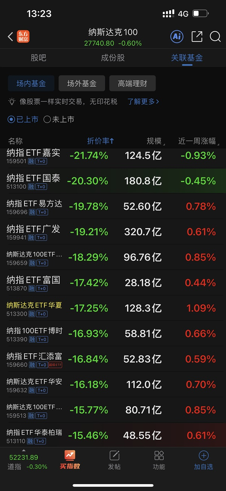

- (2026-11-11 13:24:18) 咱们3300还是近期数据最好的👍👍👍  ⊳ （引用 @不知道还能说啥）场内纳斯达克消灭了15以内的溢价率

全部nana都在15+了

- (2026-11-11 13:25:26) [图] 不能去ETF

因为他很垃圾

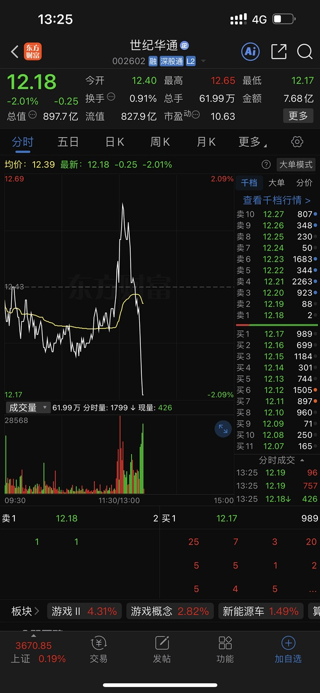  ⊳ （引用 @🅰失而复🉐😎）我有罪😇

- (2026-11-11 13:31:48) [图] 哈哈为什么真的是xys要更好啊？

  ⊳ （引用 @点-重生炒垃圾）往好的想，起码今天没被药套出，还是有希望20%的🤣🤣🤣

- (2026-11-11 13:32:34) 那就是科技大跳水了  ⊳ （引用 @扒上船离开印度）冰雪我希望你尾盘懂点事🫶

- (2026-11-11 13:33:49) 👍👍👍👍👍  ⊳ （引用 @🅰失而复🉐😎）我这给妹妹献祭了也就是做了贡献了😇

- (2026-11-11 13:34:30) 我觉得nana上周五恐慌指数飙升就开始了
美国先行
其他慢慢跟上  ⊳ （引用 @we）算反攻了吗

- (2026-11-11 13:35:47) 好处是暂时已经先连跌了两天  ⊳ （引用 @木感情的打工人）但是我看11.3-11.5那几天，冰雪也没怎么反向诶

- (2026-11-11 13:36:37) 光线要不咱们索性出轨到游戏算了？
他们传媒不带你玩

- (2026-11-11 13:37:54) 不会
冬天必将来到  ⊳ （引用 @Aaa摆烂咸鱼🥳）那冰雪肯定受影响吧

- (2026-11-11 13:39:12) 我没交换给幸福已经是奖励他了哈哈  ⊳ （引用 @Lyra）那可太好了，楼楼啥时候奖励他

- (2026-11-11 13:39:58) 加仓要等等
毕竟游戏那边确实是有更好的😂😂😂😂
光线得拉一次猛的让我完全心动  ⊳ （引用 @Lyra）那可太好了，楼楼啥时候奖励他

- (2026-11-11 13:41:32) 冰雪和科技反向是出现在无量时候
如果后期增量来就会化解

如果科技能持续反攻 不会没钱
没钱科技无法连续反攻

- (2026-11-11 13:42:08) 有增量以后不会再出现  ⊳ （引用 @扒上船离开印度）我发现既拿着冰雪，又还有科技的就很痛苦，我现在左右脑互搏😂

- (2026-11-11 13:42:39) 因为他有传媒属性

你到底买什么要分清楚  ⊳ （引用 @Aaa摆烂咸鱼🥳）楼，为啥bdd是次次次次选呀

- (2026-11-11 13:43:01) 全球联动
大A不会差的  ⊳ （引用 @点-重生炒垃圾）卧槽，新易盛211了

- (2026-11-11 13:44:54) 大家是不是发现了
恐慌指数飙升的魅力🤣
在那之后一切都好起来了

- (2026-11-11 13:46:11) 昨天那个cpi 美债狂飙都没打倒硬科技  ⊳ （引用 @不知道还能说啥）大家是不是发现了
恐慌指数飙升的魅力🤣
在那之后一切都好起来了

- (2026-11-11 13:46:57) 不会做了
我场外可都是科技😂😂😂😂😂😂😂😂😂😂
场内都有nana了
已经是科技大多头了

现在场内场外区分不是挺好吗
不是里面赚钱就是外面赚钱  ⊳ （引用 @木感情的打工人）啥时候带着大家做科技呀，难忘当年的芯片etf呢

- (2026-11-11 13:47:32) 传媒现在运气真好啊 市场情绪又起来了  ⊳ （引用 @一直在摸🐟）sy又要涨停了嘛

- (2026-11-11 13:49:45) 场内还有中韩半导体呢😂😂😂😂  ⊳ （引用 @木感情的打工人）好吧🤣

- (2026-11-11 13:51:05) 你们还记得章盟主策略吗

不管哪里 全都核心进去先🤣🤣🤣🤣🤣🤣

因为情绪好都会涨的

- (2026-11-11 13:51:39) 因为相信不是已经赚到了吗🤣🤣🤣🤣🤣  ⊳ （引用 @Dneunfki发财版）他竟然相信cn lol😂

- (2026-11-11 13:53:30) 美国人说了算  ⊳ （引用 @momo）hsc 涨停了，科技这次来真的吗

- (2026-11-11 13:54:22) [图] 恐慌指数飙升类似我们的冰点呀🤣
我想的是直接超级V历史新高

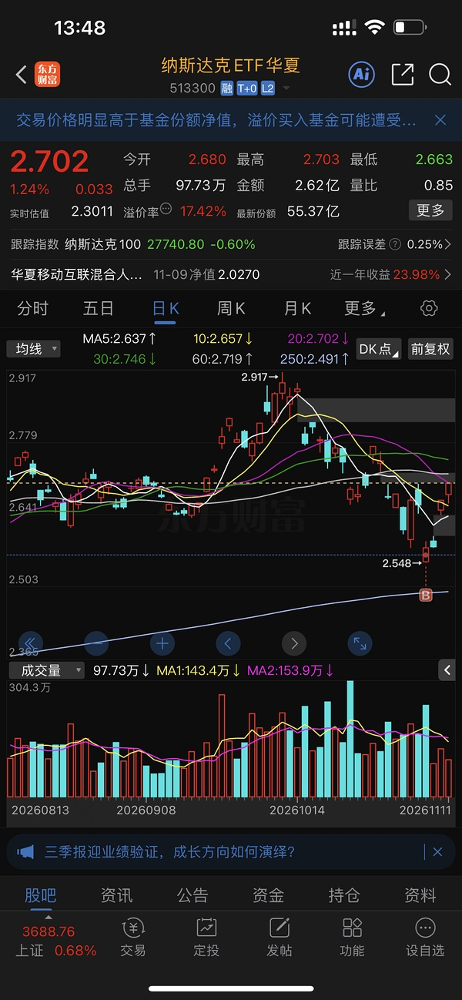  ⊳ （引用 @木感情的打工人）人家科技好像真的要进攻了，11.3-5那几天的大涨，前几天又回踩确认，今天正式进攻？

- (2026-11-11 13:56:56) 我没算 
这几天可能都是异动吧😂
你看那个九阳股份 如果学那个一直涨也不错啊 一直都在绕  ⊳ （引用 @momo）我对半导体很失望😤 话说dfhy 今天保持住就绕过异动后面可以猛猛前进了吧

- (2026-11-11 13:58:01) 这两个不给力正常
博纳没动不应该啊😂  ⊳ （引用 @momo）影视院线板块走高，慈文传媒、上海电影涨停，华策影视、百纳千成、欢瑞世纪跟涨
xf zy不给力啊今天

- (2026-11-11 13:58:29) 王子那个？那个核聚变好久没炒作过了是不是  ⊳ （引用 @速派女孩将发财）雪儿可以出轨到科技吗

- (2026-11-11 14:00:06) 大家今天场内不是科技线的嘛
就淡定的看戏吧

今天就让场外赚一把 场内能冲就冲 不能就这样也行
里外都是钱😂

- (2026-11-11 14:01:02) 人家同类的都冲了啊🤣bn弱了  ⊳ （引用 @木感情的打工人）前两天大涨啊

- (2026-11-11 14:02:06) 都去玩国内科技了
中韩半导体都没人打溢价了😂

- (2026-11-11 14:03:25) 那冰冰准备  ⊳ （引用 @🅰失而复🉐😎）外面跳水

- (2026-11-11 14:03:53) 今天债券继续下跌😂  ⊳ （引用 @点-重生炒垃圾）国债，昨天只有我把易中天当真了

- (2026-11-11 14:05:08) 😂😂😂😂😂可控核聚变吗
这个是真的好久没消息了  ⊳ （引用 @发财喵）这票我埋伏太早中了埋伏。。。

- (2026-11-11 14:10:22) 笑死还有50分钟
大家收益都有机会大幅扩大或者缩小😂😂😂😂😂

- (2026-11-11 14:12:40) 报

中国移动 空调 四大行 招招 快速跳水

- (2026-11-11 14:13:14) 啊你不是有很多其他东西的嘛😂  ⊳ （引用 @sickid）我还绿的，就看冰冰了

- (2026-11-11 14:13:35) 多只通信ETF涨幅扩大至7%
午后CPO持续走高，通信ETF华夏、通信ETF国泰、通信ETF富国等多只通信ETF涨超7%。个股方面，新易盛、中际旭创涨超14%，天孚通信涨超12%。

- (2026-11-11 14:13:46) 都去易中天了🤣  ⊳ （引用 @点-重生炒垃圾）为啥宁德还是绿的呢，香港都是红的

- (2026-11-11 14:16:39) 多只创业板人工智能ETF涨超6%
创业板人工智能ETF华夏、 创业板人工智能ETF富国、创业板人工智能ETF国泰等多只创业板人工智能ETF涨超6%。个股方面，新易盛、太辰光涨超17%。  ⊳ （引用 @不知道还能说啥）多只通信ETF涨幅扩大至7%
午后CPO持续走高，通信ETF华夏、通信ETF国泰、通信ETF富国等多只通信ETF涨超7%。个股方面，新易盛、中际旭创涨超14%，天孚通信涨超12%。

- (2026-11-11 14:17:19) [图] 微盘股 2000都被大幅度击败了

- (2026-11-11 14:17:43) 只要美国是真的
我们就是真的
全球联动  ⊳ （引用 @木感情的打工人）科技这次真的？？

- (2026-11-11 14:18:12) 老师们 各路大V分析筹码问题

只要美国是真的

这个问题马上就不复存在  ⊳ （引用 @木感情的打工人）科技这次真的？？

- (2026-11-11 14:19:12) 存储板块动力十足，长鑫科技、澜起科技、大普微、江波龙均涨5％左右，兆易创新、德明利、佰维存储涨超6％。报道称，存储又在酝酿新一轮涨价。部分头部企业已向渠道商口头告知企业级颗粒的涨价意向。

- (2026-11-11 14:19:26) 哈哈哈哈哈哈哈哈哈 新浪小编买的存储吧

动力十足都来了  ⊳ （引用 @不知道还能说啥）存储板块动力十足，长鑫科技、澜起科技、大普微、江波龙均涨5％左右，兆易创新、德明利、佰维存储涨超6％。报道称，存储又在酝酿新一轮涨价。部分头部企业已向渠道商口头告知企业级颗粒的涨价意向。

- (2026-11-11 14:20:23) 我之前和我女主播说你那xys涨70 80个点就和她收到嘉年华一样了 说来就来了🤣🤣🤣🤣  ⊳ （引用 @海贼）小看硬件了😥，新易盛感觉要涨停了

- (2026-11-11 14:21:59) 易方达不准
小华A还是很多的 没问题  ⊳ （引用 @我爱牛肉火锅）前面两个的是不是都不准😂

- (2026-11-11 14:22:15) 存储之王啊  ⊳ （引用 @我爱牛肉火锅）网易云咋排这么前了

- (2026-11-11 14:24:20) [图] 羊啊 东方啊没崩
投机资金暂时还都在😂😂

- (2026-11-11 14:25:36) [图] 他就是满多AH硬件😂尤其那个asmpt对他很重要
走势之前差 asmpt负全责

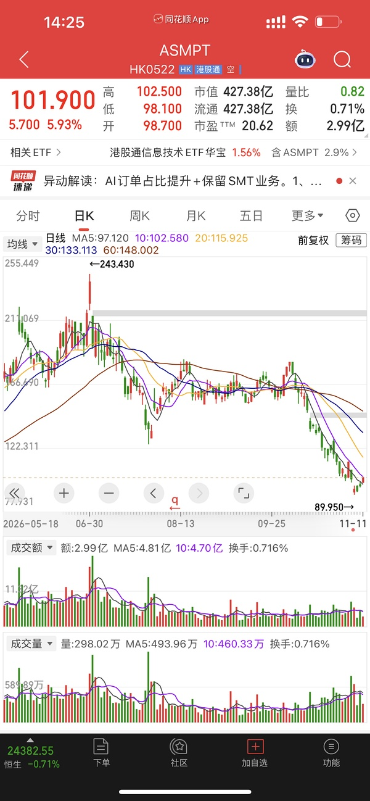  ⊳ （引用 @我爱牛肉火锅）之前其他的大跌它表现还好，我没想到今天还这么牛，我以为港股今天会颓颓的拖累他来着

- (2026-11-11 14:26:28) 雪儿今天不错啊
大家昨天不是期待他接人嘛
这个任务做到了今天🤣🤣🤣🤣🤣🤣🤣  ⊳ （引用 @我爱牛肉火锅）心软的雪人啊！请再当一回串子救救妈妈吧！

- (2026-11-11 14:27:23) [图] 我觉得都牛逼啊 题材分枝强势的也牛逼
这里也井然有序

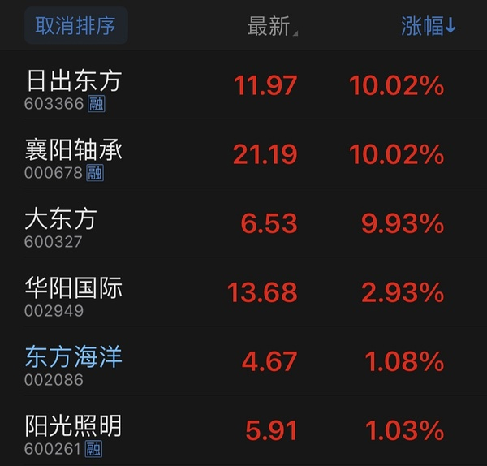  ⊳ （引用 @点-重生炒垃圾）低吸前排情绪票，前排情绪票是这些吗？

- (2026-11-11 14:31:52) 😂😂😂😂😂  ⊳ （引用 @momo）掌阅今天最高3333

- (2026-11-11 14:44:53) [图] 指数在涨
偏离值也会变
现在控制在内的

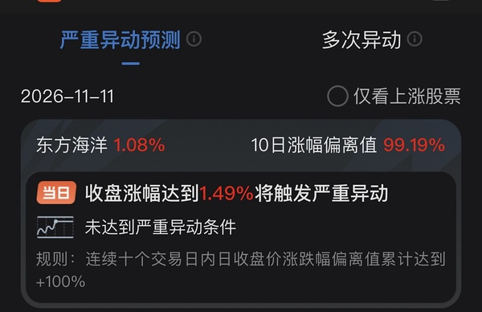  ⊳ （引用 @小红茶）dfhy今天控不住异动是不是得走了

- (2026-11-11 14:45:53) 明天让我们欢迎融资盘回归  ⊳ （引用 @点-重生炒垃圾）源杰涨停了。。。。

- (2026-11-11 14:49:17) 九阳股份玩到现在都没有进去过
那个才是大师  ⊳ （引用 @momo）感觉这个庄很会控

- (2026-11-11 14:51:56) [图] 30债昨天只是表示敬意
今天是崩了 对科技反攻非常恐慌

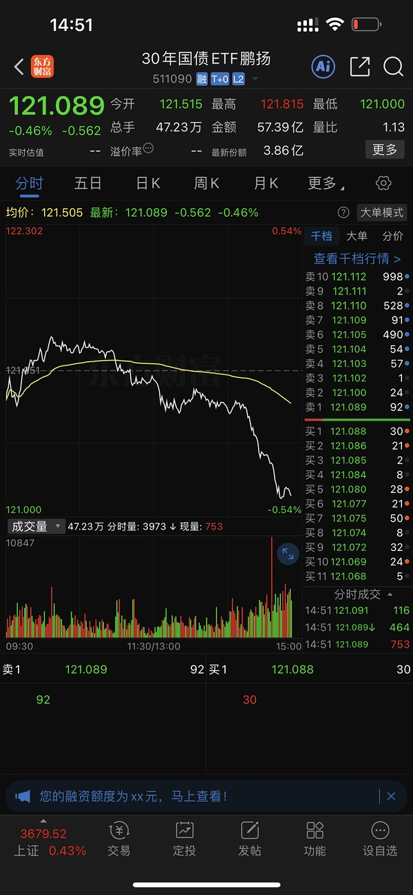  ⊳ （引用 @点-重生炒垃圾）今天有没有人敢买红利

- (2026-11-11 14:53:48) 有的
在科技

创业板重返3%  ⊳ （引用 @有人区生菜）今天尾盘没有人站出来了

- (2026-11-11 14:57:58) [图] 这两个绝对专业 再次无事发生

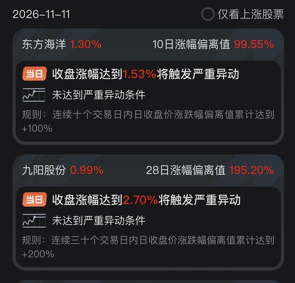

- (2026-11-11 14:59:22) 幸福两连绿
光线两连红

- (2026-11-11 15:00:39) 专业
1.52 PK 1.53  ⊳ （引用 @momo）最后卡1分也是绝了

- (2026-11-11 15:01:10) 怎么没有

光照亮了🤣  ⊳ （引用 @西西西西）今天没有救星 明天来吧

- (2026-11-11 15:02:28) [图] 明天东方海洋没有麻烦的绕异动问题了！

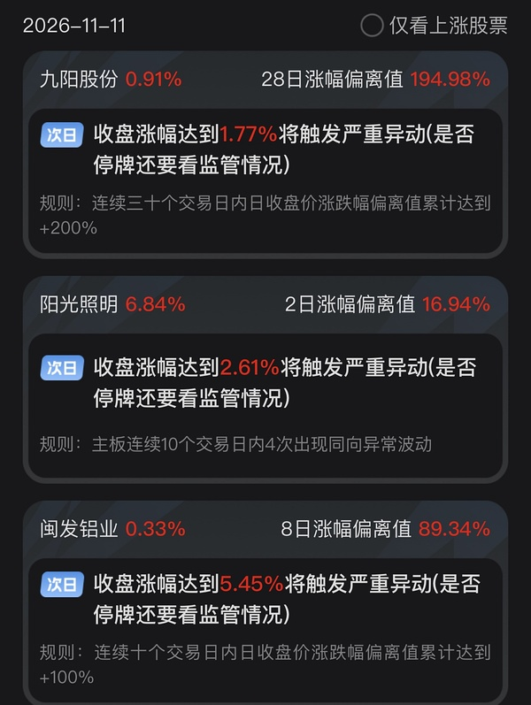

- (2026-11-11 15:03:32) 今天就很好啊
场内绿是场外大赚换来的
至少不是真的亏😂😂😂  ⊳ （引用 @西西西西）我说场内哈哈哈哈 场外我已经不点开了

- (2026-11-11 15:04:43) 我感觉今天午后题材线只有机器人没怎么受到太大影响

你们觉得呢

- (2026-11-11 15:07:39) 如果nana超级V开启科技反攻
我觉得题材线最多就是开始弱于双创 大科技
也不会反向的 情绪好起来了 资金也会变多了 
而且一开始也不可能马上回到6月科技一家独大的情况
毕竟很多人也不会相信呀🤣🤣🤣🤣🤣🤣  ⊳ （引用 @点-重生炒垃圾）楼主，游资还在信心十足

- (2026-11-11 15:09:10) 我昨天去的另外一个
今天也吸到asd了🤣  ⊳ （引用 @Aaa摆烂咸鱼🥳）确实是，我昨天上了asd 没埋我

- (2026-11-11 15:09:44) 😂😂😂😂😂😂😂😂😂
之前都输了？  ⊳ （引用 @点-重生炒垃圾）报！温暖老师三战慈文！！！

- (2026-11-11 15:12:17) 温暖老师分析的有道理啊
我也觉得传媒应该做一次明显的调整
但是今天日内大V😂😂😂😂

但我觉得虽迟但到 而且强行延缓 只会让调整加剧
不然只是柔和的调整  ⊳ （引用 @点-重生炒垃圾）温暖老师：今天的分歧属于预期内，唯一美中不足的是分歧时间太短，日内就被机器人和AI短剧带队捞了回来，分歧时间不够，可能会影响后续高位的持续性和流畅度。
这里机器人和短剧通过不断超预期证明了自己第一梯队的实力，特别是短剧，本来眼看着连续冲高回

- (2026-11-11 15:13:47) 他每天都是大换仓的
不然跟踪不了微盘🤣  ⊳ （引用 @qiu啾）这经理真的能处

- (2026-11-11 15:15:32) 从早上看 不会！
早上我不是截了一大批-6传媒嘛
那时候微盘股都是红的我还在问你们在涨什么呢
微盘股都是红的 自然没影响到

而且现在暂时没有高标连板是传媒的🤣  ⊳ （引用 @点-重生炒垃圾）短剧分歧会把别的情绪票带着陪葬吗？比如我们雪

- (2026-11-11 15:17:40) 哈哈哈哈现在科技那些股票价格我都不熟悉了
都骨折过了
不太耗钱了🤣🤣🤣🤣🤣🤣  ⊳ （引用 @点-重生炒垃圾）是的，中午看新易盛起来，准备追天哥，一看再涨点就是那个跌停雷霆位，肯定很多套牢盘，就怂了

- (2026-11-11 15:24:10) 关心美股比较重要
美股七连阳八连阳硬科技 
大A所有阻力位缺口位都不是问题
这一次抛开美股单独分析大A我觉得没有意义
全球联动  ⊳ （引用 @qiu啾）平均股价冲到了24.47。🍊说到了26.5要卖出吗？

- (2026-11-11 15:27:23) 笑死了
今天场内nana就看着美国期货+1.4 模仿了1.4%涨幅
把昨晚-0.6%就当忘记了
溢价率就这么又提高了

- (2026-11-11 15:28:21) 场内只有两个不到16%溢价的nana了😂而且那两个和16%没啥区别  ⊳ （引用 @不知道还能说啥）笑死了
今天场内nana就看着美国期货+1.4 模仿了1.4%涨幅
把昨晚-0.6%就当忘记了
溢价率就这么又提高了

- (2026-11-11 15:29:23) [图] 🤣要不一起PK一把吧

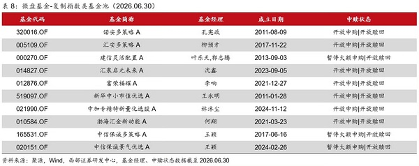  ⊳ （引用 @速派女孩将发财）我火速发给AI 审判一下 和楼主之前那三个PK一下

- (2026-11-11 15:33:19) 我们后面也学人家聪明投资者呀
等哪个好一点的nana场外大开额度
我就申购场外的 然后卖场内高溢价的
开一万申购一万卖一万😂  ⊳ （引用 @点-重生炒垃圾）这下场内纳纳真的要拿到天荒地老了

- (2026-11-11 15:37:15) 哈哈嘉实21.79%了🤣  ⊳ （引用 @六倍做多退休）😂

- (2026-11-11 15:41:32) 幸福降价5毛1794了  到不了本来的

大连到不了 我等会继续开大涨幅  ⊳ （引用 @🅰失而复🉐😎）楼昨天的条件单延续吗

- (2026-11-11 15:42:28) 昨晚传闻1万亿估值
今天说提高到1.5万
又变成利好了呢🤣  ⊳ （引用 @sickid）这个ipo难道不是软硬都受影响吗

- (2026-11-11 15:46:14) 每年三四月份
外汇局可能会放一次额度

到时候看咯  ⊳ （引用 @山中食人花）还会有场外大开额度的一天吗
感觉前几年买的那点娜娜可以留到天荒地老了

- (2026-11-11 15:47:00) 之前开了也没多久就没了
而且有些公司还把额度给主动基金
nana是不分额度的🥲  ⊳ （引用 @山中食人花）还会有场外大开额度的一天吗
感觉前几年买的那点娜娜可以留到天荒地老了

- (2026-11-11 15:47:35) 环球开着  ⊳ （引用 @高手云集上钻）我现在也想买1万，谁给点额度

- (2026-11-11 15:50:05) [图] 这个是nana 别搞错了

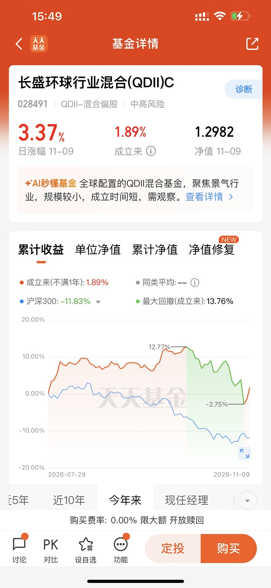  ⊳ （引用 @高手云集上钻）交银环球精选吗，我先自选一哈子

- (2026-11-11 15:52:10) 我没钱了😂😂😂本轮工业革命投资在上周五画上了句号

我不会再买了 就这点钱了  ⊳ （引用 @🅰失而复🉐😎）三四月份又有钱了😏

- (2026-11-11 15:57:04) 场外有好的娜娜打开
场外申购
场内卖出对应金额呀

这样就是标准的卖出高溢价率的 买入平价的  ⊳ （引用 @🅰失而复🉐😎）场内啥时候转换过去，还早吧我才几个点，今天还被它领涨我的仓了😇

- (2026-11-11 15:58:43) 我是不会的
场内肯定要继续炒

这几个月不就是场内收益远远好于场外了  ⊳ （引用 @梳碧湖砍柴人）先卖场内再买场外

- (2026-11-11 16:02:06) 收着主动基金的管理费 （比指数基金高）
做成指数基金的样子

何乐而不为呢  ⊳ （引用 @山中食人花）密切跟踪着 好怕经理瞎搞
我现在偶尔也投投狄姐 希望狄姐拉长时间能跑赢娜娜

- (2026-11-11 16:05:47) [图] 那第一个就是老师新买的

  ⊳ （引用 @速派女孩将发财）结论：加入鑫元鑫锐A后，10只微盘基金的优中选优排序为——进攻弹性首选鑫元鑫锐A（纯微盘工具、Q3弹性第一、11月修复偏强），稳健底仓选建信灵活配置A（回撤控制最好、当前距高点仅-12.37%），弹性卫星配新华中小市值优选A（11月反弹最强

- (2026-11-11 16:11:33) “易中天”同日涨超13%！这次能否打破“次日必跌”的魔咒？

具体而言，据Wind数据梳理，今年下半年行情中（截至目前），当“易中天”单日平均涨幅超过7%，次日收涨概率为0。

这一次是“下半年”的重演，还是“上半年”的复苏？

答案可能很快就会揭晓。

- (2026-11-11 16:12:02) 😂😂😂😂😂有点意思  ⊳ （引用 @不知道还能说啥）“易中天”同日涨超13%！这次能否打破“次日必跌”的魔咒？

具体而言，据Wind数据梳理，今年下半年行情中（截至目前），当“易中天”单日平均涨幅超过7%，次日收涨概率为0。

这一次是“下半年”的重演，还是“上半年”的复苏？

答案可能很

- (2026-11-11 16:12:24) 11月11日港股收盘：恒指跌0.98% 恒生科技指数跌1.41%

🤣

- (2026-11-11 16:13:10) [图] 

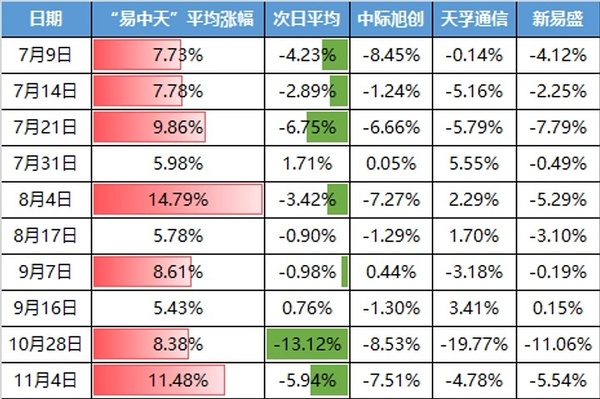  ⊳ （引用 @不知道还能说啥）“易中天”同日涨超13%！这次能否打破“次日必跌”的魔咒？

具体而言，据Wind数据梳理，今年下半年行情中（截至目前），当“易中天”单日平均涨幅超过7%，次日收涨概率为0。

这一次是“下半年”的重演，还是“上半年”的复苏？

答案可能很

- (2026-11-11 16:24:57) [图] AI应用已经大放异彩
除了科技这个板面只有影视娱乐游戏😂

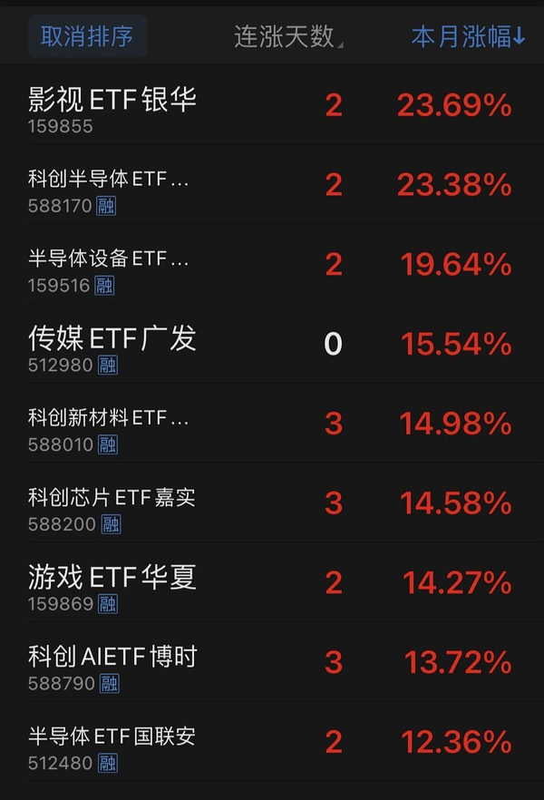  ⊳ （引用 @山中食人花）余老师 还是一样的观点
硬科技不行不行就是不行 比它好的太多了

- (2026-11-11 16:51:06) 你可以去看下11.6日的帖子 
而我只有在那天做出了一个大操作  ⊳ （引用 @旺奶牛仔糖）最近工作忙好久没爬楼了，想问问楼楼，场外的美🐔有调仓或者加仓吗～我看好像是不是在加环球呀

- (2026-11-11 16:52:57) 其实远不止这点 不过不重要了 避免干扰大家

我对美国基金重新赚回50 60%收益信心十足 从未动摇 
现在的沉沦 等个1 2年回头看终将过往云烟🤣🤣🤣🤣  ⊳ （引用 @点-重生炒垃圾）没有，环球我们自己搞着玩的，楼主就趁美基大跌那天，买了9万场内纳指，放招商银行那个账户

- (2026-11-11 16:53:59) 这人是不是赢麻啦

- (2026-11-11 16:58:08) 这是自2023年chatgtp以来
针对传媒板块最长的炒作时间了！
不管是24年Sora
还是去年的DS 
今年年初的Geo概念
每次都玩不出超过一个月的😂😂😂😂😂😂

这次确实牛逼  ⊳ （引用 @初筱玖）有点像去年的宇航员和6月的硬AI，每次都等调整，每次都盘中拉起来，真的开始调整了就是一泻千里。。。。这波软AI感觉也是柚子比较多，等哪天都开始吹什么某某席位有格局，跟着有大肉，估计就差不多了。

- (2026-11-11 16:59:16) 不能浪费我迪士尼的许愿的！！！  ⊳ （引用 @我爱牛肉火锅）哈哈哈哈哈哈哈哈哈哈，你偷加！不老实

- (2026-11-11 17:03:18) 第一个是真的加号 这我不骗你的  ⊳ （引用 @shirla）我就说那第一个字不是加号吧！🤣🤣🤣🤣

- (2026-11-11 17:03:47) uu啊 传媒玩归玩 可别当真了哦🤣🤣🤣🤣🤣  ⊳ （引用 @🅰失而复🉐😎）后面应用端肯定能赚钱

- (2026-11-11 17:11:24) 我等了四年再次等到接近26倍低估值+恐慌70%的一刻
我肯定要珍惜的

因为下次或许不知道又在哪一年了  ⊳ （引用 @钱多多多多多）那天我也认真数了好多遍，依稀记得第一个是加号也有几十个，第一个不是加号就是几百个😂😂

- (2026-11-11 17:21:25) 你们雪儿就赚了好几次了

nana我下午我看了一下 5个点收益现在  ⊳ （引用 @shirla）这个对比好，让我们拭目以待！（赚完再去nana来得及吗）

- (2026-11-11 17:24:50) [图] 我心目中的nana是这样子的！

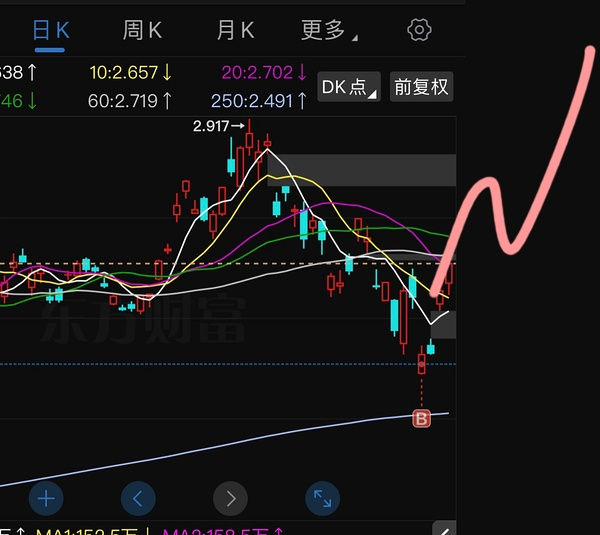  ⊳ （引用 @shirla）但是，慢就是快，所以还是可以比试比试的吧🤣

- (2026-11-11 17:28:20) 我设置的很贪啊
雪儿+7 大连+9
你们满仓冰雪的应该降低点要求🤣  ⊳ （引用 @timing）楼明天雪儿跟大连条件单是多少呀 来抄作业啦😆😆

- (2026-11-11 17:33:36) 皇台自己都打不出新高了🤣
刷了一个18.88不知道是不是暗示拜拜

皇字辈out😂😂😂😂😂😂😂  ⊳ （引用 @qiu啾）那个打新的老哥还在

- (2026-11-11 17:47:05) 这两个估值确实是绿的
小远跟七巨头 主楼贴了-0.78还凑活🤣  ⊳ （引用 @钱多多多多多）华兄，小远，都是 -0.44

- (2026-11-11 17:48:05) 大A那些大科技太吃成交量了
要大家和平共处还得继续放量

融资盘也需要回归🤣  ⊳ （引用 @点-重生炒垃圾）感觉美股软件盘前还是很强的，大A有点跟不动了

- (2026-11-11 17:49:32) [图] 很多垃圾票 一个月都没有300亿成交额的😂

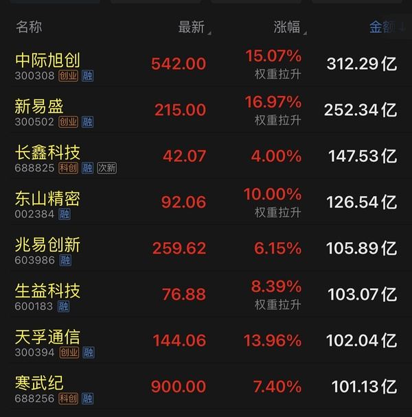  ⊳ （引用 @点-重生炒垃圾）感觉美股软件盘前还是很强的，大A有点跟不动了

- (2026-11-11 17:51:55) 午后债市大跌原因汇总：

1.午后关于国债地方债免税小作文发酵
2.期货技术面破位TL跌破20日线后开始加速下跌
3.股市强力拉升
4.资金收敛情况未改善DR001持续运行在1.32%
5.因为4引起的对妈妈敲打的担忧 情绪持续走弱
6.传银行理财赎回

- (2026-11-11 17:52:18) 😂😂😂😂😂😂😂😂原因可真多啊  ⊳ （引用 @不知道还能说啥）午后债市大跌原因汇总：

1.午后关于国债地方债免税小作文发酵
2.期货技术面破位TL跌破20日线后开始加速下跌
3.股市强力拉升
4.资金收敛情况未改善DR001持续运行在1.32%
5.因为4引起的对妈妈敲打的担忧 情绪持续走弱
6.传

- (2026-11-11 17:58:48) 我大概知道6是什么情况

之前华发的债 灾日
去抄底债券基金的

昨天开始满7天了
很多债券赎回就不需要手续费了 也都赚到了

捞一把跑路了  ⊳ （引用 @木感情的打工人）银行理财确实赎回了呀，我缺钱就赎回了哈哈哈哈哈

- (2026-11-11 18:01:43) 年化不低呢

七天很多债券涨了0.1% 直接赎回
他们算年化等于5.2%了🤣🤣一年52个礼拜  ⊳ （引用 @木感情的打工人）哦哦，那没多少钱

- (2026-11-11 18:06:17) 你以为都是咱们啊
你去看看今天涨了也都说是发套的
根本没什么相信科技反攻的🤣  ⊳ （引用 @木感情的打工人）我以为是大规模理财赎回，为了来权益市场呢😂

- (2026-11-11 18:08:51) 美股大家都是看空的

别说大A了🤣  ⊳ （引用 @木感情的打工人）😂😂😂是的，没人信就继续涨

- (2026-11-11 18:10:21) 冠军🏆  ⊳ （引用 @钱多多多多多）网易云1.89

- (2026-11-11 18:11:19) 这个是不是有两倍做多了  ⊳ （引用 @我爱牛肉火锅）我的女大要拿回属于它的一切！不玩其他的了，等女大带我吃香喝辣

- (2026-11-11 18:25:01) 😂😂😂😂😂  ⊳ （引用 @长成大🌲）【离岸信托收益征税平稳有序推进 累计申报离岸信托个人所得税超1600亿元】金十数据11月11日讯，11月11日从国家税务总局获悉，目前，离岸信托收益征税政策过渡期已平稳结束，绝大多数纳税人积极配合，累计申报离岸信托个人所得税超1600亿元，

- (2026-11-11 18:27:07) 英伟达(NVDA.O)盘前涨幅扩大至5%，此前两个交易日累计下跌9.5%。  ⊳ （引用 @我爱牛肉火锅）有的，你提醒我了，上杠杆！干！

- (2026-11-11 18:28:03) 恐慌指数那根70%大阳线快被抹掉了

- (2026-11-11 18:36:23) [图] 大A就烦这个

其他都是全球联动

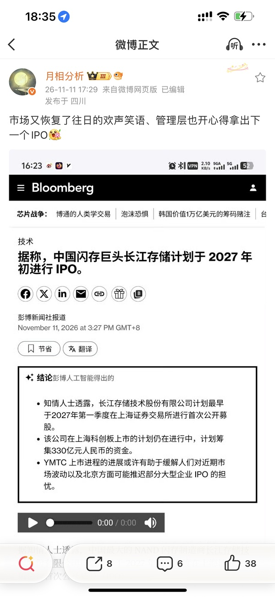  ⊳ （引用 @一一一一小得力）真的到那个时候了是不是我们的a基也活了！

- (2026-11-11 18:37:19) 可以啊 我摄像和章盟主靠上了

今天又输了两杯星冰乐😂  ⊳ （引用 @家不住海边）章盟主操作密集，布局天洋新材、文投控股、浙文影业、电魂网络，同时大幅兑现风语筑、文投控股，多票滚动。
老章挺忙啊

- (2026-11-11 18:46:43) 🤣🤣🤣🤣明天也许继续拉升呢  ⊳ （引用 @🅰失而复🉐😎）今天着实怪我😇对不住里面的人了🫣

- (2026-11-11 18:50:01) 昨天他买了电魂
我和他说直接干20cm的呀🤣

然后他选了一个 我也选了一个  就拼这个20cm涨幅
我今天输了😂😂😂😂😂  ⊳ （引用 @高手云集上钻）你们赌的是谁场内收益率高吗😂

- (2026-11-11 18:53:08) 巅峰进攻大战了

之前一直说的 谁防守谁孙子 这个时候就体现了😂  ⊳ （引用 @🅰失而复🉐😎）今晚能不能看见两位数的

- (2026-11-11 20:01:58) 为什么买C
因为一开始买的都不是最佳选择呀
都存在后续换仓的可能
小华就出现了问题 C就赚了

你看uu们之前这个换那个 那个换这个
都还在搭配组合 自然应该选C

当我能确定买 且长时间持有的C50 CC我就都是A和I
如果nana能买 自然都是A
而为了额度 当然更应该的是AC双剑齐发  ⊳ （引用 @24/7）我们当时是不是大头买的c呀，好像a划算一些？

- (2026-11-11 20:04:03) 要死
今天债券也没少亏啊😂😂😂

算了 今天是科技好起来了！！

- (2026-11-11 20:04:20) 没有 她换过仓  ⊳ （引用 @脆桃kiki）畅畅今天能有3个点吗🫣一段时间不敢点开天天基金了

- (2026-11-11 20:04:37) 我国成功发射探源计划探路者卫星。（央视新闻）  ⊳ （引用 @点-重生炒垃圾）这是真发套的

- (2026-11-11 20:06:38) 不只是喇叭
效率和我们有的一拼
讨论资本市场问题好像讨论了大半年的样子了😂  ⊳ （引用 @六倍做多退休）美国好起来了 你救市了😅 韩国怎么也是喇叭呀 

- (2026-11-11 20:07:53) 这个消息足以证明当初看到这个消息 咱们判断nana会更难买到是对的

半年之前nana场内最低的溢价率大概在4-6%
现在这个数字提高到了16%
这还在nana最近不太好的情况下  ⊳ （引用 @高手云集上钻）1600亿的税……

- (2026-11-11 20:09:17) 还不止他们
之前易方达那种基金很明显也不在了😂

所以坚定看好C50 光
公募基金砍仓幅度很夸张啊
到时候又仔抱回来  ⊳ （引用 @sickid）他们都离开光模块了吗

- (2026-11-11 20:11:07) 不过11/4号时候还在的
这一周都砍掉了？？  ⊳ （引用 @sickid）他们都离开光模块了吗

- (2026-11-11 20:11:54) 你真是天才 我悟了！！！  ⊳ （引用 @我爱牛肉火锅）我国成功发射探源计划探路者卫星
11月11日19时41分，我国在酒泉卫星发射中心使用长征二号丁运载火箭，成功将探源计划探路者卫星发射升空，卫星顺利进入预定轨道，发射任务取得圆满成功。这次任务是长征系列运载火箭的第677次飞行。（央视）

利

- (2026-11-11 20:15:34) 如果7月底不是加仓科技 是加仓传媒 就发财了？😂😂😂😂😂😂😂  ⊳ （引用 @木感情的打工人）泪目了……-26.8到-1.18……

- (2026-11-11 20:16:16) uu 你真是xjbc领域的智多星🤣🤣🤣🤣🤣🤣  ⊳ （引用 @我爱牛肉火锅）我国成功发射探源计划探路者卫星
11月11日19时41分，我国在酒泉卫星发射中心使用长征二号丁运载火箭，成功将探源计划探路者卫星发射升空，卫星顺利进入预定轨道，发射任务取得圆满成功。这次任务是长征系列运载火箭的第677次飞行。（央视）

利

- (2026-11-11 20:19:55) [图] 板块其实还行 N字一段段的 今天换手6.5%了
年初6.5开始就在冲刺和坠机徘徊了
9%是峰值

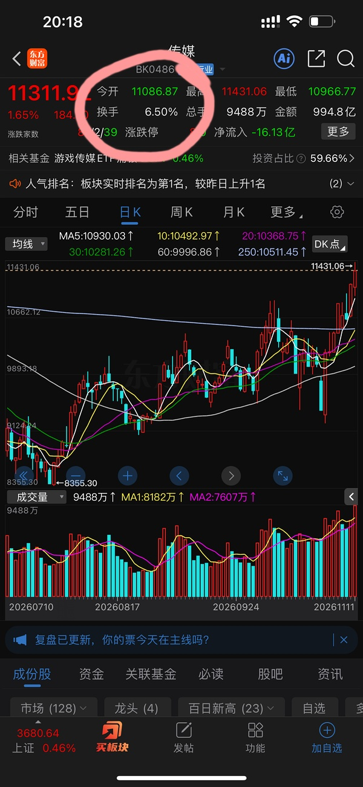  ⊳ （引用 @木感情的打工人）确实😂😂，但是没有那么多如果哈哈哈。不过这么看传媒这个月斜率有点陡峭……

- (2026-11-11 20:21:08) 短线选C基金 长线A  ⊳ （引用 @24/7）记起来了我全记起来了，还是跟楼楼才知道的I

- (2026-11-11 20:57:00) 看来fcc消息比较突然😂😂😂他们都做了新低预期  ⊳ （引用 @sickid）今天源杰20我就觉得是机构建仓了，没想到我们🐔的机构一个都没体现出来（我前两天反手买回的国产富国也只有7个点弱于预期啊）

- (2026-11-11 21:04:31) 没那么多😂  ⊳ （引用 @稀里不糊涂）楼不是买了90w场内娜娜吗

- (2026-11-11 22:00:51) 你怎么知道 

我把本来存着给明年A股冰点抄底2000和买中债美债的钱也先拿过来直接用了😂  ⊳ （引用 @木感情的打工人）60w+哈哈哈

- (2026-11-11 22:04:01) [图] 你真牛逼啊 李经理 确实是

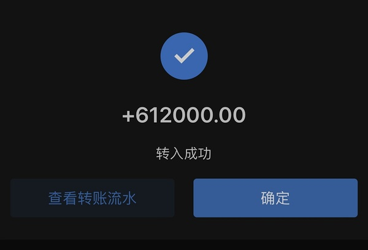  ⊳ （引用 @木感情的打工人）数字敏感啊，第一个数不是1，是➕，那第二个数就6😯🤣🤣🤣

- (2026-11-11 22:08:19) 通信ETF涨幅看看啊uu  ⊳ （引用 @想当富有的咸鱼）科技今天也没有很红啊，为什么一片欢声笑语

- (2026-11-11 22:09:58) [图] 赵老师说APEC会议之前 大A保持强势

警惕由于大A科技股处于低位 进行业绩平滑洗澡
做差今年的业绩 
把本来明后年的商誉计提减值直接今年就释放

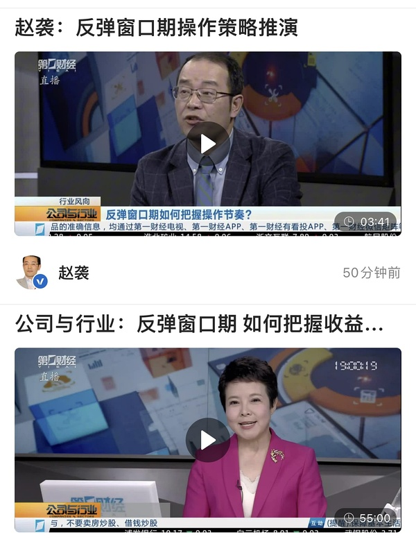

- (2026-11-11 22:10:59) 你看下30年债券对你说的那几个日子毫无反应

但是今天和昨天连续被吓到了  ⊳ （引用 @想当富有的咸鱼）主要前阵子科技不还ETF遍地涨停了么……

- (2026-11-11 22:15:23) 赵老师说的意思就是
反正科技股股价都在低位 领导层容易把差业绩提前释放
特别是有商誉减值的 很可能在今年直接计提
要大家警惕  ⊳ （引用 @六倍做多退休）这是什么操作 年报会暴雷的意思吗。

- (2026-11-11 22:16:38) 美元现货指数攀升至2025年5月以来的最高水平

- (2026-11-11 22:17:21) 你们看 牛逼的是RMB 理都不理😂😂😂😂😂

之前有uu问怎么看美元 你看 看美元有啥用🤣  ⊳ （引用 @不知道还能说啥）美元现货指数攀升至2025年5月以来的最高水平

- (2026-11-11 22:18:28) [图] 咱们RMB无敌

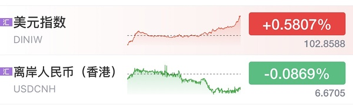  ⊳ （引用 @不知道还能说啥）你们看 牛逼的是RMB 理都不理😂😂😂😂😂

之前有uu问怎么看美元 你看 看美元有啥用🤣

- (2026-11-11 22:18:56) Yes  ⊳ （引用 @想当富有的咸鱼）就是趁着股价低把雷都爆掉的意思吗……

- (2026-11-11 22:27:09) 6月到现在只要是科技比较多的-30%起步也是标配了😂😂😂😂  ⊳ （引用 @Aaa摆烂咸鱼🥳）我同事6月买的私募，已经7毛了，我记得当时九坤好像很火，还好没上头，不然真的想死🥲

- (2026-11-11 22:28:29) [图] 很明显今天晚上净值非常异常的可不是只有几个基金

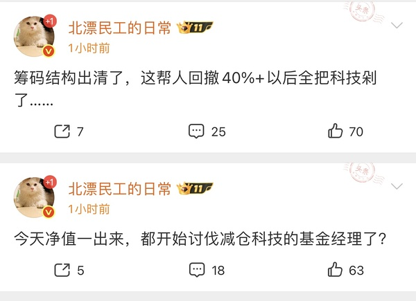

- (2026-11-11 22:30:23) 科技股筹码出清速度实际情况应该比自媒体一直估算的要更快的多  ⊳ （引用 @不知道还能说啥）很明显今天晚上净值非常异常的可不是只有几个基金

- (2026-11-11 22:31:16) 你们真厉害啊😂😂😂😂😂😂😂😂😂AI也牛逼

我没骗人吧 确实是一个加号  ⊳ （引用 @小白吐司）之前把图片给元宝看的结果，元宝也厉害哈哈哈

- (2026-11-11 22:34:35) 媒体带节奏的
去年量化背锅 今年保险背

公募基金才是大头  ⊳ （引用 @点-重生炒垃圾）险资不是没出完吗？😂😂😂涨起来了的话，险资还卖吗？

- (2026-11-11 22:36:19) 这不是真空那么简单了
后面他们回补会很猛 只要美国环境OK 后面上涨肯定很顺畅

假设基民继续赎回 这些基金要被迫卖 都卖的不是科技股了 因为拿的都不是易中天了😂😂😂😂😂  ⊳ （引用 @稀里不糊涂）真空带了

- (2026-11-11 22:38:33) 曾一度创下22天16板纪录的“大妖股”捷荣技术，因信息披露违规，将被监管重罚。

一桩尘封已久的股权交易细节，也随着监管处罚事先告知书浮出水面。

11月10日晚间，捷荣技术公告称，公司收到广东证监局下发的《行政处罚事先告知书》。监管查明，捷荣技术控股股东捷荣集团豁免川发产业互动私募证券投资基金第三笔转股价款4.47亿元，该重大事项未及时披露，同时权益变动报告书存在误导性陈述，公司及捷荣集团、实控人赵晓群等拟被处罚，合计罚款金额达1050万元。

- (2026-11-11 22:39:45) [图] 额….

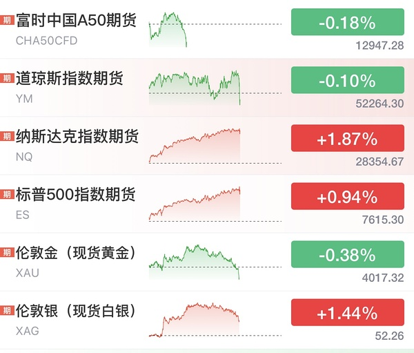

- (2026-11-11 23:20:22) 就这个成交量还是有影响
要继续放量才行

你看看易中 实在太吃成交量了 两个加起来就500多亿  ⊳ （引用 @Aaa摆烂咸鱼🥳）不要这样啊🥹，不过话说明天科技反攻，冰雪是不是受影响，这行情变化也太快了，果真是我慢慢砍了科技也就到底了

## 🧠 投资风格分析
> 📏 增量更新指引：仅当今日发言确有新依据时才修订对应维度，无变化不强行重写；单维度修订建议 ≤150 字。

- 投资理念与方法：坚持机会成本与性价比比较，只赚份内的钱、不后悔错过机会（「赚份内的钱 牛的票多的是」「没事我不后悔」）。重视低位优势，认为光线低位时「打20%图上都看不显著」，宁愿持有低位防守品种也不追高。认为防守不等于减仓，可通过「拉高冰雪」「恋爱脑」等对冲品种实现；并以6月半导体为例，认为提前减仓会拿不回来，倾向让趋势走完。对利空被无视的品种给予正面评价（「昨天利空无视也挺厉害」）。
- 风险偏好：对高溢价QDII保持警惕，关注场内溢价率与额度变化，倾向用场外低溢价申购替代场内高溢价，并设想“场外申购、场内卖出”的换仓/套利路径。对债市区分国内短债基石与部分波动债券，认为美债性价比高但波动大，需在降息预期兑现前卖出；对题材炒作保持警惕，不把短期热闹当长期价值。
- 交易与仓位：偏好盘后预设条件单与定价单，分层挂单、按涨幅目标执行；今日明确设置雪儿+7、大连+9等条件单，并强调“不增加传媒仓位和没有传媒是两回事”，不加仓传媒但保留持仓。资金在同类持仓间腾挪而非无节制新增，进攻资金用完后明确“我不会再买了”。
- 心理特质：清楚自己“手贱”、拿不住连续暴涨模式，偏好雪人式上下波动、成功率高、信心易加强的走势，不追求SY/襄阳那种自己赚不到的钱；对题材炒作保持警惕，预判宇航员大批三连板跌停收尾，体现自我认知与风险意识。

> ⚠️ 本板块由 Actions 全自动增量更新（复用当日发言与今日总览），每次仅在内容足够支撑时才改动。

## 🏷️ 昵称映射表
### 📖 昵称规律（供 AI 判断新昵称时参考）
【昵称命名规律（用于推断未知新昵称）】
- 拼音首字母缩写：取标的/基金名汉字拼音首字母串（含数字代码），多为 ETF/股票代码口语化｜示例：yl=引力传媒｜zy=掌阅科技｜sj=视觉中国｜cc=华安文体健康混合｜C50=创业板50ETF｜k50=科创50｜kun=昆仑万维｜xhxc=新瀚新材｜zxfc=中欣氟材
- 小/老+姓氏代指：「小X」「老X」通常指姓 X 的标的或该标的的基金经理；「X兄弟」多为同系基金｜示例：小惠=惠发食品｜老莫=万家品质生活(莫海波)｜小华=华夏全球科技先锋(QDII)A｜小华兄弟=华夏移动互联(QDII)｜小浦=浦银安盛全球智能科技(QDII)A｜小广=广发全球精选(QDII)A｜小远=华宝致远(QDII)C｜招招=招商银行｜小德=德明利｜赵姨=兆易创新｜露露=泸州老窖｜空调=格力电器
- 戏称/黑话→题材板块：生活化比喻或黑话对应某个题材/板块，而非单一标的；出现时多指板块方向｜示例：卖国=PCB板块(英伟达AI链)｜爱国=国产自主(半导体设备/芯片)｜奶茶=易点天下｜老师=中文在线｜蓝色=蓝色光标｜宇航员=航空航天板块｜华子=华泰保兴安悦债券｜国际=国际复材｜巨无霸=长鑫科技等重大IPO
- 谐音/取字：昵称含标的名关键字（取一字或谐音），多为 A 股个股或基金简称｜示例：万华=万华化学｜东百=东百集团｜宝=保利发展｜讨饭/亚洲讨饭/建信新兴=建信新兴市场(QDII)A｜华宝zy=华宝致远(QDII)A
- 机构/基金经理昵称：以基金公司名、经理姓、或平台代称指代对应基金产品｜示例：周经理=中欧新趋势混合(LOF)A｜张经理=信澳匠心回报混合A｜网易云/音乐世家=富国全球科技互联网股票(QDII)A｜国富亚洲=国富亚洲机会股票(QDII)A｜国泰纳指=国泰纳斯达克100指数(QDII)｜易方达全球=易方达全球成长精选混合(QDII)A｜浦银安盛=浦银安盛全球智能科技(QDII)A

### 📋 已收录映射
| 昵称 | 对应名称 |
|------|----------|
| C50 | 创业板50ETF |
| cc | 双义：股票=中国长城 / 基金=华安文体健康混合（用户 11-05 指认） |
| k50 | 科创50 |
| kun | 昆仑万维 |
| sj | 视觉中国 |
| xhxc | 新瀚新材（用户确认；代码待核） |
| yl | 引力传媒 603598（对手盘，非他持仓）｜11-06 +37.15%；11-09 本月+37.79% |
| zxfc | 中欣氟材 |
| zy | 双义：他本人口径=603533 掌阅科技（用户 11-05 确认）；11-09 楼友两条『zy』按 16 元/电影语境指 600977 中国电影。引用必须带语境，不许收敛 |
| 万华 | 万华化学 |
| 东百 | 东百集团 |
| 亚洲讨饭 | 建信新兴市场混合(QDII)A |
| 保利发展 | 保利发展 |
| 华子 | 华泰保兴安悦债券 |
| 华宝 zy | 华宝致远混合(QDII)A |
| 华宝zy | 华宝致远混合(QDII)A |
| 卖国 | PCB、光模块、通信板块（英伟达AI产业链） |
| 周经理 | 中欧新趋势混合(LOF)A |
| 国富亚洲 | 国富亚洲机会股票(QDII)A |
| 国泰纳指 | 国泰纳斯达克100指数(QDII) |
| 奶茶 | 易点天下 301171（对手盘，非他持仓）｜11-06 本月+29.51% |
| 宇航员 | 航空航天板块 |
| 宝 | 保利发展 |
| 小华 | 华夏全球科技先锋混合(QDII)A |
| 小华兄弟 | 华夏移动互联混合(QDII) |
| 小广 | 广发全球精选股票(QDII)A |
| 小德 | 德明利 |
| 小惠 | 惠发食品 |
| 小浦 | 浦银安盛全球智能科技(QDII)A |
| 小远 | 华宝致远混合(QDII)C｜只在盯，未证他持有 |
| 巨无霸 | 长鑫科技等重大IPO企业 |
| 建信新兴 | 建信新兴市场混合(QDII)A |
| 张经理 | 信澳匠心回报混合A |
| 招招 | 招商银行 |
| 易方达全球 | 易方达全球成长精选混合(QDII)A |
| 浦银安盛 | 浦银安盛全球智能科技(QDII)A |
| 爱国 | 国产自主（半导体设备/芯片制造） |
| 空调 | 格力电器 |
| 网易云 | 富国全球科技互联网股票(QDII)A |
| 老师 | 中文在线 |
| 老莫 | 万家品质生活混合A(519195) |
| 蓝色 | 蓝色光标 |
| 讨饭 | 建信新兴市场混合(QDII)A |
| 赵姨 | 兆易创新 |
| 赵哥 | 兆易创新 |
| 露露 | 泸州老窖 |
| 安安 | 安记食品 |
| 音乐世家 | 富国全球科技互联网股票(QDII)A |
| 老伯伯 | 铜冠铜箔 |
| nk | 纳指科技ETF景顺 159509（联接=景顺长城纳斯达克科技ETF联接A）｜11-06 A级：截图溢价率37.08% |
| bk | 标普信息科技LOF 161128（场外=易方达标普信息科技QDII-LOF）｜11-06 A级 |
| txx | 天下秀 |
| 媛媛 | 今世缘 |
| uu | 友友、网友们 |
| 温暖老师 | 某个特别牛逼的散户 |
| 余老师 | 余利，某牛逼投资者 |
| ycm | 粤传媒 002181｜11-09 12:12「非电影传媒就留给大家玩了 我一个都不会碰了」→ 推断已不持有 |
| 江老师 | 江琪（投资博主） |
| 水果老师 | 投资博主 |
| 小爱 | 我爱我家 |
| ty | 天娱数科 |
| bn | 博纳影业 |
| sy | 上海电影 |
| CBS | 长白山 |
| 东哥 | 东百集团 |
| 芒果 | 芒果超媒 |
| 阿中 | 中国电影 |
| 欢欢 | 欢瑞世纪 |
| 雪人 | 雪人集团 |
| 大连 | 大连圣亚 |
| 幸福 | 幸福蓝海 |
| 小粤 | 粤传媒 |
| 阿博 | 博纳影业 |
| 创成长 | 创业板成长etf |
| asd | 埃斯顿 |
| 恋爱脑 | 好想你 |
| 恋爱 | 好想你 |
| 小羊 | 襄阳轴承 |
| 中马 | 中马传动 |
| 晶雪 | 晶雪节能 |
| xf | 幸福蓝海 |
| 建设 | 建设工业 |
| 北方 | 北方导航/北方国际（未定，11-04「我在北方了」） |
| _ambiguity_note | 歧义未收敛（禁止当唯一映射）：轮子=巨轮智能/五洲新春；sj=视觉中国（传媒语境）/神剑股份（宇航员语境）；cc=中国长城/华安文体健康混合；北方=北方导航或北方国际；zy=掌阅科技（用户 11-05 确认原值正确）。证据分级：A=价位/均线/月涨幅实测命中；B=量级或单日命中/用户口述；C=仅昵称或语义，不得据此写『他持有』；沿用原仓=本轮未复核，不写进结论正文。三条判据：①条件单四位数要先按同时段动词行判买卖方向（cbs 3644 是买单不是卖单）；②『祝福/你们/你的X』句式＝评论他人持仓，不是他的操作；③同一昵称在不同语境可指两只票（zy=掌阅/中影），按价位与板块取，不许收敛成一个。 11-11 补：plus雪＝他自己也没说清（11:12「你应该不知道plus雪是哪个」），不许猜；bdd＝有传媒属性所以他不去（13:42），仍未定案；『五连阳』这类盘中口径不等于日K实测（招行 11-06 为平盘十字星）。 |
| nana场内 | 513300 纳斯达克ETF华夏｜11-09 14:34「不愧是513300 当年的普通nana ETF之王」，当日唯一红的纳指ETF |
| 雪儿 | 雪人集团 002639｜11-06「大连和雪儿」＋11-11 14:26「雪儿今天不错啊 大家昨天不是期待他接人嘛 这个任务做到了今天」（接人＝5日线接回，与雪人条件单口径一致） |
| 存钱罐 | 光线传媒 300251（他自述小仓） |
| 枣子 | 好想你 002582 |
| 王老师 | 人：王博雅投资（QDII 场内溢价口径），不是标的 |
| 印度 | 自嘲代指中国（推断，勿当事实） |
| 10086 | 中国移动（他当指标用，非持仓） |
| 阳光乳业 | 001318 阳光乳业（他的『喝的』/牛奶）｜11-09 A级：13:59 分时截图 S 标记≈13.5＋10:52「我去掉了羊来抄底」 |
| 羊 | 生肖羊概念组（带阳/洋的一篮子：东方海洋/日出东方/大东方/红太阳/澳洋健康/鲁阳节能/华阳国际/东方日升/阳光照明/九阳股份/阳光乳业/沈阳机床）｜11-09 14:04 他自己贴的分组｜**不是单只票，也不是『小羊』襄阳轴承** |
| 小明 | 605179 一鸣食品｜11-09 10:07 有人问『喝的小明？』他答『羊』＝喝的已换成阳光乳业 |
| 皇台 | 000995 皇台酒业｜11-09 与雪人 PK 当日换手率龙虎榜 |
| 海哥 | 人：转债估值博主（不是标的）｜11-09 12:48「海哥周五那个新债…我买了点试试看是市场错了还是海哥错了」 |
| 申菱转债 | 123290（申菱环境 301018 的转债）｜11-09 13:50 买 150 张 @133 多 |
| 盛天 | 300494 盛天网络｜11-11 A级：11:29 分时截图 B 标记 @11.00＋「不止 而且我跟了他一把」（跟摄像大哥） |
| dfhy | 002086 东方海洋｜11-11 13:56 楼友问 dfhy 绕异动→他「我没算 这几天可能都是异动吧」；11:35/11:54 他自己两次喊『东方海洋』 |
| xys | 300502 新易盛｜11-11 13:19「我那个买xys的女主播终于要开心了」＋13:21「她现在成本327了」→ **是女主播的仓，不是他的** |
| 冰山 | 000530 冰山冷热｜11-11 10:16「万一冰山跌停 他能跌到哪里再去」＋10:27「今天把冰山 晶雪按死 大连 CBS 正统上位」（非持仓，冰雪板块的山寨对照） |
| 冰冰 | 000530 冰山冷热｜11-11 14:03「那冰冰准备」（同『冰山』，非持仓） |
| 龙版 | 605577 龙版传媒｜11-11 11:50「最早龙版也是因为自己每次公告文案都不一样才4连板就被监管」（讲监管规则，非持仓） |
| 3300 | 513300 纳斯达克ETF华夏｜11-11 10:49「3300还行 不过今天我不满意」＋13:24「咱们3300还是近期数据最好的」 |
| nana100 | 纳斯达克100指数（他对照场内ETF溢价的基准）｜11-11 08:14「昨天513300涨了3.53% 但是nana100实际也就涨了3.4」 |
| 易中天 | 新易盛＋中际旭创＋天孚通信（CPO三巨头合称）｜11-11 14:13「都去易中天了🤣」（非持仓） |
| 冰雪双子星 | 大连圣亚600593＋长白山603099（他的正牌冰雪双仓）｜11-11 10:29「从不担心冰雪双子星」 |
| 2000 | 中证2000指数（他当微盘股基准）｜11-11 11:11「除了机器人 今天其他题材全输给了2000」 |
| cw | CoreWeave（CRWV，美股AI算力）｜11-11 11:18「cw那玩意硬起来了 大家看夜盘数字」 |
| ant | Anthropic（美股IPO）｜11-11 12:11「接下来是不是ant IPO也是利好」 |
| 摄像大哥 | 人：楼友（不是标的）｜11-11 他的两笔游戏＝电魂网络涨停＋顺网科技≈+7，属楼友口径；楼主自己买的是盛天网络＋另一只未披露代码的游戏 |
| 游戏哥哥 | 游戏板块拟人化（不是具体票）｜11-11 12:58「游戏哥哥：我来也」＋13:01「妹妹休息 哥哥接力？」 |
| 传媒妹妹 | 传媒板块拟人化（不是具体票）｜11-11 11:40「被传媒妹妹压制了」＋13:01「妹妹休息 哥哥接力？」 |

> ⚠️ 以下为 LLM **建议**，未自动写入状态文件。请人工确认后，本地编辑 `state.json` 的 `nickname_map` / `positions`，或 `nickname_rules.json` 的 `rules` 并 push 生效。

## 持仓建议（待你确认）
- **盛天网络**（300494）〔加仓〕— 依据：不止 而且我跟了他一把 说好了 亏了他还给我星冰乐
- **招商银行**（600036）〔持有〕— 依据：招招不经意间 打出五连阳

*🤖 自动生成于 2026-11-11 23:26:10 ｜ 豆瓣楼主发言追踪*