# 📋 楼主每日发言推送

> **推送日期**：2026-11-11 ｜ **执行时间**：2026-11-11 11:02:26 ｜ **监控用户**：`不知道还能说啥`
> **追踪模式**：`topic`（用户主页广播·豆瓣话题）

## 📊 持仓追踪
> 上次更新：2026-11-11 ｜ 基于楼主发言持续追踪（共 22 项）

| 标的 | 状态 | 类型 | 现价 | 提及 |
|------|------|------|------|------|
| 招商银行 | 底仓·四年前 32 元买入·不动 | 红利/银行 | 43.21（0.47%） | 11-07 10:52「我四年前买的招行 32元 … |
| 长白山 | 持有 | 冰雪·正牌双子星 | 37.94（-2.89%） | 「加仓大连cbs」；「计划4:4 实际5:3 已配… |
| 雪人集团 | 持有 | 冰雪·交易仓 | 15.40（-4.35%） | 「今天plus雪不敢😂」——当日未加仓雪人 |
| 上海电影 | 仍空仓·未回接（他说暂放弃） | 电影 | 44.92（5.52%） | 11-09 11:39「短期内估计没机会舒服拿了 … |
| 幸福蓝海 | 持有·今日 16.33 卖出一笔·下一单 18.44 | 电影 | 15.12（-1.18%） | 「幸福18.44减半」，注明「明天触发不了 明天手… |
| 粤传媒 | **已不持有（推断）** |  | 11.75（-2.08%） | 暂无 |
| 大连圣亚 | 持有 | 冰雪·正牌双子星 | 41.56（-3.42%） | 「大连我开了9% 这个价格今天也到不了」——设置条… |
| 博纳影业 | 持有小仓（电影） | 传媒 | 6.60（-3.23%） | 11-09 12:12「非电影传媒就留给大家玩了 … |
| 中国电影 | 持有·今日 15.11 加仓·卖单 15.84（≈16）未触发、盘后延续 | 电影·核心不动仓 | 15.85（-1.74%） | 昨日由阳光乳业换入后持有，「我还有不少中影幸福 我… |
| 中韩半导体ETF | 持有 |  | 3.580（0.14%） | 11-09 无新自述；当日 −0.93%，与 KO… |
| 埃斯顿 | 持有 | 机器人 | 31.27（2.32%） | 上周五早上已清掉，今日高开拿不回来 |
| 晶雪节能 | 持有 | 冰雪·山寨 | 24.42（-7.11%） | 15%回落条件单触发，卖在约17.5%涨幅处；『晶… |
| 光线传媒 | 持有 | 电影·低位备选 | 12.86（-0.46%） | 「光线15.44减半」，为定价卖出，理由是「接近涨… |
| 襄阳轴承 | 已卖（11-05 卡高点） | 机器人/生肖羊 | 21.17（9.92%） | 11-09 无新自述；10:57 起『羊』改指生肖… |
| 中马传动 | 已清（11-06） | 机器人 | 16.82（1.33%） | 同上（他清的是整条机器人线） |
| 建设工业 | 已清（11-05） | 军工（与机器人互指） | 21.03（2.04%） | 11-09 无新痕迹 |
| 好想你 | 持有·卖单未见（10.48 旧单状态待确认） | 食品（他叫『恋爱脑』） | 10.05（-1.18%） | 10:01「我有吃喝各一个 吃的大家知道」＝吃的仍… |
| 掌阅科技 | 待确认（zy 双义） | 传媒/AI应用 | 31.72（-3.29%） | 暂无 |
| 纳斯达克ETF华夏 | 持有·场内纳指主仓 | QDII·场内纳指 | 2.672（0.11%） | 11.6；11-09 14:33/14:34「楼楼挑的纳指e… |
| 纳指科技ETF景顺 | 非持仓·只在盯（11-06 明确『nk 不行』37%溢价） | QDII·场内（观察，非持仓） | 2.902（0.21%） | 11.6；07:30「nk 不行 楼主老经验了 24年暑假就… |
| 阳光乳业 | **今日已卖**（分时图 S 标记，约 13.5） | 食品·他叫『羊』/牛奶（喝的） | 14.13（-3.81%） | 10:52「我和你一样1511 我去掉了羊来抄底」… |
| 申菱转债 | 持有 | 转债（小额试错） | 143.298（-1.45%） | 11.9；此前买入150张，今日无新操作（仅提及） |

> ⚠️ 执行任务时如发现新操作，请更新 `state.json` 的 `positions`。成本价和市值有数据才填，没有则保留「暂无」。

## 🌅 今日总览
### 📌 市场背景
市场背景：今日债市与美债均有重要动态。「10年国债破1.5825%历史新低以后，央妈才从资金到文章开始动手和指导」，债市下行过快引发央妈关注；「美债回到4.75% 市场重新预期还有三次加息」，美联储官员古尔斯比称通胀由成本端和需求端共同驱动。A股方面，两市融资余额较上日减少13.85亿元，「进100 出13 融资盘不一样了」；当日微盘股大幅扩大涨幅，题材集中在机器人方向，黄金、有色、白酒、光伏领跌。银行板块延续强势，南京银行等创历史新高。

### 📌 今日操作
| 操作 | 标的 | 详情 |
|------|------|------|
| ✅ | 大连圣亚 | 「大连我开了9% 这个价格今天也到不了」——设置条件单，预期涨9%触发 |
| ✅ | 工银某超长债基 | 「我打算买一点点工银这个能买的超长的 最猛的😂」——计划小仓位买入 |
| ⏭️ | 传媒板块 | 「不要增加传媒仓位 这是我连续第二天提醒」——暂停加仓传媒 |
| ❌ | 传媒持仓 | 「我反正不加仓传媒😂」——明确不加仓传媒 |
| ⏭️ | 雪人集团 | 「今天plus雪不敢😂」——当日未加仓雪人 |
| ✅ | 申菱转债 | 此前买入150张，今日无新操作（仅提及） |

### 📌 今日议题
| 议题 | 态度 | 核心观点 | 关键引用 |
|------|------|----------|----------|
| 债市调控 | 📈看多 | 央妈温和指导债市，控制下行速度而非禁止下行 | 「10年国债破1.5825%历史新低以后，央妈才从资金到文章开始动手」 |
| 美联储加息预期 | 📉看空 | 市场重新预期三次加息，但最迟4月结束 | 「12月不加息概率为0」「4-12月一次」 |
| 融资盘变化 | 💬讨论 | 融资余额净减少，但深市增加，结构分化 | 「进100 出13 融资盘不一样了」 |
| 冰雪双子星 | 📈看多 | 不担心大连/长白山，等待轮动 | 「从不担心冰雪双子星」「也许人家今天稳住带动双子星」 |
| 机器人题材 | 📈看多 | 题材确实在机器人方向，带动微盘股 | 「题材确实是机器人 现在看到ETF前排了」 |
| 传媒仓位 | ➡️中性 | 不增加传媒仓位，但不等于清仓 | 「不增加传媒仓位和没有传媒是两回事」 |
| 微盘股方向 | 💬讨论 | 微盘股涨幅扩大，但需警惕最终结局 | 「微盘股大幅扩大涨幅」「宇航员最终是大批三连板跌停收尾」 |

### 📌 看好板块/方向
- **机器人/微盘股**：今日「题材确实是机器人 现在看到ETF前排了」，微盘股大幅扩大涨幅，相对表现好。
- **银行板块**：「银行板块延续强势格局，南京银行、长沙银行、成都银行创历史新高」，招招（招商银行）打出五连阳。
- **冰雪旅游（大连/长白山）**：对双子星信心足，「从不担心冰雪双子星」，认为有轮动机会。
- **超长债/债券**：认为债市下行受控但趋势未改，考虑买入超长债基金。

### 📌 风险提示
- 「今天这几个都不能爆发」——今日部分品种不宜追高爆发，需等待时机。
- 「宇航员最终是大批三连板跌停收尾 根本出不来」——警惕题材炒作后的流动性风险，不要追高。
- 「现在溢价率最低的也在14%了😂」——场内纳指ETF溢价率偏高，注意溢价回落风险。
- 「雪儿最大风险是科技股暴力反攻」——雪人集团（雪儿）可能被科技股虹吸资金。

## 📊 本次结果
- **今日发言**：73 条
- **累计存档**：20733 条

## 📝 该最新广播作者发言聚合（共 73 条）
### 其他讨论（提及 63 次，占比 86%）2026-11-11 07:40:21
- 重开了！
- 市场传部分券商分析师看多债市公众号文章被删除，进一步说明央妈确实对债市下行过快开始关注，10年国债破1.5825%历史新低以后，央妈才从资金到文章开始动手和指导，这次表现的比较温和，说明不是债不能下行，而是债不能过快下行！

慢牛
- 美债回到4.75%
市场重新预期还有三次加息 回到之前状态

12月一次 
1月3月一次
4-12月一次

依然比较差的情况都很有机会4月就结束加息周期

### 埃斯顿（提及 1 次，占比 1%）2026-11-11 10:34:52
- 冲啊asd

### 航空航天板块（提及 1 次，占比 1%）2026-11-11 10:52:14
- 那最后的结局大部分人还是亏钱😂
宇航员最终是大批三连板跌停收尾 根本出不来🤣

### 招商银行（提及 1 次，占比 1%）2026-11-11 10:54:31
- 招招不经意间
打出五连阳😂

### 芒果超媒（提及 1 次，占比 1%）2026-11-11 10:57:35
- 反超芒果

### 📄 全部发言（共 73 条）
- (2026-11-11 07:40:21) 重开了！  ⊳ （引用 @momo📈📈📈）咦，怎么投票就结束了

- (2026-11-11 07:44:10) 市场传部分券商分析师看多债市公众号文章被删除，进一步说明央妈确实对债市下行过快开始关注，10年国债破1.5825%历史新低以后，央妈才从资金到文章开始动手和指导，这次表现的比较温和，说明不是债不能下行，而是债不能过快下行！

慢牛

- (2026-11-11 07:49:30) [图] 美债回到4.75%
市场重新预期还有三次加息 回到之前状态

12月一次 
1月3月一次
4-12月一次

依然比较差的情况都很有机会4月就结束加息周期

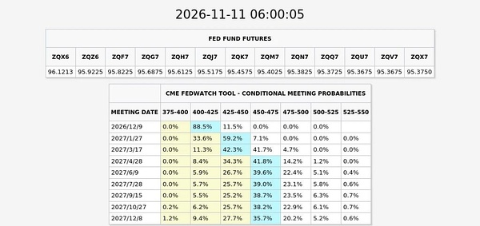

- (2026-11-11 07:49:46) 应该是因为今天美国休市？  ⊳ （引用 @我爱牛肉火锅）昨晚点进支付宝发现长盛不给买了，还好这两天多少买了一些

- (2026-11-11 07:53:00) 12月不加息概率为0🤣🤣🤣🤣🤣

只有88.5%加25和11.5%一次双倍加50  ⊳ （引用 @不知道还能说啥）美债回到4.75%
市场重新预期还有三次加息 回到之前状态

12月一次 
1月3月一次
4-12月一次

依然比较差的情况都很有机会4月就结束加息周期

- (2026-11-11 07:53:39) 那今天场内nana也许都不会绿😂😂😂😂😂  ⊳ （引用 @六倍做多退休）crwv业绩不错 终于没有给大巴掌了 

- (2026-11-11 07:58:26) 美联储官员古尔斯比：通胀是由成本端和需求端共同驱动的。

美国人能不能少吃点 少花点 ！！！！

- (2026-11-11 08:00:13) 这个一直都在
只是两次还是三次 市场一直摇摆  ⊳ （引用 @有人区生菜）怎么又开始加息了

- (2026-11-11 08:02:00) 每年都有下半年和圣诞节的呀

越花越多了！

希望延缓数据中心建设既然做了 就加大裁员吧  ⊳ （引用 @Waiting一下）美国人下半年节日多，就喜欢花钱，尤其是圣诞节左右😂😂

- (2026-11-11 08:05:07) [图] ETF追踪丨11月10日股票型ETF净赎回18亿元 资金减仓沪深300ETF华泰柏瑞

近一个月首次 无法获得净申购

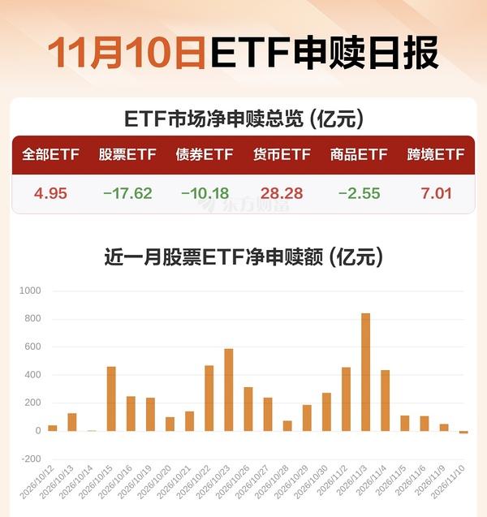

- (2026-11-11 08:14:32) 这个数学游戏越来越复杂了哈哈哈

昨天513300涨了3.53% 但是nana100实际也就涨了3.4
又多了0.13

昨晚下跌0.6 盘前暂时反弹0.4% 还要-0.2😂

正常应该-0.07开盘🤣🤣🤣

- (2026-11-11 08:17:05) [图] 我打算买一点点工银这个能买的超长的 最猛的😂

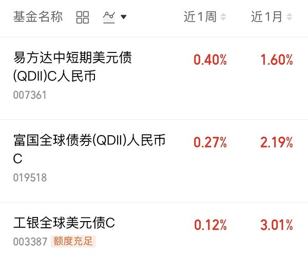  ⊳ （引用 @六倍做多退休）今天美债也买不了吧

- (2026-11-11 08:21:37) 希望uu之后回头看这是无与伦比的美妙操作🤣  ⊳ （引用 @fafa大财）今天去新岗位了，我要把场内全换成娜娜

- (2026-11-11 08:23:01) 笑死 进攻的钱我已经上周五全部用完了 一分都没有了🤣  ⊳ （引用 @shirla）我不买债了，我要进攻！

- (2026-11-11 08:24:39) 大连我开了9% 这个价格今天也到不了  ⊳ （引用 @🅰失而复🉐😎）这俩电影手动挂单送它们走😇

- (2026-11-11 08:25:17) 华泰证券：L3落地将是智驾产业重要里程碑

华泰证券研报称，L3落地将是智驾产业的重要里程碑，华泰证券认为L3准入与责任边界正在明确：大众中国在合肥获得L3道路测试牌照，L3能力最快于2027年下半年交付，Momenta预计L3/L4在2028年迎来拐点。L3在系统激活期间由系统执行驾驶任务，对制动、转向冗余与算力的要求更高，执行与决策环节的单车价值量有望随之提升。Robotaxi方面，上海拟将自动驾驶写入出租汽车条例，小鹏获广州全域L4示范运营资格，日本拟自12月起统一认证无方向盘L4车辆。

- (2026-11-11 08:25:59) 软银股价跌幅扩大至10%，此前公布财季亏损70亿美元。

- (2026-11-11 08:47:13) 两市融资余额较上日减少13.85亿元

截至11月10日，上交所融资余额报11743.95亿元，较前一交易日减少37.95亿元；深交所融资余额报10837.57亿元，较前一交易日增加24.10亿元；两市合计22581.52亿元，较前一交易日减少13.85亿元。

- (2026-11-11 08:47:24) 进100 出13

融资盘不一样了  ⊳ （引用 @不知道还能说啥）两市融资余额较上日减少13.85亿元

截至11月10日，上交所融资余额报11743.95亿元，较前一交易日减少37.95亿元；深交所融资余额报10837.57亿元，较前一交易日增加24.10亿元；两市合计22581.52亿元，较前一交易日

- (2026-11-11 09:12:13) 可以去看下去年12月日成交额巅峰大概是多少  ⊳ （引用 @锐不可丿当）早早早，楼楼昨天雪儿有点爆量了，会有风险嘛？

- (2026-11-11 09:13:23) 最近比尔阿克曼做什么股票啊？😂  ⊳ （引用 @木感情的打工人）微软市值超过英伟达了，不知道是不是一个风向标

- (2026-11-11 09:19:50) 雪儿最大风险是科技股暴力反攻  ⊳ （引用 @锐不可丿当）早早早，楼楼昨天雪儿有点爆量了，会有风险嘛？

- (2026-11-11 09:29:44) 爱利彼半导体启动IPO辅导
证监会网站披露，爱利彼半导体设备（上海）股份有限公司（以下简称“爱利彼半导体”）于2026年11月10日在上海证监局办理辅导备案登记，拟首次公开发行股票并上市，辅导券商为申万宏源证券承销保荐有限责任公司。

- (2026-11-11 09:31:40) 买入后开单7%涨幅

- (2026-11-11 09:35:42) 👍👍👍👍👍  ⊳ （引用 @钱包鼓鼓💰）15.6抄上了！

- (2026-11-11 09:36:11) 你要买 是卖1

卖才是买1  ⊳ （引用 @高手云集上钻）飞舞同花顺，我雪人挂的买入条件单是15.64，没成交，难道不能设置买一

- (2026-11-11 09:38:06) 重新强调

不要增加传媒仓位

这是我连续第二天提醒

- (2026-11-11 09:48:23) 我昨天就说了
不是今天  ⊳ （引用 @红红火火的anya）楼主，今天为啥不能买传媒呀

- (2026-11-11 09:48:45) 不增加传媒仓位和没有传媒是两回事  ⊳ （引用 @Aaa摆烂咸鱼🥳）楼，bn，中影，幸福也是传媒吧

- (2026-11-11 09:53:48) 要念名字

闽发
惠发

昨天S姐提示桂发  ⊳ （引用 @vio）小惠 这独食儿让你吃的

- (2026-11-11 09:56:52) 我只有恋爱脑
其他你们玩  ⊳ （引用 @有空青年胃不饱）楼看捞食品嘛今天

- (2026-11-11 09:57:03) 当日涨幅  ⊳ （引用 @纸飞机）这个7%涨幅是当前价7%还是按照昨日收盘价7%啊hhh，搞不清了

- (2026-11-11 09:58:27) 原来如此！！！  ⊳ （引用 @momo）日发也是涨停

- (2026-11-11 10:09:46) 位置优势😂  ⊳ （引用 @🅰失而复🉐😎）光线大放异彩了开始😏

- (2026-11-11 10:10:52) [图] 黄金 有色 白酒 光伏领跌

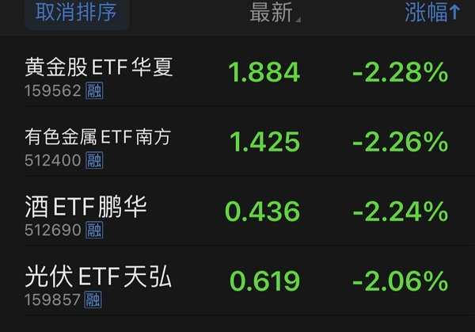

- (2026-11-11 10:12:51) 7天赢了6天
不要休息一下的吗  ⊳ （引用 @👑）怎么感觉都在发套啊

- (2026-11-11 10:15:06) [图] 历史总相似？

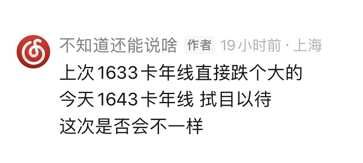

- (2026-11-11 10:16:16) [图] 今天微盘股玩到哪个方向去了？

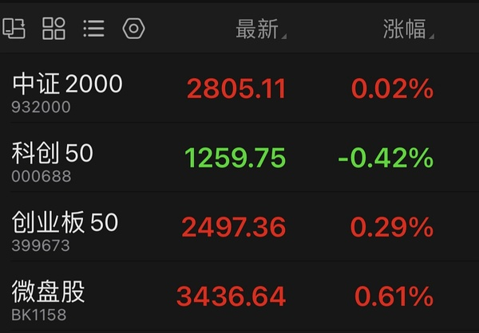

- (2026-11-11 10:16:41) 没有 万一冰山跌停 他能跌到哪里再去  ⊳ （引用 @🅰失而复🉐😎）15.35卡五日线，话说那个晶去没去它在拉了

- (2026-11-11 10:18:38) 打开你的食品饮料板块

11红110绿 这叫炒消费吗😂  ⊳ （引用 @👑）消费小辣鸡算吗

- (2026-11-11 10:21:00) 相对是机器人好点  ⊳ （引用 @木感情的打工人）🤖吧

- (2026-11-11 10:23:11) [图] 还可以
比想象中好
没有-8以上票

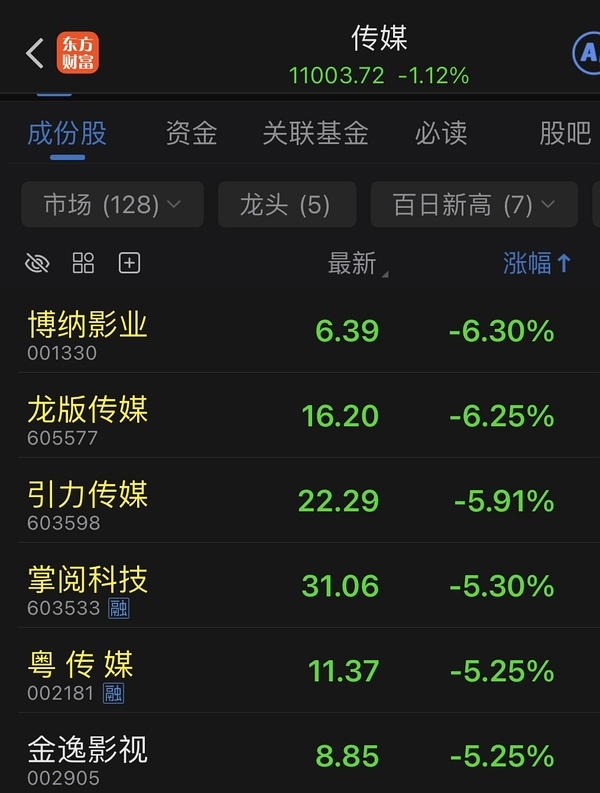

- (2026-11-11 10:27:42) 哈哈哈哈
也许人家今天稳住带动双子星
然后明天冰山深水 双子星再带动他起来🤣  ⊳ （引用 @速派女孩将发财）既然都这样了 那我支持 今天把冰山 晶雪按死  大连 CBS 正统上位

- (2026-11-11 10:28:17) 11.9日基本都是涨停的 到底嘛😂  ⊳ （引用 @有人区生菜）休息这一天顶我前面几天

- (2026-11-11 10:29:46) 从不担心冰雪双子星  ⊳ （引用 @🅰失而复🉐😎）大白来了

- (2026-11-11 10:31:28) [图] 因为这个来了

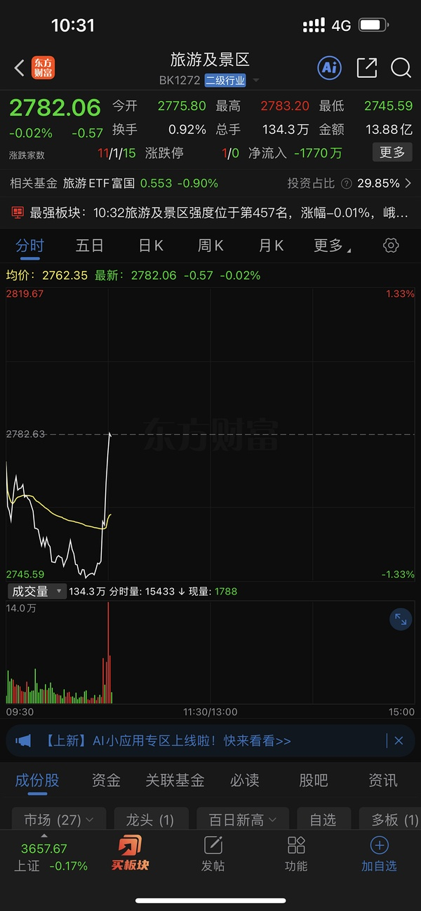  ⊳ （引用 @速派女孩将发财）CBS现在已经脱离冰山在独立行走了！

- (2026-11-11 10:31:49) 峨眉山直线拉板

- (2026-11-11 10:31:56) 他山上也有雪  ⊳ （引用 @不知道还能说啥）峨眉山直线拉板

- (2026-11-11 10:33:03) 现在溢价率最低的也在14%了😂  ⊳ （引用 @六倍做多退休）果然场内的nana溢价又高了😂 不愿意绿 爽

- (2026-11-11 10:33:50) 国台办：欢迎并支持更多台湾业者参与大陆微短剧创作

- (2026-11-11 10:33:54) …..  ⊳ （引用 @不知道还能说啥）国台办：欢迎并支持更多台湾业者参与大陆微短剧创作

- (2026-11-11 10:34:35) 峨眉山还有黄金概念呢🤣  ⊳ （引用 @点-重生炒垃圾）我还以为是猴

- (2026-11-11 10:34:52) 冲啊asd  ⊳ （引用 @只想搞钱）机器人拉升

- (2026-11-11 10:38:03) 山寨货肯定和山寨混一起  ⊳ （引用 @🅰失而复🉐😎）一看这三就是一路货色

- (2026-11-11 10:38:20) 那自然不是  ⊳ （引用 @硬糖）楼楼今天就捡了雪人吗

- (2026-11-11 10:40:58) 我反正不加仓传媒😂  ⊳ （引用 @木感情的打工人）放出来这种新闻是不是就是在找接盘的了😂

- (2026-11-11 10:42:20) [图] 微盘股大幅扩大涨幅

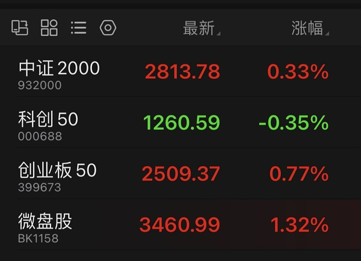

- (2026-11-11 10:43:15) [图] 题材确实是机器人 现在看到ETF前排了🤣

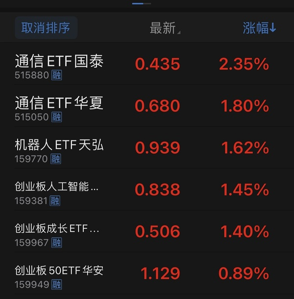  ⊳ （引用 @点-重生炒垃圾）芒果又拉两个点

- (2026-11-11 10:43:47) [图] 有喜欢的吗🤣

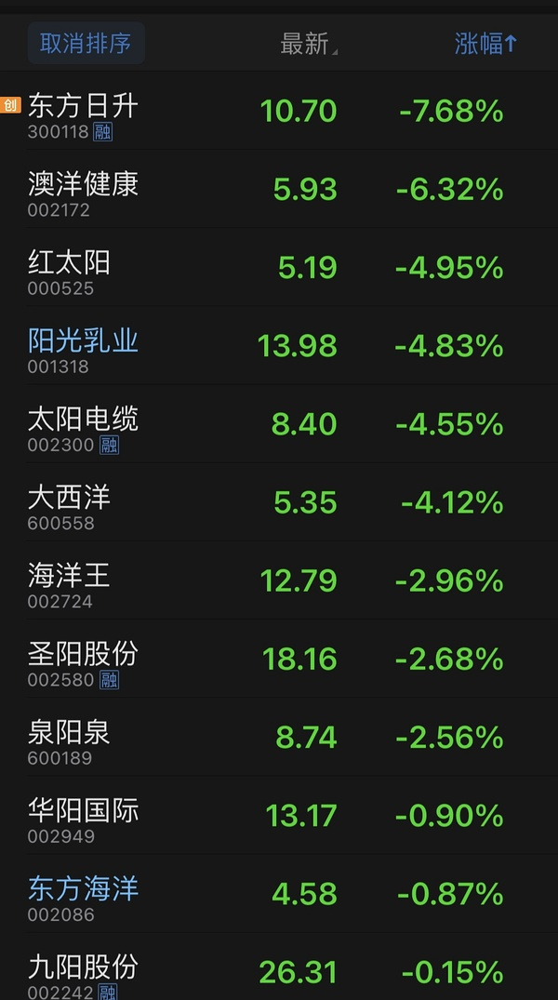  ⊳ （引用 @只想搞钱）对襄阳进行膜拜，替我的冰雪接一接

- (2026-11-11 10:45:12) 襄阳之前的图好骗人啊！  ⊳ （引用 @只想搞钱）对襄阳进行膜拜，替我的冰雪接一接

- (2026-11-11 10:45:39) 今天plus雪不敢😂😂  ⊳ （引用 @🅰失而复🉐😎）山寨来了

- (2026-11-11 10:49:16) [图] 3300还行 不过今天我不满意

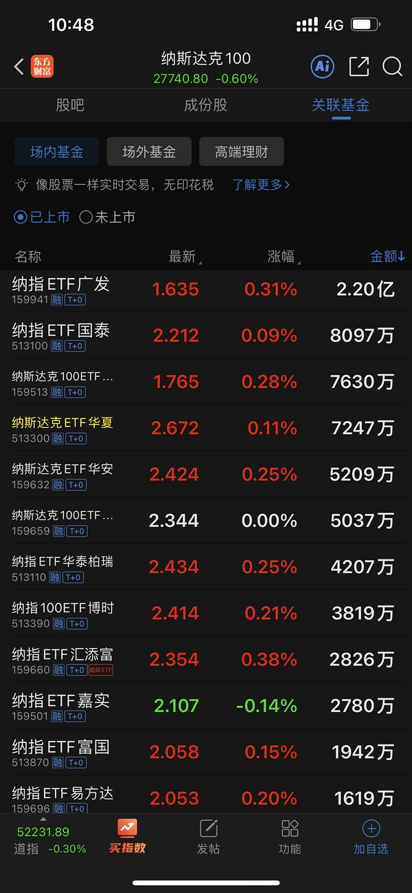

- (2026-11-11 10:49:53) 哈哈哈国台办功劳 这也能喊话到短剧😂  ⊳ （引用 @sickid）谢谢欢瑞

- (2026-11-11 10:52:14) 那最后的结局大部分人还是亏钱😂
宇航员最终是大批三连板跌停收尾 根本出不来🤣  ⊳ （引用 @点-重生炒垃圾）你说会像去年宇航员一样，一直不敢上，最后爆到一月去吗

- (2026-11-11 10:53:53) [图] 黄金白银逃出去了
现在是喝酒吃药光伏垫底了😂

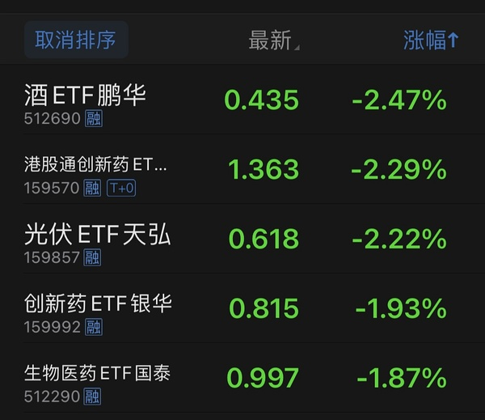

- (2026-11-11 10:54:31) 招招不经意间
打出五连阳😂

- (2026-11-11 10:56:00) [图] 也是三连阳啊

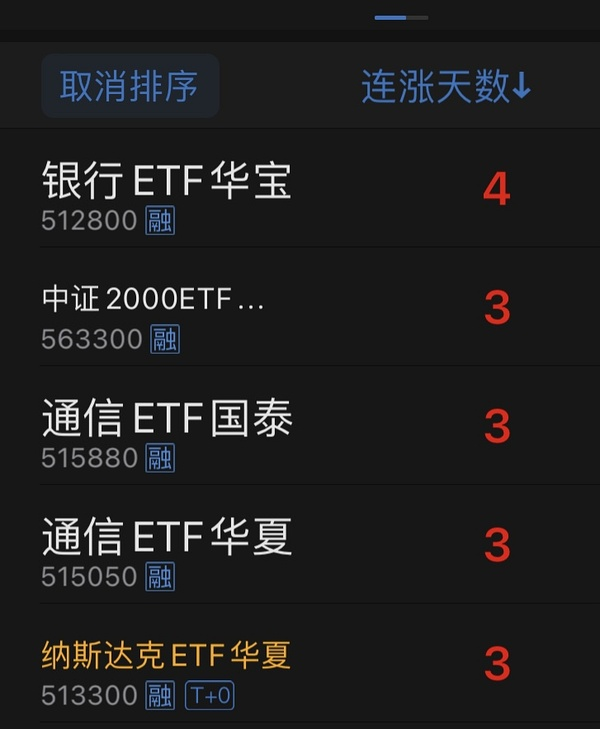  ⊳ （引用 @🅰失而复🉐😎）科技😕有想过我的感受吗

- (2026-11-11 10:56:49) 哪个权重害的  ⊳ （引用 @点-重生炒垃圾）K50开始自杀了

- (2026-11-11 10:57:35) 反超芒果  ⊳ （引用 @哎呀哎呀）Sy你还回来吃饭吗🥹🥹🥹

- (2026-11-11 10:57:50) 银行板块延续强势格局，南京银行、长沙银行、成都银行创历史新高，工建农中交邮六大行齐升。据官媒报道，今年以来，险资差异化配置银行股，大型险企主要买入国有大型银行股份。

- (2026-11-11 10:58:59) [图] 今天这几个都不能爆发

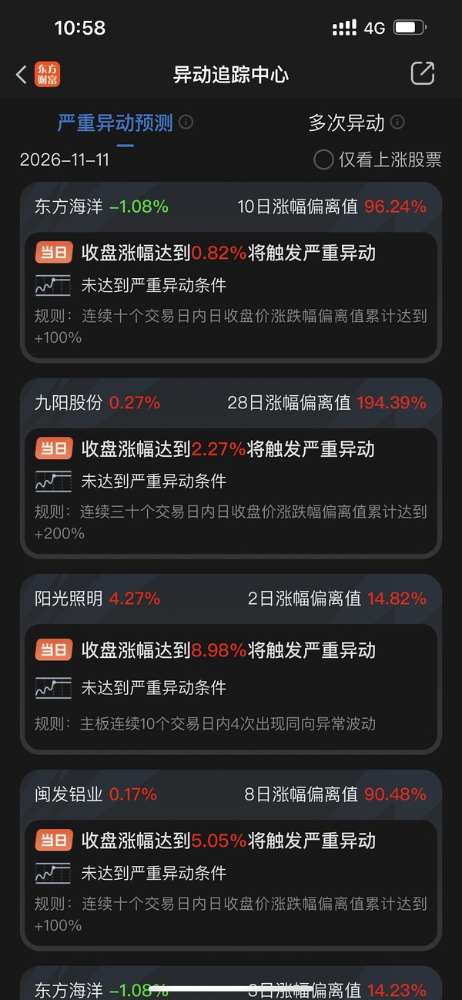

- (2026-11-11 10:59:13) 你怎么还有白酒的😂  ⊳ （引用 @问一下能不能瘦）完了 我的白酒今天暴跌了

- (2026-11-11 11:00:32) 周末我听的都是 国产设备是科技首选😂  ⊳ （引用 @点-重生炒垃圾）设备吧，三个设备一起自杀，中微带头的

## 🧠 投资风格分析
> 📏 增量更新指引：仅当今日发言确有新依据时才修订对应维度，无变化不强行重写；单维度修订建议 ≤150 字。

- 投资理念与方法：坚持机会成本与性价比比较，只赚份内的钱、不后悔错过机会（「赚份内的钱 牛的票多的是」「没事我不后悔」）。重视低位优势，认为光线低位时「打20%图上都看不显著」，宁愿持有低位防守品种也不追高。认为防守不等于减仓，可通过「拉高冰雪」「恋爱脑」等对冲品种实现；并以6月半导体为例，认为提前减仓会拿不回来，倾向让趋势走完。对利空被无视的品种给予正面评价（「昨天利空无视也挺厉害」）。
- 风险偏好：对高溢价QDII保持警惕（「现在溢价率最低的也在14%了」）；对题材热度不追高，认为多数人最终亏钱；关注融资盘变化，认为「进100 出13」显示资金结构分化；看多债市但认为央妈只是控制速度，不改变方向。
- 交易与仓位：偏好盘后预设条件单与定价单，避免盘中消息干扰；对同一标的做分层与差价操作，如大连与长白山按5:3配比、47.74卖出一份大连做差价；回踩五日线视为教科书式加仓点。资金在同类持仓间腾挪而非新增，如幸福蓝海卖出后资金放在光线，明确「今天不加仓传媒」。对已加过仓的品种（申菱转债149.9）保留条件单，未加过则不开新单。减半仓位多用涨停价或定价卖出挂单执行。
- 心理特质：对市场情绪与历史规律保持敏感，常用幽默自嘲表达观点（如「美国人能不能少吃点 少花点」）；对持仓方向有清晰判断，不因短期波动动摇（「从不担心冰雪双子星」）；对题材炒作保持警惕，预判「宇航员最终是大批三连板跌停收尾」，体现风险意识。

> ⚠️ 本板块由 Actions 全自动增量更新（复用当日发言与今日总览），每次仅在内容足够支撑时才改动。

## 🏷️ 昵称映射表
### 📖 昵称规律（供 AI 判断新昵称时参考）
【昵称命名规律（用于推断未知新昵称）】
- 拼音首字母缩写：取标的/基金名汉字拼音首字母串（含数字代码），多为 ETF/股票代码口语化｜示例：yl=引力传媒｜zy=掌阅科技｜sj=视觉中国｜cc=华安文体健康混合｜C50=创业板50ETF｜k50=科创50｜kun=昆仑万维｜xhxc=新瀚新材｜zxfc=中欣氟材
- 小/老+姓氏代指：「小X」「老X」通常指姓 X 的标的或该标的的基金经理；「X兄弟」多为同系基金｜示例：小惠=惠发食品｜老莫=万家品质生活(莫海波)｜小华=华夏全球科技先锋(QDII)A｜小华兄弟=华夏移动互联(QDII)｜小浦=浦银安盛全球智能科技(QDII)A｜小广=广发全球精选(QDII)A｜小远=华宝致远(QDII)C｜招招=招商银行｜小德=德明利｜赵姨=兆易创新｜露露=泸州老窖｜空调=格力电器
- 戏称/黑话→题材板块：生活化比喻或黑话对应某个题材/板块，而非单一标的；出现时多指板块方向｜示例：卖国=PCB板块(英伟达AI链)｜爱国=国产自主(半导体设备/芯片)｜奶茶=易点天下｜老师=中文在线｜蓝色=蓝色光标｜宇航员=航空航天板块｜华子=华泰保兴安悦债券｜国际=国际复材｜巨无霸=长鑫科技等重大IPO
- 谐音/取字：昵称含标的名关键字（取一字或谐音），多为 A 股个股或基金简称｜示例：万华=万华化学｜东百=东百集团｜宝=保利发展｜讨饭/亚洲讨饭/建信新兴=建信新兴市场(QDII)A｜华宝zy=华宝致远(QDII)A
- 机构/基金经理昵称：以基金公司名、经理姓、或平台代称指代对应基金产品｜示例：周经理=中欧新趋势混合(LOF)A｜张经理=信澳匠心回报混合A｜网易云/音乐世家=富国全球科技互联网股票(QDII)A｜国富亚洲=国富亚洲机会股票(QDII)A｜国泰纳指=国泰纳斯达克100指数(QDII)｜易方达全球=易方达全球成长精选混合(QDII)A｜浦银安盛=浦银安盛全球智能科技(QDII)A

### 📋 已收录映射
| 昵称 | 对应名称 |
|------|----------|
| C50 | 创业板50ETF |
| cc | 双义：股票=中国长城 / 基金=华安文体健康混合（用户 11-05 指认） |
| k50 | 科创50 |
| kun | 昆仑万维 |
| sj | 视觉中国 |
| xhxc | 新瀚新材（用户确认；代码待核） |
| yl | 引力传媒 603598（对手盘，非他持仓）｜11-06 +37.15%；11-09 本月+37.79% |
| zxfc | 中欣氟材 |
| zy | 双义：他本人口径=603533 掌阅科技（用户 11-05 确认）；11-09 楼友两条『zy』按 16 元/电影语境指 600977 中国电影。引用必须带语境，不许收敛 |
| 万华 | 万华化学 |
| 东百 | 东百集团 |
| 亚洲讨饭 | 建信新兴市场混合(QDII)A |
| 保利发展 | 保利发展 |
| 华子 | 华泰保兴安悦债券 |
| 华宝 zy | 华宝致远混合(QDII)A |
| 华宝zy | 华宝致远混合(QDII)A |
| 卖国 | PCB、光模块、通信板块（英伟达AI产业链） |
| 周经理 | 中欧新趋势混合(LOF)A |
| 国富亚洲 | 国富亚洲机会股票(QDII)A |
| 国泰纳指 | 国泰纳斯达克100指数(QDII) |
| 奶茶 | 易点天下 301171（对手盘，非他持仓）｜11-06 本月+29.51% |
| 宇航员 | 航空航天板块 |
| 宝 | 保利发展 |
| 小华 | 华夏全球科技先锋混合(QDII)A |
| 小华兄弟 | 华夏移动互联混合(QDII) |
| 小广 | 广发全球精选股票(QDII)A |
| 小德 | 德明利 |
| 小惠 | 惠发食品 |
| 小浦 | 浦银安盛全球智能科技(QDII)A |
| 小远 | 华宝致远混合(QDII)C｜只在盯，未证他持有 |
| 巨无霸 | 长鑫科技等重大IPO企业 |
| 建信新兴 | 建信新兴市场混合(QDII)A |
| 张经理 | 信澳匠心回报混合A |
| 招招 | 招商银行 |
| 易方达全球 | 易方达全球成长精选混合(QDII)A |
| 浦银安盛 | 浦银安盛全球智能科技(QDII)A |
| 爱国 | 国产自主（半导体设备/芯片制造） |
| 空调 | 格力电器 |
| 网易云 | 富国全球科技互联网股票(QDII)A |
| 老师 | 中文在线 |
| 老莫 | 万家品质生活混合A(519195) |
| 蓝色 | 蓝色光标 |
| 讨饭 | 建信新兴市场混合(QDII)A |
| 赵姨 | 兆易创新 |
| 赵哥 | 兆易创新 |
| 露露 | 泸州老窖 |
| 安安 | 安记食品 |
| 音乐世家 | 富国全球科技互联网股票(QDII)A |
| 老伯伯 | 铜冠铜箔 |
| nk | 纳指科技ETF景顺 159509（联接=景顺长城纳斯达克科技ETF联接A）｜11-06 A级：截图溢价率37.08% |
| bk | 标普信息科技LOF 161128（场外=易方达标普信息科技QDII-LOF）｜11-06 A级 |
| txx | 天下秀 |
| 媛媛 | 今世缘 |
| uu | 友友、网友们 |
| 温暖老师 | 某个特别牛逼的散户 |
| 余老师 | 余利，某牛逼投资者 |
| ycm | 粤传媒 002181｜11-09 12:12「非电影传媒就留给大家玩了 我一个都不会碰了」→ 推断已不持有 |
| 江老师 | 江琪（投资博主） |
| 水果老师 | 投资博主 |
| 小爱 | 我爱我家 |
| ty | 天娱数科 |
| bn | 博纳影业 |
| sy | 上海电影 |
| CBS | 长白山 |
| 东哥 | 东百集团 |
| 芒果 | 芒果超媒 |
| 阿中 | 中国电影 |
| 欢欢 | 欢瑞世纪 |
| 雪人 | 雪人集团 |
| 大连 | 大连圣亚 |
| 幸福 | 幸福蓝海 |
| 小粤 | 粤传媒 |
| 阿博 | 博纳影业 |
| 创成长 | 创业板成长etf |
| asd | 埃斯顿 |
| 恋爱脑 | 好想你 |
| 恋爱 | 好想你 |
| 小羊 | 襄阳轴承 |
| 中马 | 中马传动 |
| 晶雪 | 晶雪节能 |
| xf | 幸福蓝海 |
| 建设 | 建设工业 |
| 北方 | 北方导航/北方国际（未定，11-04「我在北方了」） |
| _ambiguity_note | 歧义未收敛（禁止当唯一映射）：轮子=巨轮智能/五洲新春；sj=视觉中国（传媒语境）/神剑股份（宇航员语境）；cc=中国长城/华安文体健康混合；北方=北方导航或北方国际；zy=掌阅科技（用户 11-05 确认原值正确）。证据分级：A=价位/均线/月涨幅实测命中；B=量级或单日命中/用户口述；C=仅昵称或语义，不得据此写『他持有』；沿用原仓=本轮未复核，不写进结论正文。三条判据：①条件单四位数要先按同时段动词行判买卖方向（cbs 3644 是买单不是卖单）；②『祝福/你们/你的X』句式＝评论他人持仓，不是他的操作；③同一昵称在不同语境可指两只票（zy=掌阅/中影），按价位与板块取，不许收敛成一个。 |
| nana场内 | 513300 纳斯达克ETF华夏｜11-09 14:34「不愧是513300 当年的普通nana ETF之王」，当日唯一红的纳指ETF |
| 雪儿 | 雪人集团 002639（推断） |
| 存钱罐 | 光线传媒 300251（他自述小仓） |
| 枣子 | 好想你 002582 |
| 王老师 | 人：王博雅投资（QDII 场内溢价口径），不是标的 |
| 印度 | 自嘲代指中国（推断，勿当事实） |
| 10086 | 中国移动（他当指标用，非持仓） |
| 阳光乳业 | 001318 阳光乳业（他的『喝的』/牛奶）｜11-09 A级：13:59 分时截图 S 标记≈13.5＋10:52「我去掉了羊来抄底」 |
| 羊 | 生肖羊概念组（带阳/洋的一篮子：东方海洋/日出东方/大东方/红太阳/澳洋健康/鲁阳节能/华阳国际/东方日升/阳光照明/九阳股份/阳光乳业/沈阳机床）｜11-09 14:04 他自己贴的分组｜**不是单只票，也不是『小羊』襄阳轴承** |
| 小明 | 605179 一鸣食品｜11-09 10:07 有人问『喝的小明？』他答『羊』＝喝的已换成阳光乳业 |
| 皇台 | 000995 皇台酒业｜11-09 与雪人 PK 当日换手率龙虎榜 |
| 海哥 | 人：转债估值博主（不是标的）｜11-09 12:48「海哥周五那个新债…我买了点试试看是市场错了还是海哥错了」 |
| 申菱转债 | 123290（申菱环境 301018 的转债）｜11-09 13:50 买 150 张 @133 多 |

> ⚠️ 以下为 LLM **建议**，未自动写入状态文件。请人工确认后，本地编辑 `state.json` 的 `nickname_map` / `positions`，或 `nickname_rules.json` 的 `rules` 并 push 生效。

## 持仓建议（待你确认）
- **工银超长期利率债基金（待核）**（）〔观察〕— 依据：我打算买一点点工银这个能买的超长的 最猛的😂（计划买入，尚未成交）

## 新昵称映射建议（待你确认）
- `冰山` = 冰山冷热（000530，冰雪概念，推断）
- `桂发` = 桂发祥（002820，食品，S姐提示）
- `闽发` = 闽发铝业（002578，推断）

## 新昵称规律建议（待你确认）
- 【溢价跟踪】场内ETF当日涨幅超出标的实际涨幅的部分即为溢价扩张，可用来倒推次日开盘参考价 ｜示例：513300涨3.53%而纳指100实际涨3.4%，多了0.13；昨晚跌0.6%、盘前反弹0.4%，正常应-0.07开盘 ｜依据：昨天513300涨了3.53% 但是nana100实际也就涨了3.4 又多了0.13
- 【溢价水位】纳指相关场内ETF溢价率普遍高企，最低的也在14%，整体处于高溢价环境 ｜示例：现在溢价率最低的也在14%了 ｜依据：现在溢价率最低的也在14%了😂
- 【传媒纪律】连续提醒不增加传媒仓位——“不增加传媒仓位”和“没有传媒”是两回事 ｜示例：重新强调不要增加传媒仓位，这是我连续第二天提醒；我反正不加仓传媒 ｜依据：重新强调 不要增加传媒仓位 这是我连续第二天提醒
- 【债市政策】10年国债破1.5825%历史新低后央妈从资金到文章温和指导，说明债不是不能下行，而是不能过快下行 ｜示例：部分券商分析师看多债市公众号文章被删除 ｜依据：这次表现的比较温和，说明不是债不能下行，而是债不能过快下行！
- 【融资盘】融资余额“进100出13”结构变化，两融资金动向作为情绪信号 ｜示例：两市融资余额较上日减少13.85亿元 ｜依据：进100 出13 融资盘不一样了
- 【跷跷板】冰雪消费股（雪人）的最大风险是科技股暴力反攻，二者存在跷跷板效应 ｜示例：雪儿最大风险是科技股暴力反攻 ｜依据：雪儿最大风险是科技股暴力反攻
- 【板块成色】用板块红绿家数判断是否真炒消费：食品饮料11红110绿说明资金并未炒消费 ｜示例：打开你的食品饮料板块 11红110绿 这叫炒消费吗 ｜依据：打开你的食品饮料板块 11红110绿 这叫炒消费吗😂
- 【微盘方向】微盘股扩大涨幅时先看题材归属，当前题材确实是机器人，ETF前排可见 ｜示例：微盘股大幅扩大涨幅；题材确实是机器人 现在看到ETF前排了 ｜依据：微盘股大幅扩大涨幅 ... 题材确实是机器人
- 【加息预期】美债回到4.75%，市场重新预期还有三次加息（12月、1月/3月、4-12月），12月不加息概率为0 ｜示例：只有88.5%加25和11.5%一次双倍加50 ｜依据：美债回到4.75% 市场重新预期还有三次加息
- 【季节性】下半年和圣诞节美国消费季节性走高，通胀需求端驱动难降 ｜示例：每年都有下半年和圣诞节的呀 越花越多了 ｜依据：希望延缓数据中心建设既然做了 就加大裁员吧 ... 每年都有下半年和圣诞节的呀

*🤖 自动生成于 2026-11-11 11:02:26 ｜ 豆瓣楼主发言追踪*