# 📋 楼主每日发言推送

> **推送日期**：2026-11-12 ｜ **执行时间**：2026-11-12 16:02:53 ｜ **监控用户**：`不知道还能说啥`
> **追踪模式**：`topic`（用户主页广播·豆瓣话题）

## 📊 持仓追踪
> 上次更新：2026-11-12 ｜ 基于楼主发言持续追踪（共 16 项）

| 标的 | 状态 | 类型 | 现价 | 提及 |
|------|------|------|------|------|
| 招商银行 | 底仓·四年前 32 元买入·不动 | 红利/银行 | 42.63（0.16%） | 11-11 10:54「招招不经意间 打出五连阳」…；成本约32元 |
| 大连圣亚 | 持有 5 笔·11-10 加仓 1 笔·卖单 +9%（46.90）未触发·盘后继续开大涨幅 | 冰雪·正牌双子星 | 41.20（-0.70%） | 设置条件单+9%：“大连我开了9% 这个价格今天也… |
| 长白山 | 持有 3 笔·锁仓·不开单不接 | 冰雪·正牌双子星 | 37.47（-0.95%） | 11-10 09:32「加仓大连cbs」；14:5… |
| 雪人集团 | 持有 3 笔·11-11 买入 1 笔（−3多≈15.5）·卖单 17.19（当日+7%）未触发 | 冰雪·交易仓 | 15.23（-2.31%） | 「雪人昨天不是接回来了？」——昨日已接回，今日提及… |
| 幸福蓝海 | 持有·卖单 18.44→17.94（11-11 盘后降 5 毛）未触发 | 电影 | 14.99（-0.53%） | 11-11 15:41「幸福降价5毛1794了 到… |
| 中国电影 | 持有·11-10 卖 1 笔 @15.84·剩余仓无单 | 电影·核心不动仓 | 15.50（-2.94%） | 11-10 09:43「你们人多也坑不了中影啊 准… |
| 光线传媒 | 持有·卖单 15.44（≈涨停·定价卖出）未触发·不加仓等猛拉 | 电影·低位备选 | 12.43（-4.97%） | “加仓要等等”，需“拉一次猛的让我完全心动” |
| 博纳影业 | 持有小仓 | 电影 | 6.32（-4.10%） | 11-11 13:58「博纳没动不应该啊😂」；14… |
| 好想你 | 持有 | 食品（他叫『恋爱脑』） | 9.76（-2.89%） | 清仓（原文：「清了恋爱脑」） |
| 纳斯达克ETF华夏 | 持有·不卖场内（继续炒溢价） | QDII·场内纳指 | 2.688（-0.74%） | 11-11 08:14「昨天513300涨了3.5… |
| 中韩半导体ETF | 持有 | QDII·场内 | 3.685（-0.14%） | 「中韩我本来就有 我不满意」——持有，但不满溢价率… |
| 申菱转债 | 持有 150 张·卖单 149.9 未触发 | 转债（小额试错） | 143.850（-2.53%） | 11.9；11-10 10:28「海哥预估150+ 还是会到… |
| 盛天网络 | 11-11 买入 @≈11.00（跟摄像大哥一把） | 游戏·电竞 | 10.59（-7.35%） | 11.11；11-11 11:29「不止 而且我跟了他一把 说… |
| 游戏自建仓 | 11-10 买入·持有·11-11 自述 +5% | 游戏·电竞 | 暂无 | 11.10；11-10 15:18「我摄像大哥昨天去的🤣 今天… |
| 美债场外基金 | 持有·国庆前买入·11-11 自述 +1.4% | 场外·美债 | 暂无 | 11-11 12:18「我国庆之前买的刚赚了1.4… |
| 埃斯顿（asd） | 买入 |  | 暂无 | 11.12；「我昨天加了asd今天刚刚加了另外个」——昨日加仓… |

> ⚠️ 执行任务时如发现新操作，请更新 `state.json` 的 `positions`。成本价和市值有数据才填，没有则保留「暂无」。

## 🌅 今日总览
### 📌 市场背景
市场背景：今日市场呈现「公募出清、融资盘开干」的结构切换迹象，融资余额单日增加74.92亿元（「两市融资余额较上日增加74.92亿元」）；资金从光模块、AI算力等方向撤离后去向待观察（「这些砍掉光 钱都买什么去了呢」）。公募基金三季报披露引发抱团重估，机构重仓股遭规避（「市场暗线：远离机构重仓」），而传媒板块成交超千亿、换手7%被指拥挤（「传媒板块7%就很拥挤了 不要加仓」）。此外纳指ETF（3300）被称“冠军”，白酒等“老登”被视作危险区域。

### 📌 今日操作
| 操作 | 标的 | 详情 |
| --- | --- | --- |
| ✅ | 东方海洋（002086） | 涨停价卖出（原文：「涨停卖了东方海洋」） |
| ✅ | 好想你（002582，恋爱脑） | 清仓（原文：「清了恋爱脑」） |
| ✅ | 低位标的（未披露） | 加仓一只低位标的（原文：「只加一个低位的 我说过 就不提了」） |
| ✅ | 另一标的（未披露） | 加仓「另外个」（原文：「今天刚刚加了另外个」） |

### 📌 今日议题
| 议题 | 态度 | 核心观点 | 关键引用 |
| --- | --- | --- | --- |
| 公募基金抱团与机构重仓风险 | 📉看空 | 公募薪资挂钩排名加剧抱团趋同，机构重仓股成危险区，应远离 | 「市场暗线：远离机构重仓」「你要感谢我们高层去年的那个制度了」 |
| 传媒板块拥挤度 | 📉看空 | 传媒成交超千亿、换手7%为拥挤信号，不增仓只持有 | 「传媒板块7%就很拥挤了 不要加仓」「不加仓和持有是两回事」 |
| 龙版传媒风险提示 | 💬讨论 | 龙版连续两个月做出重大风险提示，可能预示调整 | 「龙版还是决定的传媒之王 连续两个月做出重大风险提示」 |
| 周五风险 | 📉看空 | 周五尾盘跳水概率高，避免在14:30前开跌幅小的仓 | 「周五不要在14:30之前开跌幅小的仓！！」 |
| 机器人板块 | 📈看多 | 机器人线完美，自己玩机器人，传媒让给别人 | 「你们玩传媒 我玩机器人了」「现在好几个机器人线都完美无瑕了」 |
| 溢价率问题 | 💬讨论 | 不满中韩半导体ETF溢价率仅剩5%，需跟踪贴合度 | 「中韩我本来就有 我不满意 溢价率只剩5」「每间隔一周两周要多看看他是不是和nana100基金完全贴合」 |

### 📌 看好板块/方向
- **机器人**：今日明确表示“你们玩传媒 我玩机器人了”，且埃斯顿（asd）火箭发射，几个机器人线完美无瑕。
- **电影（中影、幸福蓝海）**：对中影幸福非常满意，称“中影幸福接受住了考验”。
- **纳斯达克ETF（3300）**：称“3300是冠军🏆”，并科普其历史地位。

### 📌 风险提示
- 「传媒板块7%就很拥挤了 不要加仓」——传媒成交额超千亿、换手7%为拥挤信号。
- 「如果羊 东方崩盘 会大幅度加大调整的」——情绪核心崩盘将引发市场调整。
- 「周五不要在14:30之前开跌幅小的仓！！」——周五尾盘跳水风险高。
- 「小心羊崩盘 进一步带崩」——连续吊羊，注意仓位。
- 「以后那些老登后续又要惨遭抛售」——机构重仓股危险。

## 📊 本次结果
- **今日发言**：212 条
- **累计存档**：21263 条

## 📝 该最新广播作者发言聚合（共 212 条）
### 其他讨论（提及 149 次，占比 70%）2026-11-12 00:09:02
- 你们都赚了多少了
我这个没动赚得好慢啊
要是有2倍就好了😂

- 黄金在意😂
- 哈哈哈哈哈哈 拉稀

### 易点天下 301171（对手盘，非他持仓）｜11-06 本月+29.51%（提及 9 次，占比 4%）2026-11-12 09:13:42
- 融资盘继续流出奶茶

不爱了就是不爱了

- 笑死
他和蓝色 奶茶 sg他们是广告组合
- 我想恭喜奶茶人
但是看着蓝色18 奶茶9

这句恭喜说不出口了😂

### 幸福蓝海（提及 9 次，占比 4%）2026-11-12 11:26:55
- 这个一直都是独立行情

如果需要减仓 也是动手幸福😂😂😂😂中影肯定最后动
- 对中影幸福非常满意
- 幸福可是先调整两天的
光线两连阳今天才调整
所以能接受

### 生肖羊概念组（带阳/洋的一篮子：东方海洋/日出东方/大东方/红太阳/澳洋健康/鲁阳节能/华阳国际/东方日升/阳光照明/九阳股份/阳光乳业/沈阳机床）｜11-09 14:04 他自己贴的分组｜**不是单只票，也不是『小羊』襄阳轴承**（提及 8 次，占比 4%）2026-11-12 09:46:56
- 羊今天紧密相连

- 早点调整 早点反弹😂就看12月了哈哈

而且那群羊啊东方啊 肯定也会崩一次

市场最近总会有一天普跌调整的早晚的事情
- 后排羊不太行了

大家仓位记得好好控制

### 蓝色光标（提及 6 次，占比 3%）2026-11-12 10:12:53
- 嗯
我认错了
他们都动大体量蓝色了
- 因为我说的那个是10cm的
大家看着蓝色
10cm不得劲 我懂的
所以我不说了
让大家能赚更多的钱
- 蓝色空中加油了

### 友友、网友们（提及 5 次，占比 2%）2026-11-12 00:13:06
- 很多uu都没这个了 所以就不加入比赛了
明天可以看看🤣
- uu无敌了
- uu该换名字了

你没有满载而归了

### 上海电影（提及 4 次，占比 2%）2026-11-12 09:38:14
- 天天念叨sy的给你们机会了
- 天天念叨sy的 现在-6给你们机会了哈
- 与此同时 sy跌停

### 605577 龙版传媒｜11-11 11:50「最早龙版也是因为自己每次公告文案都不一样才4连板就被监管」（讲监管规则，非持仓）（提及 3 次，占比 1%）2026-11-12 09:27:59
- 龙版传媒昨天的针
会和10/14日一样
具有前瞻提示作用吗
- 传媒从前天开始就没有主动型气势了
昨天国台办强行V回来

但昨天龙版9%尾盘几乎翻绿 和10/14日异曲同工
市场有所提示 

所以我不玩
你们玩
我玩其他的
- 龙版还是决定的传媒之王
连续两个月做出重大风险提示

啥时候他又拐弯好起来了 啥时候干传媒

### 纳斯达克100指数（他对照场内ETF溢价的基准）｜11-11 08:14「昨天513300涨了3.53% 但是nana100实际也就涨了3.4」（提及 2 次，占比 1%）2026-11-12 07:57:03
- 还是算算今天nana吧
昨天ETF直接漏掉了前一晚-0.6的下跌
昨天场内大涨1.4 和 nana15点期货一致

最终nana100涨2.2 这少了0.8%
但是盘前-0.8 对冲了

所以正常情况nana今天应该平开🤣
- 是的
但是呢这个你就不那么完全的省心
为了自己的真金白银
你至少每隔一周两周要多看看他是不是和nana100基金完全贴合

就像我们这个每天投票也是方便追踪基金🤣

### 航空航天板块（提及 2 次，占比 1%）2026-11-12 10:10:00
- 是的

还是老样子 复刻宇航员

一路嗨 最终出都出不来的调整
- 宇航员从11月一路赶到1月第二周！！！！

### 埃斯顿（提及 2 次，占比 1%）2026-11-12 10:17:40
- 我昨天加了asd今天刚刚加了另外个
- asd火箭发射

### 513300 纳斯达克ETF华夏｜11-11 10:49「3300还行 不过今天我不满意」＋13:24「咱们3300还是近期数据最好的」（提及 2 次，占比 1%）2026-11-12 10:38:16
- 3300是冠军🏆

- 给大家科普下
在2025年年底之前
3300始终是普通nana的王者

后来被国泰嘉实广发接连掀翻

### 好想你（提及 2 次，占比 1%）2026-11-12 14:28:24
- 我如果去掉恋爱脑
也就比你多一个机器人
我现在也挺老实的🤣
- 涨停卖了东方海洋
清了恋爱脑

### 芒果超媒（提及 1 次，占比 0%）2026-11-12 09:09:31
- 厉害哦 融资盘猛干芒果

### 300502 新易盛｜11-11 13:19「我那个买xys的女主播终于要开心了」＋13:21「她现在成本327了」→ **是女主播的仓，不是他的**（提及 1 次，占比 0%）2026-11-12 09:49:09
- xys火箭发射

### 传媒板块拟人化（不是具体票）｜11-11 11:40「被传媒妹妹压制了」＋13:01「妹妹休息 哥哥接力？」（提及 1 次，占比 0%）2026-11-12 10:08:52
- 传媒妹妹：双创啥玩意？

### 雪人集团（提及 1 次，占比 0%）2026-11-12 10:42:02
- 雪人昨天不是接回来了？

### 000530 冰山冷热｜11-11 14:03「那冰冰准备」（同『冰山』，非持仓）（提及 1 次，占比 0%）2026-11-12 10:43:49
- 你在冰冰感到温暖🤣🤣🤣🤣🤣🤣🤣

### 视觉中国（提及 1 次，占比 0%）2026-11-12 11:36:52
- 不会每次每一个都顺风顺水
航天发展也是例子

当时zs sj足够赚钱了🤣🤣🤣🤣🤣最后航天发展换中国卫星直接把航天发展钱也赚回来了

### 安记食品（提及 1 次，占比 0%）2026-11-12 13:10:05
- 真滑稽
安安xxz都是福建
惠发是炒作发

他们都不因为食品

### 000995 皇台酒业｜11-09 与雪人 PK 当日换手率龙虎榜（提及 1 次，占比 0%）2026-11-12 13:10:31
- 白酒板块逆势走高，皇台酒业触及涨停，金种子酒、古井贡酒、迎驾贡酒纷纷走高。

### 博纳影业（提及 1 次，占比 0%）2026-11-12 13:15:34
- 马上sy跌停 bn还要尊敬一下他😂

### 📄 全部发言（共 212 条）
- (2026-11-12 00:09:02) [图] 你们都赚了多少了
我这个没动赚得好慢啊
要是有2倍就好了😂

  ⊳ （引用 @速派女孩将发财）华兄 我再相信你一次

- (2026-11-12 00:11:13) 黄金在意😂  ⊳ （引用 @速派女孩将发财）忽然发现油价拉升了 但是 似乎 无人在意

- (2026-11-12 00:11:32) [图] 哈哈哈哈哈哈 拉稀

  ⊳ （引用 @稀里不糊涂）报道

- (2026-11-12 00:13:06) 很多uu都没这个了 所以就不加入比赛了
明天可以看看🤣  ⊳ （引用 @24/7）怎么感觉会是小华

- (2026-11-12 00:17:48) [图] 其实最近防守最好的是浦姐
最早砍仓存储的
现在要反过来看浦姐进攻了😂

  ⊳ （引用 @稀里不糊涂）其实我也有点想骂小远了跌都跌了，涨起来又少

- (2026-11-12 00:36:42) 虽然能领先我们很多 但是进攻最强的两个买不到多少钱🤣  ⊳ （引用 @小鱼）场外之前没买的话随便买什么都是抄我们的底😂平均亏20%吧。

- (2026-11-12 00:43:38) 检验各大题材是不是真牛逼的时间到了😂  ⊳ （引用 @木感情的打工人）科技这么猛明天场内继续吃冰块😂

- (2026-11-12 07:32:16) AMD和博通股价盘后涨幅扩大至3%。 CoreWeave 则跟随英伟达走低，跌幅 5%。

- (2026-11-12 07:34:54) 市场重新评估：谁能承接 AI 算力需求；谁有第二供应商逻辑；谁在 AI 芯片、定制芯片上有业绩支撑。

这是抢生意逻辑？  ⊳ （引用 @不知道还能说啥）AMD和博通股价盘后涨幅扩大至3%。 CoreWeave 则跟随英伟达走低，跌幅 5%。

- (2026-11-12 07:37:09) 涨多了 回踩五日线  ⊳ （引用 @Waiting一下）英伟达：CEO黄仁勋可能与直接向他汇报的公司高管金伯利·鲍威尔发生过婚外情。英伟达正准备罢免首席执行官黄仁勋。英伟达董事会准备最快于今日召开会议，以决定首席执行官黄仁勋的去留。受此消息影响，英伟达美股盘后跌幅扩大至8%。

娜娜跳水

- (2026-11-12 07:39:16) 你看nana  ⊳ （引用 @🅰失而复🉐😎）踩的有点子多了😇

- (2026-11-12 07:47:52) [图] 

- (2026-11-12 07:48:54) 这些砍掉光 钱都买什么去了呢 
很有意思 接下来晚上看净值更有趣了

- (2026-11-12 07:51:44) 如果这些资金回去重新抱团
最近涨起来的老登们非常危险
大概率只能去最近走势好的老登咯？
老登后续又要惨遭抛售 比如昨天大跌的白酒😂

- (2026-11-12 07:53:59) 玩消费玩地产的人 和我们玩传媒一样 别真的当真了🤣🤣🤣🤣🤣  ⊳ （引用 @🅰失而复🉐😎）买酒喝买药吃买房子住买火箭🚀上天

- (2026-11-12 07:57:03) 还是算算今天nana吧
昨天ETF直接漏掉了前一晚-0.6的下跌
昨天场内大涨1.4 和 nana15点期货一致

最终nana100涨2.2 这少了0.8%
但是盘前-0.8 对冲了

所以正常情况nana今天应该平开🤣  ⊳ （引用 @🅰失而复🉐😎）金子来来回回搞又回到原点🤪

- (2026-11-12 07:58:36) 昨天如果漏掉的-0.6是对晚上本来+2的预期

那今天开盘得-0.6%开盘  ⊳ （引用 @不知道还能说啥）还是算算今天nana吧
昨天ETF直接漏掉了前一晚-0.6的下跌
昨天场内大涨1.4 和 nana15点期货一致

最终nana100涨2.2 这少了0.8%
但是盘前-0.8 对冲了

所以正常情况nana今天应该平开🤣

- (2026-11-12 08:02:06) [图] 大家的筹码游戏要重新玩了！！！

- (2026-11-12 08:27:43) 哈哈 这个要重视的哦
这意味着之前主升浪的白酒 像茅台肯定是被他们公募基金推上去的 现在变成了危险地方🤣🤣🤣🤣🤣🤣  ⊳ （引用 @山中食人花）离谱 这个游戏简直就是砍人游戏

- (2026-11-12 08:31:27) 这是柚子玩的

你一直说的迈瑞那种 还有白酒那些 肯定是他们反手抱的  ⊳ （引用 @点-重生炒垃圾）传媒是吗？软科技

- (2026-11-12 08:33:50) 是的
但是呢这个你就不那么完全的省心
为了自己的真金白银
你至少每隔一周两周要多看看他是不是和nana100基金完全贴合

就像我们这个每天投票也是方便追踪基金🤣  ⊳ （引用 @钱包鼓鼓💰）趁着人少我赶紧问一句，这个A也是na是吧

- (2026-11-12 08:36:08) 药明康德Q3公募基金加仓之王 这是明牌🤣  ⊳ （引用 @山中食人花）好家伙 咱们畅畅的药明也是吧 😂😂
真的 要是想法多手慢一点的 真可能挪哪里哪里亏💰

- (2026-11-12 08:37:44) 自从基金披露三季报以后
你看药明康德明显走势不如之前了

市场暗线：远离机构重仓🤣🤣🤣🤣🤣🤣

但是机构重仓在昨夜发生了大变化😂  ⊳ （引用 @山中食人花）好家伙 咱们畅畅的药明也是吧 😂😂
真的 要是想法多手慢一点的 真可能挪哪里哪里亏💰

- (2026-11-12 08:46:13) 怎么达成一致的
你要感谢我们高层去年的那个制度了
再次出发点是好的 但是一样是坏事

那就是让基金经理薪资挂钩业绩排名
这会加剧基金抱团 趋同化  ⊳ （引用 @山中食人花）我看那些骂基金经理的 其实经理想买回来也就是一下的事吧
但是咋达成这个一致呢，可预见老美会连续反弹吗 ？

- (2026-11-12 08:47:29) 两市融资余额较上日增加74.92亿元
截至11月11日，上交所融资余额报11767.50亿元，较前一交易日增加23.55亿元；深交所融资余额报10888.94亿元，较前一交易日增加51.37亿元；两市合计22656.44亿元，较前一交易日增加74.92亿元。

- (2026-11-12 08:47:55) 我们的筹码问题已经不存在了
公募基金都不在了笑死人了😂  ⊳ （引用 @我爱牛肉火锅）老美连续猛攻，筹码问题不复存在

- (2026-11-12 08:48:33) 融资盘开始干了

这三天分别+120 -23 +74  ⊳ （引用 @不知道还能说啥）两市融资余额较上日增加74.92亿元
截至11月11日，上交所融资余额报11767.50亿元，较前一交易日增加23.55亿元；深交所融资余额报10888.94亿元，较前一交易日增加51.37亿元；两市合计22656.44亿元，较前一交易日增

- (2026-11-12 08:50:01) 公募出清 融资盘开干

好戏要开始了！！  ⊳ （引用 @不知道还能说啥）融资盘开始干了

这三天分别+120 -23 +74

- (2026-11-12 09:07:47) 涨太多了 五日线跟不上🤣  ⊳ （引用 @sickid）盘后除了AMD博通之外硬件软件都在跌，日韩倒是还可以

- (2026-11-12 09:08:44) [图] 融资盘 狠狠的干

- (2026-11-12 09:09:31) [图] 厉害哦 融资盘猛干芒果

- (2026-11-12 09:12:41) 有那么多20cm的为什么你们就盯着他呢  ⊳ （引用 @momo（富姐版））啥时候回来宠爱奶茶宝宝

- (2026-11-12 09:13:42) [图] 融资盘继续流出奶茶

不爱了就是不爱了

  ⊳ （引用 @momo（富姐版））啥时候回来宠爱奶茶宝宝

- (2026-11-12 09:15:22) 笑死 东方海洋今天不会异动 就迫不及待了

- (2026-11-12 09:17:08) 👍👍👍👍👍厉害  ⊳ （引用 @赛博朋克2077）昨天赌对了！

- (2026-11-12 09:18:42) 你要读他名字才能知道为什么😂

发 被你隐去了  ⊳ （引用 @陈江河（卖暖壶）小惠怎么这么猛

- (2026-11-12 09:22:30) 我不懂的 这还是在玩名字  ⊳ （引用 @sunny）楼楼，惠发目前回本了，今天要走嘛，还是可以观察下明天的情况

- (2026-11-12 09:26:39) 美国说了算  ⊳ （引用 @想当富有的咸鱼）那就是再来一次六月？拜托再给我一次机会吧！

- (2026-11-12 09:27:59) 龙版传媒昨天的针
会和10/14日一样
具有前瞻提示作用吗

- (2026-11-12 09:38:14) 天天念叨sy的给你们机会了

- (2026-11-12 09:39:26) 没有  ⊳ （引用 @我爱牛肉火锅）楼是不是去捞plus雪了

- (2026-11-12 09:39:38) 东方海洋开盘不直接拉板
就是为了赶走一批人是吗

- (2026-11-12 09:39:47) 做得好啊！  ⊳ （引用 @不知道还能说啥）东方海洋开盘不直接拉板
就是为了赶走一批人是吗

- (2026-11-12 09:40:51) 出不去帮我看过了
13直接跳11+

有人大甩卖  ⊳ （引用 @一直在摸🐟）你挂买三可能就出去了

- (2026-11-12 09:41:31) 天天念叨sy的 现在-6给你们机会了哈

- (2026-11-12 09:43:46) 你会这么理解 我昨天前天应该白讲了  ⊳ （引用 @kk）楼去了😂

- (2026-11-12 09:44:24) 这两个要结合旅游板块一起看🤣  ⊳ （引用 @速派女孩将发财）卡位冰山就是今天！

- (2026-11-12 09:45:57) 放量1000  ⊳ （引用 @点-重生炒垃圾）好神奇，雪雪为啥能跟爱国共存😂😂😅

- (2026-11-12 09:46:56) [图] 羊今天紧密相连

- (2026-11-12 09:47:55) 东方也有梯队  ⊳ （引用 @we）日出东方怎么也是羊呢

- (2026-11-12 09:49:09) xys火箭发射

- (2026-11-12 09:49:55) 几个不都是红绿灯吗  ⊳ （引用 @该用户已过期）⛄️今天独立行走了？

- (2026-11-12 09:53:24) 贵州茅台有走A迹象了😂  ⊳ （引用 @六倍做多退休）挺疑惑的 机构会再次狼狈的补仓补回来吗 马上要年度排名了 他们统一砍仓 到时候准备怎么勾心斗角呢 好多基金年内都是负数了

- (2026-11-12 09:54:04) 我没有啊😂  ⊳ （引用 @点-重生炒垃圾）去了吗？

- (2026-11-12 09:54:50) 中韩我本来就有 我不满意
溢价率只剩5  ⊳ （引用 @🅰失而复🉐😎）去了没🤣我去了ETF和T0

- (2026-11-12 10:06:09) 我不是在电影嘛

不加仓和持有是两回事  ⊳ （引用 @Swaaaaagy）楼楼复联5之前都不摸传媒了吗

- (2026-11-12 10:07:05) 这次我看看有几个看空美股的会认错

plu反正一直认错的 我把谁看空美股的都小本本记下来了  ⊳ （引用 @木感情的打工人）市场又要在犹豫中前行可。没人信就一直张

- (2026-11-12 10:07:31) 👍👍👍👍  ⊳ （引用 @家不住海边）蓝色。我就知道你不是白上几天香的

- (2026-11-12 10:07:40) 输给小蓝啦  ⊳ （引用 @赛博朋克2077）奶茶火箭发射

- (2026-11-12 10:07:58) 到时候那帮人删掉看空的内容

又是那句“正如我们说的那样”  ⊳ （引用 @木感情的打工人）哈哈哈哈哈哈

- (2026-11-12 10:08:28) 卧槽
这传媒结束不了

又启动老牌牛股了

- (2026-11-12 10:08:52) 传媒妹妹：双创啥玩意？  ⊳ （引用 @不知道还能说啥）卧槽
这传媒结束不了

又启动老牌牛股了

- (2026-11-12 10:09:32) 这是真的广告来了

省广带起来了

- (2026-11-12 10:10:00) 是的

还是老样子 复刻宇航员

一路嗨 最终出都出不来的调整  ⊳ （引用 @该用户已过期）你等的大调整看来等不到了🤣🤣

- (2026-11-12 10:12:20) 我认错
传媒继续

大A还是那个大A 不存在温和模式  ⊳ （引用 @该用户已过期）你等的大调整看来等不到了🤣🤣

- (2026-11-12 10:12:53) 嗯
我认错了
他们都动大体量蓝色了  ⊳ （引用 @一直在摸🐟）下半年主线不可撼动😂

- (2026-11-12 10:14:24) 只加一个低位的 我说过 就不提了
其他我不动  ⊳ （引用 @想当富有的咸鱼）打算回去了吗

- (2026-11-12 10:15:45) 我不推荐
我之前说过了有个低位的

你们自己玩
我都看错了毕竟🤣  ⊳ （引用 @🅰失而复🉐😎）谁？

- (2026-11-12 10:16:36) 不是 我截图过
不多说了

传媒分化很严重  ⊳ （引用 @我爱牛肉火锅）gx吧

- (2026-11-12 10:17:40) 我昨天加了asd今天刚刚加了另外个  ⊳ （引用 @Nobody）楼楼，机器人怎么看

- (2026-11-12 10:17:51) 不满意  ⊳ （引用 @🅰失而复🉐😎）总算在第一页看见它了

- (2026-11-12 10:18:35) 因为我说的那个是10cm的
大家看着蓝色
10cm不得劲 我懂的
所以我不说了
让大家能赚更多的钱  ⊳ （引用 @我爱牛肉火锅）那我知道谁了😂😂😂

- (2026-11-12 10:20:13) 宇航员从11月一路赶到1月第二周！！！！  ⊳ （引用 @我爱牛肉火锅）😂😂😂😂😂，说像宇航员更恐怖了，我继续在冰雪倒腾三瓜俩枣了

- (2026-11-12 10:20:58) 😂😂😂😂😂😂想起来了  ⊳ （引用 @该用户已过期）我还记得赛博姐妹在巨力还是谁吃了仨跌停🤣🤣

- (2026-11-12 10:21:36) 笑死
他和蓝色 奶茶 sg他们是广告组合  ⊳ （引用 @🅰失而复🉐😎）什么😕

- (2026-11-12 10:23:14) 然而这次是国内半导体猛啊 都还在跑😅

之前是韩国牛逼我理解跑的用意😂😂😂😂  ⊳ （引用 @六倍做多退休）创伤后疗伤阶段 涨一点就跑🤣

- (2026-11-12 10:25:06) 我想恭喜奶茶人
但是看着蓝色18 奶茶9

这句恭喜说不出口了😂

- (2026-11-12 10:25:44) 奶茶去了吗  ⊳ （引用 @🅰失而复🉐😎）蓝色20在即

- (2026-11-12 10:26:03) 😂😂😂😂😂😂😂😂  ⊳ （引用 @六倍做多退休）场内nana又要红开了🤣 期货v上来了

- (2026-11-12 10:26:31) 这个回去值得  ⊳ （引用 @🅰失而复🉐😎）回去😒主打一个一键跟随不离不弃

- (2026-11-12 10:28:27) uu无敌了  ⊳ （引用 @沈墨钩）那就恭喜我这个蓝色+奶茶人吧😂我也是坚持了好久

- (2026-11-12 10:34:40) 🤣🤣🤣🤣🤣🤣他会始终陪伴你  ⊳ （引用 @冬天他一定会来）这两天都是10:30nana来救我

- (2026-11-12 10:35:23) 你们玩传媒 我玩机器人了😂
希望电影蹭一点  ⊳ （引用 @🅰失而复🉐😎）每天开门就是为了送钱吗😇

- (2026-11-12 10:35:50) asd火箭发射

- (2026-11-12 10:36:25) 👍👍👍👍👍👍👍  ⊳ （引用 @冬天他一定会来）我把一半zy借给asd了

- (2026-11-12 10:38:16) [图] 3300是冠军🏆

- (2026-11-12 10:38:56) 给大家科普下
在2025年年底之前
3300始终是普通nana的王者

后来被国泰嘉实广发接连掀翻  ⊳ （引用 @不知道还能说啥）3300是冠军🏆

- (2026-11-12 10:39:31) 我自己开了个7%
上方一片开阔 没有特别需要注意的阻力位置  ⊳ （引用 @赛博朋克2077）好心人，今天雪人又卖单嘛

- (2026-11-12 10:42:02) 雪人昨天不是接回来了？  ⊳ （引用 @想喝冰淇淋红茶）雪人我只剩下一手了🥹，我是不是卖太早了

- (2026-11-12 10:42:26) 是不是科技下了  ⊳ （引用 @该用户已过期）我们冰雪来了

- (2026-11-12 10:42:49) SY逼近跌停

现在轮到我给大家播报SY

- (2026-11-12 10:43:49) 你在冰冰感到温暖🤣🤣🤣🤣🤣🤣🤣  ⊳ （引用 @木感情的打工人）我有点暖和了

- (2026-11-12 10:45:12) [图] 传媒虽然没死
但是难度大增
从昨天开始
已经每天无法达到一半红了
今天三分之一红

  ⊳ （引用 @点-重生炒垃圾）你早上果然在阴阳😂😂😅

- (2026-11-12 10:46:44) 但是光线在反向拉升  ⊳ （引用 @🅰失而复🉐😎）中也在上演周二😏

- (2026-11-12 10:47:33) 美元指数升破103
美元指数升破103，日内涨0.0904%。

- (2026-11-12 10:48:24) 不知道呀😂😂😂😂  ⊳ （引用 @木感情的打工人）招商好像可以对冲？？

- (2026-11-12 10:49:54) 但是微盘股走的还可以 传媒内部分化😂  ⊳ （引用 @木感情的打工人）不过既然传媒开始拉大的，说明小垃圾们要不行了吧😂😂😂

- (2026-11-12 10:50:28) [图] 大 优 掌控

  ⊳ （引用 @木感情的打工人）不过既然传媒开始拉大的，说明小垃圾们要不行了吧😂😂😂

- (2026-11-12 10:52:46) 自从周末他们“高配港股 低配美股”

港股就歇菜了
美股就复活了  ⊳ （引用 @木感情的打工人）你看看人家，朴实看多老美

- (2026-11-12 10:54:55) 蓝色空中加油了

- (2026-11-12 10:55:03) 换了一批😂😂😂😂😂😂  ⊳ （引用 @葱）毒圈开始收缩了

- (2026-11-12 10:58:40) 我在电影呀

其他暂时不会 你们玩  ⊳ （引用 @红烧肉肉）楼楼还会回传媒么

- (2026-11-12 10:59:40) uu该换名字了

你没有满载而归了  ⊳ （引用 @🅰失而复🉐😎）不得不说最近还是有点子威力在的😂

- (2026-11-12 11:10:27) 阿冰你想来就来吧 
你要做跨年妖股也行啊
放开手脚干呗

- (2026-11-12 11:11:22) 军工来了😂😂😂😂😂😂  ⊳ （引用 @点-重生炒垃圾）招商银行火箭发射

- (2026-11-12 11:13:12) [图] 现在差不多

中韩领涨

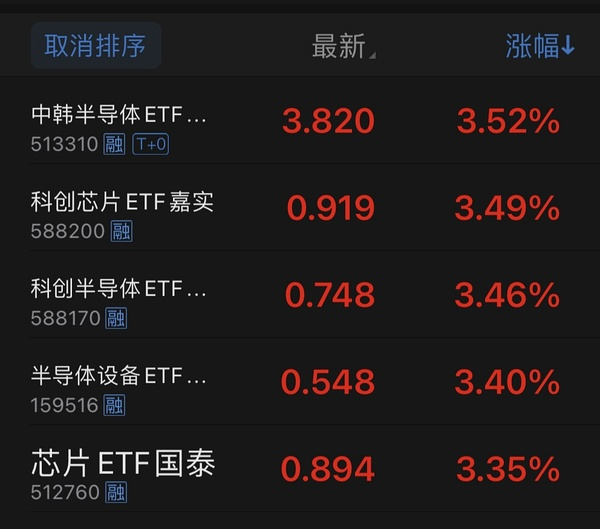  ⊳ （引用 @🅰失而复🉐😎）-8的晶还是有点搞头的🤣

- (2026-11-12 11:14:30) 祝福
现在好几个机器人线都完美无瑕了😂  ⊳ （引用 @钱多多多多多）我今天加了春哥，等春节🧧

- (2026-11-12 11:17:46) [图] 次日概率为0继续？

- (2026-11-12 11:17:58) 我不搞啊 我不加仓的  ⊳ （引用 @shirla）电影干脆明天尾盘再搞吧

- (2026-11-12 11:20:46) 到底是哪个消息😂  ⊳ （引用 @sickid）今天传媒是不是只有文投和鸡屎（丧标有消息不算）

- (2026-11-12 11:21:08) 他那个东西机器人市场垄断的 独一家  ⊳ （引用 @稀里不糊涂）福赛为何这么强

- (2026-11-12 11:22:20) 但是碟起来都很牛逼 连续下跌  ⊳ （引用 @稀里不糊涂）怪不得，他每次涨起来走势就特别吓人

- (2026-11-12 11:22:50) [图] 我担心这个😂蓝色分走了目光

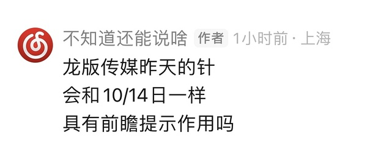  ⊳ （引用 @🅰失而复🉐😎）你看中🤣

- (2026-11-12 11:24:22) [图] 🤣规律在没办法哈哈哈哈

  ⊳ （引用 @混乱中立同人女）捏吗 创绿了

- (2026-11-12 11:25:03) 军工板块震荡拉升 航天南湖涨超10%
军工板块盘中震荡拉升，航天南湖涨超10%，国科军工、洪都航空、晨曦航空、航发科技、国睿科技等涨幅靠前。

- (2026-11-12 11:25:55) 我要问一个邪恶的问题了

奶茶今天会从11%翻绿吗😂😂😂😂😂

- (2026-11-12 11:26:55) 这个一直都是独立行情

如果需要减仓 也是动手幸福😂😂😂😂中影肯定最后动  ⊳ （引用 @暴富¥(´･ᴗ･`)$）zy只走自己的节奏😂

- (2026-11-12 11:27:48) 他们不是尾盘战神吗  ⊳ （引用 @🅰失而复🉐😎）冰冰们咋回事上午不是吉时吗🤨

- (2026-11-12 11:29:01) 也有人把蓝色作为本次传媒最后的补涨
大家看法不一样

不过我忌惮的是龙版再次提示了
10/14日提示过  ⊳ （引用 @家不住海边）不至于吧。打个仙人指路。吧😄

- (2026-11-12 11:33:26) 传媒从前天开始就没有主动型气势了
昨天国台办强行V回来

但昨天龙版9%尾盘几乎翻绿 和10/14日异曲同工
市场有所提示 

所以我不玩
你们玩
我玩其他的  ⊳ （引用 @奶茶今天40了吗）虽然我t了，但翻绿也太伤士气了，楼楼🥹

- (2026-11-12 11:34:34) 又来了一个龙建？  ⊳ （引用 @速派女孩将发财）不会就是龙江交通卡位了龙版把 都是黑龙江的

- (2026-11-12 11:35:12) 白酒那些老登  ⊳ （引用 @梳碧湖砍柴人）科技和冰雪都在回落，谁在涨

- (2026-11-12 11:36:52) 不会每次每一个都顺风顺水
航天发展也是例子

当时zs sj足够赚钱了🤣🤣🤣🤣🤣最后航天发展换中国卫星直接把航天发展钱也赚回来了  ⊳ （引用 @家不住海边）可恶。我sj补涨 呢。

- (2026-11-12 11:38:33) 早点调整 早点反弹😂就看12月了哈哈

而且那群羊啊东方啊 肯定也会崩一次

市场最近总会有一天普跌调整的早晚的事情  ⊳ （引用 @木感情的打工人）那我场外招商怎么办😂

- (2026-11-12 11:46:46) 这次首周利润很高啊🤣🤣🤣🤣  ⊳ （引用 @一切都会过去的）每个月真的只能赚一周啊 这周就开始亏钱了😅

- (2026-11-12 11:58:56) [图] 现在是医药第二大公募基金仓位了

通信已经退居第三

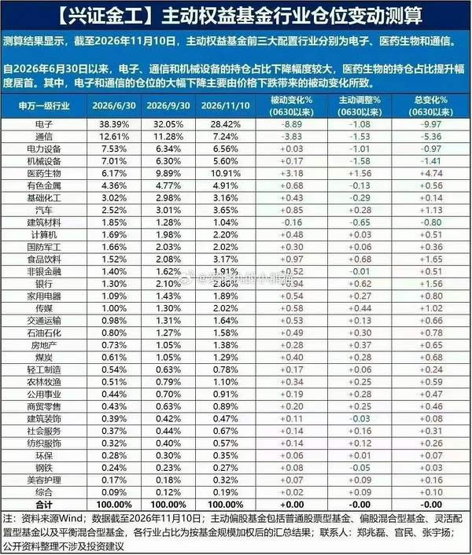

- (2026-11-12 11:59:31) 而且马上变第五

筹码问题大变样🤣  ⊳ （引用 @不知道还能说啥）现在是医药第二大公募基金仓位了

通信已经退居第三

- (2026-11-12 12:09:32) 不知道啊
他们居然在11.4到11.10卖了那么多
这些筹码现在全在妈妈手里吧？
最近根本没有其他资金能接他们那么多抛售  ⊳ （引用 @sickid）现在11月中了，公募大规模买回是不是要等明年了

- (2026-11-12 12:14:16) 他们估计也不是自己要卖的
人家都卖自己不卖 业绩排名就靠后了😂

和之前人家都买自己不买就落后一样  ⊳ （引用 @sickid）这些机构的定力还不如你们公司的主播哈哈哈

- (2026-11-12 12:35:17) [图] 10:30回落是因为美国10:30走弱了

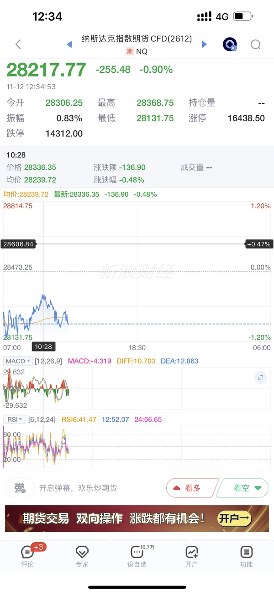  ⊳ （引用 @sickid）现在有主线板块吗请问

- (2026-11-12 12:39:49) 11月12日消息，有网友发现自己的微信发现页的“看一看”新增：短剧。不过，该功能目前处于灰度测试，因此很多人手机的微信上尚没有出现 此功能更新。

看一看是微信原生内容分发阵地，而微信历来谨慎，此番短剧的嵌入不是边角的小程序，而是看一看，这说明短剧已经被微信认定为主流的内容品类，不再只是第三方小程序。

反观“看一看”的推进逻辑，属于算法推荐+朋友再看，这意味着微信的短剧利用熟人社交做裂变，与红果形成差异化打法 。不过，该功能目前还只是灰度，并非所有人都有入口 ，随时可能调整。

- (2026-11-12 12:47:38) [图] 这是年初 1/12日 奶茶20cm两连板时候AI应用的票

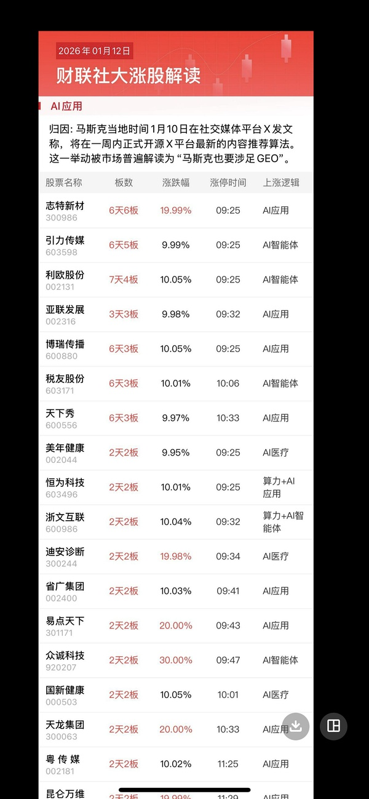

- (2026-11-12 12:51:44) [图] 现在回调肯定还有的

但是如果一波流拉到极致就不好说了

  ⊳ （引用 @么感情吃瓜中）楼说的结束只是阶段性结束，回调后还会再继续对吗？因为对这种回调没有概念以至于不知道怎么处理场外基金

- (2026-11-12 12:58:47) 去年他们还说是量化呢🤣  ⊳ （引用 @某豆用户饱腹版）定价权一直都在公募手里，双刃剑啊

- (2026-11-12 13:04:34) 传媒出现两位数跌幅了

华策

昨天最多是-6 本来挺温和的

- (2026-11-12 13:05:01) 果果紧随其后了  ⊳ （引用 @不知道还能说啥）传媒出现两位数跌幅了

华策

昨天最多是-6 本来挺温和的

- (2026-11-12 13:06:33) [图] 分歧

但是由于昨天的大V

温和调整不存在了

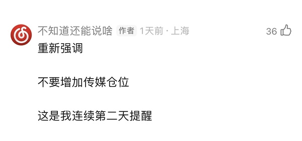  ⊳ （引用 @稀里不糊涂）分歧还是over

- (2026-11-12 13:07:22) [图] 这轮多涨了两天！
回调也许也是🤣

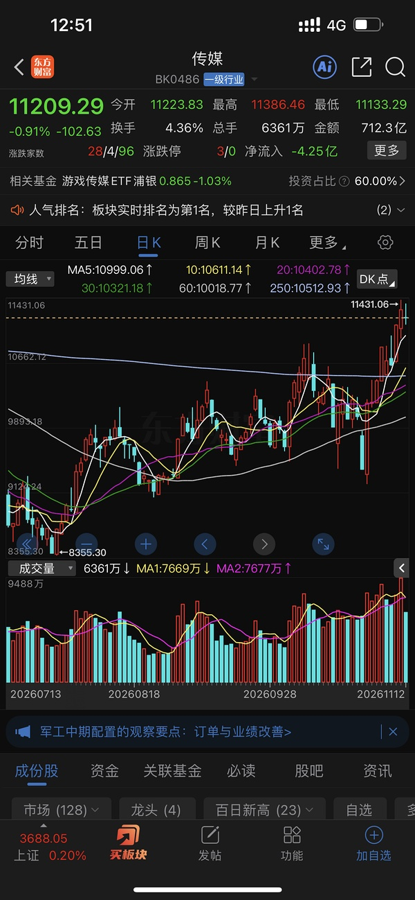  ⊳ （引用 @稀里不糊涂）分歧还是over

- (2026-11-12 13:08:42) 福建本地股异动拉升，福建水泥涨停，平潭发展、海峡创新、路桥信息、福建金森跟涨。

- (2026-11-12 13:10:05) 真滑稽
安安xxz都是福建
惠发是炒作发

他们都不因为食品  ⊳ （引用 @ekiwang）安记

- (2026-11-12 13:10:31) 白酒板块逆势走高，皇台酒业触及涨停，金种子酒、古井贡酒、迎驾贡酒纷纷走高。

- (2026-11-12 13:11:24) 规律无法打破  ⊳ （引用 @点-重生炒垃圾）中际-3.。。。。。

- (2026-11-12 13:12:36) [图] 

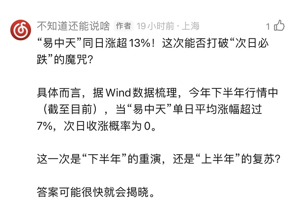  ⊳ （引用 @点-重生炒垃圾）就是大涨后次日下跌？

- (2026-11-12 13:14:11) [图] 情绪核心暂时正常 大家密切留意哦

如果这些崩盘 调整会加剧

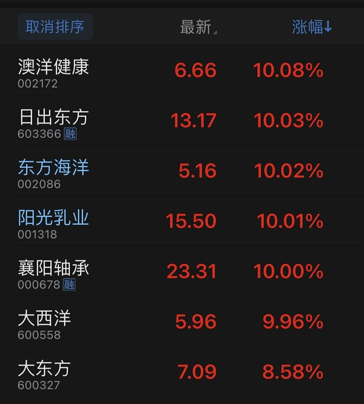

- (2026-11-12 13:15:34) 马上sy跌停 bn还要尊敬一下他😂  ⊳ （引用 @赛博朋克2077）好绿啊，bn跳水太狠了吧

- (2026-11-12 13:16:31) 你有市场情绪核心 洋洋🤣🤣🤣🤣  ⊳ （引用 @赛博朋克2077）sy涨停bn可没有涨多少😭

- (2026-11-12 13:17:04) 牛逼啊  ⊳ （引用 @sickid）涨停了，谢谢小惠

- (2026-11-12 13:18:56) uu
上个月龙版给出提示后
我们就是bn失血回撤

你会重蹈覆辙吗

龙版再次提示了  ⊳ （引用 @赛博朋克2077）那还是没有bn多的，只是打野而已😭

- (2026-11-12 13:21:21) 双主线一起杀？  ⊳ （引用 @点-重生炒垃圾）【物理AI概念震荡下挫 海天瑞声跌超10%】午后物理AI概念震荡下挫，海天瑞声跌超10%，凡拓数创、中控技术、福莱新材、华依科技、德马科技、索辰科技均跌超5%。

- (2026-11-12 13:23:20) 你看看垃圾消费是在炒消费吗😂都是炒字为主  ⊳ （引用 @赚了就s）这次感觉消费不带商场玩呢

- (2026-11-12 13:29:30) 记得控制仓位uu们

如果羊 东方崩盘

会大幅度加大调整的

- (2026-11-12 13:30:13) 对中影幸福非常满意

- (2026-11-12 13:32:04) 还行
他挺喜欢大绿接大阳  ⊳ （引用 @嘻嘻嘻嘻）楼🙋，gx满意否

- (2026-11-12 13:33:35) 幸福可是先调整两天的
光线两连阳今天才调整
所以能接受  ⊳ （引用 @嘻嘻嘻嘻）楼🙋，gx满意否

- (2026-11-12 13:36:08) [图] 你看看我为什么年初光线没吃到
因为我想要躲过下跌 确实躲过了 但结果也知道了

现在这个难题你们来解答了 🤣🤣🤣🤣

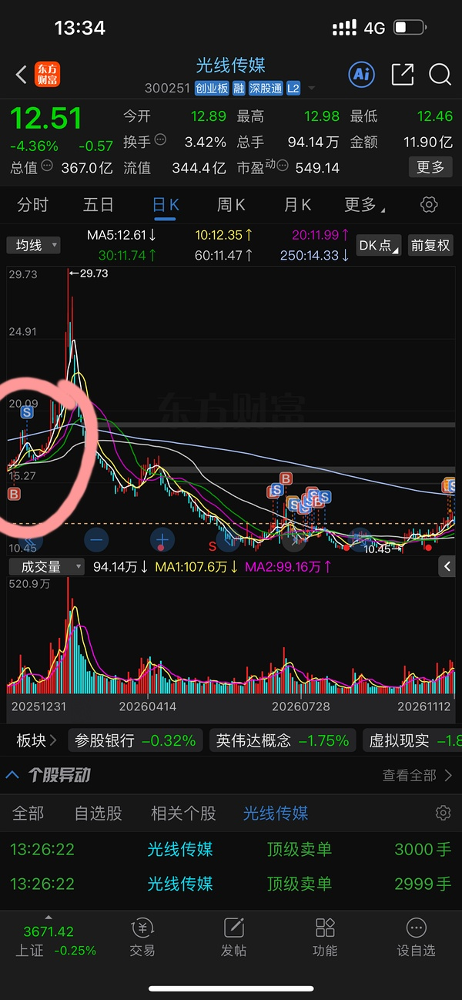  ⊳ （引用 @嘻嘻嘻嘻）楼🙋，gx满意否

- (2026-11-12 13:37:55) [图] 黄金 游戏 传媒 软件 机器人领跌市场

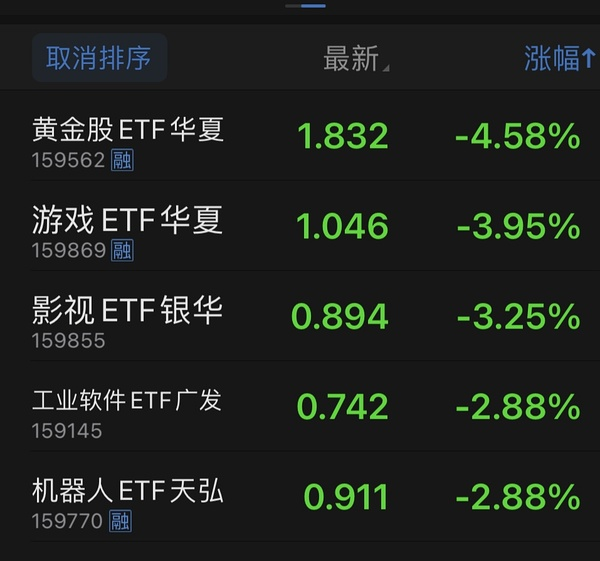

- (2026-11-12 13:38:07) 黄金最近是领跌专业户  ⊳ （引用 @不知道还能说啥）黄金 游戏 传媒 软件 机器人领跌市场

- (2026-11-12 13:39:30) 近端次新股局部异动 沈鼓集团涨停
午后近端次新股局部异动，沈鼓集团涨停，超纯应材涨超10%，粤芯半导、皇冠新材、中塑股份、贝特利、马矿股份等冲高。

- (2026-11-12 13:39:40) 神谷😂  ⊳ （引用 @sickid）所以又炒了一波次新

- (2026-11-12 13:45:10) 周四怎么了
上周四没赚钱吗？  ⊳ （引用 @👑）周四果然…

- (2026-11-12 13:48:30) 后排羊不太行了

大家仓位记得好好控制

- (2026-11-12 13:49:46) 军工做了这个角色  ⊳ （引用 @木感情的打工人）冰雪不应该逆势嘛哈哈

- (2026-11-12 13:50:34) 漂亮啊幸福

- (2026-11-12 13:50:47) 幸福在关键时刻降临  ⊳ （引用 @vio）幸福要表演

- (2026-11-12 13:51:15) 与此同时 sy跌停  ⊳ （引用 @vio）幸福要表演

- (2026-11-12 13:52:56) 因为如果羊那边也崩盘

调整幅度就会比现在加大很多了  ⊳ （引用 @钱多多多多多）控制仓位，楼主今天提到了好几次！！

- (2026-11-12 13:57:07) 楼主老传媒人感觉还是有的
这两天不能加仓传媒
国台办昨天害了传媒
不然调整会很温和😂今天这样就放大了  ⊳ （引用 @点-重生炒垃圾）都怪黄仁勋出轨，还有多少一起爆出来算了

- (2026-11-12 13:59:17) 😂我建议去其他地方

因为今天蓝色早上那个动作 又套了一批广告人是肯定的  ⊳ （引用 @点-重生炒垃圾）大调两天能进不

- (2026-11-12 14:00:31) [图] 而且sy历来以残暴虐杀手法闻名
看看他这一次如何表演
这是年初

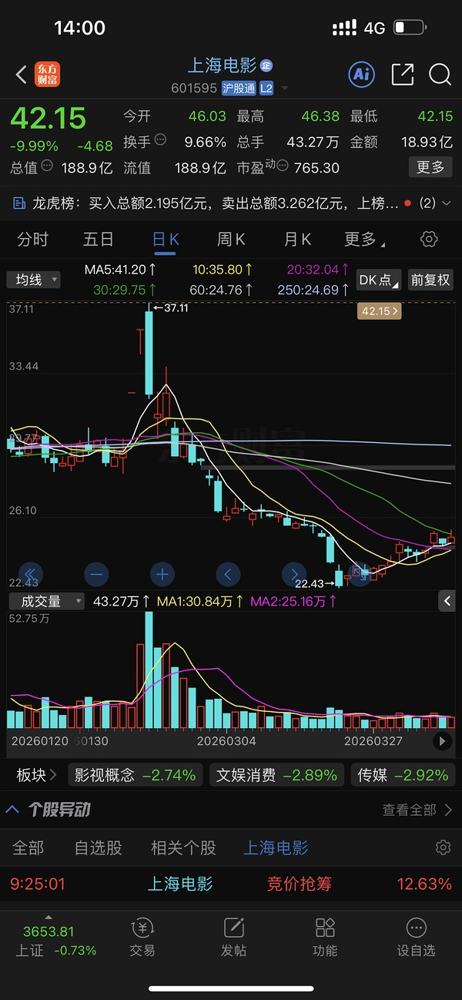  ⊳ （引用 @点-重生炒垃圾）大调两天能进不

- (2026-11-12 14:02:05) 稳住现在即可啊

小心羊崩盘 进一步带崩  ⊳ （引用 @YuanZi💕）今天看着没有救世主了😂

- (2026-11-12 14:03:17) 躲过下跌也会躲过上涨🤣  ⊳ （引用 @点-重生炒垃圾）真无语啊，念了一个月的长龙15+，今天才来，手上都没了

- (2026-11-12 14:05:17) 我还是那句老话
之前厉害的传媒
月底时候涨幅榜上可能找都找不到😂

- (2026-11-12 14:09:10) 今天中影幸福接受住了考验
明牌和SY他们无关

- (2026-11-12 14:09:36) 我们太需要市场给一次验证机会
来确认无关了  ⊳ （引用 @不知道还能说啥）今天中影幸福接受住了考验
明牌和SY他们无关

- (2026-11-12 14:11:59) 肯定有 而且你看游戏ETF跌幅更大  ⊳ （引用 @Aaa摆烂咸鱼🥳）Txx确实是，楼游戏是传媒不，会受影响不

- (2026-11-12 14:12:20) 美国也反弹了  ⊳ （引用 @点-重生炒垃圾）妈是不是来了？

- (2026-11-12 14:15:28) 我要来算算他们帐了

幸福三天 -1.7 -1.5 +0.5=-2.7
光线三天+6.1 +1.2 -4.5=+2.8

光线三天拉开了幸福5.3% 还可以的

- (2026-11-12 14:16:42) 襄阳掉了

- (2026-11-12 14:21:28) 不好
阳光也掉了  ⊳ （引用 @不知道还能说啥）襄阳掉了

- (2026-11-12 14:21:48) 连续吊羊

大家注意控制仓位  ⊳ （引用 @不知道还能说啥）不好
阳光也掉了

- (2026-11-12 14:22:28) 你应该找其他的先跑🤣🤣🤣
羊崩了炒作情绪就没了
懂我意思吧？  ⊳ （引用 @shirla）海洋要是掉了赶紧跑吗？

- (2026-11-12 14:24:38) [图] 还有牛逼大哥撑场面🤣🤣🤣🤣

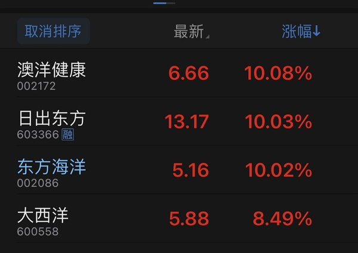  ⊳ （引用 @shirla）海洋要是掉了赶紧跑吗？

- (2026-11-12 14:27:08) 当然会 情绪核心  ⊳ （引用 @momo（富姐版））会影响全市场吗

- (2026-11-12 14:28:24) 我如果去掉恋爱脑
也就比你多一个机器人
我现在也挺老实的🤣  ⊳ （引用 @shirla）我没有其他的炒作，就是老老实实的冰雪电影人🤣🤣🤣

- (2026-11-12 14:29:07) 今天尾盘战神会是幸福降临吗😂😂😂😂😂

- (2026-11-12 14:30:29) 幸福已经做了一些尝试🤣  ⊳ （引用 @木感情的打工人）为什么不能是冰冰

- (2026-11-12 14:30:40) [图] 国台办全责

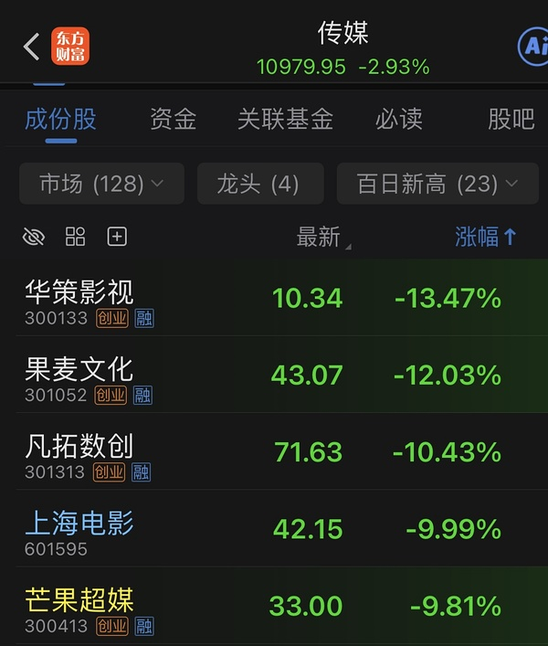

- (2026-11-12 14:32:04) 龙版还是决定的传媒之王
连续两个月做出重大风险提示

啥时候他又拐弯好起来了 啥时候干传媒  ⊳ （引用 @不知道还能说啥）国台办全责

- (2026-11-12 14:36:45) 迪士尼和三丽鸥我全都认识的！！！！！🤣🤣🤣  ⊳ （引用 @momo）哈哈哈哈哈哈哈哈笑s我了，楼你都认得楼嫂这几个宝了吗
关于教男朋友认识上迪七宝 https://xhslink.cn/o/1uv1uGlUzvm 把口令拷走，打开【小红书】查看详情~

- (2026-11-12 14:37:30) 下次去呀  ⊳ （引用 @momo（富姐版））差生提问 为什么不直接干龙版呢

- (2026-11-12 14:39:31) 涨停卖了东方海洋
清了恋爱脑

- (2026-11-12 14:41:52) 泡泡玛特我不行 实在太多了
之前记的也忘了 😂😂 主要是我女朋友现在不玩泡泡
我没有耳濡目染了 科普的不够多了  ⊳ （引用 @速派女孩将发财）楼绝对认得啊 他还会日本的 还会泡泡马特  

- (2026-11-12 14:43:15) 😂明天周五 继续考验  ⊳ （引用 @一直在摸🐟）sy跌停 bn咋看着还行啊哈哈哈哈哈

- (2026-11-12 14:43:42) 他开开关关看得我烦死了😅😅😅😅😅  ⊳ （引用 @shirla）好的，彻底老实了，哈哈哈哈，迎接周五

- (2026-11-12 14:44:23) 厉害襄阳

- (2026-11-12 14:46:32) 他们就盯着那几个文字游戏福建游戏呀
边缘化无关的食品
拿着的意义不大
并没有炒消费  ⊳ （引用 @钱多多多多多）差生提问，为啥要清恋爱脑呢

- (2026-11-12 14:50:16) 有没有可能就是坏了 才打他  ⊳ （引用 @家不住海边）光标真碰不上好时候啊

- (2026-11-12 14:50:53) 奶茶别装了
你就是想翻绿

- (2026-11-12 14:54:17) 明天周五

少亏就是赢 

你们周五还有想法？  ⊳ （引用 @稀里不糊涂）明天冰雪给点力

- (2026-11-12 14:54:31) 马上下午三点了
快起床了别睡了  ⊳ （引用 @你是逗比吗）楼主的bn还在吗～

- (2026-11-12 14:55:50) 只是这个月吗  ⊳ （引用 @稀里不糊涂）加油吧，好像这个月周五都不怎么样

- (2026-11-12 14:57:07) 有奶茶的可以计算今天哪里会追的人最多了

套牢盘满满

而且看蓝色19% 很多人会马上追奶茶  ⊳ （引用 @momo）尾盘这俩货还在努力

- (2026-11-12 15:05:13) 融资盘买了就跌😂  ⊳ （引用 @稀里不糊涂）总觉得今天和之前好像，放量了就要高开低走，缩量就涨

- (2026-11-12 15:12:28) [图] 

  ⊳ （引用 @一切都会过去的）还好钱转出去了我不然我就要追了

- (2026-11-12 15:13:49) [图] 

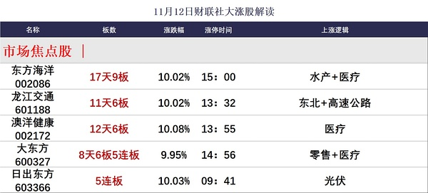

- (2026-11-12 15:25:59) 不会  ⊳ （引用 @shirla）明天涨停会触发 3 日 20% 异常波动对吗

- (2026-11-12 15:27:56) 那个3天20%不是异动 没有紧箍咒的 不然一大片都是啦

是10天100%和30天200%紧箍咒

九阳股份每天卡200%🤣  ⊳ （引用 @shirla）明天涨停会触发 3 日 20% 异常波动对吗

- (2026-11-12 15:31:51) 东方财富传媒板块今天换手超过7% 
成交量为本轮传媒行情以来最大 成交额也超过1000亿

传媒板块7%就很拥挤了
年初那轮第一次是1/12日
就是我中午发的奶茶两连板那天

所以传媒板块目前很拥挤 不要加仓

- (2026-11-12 15:32:42) 主要是明天周五
以前很多次周五大牛股会突然跳水翻绿
明天懒得盯着看了😂  ⊳ （引用 @shirla）哦哦那他如果足够妖，明天涨停也没事🤣🤣但是我胆子小已经清掉了

- (2026-11-12 15:34:09) [图] 周五不要在14:30之前开跌幅小的仓！！

周五不要在14:30之前开跌幅小的仓！！

周五不要在14:30之前开跌幅小的仓！！

周五不要在14:30之前开跌幅小的仓！！

周五不要在14:30之前开跌幅小的仓！！

周五不要在14:30之前开跌幅小的仓！！

周五不要在14:30之前开跌幅小的仓！！

周五不要在14:30之前开跌幅小的仓！！

周五不要在14:30之前开跌幅小的仓！！

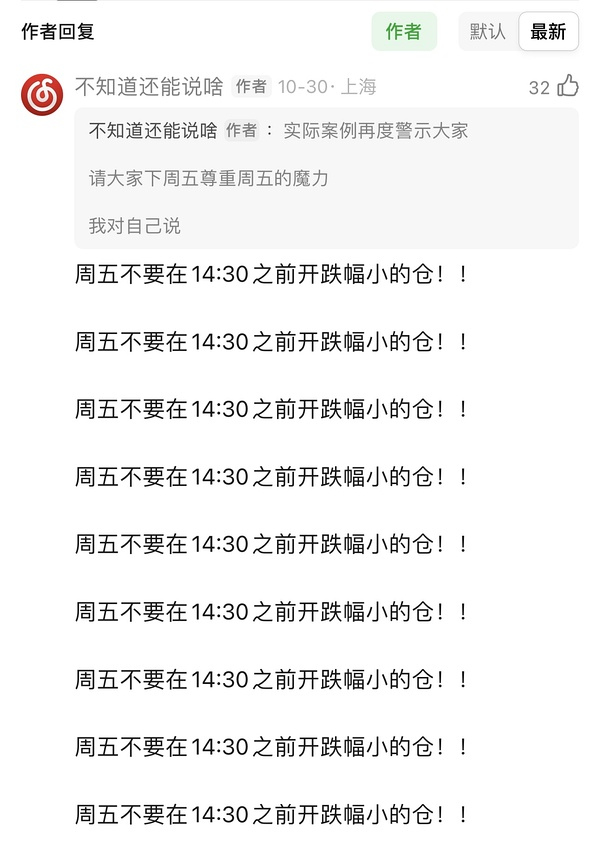

- (2026-11-12 15:50:37) 我挺担心明天东方和羊全崩 再度成为周五血洗日😂😂😂😂😂今天羊尾盘好几个都出现了松动  ⊳ （引用 @🅰失而复🉐😎）明天反着来爆红🔴🔴🔴🔴🔴🔴🔴

- (2026-11-12 16:00:20) [图] 可以的
但是一定要跌大的 而且又是周五
他趋势沿着60日线
基本上靠近附近就能bbbb了
你去画画看 大概这个多少钱

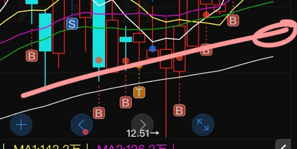  ⊳ （引用 @ü）楼楼，雪人明天如果再下跌可以再接点吗？我还差一点接满～

## 🧠 投资风格分析
> 📏 增量更新指引：仅当今日发言确有新依据时才修订对应维度，无变化不强行重写；单维度修订建议 ≤150 字。

- 投资理念与方法：坚持机会成本与性价比比较，强调“只赚份内的钱”；今日进一步强调远离机构重仓，认为公募抱团趋同会制造拥挤风险，主张跟踪基金与基准指数的贴合度，规避机构重仓股。对题材炒作保持警惕，认为消费、地产、传媒等题材“别真的当真”。
- 风险偏好：对基金溢价率敏感，对指数贴合度有要求，会定期核对；对高波动、高拥挤的板块主动回避（如传媒），偏好低波动、机会成本可控的标的；对美股资产保持信心，但关注回撤风险。
- 交易与仓位：偏好低吸、不追高，强调“不加仓和持有是两回事”；对传媒不增加仓位但保留持仓；今日卖出东方海洋（涨停）、清仓好想你，加仓低位标的与另一未披露标的；注重仓位控制，担心情绪核心崩盘，周五谨慎开仓。
- 心理特质：自我认知清晰，承认看错传媒（“我认错 传媒继续”），对市场规律有敬畏（“规律无法打破”）；重视筹码与机构行为，认为基金经理薪资挂钩排名加剧抱团；情绪稳定，不追高、不眼红他人盈利。

> ⚠️ 本板块由 Actions 全自动增量更新（复用当日发言与今日总览），每次仅在内容足够支撑时才改动。

## 🏷️ 昵称映射表
### 📖 昵称规律（供 AI 判断新昵称时参考）
【昵称命名规律（用于推断未知新昵称）】
- 拼音首字母缩写：取标的/基金名汉字拼音首字母串（含数字代码），多为 ETF/股票代码口语化｜示例：yl=引力传媒｜zy=掌阅科技｜sj=视觉中国｜cc=华安文体健康混合｜C50=创业板50ETF｜k50=科创50｜kun=昆仑万维｜xhxc=新瀚新材｜zxfc=中欣氟材
- 小/老+姓氏代指：「小X」「老X」通常指姓 X 的标的或该标的的基金经理；「X兄弟」多为同系基金｜示例：小惠=惠发食品｜老莫=万家品质生活(莫海波)｜小华=华夏全球科技先锋(QDII)A｜小华兄弟=华夏移动互联(QDII)｜小浦=浦银安盛全球智能科技(QDII)A｜小广=广发全球精选(QDII)A｜小远=华宝致远(QDII)C｜招招=招商银行｜小德=德明利｜赵姨=兆易创新｜露露=泸州老窖｜空调=格力电器
- 戏称/黑话→题材板块：生活化比喻或黑话对应某个题材/板块，而非单一标的；出现时多指板块方向｜示例：卖国=PCB板块(英伟达AI链)｜爱国=国产自主(半导体设备/芯片)｜奶茶=易点天下｜老师=中文在线｜蓝色=蓝色光标｜宇航员=航空航天板块｜华子=华泰保兴安悦债券｜国际=国际复材｜巨无霸=长鑫科技等重大IPO
- 谐音/取字：昵称含标的名关键字（取一字或谐音），多为 A 股个股或基金简称｜示例：万华=万华化学｜东百=东百集团｜宝=保利发展｜讨饭/亚洲讨饭/建信新兴=建信新兴市场(QDII)A｜华宝zy=华宝致远(QDII)A
- 机构/基金经理昵称：以基金公司名、经理姓、或平台代称指代对应基金产品｜示例：周经理=中欧新趋势混合(LOF)A｜张经理=信澳匠心回报混合A｜网易云/音乐世家=富国全球科技互联网股票(QDII)A｜国富亚洲=国富亚洲机会股票(QDII)A｜国泰纳指=国泰纳斯达克100指数(QDII)｜易方达全球=易方达全球成长精选混合(QDII)A｜浦银安盛=浦银安盛全球智能科技(QDII)A

### 📋 已收录映射
| 昵称 | 对应名称 |
|------|----------|
| C50 | 创业板50ETF |
| cc | 双义：股票=中国长城 / 基金=华安文体健康混合（用户 11-05 指认） |
| k50 | 科创50 |
| kun | 昆仑万维 |
| sj | 视觉中国 |
| xhxc | 新瀚新材（用户确认；代码待核） |
| yl | 引力传媒 603598（对手盘，非他持仓）｜11-06 +37.15%；11-09 本月+37.79% |
| zxfc | 中欣氟材 |
| zy | 双义：他本人口径=603533 掌阅科技（用户 11-05 确认）；11-09 楼友两条『zy』按 16 元/电影语境指 600977 中国电影。引用必须带语境，不许收敛 |
| 万华 | 万华化学 |
| 东百 | 东百集团 |
| 亚洲讨饭 | 建信新兴市场混合(QDII)A |
| 保利发展 | 保利发展 |
| 华子 | 华泰保兴安悦债券 |
| 华宝 zy | 华宝致远混合(QDII)A |
| 华宝zy | 华宝致远混合(QDII)A |
| 卖国 | PCB、光模块、通信板块（英伟达AI产业链） |
| 周经理 | 中欧新趋势混合(LOF)A |
| 国富亚洲 | 国富亚洲机会股票(QDII)A |
| 国泰纳指 | 国泰纳斯达克100指数(QDII) |
| 奶茶 | 易点天下 301171（对手盘，非他持仓）｜11-06 本月+29.51% |
| 宇航员 | 航空航天板块 |
| 宝 | 保利发展 |
| 小华 | 华夏全球科技先锋混合(QDII)A |
| 小华兄弟 | 华夏移动互联混合(QDII) |
| 小广 | 广发全球精选股票(QDII)A |
| 小德 | 德明利 |
| 小惠 | 惠发食品 |
| 小浦 | 浦银安盛全球智能科技(QDII)A |
| 小远 | 华宝致远混合(QDII)C｜只在盯，未证他持有 |
| 巨无霸 | 长鑫科技等重大IPO企业 |
| 建信新兴 | 建信新兴市场混合(QDII)A |
| 张经理 | 信澳匠心回报混合A |
| 招招 | 招商银行 |
| 易方达全球 | 易方达全球成长精选混合(QDII)A |
| 浦银安盛 | 浦银安盛全球智能科技(QDII)A |
| 爱国 | 国产自主（半导体设备/芯片制造） |
| 空调 | 格力电器 |
| 网易云 | 富国全球科技互联网股票(QDII)A |
| 老师 | 中文在线 |
| 老莫 | 万家品质生活混合A(519195) |
| 蓝色 | 蓝色光标 |
| 讨饭 | 建信新兴市场混合(QDII)A |
| 赵姨 | 兆易创新 |
| 赵哥 | 兆易创新 |
| 露露 | 泸州老窖 |
| 安安 | 安记食品 |
| 音乐世家 | 富国全球科技互联网股票(QDII)A |
| 老伯伯 | 铜冠铜箔 |
| nk | 纳指科技ETF景顺 159509（联接=景顺长城纳斯达克科技ETF联接A）｜11-06 A级：截图溢价率37.08% |
| bk | 标普信息科技LOF 161128（场外=易方达标普信息科技QDII-LOF）｜11-06 A级 |
| txx | 天下秀 |
| 媛媛 | 今世缘 |
| uu | 友友、网友们 |
| 温暖老师 | 某个特别牛逼的散户 |
| 余老师 | 余利，某牛逼投资者 |
| ycm | 粤传媒 002181｜11-09 12:12「非电影传媒就留给大家玩了 我一个都不会碰了」→ 推断已不持有 |
| 江老师 | 江琪（投资博主） |
| 水果老师 | 投资博主 |
| 小爱 | 我爱我家 |
| ty | 天娱数科 |
| bn | 博纳影业 |
| sy | 上海电影 |
| CBS | 长白山 |
| 东哥 | 东百集团 |
| 芒果 | 芒果超媒 |
| 阿中 | 中国电影 |
| 欢欢 | 欢瑞世纪 |
| 雪人 | 雪人集团 |
| 大连 | 大连圣亚 |
| 幸福 | 幸福蓝海 |
| 小粤 | 粤传媒 |
| 阿博 | 博纳影业 |
| 创成长 | 创业板成长etf |
| asd | 埃斯顿 |
| 恋爱脑 | 好想你 |
| 恋爱 | 好想你 |
| 小羊 | 襄阳轴承 |
| 中马 | 中马传动 |
| 晶雪 | 晶雪节能 |
| xf | 幸福蓝海 |
| 建设 | 建设工业 |
| 北方 | 北方导航/北方国际（未定，11-04「我在北方了」） |
| _ambiguity_note | 歧义未收敛（禁止当唯一映射）：轮子=巨轮智能/五洲新春；sj=视觉中国（传媒语境）/神剑股份（宇航员语境）；cc=中国长城/华安文体健康混合；北方=北方导航或北方国际；zy=掌阅科技（用户 11-05 确认原值正确）。证据分级：A=价位/均线/月涨幅实测命中；B=量级或单日命中/用户口述；C=仅昵称或语义，不得据此写『他持有』；沿用原仓=本轮未复核，不写进结论正文。三条判据：①条件单四位数要先按同时段动词行判买卖方向（cbs 3644 是买单不是卖单）；②『祝福/你们/你的X』句式＝评论他人持仓，不是他的操作；③同一昵称在不同语境可指两只票（zy=掌阅/中影），按价位与板块取，不许收敛成一个。 11-11 补：plus雪＝他自己也没说清（11:12「你应该不知道plus雪是哪个」），不许猜；bdd＝有传媒属性所以他不去（13:42），仍未定案；『五连阳』这类盘中口径不等于日K实测（招行 11-06 为平盘十字星）。 |
| nana场内 | 513300 纳斯达克ETF华夏｜11-09 14:34「不愧是513300 当年的普通nana ETF之王」，当日唯一红的纳指ETF |
| 雪儿 | 雪人集团 002639｜11-06「大连和雪儿」＋11-11 14:26「雪儿今天不错啊 大家昨天不是期待他接人嘛 这个任务做到了今天」（接人＝5日线接回，与雪人条件单口径一致） |
| 存钱罐 | 光线传媒 300251（他自述小仓） |
| 枣子 | 好想你 002582 |
| 王老师 | 人：王博雅投资（QDII 场内溢价口径），不是标的 |
| 印度 | 自嘲代指中国（推断，勿当事实） |
| 10086 | 中国移动（他当指标用，非持仓） |
| 阳光乳业 | 001318 阳光乳业（他的『喝的』/牛奶）｜11-09 A级：13:59 分时截图 S 标记≈13.5＋10:52「我去掉了羊来抄底」 |
| 羊 | 生肖羊概念组（带阳/洋的一篮子：东方海洋/日出东方/大东方/红太阳/澳洋健康/鲁阳节能/华阳国际/东方日升/阳光照明/九阳股份/阳光乳业/沈阳机床）｜11-09 14:04 他自己贴的分组｜**不是单只票，也不是『小羊』襄阳轴承** |
| 小明 | 605179 一鸣食品｜11-09 10:07 有人问『喝的小明？』他答『羊』＝喝的已换成阳光乳业 |
| 皇台 | 000995 皇台酒业｜11-09 与雪人 PK 当日换手率龙虎榜 |
| 海哥 | 人：转债估值博主（不是标的）｜11-09 12:48「海哥周五那个新债…我买了点试试看是市场错了还是海哥错了」 |
| 申菱转债 | 123290（申菱环境 301018 的转债）｜11-09 13:50 买 150 张 @133 多 |
| 盛天 | 300494 盛天网络｜11-11 A级：11:29 分时截图 B 标记 @11.00＋「不止 而且我跟了他一把」（跟摄像大哥） |
| dfhy | 002086 东方海洋｜11-11 13:56 楼友问 dfhy 绕异动→他「我没算 这几天可能都是异动吧」；11:35/11:54 他自己两次喊『东方海洋』 |
| xys | 300502 新易盛｜11-11 13:19「我那个买xys的女主播终于要开心了」＋13:21「她现在成本327了」→ **是女主播的仓，不是他的** |
| 冰山 | 000530 冰山冷热｜11-11 10:16「万一冰山跌停 他能跌到哪里再去」＋10:27「今天把冰山 晶雪按死 大连 CBS 正统上位」（非持仓，冰雪板块的山寨对照） |
| 冰冰 | 000530 冰山冷热｜11-11 14:03「那冰冰准备」（同『冰山』，非持仓） |
| 龙版 | 605577 龙版传媒｜11-11 11:50「最早龙版也是因为自己每次公告文案都不一样才4连板就被监管」（讲监管规则，非持仓） |
| 3300 | 513300 纳斯达克ETF华夏｜11-11 10:49「3300还行 不过今天我不满意」＋13:24「咱们3300还是近期数据最好的」 |
| nana100 | 纳斯达克100指数（他对照场内ETF溢价的基准）｜11-11 08:14「昨天513300涨了3.53% 但是nana100实际也就涨了3.4」 |
| 易中天 | 新易盛＋中际旭创＋天孚通信（CPO三巨头合称）｜11-11 14:13「都去易中天了🤣」（非持仓） |
| 冰雪双子星 | 大连圣亚600593＋长白山603099（他的正牌冰雪双仓）｜11-11 10:29「从不担心冰雪双子星」 |
| 2000 | 中证2000指数（他当微盘股基准）｜11-11 11:11「除了机器人 今天其他题材全输给了2000」 |
| cw | CoreWeave（CRWV，美股AI算力）｜11-11 11:18「cw那玩意硬起来了 大家看夜盘数字」 |
| ant | Anthropic（美股IPO）｜11-11 12:11「接下来是不是ant IPO也是利好」 |
| 摄像大哥 | 人：楼友（不是标的）｜11-11 他的两笔游戏＝电魂网络涨停＋顺网科技≈+7，属楼友口径；楼主自己买的是盛天网络＋另一只未披露代码的游戏 |
| 游戏哥哥 | 游戏板块拟人化（不是具体票）｜11-11 12:58「游戏哥哥：我来也」＋13:01「妹妹休息 哥哥接力？」 |
| 传媒妹妹 | 传媒板块拟人化（不是具体票）｜11-11 11:40「被传媒妹妹压制了」＋13:01「妹妹休息 哥哥接力？」 |

> ⚠️ 以下为 LLM **建议**，未自动写入状态文件。请人工确认后，本地编辑 `state.json` 的 `nickname_map` / `positions`，或 `nickname_rules.json` 的 `rules` 并 push 生效。

*🤖 自动生成于 2026-11-12 16:02:53 ｜ 豆瓣楼主发言追踪*