# 📋 楼主每日发言推送

> **推送日期**：2026-11-12 ｜ **执行时间**：2026-11-12 11:02:36 ｜ **监控用户**：`不知道还能说啥`
> **追踪模式**：`topic`（用户主页广播·豆瓣话题）

## 📊 持仓追踪
> 上次更新：2026-11-12 ｜ 基于楼主发言持续追踪（共 16 项）

| 标的 | 状态 | 类型 | 现价 | 提及 |
|------|------|------|------|------|
| 招商银行 | 底仓·四年前 32 元买入·不动 | 红利/银行 | 42.46（-0.23%） | 11-11 10:54「招招不经意间 打出五连阳」…；成本约32元 |
| 大连圣亚 | 持有 5 笔·11-10 加仓 1 笔·卖单 +9%（46.90）未触发·盘后继续开大涨幅 | 冰雪·正牌双子星 | 41.75（0.63%） | 设置条件单+9%：“大连我开了9% 这个价格今天也… |
| 长白山 | 持有 3 笔·锁仓·不开单不接 | 冰雪·正牌双子星 | 38.09（0.69%） | 11-10 09:32「加仓大连cbs」；14:5… |
| 雪人集团 | 持有 3 笔·11-11 买入 1 笔（−3多≈15.5）·卖单 17.19（当日+7%）未触发 | 冰雪·交易仓 | 15.67（0.51%） | 「雪人昨天不是接回来了？」——昨日已接回，今日提及… |
| 幸福蓝海 | 持有·卖单 18.44→17.94（11-11 盘后降 5 毛）未触发 | 电影 | 15.16（0.60%） | 11-11 15:41「幸福降价5毛1794了 到… |
| 中国电影 | 持有·11-10 卖 1 笔 @15.84·剩余仓无单 | 电影·核心不动仓 | 15.56（-2.57%） | 11-10 09:43「你们人多也坑不了中影啊 准… |
| 光线传媒 | 持有·卖单 15.44（≈涨停·定价卖出）未触发·不加仓等猛拉 | 电影·低位备选 | 12.70（-2.91%） | “加仓要等等”，需“拉一次猛的让我完全心动” |
| 博纳影业 | 持有小仓 | 电影 | 6.65（0.91%） | 11-11 13:58「博纳没动不应该啊😂」；14… |
| 好想你 | 持有·卖单 10.48 未触发（加过仓所以开着） | 食品（他叫『恋爱脑』） | 9.98（-0.70%） | “我只有恋爱脑 其他你们玩”，不扩展其他食品标的 |
| 纳斯达克ETF华夏 | 持有·不卖场内（继续炒溢价） | QDII·场内纳指 | 2.727（0.70%） | 11-11 08:14「昨天513300涨了3.5… |
| 中韩半导体ETF | 持有 | QDII·场内 | 3.827（3.71%） | 「中韩我本来就有 我不满意」——持有，但不满溢价率… |
| 申菱转债 | 持有 150 张·卖单 149.9 未触发 | 转债（小额试错） | 150.628（2.06%） | 11.9；11-10 10:28「海哥预估150+ 还是会到… |
| 盛天网络 | 11-11 买入 @≈11.00（跟摄像大哥一把） | 游戏·电竞 | 10.97（-4.02%） | 11.11；11-11 11:29「不止 而且我跟了他一把 说… |
| 游戏自建仓 | 11-10 买入·持有·11-11 自述 +5% | 游戏·电竞 | 暂无 | 11.10；11-10 15:18「我摄像大哥昨天去的🤣 今天… |
| 美债场外基金 | 持有·国庆前买入·11-11 自述 +1.4% | 场外·美债 | 暂无 | 11-11 12:18「我国庆之前买的刚赚了1.4… |
| 埃斯顿（asd） | 买入 |  | 暂无 | 11.12；「我昨天加了asd今天刚刚加了另外个」——昨日加仓… |

> ⚠️ 执行任务时如发现新操作，请更新 `state.json` 的 `positions`。成本价和市值有数据才填，没有则保留「暂无」。

## 🌅 今日总览
### 📌 市场背景
今日发言主要围绕AI算力竞争、资金结构与ETF跟踪展开：「谁能承接AI算力需求；谁有第二供应商逻辑」；「公募出清 融资盘开干」；「融资盘开始干了」；同时讨论纳指ETF：「最终nana100涨2.2」及「3300是冠军🏆」。发言还涉及传媒分化、白酒/机构重仓风险与机器人切换，但未形成对大盘整体方向的系统判断。

### 📌 今日操作
| 操作 | 标的 | 详情 |
|---|---|---|
| ✅ | 埃斯顿（asd） | 「我昨天加了asd今天刚刚加了另外个」——昨日加仓埃斯顿，今日再加另一只低位10cm标的（未披露名称） |
| ✅ | 另一只低位10cm标的 | 今日刚加，因“10cm不得劲”未公开名称；仅加这一只低位，其他不动 |
| ⏭️ | 中韩半导体ETF | 「中韩我本来就有 我不满意」——持有，但不满溢价率只剩5 |
| ⏭️ | 电影持仓 | 「我在电影呀 其他暂时不会」；「不加仓和持有是两回事」——持有电影，不加仓 |
| ⏭️ | 雪人集团 | 「雪人昨天不是接回来了？」——昨日已接回，今日提及持有 |
| ⏭️ | 其他持仓 | 「只加一个低位的 我说过 就不提了 其他我不动」——其余持仓不动 |
| ❌ | 传媒/蓝色/奶茶等 | 「我不推荐」「你们自己玩」——不推荐、不追传媒；并称融资盘继续流出奶茶 |

### 📌 今日议题
| 议题 | 态度 | 核心观点 | 关键引用 |
|---|---|---|---|
| AI算力与芯片竞争格局 | 💬讨论 | 市场在重新评估谁能承接AI算力、谁有第二供应商逻辑，AMD/博通盘后走强而CoreWeave跟随英伟达走低 | 「谁能承接AI算力需求；谁有第二供应商逻辑」「CoreWeave则跟随英伟达走低」 |
| 融资盘与公募资金结构 | 💬讨论 | 融资余额连续增加、公募出清后融资盘开干，筹码游戏重新开始 | 「公募出清 融资盘开干」「融资盘开始干了」 |
| 机构重仓与白酒风险 | 📉看空 | 公募抱团趋同会制造机构重仓拥挤风险，近期强势老登和白酒可能被抛售 | 「市场暗线：远离机构重仓」「最近涨起来的老登们非常危险」 |
| 传媒板块分化 | 💬讨论 | 传媒没死但难度大增，红盘家数下降，只有部分个股反向拉升 | 「传媒虽然没死 但是难度大增」「今天三分之一红」 |
| 机器人方向 | 📈看多 | 明确从传媒切向机器人，埃斯顿火箭发射，只加低位方向 | 「你们玩传媒 我玩机器人了」「asd火箭发射」 |
| 纳指ETF跟踪与溢价 | 💬讨论 | 细算nana100与场内ETF的漏跌/对冲，强调定期核对基金与指数贴合度 | 「最终nana100涨2.2」「每隔一周两周要多看看他是不是和nana100基金完全贴合」 |
| 宇航员式炒作风险 | 📉看空 | 主题一路嗨到最终“出都出不来”的调整，传媒可能复刻 | 「宇航员从11月一路赶到1月第二周」「最终出都出不来的调整」 |

### 📌 看好板块/方向
- **机器人**：「你们玩传媒 我玩机器人了」「asd火箭发射」，今日明确加仓埃斯顿并另加一只低位10cm标的。
- **电影**：「我在电影呀 其他暂时不会」「希望电影蹭一点」，持有电影仓，希望蹭到行情。
- **国内半导体**：「这次是国内半导体猛啊 都还在跑」，认可国内半导体相对强势。
- **纳指ETF（3300）**：「3300是冠军🏆」「始终是普通nana的王者」，认可其跟踪表现，但同时强调核对贴合度，非无脑看多。

### 📌 风险提示
- 「宇航员从11月一路赶到1月第二周！！！！」——主题炒作一路嗨后可能“出都出不来”的调整风险。
- 「传媒虽然没死 但是难度大增」——传媒内部分化，红盘家数从一半降至三分之一，操作难度上升。
- 「最近涨起来的老登们非常危险」——资金若重新抱团，近期强势老登/白酒等机构重仓可能被抛售。
- 「市场暗线：远离机构重仓」——机构重仓拥挤度风险。
- 「SY逼近跌停」——上海电影大跌，提示传媒个股风险。
- 「涨太多了 五日线跟不上」「涨多了 回踩五日线」——超涨回踩风险。
- 「出不去帮我看过了 13直接跳11+ 有人大甩卖」——流动性/大甩卖风险（标的未明）。
- 「中韩我本来就有 我不满意 溢价率只剩5」——ETF溢价收窄、跟踪不满。

## 📊 本次结果
- **今日发言**：103 条
- **累计存档**：21143 条

## 📝 该最新广播作者发言聚合（共 103 条）
### 其他讨论（提及 76 次，占比 74%）2026-11-12 00:09:02
- 你们都赚了多少了
我这个没动赚得好慢啊
要是有2倍就好了😂

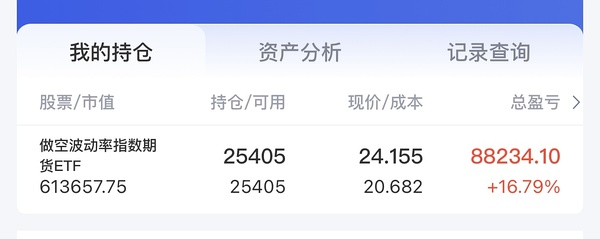
- 黄金在意😂
- 哈哈哈哈哈哈 拉稀

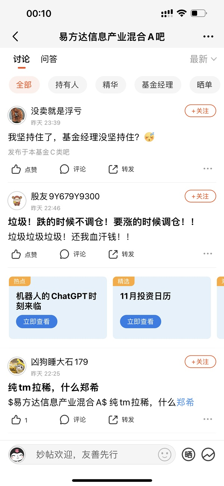

### 易点天下 301171（对手盘，非他持仓）｜11-06 本月+29.51%（提及 4 次，占比 4%）2026-11-12 09:13:42
- 融资盘继续流出奶茶

不爱了就是不爱了

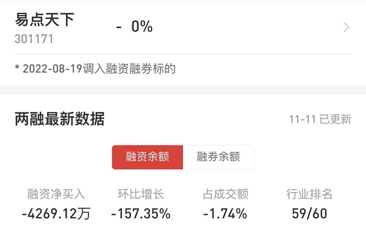
- 笑死
他和蓝色 奶茶 sg他们是广告组合
- 我想恭喜奶茶人
但是看着蓝色18 奶茶9

这句恭喜说不出口了😂

### 友友、网友们（提及 3 次，占比 3%）2026-11-12 00:13:06
- 很多uu都没这个了 所以就不加入比赛了
明天可以看看🤣
- uu无敌了
- uu该换名字了

你没有满载而归了

### 蓝色光标（提及 3 次，占比 3%）2026-11-12 10:12:53
- 嗯
我认错了
他们都动大体量蓝色了
- 因为我说的那个是10cm的
大家看着蓝色
10cm不得劲 我懂的
所以我不说了
让大家能赚更多的钱
- 蓝色空中加油了

### 纳斯达克100指数（他对照场内ETF溢价的基准）｜11-11 08:14「昨天513300涨了3.53% 但是nana100实际也就涨了3.4」（提及 2 次，占比 2%）2026-11-12 07:57:03
- 还是算算今天nana吧
昨天ETF直接漏掉了前一晚-0.6的下跌
昨天场内大涨1.4 和 nana15点期货一致

最终nana100涨2.2 这少了0.8%
但是盘前-0.8 对冲了

所以正常情况nana今天应该平开🤣
- 是的
但是呢这个你就不那么完全的省心
为了自己的真金白银
你至少每隔一周两周要多看看他是不是和nana100基金完全贴合

就像我们这个每天投票也是方便追踪基金🤣

### 上海电影（提及 2 次，占比 2%）2026-11-12 09:38:14
- 天天念叨sy的给你们机会了
- 天天念叨sy的 现在-6给你们机会了哈

### 航空航天板块（提及 2 次，占比 2%）2026-11-12 10:10:00
- 是的

还是老样子 复刻宇航员

一路嗨 最终出都出不来的调整
- 宇航员从11月一路赶到1月第二周！！！！

### 埃斯顿（提及 2 次，占比 2%）2026-11-12 10:17:40
- 我昨天加了asd今天刚刚加了另外个
- asd火箭发射

### 513300 纳斯达克ETF华夏｜11-11 10:49「3300还行 不过今天我不满意」＋13:24「咱们3300还是近期数据最好的」（提及 2 次，占比 2%）2026-11-12 10:38:16
- 3300是冠军🏆

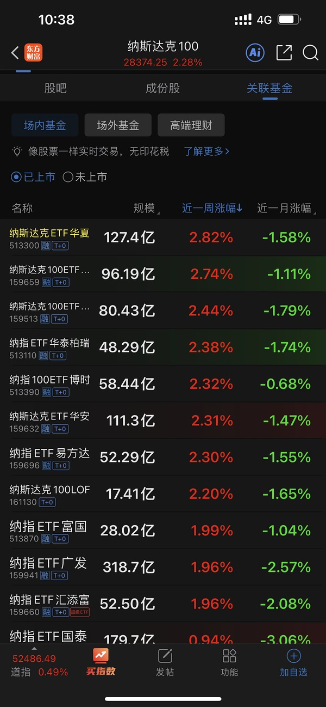
- 给大家科普下
在2025年年底之前
3300始终是普通nana的王者

后来被国泰嘉实广发接连掀翻

### 芒果超媒（提及 1 次，占比 1%）2026-11-12 09:09:31
- 厉害哦 融资盘猛干芒果

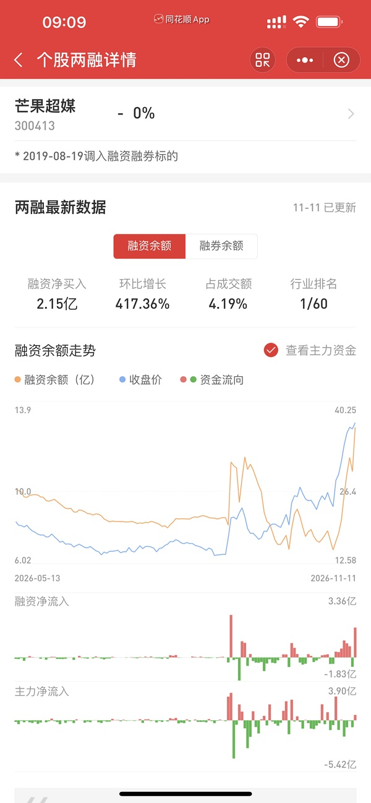

### 605577 龙版传媒｜11-11 11:50「最早龙版也是因为自己每次公告文案都不一样才4连板就被监管」（讲监管规则，非持仓）（提及 1 次，占比 1%）2026-11-12 09:27:59
- 龙版传媒昨天的针
会和10/14日一样
具有前瞻提示作用吗

### 生肖羊概念组（带阳/洋的一篮子：东方海洋/日出东方/大东方/红太阳/澳洋健康/鲁阳节能/华阳国际/东方日升/阳光照明/九阳股份/阳光乳业/沈阳机床）｜11-09 14:04 他自己贴的分组｜**不是单只票，也不是『小羊』襄阳轴承**（提及 1 次，占比 1%）2026-11-12 09:46:56
- 羊今天紧密相连

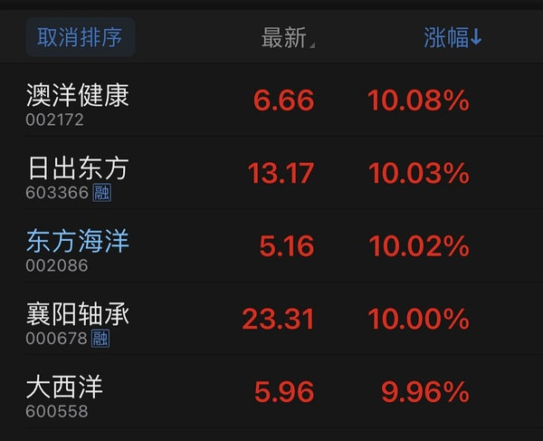

### 300502 新易盛｜11-11 13:19「我那个买xys的女主播终于要开心了」＋13:21「她现在成本327了」→ **是女主播的仓，不是他的**（提及 1 次，占比 1%）2026-11-12 09:49:09
- xys火箭发射

### 传媒板块拟人化（不是具体票）｜11-11 11:40「被传媒妹妹压制了」＋13:01「妹妹休息 哥哥接力？」（提及 1 次，占比 1%）2026-11-12 10:08:52
- 传媒妹妹：双创啥玩意？

### 雪人集团（提及 1 次，占比 1%）2026-11-12 10:42:02
- 雪人昨天不是接回来了？

### 000530 冰山冷热｜11-11 14:03「那冰冰准备」（同『冰山』，非持仓）（提及 1 次，占比 1%）2026-11-12 10:43:49
- 你在冰冰感到温暖🤣🤣🤣🤣🤣🤣🤣

### 📄 全部发言（共 103 条）
- (2026-11-12 00:09:02) [图] 你们都赚了多少了
我这个没动赚得好慢啊
要是有2倍就好了😂

  ⊳ （引用 @速派女孩将发财）华兄 我再相信你一次

- (2026-11-12 00:11:13) 黄金在意😂  ⊳ （引用 @速派女孩将发财）忽然发现油价拉升了 但是 似乎 无人在意

- (2026-11-12 00:11:32) [图] 哈哈哈哈哈哈 拉稀

  ⊳ （引用 @稀里不糊涂）报道

- (2026-11-12 00:13:06) 很多uu都没这个了 所以就不加入比赛了
明天可以看看🤣  ⊳ （引用 @24/7）怎么感觉会是小华

- (2026-11-12 00:17:48) [图] 其实最近防守最好的是浦姐
最早砍仓存储的
现在要反过来看浦姐进攻了😂

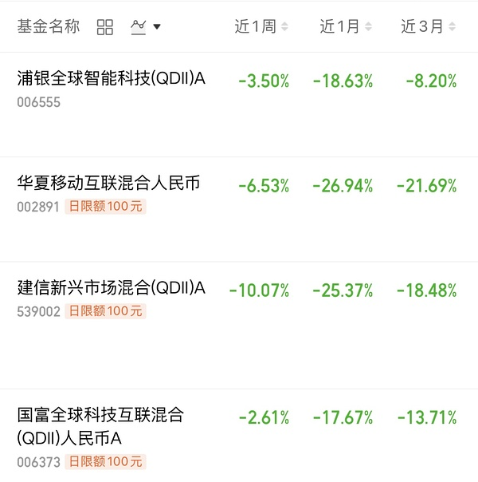  ⊳ （引用 @稀里不糊涂）其实我也有点想骂小远了跌都跌了，涨起来又少

- (2026-11-12 00:36:42) 虽然能领先我们很多 但是进攻最强的两个买不到多少钱🤣  ⊳ （引用 @小鱼）场外之前没买的话随便买什么都是抄我们的底😂平均亏20%吧。

- (2026-11-12 00:43:38) 检验各大题材是不是真牛逼的时间到了😂  ⊳ （引用 @木感情的打工人）科技这么猛明天场内继续吃冰块😂

- (2026-11-12 07:32:16) AMD和博通股价盘后涨幅扩大至3%。 CoreWeave 则跟随英伟达走低，跌幅 5%。

- (2026-11-12 07:34:54) 市场重新评估：谁能承接 AI 算力需求；谁有第二供应商逻辑；谁在 AI 芯片、定制芯片上有业绩支撑。

这是抢生意逻辑？  ⊳ （引用 @不知道还能说啥）AMD和博通股价盘后涨幅扩大至3%。 CoreWeave 则跟随英伟达走低，跌幅 5%。

- (2026-11-12 07:37:09) 涨多了 回踩五日线  ⊳ （引用 @Waiting一下）英伟达：CEO黄仁勋可能与直接向他汇报的公司高管金伯利·鲍威尔发生过婚外情。英伟达正准备罢免首席执行官黄仁勋。英伟达董事会准备最快于今日召开会议，以决定首席执行官黄仁勋的去留。受此消息影响，英伟达美股盘后跌幅扩大至8%。

娜娜跳水

- (2026-11-12 07:39:16) 你看nana  ⊳ （引用 @🅰失而复🉐😎）踩的有点子多了😇

- (2026-11-12 07:47:52) [图] 

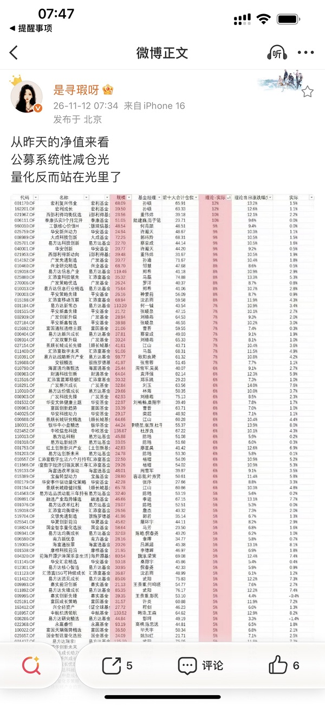

- (2026-11-12 07:48:54) 这些砍掉光 钱都买什么去了呢 
很有意思 接下来晚上看净值更有趣了

- (2026-11-12 07:51:44) 如果这些资金回去重新抱团
最近涨起来的老登们非常危险
大概率只能去最近走势好的老登咯？
老登后续又要惨遭抛售 比如昨天大跌的白酒😂

- (2026-11-12 07:53:59) 玩消费玩地产的人 和我们玩传媒一样 别真的当真了🤣🤣🤣🤣🤣  ⊳ （引用 @🅰失而复🉐😎）买酒喝买药吃买房子住买火箭🚀上天

- (2026-11-12 07:57:03) 还是算算今天nana吧
昨天ETF直接漏掉了前一晚-0.6的下跌
昨天场内大涨1.4 和 nana15点期货一致

最终nana100涨2.2 这少了0.8%
但是盘前-0.8 对冲了

所以正常情况nana今天应该平开🤣  ⊳ （引用 @🅰失而复🉐😎）金子来来回回搞又回到原点🤪

- (2026-11-12 07:58:36) 昨天如果漏掉的-0.6是对晚上本来+2的预期

那今天开盘得-0.6%开盘  ⊳ （引用 @不知道还能说啥）还是算算今天nana吧
昨天ETF直接漏掉了前一晚-0.6的下跌
昨天场内大涨1.4 和 nana15点期货一致

最终nana100涨2.2 这少了0.8%
但是盘前-0.8 对冲了

所以正常情况nana今天应该平开🤣

- (2026-11-12 08:02:06) [图] 大家的筹码游戏要重新玩了！！！

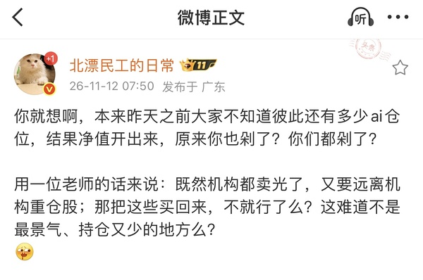

- (2026-11-12 08:27:43) 哈哈 这个要重视的哦
这意味着之前主升浪的白酒 像茅台肯定是被他们公募基金推上去的 现在变成了危险地方🤣🤣🤣🤣🤣🤣  ⊳ （引用 @山中食人花）离谱 这个游戏简直就是砍人游戏

- (2026-11-12 08:31:27) 这是柚子玩的

你一直说的迈瑞那种 还有白酒那些 肯定是他们反手抱的  ⊳ （引用 @点-重生炒垃圾）传媒是吗？软科技

- (2026-11-12 08:33:50) 是的
但是呢这个你就不那么完全的省心
为了自己的真金白银
你至少每隔一周两周要多看看他是不是和nana100基金完全贴合

就像我们这个每天投票也是方便追踪基金🤣  ⊳ （引用 @钱包鼓鼓💰）趁着人少我赶紧问一句，这个A也是na是吧

- (2026-11-12 08:36:08) 药明康德Q3公募基金加仓之王 这是明牌🤣  ⊳ （引用 @山中食人花）好家伙 咱们畅畅的药明也是吧 😂😂
真的 要是想法多手慢一点的 真可能挪哪里哪里亏💰

- (2026-11-12 08:37:44) 自从基金披露三季报以后
你看药明康德明显走势不如之前了

市场暗线：远离机构重仓🤣🤣🤣🤣🤣🤣

但是机构重仓在昨夜发生了大变化😂  ⊳ （引用 @山中食人花）好家伙 咱们畅畅的药明也是吧 😂😂
真的 要是想法多手慢一点的 真可能挪哪里哪里亏💰

- (2026-11-12 08:46:13) 怎么达成一致的
你要感谢我们高层去年的那个制度了
再次出发点是好的 但是一样是坏事

那就是让基金经理薪资挂钩业绩排名
这会加剧基金抱团 趋同化  ⊳ （引用 @山中食人花）我看那些骂基金经理的 其实经理想买回来也就是一下的事吧
但是咋达成这个一致呢，可预见老美会连续反弹吗 ？

- (2026-11-12 08:47:29) 两市融资余额较上日增加74.92亿元
截至11月11日，上交所融资余额报11767.50亿元，较前一交易日增加23.55亿元；深交所融资余额报10888.94亿元，较前一交易日增加51.37亿元；两市合计22656.44亿元，较前一交易日增加74.92亿元。

- (2026-11-12 08:47:55) 我们的筹码问题已经不存在了
公募基金都不在了笑死人了😂  ⊳ （引用 @我爱牛肉火锅）老美连续猛攻，筹码问题不复存在

- (2026-11-12 08:48:33) 融资盘开始干了

这三天分别+120 -23 +74  ⊳ （引用 @不知道还能说啥）两市融资余额较上日增加74.92亿元
截至11月11日，上交所融资余额报11767.50亿元，较前一交易日增加23.55亿元；深交所融资余额报10888.94亿元，较前一交易日增加51.37亿元；两市合计22656.44亿元，较前一交易日增

- (2026-11-12 08:50:01) 公募出清 融资盘开干

好戏要开始了！！  ⊳ （引用 @不知道还能说啥）融资盘开始干了

这三天分别+120 -23 +74

- (2026-11-12 09:07:47) 涨太多了 五日线跟不上🤣  ⊳ （引用 @sickid）盘后除了AMD博通之外硬件软件都在跌，日韩倒是还可以

- (2026-11-12 09:08:44) [图] 融资盘 狠狠的干

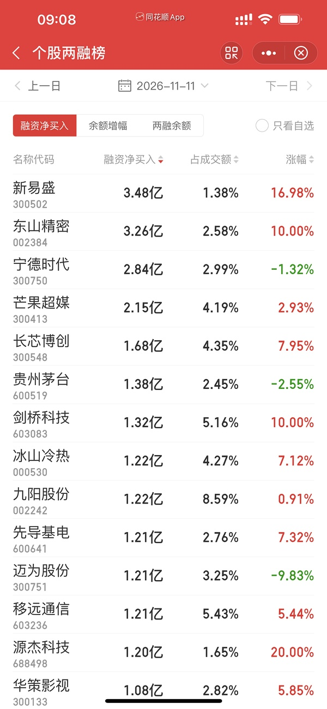

- (2026-11-12 09:09:31) [图] 厉害哦 融资盘猛干芒果

- (2026-11-12 09:12:41) 有那么多20cm的为什么你们就盯着他呢  ⊳ （引用 @momo（富姐版））啥时候回来宠爱奶茶宝宝

- (2026-11-12 09:13:42) [图] 融资盘继续流出奶茶

不爱了就是不爱了

  ⊳ （引用 @momo（富姐版））啥时候回来宠爱奶茶宝宝

- (2026-11-12 09:15:22) 笑死 东方海洋今天不会异动 就迫不及待了

- (2026-11-12 09:17:08) 👍👍👍👍👍厉害  ⊳ （引用 @赛博朋克2077）昨天赌对了！

- (2026-11-12 09:18:42) 你要读他名字才能知道为什么😂

发 被你隐去了  ⊳ （引用 @陈江河（卖暖壶）小惠怎么这么猛

- (2026-11-12 09:22:30) 我不懂的 这还是在玩名字  ⊳ （引用 @sunny）楼楼，惠发目前回本了，今天要走嘛，还是可以观察下明天的情况

- (2026-11-12 09:26:39) 美国说了算  ⊳ （引用 @想当富有的咸鱼）那就是再来一次六月？拜托再给我一次机会吧！

- (2026-11-12 09:27:59) 龙版传媒昨天的针
会和10/14日一样
具有前瞻提示作用吗

- (2026-11-12 09:38:14) 天天念叨sy的给你们机会了

- (2026-11-12 09:39:26) 没有  ⊳ （引用 @我爱牛肉火锅）楼是不是去捞plus雪了

- (2026-11-12 09:39:38) 东方海洋开盘不直接拉板
就是为了赶走一批人是吗

- (2026-11-12 09:39:47) 做得好啊！  ⊳ （引用 @不知道还能说啥）东方海洋开盘不直接拉板
就是为了赶走一批人是吗

- (2026-11-12 09:40:51) 出不去帮我看过了
13直接跳11+

有人大甩卖  ⊳ （引用 @一直在摸🐟）你挂买三可能就出去了

- (2026-11-12 09:41:31) 天天念叨sy的 现在-6给你们机会了哈

- (2026-11-12 09:43:46) 你会这么理解 我昨天前天应该白讲了  ⊳ （引用 @kk）楼去了😂

- (2026-11-12 09:44:24) 这两个要结合旅游板块一起看🤣  ⊳ （引用 @速派女孩将发财）卡位冰山就是今天！

- (2026-11-12 09:45:57) 放量1000  ⊳ （引用 @点-重生炒垃圾）好神奇，雪雪为啥能跟爱国共存😂😂😅

- (2026-11-12 09:46:56) [图] 羊今天紧密相连

- (2026-11-12 09:47:55) 东方也有梯队  ⊳ （引用 @we）日出东方怎么也是羊呢

- (2026-11-12 09:49:09) xys火箭发射

- (2026-11-12 09:49:55) 几个不都是红绿灯吗  ⊳ （引用 @该用户已过期）⛄️今天独立行走了？

- (2026-11-12 09:53:24) 贵州茅台有走A迹象了😂  ⊳ （引用 @六倍做多退休）挺疑惑的 机构会再次狼狈的补仓补回来吗 马上要年度排名了 他们统一砍仓 到时候准备怎么勾心斗角呢 好多基金年内都是负数了

- (2026-11-12 09:54:04) 我没有啊😂  ⊳ （引用 @点-重生炒垃圾）去了吗？

- (2026-11-12 09:54:50) 中韩我本来就有 我不满意
溢价率只剩5  ⊳ （引用 @🅰失而复🉐😎）去了没🤣我去了ETF和T0

- (2026-11-12 10:06:09) 我不是在电影嘛

不加仓和持有是两回事  ⊳ （引用 @Swaaaaagy）楼楼复联5之前都不摸传媒了吗

- (2026-11-12 10:07:05) 这次我看看有几个看空美股的会认错

plu反正一直认错的 我把谁看空美股的都小本本记下来了  ⊳ （引用 @木感情的打工人）市场又要在犹豫中前行可。没人信就一直张

- (2026-11-12 10:07:31) 👍👍👍👍  ⊳ （引用 @家不住海边）蓝色。我就知道你不是白上几天香的

- (2026-11-12 10:07:40) 输给小蓝啦  ⊳ （引用 @赛博朋克2077）奶茶火箭发射

- (2026-11-12 10:07:58) 到时候那帮人删掉看空的内容

又是那句“正如我们说的那样”  ⊳ （引用 @木感情的打工人）哈哈哈哈哈哈

- (2026-11-12 10:08:28) 卧槽
这传媒结束不了

又启动老牌牛股了

- (2026-11-12 10:08:52) 传媒妹妹：双创啥玩意？  ⊳ （引用 @不知道还能说啥）卧槽
这传媒结束不了

又启动老牌牛股了

- (2026-11-12 10:09:32) 这是真的广告来了

省广带起来了

- (2026-11-12 10:10:00) 是的

还是老样子 复刻宇航员

一路嗨 最终出都出不来的调整  ⊳ （引用 @该用户已过期）你等的大调整看来等不到了🤣🤣

- (2026-11-12 10:12:20) 我认错
传媒继续

大A还是那个大A 不存在温和模式  ⊳ （引用 @该用户已过期）你等的大调整看来等不到了🤣🤣

- (2026-11-12 10:12:53) 嗯
我认错了
他们都动大体量蓝色了  ⊳ （引用 @一直在摸🐟）下半年主线不可撼动😂

- (2026-11-12 10:14:24) 只加一个低位的 我说过 就不提了
其他我不动  ⊳ （引用 @想当富有的咸鱼）打算回去了吗

- (2026-11-12 10:15:45) 我不推荐
我之前说过了有个低位的

你们自己玩
我都看错了毕竟🤣  ⊳ （引用 @🅰失而复🉐😎）谁？

- (2026-11-12 10:16:36) 不是 我截图过
不多说了

传媒分化很严重  ⊳ （引用 @我爱牛肉火锅）gx吧

- (2026-11-12 10:17:40) 我昨天加了asd今天刚刚加了另外个  ⊳ （引用 @Nobody）楼楼，机器人怎么看

- (2026-11-12 10:17:51) 不满意  ⊳ （引用 @🅰失而复🉐😎）总算在第一页看见它了

- (2026-11-12 10:18:35) 因为我说的那个是10cm的
大家看着蓝色
10cm不得劲 我懂的
所以我不说了
让大家能赚更多的钱  ⊳ （引用 @我爱牛肉火锅）那我知道谁了😂😂😂

- (2026-11-12 10:20:13) 宇航员从11月一路赶到1月第二周！！！！  ⊳ （引用 @我爱牛肉火锅）😂😂😂😂😂，说像宇航员更恐怖了，我继续在冰雪倒腾三瓜俩枣了

- (2026-11-12 10:20:58) 😂😂😂😂😂😂想起来了  ⊳ （引用 @该用户已过期）我还记得赛博姐妹在巨力还是谁吃了仨跌停🤣🤣

- (2026-11-12 10:21:36) 笑死
他和蓝色 奶茶 sg他们是广告组合  ⊳ （引用 @🅰失而复🉐😎）什么😕

- (2026-11-12 10:23:14) 然而这次是国内半导体猛啊 都还在跑😅

之前是韩国牛逼我理解跑的用意😂😂😂😂  ⊳ （引用 @六倍做多退休）创伤后疗伤阶段 涨一点就跑🤣

- (2026-11-12 10:25:06) 我想恭喜奶茶人
但是看着蓝色18 奶茶9

这句恭喜说不出口了😂

- (2026-11-12 10:25:44) 奶茶去了吗  ⊳ （引用 @🅰失而复🉐😎）蓝色20在即

- (2026-11-12 10:26:03) 😂😂😂😂😂😂😂😂  ⊳ （引用 @六倍做多退休）场内nana又要红开了🤣 期货v上来了

- (2026-11-12 10:26:31) 这个回去值得  ⊳ （引用 @🅰失而复🉐😎）回去😒主打一个一键跟随不离不弃

- (2026-11-12 10:28:27) uu无敌了  ⊳ （引用 @沈墨钩）那就恭喜我这个蓝色+奶茶人吧😂我也是坚持了好久

- (2026-11-12 10:34:40) 🤣🤣🤣🤣🤣🤣他会始终陪伴你  ⊳ （引用 @冬天他一定会来）这两天都是10:30nana来救我

- (2026-11-12 10:35:23) 你们玩传媒 我玩机器人了😂
希望电影蹭一点  ⊳ （引用 @🅰失而复🉐😎）每天开门就是为了送钱吗😇

- (2026-11-12 10:35:50) asd火箭发射

- (2026-11-12 10:36:25) 👍👍👍👍👍👍👍  ⊳ （引用 @冬天他一定会来）我把一半zy借给asd了

- (2026-11-12 10:38:16) [图] 3300是冠军🏆

- (2026-11-12 10:38:56) 给大家科普下
在2025年年底之前
3300始终是普通nana的王者

后来被国泰嘉实广发接连掀翻  ⊳ （引用 @不知道还能说啥）3300是冠军🏆

- (2026-11-12 10:39:31) 我自己开了个7%
上方一片开阔 没有特别需要注意的阻力位置  ⊳ （引用 @赛博朋克2077）好心人，今天雪人又卖单嘛

- (2026-11-12 10:42:02) 雪人昨天不是接回来了？  ⊳ （引用 @想喝冰淇淋红茶）雪人我只剩下一手了🥹，我是不是卖太早了

- (2026-11-12 10:42:26) 是不是科技下了  ⊳ （引用 @该用户已过期）我们冰雪来了

- (2026-11-12 10:42:49) SY逼近跌停

现在轮到我给大家播报SY

- (2026-11-12 10:43:49) 你在冰冰感到温暖🤣🤣🤣🤣🤣🤣🤣  ⊳ （引用 @木感情的打工人）我有点暖和了

- (2026-11-12 10:45:12) [图] 传媒虽然没死
但是难度大增
从昨天开始
已经每天无法达到一半红了
今天三分之一红

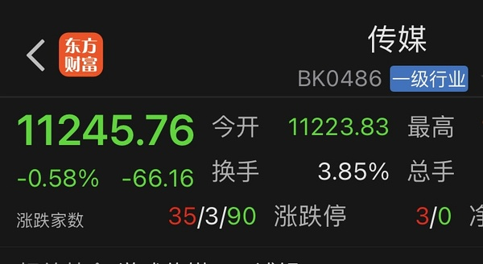  ⊳ （引用 @点-重生炒垃圾）你早上果然在阴阳😂😂😅

- (2026-11-12 10:46:44) 但是光线在反向拉升  ⊳ （引用 @🅰失而复🉐😎）中也在上演周二😏

- (2026-11-12 10:47:33) 美元指数升破103
美元指数升破103，日内涨0.0904%。

- (2026-11-12 10:48:24) 不知道呀😂😂😂😂  ⊳ （引用 @木感情的打工人）招商好像可以对冲？？

- (2026-11-12 10:49:54) 但是微盘股走的还可以 传媒内部分化😂  ⊳ （引用 @木感情的打工人）不过既然传媒开始拉大的，说明小垃圾们要不行了吧😂😂😂

- (2026-11-12 10:50:28) [图] 大 优 掌控

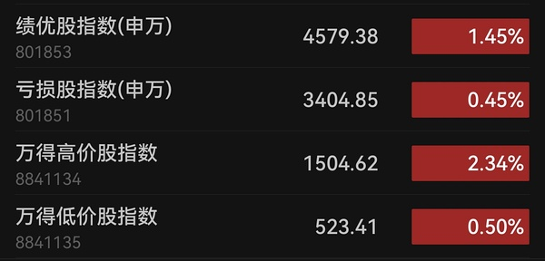  ⊳ （引用 @木感情的打工人）不过既然传媒开始拉大的，说明小垃圾们要不行了吧😂😂😂

- (2026-11-12 10:52:46) 自从周末他们“高配港股 低配美股”

港股就歇菜了
美股就复活了  ⊳ （引用 @木感情的打工人）你看看人家，朴实看多老美

- (2026-11-12 10:54:55) 蓝色空中加油了

- (2026-11-12 10:55:03) 换了一批😂😂😂😂😂😂  ⊳ （引用 @葱）毒圈开始收缩了

- (2026-11-12 10:58:40) 我在电影呀

其他暂时不会 你们玩  ⊳ （引用 @红烧肉肉）楼楼还会回传媒么

- (2026-11-12 10:59:40) uu该换名字了

你没有满载而归了  ⊳ （引用 @🅰失而复🉐😎）不得不说最近还是有点子威力在的😂

## 🧠 投资风格分析
> 📏 增量更新指引：仅当今日发言确有新依据时才修订对应维度，无变化不强行重写；单维度修订建议 ≤150 字。

- 投资理念与方法：坚持机会成本与性价比比较，只赚份内的钱、不后悔错过；重视低位与防守，认为防守可通过对冲品种实现，不把短期热闹当长期价值。今日新增依据显示，他看重筹码结构与机构行为，认为公募抱团趋同会制造机构重仓拥挤风险，倾向远离机构重仓；对消费、地产、传媒等题材强调“别真的当真”，只做自己理解的低位方向（如机器人），不推荐、不追高。
- 风险偏好：对高溢价QDII保持警惕，关注场内溢价率、额度与跟踪误差，倾向用场外低溢价替代场内高溢价，并设想场外申购/场内卖出路径；对债市区分短债基石与波动债券，认为美债性价比高但波动大。今日新增：会盯ETF与基准指数（如nana100）的贴合度，建议每隔一两周核对基金是否完全贴合；对溢价收窄（“溢价率只剩5”）表达不满。
- 交易与仓位：偏好盘后预设条件单与定价单，分层挂单、按涨幅目标执行；今日明确设置雪儿+7、大连+9等条件单，并强调“不增加传媒仓位和没有传媒是两回事”，不加仓传媒但保留持仓。资金在同类持仓间腾挪而非无节制新增，进攻资金用完后明确“我不会再买了”。
- 心理特质：清楚自己“手贱”、拿不住连续暴涨模式，偏好雪人式上下波动、成功率高、信心易加强的走势，不追求SY/襄阳那种自己赚不到的钱；对题材炒作保持警惕，预判宇航员大批三连板跌停收尾，体现自我认知与风险意识。

> ⚠️ 本板块由 Actions 全自动增量更新（复用当日发言与今日总览），每次仅在内容足够支撑时才改动。

## 🏷️ 昵称映射表
### 📖 昵称规律（供 AI 判断新昵称时参考）
【昵称命名规律（用于推断未知新昵称）】
- 拼音首字母缩写：取标的/基金名汉字拼音首字母串（含数字代码），多为 ETF/股票代码口语化｜示例：yl=引力传媒｜zy=掌阅科技｜sj=视觉中国｜cc=华安文体健康混合｜C50=创业板50ETF｜k50=科创50｜kun=昆仑万维｜xhxc=新瀚新材｜zxfc=中欣氟材
- 小/老+姓氏代指：「小X」「老X」通常指姓 X 的标的或该标的的基金经理；「X兄弟」多为同系基金｜示例：小惠=惠发食品｜老莫=万家品质生活(莫海波)｜小华=华夏全球科技先锋(QDII)A｜小华兄弟=华夏移动互联(QDII)｜小浦=浦银安盛全球智能科技(QDII)A｜小广=广发全球精选(QDII)A｜小远=华宝致远(QDII)C｜招招=招商银行｜小德=德明利｜赵姨=兆易创新｜露露=泸州老窖｜空调=格力电器
- 戏称/黑话→题材板块：生活化比喻或黑话对应某个题材/板块，而非单一标的；出现时多指板块方向｜示例：卖国=PCB板块(英伟达AI链)｜爱国=国产自主(半导体设备/芯片)｜奶茶=易点天下｜老师=中文在线｜蓝色=蓝色光标｜宇航员=航空航天板块｜华子=华泰保兴安悦债券｜国际=国际复材｜巨无霸=长鑫科技等重大IPO
- 谐音/取字：昵称含标的名关键字（取一字或谐音），多为 A 股个股或基金简称｜示例：万华=万华化学｜东百=东百集团｜宝=保利发展｜讨饭/亚洲讨饭/建信新兴=建信新兴市场(QDII)A｜华宝zy=华宝致远(QDII)A
- 机构/基金经理昵称：以基金公司名、经理姓、或平台代称指代对应基金产品｜示例：周经理=中欧新趋势混合(LOF)A｜张经理=信澳匠心回报混合A｜网易云/音乐世家=富国全球科技互联网股票(QDII)A｜国富亚洲=国富亚洲机会股票(QDII)A｜国泰纳指=国泰纳斯达克100指数(QDII)｜易方达全球=易方达全球成长精选混合(QDII)A｜浦银安盛=浦银安盛全球智能科技(QDII)A

### 📋 已收录映射
| 昵称 | 对应名称 |
|------|----------|
| C50 | 创业板50ETF |
| cc | 双义：股票=中国长城 / 基金=华安文体健康混合（用户 11-05 指认） |
| k50 | 科创50 |
| kun | 昆仑万维 |
| sj | 视觉中国 |
| xhxc | 新瀚新材（用户确认；代码待核） |
| yl | 引力传媒 603598（对手盘，非他持仓）｜11-06 +37.15%；11-09 本月+37.79% |
| zxfc | 中欣氟材 |
| zy | 双义：他本人口径=603533 掌阅科技（用户 11-05 确认）；11-09 楼友两条『zy』按 16 元/电影语境指 600977 中国电影。引用必须带语境，不许收敛 |
| 万华 | 万华化学 |
| 东百 | 东百集团 |
| 亚洲讨饭 | 建信新兴市场混合(QDII)A |
| 保利发展 | 保利发展 |
| 华子 | 华泰保兴安悦债券 |
| 华宝 zy | 华宝致远混合(QDII)A |
| 华宝zy | 华宝致远混合(QDII)A |
| 卖国 | PCB、光模块、通信板块（英伟达AI产业链） |
| 周经理 | 中欧新趋势混合(LOF)A |
| 国富亚洲 | 国富亚洲机会股票(QDII)A |
| 国泰纳指 | 国泰纳斯达克100指数(QDII) |
| 奶茶 | 易点天下 301171（对手盘，非他持仓）｜11-06 本月+29.51% |
| 宇航员 | 航空航天板块 |
| 宝 | 保利发展 |
| 小华 | 华夏全球科技先锋混合(QDII)A |
| 小华兄弟 | 华夏移动互联混合(QDII) |
| 小广 | 广发全球精选股票(QDII)A |
| 小德 | 德明利 |
| 小惠 | 惠发食品 |
| 小浦 | 浦银安盛全球智能科技(QDII)A |
| 小远 | 华宝致远混合(QDII)C｜只在盯，未证他持有 |
| 巨无霸 | 长鑫科技等重大IPO企业 |
| 建信新兴 | 建信新兴市场混合(QDII)A |
| 张经理 | 信澳匠心回报混合A |
| 招招 | 招商银行 |
| 易方达全球 | 易方达全球成长精选混合(QDII)A |
| 浦银安盛 | 浦银安盛全球智能科技(QDII)A |
| 爱国 | 国产自主（半导体设备/芯片制造） |
| 空调 | 格力电器 |
| 网易云 | 富国全球科技互联网股票(QDII)A |
| 老师 | 中文在线 |
| 老莫 | 万家品质生活混合A(519195) |
| 蓝色 | 蓝色光标 |
| 讨饭 | 建信新兴市场混合(QDII)A |
| 赵姨 | 兆易创新 |
| 赵哥 | 兆易创新 |
| 露露 | 泸州老窖 |
| 安安 | 安记食品 |
| 音乐世家 | 富国全球科技互联网股票(QDII)A |
| 老伯伯 | 铜冠铜箔 |
| nk | 纳指科技ETF景顺 159509（联接=景顺长城纳斯达克科技ETF联接A）｜11-06 A级：截图溢价率37.08% |
| bk | 标普信息科技LOF 161128（场外=易方达标普信息科技QDII-LOF）｜11-06 A级 |
| txx | 天下秀 |
| 媛媛 | 今世缘 |
| uu | 友友、网友们 |
| 温暖老师 | 某个特别牛逼的散户 |
| 余老师 | 余利，某牛逼投资者 |
| ycm | 粤传媒 002181｜11-09 12:12「非电影传媒就留给大家玩了 我一个都不会碰了」→ 推断已不持有 |
| 江老师 | 江琪（投资博主） |
| 水果老师 | 投资博主 |
| 小爱 | 我爱我家 |
| ty | 天娱数科 |
| bn | 博纳影业 |
| sy | 上海电影 |
| CBS | 长白山 |
| 东哥 | 东百集团 |
| 芒果 | 芒果超媒 |
| 阿中 | 中国电影 |
| 欢欢 | 欢瑞世纪 |
| 雪人 | 雪人集团 |
| 大连 | 大连圣亚 |
| 幸福 | 幸福蓝海 |
| 小粤 | 粤传媒 |
| 阿博 | 博纳影业 |
| 创成长 | 创业板成长etf |
| asd | 埃斯顿 |
| 恋爱脑 | 好想你 |
| 恋爱 | 好想你 |
| 小羊 | 襄阳轴承 |
| 中马 | 中马传动 |
| 晶雪 | 晶雪节能 |
| xf | 幸福蓝海 |
| 建设 | 建设工业 |
| 北方 | 北方导航/北方国际（未定，11-04「我在北方了」） |
| _ambiguity_note | 歧义未收敛（禁止当唯一映射）：轮子=巨轮智能/五洲新春；sj=视觉中国（传媒语境）/神剑股份（宇航员语境）；cc=中国长城/华安文体健康混合；北方=北方导航或北方国际；zy=掌阅科技（用户 11-05 确认原值正确）。证据分级：A=价位/均线/月涨幅实测命中；B=量级或单日命中/用户口述；C=仅昵称或语义，不得据此写『他持有』；沿用原仓=本轮未复核，不写进结论正文。三条判据：①条件单四位数要先按同时段动词行判买卖方向（cbs 3644 是买单不是卖单）；②『祝福/你们/你的X』句式＝评论他人持仓，不是他的操作；③同一昵称在不同语境可指两只票（zy=掌阅/中影），按价位与板块取，不许收敛成一个。 11-11 补：plus雪＝他自己也没说清（11:12「你应该不知道plus雪是哪个」），不许猜；bdd＝有传媒属性所以他不去（13:42），仍未定案；『五连阳』这类盘中口径不等于日K实测（招行 11-06 为平盘十字星）。 |
| nana场内 | 513300 纳斯达克ETF华夏｜11-09 14:34「不愧是513300 当年的普通nana ETF之王」，当日唯一红的纳指ETF |
| 雪儿 | 雪人集团 002639｜11-06「大连和雪儿」＋11-11 14:26「雪儿今天不错啊 大家昨天不是期待他接人嘛 这个任务做到了今天」（接人＝5日线接回，与雪人条件单口径一致） |
| 存钱罐 | 光线传媒 300251（他自述小仓） |
| 枣子 | 好想你 002582 |
| 王老师 | 人：王博雅投资（QDII 场内溢价口径），不是标的 |
| 印度 | 自嘲代指中国（推断，勿当事实） |
| 10086 | 中国移动（他当指标用，非持仓） |
| 阳光乳业 | 001318 阳光乳业（他的『喝的』/牛奶）｜11-09 A级：13:59 分时截图 S 标记≈13.5＋10:52「我去掉了羊来抄底」 |
| 羊 | 生肖羊概念组（带阳/洋的一篮子：东方海洋/日出东方/大东方/红太阳/澳洋健康/鲁阳节能/华阳国际/东方日升/阳光照明/九阳股份/阳光乳业/沈阳机床）｜11-09 14:04 他自己贴的分组｜**不是单只票，也不是『小羊』襄阳轴承** |
| 小明 | 605179 一鸣食品｜11-09 10:07 有人问『喝的小明？』他答『羊』＝喝的已换成阳光乳业 |
| 皇台 | 000995 皇台酒业｜11-09 与雪人 PK 当日换手率龙虎榜 |
| 海哥 | 人：转债估值博主（不是标的）｜11-09 12:48「海哥周五那个新债…我买了点试试看是市场错了还是海哥错了」 |
| 申菱转债 | 123290（申菱环境 301018 的转债）｜11-09 13:50 买 150 张 @133 多 |
| 盛天 | 300494 盛天网络｜11-11 A级：11:29 分时截图 B 标记 @11.00＋「不止 而且我跟了他一把」（跟摄像大哥） |
| dfhy | 002086 东方海洋｜11-11 13:56 楼友问 dfhy 绕异动→他「我没算 这几天可能都是异动吧」；11:35/11:54 他自己两次喊『东方海洋』 |
| xys | 300502 新易盛｜11-11 13:19「我那个买xys的女主播终于要开心了」＋13:21「她现在成本327了」→ **是女主播的仓，不是他的** |
| 冰山 | 000530 冰山冷热｜11-11 10:16「万一冰山跌停 他能跌到哪里再去」＋10:27「今天把冰山 晶雪按死 大连 CBS 正统上位」（非持仓，冰雪板块的山寨对照） |
| 冰冰 | 000530 冰山冷热｜11-11 14:03「那冰冰准备」（同『冰山』，非持仓） |
| 龙版 | 605577 龙版传媒｜11-11 11:50「最早龙版也是因为自己每次公告文案都不一样才4连板就被监管」（讲监管规则，非持仓） |
| 3300 | 513300 纳斯达克ETF华夏｜11-11 10:49「3300还行 不过今天我不满意」＋13:24「咱们3300还是近期数据最好的」 |
| nana100 | 纳斯达克100指数（他对照场内ETF溢价的基准）｜11-11 08:14「昨天513300涨了3.53% 但是nana100实际也就涨了3.4」 |
| 易中天 | 新易盛＋中际旭创＋天孚通信（CPO三巨头合称）｜11-11 14:13「都去易中天了🤣」（非持仓） |
| 冰雪双子星 | 大连圣亚600593＋长白山603099（他的正牌冰雪双仓）｜11-11 10:29「从不担心冰雪双子星」 |
| 2000 | 中证2000指数（他当微盘股基准）｜11-11 11:11「除了机器人 今天其他题材全输给了2000」 |
| cw | CoreWeave（CRWV，美股AI算力）｜11-11 11:18「cw那玩意硬起来了 大家看夜盘数字」 |
| ant | Anthropic（美股IPO）｜11-11 12:11「接下来是不是ant IPO也是利好」 |
| 摄像大哥 | 人：楼友（不是标的）｜11-11 他的两笔游戏＝电魂网络涨停＋顺网科技≈+7，属楼友口径；楼主自己买的是盛天网络＋另一只未披露代码的游戏 |
| 游戏哥哥 | 游戏板块拟人化（不是具体票）｜11-11 12:58「游戏哥哥：我来也」＋13:01「妹妹休息 哥哥接力？」 |
| 传媒妹妹 | 传媒板块拟人化（不是具体票）｜11-11 11:40「被传媒妹妹压制了」＋13:01「妹妹休息 哥哥接力？」 |

> ⚠️ 以下为 LLM **建议**，未自动写入状态文件。请人工确认后，本地编辑 `state.json` 的 `nickname_map` / `positions`，或 `nickname_rules.json` 的 `rules` 并 push 生效。

## 持仓建议（待你确认）
- **埃斯顿**（002747）〔加仓〕— 依据：我昨天加了asd今天刚刚加了另外个；asd火箭发射
- **中韩半导体ETF**（）〔持有〕— 依据：中韩我本来就有 我不满意 溢价率只剩5
- **中国电影**（600977）〔持有〕— 依据：我不是在电影嘛；我在电影呀 其他暂时不会 你们玩
- **浦银安盛全球智能科技(QDII)A**（005656）〔观察〕— 依据：其实最近防守最好的是浦姐 最早砍仓存储的 现在要反过来看浦姐进攻了

## 新昵称映射建议（待你确认）
- `浦姐` = 浦银安盛全球智能科技(QDII)A（005656）
- `sg` = 省广集团
- `小蓝` = 蓝色光标
- `老登` = 机构抱团老登股（白酒/消费/医药等）
- `SY` = 上海电影（传媒/电影语境；宇航员语境可为神剑股份，需带语境）
- `机器人` = 机器人板块

## 新昵称规律建议（待你确认）
- 【命名规律】基金公司/产品拟人化加「姐/哥」代指该基金，如浦姐=浦银安盛 ｜示例：浦姐=浦银安盛全球智能科技(QDII)A ｜依据：最早砍仓存储的 现在要反过来看浦姐进攻了
- 【戏称/黑话】「老登」指机构抱团的白酒/消费/医药等老登股，与游资题材对立 ｜示例：最近涨起来的老登们非常危险；白酒后续又要惨遭抛售 ｜依据：如果这些资金回去重新抱团 最近涨起来的老登们非常危险 大概率只能去最近走势好的老登
- 【首字母缩写】拼音首字母缩写代指个股，如sg=省广集团 ｜示例：sg=省广集团 ｜依据：他和蓝色 奶茶 sg他们是广告组合

*🤖 自动生成于 2026-11-12 11:02:36 ｜ 豆瓣楼主发言追踪*