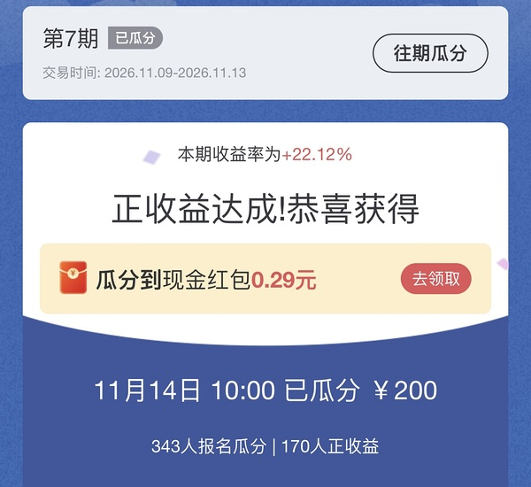
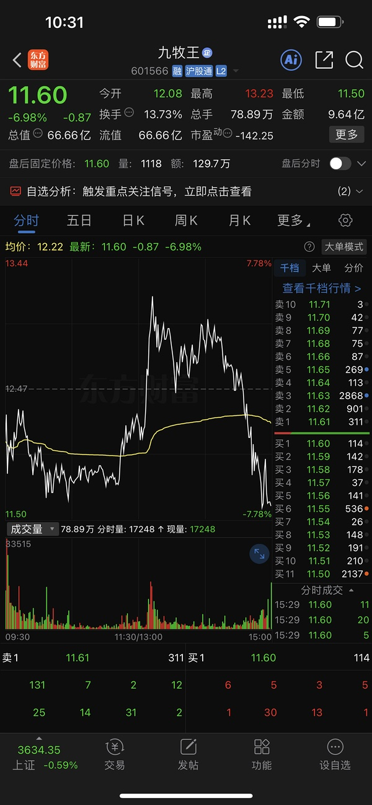
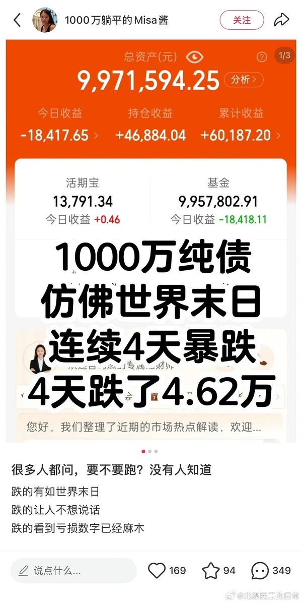
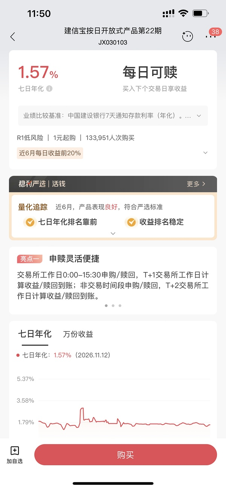
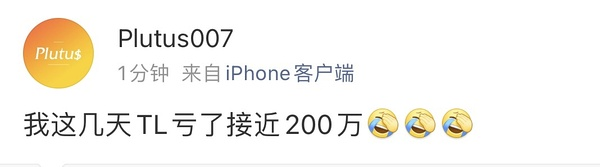
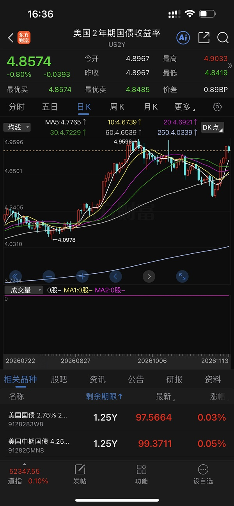

# 📋 楼主每日发言推送

> **推送日期**：2026-11-14 ｜ **执行时间**：2026-11-14 20:21:30 ｜ **监控用户**：`不知道还能说啥`
> **追踪模式**：`topic`（用户主页广播·豆瓣话题）

## 📊 持仓追踪
> 上次更新：2026-11-14 ｜ 基于楼主发言持续追踪（共 14 项）

| 标的 | 状态 | 类型 | 现价 | 提及 |
|------|------|------|------|------|
| 招商银行 | 底仓·四年前 32 元买入·不动 | 红利/银行 | 42.93（0.70%） | 不动；14:50『只要股息率大于5 我有的胜就冲……；成本约32元 |
| 大连圣亚 | 持有 5 笔·卖单 +9% 起（46.90/45.22）未触发·『我没有大连买入计划』 | 冰雪·正牌双子星 | 39.46（-4.22%） | 持有 5 笔·卖单 +9% 起未触及（当日高 40… |
| 长白山 | 持有 3 笔·锁仓·不开单不接 | 冰雪·正牌双子星 | 36.30（-3.12%） | 持有 3 笔·锁仓；15:25『光线15.44不变… |
| 雪人集团 | 持有 3 笔·卖单 16.68（+7%）未触发·接回划线 ≤14.2 未触及 | 冰雪·交易仓 | 14.42（-5.32%） | 持有 3 笔·卖单 16.68（+7%）未触及（当… |
| 幸福蓝海 | 持有·11-13 涨停价 17.99 部分卖出（余一半多点） | 电影 | 17.99（20.01%） | 17.99 卖单 10:10 触发＝部分卖出（涨停… |
| 中国电影 | 持有·剩余仓无单·『中影肯定最后动』 | 电影·核心不动仓 | 17.05（10.00%） | 持有·无单；涨停 17.05＝15.50×1.1；… |
| 光线传媒 | 持有＋11-13 当日买入 1 笔·卖单 14.87/15.44 均未触发 | 电影·低位备选 | 13.09（5.31%） | 当日买入：10:09『买入光线+5.6』→ 12.… |
| 博纳影业 | 持有小仓·『复仇者联盟没有到来 全都不会清仓』（档期锚：复联 12 月／流浪地球 2 月） | 电影 | 6.78（7.28%） | 持有小仓；+7.28%（高 6.95＝涨停价 6.… |
| 纳斯达克ETF华夏 | 持有·不卖场内（溢价品种，12:06 截图溢价 15.28%） | QDII·场内纳指 | 2.711（0.86%） | 持有；12:06 截图 513300 折价率 -1… |
| 中韩半导体ETF | 持有·溢价 5 附近不满意（11-12 口径，今日无动作） | QDII·场内 | 3.650（-0.95%） | 持有；当日 -0.95% |
| 盛天网络 | 11-11 买入·持有（口径待确认） | 游戏·电竞 | 10.69（0.94%） | 11.11；11-11 买 @≈11.00；**口径待确认**… |
| 游戏自建仓 | 11-10 买入·持有·11-11 自述 +5% | 游戏·电竞 | 暂无 | 11.10；11-10 买入、11-11 自述 +5；11-1… |
| 美债场外基金 | 持有·国庆前买入·11-11 自述 +1.4%·债券连续两日被吓 | 场外·美债 | 暂无 | 12:26『看来我的债券基金略好 抄底还没转亏 希… |
| 传媒低位10cm | 自述『只加一个低位的』·时点不明（疑似此前已加）·其他不动 | 传媒·低位 | 暂无 | 11.12；11-13 全天不加仓传媒（08:09『主要是我不… |

> ⚠️ 执行任务时如发现新操作，请更新 `state.json` 的 `positions`。成本价和市值有数据才填，没有则保留「暂无」。

## 🌅 今日总览
### 📌 市场背景
今日发言未涉及A股整体市场判断，更多为闲聊与外部信息评论：提到「下周有两件大事呀」但未展开；谈及海外环境称「这周的美国利空环绕 能这样的反弹已经不错了」；并观察「看看这周的黄金白银 完全溃不成军 当然还有恒科😂」。此外转述人民日报平台经济评论并称「抖音危 红果危」。

### 📌 今日操作
| 操作 | 标的 | 详情 |
|---|---|---|
| ⏭️ | 无披露 | 今日发言未提及实际买卖或调仓；仅称「我昨天也不打开银行看我债券找不痛快了」，并提示模拟盘可领红包 |

### 📌 今日议题
| 议题 | 态度 | 核心观点 | 关键引用 |
|---|---|---|---|
| 平台经济监管评论 | 💬讨论 | 转述人民日报评论强调平台须承担公共责任，并直接点评短视频/内容平台风险 | 「人民锐评：超级平台须读懂‘时间’的公共分量」「抖音危 红果危」 |
| 海外市场与利空环境 | ➡️中性 | 认为美国利空环绕下市场还能反弹已属不错 | 「这周的美国利空环绕 能这样的反弹已经不错了」 |
| 黄金白银与恒科走势 | 📉看空 | 指出本周黄金白银与恒科表现溃不成军 | 「看看这周的黄金白银 完全溃不成军 当然还有恒科😂」 |
| 银行/债券账户查看体验 | 💬讨论 | 选择不打开银行看债券以避免不痛快，认为不看可当无事发生 | 「我昨天也不打开银行看我债券找不痛快了」「不看就无视发生」 |
| 模拟盘红包与美国收益 | 💬讨论 | 提示玩模拟盘可上号领红包，并估计玩美国方向的大多正收益 | 「玩模拟盘的可以上号拿红包了！！」「大家玩美国的应该都是正收益吧」 |
| 下周两件大事 | 💬讨论 | 提示下周有两件大事但未具体展开 | 「下周有两件大事呀」 |

### 📌 看好板块/方向
- **美国市场/美股**：发言称「大家玩美国的应该都是正收益吧」，并认为「这周的美国利空环绕 能这样的反弹已经不错了」，对反弹韧性偏正面。

### 📌 风险提示
- 「这周的美国利空环绕」——海外利空扰动仍在，反弹力度受约束。
- 「看看这周的黄金白银 完全溃不成军 当然还有恒科😂」——黄金白银与恒科本周走势显著偏弱，注意相关资产波动。
- 「抖音危 红果危」——平台经济监管评论引发对短视频/内容平台的情绪担忧。
- 「这个东西不下来 嗨不顺畅」——某压制因素未解除则情绪不顺，但对象未明，不宜过度解读。

## 📊 本次结果
- **今日发言**：15 条
- **累计存档**：21625 条

## 📝 该最新广播作者发言聚合（共 15 条）
- (2026-11-14 08:18:53) 哈哈哈哈 她们都在睡  ⊳ （引用 @🅰失而复🉐😎）周末的第一这么轻而易举的吗

- (2026-11-14 10:23:10) 笑死 因为昨天晚上设备坏了😂  ⊳ （引用 @vio）楼出去潇洒了！感觉好久没听过周五约吃饭什么的了😀

- (2026-11-14 10:23:28) 下周有两件大事呀  ⊳ （引用 @小灰灰）反弹暂歇？不好的预感……

- (2026-11-14 10:24:35) [图] 那个模拟盘能有红包😂

  ⊳ （引用 @VVV坚定持有VVV）昨晚买入真是好时机诶！模拟盘已经赚8k啦！

- (2026-11-14 10:25:22) 玩模拟盘的可以上号拿红包了！！
大家玩美国的应该都是正收益吧

- (2026-11-14 10:31:53) [图] V老师 邪恶的票过了一年还是坏事做尽🤣🤣🤣

  ⊳ （引用 @VVV坚定持有VVV）昨晚买入真是好时机诶！模拟盘已经赚8k啦！

- (2026-11-14 10:42:15) 期待住  ⊳ （引用 @小鱼）下周能不能都是大喜事，英伟达业绩推动股价大涨，然后大家都跟着领头羊涨😂😂

- (2026-11-14 10:42:44) 人民锐评：超级平台须读懂“时间”的公共分量

人民日报看法评论文章指出，强调责任，是为了培育良性的注意力市场。争取用户时长不该是压倒一切的KPI，为公众创造真实价值才是根本。党中央的政策指向很明确，“从构筑国家竞争新优势的战略高度出发，坚持发展和规范并重，把握平台经济发展规律，建立健全平台经济治理体系”。

抖音危 红果危

- (2026-11-14 10:49:37) [图] 😂我昨天也不打开银行看我债券找不痛快了
和大家一样了 不看就无视发生🤣

- (2026-11-14 11:51:14) [图] 王者之师 建信22号😂😂😂😂😂😂😂

  ⊳ （引用 @shirla）货基😅或者抄底债？

- (2026-11-14 11:52:23) [图] 😂😂😂😂

  ⊳ （引用 @不知道还能说啥）😂我昨天也不打开银行看我债券找不痛快了
和大家一样了 不看就无视发生🤣

- (2026-11-14 11:52:28) [图] 😂😂😂😂

  ⊳ （引用 @不知道还能说啥）😂我昨天也不打开银行看我债券找不痛快了
和大家一样了 不看就无视发生🤣

- (2026-11-14 16:38:36) [图] 这个东西不下来 嗨不顺畅
这周的美国利空环绕 能这样的反弹已经不错了

这玩意一上去 
看看这周的黄金白银 完全溃不成军
当然还有恒科😂

  ⊳ （引用 @温妤哦）哎 又要跌了吗 啥时候才止跌

- (2026-11-14 17:56:54) 不清楚 不过我好几个其他银行确实没找到😂  ⊳ （引用 @momo）这个是不是只能在招行买

- (2026-11-14 18:52:01) 如果这个稳定的话就也不错啊
大部分没多久就变成一万3毛多一天了😂  ⊳ （引用 @叁仟世界鸦杀。）坏了 建行只有20期

## 🧠 投资风格分析
> 📏 增量更新指引：仅当今日发言确有新依据时才修订对应维度，无变化不强行重写；单维度修订建议 ≤150 字。

- 投资理念与方法：坚持机会成本与性价比比较，强调“只赚份内的钱”；今日进一步强调远离机构重仓，认为公募抱团趋同会制造拥挤风险，主张跟踪基金与基准指数的贴合度，规避机构重仓股。对题材炒作保持警惕，认为消费、地产、传媒等题材“别真的当真”。
- 风险偏好：对高波动、高拥挤的题材股回避，主动规避机构重仓和题材炒作；对美股谨慎但认可其强势；注意控制仓位，担心情绪核心崩盘，周四担心题材杀跌，周五提示『别装逼』。
- 交易与仓位：偏好低吸不追高，强调『不加仓和持有是两回事』；坚决执行条件单，挂单卖出幸福蓝海、触发后买入光线；对传媒不增加仓位但保留持仓；周五躲避利息，今天清仓机器人；注重仓位控制，担心情绪核心崩盘，强调『管住手』。
- 心理特质：自我认知清晰，承认看错传媒，对市场规律有敬畏；重视筹码与机构行为；情绪稳定，不追高、不眼红。今日新增：面对不利账户选择不打开银行/债券查看，称「不看就无视发生」，体现以回避查看波动来维持心态的自我调节习惯。

> ⚠️ 本板块由 Actions 全自动增量更新（复用当日发言与今日总览），每次仅在内容足够支撑时才改动。

## 🏷️ 昵称映射表
### 📖 昵称规律（供 AI 判断新昵称时参考）
【昵称命名规律（用于推断未知新昵称）】
- 拼音首字母缩写：取标的/基金名汉字拼音首字母串（含数字代码），多为 ETF/股票代码口语化｜示例：yl=引力传媒｜zy=掌阅科技｜sj=视觉中国｜cc=华安文体健康混合｜C50=创业板50ETF｜k50=科创50｜kun=昆仑万维｜xhxc=新瀚新材｜zxfc=中欣氟材
- 小/老+姓氏代指：「小X」「老X」通常指姓 X 的标的或该标的的基金经理；「X兄弟」多为同系基金｜示例：小惠=惠发食品｜老莫=万家品质生活(莫海波)｜小华=华夏全球科技先锋(QDII)A｜小华兄弟=华夏移动互联(QDII)｜小浦=浦银安盛全球智能科技(QDII)A｜小广=广发全球精选(QDII)A｜小远=华宝致远(QDII)C｜招招=招商银行｜小德=德明利｜赵姨=兆易创新｜露露=泸州老窖｜空调=格力电器
- 戏称/黑话→题材板块：生活化比喻或黑话对应某个题材/板块，而非单一标的；出现时多指板块方向｜示例：卖国=PCB板块(英伟达AI链)｜爱国=国产自主(半导体设备/芯片)｜奶茶=易点天下｜老师=中文在线｜蓝色=蓝色光标｜宇航员=航空航天板块｜华子=华泰保兴安悦债券｜国际=国际复材｜巨无霸=长鑫科技等重大IPO
- 谐音/取字：昵称含标的名关键字（取一字或谐音），多为 A 股个股或基金简称｜示例：万华=万华化学｜东百=东百集团｜宝=保利发展｜讨饭/亚洲讨饭/建信新兴=建信新兴市场(QDII)A｜华宝zy=华宝致远(QDII)A
- 机构/基金经理昵称：以基金公司名、经理姓、或平台代称指代对应基金产品｜示例：周经理=中欧新趋势混合(LOF)A｜张经理=信澳匠心回报混合A｜网易云/音乐世家=富国全球科技互联网股票(QDII)A｜国富亚洲=国富亚洲机会股票(QDII)A｜国泰纳指=国泰纳斯达克100指数(QDII)｜易方达全球=易方达全球成长精选混合(QDII)A｜浦银安盛=浦银安盛全球智能科技(QDII)A

### 📋 已收录映射
| 昵称 | 对应名称 |
|------|----------|
| C50 | 创业板50ETF |
| cc | 双义：股票=中国长城 / 基金=华安文体健康混合（用户 11-05 指认） |
| k50 | 科创50 |
| kun | 昆仑万维 |
| sj | 视觉中国 |
| xhxc | 新瀚新材（用户确认；代码待核） |
| yl | 引力传媒 603598（对手盘，非他持仓）｜11-06 +37.15%；11-09 本月+37.79% |
| zxfc | 中欣氟材 |
| zy | 双义：他本人口径=603533 掌阅科技（用户 11-05 确认）；11-09 楼友两条『zy』按 16 元/电影语境指 600977 中国电影。引用必须带语境，不许收敛 |
| 万华 | 万华化学 |
| 东百 | 东百集团 |
| 亚洲讨饭 | 建信新兴市场混合(QDII)A |
| 保利发展 | 保利发展 |
| 华子 | 华泰保兴安悦债券 |
| 华宝 zy | 华宝致远混合(QDII)A |
| 华宝zy | 华宝致远混合(QDII)A |
| 卖国 | PCB、光模块、通信板块（英伟达AI产业链） |
| 周经理 | 中欧新趋势混合(LOF)A |
| 国富亚洲 | 国富亚洲机会股票(QDII)A |
| 国泰纳指 | 国泰纳斯达克100指数(QDII) |
| 奶茶 | 301171 易点天下（对手盘，非持仓）｜11-13 10:07『奶茶out 幸福人的底气是可以说芒果out』；当日 −6.72% |
| 宇航员 | 航空航天板块 |
| 宝 | 保利发展 |
| 小华 | 华夏全球科技先锋混合(QDII)A |
| 小华兄弟 | 华夏移动互联混合(QDII) |
| 小广 | 广发全球精选股票(QDII)A |
| 小德 | 德明利 |
| 小惠 | 惠发食品 |
| 小浦 | 浦银安盛全球智能科技(QDII)A |
| 小远 | 华宝致远混合(QDII)C｜只在盯，未证他持有 |
| 巨无霸 | 长鑫科技等重大IPO企业 |
| 建信新兴 | 建信新兴市场混合(QDII)A |
| 张经理 | 信澳匠心回报混合A |
| 招招 | 招商银行 |
| 易方达全球 | 易方达全球成长精选混合(QDII)A |
| 浦银安盛 | 浦银安盛全球智能科技(QDII)A |
| 爱国 | 国产自主（半导体设备/芯片制造） |
| 空调 | 格力电器 |
| 网易云 | 富国全球科技互联网股票(QDII)A |
| 老师 | 中文在线 |
| 老莫 | 万家品质生活混合A(519195) |
| 蓝色 | 300058 蓝色光标（广告组合，非他持仓）｜11-12 高 15.97＝20cm 涨停价、收 14.76 +10.89%（炸板）；10:21『他和蓝色 奶茶 sg他们是广告组合』 |
| 讨饭 | 建信新兴市场混合(QDII)A |
| 赵姨 | 兆易创新 |
| 赵哥 | 兆易创新 |
| 露露 | 泸州老窖 |
| 安安 | 安记食品 |
| 音乐世家 | 富国全球科技互联网股票(QDII)A |
| 老伯伯 | 铜冠铜箔 |
| nk | 纳指科技ETF景顺 159509（联接=景顺长城纳斯达克科技ETF联接A）｜11-06 A级：截图溢价率37.08% |
| bk | 标普信息科技LOF 161128（场外=易方达标普信息科技QDII-LOF）｜11-06 A级 |
| txx | 天下秀 |
| 媛媛 | 今世缘 |
| uu | 友友、网友们 |
| 温暖老师 | 某个特别牛逼的散户 |
| 余老师 | 余利，某牛逼投资者 |
| ycm | 粤传媒 002181｜11-09 12:12「非电影传媒就留给大家玩了 我一个都不会碰了」→ 推断已不持有 |
| 江老师 | 江琪（投资博主） |
| 水果老师 | 投资博主 |
| 小爱 | 我爱我家 |
| ty | 天娱数科 |
| bn | 博纳影业 |
| sy | 601595 上海电影｜**他空仓**（11-09 起未回接）；11-12 09:38『天天念叨sy的给你们机会了』＋09:41『现在-6给你们机会了哈』＋13:15『马上sy跌停 bn还要尊敬一下他』＋13:51『与此同时 sy跌停』＋14:00『sy历来以残暴虐杀手法闻名』；实测收 42.15 −9.99% 跌停 |
| CBS | 长白山 |
| 东哥 | 东百集团 |
| 芒果 | 300413 芒果超媒（对照，非持仓）｜11-13 14:01 本月涨幅 41.70% vs 幸福 53.76% →『幸福已经拉开芒果12%』＝12.06pp 精确命中；当日 −4.83% |
| 阿中 | 中国电影 |
| 欢欢 | 欢瑞世纪 |
| 雪人 | 雪人集团 |
| 大连 | 大连圣亚 |
| 幸福 | 幸福蓝海 |
| 小粤 | 粤传媒 |
| 阿博 | 博纳影业 |
| 创成长 | 创业板成长etf |
| asd | 002747 埃斯顿｜11-11 15:09『我昨天去的另外一个 今天也吸到asd了』＝11-11 低吸买入；11-12 10:17『我昨天加了asd今天刚刚加了另外个』＋10:35『asd火箭发射』（盘中高 32.19，收 29.95 −4.37%）；买价未披露。**11-11 轮误删、11-12 恢复** |
| 恋爱脑 | 002582 好想你｜11-12 14:39:31『清了恋爱脑』＝清仓（卖价未披露；10.48 卖单两日均未触及→手动卖）；14:28『我如果去掉恋爱脑 也就比你多一个机器人』；当日收 9.76 −2.89% |
| 恋爱 | 002582 好想你（同『恋爱脑』）｜11-12 14:39 已清仓，不再持有 |
| 小羊 | 000678 襄阳轴承｜11-05 已卖（卡当日最高 20.40）；11-12 14:16『襄阳掉了』＋14:44『厉害襄阳』＝只评论走势，非持仓 |
| 中马 | 中马传动 |
| 晶雪 | 晶雪节能 |
| xf | 幸福蓝海 |
| 建设 | 建设工业 |
| 北方 | 北方导航/北方国际（未定，11-04「我在北方了」） |
| _ambiguity_note | 歧义未收敛（禁止当唯一映射）：轮子=巨轮智能/五洲新春；sj=视觉中国（传媒语境）/神剑股份（宇航员语境）；cc=中国长城/华安文体健康混合；北方=北方导航或北方国际；zy=掌阅科技（用户 11-05 确认原值正确）。证据分级：A=价位/均线/月涨幅实测命中；B=量级或单日命中/用户口述；C=仅昵称或语义，不得据此写『他持有』；沿用原仓=本轮未复核，不写进结论正文。三条判据：①条件单四位数要先按同时段动词行判买卖方向（cbs 3644 是买单不是卖单）；②『祝福/你们/你的X』句式＝评论他人持仓，不是他的操作；③同一昵称在不同语境可指两只票（zy=掌阅/中影），按价位与板块取，不许收敛成一个。 11-11 补：plus雪＝他自己也没说清（11:12「你应该不知道plus雪是哪个」），不许猜；bdd＝有传媒属性所以他不去（13:42），仍未定案；『五连阳』这类盘中口径不等于日K实测（招行 11-06 为平盘十字星）。 11-12 补：①盘中快照≠收盘（14:15 三日账第三日 幸福+0.5/光线−4.5 为盘中值，收盘 −0.53/−4.97；他写的『拉开5.3%』按自列数字相加应为 5.5，属口算误差，不得据此推翻实测）；②历史卖单不重复计触发（中影 15.84 虽∈11-12 区间[15.39,15.98]，但 11-10 已成交、无存续卖单）；③清仓自述不封锁后续再买（asd 11-06 清→11-11 15:09 再吸，11-11 轮据此误删）；④『果果』只是推断映射，不得当持仓证据；⑤机器人第二仓与传媒低位10cm 代码未披露，福赛仅为楼友提问他作答，不许映射。 11-13 补：①**本月涨幅类口述可核**，基准＝10-30 收盘，且要用**发言时刻的分钟价**复算（14:01 截图 53.76% 与分钟线独立复算分毫不差，『拉开芒果12%』＝12.06pp）；②**基金表『折价率』列负号＝溢价**（513300 −15.28% ⇒ 溢价 15.28%，与 11-06 的 16.36% 同口径），别读成折价；③**『我手里就7只股票了/我只有电影冰雪了』是他题材仓口径**，不得据此删除无卖出自述的持仓行（铁律 6）；④**『全部跌停』类口述是盘中快照**（东方海洋盘中最低 4.64＝跌停价、收 −6.59%，未封死）；⑤plus雪＝晶雪只是**品种识别**，他 11-09 已自述清仓，不得当持有证据。 |
| nana场内 | 513300 纳斯达克ETF华夏｜11-09 14:34「不愧是513300 当年的普通nana ETF之王」，当日唯一红的纳指ETF |
| 雪儿 | 雪人集团 002639｜11-06「大连和雪儿」＋11-11 14:26「雪儿今天不错啊 大家昨天不是期待他接人嘛 这个任务做到了今天」（接人＝5日线接回，与雪人条件单口径一致） |
| 存钱罐 | 光线传媒 300251（他自述小仓）｜11-13 15:11『我相信光虽迟但到 我会肯定保留上周的存钱仓位』＝存钱罐口径再次落到光线 |
| 枣子 | 002582 好想你（同『恋爱脑』）｜11-12 14:39 已清仓，不再持有 |
| 王老师 | 人：王博雅投资（QDII 场内溢价口径），不是标的 |
| 印度 | 自嘲代指中国（推断，勿当事实） |
| 10086 | 中国移动（他当指标用，非持仓） |
| 阳光乳业 | 001318 阳光乳业（他的『喝的』/牛奶）｜11-09 A级：13:59 分时截图 S 标记≈13.5＋10:52「我去掉了羊来抄底」 |
| 羊 | 生肖羊概念组（带阳/洋/光/太/泉的一篮子）｜11-09 14:04 他自己贴的分组；**11-13 崩盘实证**：15:58 截图跌幅榜 澳洋健康 −10.06、阳光照明 −10.05、红太阳 −10.04、大东方 −10.03、阳光乳业 −10.02、襄阳轴承 −9.98、鲁阳节能 −9.95、大西洋 −9.73、太阳电缆 −9.29、圣阳股份 −8.64、泉阳泉 −6.60、东方海洋 −6.59；他 14:48『我昨天起码说了6次 控制仓位 因为羊和东方昨天松动了！！！！这是情绪核心』 |
| 小明 | 605179 一鸣食品｜11-09 10:07 有人问『喝的小明？』他答『羊』＝喝的已换成阳光乳业 |
| 皇台 | 000995 皇台酒业｜11-09 与雪人 PK 当日换手率龙虎榜 |
| 海哥 | 人：转债估值博主（不是标的）｜11-09 12:48「海哥周五那个新债…我买了点试试看是市场错了还是海哥错了」 |
| 申菱转债 | 123290（申菱环境 301018 的转债）｜11-09 13:50 买 150 张 @133 多；11-10 11:20『我开了149.9』卖单；11-12 分钟线 10:03–11:12 持续≥149.9（高 152.313）→触发推定清仓，+12.28%（成本 133.5 推定）记入 stock_pnl，已从持仓表删除 |
| 盛天 | 300494 盛天网络｜11-11 A级：11:29 分时截图 B 标记 @11.00＋「不止 而且我跟了他一把」（跟摄像大哥） |
| dfhy | 002086 东方海洋｜11-11 13:56 楼友问 dfhy 绕异动→他『我没算 这几天可能都是异动吧』；11:35/11:54 他自己两次喊『东方海洋』；11-12 14:39:31『涨停卖了东方海洋』@5.16（=4.69×1.10 分毫不差，分钟线 14:36 起封板，财联社截图 17天9板/10.02%）→已卖出；买价未披露故不记收益 |
| xys | 300502 新易盛｜11-11 13:19「我那个买xys的女主播终于要开心了」＋13:21「她现在成本327了」→ **是女主播的仓，不是他的** |
| 冰山 | 000530 冰山冷热｜11-11 10:16「万一冰山跌停 他能跌到哪里再去」＋10:27「今天把冰山 晶雪按死 大连 CBS 正统上位」（非持仓，冰雪板块的山寨对照） |
| 冰冰 | 000530 冰山冷热｜11-11 14:03「那冰冰准备」（同『冰山』，非持仓） |
| 龙版 | 605577 龙版传媒｜11-11 11:50「最早龙版也是因为自己每次公告文案都不一样才4连板就被监管」（讲监管规则，非持仓） |
| 3300 | 513300 纳斯达克ETF华夏｜11-11 10:49「3300还行 不过今天我不满意」＋13:24「咱们3300还是近期数据最好的」 |
| nana100 | 纳斯达克100指数（他对照场内ETF溢价的基准）｜11-11 08:14「昨天513300涨了3.53% 但是nana100实际也就涨了3.4」 |
| 易中天 | 新易盛＋中际旭创＋天孚通信（CPO三巨头合称）｜11-11 14:13「都去易中天了🤣」（非持仓） |
| 冰雪双子星 | 大连圣亚600593＋长白山603099（他的正牌冰雪双仓）｜11-11 10:29「从不担心冰雪双子星」 |
| 2000 | 中证2000指数（他当微盘股基准）｜11-11 11:11「除了机器人 今天其他题材全输给了2000」 |
| cw | CoreWeave（CRWV，美股AI算力）｜11-11 11:18「cw那玩意硬起来了 大家看夜盘数字」 |
| ant | Anthropic（美股IPO）｜11-11 12:11「接下来是不是ant IPO也是利好」 |
| 摄像大哥 | 人：楼友（不是标的）｜11-11 他的两笔游戏＝电魂网络涨停＋顺网科技≈+7，属楼友口径；楼主自己买的是盛天网络＋另一只未披露代码的游戏 |
| 游戏哥哥 | 游戏板块拟人化（不是具体票）｜11-11 12:58「游戏哥哥：我来也」＋13:01「妹妹休息 哥哥接力？」 |
| 传媒妹妹 | 传媒板块拟人化（不是具体票）｜11-11 11:40「被传媒妹妹压制了」＋13:01「妹妹休息 哥哥接力？」 |
| sg | 002400 省广集团（广告组合，非他持仓）｜11-12 A级映射：10:09:32『省广带起来了』＋10:21:36『他和蓝色 奶茶 sg他们是广告组合』；分钟线 10:00 6.70→10:09 6.89→10:21 6.94（昨收 6.70）命中『带起来』；当日收 6.64 −0.90%（冲高回落） |
| 果果 | 301052 果麦文化（**推断·B**，非持仓）｜11-12 13:05:01『果果紧随其后了』紧接 13:04:34『传媒出现两位数跌幅了 华策』；实测华策 −13.97%、果麦 −10.38% 同为两位数跌幅→谐音＋当日跌幅与语境命中；未见他自述买卖，不得当持仓证据 |
| 老登 | 机构抱团的老牌权重（白酒/消费/地产一类，**不是单只票**）｜11-12 07:51:44『如果这些资金回去重新抱团 最近涨起来的老登们非常危险…老登后续又要惨遭抛售 比如昨天大跌的白酒』 |
| plus雪 | 301010 晶雪节能（**B·推断，且非当前持有**）｜11-13 10:04『plus雪是-20的 不符合周五早上不要买跌的少的票 还能再跌-10』＝20cm 品种，实测晶雪当日 −10.10%（跌停 20.28）；12:31『我猜你去plus雪了』是对别人说的；15:25 他答『24.94』＝11-05 晶雪老卖单价、当日最高 24.92 差 2 分未触及。**但他 11-09 自述晶雪已清仓 → 不得据此判持有** |
| 复仇者联盟 | 电影档期锚（不是标的）｜11-13 10:18『复仇者联盟没有到来 全都不会清仓』＋10:29『复仇者联盟是12月的 流浪地球要2月』＝他把电影仓的兑现条件挂在片单档期上 |
| 流浪地球 | 电影档期锚（不是标的）｜同上，10:29『流浪地球要2月』 |
| nana | 纳斯达克100 指数（他用来对照场内 ETF 溢价/涨幅的基准，非标的）｜11-13 00:16『今天图上看 nana依然是大阳线』＋07:57『昨天-0.7收盘 但是nana晚上其实只有-0.3 现在期货+0.5 今天场内应该开盘+0.9%』→ 实测 513300 开盘 2.710＝+0.82%（误差 0.08pp） |
| 千红转债 | 楼友中签的新债（**不是他的标的**）｜11-13 09:17 他教对方『9:30就130停牌了 开个闹钟 14:56上号』『就是最后14:57去挂』＝转债上市首日尾盘挂单卖法 |
| 文投控股 | 600715（院线·他只在盯，非持仓）｜11-13 09:33 传媒板块截图 +10.03% 涨停、本月涨幅 66.67%（＝10-30 收盘基准独立复算分毫不差）；配 09:33『市场有转院线迹象』 |
| 华智数媒 | 300426（传媒·他只在盯，非持仓）｜11-13 本月涨幅榜第一（09:47 截图 78.91%／14:01 74.11%） |
| 横店影视 | 603103（院线·非持仓）｜11-13 09:33 截图 19.31 +10.03% 涨停，与文投/金逸并列＝『转院线迹象』的另外两票 |
| 金逸影视 | 002905（院线·非持仓）｜11-13 09:33 截图 9.90 +10.00% 涨停 |
| 日出东方 | 603366（羊字辈·情绪核心，非持仓）｜11-13 15:58『尤其今天表态的日出东方 别周一又跌停躺平了』；实测 +5.54%、最高 14.21 距涨停 14.49 一步 |

> ⚠️ 以下为 LLM **建议**，未自动写入状态文件。请人工确认后，本地编辑 `state.json` 的 `nickname_map` / `positions`，或 `nickname_rules.json` 的 `rules` 并 push 生效。

## 新昵称规律建议（待你确认）
- 【宏观联动】美债/美元类指标（“这个东西”“这玩意”）上行会压制黄金白银与恒生科技；美国利空环绕下，市场能反弹已属不易。 ｜示例：这周的美国利空环绕 能这样的反弹已经不错了；这玩意一上去 看看这周的黄金白银 完全溃不成军 当然还有恒科 ｜依据：这个东西不下来 嗨不顺畅……这玩意一上去 看看这周的黄金白银 完全溃不成军 当然还有恒科😂
- 【政策风险】平台经济监管定调类评论（如人民锐评强调超级平台责任）会压制抖音、红果等超级平台/免费阅读类平台的政策预期。 ｜示例：人民锐评：超级平台须读懂“时间”的公共分量；抖音危 红果危 ｜依据：人民锐评：超级平台须读懂“时间”的公共分量……抖音危 红果危
- 【固收收益】债券/现金类产品短期收益较高，但多数很快摊薄到“一万三毛多一天”的低收益水平。 ｜示例：如果这个稳定的话就也不错啊 大部分没多久就变成一万3毛多一天了 ｜依据：如果这个稳定的话就也不错啊 大部分没多久就变成一万3毛多一天了😂

*🤖 自动生成于 2026-11-14 20:21:30 ｜ 豆瓣楼主发言追踪*