# 📋 楼主每日发言推送

> **推送日期**：2026-11-16 ｜ **执行时间**：2026-11-16 20:05:07 ｜ **监控用户**：`不知道还能说啥`
> **追踪模式**：`topic`（用户主页广播·豆瓣话题）

## 📊 持仓追踪
> 上次更新：2026-11-16 ｜ 基于楼主发言持续追踪（共 14 项）

| 标的 | 状态 | 类型 | 现价 | 提及 |
|------|------|------|------|------|
| 招商银行 | 底仓·四年前 32 元买入·不动 | 红利/银行 | 43.40（1.09%） | 不动；14:50『只要股息率大于5 我有的胜就冲……；成本约32元 |
| 大连圣亚 | 持有 5 笔·卖单 +9% 起（46.90/45.22）未触发·『我没有大连买入计划』 | 冰雪·正牌双子星 | 39.26（-0.51%） | 持有 5 笔·卖单 +9% 起未触及（当日高 40… |
| 长白山 | 持有 3 笔·锁仓·不开单不接 | 冰雪·正牌双子星 | 35.63（-1.85%） | 持有 3 笔·锁仓；15:25『光线15.44不变… |
| 雪人集团 | 持有 3 笔·卖单 16.68（+7%）未触发·接回划线 ≤14.2 未触及 | 冰雪·交易仓 | 14.79（2.57%） | 持有 3 笔·卖单 16.68（+7%）未触及（当… |
| 幸福蓝海 | 持有·11-13 涨停价 17.99 部分卖出（余一半多点） | 电影 | 16.78（-6.73%） | 17.99 卖单 10:10 触发＝部分卖出（涨停… |
| 中国电影 | 持有·剩余仓无单·『中影肯定最后动』 | 电影·核心不动仓 | 16.72（-1.94%） | 持有·无单；涨停 17.05＝15.50×1.1；… |
| 光线传媒 | 持有＋11-13 当日买入 1 笔·卖单 14.87/15.44 均未触发 | 电影·低位备选 | 12.37（-5.50%） | 当日买入：10:09『买入光线+5.6』→ 12.… |
| 博纳影业 | 持有小仓·『复仇者联盟没有到来 全都不会清仓』（档期锚：复联 12 月／流浪地球 2 月） | 电影 | 6.32（-6.78%） | 持有小仓；+7.28%（高 6.95＝涨停价 6.… |
| 纳斯达克ETF华夏 | 持有·不卖场内（溢价品种，12:06 截图溢价 15.28%） | QDII·场内纳指 | 2.647（-2.36%） | 持有；12:06 截图 513300 折价率 -1… |
| 中韩半导体ETF | 持有·溢价 5 附近不满意（11-12 口径，今日无动作） | QDII·场内 | 3.488（-4.44%） | 持有；当日 -0.95% |
| 盛天网络 | 11-11 买入·持有（口径待确认） | 游戏·电竞 | 10.05（-5.99%） | 11.11；11-11 买 @≈11.00；**口径待确认**… |
| 游戏自建仓 | 11-10 买入·持有·11-11 自述 +5% | 游戏·电竞 | 暂无 | 11-10 买入、11-11 自述 +5；11-1… |
| 美债场外基金 | 持有·国庆前买入·11-11 自述 +1.4%·债券连续两日被吓 | 场外·美债 | 暂无 | 12:26『看来我的债券基金略好 抄底还没转亏 希… |
| 传媒低位10cm | 自述『只加一个低位的』·时点不明（疑似此前已加）·其他不动 | 传媒·低位 | 暂无 | 11.12；11-13 全天不加仓传媒（08:09『主要是我不… |

> ⚠️ 执行任务时如发现新操作，请更新 `state.json` 的 `positions`。成本价和市值有数据才填，没有则保留「暂无」。

## 🌅 今日总览
### 📌 市场背景
（本次 LLM 未产出，建议重跑）

### 📌 今日操作
（本次 LLM 未产出，建议重跑）

### 📌 今日议题
（本次 LLM 未产出，建议重跑）

### 📌 看好板块/方向
（本次 LLM 未产出，建议重跑）

### 📌 风险提示
（本次 LLM 未产出，建议重跑）

## 📊 本次结果
- **今日发言**：244 条
- **累计存档**：21854 条

## 📝 该最新广播作者发言聚合（共 244 条）
### 其他讨论（提及 182 次，占比 75%）2026-11-14 08:18:53
- 哈哈哈哈 她们都在睡
- 笑死 因为昨天晚上设备坏了😂
- 下周有两件大事呀

### 生肖羊概念组（带阳/洋/光/太/泉的一篮子）｜11-09 14:04 他自己贴的分组；**11-13 崩盘实证**：15:58 截图跌幅榜 澳洋健康 −10.06、阳光照明 −10.05、红太阳 −10.04、大东方 −10.03、阳光乳业 −10.02、襄阳轴承 −9.98、鲁阳节能 −9.95、大西洋 −9.73、太阳电缆 −9.29、圣阳股份 −8.64、泉阳泉 −6.60、东方海洋 −6.59；他 14:48『我昨天起码说了6次 控制仓位 因为羊和东方昨天松动了！！！！这是情绪核心』（提及 10 次，占比 4%）2026-11-16 09:25:39
- 羊在复苏 很关键
- 羊在崩
- 因为羊

### 幸福蓝海（提及 8 次，占比 3%）2026-11-15 19:20:02
- 明天我思考的是 如果光线15+ 是否还给幸福🤣
- 你光线比幸福多了吗
- 买入幸福

### 友友、网友们（提及 5 次，占比 2%）2026-11-14 22:08:33
- 滑稽的来了uu们

【特朗普：推动《电影、电视与娱乐产业振兴法案》】财联社11月14日电，美国总统特朗普表示，正在联合共和、民主两党多名参议员和众议员，共同推动《电影、电视与娱乐产业振兴法案》，希望通过立法和税收优惠，将流向加拿大、英国、
- 😂楼里uu早上估计更关注冰冰
很明显周五我看到大家还是冰冰决定账户🤣
- 很多uu估计后面对股市都不会有好感
钱都会去做理财

记住这些天债券灾难日
后面你们挑选产品回撤大不大
最近几个日子就是非常重要的案例参考

产品的债券久期拉的长不长
策略激进不激进
是否有保守中又能强化收益的

自己即使现在不买
以后也可

### 博纳影业（提及 4 次，占比 2%）2026-11-16 09:45:57
- 加仓bn
- 希望看到bn至少有比sy更高的反弹效率
- 尾盘bn再次反向sy
非常棒

### 双义：股票=中国长城 / 基金=华安文体健康混合（用户 11-05 指认）（提及 3 次，占比 1%）2026-11-14 11:52:23
- 😂😂😂😂

- 你还要避开这两个

要纯利率债了

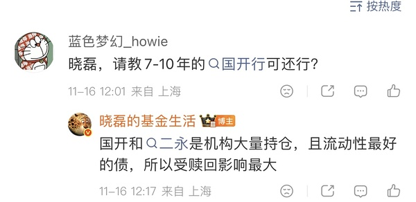
- 他们最关键

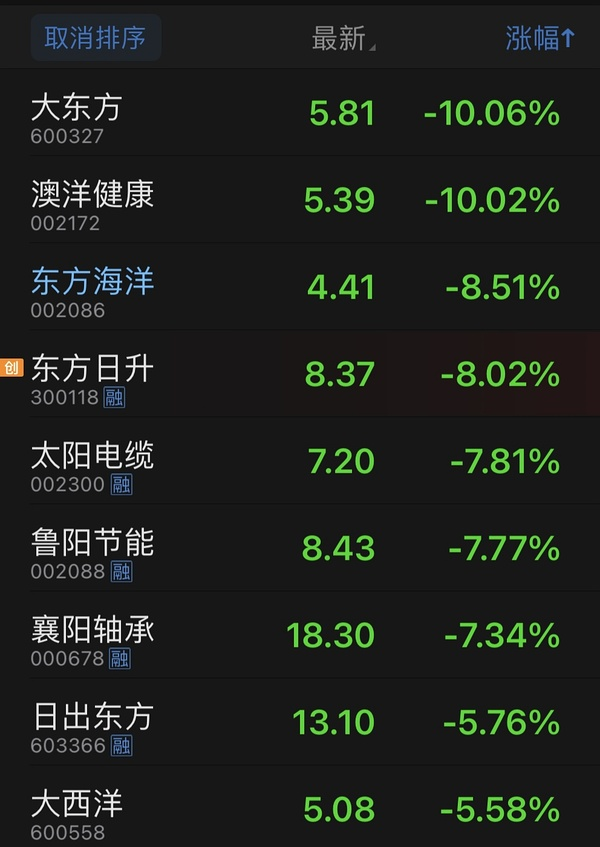

### 513300 纳斯达克ETF华夏｜11-11 10:49「3300还行 不过今天我不满意」＋13:24「咱们3300还是近期数据最好的」（提及 3 次，占比 1%）2026-11-16 07:39:53
- 要好好估算一下今天的3300

周五3300涨0.86 
实际晚上收盘-1.22 现在+0.6 =-0.6

3300正常今天开盘应该要下跌1.5%
- 这个3300他们很赖皮啊

如果预期错了 就当没看到😂😂😂😂也不抹回去的
- 我要Mark一下
不然明天算不清

我们3点收盘期货-1%
3300周五涨错了0.86
周五的-1.22外加今天-1
累计应该下跌0.86+1.22+1=3.08

实际收盘-2.3
还是少计算了0.7%跌幅

不知道就当没发生还是预期晚上

### 中文在线（提及 2 次，占比 1%）2026-11-14 10:31:53
- V老师 邪恶的票过了一年还是坏事做尽🤣🤣🤣

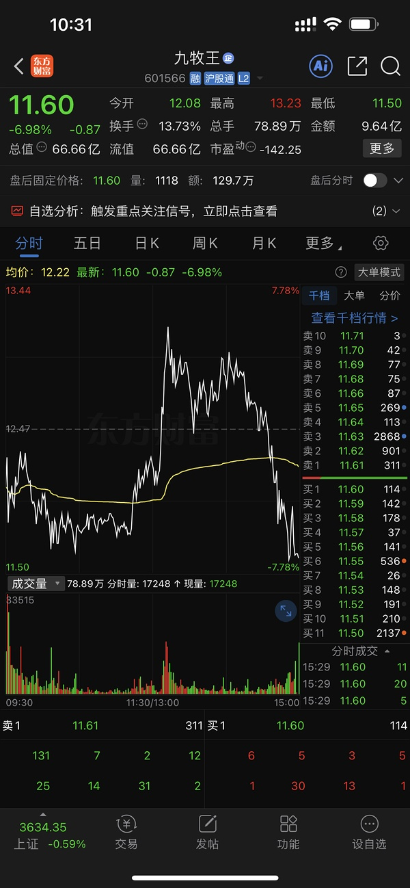
- V老师去看看惠城环保呀🤣
全市场唯一一个20cm

### 江琪（投资博主）（提及 2 次，占比 1%）2026-11-16 10:38:14
- 但是他确实是这么说的
然后江老师账户又重新开始奔向-35以上
- 今天江老师微博那边视频评论区的留言就非常不好看了

### 航空航天板块（提及 2 次，占比 1%）2026-11-16 13:03:51
- 之前不是一直传媒机器人宇航员啥的嘛 也是垃圾
- 卷毛再也不提宇航员了吗

### 大连圣亚（提及 2 次，占比 1%）2026-11-16 14:31:12
- 大连在做第二个底 其他我不多说
- 情绪退潮其实也不是都坏事 也有一个好处的
这样大连那种低位冰雪和其他的旅游就会得到一些关注

之前能玩的东西实在太多了 资金分流很严重

### 中国电影（提及 1 次，占比 0%）2026-11-14 22:39:04
- 中国电影：A股上市公司里唯一拥有进口分账片发行资质、好莱坞大片内地发行方。

### 300494 盛天网络｜11-11 A级：11:29 分时截图 B 标记 @11.00＋「不止 而且我跟了他一把」（跟摄像大哥）（提及 1 次，占比 0%）2026-11-15 20:16:11
- 👍👍祝你们明天盛天嗨翻天

### 605577 龙版传媒｜11-11 11:50「最早龙版也是因为自己每次公告文案都不一样才4连板就被监管」（讲监管规则，非持仓）（提及 1 次，占比 0%）2026-11-16 09:54:56
- 龙版火箭发射

### 000530 冰山冷热｜11-11 14:03「那冰冰准备」（同『冰山』，非持仓）（提及 1 次，占比 0%）2026-11-16 10:00:04
- 电影+冰冰

今天轮班冰冰上班

### 安记食品（提及 1 次，占比 0%）2026-11-16 10:04:38
- 安安不如阳光🤣

### 电影档期锚（不是标的）｜11-13 10:18『复仇者联盟没有到来 全都不会清仓』＋10:29『复仇者联盟是12月的 流浪地球要2月』＝他把电影仓的兑现条件挂在片单档期上（提及 1 次，占比 0%）2026-11-16 10:16:53
- 不是楼楼精选
是复仇者联盟和流浪地球第一发行方

### 纳斯达克100 指数（他用来对照场内 ETF 溢价/涨幅的基准，非标的）｜11-13 00:16『今天图上看 nana依然是大阳线』＋07:57『昨天-0.7收盘 但是nana晚上其实只有-0.3 现在期货+0.5 今天场内应该开盘+0.9%』→ 实测 513300 开盘 2.710＝+0.82%（误差 0.08pp）（提及 1 次，占比 0%）2026-11-16 10:37:37
- 这个nana几乎无视了周五美国晚上的大跳水啊😅

### 科创50（提及 1 次，占比 0%）2026-11-16 13:28:13
- 今天是k50跌的多

### 华泰保兴安悦债券（提及 1 次，占比 0%）2026-11-16 13:47:40
- 没办法 大部分都有

纯利率债就是华子那种 不过华子满仓30债
有些是满仓5-10年

### 雪人集团（提及 1 次，占比 0%）2026-11-16 14:01:19
- 这不是冰雪人应该说出口的
还有一小时

### 光线传媒 300251（他自述小仓）｜11-13 15:11『我相信光虽迟但到 我会肯定保留上周的存钱仓位』＝存钱罐口径再次落到光线（提及 1 次，占比 0%）2026-11-16 14:05:41
- 之所以称为存钱罐

第一要务是守住钱

如果是进攻猛 那就不是存钱罐了🤣

### 投资博主（提及 1 次，占比 0%）2026-11-16 14:12:31
- 水果老师现在没有状态
和江老师一样

### 创业板成长etf（提及 1 次，占比 0%）2026-11-16 14:24:09
- 多只科创成长ETF跌超8%
科创成长指数跌超8%，科创成长ETF华夏、科创成长ETF广发、科创成长ETF易方达跌超8%。

### 301010 晶雪节能（**B·推断，且非当前持有**）｜11-13 10:04『plus雪是-20的 不符合周五早上不要买跌的少的票 还能再跌-10』＝20cm 品种，实测晶雪当日 −10.10%（跌停 20.28）；12:31『我猜你去plus雪了』是对别人说的；15:25 他答『24.94』＝11-05 晶雪老卖单价、当日最高 24.92 差 2 分未触及。**但他 11-09 自述晶雪已清仓 → 不得据此判持有**（提及 1 次，占比 0%）2026-11-16 14:53:14
- 掌声送给今天雪儿和plus雪
价值还是很高的 
对账户很重要 对他们后续走势也很重要

### 雪人集团 002639｜11-06「大连和雪儿」＋11-11 14:26「雪儿今天不错啊 大家昨天不是期待他接人嘛 这个任务做到了今天」（接人＝5日线接回，与雪人条件单口径一致）（提及 1 次，占比 0%）2026-11-16 14:58:54
- 后面雪儿参考大家10.27-11.10一路做上来的模式 继续做就行了

大跌买入 大涨自己S 底仓不动

### 002582 好想你｜11-12 14:39:31『清了恋爱脑』＝清仓（卖价未披露；10.48 卖单两日均未触及→手动卖）；14:28『我如果去掉恋爱脑 也就比你多一个机器人』；当日收 9.76 −2.89%（提及 1 次，占比 0%）2026-11-16 16:30:37
- 没人买
只能不断降价卖才能卖出去😂
我上周恋爱脑急于卖都是降了3分🤣

### 富国全球科技互联网股票(QDII)A（提及 1 次，占比 0%）2026-11-16 16:50:22
- 那你误会了
我还给你们看过截图
我只是把我给她买的现金流基金转换了网易云

### 余利，某牛逼投资者（提及 1 次，占比 0%）2026-11-16 17:05:58
- 还是余老师有价值

从历史上看，在历次大盘进入月线“死叉”后的半年内，主力买盘往往都会相对谨慎一些，更多表现为“托底”，而非持续地“高举”，相对较低的成交量也难以形成一条持续抱团的主线，我在《11月到了！超卖反弹会不会一触即发？……》一文中

### 600715（院线·他只在盯，非持仓）｜11-13 09:33 传媒板块截图 +10.03% 涨停、本月涨幅 66.67%（＝10-30 收盘基准独立复算分毫不差）；配 09:33『市场有转院线迹象』（提及 1 次，占比 0%）2026-11-16 17:59:39
- 题材端同样迎来高位集中退潮，前期人气高位股批量跌停，大东方、襄阳轴承、青岛食品、百洋股份、澳洋健康、闽发铝业上演2连跌停，东方环宇、日出东方、锋龙股份、金辰股份封死跌停，短线资金兑现意愿强烈。值得重点关注的是，本轮短线人气核心标的九阳股份尾

### 粤传媒 002181｜11-09 12:12「非电影传媒就留给大家玩了 我一个都不会碰了」→ 推断已不持有（提及 1 次，占比 0%）2026-11-16 18:17:02
- 我上次场内被国内科技骗
还是通信ETF 后来换ycm的那次😂记忆犹新

### 自嘲代指中国（推断，勿当事实）（提及 1 次，占比 0%）2026-11-16 19:11:11
- 你们不熟悉plu
他为什么号都编排到007了
就是他永远看空印度的
这个看空不是单单股市的 是全方位的
924一开始他也看空的
不过他就一点好 看错了马上改

### 📄 全部发言（共 244 条）
- (2026-11-14 08:18:53) 哈哈哈哈 她们都在睡  ⊳ （引用 @🅰失而复🉐😎）周末的第一这么轻而易举的吗

- (2026-11-14 10:23:10) 笑死 因为昨天晚上设备坏了😂  ⊳ （引用 @vio）楼出去潇洒了！感觉好久没听过周五约吃饭什么的了😀

- (2026-11-14 10:23:28) 下周有两件大事呀  ⊳ （引用 @小灰灰）反弹暂歇？不好的预感……

- (2026-11-14 10:24:35) [图] 那个模拟盘能有红包😂

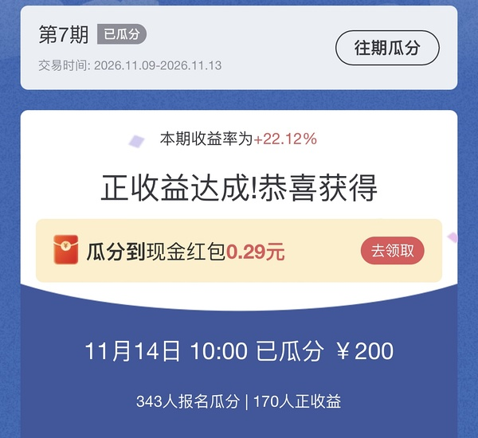  ⊳ （引用 @VVV坚定持有VVV）昨晚买入真是好时机诶！模拟盘已经赚8k啦！

- (2026-11-14 10:25:22) 玩模拟盘的可以上号拿红包了！！
大家玩美国的应该都是正收益吧

- (2026-11-14 10:31:53) [图] V老师 邪恶的票过了一年还是坏事做尽🤣🤣🤣

  ⊳ （引用 @VVV坚定持有VVV）昨晚买入真是好时机诶！模拟盘已经赚8k啦！

- (2026-11-14 10:42:15) 期待住  ⊳ （引用 @小鱼）下周能不能都是大喜事，英伟达业绩推动股价大涨，然后大家都跟着领头羊涨😂😂

- (2026-11-14 10:42:44) 人民锐评：超级平台须读懂“时间”的公共分量

人民日报看法评论文章指出，强调责任，是为了培育良性的注意力市场。争取用户时长不该是压倒一切的KPI，为公众创造真实价值才是根本。党中央的政策指向很明确，“从构筑国家竞争新优势的战略高度出发，坚持发展和规范并重，把握平台经济发展规律，建立健全平台经济治理体系”。

抖音危 红果危

- (2026-11-14 10:49:37) [图] 😂我昨天也不打开银行看我债券找不痛快了
和大家一样了 不看就无视发生🤣

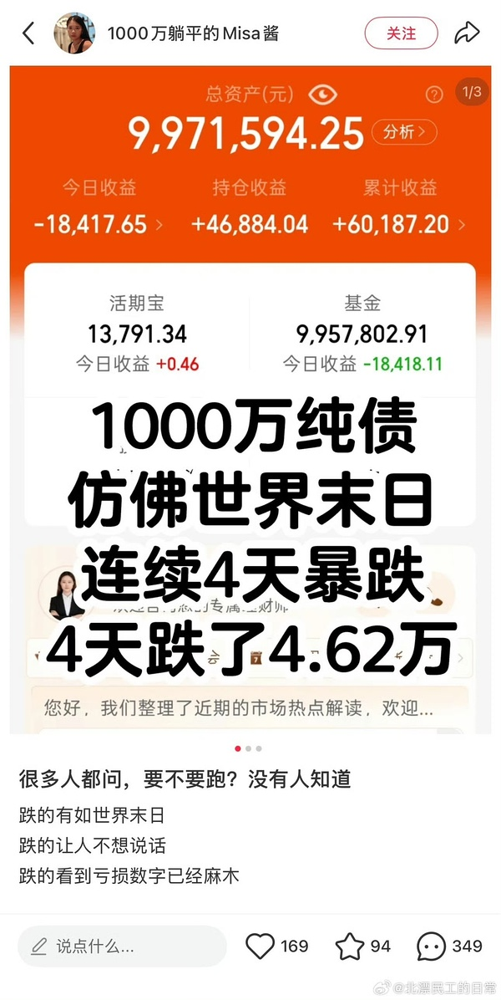

- (2026-11-14 11:51:14) [图] 王者之师 建信22号😂😂😂😂😂😂😂

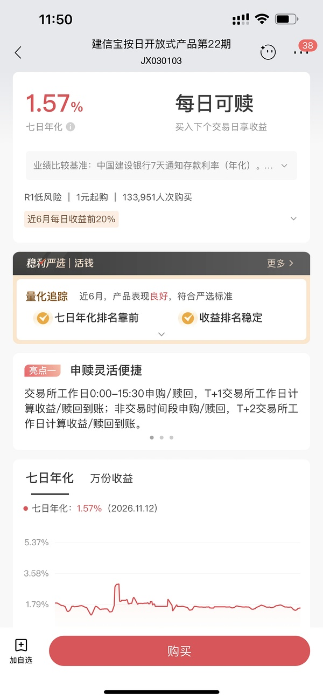  ⊳ （引用 @shirla）货基😅或者抄底债？

- (2026-11-14 11:52:23) [图] 😂😂😂😂

  ⊳ （引用 @不知道还能说啥）😂我昨天也不打开银行看我债券找不痛快了
和大家一样了 不看就无视发生🤣

- (2026-11-14 11:52:28) [图] 😂😂😂😂

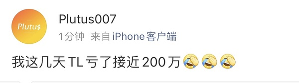  ⊳ （引用 @不知道还能说啥）😂我昨天也不打开银行看我债券找不痛快了
和大家一样了 不看就无视发生🤣

- (2026-11-14 16:38:36) [图] 这个东西不下来 嗨不顺畅
这周的美国利空环绕 能这样的反弹已经不错了

这玩意一上去 
看看这周的黄金白银 完全溃不成军
当然还有恒科😂

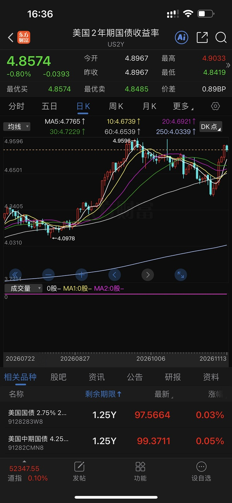  ⊳ （引用 @温妤哦）哎 又要跌了吗 啥时候才止跌

- (2026-11-14 17:56:54) 不清楚 不过我好几个其他银行确实没找到😂  ⊳ （引用 @momo）这个是不是只能在招行买

- (2026-11-14 18:52:01) 如果这个稳定的话就也不错啊
大部分没多久就变成一万3毛多一天了😂  ⊳ （引用 @叁仟世界鸦杀。）坏了 建行只有20期

- (2026-11-14 22:04:57) 不是我
是我摄像😂  ⊳ （引用 @点-重生炒垃圾）晚上英雄联盟决赛啊，凌晨三点，楼主要开奖了

- (2026-11-14 22:06:26) 现在1000左右的 除了茅台啥都能买
五粮液普八都不到800块钱  ⊳ （引用 @🧋今天25了吗）楼里应该有大把对白酒颇有研究的uu吧🤣🤣梦之蓝M9好价大概多少钱呀，或者一千左右一瓶的还有别的推荐的吗

- (2026-11-14 22:07:14) 《科创板日报》11月14日讯 据媒体报道称，OpenAI已解散其独立机器人团队

- (2026-11-14 22:08:33) 滑稽的来了uu们

【特朗普：推动《电影、电视与娱乐产业振兴法案》】财联社11月14日电，美国总统特朗普表示，正在联合共和、民主两党多名参议员和众议员，共同推动《电影、电视与娱乐产业振兴法案》，希望通过立法和税收优惠，将流向加拿大、英国、澳大利亚等国的影视制作项目重新吸引回美国。(来自财联社APP)

- (2026-11-14 22:09:36) 周五电影是提前知道这个的吗？？  ⊳ （引用 @不知道还能说啥）滑稽的来了uu们

【特朗普：推动《电影、电视与娱乐产业振兴法案》】财联社11月14日电，美国总统特朗普表示，正在联合共和、民主两党多名参议员和众议员，共同推动《电影、电视与娱乐产业振兴法案》，希望通过立法和税收优惠，将流向加拿大、英国、

- (2026-11-14 22:39:04) 中国电影：A股上市公司里唯一拥有进口分账片发行资质、好莱坞大片内地发行方。  ⊳ （引用 @高手云集上钻）Make 好莱坞great again

- (2026-11-14 22:48:50) 期待😂只要中影大涨 账户就肯定稳
上周五没稳住 就是中影涨太少了🤣  ⊳ （引用 @🧋今天25了吗）周一两连板！

- (2026-11-14 23:11:09) 金毛焦头烂额 怎么还有闲心搞娱乐😂  ⊳ （引用 @Lyra）太好了😄再带带光线呗

- (2026-11-15 09:35:35) [图] 果然评论区都是这个

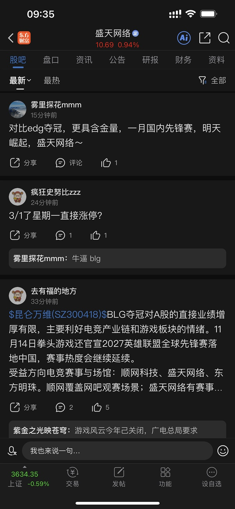  ⊳ （引用 @Aaa摆烂咸鱼🥳）我周四周五买了2笔不知道还能吃到不，因为感觉周五情况不太好其实，第六感 觉得中国要赢，昨天晚上我老公就很激动，我就一直跟他说中国这次要夺冠，他一直给我讲韩国队的配置多牛，我只说了一句只要不懂游戏的人才能赌对谁赢🤣🤣，他一直在看，我迷迷糊糊问

- (2026-11-15 09:37:55) [图] 电竞概念股

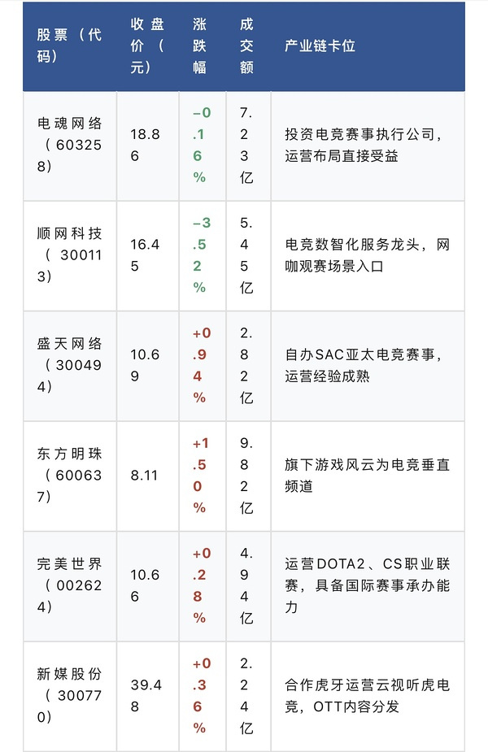

- (2026-11-15 09:40:02) 除了时隔5年，LPL赛区终于第四次夺得世界赛冠军外，11月14日，英雄联盟赛事官方公布2027年赛历：特别版全球先锋赛First Stand: All In将在中国举办，取代原定于东南亚的举办计划，成为英雄联盟迄今规模最大的开场国际赛事。  ⊳ （引用 @不知道还能说啥）电竞概念股

- (2026-11-15 09:52:04) 互相补仓😂😂😂😂😂😂😂  ⊳ （引用 @moli）b币和黄金暗盘狂跌，咩事

- (2026-11-15 09:57:00) [图] 光线有很多游戏的
因为我摄像说了一个礼拜了
我周五切换光线也有考虑一点能不能蹭到

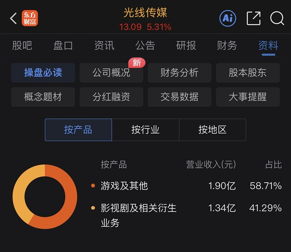  ⊳ （引用 @momo）真要顺势打游戏的话带带电影呗  哥哥妹妹一起玩

- (2026-11-15 11:58:55) Btb好像都涨回来了😂  ⊳ （引用 @moli）高盛你糊涂

- (2026-11-15 17:41:47) 先看明天游戏热度强度到底大不大😂😂😂
影视游戏联袂好像以前也有过  ⊳ （引用 @初筱玖）梦一个短剧危然后电影接力

- (2026-11-15 19:09:15) 感觉低开不了多少😂  ⊳ （引用 @🅰失而复🉐😎）电影低开补不补幸福啊😇

- (2026-11-15 19:20:02) 明天我思考的是 如果光线15+ 是否还给幸福🤣  ⊳ （引用 @🅰失而复🉐😎）完蛋😒

- (2026-11-15 19:48:21) 中影涨停一般都是开启加速  ⊳ （引用 @momo）不好，我的中影不会飞走了吧

- (2026-11-15 19:56:24) 明天重头戏是我摄像的游戏😂  ⊳ （引用 @ü）明天电影和冰雪一起来吧！

- (2026-11-15 20:03:24) [图] 

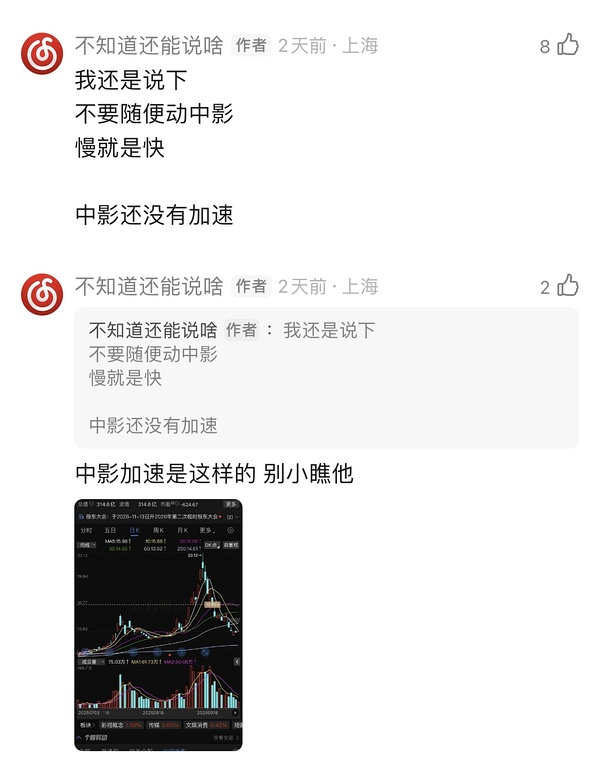  ⊳ （引用 @momo）只剩底仓，就几手了

- (2026-11-15 20:07:07) 这个位置没啥问题
无非你有没有更好的去处  ⊳ （引用 @🅰失而复🉐😎）那个利欧咋处置🫠你们都走了

- (2026-11-15 20:16:11) 👍👍祝你们明天盛天嗨翻天  ⊳ （引用 @发财喵）楼楼 我周五捡了点盛天🤣🤣🤣

- (2026-11-15 20:16:26) 厉害👍  ⊳ （引用 @赚大钱钱）周五涨停板卖了三分之一，听到楼说的不要动，开板立马又买回了🤣

- (2026-11-15 20:19:08) 坐等月底时候看涨幅
中影干翻SY  ⊳ （引用 @赚大钱钱）周五涨停板卖了三分之一，听到楼说的不要动，开板立马又买回了🤣

- (2026-11-15 20:57:40) 横店我不熟悉
博肯定可以
但是博很喜欢N字 大A大V注意节奏  ⊳ （引用 @ü）楼楼，影视后面考虑接回博子吗？横店考虑一下吗！

- (2026-11-15 21:45:59) 现在抖舞都有一个叫 纳斯达克摇了😂😂😂😂😂

- (2026-11-15 21:57:15) 这一次的机会比我2022年那次更好

我那次一边买的时候 鬼故事一大堆就不提了
那时候加息的预期都在边走边看 
现在这个也直接拉满最负面情况
实在是太棒了  ⊳ （引用 @moli）娜娜的估值好像开始有点跟不上涨幅了

- (2026-11-15 22:05:57) 对应余力 趋势动物一个强调红微继续大胜 一个强调红利右侧 应该没什么毛病

这两个结论针对的从来都是大A不妙  ⊳ （引用 @moli）大佳发文，说大A形势不妙🤔

- (2026-11-15 22:43:14) 看明天他们各自表现了  ⊳ （引用 @11）还吗！

- (2026-11-15 22:43:38) 华语科幻AI影像联盟成立，何夕《天年》等首批影视项目启动
2026科幻星云嘉年华期间，华语科幻AI影像联盟11月14日在成都成立，300余名科幻作家、影视编剧与产业界人士见证。联盟由海南壹天视界、青春你好传媒和完美世界影视发起，分工构建华语科幻产业链条。何夕《天年》、江波《南海救援48小时》、程婧波《灯花》、萧星寒《异重庆四重奏》四部作品成为首批启动的科幻影视项目。海南壹天视界董事长甘伟康表示，未来IP影像开发不止AIGC影视，还有真人剧集、游戏、动漫等。（澎湃新闻）

- (2026-11-16 00:38:13) [图] 这些我都有
第二个和第三个在这轮中灾难中经受住了考验
后面看他们修复水平了

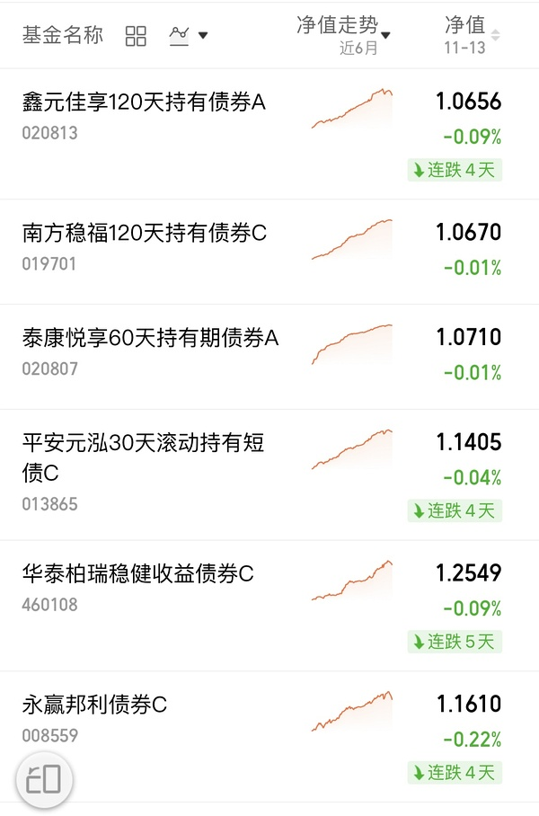  ⊳ （引用 @木感情的打工人）楼，你买的中债是哪个，我来抄底啦

- (2026-11-16 00:42:09) 30超长债牛逼没办法  ⊳ （引用 @木感情的打工人）好哦，华子是咋回事今年这战绩太无敌了吧

- (2026-11-16 07:35:48) 你们周末一天天的发鬼故事

英伟达股价异动！

北京时间11月16日凌晨，英伟达暗盘股价直线拉升，涨幅一度超过4%；截至券商中国记者发稿时，英伟达暗盘涨3.63%。受英伟达带动，其他AI硬件股也集体走高，美光科技、SK海力士、闪迪涨超2%，英特尔、迈威尔科技、康宁、超威半导体等暗盘涨幅均超过1%。美股期货也直线拉升，纳指期货涨0.60%。

- (2026-11-16 07:39:53) 要好好估算一下今天的3300

周五3300涨0.86 
实际晚上收盘-1.22 现在+0.6 =-0.6

3300正常今天开盘应该要下跌1.5%

- (2026-11-16 08:49:00) 两市融资余额较上日减少165.45亿元
截至11月13日，上交所融资余额报11692.64亿元，较前一交易日减少86.72亿元；深交所融资余额报10805.21亿元，较前一交易日减少78.73亿元；两市合计22497.85亿元，较前一交易日减少165.45亿元。

周五老规矩

- (2026-11-16 09:02:47) 还是老话 美国说了算  ⊳ （引用 @qiu啾）明年还是得和机构在一起。

- (2026-11-16 09:03:31) 你光线比幸福多了吗  ⊳ （引用 @vio）是啊  开始我以为3笔  定睛一看是4笔

- (2026-11-16 09:07:54) [图] 上周就开了

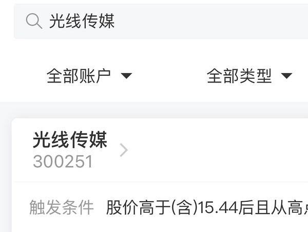  ⊳ （引用 @vio）是的 哈哈，今天开光线15+的单子不

- (2026-11-16 09:10:52) 炒股人不会就看一个app  ⊳ （引用 @暴富¥(´･ᴗ･`)$）怎么-90开呢😂😂😂

- (2026-11-16 09:13:34) 2倍做多一把回🤣  ⊳ （引用 @我爱牛肉火锅）模拟盘被女大害惨了亏了20多个点！剑走偏锋去买了这个种叶子的，请让我回本

- (2026-11-16 09:17:13) 11月15日，Summit Therapeutics披露公告称，美国FDA已就PD-1/VEGF双抗Ivonescimab（AK112，依沃西单抗）联合含铂化疗用于治疗经EGFR-TKI治疗进展的局部晚期或转移性非鳞状非小细胞肺癌（NSCLC）的生物制品许可申请（BLA），发出完整回复函（CRL），本次上市申请暂未获批。

完整回复函表明，美国FDA认为在缺乏具有统计学意义的总生存期（OS）改善的情况下，依沃西单抗尚无充分的疗效证据，无进展生存期（PFS）的获益不足以支持批准该药物的获益风险比。

公开资料显示，依沃西是康方生物（09926.HK）自主研发的全球首创PD-1/VEGF双特异性肿瘤免疫治疗药物。

- (2026-11-16 09:25:39) 羊在复苏 很关键

- (2026-11-16 09:28:42) 对  ⊳ （引用 @赛博朋克2077）楼，xf是不是没卖单了呀

- (2026-11-16 09:28:59) 是的

看东方海洋了  ⊳ （引用 @我爱牛肉火锅）九阳今天不用绕异动了吗？

- (2026-11-16 09:34:40) 羊在崩  ⊳ （引用 @我爱牛肉火锅）我说胆子这么大涨停

- (2026-11-16 09:34:45) 因为羊  ⊳ （引用 @木感情的打工人）电影直接兑现了？

- (2026-11-16 09:35:10) 买入幸福

- (2026-11-16 09:35:23) -6  ⊳ （引用 @不知道还能说啥）买入幸福

- (2026-11-16 09:38:05) 因为科技也是大跌中
不知道你理解我的意思吗  ⊳ （引用 @shirla）好的跟上了，雪人是不是还没接呀

- (2026-11-16 09:38:52) 加仓  ⊳ （引用 @随便吧）楼楼，是光线换的，还是新加仓呀

- (2026-11-16 09:39:08) 今天靠冰雪

- (2026-11-16 09:39:20) 嗯 而且上周买了plus了  ⊳ （引用 @shirla）好的跟上了，雪人是不是还没接呀

- (2026-11-16 09:40:12) 电影+冰雪

无敌组合😂😂😂😂😂

- (2026-11-16 09:41:19) [图] 羊还是不行

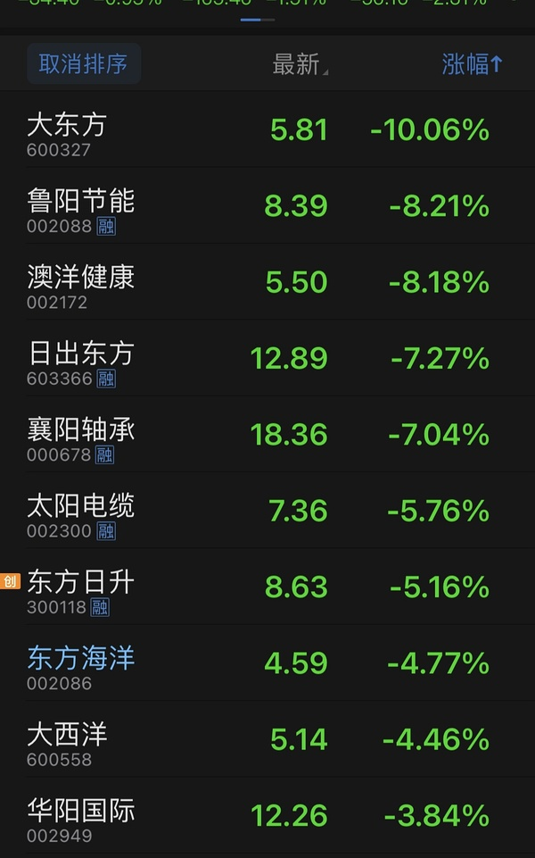

- (2026-11-16 09:43:53) 中影无需操心

- (2026-11-16 09:45:57) 加仓bn

- (2026-11-16 09:46:11) -6  ⊳ （引用 @不知道还能说啥）加仓bn

- (2026-11-16 09:47:19) 被羊干扰了  ⊳ （引用 @红烧肉肉）XF好善良，今天这么低来接....

- (2026-11-16 09:47:49) 为了方便看羊 我又买了点去了😂😂😂😂😂  ⊳ （引用 @shirla）啊哈哈我刚才也是-7建了个底仓

- (2026-11-16 09:48:42) 差不多😂 -5没来得及  ⊳ （引用 @shirla）-3捞的吗！

- (2026-11-16 09:48:51) [图] 好转

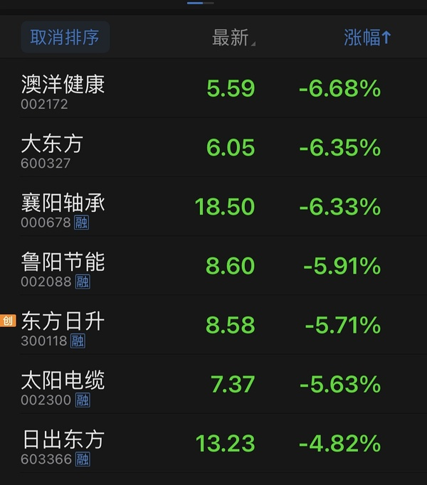  ⊳ （引用 @不知道还能说啥）羊还是不行

- (2026-11-16 09:50:53) 今天冰雪护体
又浪起来了😅  ⊳ （引用 @shirla）我没子弹了快，你看羊吧，我看你😂😂😂

- (2026-11-16 09:52:32) 30债血洗  ⊳ （引用 @木感情的打工人）招行右侧了哈哈

- (2026-11-16 09:52:37) 今天  ⊳ （引用 @🧋今天25了吗）bn什么时候建的底仓，我又缺课了？

- (2026-11-16 09:54:27) 抢不了
军工是中票
你看市值

羊那边情绪影响了垃圾票  ⊳ （引用 @稀里不糊涂）我怀疑军工抢了咱们冰雪的位置

- (2026-11-16 09:54:56) 龙版火箭发射

- (2026-11-16 09:55:22) 有些周更新的理财
今天看到要赎回了😂  ⊳ （引用 @六倍做多退休）看了眼科创 城投 嘎巴一下子又过去了我的篮子又无了

- (2026-11-16 10:00:04) 电影+冰冰

今天轮班冰冰上班  ⊳ （引用 @🅰失而复🉐😎）把冰带起来了😏

- (2026-11-16 10:01:49) 有A港美都能玩 去报名吧哈哈  ⊳ （引用 @哄哄🐮）博时etf比赛结束了，又得找玩得了

- (2026-11-16 10:04:03) 不愧是plus

- (2026-11-16 10:04:38) 安安不如阳光🤣  ⊳ （引用 @只想搞钱）安安，雪雪冲呀

- (2026-11-16 10:05:32) 4+4组合 牛逼 我很喜欢

让我一直陪伴下去吧

- (2026-11-16 10:08:33) 今天让电影决斗一下  ⊳ （引用 @shirla）那我是4+3了🤣

- (2026-11-16 10:09:21) [图] 羊的气血来了

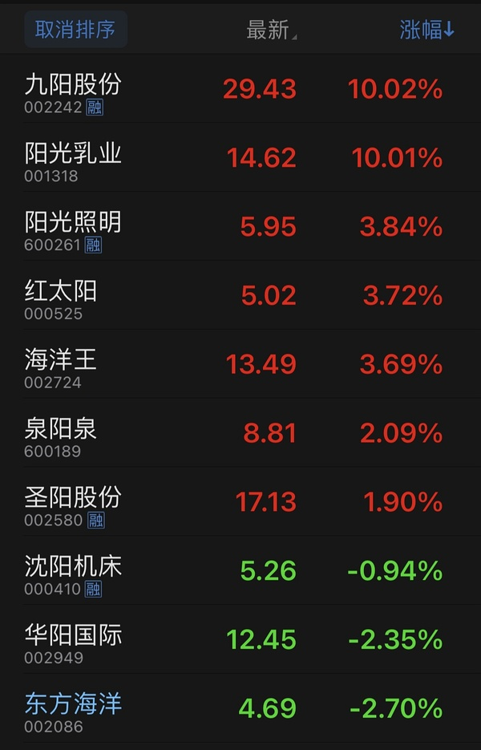

- (2026-11-16 10:11:33) 幸福开单20.44卖今天的

- (2026-11-16 10:13:05) 这是传媒的魂  ⊳ （引用 @不知道还能说啥）龙版火箭发射

- (2026-11-16 10:16:53) 不是楼楼精选
是复仇者联盟和流浪地球第一发行方  ⊳ （引用 @lacey）中影好强 不愧是楼楼精选

- (2026-11-16 10:19:45) 我算的时候期货+0.6 现在-0.2了
还得-0.8😂😂😂😂😂😂  ⊳ （引用 @我爱牛肉火锅）不啊，看看楼算的，下次自己算

- (2026-11-16 10:20:27) 13%多  ⊳ （引用 @我爱牛肉火锅）幸福到条件单要涨几个点啊

- (2026-11-16 10:23:00) [图] 后面我就不重复了 最后一次发

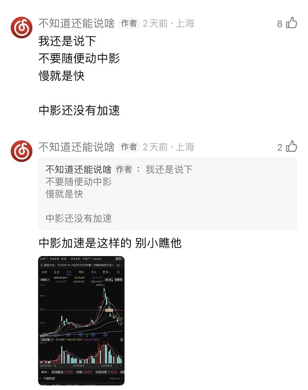

- (2026-11-16 10:24:35) 今天回踩五日线😂  ⊳ （引用 @我爱牛肉火锅）果然是核心中的核心

- (2026-11-16 10:26:42) 早上我忙着干电影
我摄像在那边忙着干游戏
笑死了 都是认真模样🤣🤣🤣🤣  ⊳ （引用 @我爱牛肉火锅）善良守规矩😂😂😂，bn居然真的有跟他，我说咋V起了

- (2026-11-16 10:28:44) 希望看到bn至少有比sy更高的反弹效率

- (2026-11-16 10:30:33) 😂楼里uu早上估计更关注冰冰
很明显周五我看到大家还是冰冰决定账户🤣  ⊳ （引用 @我爱牛肉火锅）早上给的上车机会真的太爽了，周末看楼里聊电影很怕高开uu忍不住去追，今天这样真的很好，爽啊！！！

- (2026-11-16 10:33:03) 就开这么点跌幅？😅😅😅😅  ⊳ （引用 @我爱牛肉火锅）nana开盘

- (2026-11-16 10:33:28) 👍👍👍👍👍  ⊳ （引用 @🅰失而复🉐😎）横店也板了，延续周五

- (2026-11-16 10:37:37) 这个nana几乎无视了周五美国晚上的大跳水啊😅  ⊳ （引用 @我爱牛肉火锅）全靠同行衬托，老印越烂3310越稳稳的幸福hhhhhh

- (2026-11-16 10:38:14) 但是他确实是这么说的
然后江老师账户又重新开始奔向-35以上  ⊳ （引用 @该用户已过期）跛子：安排

- (2026-11-16 10:39:06) 阿光阿
你得不到我后面奖励了 应该还会遭遇惩罚
不论周五和今天的反弹速率
你都没有能够让我看到比幸福更好的一面
你只剩三小时证明自己了🤣

- (2026-11-16 10:39:15) 牛逼  ⊳ （引用 @我爱牛肉火锅）有没有预测今晚nana走势的可能🤔🤔

- (2026-11-16 10:39:24) 我悟了！！！  ⊳ （引用 @shirla）想到一块去了哈哈

- (2026-11-16 10:40:40) 这个3300他们很赖皮啊

如果预期错了 就当没看到😂😂😂😂也不抹回去的  ⊳ （引用 @shirla）想到一块去了哈哈

- (2026-11-16 10:47:13) [图] 这个确实差不多踩到了
今天没过头 也不知道是不是改天过个头🤣🤣🤣

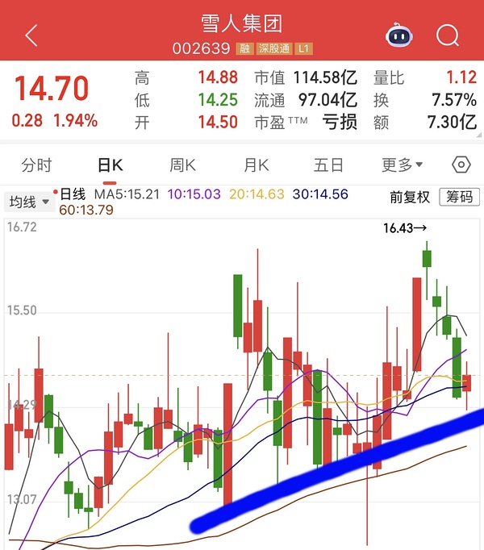  ⊳ （引用 @shirla）阿光要争气啊，搞快点，赶紧的

- (2026-11-16 10:50:19) 是的！
最好还是科技反弹的时候😂  ⊳ （引用 @shirla）对对，上周五是14.2，今天差不多就是14.25，真是标准啊。后面过头的话就无脑接了吧！？

- (2026-11-16 10:53:44) 是的  ⊳ （引用 @shirla）楼楼晶雪没触发就先放着了是不，等下午？（我比对着给上周五尾盘捞的雪人也定了个单子

- (2026-11-16 11:01:43) 暂时我还有容忍度

我周五+20换的+5.6

5.6的收盘5.3 少了0.3 20的没动 这边输0.3

现在光少跌0.6 合计赚了0.3 这是我能容忍的理由  ⊳ （引用 @我爱牛肉火锅）你持仓里光线的竞品是xf吗？是不是跑赢xf就符合你的期望

- (2026-11-16 11:06:38) 是的
暂时不优秀
但暂时合格

不过这个合格线 幸福有可能直接破灭他😂  ⊳ （引用 @我爱牛肉火锅）暂时还在合格线😂😂

- (2026-11-16 11:09:25) 幸福今天缺口遇阻😂😂😂他也有自己的问题
看光线能否抓住机会了  ⊳ （引用 @shirla）那他就完了（哼

- (2026-11-16 11:13:55) 是的 一模一样
60日线和年线来回倒腾😂😂  ⊳ （引用 @shirla）BN明天开始是不是可以像雪人一样玩起来

- (2026-11-16 11:14:54) 而且羊的情绪 外加新华续杯的情绪是一起崩盘的
从周五开始差不多三天

明天下午垃圾票情绪有可能先回暖  ⊳ （引用 @shirla）BN明天开始是不是可以像雪人一样玩起来

- (2026-11-16 11:30:39) 事情还是越大越好 债券市场可比股市重要多了😂  ⊳ （引用 @六倍做多退休）😂赎回

- (2026-11-16 11:34:04) [图] 真牛逼

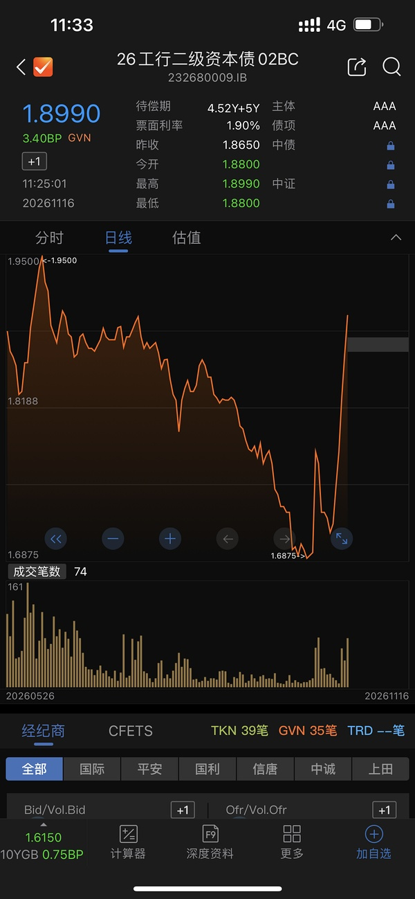  ⊳ （引用 @六倍做多退休）今天晚上依旧惨不忍睹回半年前了

- (2026-11-16 11:35:46) 是的 反正已经跌了 只能期待事情越大越好

因为银行持有大量债券 最大受损方之一

而银行是爸爸妈妈亲儿子  ⊳ （引用 @我爱牛肉火锅）事情越大妈妈救的越快是吗？

- (2026-11-16 11:40:27) 主流观点是 利率债先企稳 然后才是高等级信用债  ⊳ （引用 @木感情的打工人）那我可要抓紧抄底了

- (2026-11-16 11:41:01) 三只松鼠(300783.SZ)：持续关注短剧、漫剧等新的营销形式赛道  ⊳ （引用 @404找回了）松鼠的今天阳包阴不错哎

- (2026-11-16 11:48:32) [图] 他在抄底

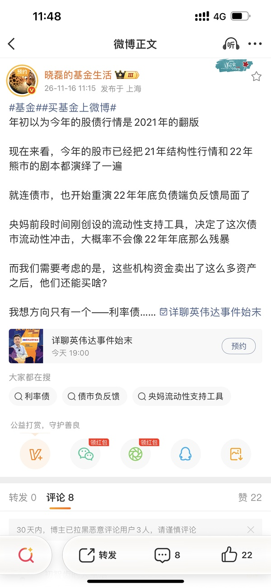  ⊳ （引用 @木感情的打工人）那我可要抓紧抄底了

- (2026-11-16 11:56:00) 很多uu估计后面对股市都不会有好感
钱都会去做理财

记住这些天债券灾难日
后面你们挑选产品回撤大不大
最近几个日子就是非常重要的案例参考

产品的债券久期拉的长不长
策略激进不激进
是否有保守中又能强化收益的

自己即使现在不买
以后也可能会用到
可以提前记上小本本

- (2026-11-16 11:57:31) 最近债券崩盘日分别为

10.30日
11.2日

11.12日
11.13日
11.16日（今天）  ⊳ （引用 @不知道还能说啥）很多uu估计后面对股市都不会有好感
钱都会去做理财

记住这些天债券灾难日
后面你们挑选产品回撤大不大
最近几个日子就是非常重要的案例参考

产品的债券久期拉的长不长
策略激进不激进
是否有保守中又能强化收益的

自己即使现在不买
以后也可

- (2026-11-16 12:04:41) 那次不一样
是180度突然口罩全部放开后
经济复苏预期爆棚😂😂😂😂  ⊳ （引用 @moli）其实我22年都不知道发生过债灾。放在🐔付宝里没动过，回头几年来看好像除了挖了个坑，好像也没什么特别的

- (2026-11-16 12:05:24) 那次比现在吓人多了

现在债券基本面毫无问题（复苏无望）

那次是基本面出现预期重大转折  ⊳ （引用 @moli）其实我22年都不知道发生过债灾。放在🐔付宝里没动过，回头几年来看好像除了挖了个坑，好像也没什么特别的

- (2026-11-16 12:06:03) 债持不炒，每调买机  ⊳ （引用 @有人区生菜）我有个债还准备明天跑路来着，再也不买有锁定期的了

- (2026-11-16 12:06:26) 债斯达克比纳斯达克更牛逼  ⊳ （引用 @我爱牛肉火锅）债持不炒，每调买机

- (2026-11-16 12:08:24) 咱们这个和上一个礼拜几乎一模一样啊

上上周五电影救场账户 冰雪崩盘
上周一电影崩盘账户 冰雪救场

这次也是😂

- (2026-11-16 12:51:55) 因为冰雪还没开始  ⊳ （引用 @第四个影子）感觉这轮冰雪龙头是龙江交通和冰山冷热，大连和长白山有点在看它们两个的感觉，不够主动啊，不知道什么时候能轮动到它们两个

- (2026-11-16 12:56:41) [图] 22无敌
最近还提高了点

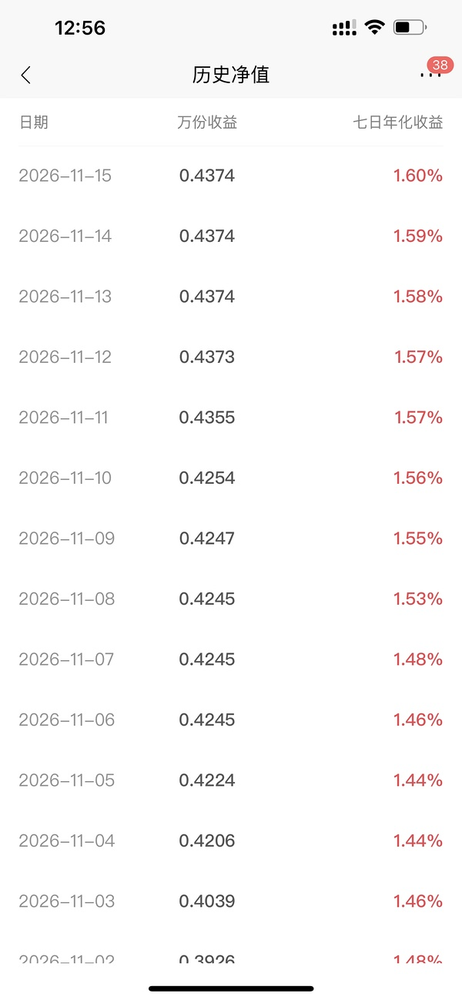  ⊳ （引用 @一颗牛奶糖）买入我的建信22😘

- (2026-11-16 12:58:09) 还没开始 
因为这还涉及旅游板块  ⊳ （引用 @第四个影子）啊，还没开始吗，我以为冰山和龙江它们这么强势还以为冰雪快到中后期了呢🥲
看大连去年是11月5号见顶，之后就一次比一次低了

- (2026-11-16 13:03:51) 之前不是一直传媒机器人宇航员啥的嘛 也是垃圾  ⊳ （引用 @第四个影子）原来如此，感觉今年的节奏和去年很不一样了，今年是8，9月小垃圾们不错，10月底11月反而一般了，去年是10中旬之后小垃圾一直有行情

- (2026-11-16 13:05:17) 美国跳水呀  ⊳ （引用 @凯恩拿下金球😋）开盘会不会太丝滑了

- (2026-11-16 13:07:05) 你们应该忘了
上周一冰雪也是午后启动的  ⊳ （引用 @该用户已过期）差太远了，有点失望🤣🤣

- (2026-11-16 13:08:17) 我们应该是红红红的  ⊳ （引用 @该用户已过期）🤣🤣最近的记忆是一直绿绿绿，哈哈哈

- (2026-11-16 13:20:21) 指引啥啊
不是跟着在走、
午饭前美国拉升 我们拉升
中午他们跳水 我们马上跳
现在人家反弹  ⊳ （引用 @momo）晚上丑国不会又来打我吧  好像a公子又在指引  有感觉吗

- (2026-11-16 13:28:13) 今天是k50跌的多  ⊳ （引用 @点-重生炒垃圾）还好割了，易中天又咋了😅😅😅一直-10，创业板没办法啊

- (2026-11-16 13:28:50) [图] 你还要避开这两个

要纯利率债了

  ⊳ （引用 @木感情的打工人）✅结论
 
华泰柏瑞稳健收益债券C（460108），这一篮子里面利率债占比最高，是纯正利率债为主的长债基金，重仓全是国开债、农发债、国债（政策性金融债+国债=利率债） 。
 
简单对比（截止2026三季报）
 
1.华泰柏瑞稳健收益债券C（

- (2026-11-16 13:35:24) 银行间主要利率债收益率午后升幅扩大
银行间主要利率债收益率午后升幅扩大，10年期国债活跃券260016收益率上行2.25bp报1.63%，30年期国债活跃券2600006收益率上行1.75bp报2.077%，10年期国开活跃券260205收益率上行1.7bp报1.734%。

- (2026-11-16 13:40:34) 中国台湾加权指数收跌5.74%
中国台湾加权指数收跌5.74%，报41167.76点。

😂  ⊳ （引用 @六倍做多退休）卧槽债是真的疯啊 踩踏了 这

- (2026-11-16 13:46:05) 不过这两个一旦好起来 暴力反攻应该也是最好的🤣
机构回补  ⊳ （引用 @木感情的打工人）哦哦好的

- (2026-11-16 13:47:40) 没办法 大部分都有

纯利率债就是华子那种 不过华子满仓30债
有些是满仓5-10年  ⊳ （引用 @木感情的打工人）基本都有国开和二永

- (2026-11-16 13:49:08) V老师去看看惠城环保呀🤣
全市场唯一一个20cm  ⊳ （引用 @VVV坚定持有VVV）醒来一看绿绿的，很安心呢
一点没有睡醒起来暴涨红透半边天的风险

- (2026-11-16 13:53:00) 小思也很牛逼的 只有60几块了  ⊳ （引用 @VVV坚定持有VVV）幸亏老早之前手贱摸了就跑，同事还在里头坐牢卖不掉🥲

- (2026-11-16 13:54:55) 光线靠着幸福给面子

还算合格

今天赚回2%的相对差价

- (2026-11-16 13:55:58) 多打了 今天早上给你出去的  ⊳ （引用 @momo）我大连上周五打满了，好难受，现在绿绿的

- (2026-11-16 13:59:30) [图] 他们最关键

  ⊳ （引用 @我爱牛肉火锅）没了，雪人殉情去了，科技也没弹啊，

- (2026-11-16 14:00:36) 快讯：科创50跌幅扩大至5% 摩尔线程等多股跌超10%

- (2026-11-16 14:01:19) 这不是冰雪人应该说出口的
还有一小时  ⊳ （引用 @嘻嘻子）今天没一个东西能救我了

- (2026-11-16 14:02:36) 阿光可以啊
今天赢到2.5%了👍

- (2026-11-16 14:05:41) 之所以称为存钱罐

第一要务是守住钱

如果是进攻猛 那就不是存钱罐了🤣  ⊳ （引用 @该用户已过期）能不能不要用这种方式赢？🤣🤣就不能+12.5赢+10么，哈哈哈哈

- (2026-11-16 14:12:31) 水果老师现在没有状态
和江老师一样  ⊳ （引用 @momo）Dfrs鞠老师提了后就没好过😂

- (2026-11-16 14:15:46) 不热

平均股价都是高价股说了算

除了茅台 高价股基本都是科技股  ⊳ （引用 @凯恩拿下金球😋）热知识：平均股价本月即将翻绿

- (2026-11-16 14:17:31) [图] 最近我状态好

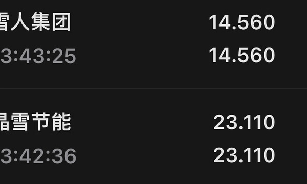  ⊳ （引用 @木感情的打工人）我也不信，那走势根本不像

- (2026-11-16 14:18:15) 反正我言行一致  ⊳ （引用 @Frances）冰雪真的来了

- (2026-11-16 14:20:55) 你看看双创

反弹？  ⊳ （引用 @木感情的打工人）两点半前的反弹

- (2026-11-16 14:22:42) 现在我要去T掉追加的
我要去买一个传媒了  ⊳ （引用 @我爱牛肉火锅）冰山买的不多是不是可以一直拿着🤔🤔

- (2026-11-16 14:23:52) no  ⊳ （引用 @我爱牛肉火锅）我猜利欧hhhhhh

- (2026-11-16 14:24:09) 多只科创成长ETF跌超8%
科创成长指数跌超8%，科创成长ETF华夏、科创成长ETF广发、科创成长ETF易方达跌超8%。

- (2026-11-16 14:25:25) 楼里的uu自己玩冰雪
有的还重仓冰雪
但却在科技大跌时候说冰雪没希望反拉
你们这个手里的票都不熟悉特质
怎么还能重仓的？

- (2026-11-16 14:31:12) 大连在做第二个底 其他我不多说  ⊳ （引用 @柚子mm）楼楼，除了t掉多的大连还是锁仓吗？

- (2026-11-16 14:38:55) 回到19号大阴线中间 还是会在下来的
这些冰雪也会玩很长时间  ⊳ （引用 @木感情的打工人）等一个缩量见底

- (2026-11-16 14:40:04) 哈哈别知道了
就电影挺好的  ⊳ （引用 @Lyra）有没有人能告诉我是哪个传媒呀（太笨

- (2026-11-16 14:44:28) 冰雪今天价值还是很高的

- (2026-11-16 14:44:42) 因为今天市场总体可不是上周一了  ⊳ （引用 @不知道还能说啥）冰雪今天价值还是很高的

- (2026-11-16 14:45:55) 小伙伴
你别在意我2%都没得仓位

我早上出击电影了  ⊳ （引用 @一根鸭脖子）楼上午是不是捞了dfhy？

- (2026-11-16 14:47:16) 现在债券市场更重要了😂  ⊳ （引用 @木感情的打工人）gjd是不是被套了……前阵子持续买的那些

- (2026-11-16 14:53:14) 掌声送给今天雪儿和plus雪
价值还是很高的 
对账户很重要 对他们后续走势也很重要

- (2026-11-16 14:53:37) 美国反弹  ⊳ （引用 @家不住海边）妈来了

- (2026-11-16 14:54:22) 股
美国说了算

妈妈救不起来的  ⊳ （引用 @wait）如果要先救债，是不是意味着股还要继续下探？还有得跌？

- (2026-11-16 14:55:35) 尾盘bn再次反向sy
非常棒

- (2026-11-16 14:55:44) 👍👍👍👍👍👍👍  ⊳ （引用 @不知道还能说啥）尾盘bn再次反向sy
非常棒

- (2026-11-16 14:57:07) 不错的
连续三天和我证明
bn与sy再无瓜葛  ⊳ （引用 @我爱牛肉火锅）掌声送给他！！！大连早上换了点给它 少亏当赚了

- (2026-11-16 14:58:54) 后面雪儿参考大家10.27-11.10一路做上来的模式 继续做就行了

大跌买入 大涨自己S 底仓不动

- (2026-11-16 15:03:21) 如果你还记得

你应该会和我一样设置那个价格

694

还记得吗  ⊳ （引用 @momo）楼楼今天买的bn有条件单嘛

- (2026-11-16 15:03:27) 694定价卖出  ⊳ （引用 @不知道还能说啥）如果你还记得

你应该会和我一样设置那个价格

694

还记得吗

- (2026-11-16 15:05:09) [图] 明天必须得看到这批不这样
不是他们不能跌 是不能这样批量跌停

明天是第三天了

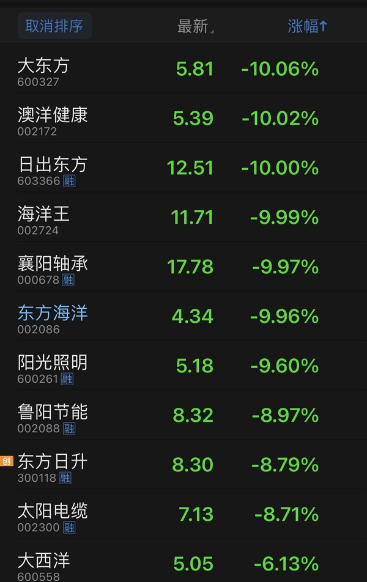

- (2026-11-16 15:06:29) 今天江老师微博那边视频评论区的留言就非常不好看了

- (2026-11-16 15:06:55) 没有羊
情绪一地鸡毛  ⊳ （引用 @我爱牛肉火锅）放飞自我中哈哈哈哈，🐏🐏队立大功

- (2026-11-16 15:07:36) 控制仓位

比如今天加仓的要减出去（不看价格）  ⊳ （引用 @高手云集上钻）那如果还是这样会有什么后果呢

- (2026-11-16 15:14:49) 情绪退潮其实也不是都坏事 也有一个好处的
这样大连那种低位冰雪和其他的旅游就会得到一些关注

之前能玩的东西实在太多了 资金分流很严重  ⊳ （引用 @我爱牛肉火锅）温暖老师说的情绪退潮期？

- (2026-11-16 15:17:47) 因为东方海洋上周四做了个不好的示范
没有绕异动后 直接涨停 但是里面资金很怕监管
尾盘跳水 东方海洋也是这样的
然后次日跌停  ⊳ （引用 @明白人）楼，九阳开板往下，这个是玄学指标也是市场情绪指标吧

- (2026-11-16 15:19:37) 尾盘有gjd哎 蛮多票尾盘都有资金😂  ⊳ （引用 @sickid）我看影视院线还好，横店尾盘还有人进来拿先手

- (2026-11-16 15:22:50) 这次你知道最大问题在哪里嘛

因为发生在股市大崩以后
很多资金离开了被虐杀的科技股市 
然后转投债市准备洗心革面😂😂
然后遭遇更大的暴击（债券很多人买的体量相当大）

这次债券基本面没有任何改变
但是里面的持有人的心态是虐杀两连击

这一把赎回潮很迅猛了  ⊳ （引用 @高手云集上钻）给债的按摩

- (2026-11-16 15:27:11) 现在楼里希望的好的品种差别挺大的

而且有的好 有的就肯定不好😂  ⊳ （引用 @momo）楼里又开始了大忏悔时候，一般这时候明天会好一点吗🙂

- (2026-11-16 15:27:50) 直接英伟达业绩都不用看了吗  ⊳ （引用 @Frances）关注的博主说，不要相信盘后的任何利好，都是狗屎。关注下一个节点11月19，一个是Anthropic的IPO上市，还有三个老大在深圳见面

- (2026-11-16 15:35:12) 我债灾了……….

收盘后 就轮到我emo了  ⊳ （引用 @sickid）情绪最稳定的永远是楼主

- (2026-11-16 15:38:15) 我都没和我女朋友说债灾了
我怕我女朋友回复我之前和她一起多买点2开头的招行不就好了？提款机明明在股市😂😂  ⊳ （引用 @我爱牛肉火锅）我觉得他会看，今天不放假！而且这种时候可以筛出含金量高的债基（其实都是我瞎扯的）

- (2026-11-16 15:41:44) 两连冠了  ⊳ （引用 @VVV坚定持有VVV）小远-0.92%

- (2026-11-16 15:42:30) 你的债最近没亏钱？还是你没去看啊😂  ⊳ （引用 @噜啦啦噜啦啦）额，债灾了？我特么都想赎回了，怎么啥啥都不赚钱啊😂😂😂😂

- (2026-11-16 15:43:24) 笑死
那是我传媒
他来的时候大家每天喜笑颜开

我媒体愁眉苦脸  ⊳ （引用 @龙拜拜）特又要来中国了？还记得上次来每天大跌

- (2026-11-16 15:50:46) 最近那个黄金高点吗 那个迷惑性确实很强😂😂😂  ⊳ （引用 @赚大钱钱）我有罪，我不止自己大买特买，还拉着我老公一个很谨慎的人买买买，买在了山顶上。然后他开始鄙夷我的投资思路，自己研究了一番，大举最高点买入黄金。现在我俩谁都不敢说谁，一说就是互相攻击🤣🤣

- (2026-11-16 15:56:36) [图] 😂自己动手丰衣足食
还有5年 3年的 

利率债就是这个

  ⊳ （引用 @qiu啾）打工人uu能否抄作业

- (2026-11-16 15:57:57) 美元货币基金现在年化多少了  ⊳ （引用 @木感情的打工人）其实我对象买了很多美元货币基金，我只能攻击他这一点。。

- (2026-11-16 16:09:12) [图] 不知道的还以为我们经济也要通胀了😅😅😅😅

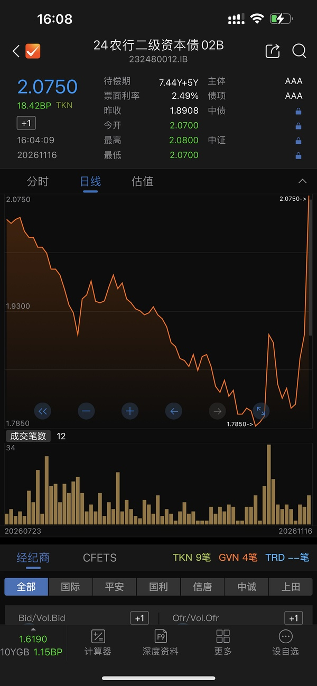  ⊳ （引用 @木感情的打工人）我怕这些还要大幅回撤，我准备歇歇小手

- (2026-11-16 16:09:43) 台股16日创史上第二大单日收盘跌点

台股16日低开低走，大盘指数收于41040.08点，大跌2635.04点，跌幅6.03%，创下历年第二大单日收盘跌点纪录，全日成交金额达8450.56亿元（新台币，下同）。 权值股方面，台积电收2215元，下跌135元，跌幅5.74%，这也是该股历年第二大单日跌点纪录

- (2026-11-16 16:17:35) 场内渐入佳境了😂😂我已经连红三个月了 八月也是小亏
本来我挺高兴的 直到遇上了债灾了
而且发生在股市连续横盘的情况下  ⊳ （引用 @vio）唉 这半年太地狱了

- (2026-11-16 16:18:15) 小暑才两个银行  ⊳ （引用 @木感情的打工人）才小暑吗，。。

- (2026-11-16 16:18:41) 带不走的 明天竞价就按回去了  ⊳ （引用 @Waiting一下）😭

- (2026-11-16 16:26:10) 现在大跌都不会放量的
这也是冰点不会再有的重要原因

主要的大额融资盘七月爆仓完了
现在下跌都是一点点爆
公募基金之前也都卖了
都是无量杀跌 降价大甩卖呀  ⊳ （引用 @啊呆呆呆呆）主要现在没量啊，就无法格局，之前3700两次都过不去肯定要跌。主要今天跌这么多还没放量啊明天直接大低开最好。🤣

- (2026-11-16 16:27:01) 我不搬家
我正在被债券血洗  ⊳ （引用 @一切都会过去的）本楼是真的做到了存款搬家 然后就没有存款了😂

- (2026-11-16 16:30:37) 没人买
只能不断降价卖才能卖出去😂
我上周恋爱脑急于卖都是降了3分🤣  ⊳ （引用 @moli）筹码真空区吗，只要卖没人接就能一直跌

- (2026-11-16 16:34:02) 这一次茅台魔咒体会的更深刻了

这个魔咒我已经罚超五遍了  ⊳ （引用 @家不住海边）看到小熊猫发的这个。 绷不住了。怜爱科技人

- (2026-11-16 16:36:56) 三个原因呢 三合一联合围剿

1，之前固收+产品大爆 股票大跌引发净值大跌 大幅度赎回 固收+底层是债券 债券被一起抛售

2，华发违约的消息面余温未消

3，传闻国债免税取消  ⊳ （引用 @啊呆呆呆呆）债最近是为啥跌啊，股债双杀吗。

- (2026-11-16 16:42:24) 这一次拉不起来的
全球联动！！！！！

gjd不停的买买买 都强化到银行消费那些大票去了

如果美国持续下跌 妈妈只能延缓下跌速度 但是无法改变趋势的

妈妈不如去救债券 那玩意她说了算  ⊳ （引用 @高手云集上钻）没人卖是不是说明，国家队拉起来也很简单，就这样做梦

- (2026-11-16 16:43:54) [图] 债券妈妈来了吗

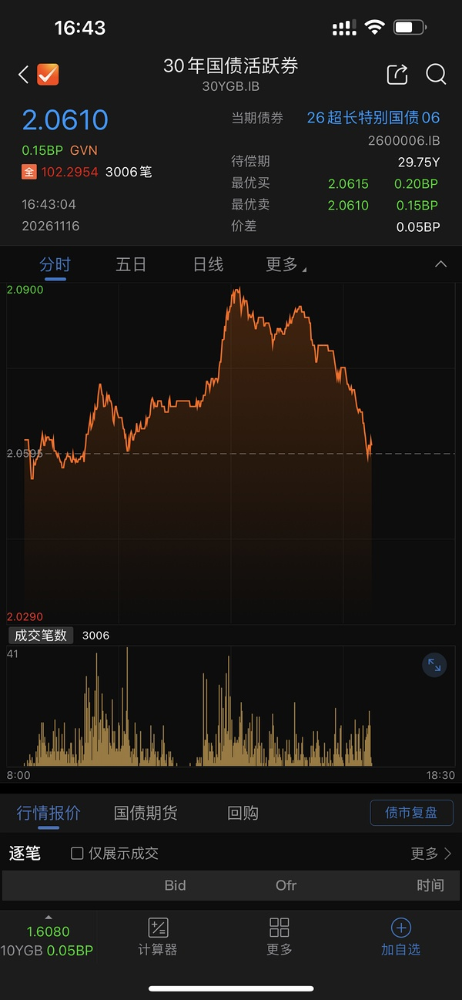  ⊳ （引用 @六倍做多退休）家庭地位和金钱一起失去了

- (2026-11-16 16:44:15) 30债几乎抹掉了今天跌幅  ⊳ （引用 @木感情的打工人）才小暑吗，。。

- (2026-11-16 16:45:57) 虽然不消停
但是上周反馈很不错的

你看我今天标题才是暂缓
因为这周有两个大事件 我都写了 17号和19号
能挺过去就稳了  ⊳ （引用 @momo（富姐版））美国人什么时候消停

- (2026-11-16 16:49:40) 债券基金好像结算是16:00点的😂我也不知道哈哈哈 卡在那个时候修复的

但是就利率债有修复 信用债没啥  ⊳ （引用 @六倍做多退休）哦呦 跌到神志不清了 想问的是买到大跌的还是无事发生的

- (2026-11-16 16:50:22) 那你误会了
我还给你们看过截图
我只是把我给她买的现金流基金转换了网易云  ⊳ （引用 @梳碧湖砍柴人）楼之前网易云也是梭哈的带着楼嫂账户一起梭哈，金额应该不比娜娜少吧

- (2026-11-16 16:50:43) 因为美元美债飙升
不利于非美市场
你看看今天的台湾 韩国一个个都是弱不禁风的

加息预期重燃呀
你多多希望我美债基金多赚点呗
这意味着加息预期减弱😂😂😂😂😂
我一旦美债亏钱 几乎预告大A科技（不管哪一路）没戏  ⊳ （引用 @Waiting一下）问个傻傻的问题，但是楼楼老美也没怎么跌，为什么我们跌了那么多😭，这是不是也要怪妈妈呢

- (2026-11-16 16:54:57) 👍👍👍👍  ⊳ （引用 @moli）我还悄咪咪小加了一笔🤔

- (2026-11-16 17:00:05) 我要Mark一下
不然明天算不清

我们3点收盘期货-1%
3300周五涨错了0.86
周五的-1.22外加今天-1
累计应该下跌0.86+1.22+1=3.08

实际收盘-2.3
还是少计算了0.7%跌幅

不知道就当没发生还是预期晚上并不是-1  ⊳ （引用 @不知道还能说啥）要好好估算一下今天的3300

周五3300涨0.86 
实际晚上收盘-1.22 现在+0.6 =-0.6

3300正常今天开盘应该要下跌1.5%

- (2026-11-16 17:05:58) 还是余老师有价值

从历史上看，在历次大盘进入月线“死叉”后的半年内，主力买盘往往都会相对谨慎一些，更多表现为“托底”，而非持续地“高举”，相对较低的成交量也难以形成一条持续抱团的主线，我在《11月到了！超卖反弹会不会一触即发？……》一文中，曾以上轮月线"死叉"阶段（2022年2月至2024年8月）为例，期间曾有过三次修复性行情，最后的结果是：2022年5月-2022年8月：微盘>成长100>双创50；2022年11月-2023年3月：微盘>双创50>成长100；2024年2月-2024年3月：微盘>成长100>双创50。所以与公募、融资这些抱团资金相关度较低的红利、低波、微盘这些风格往往相对占优，有经验的人就会以红利低波为底仓，然后在超卖的时候用小微盘来打猎（就算是下跌，它的跌幅也往往远小于双创等成长指数）

今年8月死叉的 半年后就是3月

正好1/27日太子爷解禁
2/5春节 长假 2月也没多少天可交易

三月份没什么毛病  ⊳ （引用 @我爱牛肉火锅）大佳发文！又水一天

- (2026-11-16 17:08:57) 我的心理素质都是这么一次次熬出来的

我现实里也熬🤣
很多新主播我也都是前期大幅支出无回报 
还有等流水好起来了回报有了她要跳槽了🤣🤣🤣🤣  ⊳ （引用 @木李）熬过这次，我感觉我心理素质上了一个境界🥺🥺🥺

- (2026-11-16 17:11:20) 趋势动物才是真牛逼啊
我是参考的

毕竟人家7.2逃顶科技 也不是马后炮的
后面主推红利正确至今
乃至上周强调右侧重新开始

中间还加了个黄金下跌右侧开启（我以为这个会错的 打脸😂😂😂😂）

既然主要的三次模型得来的观点都非常准确
还是值得参考的

至少看到他发红利右侧结束 才看好科技呗😂😂😂  ⊳ （引用 @我爱牛肉火锅）不过他今天最后一段也说要重视趋势了，最近要给趋势动物发的文打重点tag了

- (2026-11-16 17:12:07) 半年后是三月呀  ⊳ （引用 @高手云集上钻）三月份咋了？

- (2026-11-16 17:15:06) 有些我被她们年纪小 漂亮的单纯的脸迷惑了😂

而且有的刚成年 长约和让她们安心之间的平衡点是有难度的

后来我也看开了
这是投资人 投资总有输赢
只要赢的几率大就行了
心态稳稳的  ⊳ （引用 @我爱牛肉火锅）不能定违约金补回损失吗？她做初一你做十五的

- (2026-11-16 17:20:28) 是的 有几个我一定要 我觉得肯定会有流水
只能我在合约上大幅度让步

像我们股票三箭齐发经常有2个牛逼1个哑火的一样
只要牛逼的比坑爹的多就行了😂😂😂😂  ⊳ （引用 @我爱牛肉火锅）不过确实 违约金定很高很难说服人签约 到时候直接启动AI主播 跟炒股一样，赢得多过输得，总体是赚的就好了 人没办法每件事都赢的

- (2026-11-16 17:23:47) 今天刚新高
周五看还要担忧双头呢😂😂😂  ⊳ （引用 @想当富有的咸鱼）工商银行这才进立夏吗？

- (2026-11-16 17:24:20) 这明显说的是场内  ⊳ （引用 @茅五泸荣誉黑粉）啊，我们场外最多的不还是科技吗

- (2026-11-16 17:26:00) 华夏兄弟-2.5%

- (2026-11-16 17:28:35) 是谷雨  ⊳ （引用 @moli）还没回本就立夏了吗

- (2026-11-16 17:31:27) 再涨15% 工行股息率就要低于3%了  ⊳ （引用 @想当富有的咸鱼）很忧伤，因为有股息率，我没法用单纯的眼光看银行

- (2026-11-16 17:44:26) 利润好 早就写了
不写说明是亏损的🤣  ⊳ （引用 @momo） 这个营收看着还不错啊，就是不知道利润多少了
小鹏汽车第三季度营收为242.8亿元人民币。

- (2026-11-16 17:48:08) [图] 😂他们看好利率债的底气

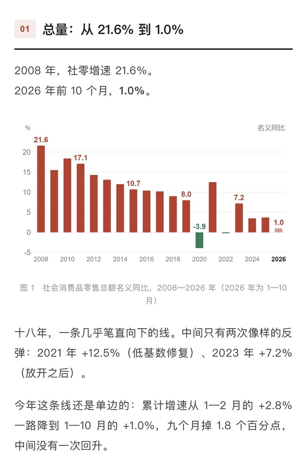  ⊳ （引用 @六倍做多退休）之前十五五规划，定了一个较保守的消费目标，
即便如此，今年以来的消费趋势，和十五五目标趋势，缺口正越拉越大....

- (2026-11-16 17:51:19) 长江电力股息率也一样的
纯抱团了  ⊳ （引用 @想当富有的咸鱼）它就完全脱离红利股了

- (2026-11-16 17:52:27) [图] 这个负了

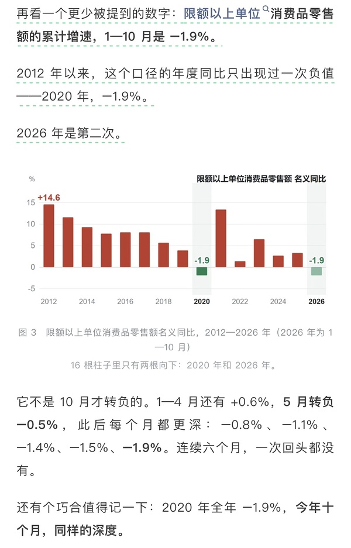  ⊳ （引用 @六倍做多退休）今年增速是正的我都觉得不可思议 

- (2026-11-16 17:59:39) 题材端同样迎来高位集中退潮，前期人气高位股批量跌停，大东方、襄阳轴承、青岛食品、百洋股份、澳洋健康、闽发铝业上演2连跌停，东方环宇、日出东方、锋龙股份、金辰股份封死跌停，短线资金兑现意愿强烈。值得重点关注的是，本轮短线人气核心标的九阳股份尾盘炸板，分歧显著加大，其次日资金反馈将成为短线情绪的重要观察锚点。而在普跌格局下，短剧传媒成为盘面为数不多的情绪活口，板块维持相对韧性，文投控股走出19天11板、凯撒文化5天4板、金逸影视5天3板，后续需要持续跟踪这条支线能否持续走强，带动市场整体情绪回暖、修复亏钱效应。

- (2026-11-16 17:59:59) 财联社小编写的

命看九阳和传媒了😂😂😂😂😂😂  ⊳ （引用 @不知道还能说啥）题材端同样迎来高位集中退潮，前期人气高位股批量跌停，大东方、襄阳轴承、青岛食品、百洋股份、澳洋健康、闽发铝业上演2连跌停，东方环宇、日出东方、锋龙股份、金辰股份封死跌停，短线资金兑现意愿强烈。值得重点关注的是，本轮短线人气核心标的九阳股份尾

- (2026-11-16 18:00:57) 然后A科技多的话 今天是接着周五大杀特杀后又一把血洗呢  ⊳ （引用 @吃西瓜的人）怎么大家突然心态崩了…我感觉我还挺平和的，因为我从上一轮牛市熬到这一轮牛市场外a🐔才回本，虽然现在又亏了…反正拿得住总有一天会回来的，只是时间问题，而且这次美🐔很多，所以信心更足一点

- (2026-11-16 18:09:12) 科技太勾魂小伙伴们了
上周不是大涨了一次嘛
肯定科技uu有回首掏的😂
有的uu心都在科技 做垃圾才是无奈之举
和我就做垃圾不太一样  ⊳ （引用 @茅五泸荣誉黑粉）我看楼里以为大家场内都是小垃圾，果然不炒场内就是跟不上节奏

- (2026-11-16 18:17:02) 我上次场内被国内科技骗
还是通信ETF 后来换ycm的那次😂记忆犹新  ⊳ （引用 @我爱牛肉火锅）uu们的誓言时效性是日卡级别

- (2026-11-16 18:19:03) 许许多多的债券基金
今晚更新后 最大回撤这个数据将大幅度拉大了
有的债券都是2024后成立的
没有遭遇过这么惨烈的债灾

- (2026-11-16 19:11:11) 你们不熟悉plu
他为什么号都编排到007了
就是他永远看空印度的
这个看空不是单单股市的 是全方位的
924一开始他也看空的
不过他就一点好 看错了马上改  ⊳ （引用 @momo）。。。。真没必要吧，老美好起来了我不信我们跟不上

- (2026-11-16 19:11:38) 现在是plu返璞归真的时间段 他肯定不停发的 习惯就好  ⊳ （引用 @momo）。。。。真没必要吧，老美好起来了我不信我们跟不上

- (2026-11-16 19:21:08) 卷毛再也不提宇航员了吗  ⊳ （引用 @点-重生炒垃圾）今天节目都忘记看了🤣🤣🤣做完汇报，心气回来了

- (2026-11-16 19:33:15) 传：多家银行和券商资管收到央妈告知，允许重新买入长债

- (2026-11-16 19:37:41) 妈妈对长债跌到这个位置感到满意了😂  ⊳ （引用 @我爱牛肉火锅）妈来了，妈带着小钱钱救你来了

- (2026-11-16 19:40:12) [图] 🤣

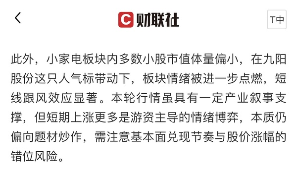  ⊳ （引用 @速派女孩将发财）都有家电板块的专题了 不得了 听了这么多次 第一次听到家电专题

- (2026-11-16 19:49:09) 之前买的时候是降息周期
现在都变成加息周期了
宏观背景发生了180度变化
没纠错 也更别再放大错误了

一定要加仓至少等1.27日太子爷解禁完 过完春节
再叠加美债收益率稳定在4.5以下靠近4.25时候再考虑  ⊳ （引用 @江湖骗子在哪）我也是，不然那次真的又要进去了，还好楼拦住了

- (2026-11-16 19:54:49) [图] 🤣我新浪模拟盘之前做空1000指数 最终遇到924一把赔完还倒欠新浪50万

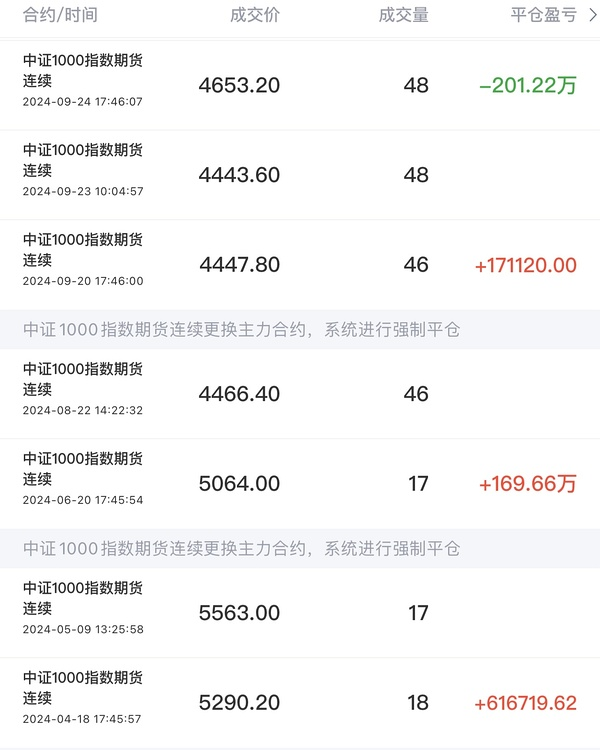  ⊳ （引用 @速派女孩将发财）老师 你太高看我了！！！ 我都没资格开期货户
那玩意儿真的太吓人了

- (2026-11-16 19:56:03) 快祝我美债赚大钱！！！  ⊳ （引用 @小鱼）天哪，心里更加拔凉拔凉的了😂😂

- (2026-11-16 19:59:29) [图] 做空一路狂胜 直接遇到924倒亏还欠新浪🤣

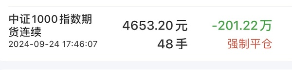  ⊳ （引用 @VVV坚定持有VVV）我在另一个群里围观过期货比赛，第一名一周+500%，太猛了🫢

## 🧠 投资风格分析
> 📏 增量更新指引：仅当今日发言确有新依据时才修订对应维度，无变化不强行重写；单维度修订建议 ≤150 字。

- 投资理念与方法：坚持机会成本与性价比比较，强调“只赚份内的钱”；今日进一步强调远离机构重仓，认为公募抱团趋同会制造拥挤风险，主张跟踪基金与基准指数的贴合度，规避机构重仓股。对题材炒作保持警惕，认为消费、地产、传媒等题材“别真的当真”。
- 风险偏好：对高波动、高拥挤的题材股回避，主动规避机构重仓和题材炒作；对美股谨慎但认可其强势；注意控制仓位，担心情绪核心崩盘，周四担心题材杀跌，周五提示『别装逼』。
- 交易与仓位：偏好低吸不追高，强调『不加仓和持有是两回事』；坚决执行条件单，挂单卖出幸福蓝海、触发后买入光线；对传媒不增加仓位但保留持仓；周五躲避利息，今天清仓机器人；注重仓位控制，担心情绪核心崩盘，强调『管住手』。
- 心理特质：自我认知清晰，承认看错传媒，对市场规律有敬畏；重视筹码与机构行为；情绪稳定，不追高、不眼红。今日新增：面对不利账户选择不打开银行/债券查看，称「不看就无视发生」，体现以回避查看波动来维持心态的自我调节习惯。

> ⚠️ 本板块由 Actions 全自动增量更新（复用当日发言与今日总览），每次仅在内容足够支撑时才改动。

## 🏷️ 昵称映射表
### 📖 昵称规律（供 AI 判断新昵称时参考）
【昵称命名规律（用于推断未知新昵称）】
- 拼音首字母缩写：取标的/基金名汉字拼音首字母串（含数字代码），多为 ETF/股票代码口语化｜示例：yl=引力传媒｜zy=掌阅科技｜sj=视觉中国｜cc=华安文体健康混合｜C50=创业板50ETF｜k50=科创50｜kun=昆仑万维｜xhxc=新瀚新材｜zxfc=中欣氟材
- 小/老+姓氏代指：「小X」「老X」通常指姓 X 的标的或该标的的基金经理；「X兄弟」多为同系基金｜示例：小惠=惠发食品｜老莫=万家品质生活(莫海波)｜小华=华夏全球科技先锋(QDII)A｜小华兄弟=华夏移动互联(QDII)｜小浦=浦银安盛全球智能科技(QDII)A｜小广=广发全球精选(QDII)A｜小远=华宝致远(QDII)C｜招招=招商银行｜小德=德明利｜赵姨=兆易创新｜露露=泸州老窖｜空调=格力电器
- 戏称/黑话→题材板块：生活化比喻或黑话对应某个题材/板块，而非单一标的；出现时多指板块方向｜示例：卖国=PCB板块(英伟达AI链)｜爱国=国产自主(半导体设备/芯片)｜奶茶=易点天下｜老师=中文在线｜蓝色=蓝色光标｜宇航员=航空航天板块｜华子=华泰保兴安悦债券｜国际=国际复材｜巨无霸=长鑫科技等重大IPO
- 谐音/取字：昵称含标的名关键字（取一字或谐音），多为 A 股个股或基金简称｜示例：万华=万华化学｜东百=东百集团｜宝=保利发展｜讨饭/亚洲讨饭/建信新兴=建信新兴市场(QDII)A｜华宝zy=华宝致远(QDII)A
- 机构/基金经理昵称：以基金公司名、经理姓、或平台代称指代对应基金产品｜示例：周经理=中欧新趋势混合(LOF)A｜张经理=信澳匠心回报混合A｜网易云/音乐世家=富国全球科技互联网股票(QDII)A｜国富亚洲=国富亚洲机会股票(QDII)A｜国泰纳指=国泰纳斯达克100指数(QDII)｜易方达全球=易方达全球成长精选混合(QDII)A｜浦银安盛=浦银安盛全球智能科技(QDII)A

### 📋 已收录映射
| 昵称 | 对应名称 |
|------|----------|
| C50 | 创业板50ETF |
| cc | 双义：股票=中国长城 / 基金=华安文体健康混合（用户 11-05 指认） |
| k50 | 科创50 |
| kun | 昆仑万维 |
| sj | 视觉中国 |
| xhxc | 新瀚新材（用户确认；代码待核） |
| yl | 引力传媒 603598（对手盘，非他持仓）｜11-06 +37.15%；11-09 本月+37.79% |
| zxfc | 中欣氟材 |
| zy | 双义：他本人口径=603533 掌阅科技（用户 11-05 确认）；11-09 楼友两条『zy』按 16 元/电影语境指 600977 中国电影。引用必须带语境，不许收敛 |
| 万华 | 万华化学 |
| 东百 | 东百集团 |
| 亚洲讨饭 | 建信新兴市场混合(QDII)A |
| 保利发展 | 保利发展 |
| 华子 | 华泰保兴安悦债券 |
| 华宝 zy | 华宝致远混合(QDII)A |
| 华宝zy | 华宝致远混合(QDII)A |
| 卖国 | PCB、光模块、通信板块（英伟达AI产业链） |
| 周经理 | 中欧新趋势混合(LOF)A |
| 国富亚洲 | 国富亚洲机会股票(QDII)A |
| 国泰纳指 | 国泰纳斯达克100指数(QDII) |
| 奶茶 | 301171 易点天下（对手盘，非持仓）｜11-13 10:07『奶茶out 幸福人的底气是可以说芒果out』；当日 −6.72% |
| 宇航员 | 航空航天板块 |
| 宝 | 保利发展 |
| 小华 | 华夏全球科技先锋混合(QDII)A |
| 小华兄弟 | 华夏移动互联混合(QDII) |
| 小广 | 广发全球精选股票(QDII)A |
| 小德 | 德明利 |
| 小惠 | 惠发食品 |
| 小浦 | 浦银安盛全球智能科技(QDII)A |
| 小远 | 华宝致远混合(QDII)C｜只在盯，未证他持有 |
| 巨无霸 | 长鑫科技等重大IPO企业 |
| 建信新兴 | 建信新兴市场混合(QDII)A |
| 张经理 | 信澳匠心回报混合A |
| 招招 | 招商银行 |
| 易方达全球 | 易方达全球成长精选混合(QDII)A |
| 浦银安盛 | 浦银安盛全球智能科技(QDII)A |
| 爱国 | 国产自主（半导体设备/芯片制造） |
| 空调 | 格力电器 |
| 网易云 | 富国全球科技互联网股票(QDII)A |
| 老师 | 中文在线 |
| 老莫 | 万家品质生活混合A(519195) |
| 蓝色 | 300058 蓝色光标（广告组合，非他持仓）｜11-12 高 15.97＝20cm 涨停价、收 14.76 +10.89%（炸板）；10:21『他和蓝色 奶茶 sg他们是广告组合』 |
| 讨饭 | 建信新兴市场混合(QDII)A |
| 赵姨 | 兆易创新 |
| 赵哥 | 兆易创新 |
| 露露 | 泸州老窖 |
| 安安 | 安记食品 |
| 音乐世家 | 富国全球科技互联网股票(QDII)A |
| 老伯伯 | 铜冠铜箔 |
| nk | 纳指科技ETF景顺 159509（联接=景顺长城纳斯达克科技ETF联接A）｜11-06 A级：截图溢价率37.08% |
| bk | 标普信息科技LOF 161128（场外=易方达标普信息科技QDII-LOF）｜11-06 A级 |
| txx | 天下秀 |
| 媛媛 | 今世缘 |
| uu | 友友、网友们 |
| 温暖老师 | 某个特别牛逼的散户 |
| 余老师 | 余利，某牛逼投资者 |
| ycm | 粤传媒 002181｜11-09 12:12「非电影传媒就留给大家玩了 我一个都不会碰了」→ 推断已不持有 |
| 江老师 | 江琪（投资博主） |
| 水果老师 | 投资博主 |
| 小爱 | 我爱我家 |
| ty | 天娱数科 |
| bn | 博纳影业 |
| sy | 601595 上海电影｜**他空仓**（11-09 起未回接）；11-12 09:38『天天念叨sy的给你们机会了』＋09:41『现在-6给你们机会了哈』＋13:15『马上sy跌停 bn还要尊敬一下他』＋13:51『与此同时 sy跌停』＋14:00『sy历来以残暴虐杀手法闻名』；实测收 42.15 −9.99% 跌停 |
| CBS | 长白山 |
| 东哥 | 东百集团 |
| 芒果 | 300413 芒果超媒（对照，非持仓）｜11-13 14:01 本月涨幅 41.70% vs 幸福 53.76% →『幸福已经拉开芒果12%』＝12.06pp 精确命中；当日 −4.83% |
| 阿中 | 中国电影 |
| 欢欢 | 欢瑞世纪 |
| 雪人 | 雪人集团 |
| 大连 | 大连圣亚 |
| 幸福 | 幸福蓝海 |
| 小粤 | 粤传媒 |
| 阿博 | 博纳影业 |
| 创成长 | 创业板成长etf |
| asd | 002747 埃斯顿｜11-11 15:09『我昨天去的另外一个 今天也吸到asd了』＝11-11 低吸买入；11-12 10:17『我昨天加了asd今天刚刚加了另外个』＋10:35『asd火箭发射』（盘中高 32.19，收 29.95 −4.37%）；买价未披露。**11-11 轮误删、11-12 恢复** |
| 恋爱脑 | 002582 好想你｜11-12 14:39:31『清了恋爱脑』＝清仓（卖价未披露；10.48 卖单两日均未触及→手动卖）；14:28『我如果去掉恋爱脑 也就比你多一个机器人』；当日收 9.76 −2.89% |
| 恋爱 | 002582 好想你（同『恋爱脑』）｜11-12 14:39 已清仓，不再持有 |
| 小羊 | 000678 襄阳轴承｜11-05 已卖（卡当日最高 20.40）；11-12 14:16『襄阳掉了』＋14:44『厉害襄阳』＝只评论走势，非持仓 |
| 中马 | 中马传动 |
| 晶雪 | 晶雪节能 |
| xf | 幸福蓝海 |
| 建设 | 建设工业 |
| 北方 | 北方导航/北方国际（未定，11-04「我在北方了」） |
| _ambiguity_note | 歧义未收敛（禁止当唯一映射）：轮子=巨轮智能/五洲新春；sj=视觉中国（传媒语境）/神剑股份（宇航员语境）；cc=中国长城/华安文体健康混合；北方=北方导航或北方国际；zy=掌阅科技（用户 11-05 确认原值正确）。证据分级：A=价位/均线/月涨幅实测命中；B=量级或单日命中/用户口述；C=仅昵称或语义，不得据此写『他持有』；沿用原仓=本轮未复核，不写进结论正文。三条判据：①条件单四位数要先按同时段动词行判买卖方向（cbs 3644 是买单不是卖单）；②『祝福/你们/你的X』句式＝评论他人持仓，不是他的操作；③同一昵称在不同语境可指两只票（zy=掌阅/中影），按价位与板块取，不许收敛成一个。 11-11 补：plus雪＝他自己也没说清（11:12「你应该不知道plus雪是哪个」），不许猜；bdd＝有传媒属性所以他不去（13:42），仍未定案；『五连阳』这类盘中口径不等于日K实测（招行 11-06 为平盘十字星）。 11-12 补：①盘中快照≠收盘（14:15 三日账第三日 幸福+0.5/光线−4.5 为盘中值，收盘 −0.53/−4.97；他写的『拉开5.3%』按自列数字相加应为 5.5，属口算误差，不得据此推翻实测）；②历史卖单不重复计触发（中影 15.84 虽∈11-12 区间[15.39,15.98]，但 11-10 已成交、无存续卖单）；③清仓自述不封锁后续再买（asd 11-06 清→11-11 15:09 再吸，11-11 轮据此误删）；④『果果』只是推断映射，不得当持仓证据；⑤机器人第二仓与传媒低位10cm 代码未披露，福赛仅为楼友提问他作答，不许映射。 11-13 补：①**本月涨幅类口述可核**，基准＝10-30 收盘，且要用**发言时刻的分钟价**复算（14:01 截图 53.76% 与分钟线独立复算分毫不差，『拉开芒果12%』＝12.06pp）；②**基金表『折价率』列负号＝溢价**（513300 −15.28% ⇒ 溢价 15.28%，与 11-06 的 16.36% 同口径），别读成折价；③**『我手里就7只股票了/我只有电影冰雪了』是他题材仓口径**，不得据此删除无卖出自述的持仓行（铁律 6）；④**『全部跌停』类口述是盘中快照**（东方海洋盘中最低 4.64＝跌停价、收 −6.59%，未封死）；⑤plus雪＝晶雪只是**品种识别**，他 11-09 已自述清仓，不得当持有证据。 |
| nana场内 | 513300 纳斯达克ETF华夏｜11-09 14:34「不愧是513300 当年的普通nana ETF之王」，当日唯一红的纳指ETF |
| 雪儿 | 雪人集团 002639｜11-06「大连和雪儿」＋11-11 14:26「雪儿今天不错啊 大家昨天不是期待他接人嘛 这个任务做到了今天」（接人＝5日线接回，与雪人条件单口径一致） |
| 存钱罐 | 光线传媒 300251（他自述小仓）｜11-13 15:11『我相信光虽迟但到 我会肯定保留上周的存钱仓位』＝存钱罐口径再次落到光线 |
| 枣子 | 002582 好想你（同『恋爱脑』）｜11-12 14:39 已清仓，不再持有 |
| 王老师 | 人：王博雅投资（QDII 场内溢价口径），不是标的 |
| 印度 | 自嘲代指中国（推断，勿当事实） |
| 10086 | 中国移动（他当指标用，非持仓） |
| 阳光乳业 | 001318 阳光乳业（他的『喝的』/牛奶）｜11-09 A级：13:59 分时截图 S 标记≈13.5＋10:52「我去掉了羊来抄底」 |
| 羊 | 生肖羊概念组（带阳/洋/光/太/泉的一篮子）｜11-09 14:04 他自己贴的分组；**11-13 崩盘实证**：15:58 截图跌幅榜 澳洋健康 −10.06、阳光照明 −10.05、红太阳 −10.04、大东方 −10.03、阳光乳业 −10.02、襄阳轴承 −9.98、鲁阳节能 −9.95、大西洋 −9.73、太阳电缆 −9.29、圣阳股份 −8.64、泉阳泉 −6.60、东方海洋 −6.59；他 14:48『我昨天起码说了6次 控制仓位 因为羊和东方昨天松动了！！！！这是情绪核心』 |
| 小明 | 605179 一鸣食品｜11-09 10:07 有人问『喝的小明？』他答『羊』＝喝的已换成阳光乳业 |
| 皇台 | 000995 皇台酒业｜11-09 与雪人 PK 当日换手率龙虎榜 |
| 海哥 | 人：转债估值博主（不是标的）｜11-09 12:48「海哥周五那个新债…我买了点试试看是市场错了还是海哥错了」 |
| 申菱转债 | 123290（申菱环境 301018 的转债）｜11-09 13:50 买 150 张 @133 多；11-10 11:20『我开了149.9』卖单；11-12 分钟线 10:03–11:12 持续≥149.9（高 152.313）→触发推定清仓，+12.28%（成本 133.5 推定）记入 stock_pnl，已从持仓表删除 |
| 盛天 | 300494 盛天网络｜11-11 A级：11:29 分时截图 B 标记 @11.00＋「不止 而且我跟了他一把」（跟摄像大哥） |
| dfhy | 002086 东方海洋｜11-11 13:56 楼友问 dfhy 绕异动→他『我没算 这几天可能都是异动吧』；11:35/11:54 他自己两次喊『东方海洋』；11-12 14:39:31『涨停卖了东方海洋』@5.16（=4.69×1.10 分毫不差，分钟线 14:36 起封板，财联社截图 17天9板/10.02%）→已卖出；买价未披露故不记收益 |
| xys | 300502 新易盛｜11-11 13:19「我那个买xys的女主播终于要开心了」＋13:21「她现在成本327了」→ **是女主播的仓，不是他的** |
| 冰山 | 000530 冰山冷热｜11-11 10:16「万一冰山跌停 他能跌到哪里再去」＋10:27「今天把冰山 晶雪按死 大连 CBS 正统上位」（非持仓，冰雪板块的山寨对照） |
| 冰冰 | 000530 冰山冷热｜11-11 14:03「那冰冰准备」（同『冰山』，非持仓） |
| 龙版 | 605577 龙版传媒｜11-11 11:50「最早龙版也是因为自己每次公告文案都不一样才4连板就被监管」（讲监管规则，非持仓） |
| 3300 | 513300 纳斯达克ETF华夏｜11-11 10:49「3300还行 不过今天我不满意」＋13:24「咱们3300还是近期数据最好的」 |
| nana100 | 纳斯达克100指数（他对照场内ETF溢价的基准）｜11-11 08:14「昨天513300涨了3.53% 但是nana100实际也就涨了3.4」 |
| 易中天 | 新易盛＋中际旭创＋天孚通信（CPO三巨头合称）｜11-11 14:13「都去易中天了🤣」（非持仓） |
| 冰雪双子星 | 大连圣亚600593＋长白山603099（他的正牌冰雪双仓）｜11-11 10:29「从不担心冰雪双子星」 |
| 2000 | 中证2000指数（他当微盘股基准）｜11-11 11:11「除了机器人 今天其他题材全输给了2000」 |
| cw | CoreWeave（CRWV，美股AI算力）｜11-11 11:18「cw那玩意硬起来了 大家看夜盘数字」 |
| ant | Anthropic（美股IPO）｜11-11 12:11「接下来是不是ant IPO也是利好」 |
| 摄像大哥 | 人：楼友（不是标的）｜11-11 他的两笔游戏＝电魂网络涨停＋顺网科技≈+7，属楼友口径；楼主自己买的是盛天网络＋另一只未披露代码的游戏 |
| 游戏哥哥 | 游戏板块拟人化（不是具体票）｜11-11 12:58「游戏哥哥：我来也」＋13:01「妹妹休息 哥哥接力？」 |
| 传媒妹妹 | 传媒板块拟人化（不是具体票）｜11-11 11:40「被传媒妹妹压制了」＋13:01「妹妹休息 哥哥接力？」 |
| sg | 002400 省广集团（广告组合，非他持仓）｜11-12 A级映射：10:09:32『省广带起来了』＋10:21:36『他和蓝色 奶茶 sg他们是广告组合』；分钟线 10:00 6.70→10:09 6.89→10:21 6.94（昨收 6.70）命中『带起来』；当日收 6.64 −0.90%（冲高回落） |
| 果果 | 301052 果麦文化（**推断·B**，非持仓）｜11-12 13:05:01『果果紧随其后了』紧接 13:04:34『传媒出现两位数跌幅了 华策』；实测华策 −13.97%、果麦 −10.38% 同为两位数跌幅→谐音＋当日跌幅与语境命中；未见他自述买卖，不得当持仓证据 |
| 老登 | 机构抱团的老牌权重（白酒/消费/地产一类，**不是单只票**）｜11-12 07:51:44『如果这些资金回去重新抱团 最近涨起来的老登们非常危险…老登后续又要惨遭抛售 比如昨天大跌的白酒』 |
| plus雪 | 301010 晶雪节能（**B·推断，且非当前持有**）｜11-13 10:04『plus雪是-20的 不符合周五早上不要买跌的少的票 还能再跌-10』＝20cm 品种，实测晶雪当日 −10.10%（跌停 20.28）；12:31『我猜你去plus雪了』是对别人说的；15:25 他答『24.94』＝11-05 晶雪老卖单价、当日最高 24.92 差 2 分未触及。**但他 11-09 自述晶雪已清仓 → 不得据此判持有** |
| 复仇者联盟 | 电影档期锚（不是标的）｜11-13 10:18『复仇者联盟没有到来 全都不会清仓』＋10:29『复仇者联盟是12月的 流浪地球要2月』＝他把电影仓的兑现条件挂在片单档期上 |
| 流浪地球 | 电影档期锚（不是标的）｜同上，10:29『流浪地球要2月』 |
| nana | 纳斯达克100 指数（他用来对照场内 ETF 溢价/涨幅的基准，非标的）｜11-13 00:16『今天图上看 nana依然是大阳线』＋07:57『昨天-0.7收盘 但是nana晚上其实只有-0.3 现在期货+0.5 今天场内应该开盘+0.9%』→ 实测 513300 开盘 2.710＝+0.82%（误差 0.08pp） |
| 千红转债 | 楼友中签的新债（**不是他的标的**）｜11-13 09:17 他教对方『9:30就130停牌了 开个闹钟 14:56上号』『就是最后14:57去挂』＝转债上市首日尾盘挂单卖法 |
| 文投控股 | 600715（院线·他只在盯，非持仓）｜11-13 09:33 传媒板块截图 +10.03% 涨停、本月涨幅 66.67%（＝10-30 收盘基准独立复算分毫不差）；配 09:33『市场有转院线迹象』 |
| 华智数媒 | 300426（传媒·他只在盯，非持仓）｜11-13 本月涨幅榜第一（09:47 截图 78.91%／14:01 74.11%） |
| 横店影视 | 603103（院线·非持仓）｜11-13 09:33 截图 19.31 +10.03% 涨停，与文投/金逸并列＝『转院线迹象』的另外两票 |
| 金逸影视 | 002905（院线·非持仓）｜11-13 09:33 截图 9.90 +10.00% 涨停 |
| 日出东方 | 603366（羊字辈·情绪核心，非持仓）｜11-13 15:58『尤其今天表态的日出东方 别周一又跌停躺平了』；实测 +5.54%、最高 14.21 距涨停 14.49 一步 |

> ⚠️ 以下为 LLM **建议**，未自动写入状态文件。请人工确认后，本地编辑 `state.json` 的 `nickname_map` / `positions`，或 `nickname_rules.json` 的 `rules` 并 push 生效。

## 持仓建议（待你确认）
- **幸福蓝海**（300528）〔买入〕— 依据：「买入幸福」；随后「幸福开单20.44卖今天的」为日内T，底仓未清
- **博纳影业**（001330）〔加仓〕— 依据：「加仓bn」；「尾盘bn再次反向sy 非常棒」「bn与sy再无瓜葛」
- **中国电影**（600977）〔加仓〕— 依据：「早上出击电影了」「我早上出击电影了」；「中影无需操心」
- **晶雪节能**（301010）〔买入〕— 依据：「嗯 而且上周买了plus了」（plus＝晶雪，冰雪板块语境）；「掌声送给今天雪儿和plus雪 价值还是很高的」
- **光线传媒**（300251）〔持有〕— 依据：「阿光阿 你得不到我后面奖励了」；「存钱罐第一要务是守住钱」；「我周五+20换的+5.6…现在光少跌0.6 合计赚了0.3 这是我能容忍的理由」

## 新昵称映射建议（待你确认）
- `阿光` = 光线传媒 300251
- `plus` = 晶雪节能 301010（推断·B，与plus雪同义）
- `华夏兄弟` = 华夏移动互联混合(QDII) 002891

## 新昵称规律建议（待你确认）
- 【债券/固收】债基风险看久期与策略：纯利率债（华子满仓30债）风险相对可控，拉长久期、策略激进的债基在债灾中回撤最大；主流节奏是利率债先企稳、随后高等级信用债 ｜示例：「纯利率债就是华子那种 不过华子满仓30债 有些是满仓5-10年」；「主流观点是 利率债先企稳 然后才是高等级信用债」；「产品的债券久期拉的长不长 策略激进不激进」 ｜依据：今日大量债灾讨论，10.30/11.2/11.12/11.13/11.16债崩日列举，用来教uu以后挑产品看回撤
- 【跨市场联动】美债与A股科技负相关：美债赚＝加息预期弱＝大A科技有戏；美债一旦亏钱几乎预告大A科技（不论哪一路）没戏 ｜示例：「你多多希望我美债基金多赚点呗 这意味着加息预期减弱 我一旦美债亏钱 几乎预告大A科技（不管哪一路）没戏」；「因为美元美债飙升 不利于非美市场」 ｜依据：今日债灾＋台韩大跌，他把美债基金盈亏当作A股科技领先指标
- 【风格/择时】月线死叉后半年内主力偏托底不抬轿、无量难以持续抱团，红利低波做底仓、超卖时用微盘打猎；本轮8月死叉→次年3月是关键窗口 ｜示例：「红利低波为底仓，然后在超卖的时候用小微盘来打猎」；「今年8月死叉的 半年后就是3月」；「与公募、融资抱团资金相关度较低的红利、低波、微盘这些风格往往相对占优」 ｜依据：引用余力/趋势动物观点并结合1.27太子爷解禁、2/5春节做时点判断
- 【指数预判】纳斯达克ETF华夏（3300）开盘涨跌可用『周五场内涨跌＋隔夜nana实际涨跌＋当期期货』三项累加估算，误差常在0.1~0.8pp ｜示例：「3300周五涨0.86 实际晚上收盘-1.22 现在+0.6 =-0.6 3300正常今天开盘应该要下跌1.5%」；「累计应该下跌0.86+1.22+1=3.08 实际收盘-2.3 还是少计算了0.7%」 ｜依据：11-16盘中他逐步推导3300开盘缺口，与nana基准对照

*🤖 自动生成于 2026-11-16 20:05:07 ｜ 豆瓣楼主发言追踪*