# 📋 楼主每日发言推送

> **推送日期**：2026-11-17 ｜ **执行时间**：2026-11-17 16:03:53 ｜ **监控用户**：`不知道还能说啥`
> **追踪模式**：`topic`（用户主页广播·豆瓣话题）

## 📊 持仓追踪
> 上次更新：2026-11-17 ｜ 基于楼主发言持续追踪（共 17 项）

| 标的 | 状态 | 类型 | 现价 | 提及 |
|------|------|------|------|------|
| 招商银行 | 卖出 | 红利/银行 | 43.45（0.12%） | 无买入动作；仅提及股息率口径（自己30多元买入的7…；成本约32元 |
| 大连圣亚 | 持有 | 冰雪·正牌双子星 | 38.05（-3.08%） | 持仓未变（『冰雪都有啊 又没改过』）；长白山15.… |
| 长白山 | 持有 3 笔·锁仓·不开单不接 | 冰雪·正牌双子星 | 35.11（-1.46%） | 持有 3 笔·锁仓；11-16 无提及、无新买卖自… |
| 雪人集团 | 持有 | 冰雪·交易仓 | 14.38（-2.77%） | 15.84卖单继续挂出等待触发；14.84上方开卖… |
| 幸福蓝海 | 持有 | 电影 | 14.97（-10.79%） | 因加仓提高卖出条件单至18.64/20.44（保守… |
| 中国电影 | 持有·剩余仓无单·锁仓『慢就是快』 | 电影·核心不动仓 | 15.33（-8.31%） | 持有·无单；10:23 截图自引 11-14 广播… |
| 光线传媒 | 持有 | 电影·低位备选 | 11.41（-7.76%） | 今日-4.3%买入，午后跌至-8.3%（浮亏约4%… |
| 博纳影业 | 持有小仓＋11-16 加仓 1 笔 @≈6.37·卖单 6.94 未触发（高 6.77）·档期锚不变（复联 12 月／流浪地球 2 月） | 电影 | 5.69（-9.97%） | 6.94定价卖出（『bn694』『设置694 买一… |
| 纳斯达克ETF华夏 | 持有·不卖场内（溢价品种）·开盘预测 -1.5% 落空他自己认赖皮 | QDII·场内纳指 | 2.606（-1.55%） | 07:39『3300正常今天开盘应该要下跌1.5%… |
| 中韩半导体ETF | 持有 | QDII·场内 | 3.520（0.92%） | 不加仓，认可方向（『有中韩不吃亏』『中韩最近靠的都… |
| 盛天网络 | 11-11 买入·持有（口径仍待确认） | 游戏·电竞 | 9.46（-5.87%） | 11-13 15:26『我手里就7只股票了…我只有… |
| 游戏自建仓 | 11-10 买入·持有·11-11 自述 +5%（时点值未更新） | 游戏·电竞 | 暂无 | 11-16 无提及；11-15 19:56『明天重… |
| 美债场外基金 | 持有·国庆前买入·11-11 自述 +1.4%（时点值未更新）·债灾自述接近转亏 | 场外·美债 | 暂无 | 11-16 16:50『你多多希望我美债基金多赚点… |
| 传媒低位10cm | 11-12 自述『只加一个低位的』＋11-16 14:22『我要去买一个传媒了』（是否执行无自述）·拒绝点名 | 传媒·低位 | 暂无 | 11.12；14:22『现在我要去T掉追加的 我要去买一个传媒… |
| 东方海洋 | 11-16 买入探针仓 <2%·无卖单自述·当日跌停（11-12 曾涨停 5.16 卖出，见 day_actions_1112） | 探针·羊情绪组 | 4.14（-4.61%） | 11.16；09:47『为了方便看羊 我又买了点去了』（对象歧… |
| 晶雪节能 | 上周买回（日期未核 11-10~11-13）·持有·卖单 24.94（11-05 老卖单价沿用推定）未触发（高 24.39） | 冰雪·交易仓（plus/plus雪） | 23.32（-2.02%） | 11.16；24.94卖单继续沿用（周五抄底价，未触发）；今日… |
| 六只债券基金 | 持有·00:38『这些我都有 第二个和第三个在这轮中灾难中经受住了考验』·债灾自述实亏·『债持不炒，每调买机』 | 场外·债基 | 暂无 | 11.16；清单＝020813 鑫元佳享120天A 1.065… |

> ⚠️ 执行任务时如发现新操作，请更新 `state.json` 的 `positions`。成本价和市值有数据才填，没有则保留「暂无」。

## 🌅 今日总览
### 📌 市场背景
【今日市场背景】

- 债券市场单日暴力反弹，利率债/信用债/政金债集体修复：昨日（11-16）长债大跌后「加上昨天盘后 长债抹去了昨天所有跌幅」，央行今日开展7140亿元隔夜逆回购（4600亿元到期）、叠加降准传闻，被楼主称为「11/17日是债券反攻日」。

- 情绪面进入崩盘第三天：高位人气股（大东方、百洋股份、永臻股份、闽发铝业3连跌停，日出东方、海洋王连续2日跌停）领跌，「高位人气股今早持续低迷」✓；『今天是崩盘情绪第三天』主题，但楼主认为「今天第三天 情绪应该修复」——部分资金尝试反攻核心抱团，科技/传媒先于指数回暖（『今天科技还可以的』）。

- 美联储加息预期回落：『市场抹去上周第四次加息的高预期 回到本来的三次』，并给出12月—1月—3月各一次、三月可能是最后一次的路径判断；对隔夜美股补跌幅度做了精细测算（nana收盘-2.67%+0.2期货=补跌-1.47%，昨日少跌0.7%则开盘-2.17%）。

- 权益未改「走出结构性风险」底色：『目前除了现金 好像没有不是风险资产的了』，筹码快速轮动、情绪脆弱；但银行股被指「假摔」（『空调暗示银行假摔』『空调也暗示银行下跌是假的🤣工行马上翻红』）。

### 📌 今日操作
| 操作 | 标的 | 详情 |
| --- | --- | --- |
| ✅ 低吸买入 | 雪人集团（雪儿） | 14.84设置买单触发（『雪人触发1484今天买单』）；上午日内浮盈7%+（『早上抄底雪儿的利润居然比plus还多点』『今天雪儿日内就7+到手了』） |
| ⏭️ 挂单卖出 | 雪人集团（雪儿） | 15.84卖单继续挂出等待触发；14.84上方开卖单（『开单1484卖今天的 1584照常』） |
| ⏭️ 挂单卖出 | 晶雪节能（plus雪） | 24.94卖单继续沿用（周五抄底价，未触发）；今日另开25.64卖单并已回落（『我开的2564 今天也触发回落了』） |
| ✅ 低吸买入 | 光线传媒（存钱罐） | 今日-4.3%买入，午后跌至-8.3%（浮亏约4%）；楼主称其『完成了任务』、贡献防守（『光线做出了防守贡献』『今天光线-4.3换回-7』） |
| ✅ 持有/加仓 | 幸福蓝海 | 因加仓提高卖出条件单至18.64/20.44（保守/贪心两档）；『接下来进攻我靠幸福』「幸福是量化专业户 线没有任何看头 就看板块情绪如何」 |
| ⏭️ 挂单卖出 | 博纳影业 | 6.94定价卖出（『bn694』『设置694 买一 定价卖出』；若直接拉板则6.95成交），盘中-7.5% |
| ✅ 持有 | 大连圣亚/长白山（冰雪） | 持仓未变（『冰雪都有啊 又没改过』）；长白山15.84卖单暂存 |
| ✅ 买回 | 恋爱脑（好想你） | 14:39 已清仓（昨）；今日未再买回（当处观察位） |
| ❌ 放弃 | 招商银行（招招） | 无买入动作；仅提及股息率口径（自己30多元买入的7000股） |
| ✅ 逆回购 | 资金管理 | 收盘前「我要赶紧去逆回购了 不然贱手又要买买买了」（仓位管控） |
| ✅ 持仓 | 中韩半导体ETF | 不加仓，认可方向（『有中韩不吃亏』『中韩最近靠的都是中』） |

### 📌 今日议题
| 议题 | 态度 | 核心观点 | 关键引用 |
| --- | --- | --- | --- |
| 债券市场反攻 | 📈看多 | 央行释放流动性+降准预期，利率债/信用债/政金债集体反弹，11/17为债券反攻日 | 「今天是利率债 信用债 政金债集体暴力反弹 是很好的观察日」 |
| 美联储加息路径 | 📈看多 | 12月/1月/3月各一次、三月为最后一次；「三月真是玄乎 很多都指向三月」 | 「市场抹去上周第四次加息的高预期 回到本来的三次」 |
| 情绪崩盘第三天 | 💬讨论 | 高位人气股三连跌停=情绪核心，今天第三天资金应尝试反攻核心抱团 | 「高位人气股今早持续低迷」/「今天是崩盘情绪第三天」 |
| 羊字辈（东方/羊概念） | 📉看空 | 《羊》是情绪核心板块，崩盘源头；跌停越多越危险 | 「羊是核心」/「那群东方和羊总要死掉一批的 必经之路」 |
| 冰雪旅游板块 | 📈看多 | 雪人/晶雪带板块，雪儿反复做隔日8%+利润；大连/长白山留给12月 | 「那两个在和旅游板块筑底 留给12月不好嘛」 |
| 传媒/电影板块 | 📈看多 | 今天第三天传媒也不再谨慎，以身入局；但提醒不赌票房，密集消息前提前撤 | 「传媒我也没有那么谨慎了」/「不要赌票房 在密集消息之前就要提前撤」 |
| 垃圾消费 | 📉看空 | 情绪崩盘时垃圾消费最先崩，流动性差、抛售困难，要跑得远远的 | 「只要情绪不好了 垃圾食品你要快点出去」/「这是学费」 |
| QDII/纳指ETF跟踪 | 💬讨论 | 场内3300需精确跟踪漏跌幅度，区分正常跌与杀溢价 | 「你要知道 是正常跌 还是杀溢价」 |
| 银行股估值 | 💬讨论 | 银行破净本就不合理，分红稳定对长期持有者更重要 | 「银行股全是破净也是本来市场的错误」 |

### 📌 看好板块/方向
- **冰雪旅游**：情绪崩盘后反攻的核心方向，雪儿/晶雪反复做隔日8%+利润；大连/长白山为12月埋仓（「那两个在和旅游板块筑底 留给12月不好嘛」）。
- **电影/传媒**：第三天不再谨慎、以身入局；光线防守、幸福进攻、博纳博弈；强调密集消息前要提前兑现（「不要赌票房 在密集消息之前就要提前撤」）。
- **半导体/科技**：科技今日先于指数回暖，中韩半导体ETF受益「中」方（「中韩最近靠的都是中」）；爱国在科创、海外在跑。
- **债券（含利率债/信用债）**：央行释放流动性+降准预期，债券集体暴力反弹被记入「债券反攻日」。

### 📌 风险提示
- 「高位人气股今早持续低迷 大东方、百洋股份、永臻股份、闽发铝业走出3连跌停」——情绪核心崩盘未止，跌停数量大增，抢反弹需谨慎。
- 「垃圾消费里越是看起来抗跌的 等情绪崩的时候 跌的更猛」——垃圾消费流动性差、抛售困难，下跌时波段杀伤力大。
- 「明天有可能大跌 有可能不跌 怎么样都是对的了」——情绪第三天方向不明，仓位管理优先。
- 「你要知道 是正常跌 还是杀溢价」——QDII场内ETF溢价随时可能被杀，需盯紧漏跌幅度。
- 「博纳不是金逸」——昨日抢先手博纳不如金逸，盘中-7.5%提醒情绪不佳时不追先手。
- 「美国只要知道哪一次是最后一次就会好（美联储会给信号的）」——加息尾部仍有不确定性。

## 📊 本次结果
- **今日发言**：203 条
- **累计存档**：22076 条

## 📝 该最新广播作者发言聚合（共 203 条）
### 其他讨论（提及 141 次，占比 69%）2026-11-17 07:34:19
- 

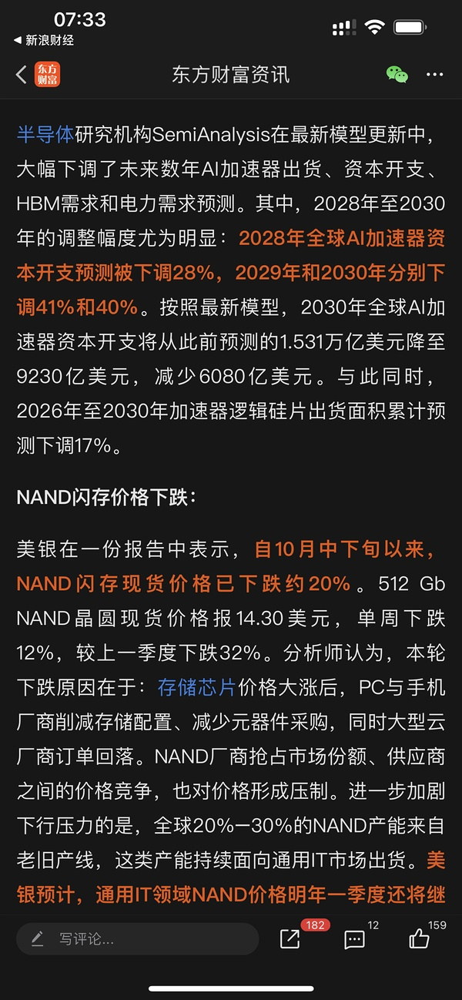
- 那要裁员了
- 然而甚至不知道债是因为昨天股市避险还是因为说话…….不过美债连绿中断了 现在看中债了🥲🥲🥲

### 生肖羊概念组（带阳/洋/光/太/泉的一篮子）｜11-09 14:04 他自己贴的分组；**11-13 崩盘实证**：15:58 截图跌幅榜 澳洋健康 −10.06、阳光照明 −10.05、红太阳 −10.04、大东方 −10.03、阳光乳业 −10.02、襄阳轴承 −9.98、鲁阳节能 −9.95、大西洋 −9.73、太阳电缆 −9.29、圣阳股份 −8.64、泉阳泉 −6.60、东方海洋 −6.59；他 14:48『我昨天起码说了6次 控制仓位 因为羊和东方昨天松动了！！！！这是情绪核心』（提及 7 次，占比 3%）2026-11-17 09:45:21
- 问题不大
今天冰雪前面因为羊
也开的很低很低
- 今天市场是情绪下杀 因为那群羊
今天科技还可以的
- 羊是核心 让她们多多加油 你才有希望

### 雪人集团 002639｜11-06「大连和雪儿」＋11-11 14:26「雪儿今天不错啊 大家昨天不是期待他接人嘛 这个任务做到了今天」（接人＝5日线接回，与雪人条件单口径一致）（提及 6 次，占比 3%）2026-11-17 08:13:45
- 冰雪都有啊 又没改过
今天雪儿1584完全有可能到啊

现在场外一塌糊涂 场内更要认真了😂
- 等会看吧
今天最多就捞雪儿
- 牛股 我买完雪儿这边已经上去了 22+了

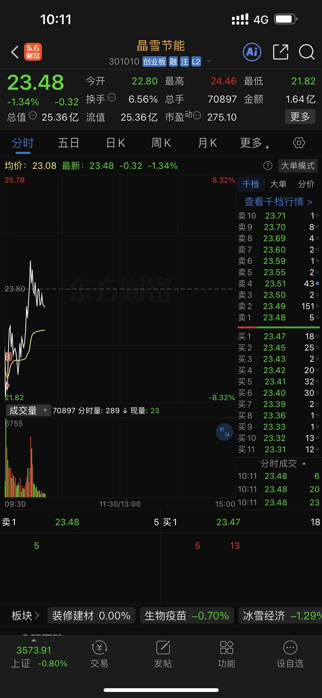

### 双义：股票=中国长城 / 基金=华安文体健康混合（用户 11-05 指认）（提及 6 次，占比 3%）2026-11-17 09:08:23
- 今天就安心了
终于是红色的了

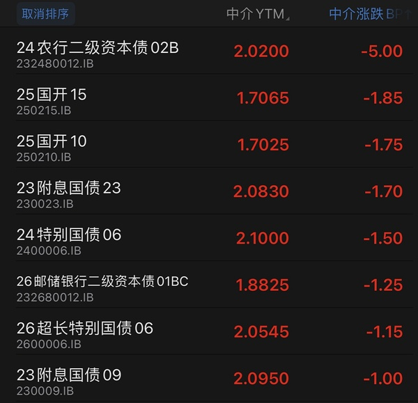
- 信用债厉害的

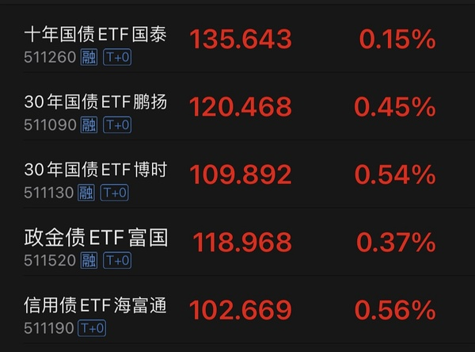
- 笑死
爱国和海外都是对手盘了

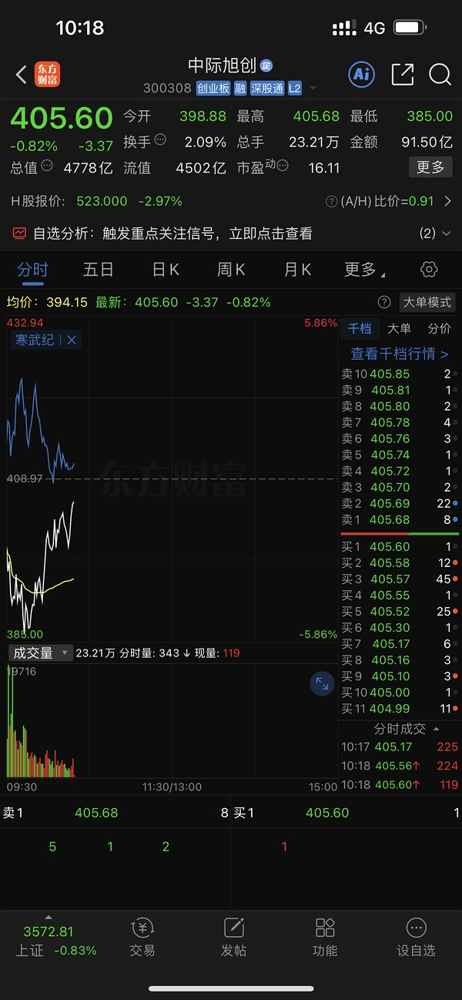

### 幸福蓝海（提及 4 次，占比 2%）2026-11-17 09:48:35
- 光线做出了防守贡献
接下来进攻我靠幸福
- 幸福这个月给了我幸福
现在我肯定先追随幸福🤣
- -4.3 的光线现在-8.3 4%
-7的幸福现在-11% 4%

没区别😂😂😂

### 301010 晶雪节能（上周买回、11-16 持有）｜09:39『上周买了plus』＋14:53『掌声雪儿plus雪』；卖单 24.94 沿用 11-05 老价，当日高 24.39 未触及（提及 4 次，占比 2%）2026-11-17 09:51:01
- 早上抄底雪儿的利润居然比plus还多点
- plus表示不服😂😂😂😂
- 2494的plus
你们周五抄底该兑现了

### 雪人集团（提及 4 次，占比 2%）2026-11-17 10:58:19
- 雪人触发1484今天买单
- 不需要今天 雪人接下来都是震荡向上

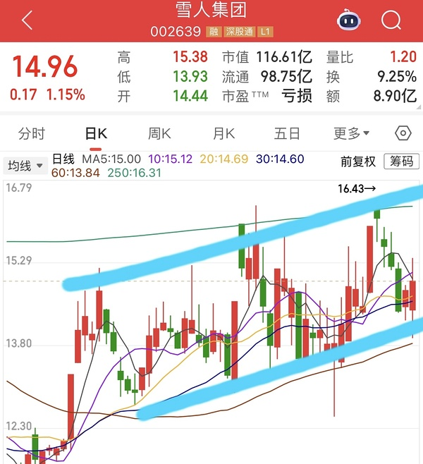
- 旅游板块你看 走势是这样的

暂时目标锁定在雪人他们非纯种上

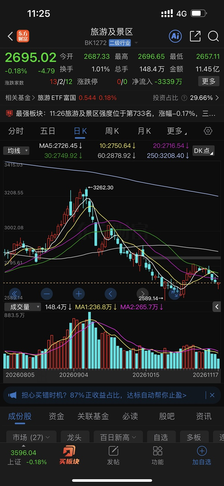

### 301010 晶雪节能（**B·推断；11-16 已买回持有**）｜11-13 10:04『plus雪是-20的…还能再跌-10』＝20cm，实测当日 −10.10%；15:25 答『多少出』报 24.94＝11-05 老卖单价（当日高 24.92 差 2 分未触及）；11-09 曾自述清仓 → **11-16 09:39『上周买了plus』＋14:53『掌声雪儿plus雪』＝上周买回、重新持有**；11-16 卖单 24.94 沿用，当日高 24.39 未触及；持仓屏 13:42:36 晶雪 23.110（提及 3 次，占比 1%）2026-11-17 09:13:07
- 看来昨天大家都没准备

bn694
幸福因为加仓了 保守开1864 贪心的我开2044 
雪儿1584今天是有可能到的 要开
plus雪2494继续就行对应周五抄底利润并不低 虽然我又抬高了

你们有些小伙伴自己抄底过大连cbs的别忘了自己
- 冰山自己都是九阳带的😂
现在你想要带要靠plus雪了
冰山已经+8 还能怎么带🤣而且雪人冲过一次1484了
个人让我没有动力单日连过两个关口哈哈
- 那个1584不动啊
明天重新买入后继续设置1484卖新买的 1584继续开

plus雪你今天没出去吗
2494啊😂😂😂😂
我开的2564 今天也触发回落了
就这两个
你自己看

超预期牛逼 不在计划内 依然按部就班

### 格力电器（提及 3 次，占比 1%）2026-11-17 13:04:19
- 空调暗示银行假摔
- 今天空调也暗示银行下跌是假的🤣工行马上翻红
- 你发截图时候
那个空调红着1%就在暗示银行是假摔了
我女朋友的东西我可关心了

### 博纳影业（提及 3 次，占比 1%）2026-11-17 13:27:28
- 今天早上bn-7.5 sy-1
再次实际教导 不能在情绪不好的时候
大跌的换跌的少的 不然日内可以连亏两把
- 坐等bn今天反超sy
- bn 614
幸福 1584

雪儿明天重新买入

### 513300 纳斯达克ETF华夏｜11-11 10:49「3300还行 不过今天我不满意」＋13:24「咱们3300还是近期数据最好的」（提及 2 次，占比 1%）2026-11-17 08:16:42
- 好了 重新计算下今天的3300
昨天三点收盘时候-1 计算得出3300其实还少了0.7跌幅

最终nana收盘-2.67% 现在+0.2 合计这里还要补跌-1.47%

如果算上少的0.7 就是开盘-2.17%
如果0.7忘了不要了 就是-
- 场内3300也在拉升溢价

昨天少跌的0.7 就当过去了就过去了不要啦？

### 603366（羊字辈·情绪核心，非持仓）｜11-13 15:58『尤其今天表态的日出东方 别周一又跌停躺平了』；实测 +5.54%、最高 14.21 距涨停 14.49 一步（提及 2 次，占比 1%）2026-11-17 09:53:13
- 高位人气股今早持续低迷，大东方、百洋股份、永臻股份、闽发铝业走出3连跌停，东方环宇、金辰股份、日出东方、海洋王连续2日跌停

有三连板的  情绪完全不行
- 而且今天垃圾不是因为科技

是因为这个

高位人气股今早持续低迷，大东方、百洋股份、永臻股份、闽发铝业走出3连跌停，东方环宇、金辰股份、日出东方、海洋王连续2日跌停。

### 友友、网友们（提及 2 次，占比 1%）2026-11-17 09:54:06
- uu们买了第二天没马上赚到就这个不行那个不行
买了第二天马上赚到的是余额宝呀

债券都大跌呢
- uu纳斯达克怎么样了？现在都没年初1月到三月底的回撤大啊😂

### 002582 好想你｜11-12 14:39:31『清了恋爱脑』＝清仓（卖价未披露；10.48 卖单两日均未触及→手动卖）；14:28『我如果去掉恋爱脑 也就比你多一个机器人』；当日收 9.76 −2.89%（提及 2 次，占比 1%）2026-11-17 10:36:38
- 所以我恋爱脑要撤走😂😂😂

老消费人了 都是大量学费的

没涨的 跌起来不会含糊

垃圾消费里越是看起来抗跌的  等情绪崩的时候 跌的更猛
- 你们肯定很喜欢安安那几个

你看安安成交量才多少

我如果着急卖 我还得降价几分钱才能马上卖掉

上周我恋爱脑降低了三分才马上出手成交

这就是危难时刻不能买垃圾消费的

### 电影档期锚（不是标的）｜同上，10:29『流浪地球要2月』（提及 2 次，占比 1%）2026-11-17 15:33:27
- 这个我要说一句
不要赌票房
在密集消息之前就要提前撤
再觉得票房牛逼 也要提前跑
到时候流浪地球也是

当然今天是普杀 也不管什么票是什么东西 
这一天总要来的
- 现在除了流浪地球
还有什么定档春节的影片不？

### 国产自主（半导体设备/芯片制造）（提及 1 次，占比 0%）2026-11-17 08:42:39
- 海外呀
爱国都在科创

### 华子＝007540 华泰保兴安悦债券A（华泰保兴基金·安悦债券A类份额），满仓30年超长利率债的长债基金（用户 2026-11-16 确认，无歧义，不是歧义项）；00:42 楼友『华子今年战绩无敌吧』→他答『30超长债牛逼没办法』；13:47『纯利率债就是华子那种 不过华子满仓30债 有些是满仓5-10年』；**与460108不是同一只**：460108＝华泰柏瑞稳健收益债券C（他持有的纯利率债·重仓国开/农发/国债，见六基行），华子007540 是华泰保兴的长债基金，勿混（提及 1 次，占比 0%）2026-11-17 08:49:51
- 笑死 昨天多么可笑的是华子也才0.39😂

### 新易盛＋中际旭创＋天孚通信（CPO三巨头合称）｜11-11 14:13「都去易中天了🤣」（非持仓）（提及 1 次，占比 0%）2026-11-17 09:59:53
- 你看看易中天不是在上吗

### 东方海洋（提及 1 次，占比 0%）2026-11-17 10:07:48
- “东方海洋上演地天板”

我等着这个推送

### 安记食品（提及 1 次，占比 0%）2026-11-17 11:32:42
- 但你要跟踪
因为随时都可以杀溢价
你要知道是正常跌 还是杀溢价

我是真金白银 这不是场外那么的安安稳稳
我每天都关心的

心里肯定要清楚 他漏跌了多少
到时候是正常归还这个漏的还是大杀溢价

### 创业板50ETF（提及 1 次，占比 0%）2026-11-17 11:46:42
- 你如果是按照我那个配比来的 别担心 这次是全球联动
比如最近C50跌幅大 
但其实总持仓不到中国基金三分之一 
已经尽可能减少拖累账户整体

### 保利发展（提及 1 次，占比 0%）2026-11-17 12:39:22
- 但是余额宝利率也是确实越来越低
怎么说呢 珍惜还有5%股息率的招行（也已经不到了）

### 粤传媒 002181｜11-09 12:12「非电影传媒就留给大家玩了 我一个都不会碰了」→ 推断已不持有（提及 1 次，占比 0%）2026-11-17 13:34:53
- 那下次你知道了 ycm之前也这样

### 000530 冰山冷热｜11-11 10:16「万一冰山跌停 他能跌到哪里再去」＋10:27「今天把冰山 晶雪按死 大连 CBS 正统上位」（非持仓，冰雪板块的山寨对照）（提及 1 次，占比 0%）2026-11-17 13:49:48
- 但是冰山又是看九阳的😂

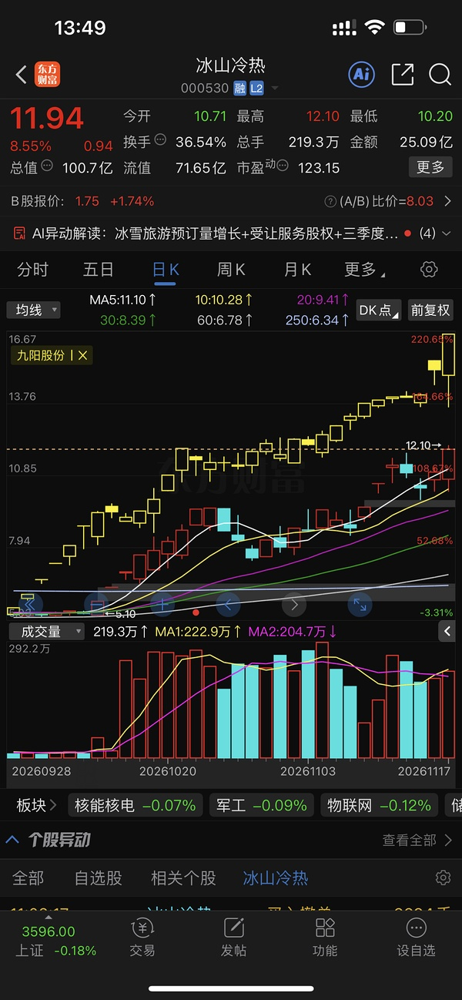

### 中证2000指数（他当微盘股基准）｜11-11 11:11「除了机器人 今天其他题材全输给了2000」（提及 1 次，占比 0%）2026-11-17 14:00:35
- 2000今天翻绿了

### 中国移动（他当指标用，非持仓）（提及 1 次，占比 0%）2026-11-17 14:27:23
- 今天空调一直1%顶着暗示银行假摔呀 包括10086

### 某个特别牛逼的散户（提及 1 次，占比 0%）2026-11-17 16:00:31
- 提桶大师plu今天提桶信号消失和温暖老师观点激情碰撞

精彩

### 📄 全部发言（共 203 条）
- (2026-11-17 07:34:19) [图] 

- (2026-11-17 07:52:09) 那要裁员了  ⊳ （引用 @六倍做多退休）按照这种下调 半导体要杀eps了 那么纳斯达克的前瞻pe完全没有用了

- (2026-11-17 08:04:59) 然而甚至不知道债是因为昨天股市避险还是因为说话…….不过美债连绿中断了 现在看中债了🥲🥲🥲  ⊳ （引用 @六倍做多退休）所有的一切都是为了美债 债始终优先级高于股

- (2026-11-17 08:06:34) [图] 市场抹去上周第四次加息的高预期 回到本来的三次

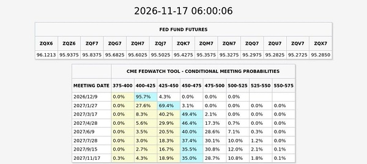

- (2026-11-17 08:08:54) 这份表看的就很舒服
12月一次
1月一次
三月就可能是最后次

三月真是玄乎 很多都指向三月 
明年过完年应该挺有意思的  ⊳ （引用 @不知道还能说啥）市场抹去上周第四次加息的高预期 回到本来的三次

- (2026-11-17 08:12:46) 目前除了现金 好像没有不是风险资产的了😂  ⊳ （引用 @六倍做多退休）美银警告：强美元正在抽干全球流动性，风险资产的机会可能要等到明年春天。

- (2026-11-17 08:13:45) 冰雪都有啊 又没改过
今天雪儿1584完全有可能到啊

现在场外一塌糊涂 场内更要认真了😂  ⊳ （引用 @吃西瓜的人）是不是只有xf有单子？

- (2026-11-17 08:16:42) 好了 重新计算下今天的3300
昨天三点收盘时候-1 计算得出3300其实还少了0.7跌幅

最终nana收盘-2.67% 现在+0.2 合计这里还要补跌-1.47%

如果算上少的0.7 就是开盘-2.17%
如果0.7忘了不要了 就是-1.47开盘

- (2026-11-17 08:17:00) 694定价
这价格应该不是涨停  ⊳ （引用 @我爱牛肉火锅）bn直接挂涨停就可以了对吧

- (2026-11-17 08:18:56) 设置694 买一 定价卖出

如果直接拉板 也会695卖出的  ⊳ （引用 @我爱牛肉火锅）我刚刚看涨停695😂😂，我去改一下

- (2026-11-17 08:27:54) 电脑内存条 电脑硬盘这次是不是要叠加了？
手机涨上去的要不要降回来  ⊳ （引用 @moli）一路闭眼玩到3月再回来看看

- (2026-11-17 08:30:29) 盘后多条小作文

1，市场将于近期降准缓解债券流动性

2，被禁止买长债的机构据说问了监管，居然已告知不再限制买长债了

3，央妈将于本周开始亲自下场加大买债规模

其中2已有多家机构确认其真实性

- (2026-11-17 08:31:34) 笑死
妈妈不容易
两边都要救

上周部分流出股市 是因为债券市场也要花钱是吗  ⊳ （引用 @不知道还能说啥）盘后多条小作文

1，市场将于近期降准缓解债券流动性

2，被禁止买长债的机构据说问了监管，居然已告知不再限制买长债了

3，央妈将于本周开始亲自下场加大买债规模

其中2已有多家机构确认其真实性

- (2026-11-17 08:34:04) 没有
上周五抄底的 还是2494好 
虽然我自己修改到了2574😂  ⊳ （引用 @shirla）plus是不是2624

- (2026-11-17 08:42:39) 海外呀
爱国都在科创  ⊳ （引用 @高手云集上钻）楼我有个问题，按照海外链和爱国链的说法，C50属于哪边呢

- (2026-11-17 08:45:30) [图] 有用

加上昨天盘后 长债抹去了昨天所有跌幅

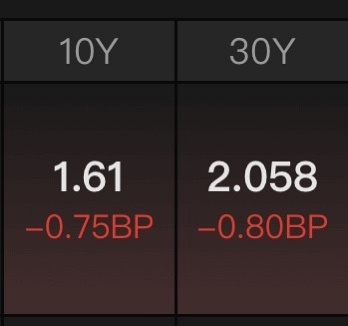  ⊳ （引用 @不知道还能说啥）盘后多条小作文

1，市场将于近期降准缓解债券流动性

2，被禁止买长债的机构据说问了监管，居然已告知不再限制买长债了

3，央妈将于本周开始亲自下场加大买债规模

其中2已有多家机构确认其真实性

- (2026-11-17 08:48:45) 🤣🤣🤣🤣🤣🤣🤣🤣

融资盘：qnmd 又被骗了  ⊳ （引用 @稀里不糊涂）融资出去200个亿

- (2026-11-17 08:49:51) 笑死 昨天多么可笑的是华子也才0.39😂  ⊳ （引用 @噜啦啦噜啦啦）昨天我的短债-0.18%，嘛呀，最大跌幅了吧😢，前面都才-0.10%😭😭😭

- (2026-11-17 09:04:52) 利率债大概率是的！我没钱了 不然我昨天肯定买😂  ⊳ （引用 @momomomomomo哒）那我昨天加债是加到低点了吗

- (2026-11-17 09:05:28) 肯定是债

债斯达克不是盖的  ⊳ （引用 @咬着一颗绿苹果）先保债还是先保股？先保债吧那我们还要吃苦一段时间了

- (2026-11-17 09:08:23) [图] 今天就安心了
终于是红色的了

- (2026-11-17 09:08:55) 这比股市血腥多了
有些债券三天抹掉了半年😂  ⊳ （引用 @不知道还能说啥）今天就安心了
终于是红色的了

- (2026-11-17 09:13:07) 看来昨天大家都没准备

bn694
幸福因为加仓了 保守开1864 贪心的我开2044 
雪儿1584今天是有可能到的 要开
plus雪2494继续就行对应周五抄底利润并不低 虽然我又抬高了

你们有些小伙伴自己抄底过大连cbs的别忘了自己开

- (2026-11-17 09:17:53) [图] 明天有可能大跌 有可能不跌 怎么样都是对的了

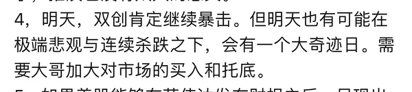  ⊳ （引用 @云小朵飘啊飘）大佳
1，今晚美股下跌。主要是半导体带动的科技的集体回调。硬件再次遭受重创，软件也不乐观。硬件有一个利空，有一个大行发了报告，说flash闪存价格下跌了20%。这不是预测，而是正在发生的事情。具体情况有待证实。软件则是英伟达风波的后续。明晚

- (2026-11-17 09:19:02) 不一定啊 昨天我们科技基本是计提了晚上的😂  ⊳ （引用 @点-重生炒垃圾）收到，全靠楼主这边来点红了

- (2026-11-17 09:19:54) 没有😂  ⊳ （引用 @🅰失而复🉐😎）你昨天最后买的是不是在里面😏

- (2026-11-17 09:24:40) 这个是美联储任期 不是主席任期
鲍威尔现在也是美联储的  ⊳ （引用 @樱桃小丸犊子）话说他的任期是14年。。。

- (2026-11-17 09:26:09) 等会看吧
今天最多就捞雪儿  ⊳ （引用 @shirla）楼楼一会儿捞哪个

- (2026-11-17 09:29:40) 跌了七八十了看到泡沫了……  ⊳ （引用 @👑）素，主要是我身边的大佬也看到了ai泡沫了😵‍💫😵‍💫😵‍💫害怕民主党简直

- (2026-11-17 09:30:41) 这还被称为大佬呢  ⊳ （引用 @我爱牛肉火锅）kkkkkk，好嘴哈哈哈哈哈哈哈

- (2026-11-17 09:31:21) 买入了

- (2026-11-17 09:31:37) 开单1484卖今天的
1584照常  ⊳ （引用 @不知道还能说啥）买入了

- (2026-11-17 09:33:59) 看到的时候直接14整了 笑死  ⊳ （引用 @shirla）耶，开单子

- (2026-11-17 09:35:10) 那你应该不知道14.2的绝佳买点 说三天的  ⊳ （引用 @番茄炒鸡蛋）我是错过哪条信息了？只看到卖单呀

- (2026-11-17 09:38:17) 有中韩不吃亏  ⊳ （引用 @稀里不糊涂）科技这么硬？红了都

- (2026-11-17 09:39:28) 爆量针😂  ⊳ （引用 @家不住海边）蓝色光标。贱人

- (2026-11-17 09:40:41) 25跌停开局  ⊳ （引用 @我爱牛肉火锅）地板好多东方啊

- (2026-11-17 09:43:51) -4.3换回-7

- (2026-11-17 09:44:06) 光线完成了任务  ⊳ （引用 @不知道还能说啥）-4.3换回-7

- (2026-11-17 09:45:21) 问题不大
今天冰雪前面因为羊
也开的很低很低  ⊳ （引用 @🅰失而复🉐😎）拉科技了😵

- (2026-11-17 09:48:10) 有的 上周买的在  ⊳ （引用 @木感情的打工人）你没有光线了吗

- (2026-11-17 09:48:35) 光线做出了防守贡献
接下来进攻我靠幸福  ⊳ （引用 @木感情的打工人）你没有光线了吗

- (2026-11-17 09:49:26) 居然有过3.5差价…  ⊳ （引用 @shirla）-5换-8.5😂😂😂

- (2026-11-17 09:51:01) 早上抄底雪儿的利润居然比plus还多点

- (2026-11-17 09:51:46) 回踩十日线是吗！  ⊳ （引用 @点-重生炒垃圾）Zy还能送钱吗？

- (2026-11-17 09:51:59) 科技股没用 看美国的  ⊳ （引用 @红红火火的anya）楼主，这种大跌情况下，技术指标还有用吗，我手里的股基本都破位了

- (2026-11-17 09:53:13) 高位人气股今早持续低迷，大东方、百洋股份、永臻股份、闽发铝业走出3连跌停，东方环宇、金辰股份、日出东方、海洋王连续2日跌停

有三连板的  情绪完全不行

- (2026-11-17 09:54:06) uu们买了第二天没马上赚到就这个不行那个不行
买了第二天马上赚到的是余额宝呀

债券都大跌呢  ⊳ （引用 @稀里不糊涂）现在买什么不跌

- (2026-11-17 09:54:48) plus表示不服😂😂😂😂  ⊳ （引用 @不知道还能说啥）早上抄底雪儿的利润居然比plus还多点

- (2026-11-17 09:55:50) 管用啊 没执行 犯错了  ⊳ （引用 @高手云集上钻）国庆之前写了四条减仓C50的条件，是不是已经不用管了1.美联储加息2.黄金弱3.人民币转弱4.国庆之后无增量

- (2026-11-17 09:56:50) 我记得周五楼里都是冰雪

今天冰雪不错了 开始唉声叹气了

- (2026-11-17 09:57:22) 除了RMB 都满足了  ⊳ （引用 @shirla）啊不是说条件不满足吗🤣🤣

- (2026-11-17 09:59:53) 你看看易中天不是在上吗  ⊳ （引用 @稀里不糊涂）科技下了，垃圾能不能上

- (2026-11-17 10:00:18) 而且今天垃圾不是因为科技

是因为这个

高位人气股今早持续低迷，大东方、百洋股份、永臻股份、闽发铝业走出3连跌停，东方环宇、金辰股份、日出东方、海洋王连续2日跌停。  ⊳ （引用 @稀里不糊涂）科技下了，垃圾能不能上

- (2026-11-17 10:05:37) 这是情绪核心之一 很关键  ⊳ （引用 @lacey）dfhy还从地板拉起来了🫣🫣

- (2026-11-17 10:05:55) 再看看呢  ⊳ （引用 @🅰失而复🉐😎）还是上影😕

- (2026-11-17 10:07:11) 今天市场是情绪下杀 因为那群羊
今天科技还可以的  ⊳ （引用 @🅰失而复🉐😎）红1900+是谁😵

- (2026-11-17 10:07:48) “东方海洋上演地天板”

我等着这个推送

- (2026-11-17 10:09:22) 他跌停我都没看到😂😂😂😂  ⊳ （引用 @六倍做多退休）我以为是九阳 九阳地板拉红了

- (2026-11-17 10:09:58) 想要做跨年妖股
就是要在危在旦夕时候挺身而出
不然也是fw  ⊳ （引用 @VVV坚定持有VVV）加油啊东方！

- (2026-11-17 10:11:22) 今天是第三天了 加油  ⊳ （引用 @我爱牛肉火锅）今天会是羊羊队立大功吗？

- (2026-11-17 10:12:16) [图] 牛股 我买完雪儿这边已经上去了 22+了

  ⊳ （引用 @ekiwang）我21.9抄的plus

- (2026-11-17 10:12:35) 但是九阳比他更厉害  ⊳ （引用 @vio）快红了

- (2026-11-17 10:13:54) 暂时确实是盟友
不过到最后只会剩一个🤣🤣  ⊳ （引用 @我爱牛肉火锅）我们是盟友不是对手，它越强越好啊，不要批量跌停我已心满意足

- (2026-11-17 10:15:40) [图] 信用债厉害的

- (2026-11-17 10:15:56) 宇树科技跌超10％，领跌物理AI板块，上纬新材、索辰科技、凡拓数创、福莱新材、襄阳轴承、华阳智能大幅调整。

- (2026-11-17 10:16:11) 传媒+物理ai
都被情绪干崩了  ⊳ （引用 @不知道还能说啥）宇树科技跌超10％，领跌物理AI板块，上纬新材、索辰科技、凡拓数创、福莱新材、襄阳轴承、华阳智能大幅调整。

- (2026-11-17 10:17:09) 今天就是第三天  ⊳ （引用 @我爱牛肉火锅）先活下去好吗？老大！！我一想到拔网线绕异动第三天抄底，我就玉玉了，感觉时不时打我一下

- (2026-11-17 10:17:44) 纯利率债其实很少的 

因为之前信用债太稳了  ⊳ （引用 @momomomomomo哒）早上你说利率债应该是最低 我去豆包了一下我的买的 是利率债+信用债

- (2026-11-17 10:18:29) [图] 笑死
爱国和海外都是对手盘了

- (2026-11-17 10:19:25) [图] 接下来大家别问我买什么了

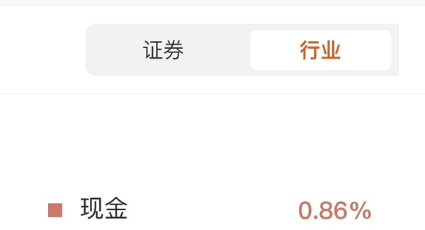

- (2026-11-17 10:21:08) 有可能过会儿就可以不是  ⊳ （引用 @稀里不糊涂）都满仓了😂😂

- (2026-11-17 10:32:16) 那还是忘记了那个0.7
按照我们推送的-1.47附近开  ⊳ （引用 @shirla）开盘才-0.6好像~不过一直在往下掉，现在-1.5了

- (2026-11-17 10:33:17) 跟风闽发的😂  ⊳ （引用 @只想搞钱）惠惠三连跌停，这是什么死罪吗

- (2026-11-17 10:36:38) 所以我恋爱脑要撤走😂😂😂

老消费人了 都是大量学费的

没涨的 跌起来不会含糊

垃圾消费里越是看起来抗跌的  等情绪崩的时候 跌的更猛  ⊳ （引用 @只想搞钱）而且整的整个消费没涨的也血洗

- (2026-11-17 10:41:24) 羊是核心 让她们多多加油 你才有希望  ⊳ （引用 @只想搞钱）我的安安和东百被套了，无语从芳子跑了还在庆幸结果跑到另一个坑

- (2026-11-17 10:43:14) 我没钱  ⊳ （引用 @Aaa摆烂咸鱼🥳）楼，纳斯达克etf是不是又可以买了，很符合你的图

- (2026-11-17 10:43:39) 那就是今天了
今天第三天 情绪资金会率先尝试核心目标  ⊳ （引用 @VVV坚定持有VVV）地天！我还没吃过地天板呢

- (2026-11-17 10:45:43) [图] 你最好仔细看下我的估算
然后看着期货按计算器

他们现在还是漏了0.7跌幅 你是否无视 
当然长期也无所谓 就看你投资目的

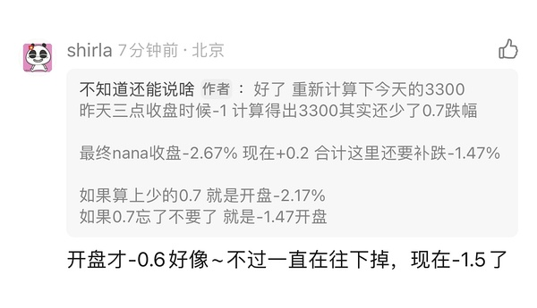  ⊳ （引用 @Aaa摆烂咸鱼🥳）那我去转换一下😂

- (2026-11-17 10:47:10) 钱不够🤣🤣🤣🤣要抄底东西太多了  ⊳ （引用 @我爱牛肉火锅）但是冰雪为啥反向了嘞，我以为小雪只怕科技反攻呢

- (2026-11-17 10:47:43) 就像我 因为前面干满仓了

今天冰雪继续往下 我也买不了了🤣

钱不够  ⊳ （引用 @我爱牛肉火锅）但是冰雪为啥反向了嘞，我以为小雪只怕科技反攻呢

- (2026-11-17 10:48:27) [图] 因为他们带队

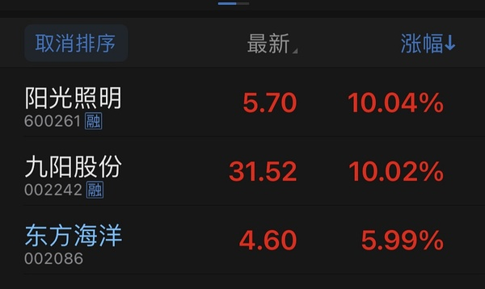  ⊳ （引用 @稀里不糊涂）跌停减少了

- (2026-11-17 10:49:39) [图] 谢谢他们 情绪绝对的核心

  ⊳ （引用 @该用户已过期）在尝试起床了🥹🥹

- (2026-11-17 10:51:28) 之前羊全部跌停不就一天发了N遍控制仓位

今天第三天了 情绪应该修复 我all in了🤣  ⊳ （引用 @只想搞钱）所以今天是留着钱去抄地板才是最优嘛，谁还有钱这个时候

- (2026-11-17 10:52:08) 这才是牛逼  ⊳ （引用 @sickid）凯撒涨停了

- (2026-11-17 10:52:54) 所以尼玛 要找跌停的  ⊳ （引用 @🅰失而复🉐😎）还有它

- (2026-11-17 10:53:42) 今天是情绪第三天呀 很正常其实  ⊳ （引用 @momo）凯撒文化盘中涨停，上演“地天板”，现报4.80元，成交额11.59亿元。
今天要批量地天吗

- (2026-11-17 10:56:05) 没问题的 14.2以下狠狠干  ⊳ （引用 @👑）哎？雪人⛄

- (2026-11-17 10:56:20) 不好意思
看的是羊的脸色  ⊳ （引用 @miumiu）怎么天天看冰山脸色啊

- (2026-11-17 10:56:58) yeah
不会是满仓了  ⊳ （引用 @该用户已过期）求雪人不扭！

- (2026-11-17 10:57:55) 2494的plus
你们周五抄底该兑现了

- (2026-11-17 10:58:19) 雪人触发1484今天买单

- (2026-11-17 10:58:27) 1584等待继续触发  ⊳ （引用 @不知道还能说啥）雪人触发1484今天买单

- (2026-11-17 10:59:01) 那两个在和旅游板块筑底 留给12月不好嘛  ⊳ （引用 @速派女孩将发财）大连 你可以后发制人嘛？？？
球球你了 我真的买了很多你 你再不努力我真的会换掉你了

- (2026-11-17 11:01:03) 我要赶紧去逆回购了
不然贱手又要买买买了

- (2026-11-17 11:01:33) SY如果跌到20日线
将重新纳入目标品

- (2026-11-17 11:02:00) SY此前都是沿着20日线运行  ⊳ （引用 @不知道还能说啥）SY如果跌到20日线
将重新纳入目标品

- (2026-11-17 11:02:23) 谢谢九阳 

这是市场情绪的绝对核心股票了  ⊳ （引用 @稀里不糊涂）红的变多了，情绪好转

- (2026-11-17 11:03:33) 阳光照明：那我呢  ⊳ （引用 @稀里不糊涂）九阳可以成今年妖股了，东方你退下吧

- (2026-11-17 11:06:01) 我昨天也着急
想要先手😂
如果今天加仓会更好  ⊳ （引用 @钱多多多多多）这次的教训对我来说，是3天。忍到了周五尾盘，但周五尾盘买的有点多了，导致昨天和今天很被动，下一次情绪崩盘，不能着急，控制好仓位。

- (2026-11-17 11:09:52) [图] 不需要今天 雪人接下来都是震荡向上

  ⊳ （引用 @momo）雪人今天能期盼到15.84吗，我还没卖出😐

- (2026-11-17 11:13:15) 没有 
今天第三天 只能先修复核心抱团的  ⊳ （引用 @momomomomomo哒）幸福是否有翻红的风险

- (2026-11-17 11:14:22) 叫夜盘

新浪财经就有  ⊳ （引用 @momo）现在哪可以看暗盘的coherent吗

- (2026-11-17 11:15:54) [图] 谢谢妈妈

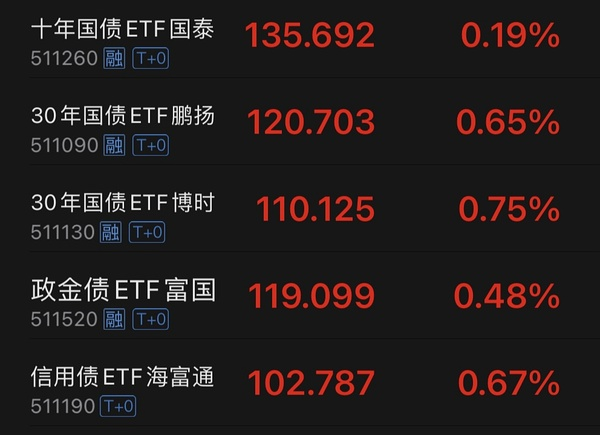  ⊳ （引用 @不知道还能说啥）盘后多条小作文

1，市场将于近期降准缓解债券流动性

2，被禁止买长债的机构据说问了监管，居然已告知不再限制买长债了

3，央妈将于本周开始亲自下场加大买债规模

其中2已有多家机构确认其真实性

- (2026-11-17 11:17:06) 让冰雪来呗
大家轮轮班  ⊳ （引用 @该用户已过期）电影们，你们方向错了

- (2026-11-17 11:21:59) 这个债券抄底居然还只能是昨天
如果今天 买点就不太好😂😂😂😂

- (2026-11-17 11:22:45) 我之前讲过的 
代入大家作为散户的视角 来判断最容易买入的点位 而这种点位就是批量套牢盘的地方  ⊳ （引用 @吃西瓜的人）楼你这些条件单价格的技巧是什么呀？可以偷师一下嘛

- (2026-11-17 11:26:01) [图] 旅游板块你看 走势是这样的

暂时目标锁定在雪人他们非纯种上

  ⊳ （引用 @该用户已过期）那还是大连先来吧🤣🤣电影看起来不是很想动

- (2026-11-17 11:27:11) 最近爱姐姐 珀莱雅那种好弱啊 都玩大的消费了还是不行  ⊳ （引用 @六倍做多退休）安井食品是真牛😂还以为增速到顶了 结果又起来了

- (2026-11-17 11:28:06) 场内3300也在拉升溢价

昨天少跌的0.7 就当过去了就过去了不要啦？

- (2026-11-17 11:32:42) 但你要跟踪
因为随时都可以杀溢价
你要知道是正常跌 还是杀溢价

我是真金白银 这不是场外那么的安安稳稳
我每天都关心的

心里肯定要清楚 他漏跌了多少
到时候是正常归还这个漏的还是大杀溢价  ⊳ （引用 @monica）所以，这个3300的涨跌毫无规律可言，主打一个应涨尽涨。

- (2026-11-17 11:35:19) 这不对吧
你买票不可能就为了今天要翻红吧

今天是崩盘情绪第三天

不是情绪高涨第三天呀🤣  ⊳ （引用 @小猫白-发财版）惨 我今天还加仓幸福了

- (2026-11-17 11:36:32) 中韩最近靠的都是中

韩国人都是嘴炮 比我们妈妈垃圾多了😂  ⊳ （引用 @六倍做多退休）场内纳+中韩 真的还不错 

- (2026-11-17 11:38:17) [图] 东方财富这个垃圾指标 冰你个大头鬼
财联社现在温度58度😂😂😂

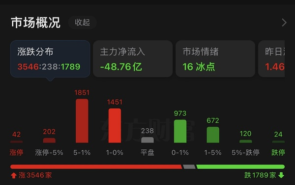

- (2026-11-17 11:42:06) [图] 买债券的又可以记录日子了
今天11/17日是债券反攻日

抗跌的里面有没有涨起来又猛的（夏普比猛的）
值得关注

因为今天是利率债 信用债 政金债集体暴力反弹 是很好的观察日

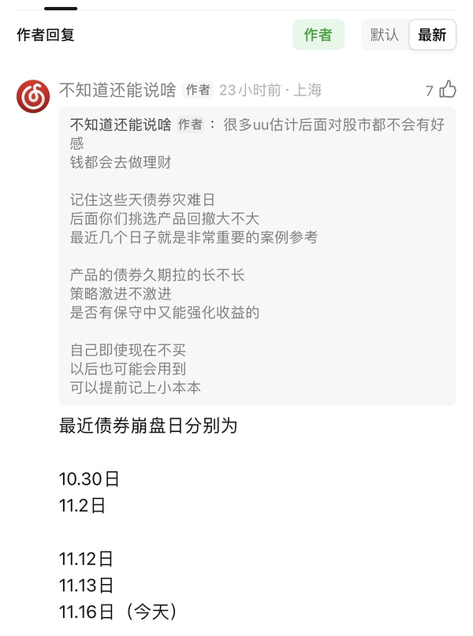

- (2026-11-17 11:46:42) 你如果是按照我那个配比来的 别担心 这次是全球联动
比如最近C50跌幅大 
但其实总持仓不到中国基金三分之一 
已经尽可能减少拖累账户整体  ⊳ （引用 @momo）我中买得比美多，就怕到时候反弹，美都填不平中的亏损😂

- (2026-11-17 11:47:55) 11月17日消息，日前，阿里巴巴发布全员通知，调整了员工回流政策。

根据最新规定，从阿里集团主动离职1次的员工，需满6个月后方可重新应聘；但如果是回流至集团内未曾任职过的业务集团岗位，则不受该时间限制。

而对于主动离职达到2次的员工，将无法回流至原业务集团，仅能去往集团体系内未曾任职过的其他业务线。例如，若从阿里控股离职两次，将不能再回阿里控股，但仍可前往淘天、阿里云、AIDC等其他业务线。

据新浪科技报道，针对外界关于该政策“史上最严”的讨论，有知情人士透露，本次调整只是对集团各业务线原有“二雇政策”的统一，属于既往政策的延续，并非收紧，“史上最严”的说法系误读。  ⊳ （引用 @六倍做多退休）阿里巴巴港股下跌5%，至85.6港元，为2025年1月以来最低水平。

- (2026-11-17 11:50:40) 👍👍👍👍  ⊳ （引用 @VVV坚定持有VVV）这题我会，因为人家在“套牢”的同时，可以反手做空，等到反弹回“套牢”位置的时候已经赚了空的钱，不用卖出正股可以开始赚多的钱

- (2026-11-17 12:00:52) [图] 昨天买先手 也有理由的🤣毕竟今天第三天 大有修复可能
比如这个你今天跌停买 暂时也是纸面富贵 🤣还不知道会如何
不过如果昨天拿到筹码 今天就能真的赚了出了

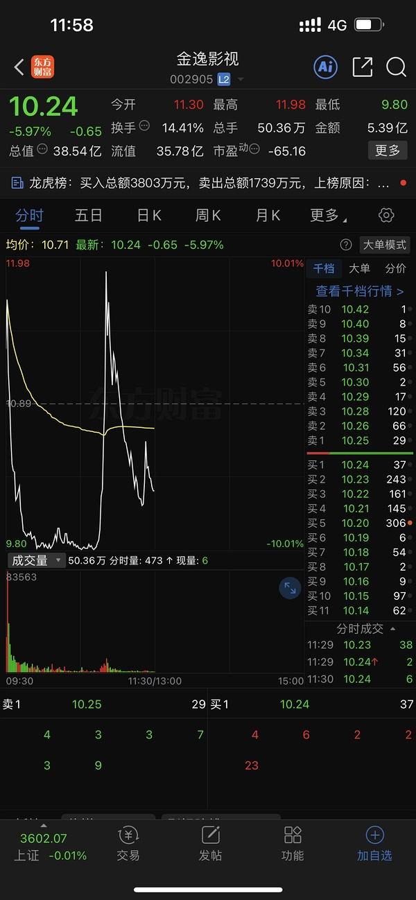  ⊳ （引用 @lacey）呜呜呜我也吉吉国王了🫠🫠今天差点绷不住

- (2026-11-17 12:16:01) 他打了伊朗后
3-6月可是中美硬科技最猛的😂  ⊳ （引用 @sickid）一切责任在以色列

- (2026-11-17 12:17:21) 所以一天到晚看上证指数的都是小丑
今天科技嗨了 上证指数反而是绿的  ⊳ （引用 @momo（富姐版））心情是科技不要再跌了影响大盘 就这样横盘吧 让大家开开心心炒几个小垃圾明年再说

- (2026-11-17 12:24:52) 昨日盘后传闻央行降为了债券市场立即降准，目前消息面无法证实也无法证伪。

不过今日央行重新释放流动性，11月17日央行开展了7140亿元隔夜逆回购操作，今日有4600亿元隔夜逆回购到期。

- (2026-11-17 12:24:57) 谢谢妈  ⊳ （引用 @不知道还能说啥）昨日盘后传闻央行降为了债券市场立即降准，目前消息面无法证实也无法证伪。

不过今日央行重新释放流动性，11月17日央行开展了7140亿元隔夜逆回购操作，今日有4600亿元隔夜逆回购到期。

- (2026-11-17 12:25:29) 妈妈最近可太忙了 左右夹击 妈妈太累了  ⊳ （引用 @不知道还能说啥）昨日盘后传闻央行降为了债券市场立即降准，目前消息面无法证实也无法证伪。

不过今日央行重新释放流动性，11月17日央行开展了7140亿元隔夜逆回购操作，今日有4600亿元隔夜逆回购到期。

- (2026-11-17 12:28:45) 这还不只是我的心肝🤣🤣🤣🤣

养老金 企业年金 很多地方政府的钱也是债券占据绝对大头的🤣  ⊳ （引用 @我爱牛肉火锅）好好笑，债是妈的心肝也是你的心肝

- (2026-11-17 12:35:39) [图] 我也得说句公道话
银行股全是破净也是本来市场的错误😂
现在很多银行股pb还是低于地产股 本来也不合理😂😂😂😂😂

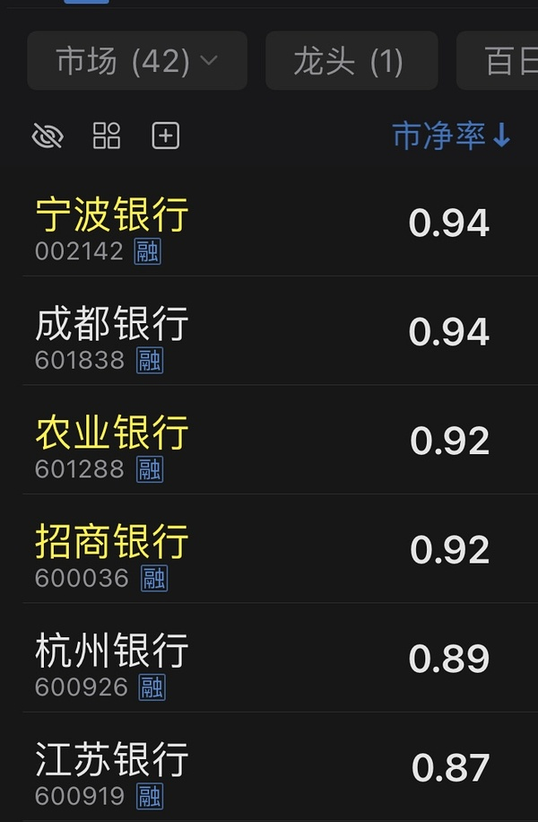  ⊳ （引用 @六倍做多退休）银行牛逼

- (2026-11-17 12:39:22) 但是余额宝利率也是确实越来越低
怎么说呢 珍惜还有5%股息率的招行（也已经不到了）  ⊳ （引用 @moli）但股息率这么低

- (2026-11-17 12:48:47) 我懂你们的
我讲句老实话
如果我当初20笔配置里有5份红利
也肯定被你们自己转出去干了😂  ⊳ （引用 @momo）😭谢谢楼楼按摩，我是差生，梭哈了C50和畅畅，这两对半，其他割了

- (2026-11-17 12:53:04) 不过我后来也在思考
这个实时股息率其实都是针对现在买的人说的

比如对于我来说 
我招行就是几年前30多买了7000股20万的人
只要他的分红稳定提高 
就按照2元来看 对我持有者来说 我就是每年20万投入分得14000的人 不会因为他股价是60元还是40元的高低
而降低我持有人的分红股息率

我就是那个20万  ⊳ （引用 @moli）但股息率这么低

- (2026-11-17 12:59:50) 🤣其实你们的操作比我更相信科技  ⊳ （引用 @momomomomomo哒）我是其他割了都去买了美 😂

- (2026-11-17 13:02:57) 过两天就赚了  ⊳ （引用 @momo）被我反指了哈哈哈

- (2026-11-17 13:04:19) 空调暗示银行假摔  ⊳ （引用 @木感情的打工人）今天钱都去科技了？？

- (2026-11-17 13:13:05) 你好像本轮自始至终都不相信电影  ⊳ （引用 @木感情的打工人）电影不会a杀把，楼

- (2026-11-17 13:16:14) 今天空调也暗示银行下跌是假的🤣工行马上翻红  ⊳ （引用 @一切都会过去的）茅台又要拐头向上了 打扰了

- (2026-11-17 13:16:50) 今天确实不会了
因为已经嗨过了
我们都已经兑现筹码了  ⊳ （引用 @家不住海边）又来了
今天我也不相信冰雪能支棱起来

- (2026-11-17 13:19:03) [图] 今天不行

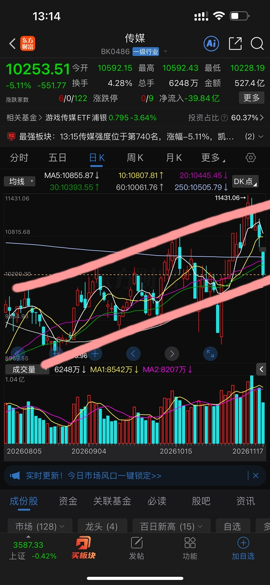  ⊳ （引用 @YuanZi💕）那午后电影来接力吧😂

- (2026-11-17 13:27:28) 今天早上bn-7.5 sy-1
再次实际教导 不能在情绪不好的时候
大跌的换跌的少的 不然日内可以连亏两把

- (2026-11-17 13:28:16) 他是不是不服气😂  ⊳ （引用 @该用户已过期）⛄️楼看不起你今天还能起来一波，你看着办吧🤣🤣（我忍不了，你呢？）

- (2026-11-17 13:29:23) bdd走势完全复刻传媒
我要删除他在冰雪分组了

- (2026-11-17 13:30:44) 上一段要在这地方来来回回几天呢
会给我们送很多零花钱的  ⊳ （引用 @该用户已过期）超级不服气，马上干波大的🤣🤣

- (2026-11-17 13:32:26) 美国只要知道哪一次是最后一次就会好（美联储会给信号的）  ⊳ （引用 @一切都会过去的）楼楼 宏观上是不是得熬过加息周期才能有大行情了 达子这些也只是短期扰动了

- (2026-11-17 13:34:53) [图] 那下次你知道了 ycm之前也这样

  ⊳ （引用 @该用户已过期）我还是希望它先触发一下1584的单子，不然没钱套它了🤣🤣没想到下来这么多，15.3+和8+打满了

- (2026-11-17 13:36:42) 坐等bn今天反超sy  ⊳ （引用 @🅰失而复🉐😎）早删了就它这样的真难把控

- (2026-11-17 13:38:49) [图] 妈妈真忙碌啊 还有这里妈妈也要竭尽全力

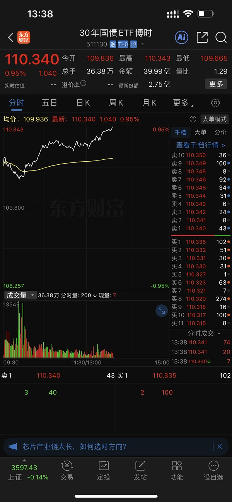  ⊳ （引用 @速派女孩将发财）娜娜期货在跳水 这个时候妈妈来 又是一点半 omg
我们冰冰还是有机会的

- (2026-11-17 13:43:30) 幸福这个月给了我幸福
现在我肯定先追随幸福🤣  ⊳ （引用 @该用户已过期）完了，又得给sy留钱🤣🤣我这钱咋就这么少呢

- (2026-11-17 13:44:49) 你不应该啊
我今天还说了20日线跌到才纳入观察目标
今天跌停也到不了的  ⊳ （引用 @momo）楼楼今天补了sy吗

- (2026-11-17 13:49:48) [图] 但是冰山又是看九阳的😂

  ⊳ （引用 @该用户已过期）过几天吧🤣今天就⛄️给了点好脸色，冰山崩了就没了🤣🤣

- (2026-11-17 13:52:32) 我场内之前也操作过通信ETF
既然是场内 错了及时砍呗 来去自如😂  ⊳ （引用 @Waiting一下）我场内的C50室场外所有的总和，我原本只想做个T没想到，从8号到现在，诶

- (2026-11-17 13:52:56) 涨停跌停数量同时大幅增加😂😂😂😂😂

- (2026-11-17 13:54:18) [图] 后排倒下了

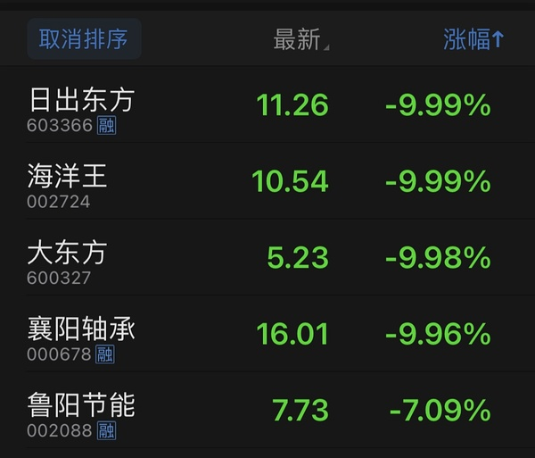  ⊳ （引用 @该用户已过期）九阳太硬了🤣封单几乎无变化

- (2026-11-17 13:57:20) 每次这时候
那个平潭就来了

- (2026-11-17 13:58:25) 上午已经不到9了 现在我也不想看😂  ⊳ （引用 @该用户已过期）楼，你这个月的收益还有一半吗？🥹🥹

- (2026-11-17 13:59:46) 割干净了吗  ⊳ （引用 @想当富有的咸鱼）早上实在没钱买雪PLUS了，还好割了个科技买了雪……

- (2026-11-17 14:00:35) 2000今天翻绿了  ⊳ （引用 @该用户已过期）我只剩高点的1/7了，即将清零🥹🥹这个月没保卫

- (2026-11-17 14:02:20) 冰山自己都是九阳带的😂
现在你想要带要靠plus雪了
冰山已经+8 还能怎么带🤣而且雪人冲过一次1484了
个人让我没有动力单日连过两个关口哈哈  ⊳ （引用 @高手云集上钻）老大能不能让冰山带一下冰雪人的持仓😭

- (2026-11-17 14:04:22) [图] 今天跌停是强者的证明🤣🤣🤣🤣

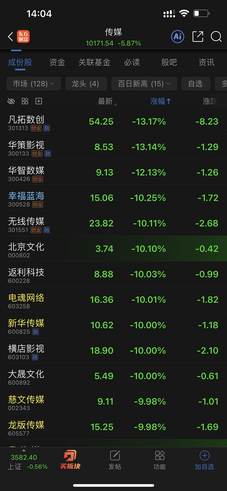  ⊳ （引用 @只想搞钱）Bn要奔着跌停去吗🥲🥲

- (2026-11-17 14:07:45) 都是大跌了
大家有不看好的 东西
可以调仓换股了

- (2026-11-17 14:08:00) [图] 在这

  ⊳ （引用 @家不住海边）救市主在哪

- (2026-11-17 14:08:57) 我要算算我今天-4.3换-7赚了没有  ⊳ （引用 @该用户已过期）没事，这两天这么跌，他们该割了

- (2026-11-17 14:11:34) 情绪崩盘 消费垃圾是最该跌的
消费那边小票才是真的小

而且没什么成交量 很容易大幅度降价卖  ⊳ （引用 @只想搞钱）不是，我真心不理解消费是为什么啊，全是三天-20个点左右的

- (2026-11-17 14:12:52) 老消费人
有几个学费我都交过

情绪你看着不行了（羊提示很久了） 不能买垃圾消费

过节之前 你不能买消费

市场反攻你不能买垃圾消费  ⊳ （引用 @只想搞钱）不是，我真心不理解消费是为什么啊，全是三天-20个点左右的

- (2026-11-17 14:14:31) [图] 是的 就是这样子
之前传媒不能加仓的原因

然而今天第三天 我已经以身入局了
传媒我也没有那么谨慎了😂😂😂😂😂😂

略微错在昨天抢先手 可惜博纳不是金逸

  ⊳ （引用 @木感情的打工人）楼，你前面说那几个高位票给的指引，警惕情绪大崩盘，这就来了

- (2026-11-17 14:16:28) 你们肯定很喜欢安安那几个

你看安安成交量才多少

我如果着急卖 我还得降价几分钱才能马上卖掉

上周我恋爱脑降低了三分才马上出手成交

这就是危难时刻不能买垃圾消费的  ⊳ （引用 @只想搞钱）好的谢谢楼

- (2026-11-17 14:18:16) 今天抗跌的吸引资金 可能反而不是好事
让他们跌 本来就都是大跌  ⊳ （引用 @momo）zy你。。。

- (2026-11-17 14:20:14) 😂😂😂😂😂每次情绪崩盘
垃圾食品商场 你写下来“要跑的远远的”

你不可能有我吃的亏多的
这是学费

只要情绪不好了
垃圾食品你要快点出去  ⊳ （引用 @只想搞钱）光想着在消费等总没错，忽略主要问题了

- (2026-11-17 14:22:44) 如果指数好 就有机器人
机器人好像很会共振指数😂  ⊳ （引用 @sickid）不过我看的短线博主说明天传媒机器人有机会

- (2026-11-17 14:23:15) 我会有的😂  ⊳ （引用 @速派女孩将发财）明天还会有法定香槟日嘛？

- (2026-11-17 14:25:35) 现在跌幅都差不多
你看好哪个去哪个  ⊳ （引用 @圈圈儿）楼楼，只跟上了雪人，雪plus早上没来得及低吸只有兑现了。幸福有操作，zy可以什么时候介入？今天吗？

- (2026-11-17 14:25:56) 跌停上都是强者 赶紧的  ⊳ （引用 @乖乖是只嘤嘤怪）难顶 bn要跌停啊

- (2026-11-17 14:27:23) 今天空调一直1%顶着暗示银行假摔呀 包括10086  ⊳ （引用 @海贼）银行太牛逼了

- (2026-11-17 14:30:23) 市场不可能在目前情绪下跑出新的强势题材的
所以情绪反攻都是延续之前

除了冰雪旅游那种滑稽东西
如果没有反攻 大家都末日 也没什么区别  ⊳ （引用 @该用户已过期）咱都一样的持仓，你有我也有！

- (2026-11-17 14:31:52) 你不知道我满仓了？  ⊳ （引用 @👑）bn zy如果跌停接吗

- (2026-11-17 14:33:11) 跌停暴增  ⊳ （引用 @速派女孩将发财）woc 两点半急速跳水 什么意思

- (2026-11-17 14:33:59) 妈妈今天管债券🤣  ⊳ （引用 @速派女孩将发财）老师 我们的剧本不是两点半拉升嘛？都怪妈妈一点半乱买 烦死了

- (2026-11-17 14:35:18) 我买的我都看好
不看好的不买  ⊳ （引用 @圈圈儿）楼楼更看好幸福么

- (2026-11-17 14:36:12) 所以满仓了啊 没有余额

雪儿明天还是给雪儿的 14.3以下  ⊳ （引用 @🅰失而复🉐😎）你不是雪人出来逆回购了

- (2026-11-17 14:38:08) 在太子爷两件事没落地之前你们就有这个感觉😂  ⊳ （引用 @晓）我也感觉科创比创业容易回本

- (2026-11-17 14:39:27) -4.3 的光线现在-8.3 4%
-7的幸福现在-11% 4%

没区别😂😂😂  ⊳ （引用 @我爱牛肉火锅）你算好了吗？光线在你这是不是又稍微挽回点面子

- (2026-11-17 14:43:01) 幸福是量化专业户 线没有任何看头

就看板块情绪如何  ⊳ （引用 @我爱牛肉火锅）xf要是现价收盘刚好抹掉大阳线，它也学到奶茶的吃一天揍三天了吗hhhhhh

- (2026-11-17 14:46:11) 反正我都是提前说
就像6月发中芯国际图提醒一样
至于大家怎么看各自有看法很正常  ⊳ （引用 @高手云集上钻）太子上面有爹妈，失业板有谁😎

- (2026-11-17 14:49:10) 今天大绿的是我场内账户😂  ⊳ （引用 @我爱牛肉火锅）睡醒一看很绿但没有绿的想象中多，不知道谁救了我

- (2026-11-17 14:51:37) 如果明天开局立马强力修复抢反弹
一定要抓紧把今天买的ssss
记住哦 这个很重要

- (2026-11-17 14:54:05) 做好准备

传媒开局强力抢反攻 经常做  ⊳ （引用 @该用户已过期）感觉不会强力🤣🤣最多能坐起来

- (2026-11-17 14:55:28) 你发截图时候
那个空调红着1%就在暗示银行是假摔了
我女朋友的东西我可关心了  ⊳ （引用 @momo）没想到模拟盘我竟然红了，我要把模拟盘清掉，不能占用中下旬收入特高这个预言！！！

- (2026-11-17 14:57:59) bn 614
幸福 1584

雪儿明天重新买入  ⊳ （引用 @shirla）手动来不及哎，条件单求抄作业😂😂😂

- (2026-11-17 15:02:35) 那个1584不动啊
明天重新买入后继续设置1484卖新买的 1584继续开

plus雪你今天没出去吗
2494啊😂😂😂😂
我开的2564 今天也触发回落了
就这两个
你自己看

超预期牛逼 不在计划内 依然按部就班  ⊳ （引用 @shirla）已有的雪儿建议设置多少哇，还有plus

- (2026-11-17 15:05:25) 明天收益重新回来 加油🤣

而且最好希望他们不要开局立马强力修复 会适得其反😂😂😂😂😂😂😂稍微给点时间来去交换一下  ⊳ （引用 @shirla）这个月的收益暂时无了😂😂😂希望明天开始扬起来啊！别抑了啊！

- (2026-11-17 15:06:36) 这两天不都来了吗  ⊳ （引用 @稀里不糊涂）我发现最近这段时间捡尸队不来了，不仅不来了还卖

- (2026-11-17 15:07:15) 今天还能问咋了😂  ⊳ （引用 @-却行）卧槽bn咋了

- (2026-11-17 15:09:17) uu真猛啊 plus日内就回接了  ⊳ （引用 @shirla）好的！感谢楼楼一次次地喂饭啊哈哈~plus雪我今天顺利出去啦，尾盘又接回来了，雪儿是没出去后来就没动了，希望明天出去一下给我点零花钱！（下次得设买三才行）

- (2026-11-17 15:12:12) [图] 今天你们没出发雪儿挺意外的
因为10:57:36开始回落以后
即使一开始没报价出去
后面股价还返回来的可以交易成功的

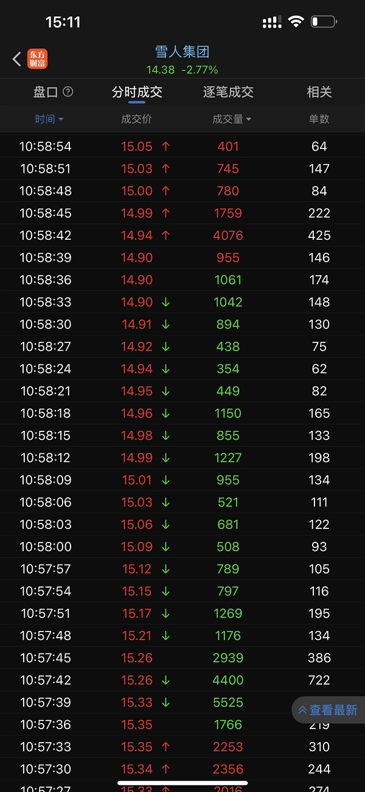  ⊳ （引用 @shirla）好的！感谢楼楼一次次地喂饭啊哈哈~plus雪我今天顺利出去啦，尾盘又接回来了，雪儿是没出去后来就没动了，希望明天出去一下给我点零花钱！（下次得设买三才行）

- (2026-11-17 15:13:24) 债券更重要

还有空买A 不错了 债券那边啥情况你也知道的  ⊳ （引用 @稀里不糊涂）和之前比买的少很多了吧，之前不是都说3.5百亿的买

- (2026-11-17 15:22:33) 最强势板块补跌 情绪崩盘总要经历的
好在这三天电影人就是回归到周四
中间还是高抛兑现几笔的 
除去昨天的先手有点问题 今天买入也正常  ⊳ （引用 @-却行）🤯没想到一觉起来都跳了

- (2026-11-17 15:33:27) 这个我要说一句
不要赌票房
在密集消息之前就要提前撤
再觉得票房牛逼 也要提前跑
到时候流浪地球也是

当然今天是普杀 也不管什么票是什么东西 
这一天总要来的  ⊳ （引用 @👑）中影我其实还蛮有信心的，就是昨天去看了电影，感觉好萧条😅然后不是说复联五预测首周15亿美元吗，如果真爆发就好了🤣🥲

- (2026-11-17 15:35:04) 现在楼里到底命在传媒还是冰雪？
我已经被大家整迷糊了  ⊳ （引用 @momomomomomo哒）等明天了😩😩😩

- (2026-11-17 15:40:29) 雪人来来回回已经赚了很多次隔日就8%以上利润了
都是雪儿帮你赚来的吧？  ⊳ （引用 @统统S掉）我全仓冰雪，因为场内焊死了只放2w，买不了那么多。但是这个月收益率还+11.2%，我也不知道咋算的

- (2026-11-17 15:42:44) 现在除了流浪地球
还有什么定档春节的影片不？  ⊳ （引用 @qiu啾）说起来今天小姐妹们开始讨论春节档了哈哈哈复仇者联盟什么的

- (2026-11-17 15:43:44) 今天雪儿日内就7+到手了
雪儿利润都是靠他来来回回积攒的😂😂😂😂
大家更喜欢的一直都是这个赚钱模式  ⊳ （引用 @统统S掉）确实是，雪人+20，大连-10

- (2026-11-17 15:45:29) uu纳斯达克怎么样了？现在都没年初1月到三月底的回撤大啊😂  ⊳ （引用 @小鱼）我想问个问题，纳指都这样了，有没有纳指基开放额度了啊？开放了要不要买啊，我不敢打开我的账户😂😂

- (2026-11-17 15:50:09) 我提醒你一下
不是因为哪吒
而是因为DS横空出世
因为碰巧他哪吒 所以放大了情绪交易
如果没有DS
回来第一天20 然后就A杀了  ⊳ （引用 @生动的羊）赌票房还走出来的 只记得光线 哪吒多么现象级的产品啊

- (2026-11-17 15:51:30) [图] 没有一个赌票房是成功的 光线只是运气好碰到了DS

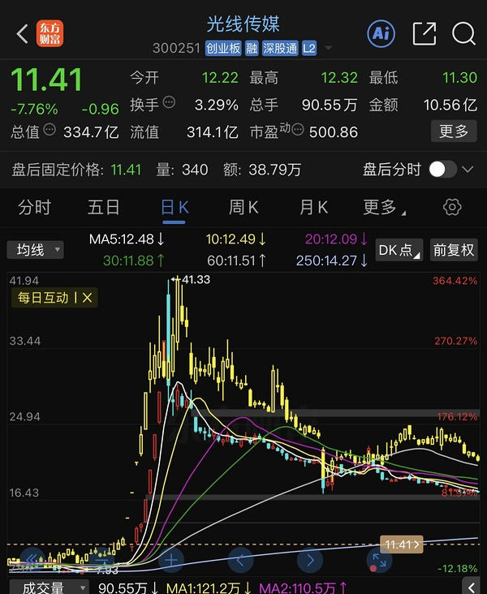  ⊳ （引用 @生动的羊）赌票房还走出来的 只记得光线 哪吒多么现象级的产品啊

- (2026-11-17 15:57:57) 那群东方和羊总要死掉一批的 必经之路😂😂😂
每次都有情绪炒作周期呀没办法

闽发7连板歇菜应该是本轮情绪受损的开始😅
你看跟风的惠发哈哈 一地鸡毛  ⊳ （引用 @速派女孩将发财）现在是双创恶劣还要带崩微盘股 就很烦 以前双创坏微盘会和银行一样红的

- (2026-11-17 16:00:31) 提桶大师plu今天提桶信号消失和温暖老师观点激情碰撞

精彩

## 🧠 投资风格分析
> 📏 增量更新指引：仅当今日发言确有新依据时才修订对应维度，无变化不强行重写；单维度修订建议 ≤150 字。

- 投资理念与方法：坚持机会成本与性价比比较，强调“只赚份内的钱”；今日进一步强调远离机构重仓，认为公募抱团趋同会制造拥挤风险，主张跟踪基金与基准指数的贴合度，规避机构重仓股。对题材炒作保持警惕，认为消费、地产、传媒等题材“别真的当真”。
- 风险偏好：对高波动、高拥挤的题材股回避，主动规避机构重仓和题材炒作；对美股谨慎但认可其强势；注意控制仓位，担心情绪核心崩盘，周四担心题材杀跌，周五提示『别装逼』。
- 交易与仓位：偏好低吸不追高，强调『不加仓和持有是两回事』；坚决执行条件单，挂单卖出幸福蓝海、触发后买入光线；对传媒不增加仓位但保留持仓；周五躲避利息，今天清仓机器人；注重仓位控制，担心情绪核心崩盘，强调『管住手』。
- 心理特质：自我认知清晰，承认看错传媒，对市场规律有敬畏；重视筹码与机构行为；情绪稳定，不追高、不眼红。今日新增：面对不利账户选择不打开银行/债券查看，称「不看就无视发生」，体现以回避查看波动来维持心态的自我调节习惯。

> ⚠️ 本板块由 Actions 全自动增量更新（复用当日发言与今日总览），每次仅在内容足够支撑时才改动。

## 🏷️ 昵称映射表
### 📖 昵称规律（供 AI 判断新昵称时参考）
【昵称命名规律（用于推断未知新昵称）】
- 拼音首字母缩写：取标的/基金名汉字拼音首字母串（含数字代码），多为 ETF/股票代码口语化｜示例：yl=引力传媒｜zy=掌阅科技｜sj=视觉中国｜cc=华安文体健康混合｜C50=创业板50ETF｜k50=科创50｜kun=昆仑万维｜xhxc=新瀚新材｜zxfc=中欣氟材
- 小/老+姓氏代指：「小X」「老X」通常指姓 X 的标的或该标的的基金经理；「X兄弟」多为同系基金｜示例：小惠=惠发食品｜老莫=万家品质生活(莫海波)｜小华=华夏全球科技先锋(QDII)A｜小华兄弟=华夏移动互联(QDII)｜小浦=浦银安盛全球智能科技(QDII)A｜小广=广发全球精选(QDII)A｜小远=华宝致远(QDII)C｜招招=招商银行｜小德=德明利｜赵姨=兆易创新｜露露=泸州老窖｜空调=格力电器
- 戏称/黑话→题材板块：生活化比喻或黑话对应某个题材/板块，而非单一标的；出现时多指板块方向｜示例：卖国=PCB板块(英伟达AI链)｜爱国=国产自主(半导体设备/芯片)｜奶茶=易点天下｜老师=中文在线｜蓝色=蓝色光标｜宇航员=航空航天板块｜华子=华泰保兴安悦债券｜国际=国际复材｜巨无霸=长鑫科技等重大IPO
- 谐音/取字：昵称含标的名关键字（取一字或谐音），多为 A 股个股或基金简称｜示例：万华=万华化学｜东百=东百集团｜宝=保利发展｜讨饭/亚洲讨饭/建信新兴=建信新兴市场(QDII)A｜华宝zy=华宝致远(QDII)A
- 机构/基金经理昵称：以基金公司名、经理姓、或平台代称指代对应基金产品｜示例：周经理=中欧新趋势混合(LOF)A｜张经理=信澳匠心回报混合A｜网易云/音乐世家=富国全球科技互联网股票(QDII)A｜国富亚洲=国富亚洲机会股票(QDII)A｜国泰纳指=国泰纳斯达克100指数(QDII)｜易方达全球=易方达全球成长精选混合(QDII)A｜浦银安盛=浦银安盛全球智能科技(QDII)A

### 📋 已收录映射
| 昵称 | 对应名称 |
|------|----------|
| C50 | 创业板50ETF |
| cc | 双义：股票=中国长城 / 基金=华安文体健康混合（用户 11-05 指认） |
| k50 | 科创50 |
| kun | 昆仑万维 |
| sj | 视觉中国 |
| xhxc | 新瀚新材（用户确认；代码待核） |
| yl | 引力传媒 603598（对手盘，非他持仓）｜11-06 +37.15%；11-09 本月+37.79% |
| zxfc | 中欣氟材 |
| zy | 双义：他本人口径=603533 掌阅科技（用户 11-05 确认）；11-09 楼友两条『zy』按 16 元/电影语境指 600977 中国电影。引用必须带语境，不许收敛 |
| 万华 | 万华化学 |
| 东百 | 东百集团 |
| 亚洲讨饭 | 建信新兴市场混合(QDII)A |
| 保利发展 | 保利发展 |
| 华子 | 华子＝007540 华泰保兴安悦债券A（华泰保兴基金·安悦债券A类份额），满仓30年超长利率债的长债基金（用户 2026-11-16 确认，无歧义，不是歧义项）；00:42 楼友『华子今年战绩无敌吧』→他答『30超长债牛逼没办法』；13:47『纯利率债就是华子那种 不过华子满仓30债 有些是满仓5-10年』；**与460108不是同一只**：460108＝华泰柏瑞稳健收益债券C（他持有的纯利率债·重仓国开/农发/国债，见六基行），华子007540 是华泰保兴的长债基金，勿混 |
| 华宝 zy | 华宝致远混合(QDII)A |
| 华宝zy | 华宝致远混合(QDII)A |
| 卖国 | PCB、光模块、通信板块（英伟达AI产业链） |
| 周经理 | 中欧新趋势混合(LOF)A |
| 国富亚洲 | 国富亚洲机会股票(QDII)A |
| 国泰纳指 | 国泰纳斯达克100指数(QDII) |
| 奶茶 | 301171 易点天下（对手盘，非持仓）｜11-13 10:07『奶茶out 幸福人的底气是可以说芒果out』；当日 −6.72% |
| 宇航员 | 航空航天板块 |
| 宝 | 保利发展 |
| 小华 | 华夏全球科技先锋混合(QDII)A |
| 小华兄弟 | 华夏移动互联混合(QDII) |
| 小广 | 广发全球精选股票(QDII)A |
| 小德 | 德明利 |
| 小惠 | 惠发食品 |
| 小浦 | 浦银安盛全球智能科技(QDII)A |
| 小远 | 华宝致远混合(QDII)C｜只在盯，未证他持有 |
| 巨无霸 | 长鑫科技等重大IPO企业 |
| 建信新兴 | 建信新兴市场混合(QDII)A |
| 张经理 | 信澳匠心回报混合A |
| 招招 | 招商银行 |
| 易方达全球 | 易方达全球成长精选混合(QDII)A |
| 浦银安盛 | 浦银安盛全球智能科技(QDII)A |
| 爱国 | 国产自主（半导体设备/芯片制造） |
| 空调 | 格力电器 |
| 网易云 | 富国全球科技互联网股票(QDII)A |
| 老师 | 中文在线 |
| 老莫 | 万家品质生活混合A(519195) |
| 蓝色 | 300058 蓝色光标（广告组合，非他持仓）｜11-12 高 15.97＝20cm 涨停价、收 14.76 +10.89%（炸板）；10:21『他和蓝色 奶茶 sg他们是广告组合』 |
| 讨饭 | 建信新兴市场混合(QDII)A |
| 赵姨 | 兆易创新 |
| 赵哥 | 兆易创新 |
| 露露 | 泸州老窖 |
| 安安 | 安记食品 |
| 音乐世家 | 富国全球科技互联网股票(QDII)A |
| 老伯伯 | 铜冠铜箔 |
| nk | 纳指科技ETF景顺 159509（联接=景顺长城纳斯达克科技ETF联接A）｜11-06 A级：截图溢价率37.08% |
| bk | 标普信息科技LOF 161128（场外=易方达标普信息科技QDII-LOF）｜11-06 A级 |
| txx | 天下秀 |
| 媛媛 | 今世缘 |
| uu | 友友、网友们 |
| 温暖老师 | 某个特别牛逼的散户 |
| 余老师 | 余利，某牛逼投资者 |
| ycm | 粤传媒 002181｜11-09 12:12「非电影传媒就留给大家玩了 我一个都不会碰了」→ 推断已不持有 |
| 江老师 | 江琪（投资博主） |
| 水果老师 | 投资博主 |
| 小爱 | 我爱我家 |
| ty | 天娱数科 |
| bn | 博纳影业 |
| sy | 601595 上海电影｜**他空仓**（11-09 起未回接）；11-12 09:38『天天念叨sy的给你们机会了』＋09:41『现在-6给你们机会了哈』＋13:15『马上sy跌停 bn还要尊敬一下他』＋13:51『与此同时 sy跌停』＋14:00『sy历来以残暴虐杀手法闻名』；实测收 42.15 −9.99% 跌停 |
| CBS | 长白山 |
| 东哥 | 东百集团 |
| 芒果 | 300413 芒果超媒（对照，非持仓）｜11-13 14:01 本月涨幅 41.70% vs 幸福 53.76% →『幸福已经拉开芒果12%』＝12.06pp 精确命中；当日 −4.83% |
| 阿中 | 中国电影 |
| 欢欢 | 欢瑞世纪 |
| 雪人 | 雪人集团 |
| 大连 | 大连圣亚 |
| 幸福 | 幸福蓝海 |
| 小粤 | 粤传媒 |
| 阿博 | 博纳影业 |
| 创成长 | 创业板成长etf |
| asd | 002747 埃斯顿｜11-11 15:09『我昨天去的另外一个 今天也吸到asd了』＝11-11 低吸买入；11-12 10:17『我昨天加了asd今天刚刚加了另外个』＋10:35『asd火箭发射』（盘中高 32.19，收 29.95 −4.37%）；买价未披露。**11-11 轮误删、11-12 恢复** |
| 恋爱脑 | 002582 好想你｜11-12 14:39:31『清了恋爱脑』＝清仓（卖价未披露；10.48 卖单两日均未触及→手动卖）；14:28『我如果去掉恋爱脑 也就比你多一个机器人』；当日收 9.76 −2.89% |
| 恋爱 | 002582 好想你（同『恋爱脑』）｜11-12 14:39 已清仓，不再持有 |
| 小羊 | 000678 襄阳轴承｜11-05 已卖（卡当日最高 20.40）；11-12 14:16『襄阳掉了』＋14:44『厉害襄阳』＝只评论走势，非持仓 |
| 中马 | 中马传动 |
| 晶雪 | 晶雪节能 |
| xf | 幸福蓝海 |
| 建设 | 建设工业 |
| 北方 | 北方导航/北方国际（未定，11-04「我在北方了」） |
| _ambiguity_note | 歧义未收敛（禁止当唯一映射）：轮子=巨轮智能/五洲新春；sj=视觉中国（传媒语境）/神剑股份（宇航员语境）；cc=中国长城/华安文体健康混合；北方=北方导航或北方国际；zy=掌阅科技（用户 11-05 确认原值正确）。证据分级：A=价位/均线/月涨幅实测命中；B=量级或单日命中/用户口述；C=仅昵称或语义，不得据此写『他持有』；沿用原仓=本轮未复核，不写进结论正文。三条判据：①条件单四位数要先按同时段动词行判买卖方向（cbs 3644 是买单不是卖单）；②『祝福/你们/你的X』句式＝评论他人持仓，不是他的操作；③同一昵称在不同语境可指两只票（zy=掌阅/中影），按价位与板块取，不许收敛成一个。 11-11 补：plus雪＝他自己也没说清（11:12「你应该不知道plus雪是哪个」），不许猜；bdd＝有传媒属性所以他不去（13:42），仍未定案；『五连阳』这类盘中口径不等于日K实测（招行 11-06 为平盘十字星）。 11-12 补：①盘中快照≠收盘（14:15 三日账第三日 幸福+0.5/光线−4.5 为盘中值，收盘 −0.53/−4.97；他写的『拉开5.3%』按自列数字相加应为 5.5，属口算误差，不得据此推翻实测）；②历史卖单不重复计触发（中影 15.84 虽∈11-12 区间[15.39,15.98]，但 11-10 已成交、无存续卖单）；③清仓自述不封锁后续再买（asd 11-06 清→11-11 15:09 再吸，11-11 轮据此误删）；④『果果』只是推断映射，不得当持仓证据；⑤机器人第二仓与传媒低位10cm 代码未披露，福赛仅为楼友提问他作答，不许映射。 11-13 补：①**本月涨幅类口述可核**，基准＝10-30 收盘，且要用**发言时刻的分钟价**复算（14:01 截图 53.76% 与分钟线独立复算分毫不差，『拉开芒果12%』＝12.06pp）；②**基金表『折价率』列负号＝溢价**（513300 −15.28% ⇒ 溢价 15.28%，与 11-06 的 16.36% 同口径），别读成折价；③**『我手里就7只股票了/我只有电影冰雪了』是他题材仓口径**，不得据此删除无卖出自述的持仓行（铁律 6）；④**『全部跌停』类口述是盘中快照**（东方海洋盘中最低 4.64＝跌停价、收 −6.59%，未封死）；⑤plus雪＝晶雪只是**品种识别**，他 11-09 已自述清仓，不得当持有证据。 11-16补：①华子与460108是否同一只未定案（华子亦可能楼友昵称），不得据华子写他持有30债；②14:22『T掉追加的』对象歧义（主读法＝大连11-10加筆T，备选＝幸福老股T），无成交自述不改笔数；③博纳09:52『今天』与底仓口径冲突，加仓@6.37按09:45『加仓bn』＋09:46『-6』取；④『2开头招行』语义未定不映射；⑤华夏兄弟17:26裸报-2.5%证据不足不入表。 11-16补：①14:22『T掉追加的』对象歧义（主读法＝大连11-10加筆T，备选＝幸福老股T），无成交自述不改笔数；②博纳09:52『今天』与底仓口径冲突，加仓@6.37按09:45『加仓bn』＋09:46『-6』取；③『2开头招行』语义未定不映射；④华夏兄弟17:26裸报-2.5%证据不足不入表。 |
| nana场内 | 513300 纳斯达克ETF华夏｜11-09 14:34「不愧是513300 当年的普通nana ETF之王」，当日唯一红的纳指ETF |
| 雪儿 | 雪人集团 002639｜11-06「大连和雪儿」＋11-11 14:26「雪儿今天不错啊 大家昨天不是期待他接人嘛 这个任务做到了今天」（接人＝5日线接回，与雪人条件单口径一致） |
| 存钱罐 | 光线传媒 300251（他自述小仓）｜11-13 15:11『我相信光虽迟但到 我会肯定保留上周的存钱仓位』＝存钱罐口径再次落到光线 |
| 枣子 | 002582 好想你（同『恋爱脑』）｜11-12 14:39 已清仓，不再持有 |
| 王老师 | 人：王博雅投资（QDII 场内溢价口径），不是标的 |
| 印度 | 自嘲代指中国（推断，勿当事实） |
| 10086 | 中国移动（他当指标用，非持仓） |
| 阳光乳业 | 001318 阳光乳业（他的『喝的』/牛奶）｜11-09 A级：13:59 分时截图 S 标记≈13.5＋10:52「我去掉了羊来抄底」 |
| 羊 | 生肖羊概念组（带阳/洋/光/太/泉的一篮子）｜11-09 14:04 他自己贴的分组；**11-13 崩盘实证**：15:58 截图跌幅榜 澳洋健康 −10.06、阳光照明 −10.05、红太阳 −10.04、大东方 −10.03、阳光乳业 −10.02、襄阳轴承 −9.98、鲁阳节能 −9.95、大西洋 −9.73、太阳电缆 −9.29、圣阳股份 −8.64、泉阳泉 −6.60、东方海洋 −6.59；他 14:48『我昨天起码说了6次 控制仓位 因为羊和东方昨天松动了！！！！这是情绪核心』 |
| 小明 | 605179 一鸣食品｜11-09 10:07 有人问『喝的小明？』他答『羊』＝喝的已换成阳光乳业 |
| 皇台 | 000995 皇台酒业｜11-09 与雪人 PK 当日换手率龙虎榜 |
| 海哥 | 人：转债估值博主（不是标的）｜11-09 12:48「海哥周五那个新债…我买了点试试看是市场错了还是海哥错了」 |
| 申菱转债 | 123290（申菱环境 301018 的转债）｜11-09 13:50 买 150 张 @133 多；11-10 11:20『我开了149.9』卖单；11-12 分钟线 10:03–11:12 持续≥149.9（高 152.313）→触发推定清仓，+12.28%（成本 133.5 推定）记入 stock_pnl，已从持仓表删除 |
| 盛天 | 300494 盛天网络｜11-11 A级：11:29 分时截图 B 标记 @11.00＋「不止 而且我跟了他一把」（跟摄像大哥） |
| dfhy | 002086 东方海洋｜11-11 13:56 楼友问 dfhy 绕异动→他『我没算 这几天可能都是异动吧』；11-12 14:39 涨停 5.16 卖出（＝4.69×1.10 到分＋分钟 14:36 封板＋财联社 17天9板）；**11-16 09:28『看东方海洋了』＋15:17『东方海洋上周四不好示范』＝买回探针仓 <2%**，羊仪表盘四图蓝高亮 002086，当日跌停收 4.34（昨 4.82）；探针非重仓 |
| xys | 300502 新易盛｜11-11 13:19「我那个买xys的女主播终于要开心了」＋13:21「她现在成本327了」→ **是女主播的仓，不是他的** |
| 冰山 | 000530 冰山冷热｜11-11 10:16「万一冰山跌停 他能跌到哪里再去」＋10:27「今天把冰山 晶雪按死 大连 CBS 正统上位」（非持仓，冰雪板块的山寨对照） |
| 冰冰 | 000530 冰山冷热｜11-11 14:03「那冰冰准备」（同『冰山』，非持仓） |
| 龙版 | 605577 龙版传媒｜11-11 11:50「最早龙版也是因为自己每次公告文案都不一样才4连板就被监管」（讲监管规则，非持仓） |
| 3300 | 513300 纳斯达克ETF华夏｜11-11 10:49「3300还行 不过今天我不满意」＋13:24「咱们3300还是近期数据最好的」 |
| nana100 | 纳斯达克100指数（他对照场内ETF溢价的基准）｜11-11 08:14「昨天513300涨了3.53% 但是nana100实际也就涨了3.4」 |
| 易中天 | 新易盛＋中际旭创＋天孚通信（CPO三巨头合称）｜11-11 14:13「都去易中天了🤣」（非持仓） |
| 冰雪双子星 | 大连圣亚600593＋长白山603099（他的正牌冰雪双仓）｜11-11 10:29「从不担心冰雪双子星」 |
| 2000 | 中证2000指数（他当微盘股基准）｜11-11 11:11「除了机器人 今天其他题材全输给了2000」 |
| cw | CoreWeave（CRWV，美股AI算力）｜11-11 11:18「cw那玩意硬起来了 大家看夜盘数字」 |
| ant | Anthropic（美股IPO）｜11-11 12:11「接下来是不是ant IPO也是利好」 |
| 摄像大哥 | 人：楼友（不是标的）｜11-11 他的两笔游戏＝电魂网络涨停＋顺网科技≈+7，属楼友口径；楼主自己买的是盛天网络＋另一只未披露代码的游戏 |
| 游戏哥哥 | 游戏板块拟人化（不是具体票）｜11-11 12:58「游戏哥哥：我来也」＋13:01「妹妹休息 哥哥接力？」 |
| 传媒妹妹 | 传媒板块拟人化（不是具体票）｜11-11 11:40「被传媒妹妹压制了」＋13:01「妹妹休息 哥哥接力？」 |
| sg | 002400 省广集团（广告组合，非他持仓）｜11-12 A级映射：10:09:32『省广带起来了』＋10:21:36『他和蓝色 奶茶 sg他们是广告组合』；分钟线 10:00 6.70→10:09 6.89→10:21 6.94（昨收 6.70）命中『带起来』；当日收 6.64 −0.90%（冲高回落） |
| 果果 | 301052 果麦文化（**推断·B**，非持仓）｜11-12 13:05:01『果果紧随其后了』紧接 13:04:34『传媒出现两位数跌幅了 华策』；实测华策 −13.97%、果麦 −10.38% 同为两位数跌幅→谐音＋当日跌幅与语境命中；未见他自述买卖，不得当持仓证据 |
| 老登 | 机构抱团的老牌权重（白酒/消费/地产一类，**不是单只票**）｜11-12 07:51:44『如果这些资金回去重新抱团 最近涨起来的老登们非常危险…老登后续又要惨遭抛售 比如昨天大跌的白酒』 |
| plus雪 | 301010 晶雪节能（**B·推断；11-16 已买回持有**）｜11-13 10:04『plus雪是-20的…还能再跌-10』＝20cm，实测当日 −10.10%；15:25 答『多少出』报 24.94＝11-05 老卖单价（当日高 24.92 差 2 分未触及）；11-09 曾自述清仓 → **11-16 09:39『上周买了plus』＋14:53『掌声雪儿plus雪』＝上周买回、重新持有**；11-16 卖单 24.94 沿用，当日高 24.39 未触及；持仓屏 13:42:36 晶雪 23.110 |
| 复仇者联盟 | 电影档期锚（不是标的）｜11-13 10:18『复仇者联盟没有到来 全都不会清仓』＋10:29『复仇者联盟是12月的 流浪地球要2月』＝他把电影仓的兑现条件挂在片单档期上 |
| 流浪地球 | 电影档期锚（不是标的）｜同上，10:29『流浪地球要2月』 |
| nana | 纳斯达克100 指数（他用来对照场内 ETF 溢价/涨幅的基准，非标的）｜11-13 00:16『今天图上看 nana依然是大阳线』＋07:57『昨天-0.7收盘 但是nana晚上其实只有-0.3 现在期货+0.5 今天场内应该开盘+0.9%』→ 实测 513300 开盘 2.710＝+0.82%（误差 0.08pp） |
| 千红转债 | 楼友中签的新债（**不是他的标的**）｜11-13 09:17 他教对方『9:30就130停牌了 开个闹钟 14:56上号』『就是最后14:57去挂』＝转债上市首日尾盘挂单卖法 |
| 文投控股 | 600715（院线·他只在盯，非持仓）｜11-13 09:33 传媒板块截图 +10.03% 涨停、本月涨幅 66.67%（＝10-30 收盘基准独立复算分毫不差）；配 09:33『市场有转院线迹象』 |
| 华智数媒 | 300426（传媒·他只在盯，非持仓）｜11-13 本月涨幅榜第一（09:47 截图 78.91%／14:01 74.11%） |
| 横店影视 | 603103（院线·非持仓）｜11-13 09:33 截图 19.31 +10.03% 涨停，与文投/金逸并列＝『转院线迹象』的另外两票 |
| 金逸影视 | 002905（院线·非持仓）｜11-13 09:33 截图 9.90 +10.00% 涨停 |
| 日出东方 | 603366（羊字辈·情绪核心，非持仓）｜11-13 15:58『尤其今天表态的日出东方 别周一又跌停躺平了』；实测 +5.54%、最高 14.21 距涨停 14.49 一步 |
| plus | 301010 晶雪节能（上周买回、11-16 持有）｜09:39『上周买了plus』＋14:53『掌声雪儿plus雪』；卖单 24.94 沿用 11-05 老价，当日高 24.39 未触及 |
| 东方海洋 | 002086（＝dfhy）｜11-16 买回探针仓 <2%，当日跌停收 4.34（昨 4.82）；11-12 曾涨停 5.16 卖出；09:28『看东方海洋了』＋15:17『东方海洋上周四不好示范』 |
| 晶雪节能 | 301010（＝plus/plus雪）｜11-16 持有，卖单 24.94 未触及（高 24.39）；持仓屏 13:42:36 晶雪 23.110 |
| gjd | 国家队（推断 B）｜11-16 15:19/16:42 护盘语境，非具体标的 |
| plu | 人物·永远看空印度的博主（非标的）｜11-16 19:11『他永远看空印度的…924一开始他也看空的 不过他就一点好 看错了马上改』 |
| 华夏兄弟 | ＝小华兄弟·华夏移动互联混合(QDII)（推断·证据不足不入表）｜11-16 17:26 裸报 -2.5% 疑似场外持有，无第一人称买入/持有自述、无截图 |

> ⚠️ 以下为 LLM **建议**，未自动写入状态文件。请人工确认后，本地编辑 `state.json` 的 `nickname_map` / `positions`，或 `nickname_rules.json` 的 `rules` 并 push 生效。

## 持仓建议（待你确认）
- **雪人集团**（002639）〔加仓〕— 依据：今天雪人触发1484买单；早上抄底雪儿的利润；今天雪儿日内就7+到手了

*🤖 自动生成于 2026-11-17 16:03:53 ｜ 豆瓣楼主发言追踪*