# 📋 楼主每日发言推送

> **推送日期**：2026-11-18 ｜ **执行时间**：2026-11-18 16:06:02 ｜ **监控用户**：`不知道还能说啥`
> **追踪模式**：`topic`（用户主页广播·豆瓣话题）

## 📊 持仓追踪
> 上次更新：2026-11-18 ｜ 基于楼主发言持续追踪（共 17 项）

| 标的 | 状态 | 类型 | 现价 | 提及 |
|------|------|------|------|------|
| 招商银行 | 底仓·四年前 32 元×7000 股买入·四年分红未复投仍 7000 股·不动 | 红利/银行 | 43.12（-0.76%） | 底仓·不动；四年前 32元×7000股买入；四年累…；成本约32元 |
| 大连圣亚 | 持有 | 冰雪·正牌双子星 | 35.92（-5.60%） | 加仓，「我加了大连 明天还要买雪儿」 |
| 长白山 | 卖出 | 冰雪·正牌双子星 | 33.68（-4.07%） | 卖出腾资金，「我在大连和cbs里做出了二选一」 |
| 雪人集团 | 持有 | 冰雪·交易仓 | 14.52（0.97%） | 条件单14.17买入；14.84/15.84卖单挂… |
| 幸福蓝海 | 持有·今日换仓买入 1 笔@≈15.50（09:43）＋11-16 笔@16.91·明日卖单 15.84（由 18.64/20.44 下移） | 电影 | 14.43（-3.61%） | 挂18.64/20.44卖单（「保守开1864 贪… |
| 中国电影 | 持有·剩余仓无单·锁仓『慢就是快』 | 电影·核心不动仓 | 15.31（-0.13%） | 持有·锁仓无单『慢就是快』；11-17 普跌 -8… |
| 光线传媒 | 持有·今日部分卖出@11.82（-4.3% 换仓入幸福）·仍持上周老仓 | 电影·低位备选 | 11.16（-2.19%） | 09:43『-4.3换回-7』＝09:43 卖光线… |
| 博纳影业 | 持有小仓·今日跌停 5.69（=6.32×0.9）·卖单 6.94 未触及（高 6.22）·明日买 614 计划 | 电影 | 5.47（-3.87%） | 6.94定价卖出，拉板则6.95卖 |
| 纳斯达克ETF华夏 | 持有·不卖场内（溢价品种）·开盘预测 -1.5% 落空他自己认赖皮 | QDII·场内纳指 | 2.628（0.84%） | 持有·不卖场内；08:16『3300其实还少了0.… |
| 中韩半导体ETF | 持有·今日无动作自述 | QDII·场内 | 3.590（1.99%） | 持有；11-17 +0.92%（逆势红）；09:3… |
| 盛天网络 | 11-11 买入·持有（口径仍待确认） | 游戏·电竞 | 9.05（-4.33%） | 持有（口径仍待确认：11-16『只有电影冰雪7只』… |
| 游戏自建仓 | 11-10 买入·持有·11-11 自述 +5%（时点值未更新） | 游戏·电竞 | 暂无 | 11-10买入·持有·11-11自述+5%（时点值… |
| 美债场外基金 | 持有·国庆前买入·11-11 自述 +1.4%（时点值未更新）·债灾自述接近转亏 | 场外·美债 | 暂无 | 持有·国庆前买入；08:04『美债连绿中断了 现在… |
| 传媒低位10cm | 11-12 自述『只加一个低位的』＋11-16 14:22『我要去买一个传媒了』（是否执行无自述）·拒绝点名 | 传媒·低位 | 暂无 | 11-12『只加一个低位的』·11-16『我要去买… |
| 东方海洋 | 11-16 买入探针仓 <2%·无卖单自述·当日跌停（11-12 曾涨停 5.16 卖出，见 day_actions_1112） | 探针·羊情绪组 | 3.73（-9.90%） | 11.16；探针仓<2%·持有；11-17 地天板（跌停3.9… |
| 晶雪节能 | 持有 | 冰雪·交易仓（plus/plus雪） | 24.90（6.78%） | 11.16；25.64回落触发卖出；24.94兑现周五抄底利润 |
| 六只债券基金 | 持有·00:38『这些我都有 第二个和第三个在这轮中灾难中经受住了考验』·债灾自述实亏·『债持不炒，每调买机』 | 场外·债基 | 暂无 | 11.16；持有观察，债市反弹回血，「我的债拿回来好多了」；不… |

> ⚠️ 执行任务时如发现新操作，请更新 `state.json` 的 `positions`。成本价和市值有数据才填，没有则保留「暂无」。

## 🌅 今日总览
### 📌 市场背景
今日A股情绪继续下杀，楼主归因于羊概念退潮：「今天市场是情绪下杀 因为那群羊」，高位人气股连续跌停；科技相对抗跌，但「今天科技嗨了 上证指数反而是绿的」。债市出现暴力反弹，楼主称「今天11/17日是债券反攻日」，利率债、信用债、政金债集体修复。美股方面，楼主持续核算纳指ETF 3300 的漏跌与溢价：「目前3300一共漏了1.65%跌幅」，并称每晚多跌的“都当没看到”。整体处于情绪崩盘后的修复博弈窗口，冰雪、传媒电影均调整，楼主持仓场内账户大绿。

### 📌 今日操作
| 操作 | 标的 | 详情 |
|---|---|---|
| ✅ | 雪人集团 | 条件单14.17买入；14.84/15.84卖单挂出；今日加仓部分已兑现 |
| ✅ | 大连圣亚 | 加仓，「我加了大连 明天还要买雪儿」 |
| ❌ | 长白山（CBS） | 卖出腾资金，「我在大连和cbs里做出了二选一」 |
| ✅ | 晶雪节能（plus雪） | 25.64回落触发卖出；24.94兑现周五抄底利润 |
| ✅ | 传媒/电影方向 | 「今天第三天 我已经以身入局了」「今天买入也正常」 |
| ⏭️ | 博纳影业 | 6.94定价卖出，拉板则6.95卖 |
| ⏭️ | 幸福蓝海 | 挂18.64/20.44卖单（「保守开1864 贪心的我开2044」） |
| ✅ | 逆回购 | 卖出后资金做逆回购，「赶紧逆回购去了」 |
| ⏭️ | 债券基金 | 持有观察，债市反弹回血，「我的债拿回来好多了」；不追买 |
| ⏭️ | 美股/纳指 | 跟踪3300漏跌与溢价；2倍做多英伟达为模拟盘，不落实盘 |
| ✅ | 仓位状态 | 自述「再度满仓了」，但计划明日买雪人前先卖CBS/逆回购管理现金 |

### 📌 今日议题
| 议题 | 态度 | 核心观点 | 关键引用 |
|---|---|---|---|
| 债市暴力反弹 | 📈看多 | 11/17是债券反攻日，利率债/信用债/政金债集体修复，利率债基本面逻辑硬 | 「今天11/17日是债券反攻日」「利率债今天确实更好」 |
| 垃圾消费/微盘股 | 📉看空 | 情绪退潮时垃圾食品商场、小票流动性差，应第一时间回避 | 「情绪崩盘 消费垃圾是最该跌的」「危难时刻不能买垃圾消费」 |
| 冰雪组合 | 📈看多 | 坚持冰雪组合轮动，雪人14.2以下低吸，卖长白山腾资金买雪人 | 「冰雪是组合 最后只要组合赚钱就行」「我在大连和cbs里做出了二选一」 |
| 传媒/电影 | 📈看多 | 情绪第三天以身入局，进攻靠幸福，光线防守；但不赌票房、及时兑现 | 「今天第三天 我已经以身入局了」「接下来进攻我靠幸福」 |
| 科技/纳指 | 📈看多 | 科技跌幅深位置低，量回25000亿后必交易科技；但美国科技说了算 | 「美国科技说了算 这次全球联动」「今天科技嗨了 上证指数反而是绿的」 |
| 银行/红利 | ➡️中性 | 长期持有招行看分红现金流，银行破净不合理；空调红盘暗示银行假摔 | 「珍惜还有5%股息率的招行」「银行股全是破净也是本来市场的错误」 |
| 3300漏跌/溢价 | 💬讨论 | 持续核算纳指ETF漏跌，需跟踪是正常归还还是杀溢价 | 「目前3300一共漏了1.65%跌幅」「每天实际多跌的 都当没看到」 |
| 情绪周期 | 💬讨论 | 今天是情绪崩盘第三天，修复应延续旧题材，不宜期待新题材 | 「今天是情绪第三天呀 很正常其实」「市场不可能在目前情绪下跑出新的强势题材的」 |
| 主动ETF/基金抱团 | 💬讨论 | 主动ETF高仓位上市，考核机制会加大抱团 | 「首批18只主动ETF最高仓位超90%」「这必然会加大抱团」 |

### 📌 看好板块/方向
- **债券（利率债/信用债/30年国债）**：今日利率债、信用债、政金债集体暴力反弹，楼主称「今天11/17日是债券反攻日」，并认为利率债基本面逻辑硬。
- **科技（科创/半导体/美股科技）**：跌幅深、位置低，量一旦回来科技优先；但强调「美国科技说了算」。
- **冰雪组合（雪人/大连圣亚）**：坚持组合轮动、反复做T，雪人14.2以下低吸，卖长白山腾资金买雪人。
- **传媒/电影**：情绪第三天「以身入局」，进攻靠幸福，光线防守；但只做修复不赌票房。
- **银行/红利（招行）**：长期持有招行看分红现金流，认为银行破净不合理；空调、10086红盘暗示银行假摔。
- **真正的大消费**：一句「真正的大消费现在好得很」，但未展开；明确不看好垃圾消费/食品商场。

### 📌 风险提示
- 「情绪崩盘 消费垃圾是最该跌的」——垃圾消费/食品商场小票在情绪退潮时流动性差、跌幅更猛，楼主反复强调「危难时刻不能买垃圾消费」。
- 「这比股市血腥多了 有些债券三天抹掉了半年」——债市波动风险，长债怕经济复苏、A股超级牛、突发事件。
- 「目前3300一共漏了1.65%跌幅」——纳指ETF溢价/补跌风险，需跟踪是正常归还漏跌还是杀溢价。
- 「场内很忌讳“等个反弹走”」——操作纪律风险，情况不好应马上走。
- 「市场不可能在目前情绪下跑出新的强势题材的」——不要期待新题材，反攻多是旧题材延续。
- 「不要赌票房 在密集消息之前就要提前撤」——电影传媒兑现风险。
- 「过节之前 你不能买消费 市场反攻你不能买垃圾消费」——时点与风格风险。
- 「固收+赎回压力」——债市不稳会通过固收+传导至股票卖压。
- 「高位人气股持续退潮」——情绪核心崩盘风险，连板高度压缩至3板。

## 📊 本次结果
- **今日发言**：411 条
- **累计存档**：22425 条

## 📝 该最新广播作者发言聚合（共 411 条）
### 其他讨论（提及 301 次，占比 73%）2026-11-17 07:34:19
- 

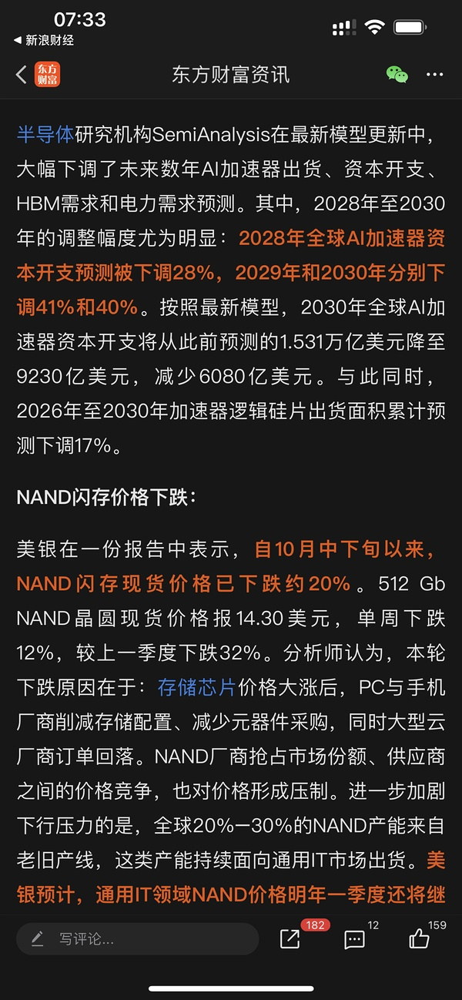
- 那要裁员了
- 然而甚至不知道债是因为昨天股市避险还是因为说话…….不过美债连绿中断了 现在看中债了🥲🥲🥲

### 雪人集团 002639｜11-06「大连和雪儿」＋11-11 14:26「雪儿今天不错啊 大家昨天不是期待他接人嘛 这个任务做到了今天」（接人＝5日线接回，与雪人条件单口径一致）（提及 11 次，占比 3%）2026-11-17 08:13:45
- 冰雪都有啊 又没改过
今天雪儿1584完全有可能到啊

现在场外一塌糊涂 场内更要认真了😂
- 等会看吧
今天最多就捞雪儿
- 牛股 我买完雪儿这边已经上去了 22+了

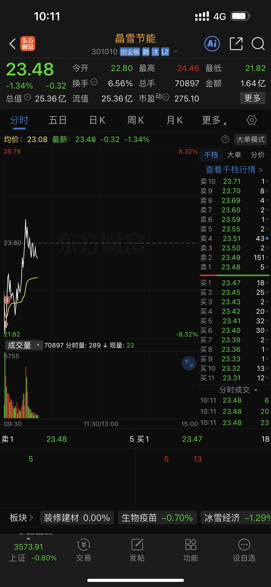

### 生肖羊概念组（带阳/洋/光/太/泉的一篮子）｜11-09 14:04 他自己贴的分组；**11-13 崩盘实证**：15:58 截图跌幅榜 澳洋健康 −10.06、阳光照明 −10.05、红太阳 −10.04、大东方 −10.03、阳光乳业 −10.02、襄阳轴承 −9.98、鲁阳节能 −9.95、大西洋 −9.73、太阳电缆 −9.29、圣阳股份 −8.64、泉阳泉 −6.60、东方海洋 −6.59；他 14:48『我昨天起码说了6次 控制仓位 因为羊和东方昨天松动了！！！！这是情绪核心』（提及 9 次，占比 2%）2026-11-17 09:45:21
- 问题不大
今天冰雪前面因为羊
也开的很低很低
- 今天市场是情绪下杀 因为那群羊
今天科技还可以的
- 羊是核心 让她们多多加油 你才有希望

### 双义：股票=中国长城 / 基金=华安文体健康混合（用户 11-05 指认）（提及 7 次，占比 2%）2026-11-17 09:08:23
- 今天就安心了
终于是红色的了

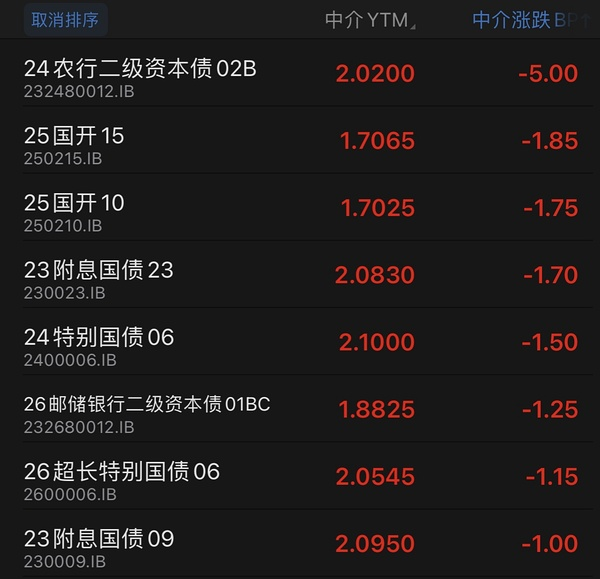
- 信用债厉害的

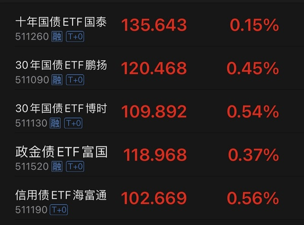
- 笑死
爱国和海外都是对手盘了

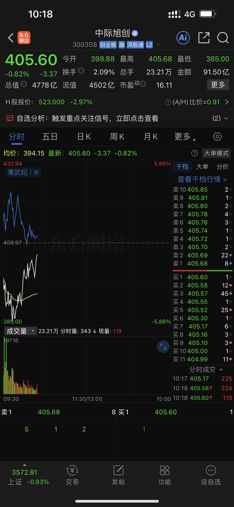

### 友友、网友们（提及 7 次，占比 2%）2026-11-17 09:54:06
- uu们买了第二天没马上赚到就这个不行那个不行
买了第二天马上赚到的是余额宝呀

债券都大跌呢
- uu纳斯达克怎么样了？现在都没年初1月到三月底的回撤大啊😂
- 下午uu发过了

### 雪人集团（提及 6 次，占比 1%）2026-11-17 10:58:19
- 雪人触发1484今天买单
- 不需要今天 雪人接下来都是震荡向上

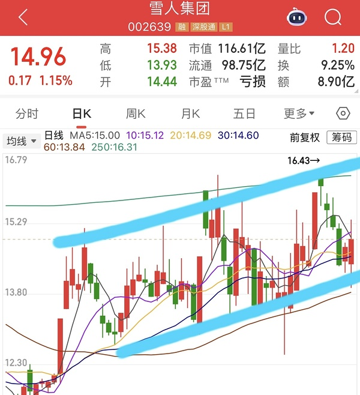
- 旅游板块你看 走势是这样的

暂时目标锁定在雪人他们非纯种上

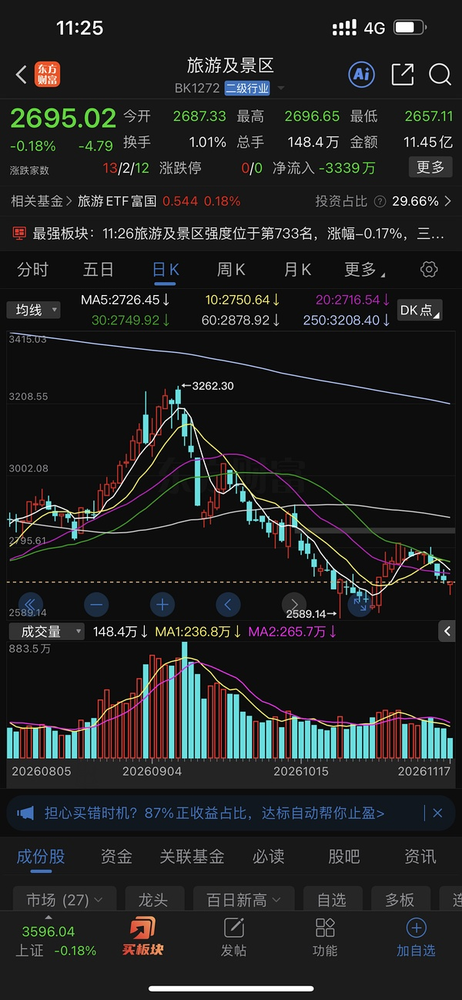

### 513300 纳斯达克ETF华夏｜11-11 10:49「3300还行 不过今天我不满意」＋13:24「咱们3300还是近期数据最好的」（提及 5 次，占比 1%）2026-11-17 08:16:42
- 好了 重新计算下今天的3300
昨天三点收盘时候-1 计算得出3300其实还少了0.7跌幅

最终nana收盘-2.67% 现在+0.2 合计这里还要补跌-1.47%

如果算上少的0.7 就是开盘-2.17%
如果0.7忘了不要了 就是-
- 场内3300也在拉升溢价

昨天少跌的0.7 就当过去了就过去了不要啦？
- 还是先算算今天3300了
在漏了-0.7的情况下

今天-1.55收盘对应nana期货0

Mark 明天早上再来算

### 301010 晶雪节能（上周买回、11-16 持有）｜09:39『上周买了plus』＋14:53『掌声雪儿plus雪』；卖单 24.94 沿用 11-05 老价，当日高 24.39 未触及（提及 5 次，占比 1%）2026-11-17 09:51:01
- 早上抄底雪儿的利润居然比plus还多点
- plus表示不服😂😂😂😂
- 2494的plus
你们周五抄底该兑现了

### 301010 晶雪节能（**B·推断；11-16 已买回持有**）｜11-13 10:04『plus雪是-20的…还能再跌-10』＝20cm，实测当日 −10.10%；15:25 答『多少出』报 24.94＝11-05 老卖单价（当日高 24.92 差 2 分未触及）；11-09 曾自述清仓 → **11-16 09:39『上周买了plus』＋14:53『掌声雪儿plus雪』＝上周买回、重新持有**；11-16 卖单 24.94 沿用，当日高 24.39 未触及；持仓屏 13:42:36 晶雪 23.110（提及 4 次，占比 1%）2026-11-17 09:13:07
- 看来昨天大家都没准备

bn694
幸福因为加仓了 保守开1864 贪心的我开2044 
雪儿1584今天是有可能到的 要开
plus雪2494继续就行对应周五抄底利润并不低 虽然我又抬高了

你们有些小伙伴自己抄底过大连cbs的别忘了自己
- 冰山自己都是九阳带的😂
现在你想要带要靠plus雪了
冰山已经+8 还能怎么带🤣而且雪人冲过一次1484了
个人让我没有动力单日连过两个关口哈哈
- 那个1584不动啊
明天重新买入后继续设置1484卖新买的 1584继续开

plus雪你今天没出去吗
2494啊😂😂😂😂
我开的2564 今天也触发回落了
就这两个
你自己看

超预期牛逼 不在计划内 依然按部就班

### 幸福蓝海（提及 4 次，占比 1%）2026-11-17 09:48:35
- 光线做出了防守贡献
接下来进攻我靠幸福
- 幸福这个月给了我幸福
现在我肯定先追随幸福🤣
- -4.3 的光线现在-8.3 4%
-7的幸福现在-11% 4%

没区别😂😂😂

### 格力电器（提及 4 次，占比 1%）2026-11-17 13:04:19
- 空调暗示银行假摔
- 今天空调也暗示银行下跌是假的🤣工行马上翻红
- 你发截图时候
那个空调红着1%就在暗示银行是假摔了
我女朋友的东西我可关心了

### 博纳影业（提及 3 次，占比 1%）2026-11-17 13:27:28
- 今天早上bn-7.5 sy-1
再次实际教导 不能在情绪不好的时候
大跌的换跌的少的 不然日内可以连亏两把
- 坐等bn今天反超sy
- bn 614
幸福 1584

雪儿明天重新买入

### 华子＝007540 华泰保兴安悦债券A（华泰保兴基金·安悦债券A类份额），满仓30年超长利率债的长债基金（用户 2026-11-16 确认，无歧义，不是歧义项）；00:42 楼友『华子今年战绩无敌吧』→他答『30超长债牛逼没办法』；13:47『纯利率债就是华子那种 不过华子满仓30债 有些是满仓5-10年』；**与460108不是同一只**：460108＝华泰柏瑞稳健收益债券C（他持有的纯利率债·重仓国开/农发/国债，见六基行），华子007540 是华泰保兴的长债基金，勿混（提及 2 次，占比 0%）2026-11-17 08:49:51
- 笑死 昨天多么可笑的是华子也才0.39😂
- 这个就是满仓30债
不是我选的 他就是代表场内那个30债ETF
（ETF也是一堆30债集合 华子是帮你选几个30债）
华子业绩比场内30债ETF好

如果不看好经济复苏 但是又觉得短债来钱太慢了 他们就是买这个30债 波动收益都加大😂😂😂😂

### 603366（羊字辈·情绪核心，非持仓）｜11-13 15:58『尤其今天表态的日出东方 别周一又跌停躺平了』；实测 +5.54%、最高 14.21 距涨停 14.49 一步（提及 2 次，占比 0%）2026-11-17 09:53:13
- 高位人气股今早持续低迷，大东方、百洋股份、永臻股份、闽发铝业走出3连跌停，东方环宇、金辰股份、日出东方、海洋王连续2日跌停

有三连板的  情绪完全不行
- 而且今天垃圾不是因为科技

是因为这个

高位人气股今早持续低迷，大东方、百洋股份、永臻股份、闽发铝业走出3连跌停，东方环宇、金辰股份、日出东方、海洋王连续2日跌停。

### 002582 好想你｜11-12 14:39:31『清了恋爱脑』＝清仓（卖价未披露；10.48 卖单两日均未触及→手动卖）；14:28『我如果去掉恋爱脑 也就比你多一个机器人』；当日收 9.76 −2.89%（提及 2 次，占比 0%）2026-11-17 10:36:38
- 所以我恋爱脑要撤走😂😂😂

老消费人了 都是大量学费的

没涨的 跌起来不会含糊

垃圾消费里越是看起来抗跌的  等情绪崩的时候 跌的更猛
- 你们肯定很喜欢安安那几个

你看安安成交量才多少

我如果着急卖 我还得降价几分钱才能马上卖掉

上周我恋爱脑降低了三分才马上出手成交

这就是危难时刻不能买垃圾消费的

### 保利发展（提及 2 次，占比 0%）2026-11-17 12:39:22
- 但是余额宝利率也是确实越来越低
怎么说呢 珍惜还有5%股息率的招行（也已经不到了）
- 2026年7-9月，黄金珠宝社零同比分别下降10.1%、17.5%和9.6%，行业需求端，感受到了更大的凉意。

受到打击最重的，莫过于老铺黄金。老铺黄金的商业模式——全直营、全一口价、只进顶奢商场，在金价上涨时放大了利润，在金价下跌时，同

### 粤传媒 002181｜11-09 12:12「非电影传媒就留给大家玩了 我一个都不会碰了」→ 推断已不持有（提及 2 次，占比 0%）2026-11-17 13:34:53
- 那下次你知道了 ycm之前也这样

- 一个看你是否坚定看好 
就像之前上周五我觉得羊临近崩盘 那我把我没那么坚定的都去掉了 机器人啊恋爱脑那些

还有种就是比如奶茶之前
板块其他同类型都无敌牛逼时候 他无动于衷 那这种说明是他单独很弱

最后一种就是你说的了 不让赢转亏总是对的

### 000530 冰山冷热｜11-11 10:16「万一冰山跌停 他能跌到哪里再去」＋10:27「今天把冰山 晶雪按死 大连 CBS 正统上位」（非持仓，冰雪板块的山寨对照）（提及 2 次，占比 0%）2026-11-17 13:49:48
- 但是冰山又是看九阳的😂

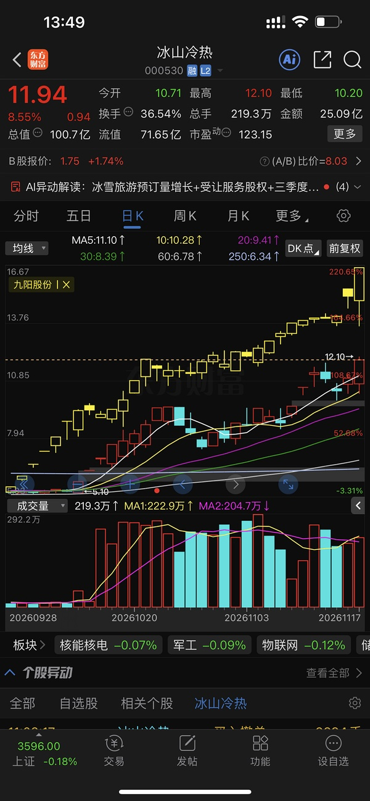
- 冰山跟上

### 电影档期锚（不是标的）｜同上，10:29『流浪地球要2月』（提及 2 次，占比 0%）2026-11-17 15:33:27
- 这个我要说一句
不要赌票房
在密集消息之前就要提前撤
再觉得票房牛逼 也要提前跑
到时候流浪地球也是

当然今天是普杀 也不管什么票是什么东西 
这一天总要来的
- 现在除了流浪地球
还有什么定档春节的影片不？

### 自嘲代指中国（推断，勿当事实）（提及 2 次，占比 0%）2026-11-17 16:05:24
- 你都不看的 提供消失说的是大A

债券他每调买机的 你忘了他有多看空印度啊
看空印度本质就是买债券
- 我现在也不看的
因为每天他都是看空印度各方面😂
反正都是已知情况

难得刷到今天提桶消失

### 余利，某牛逼投资者（提及 2 次，占比 0%）2026-11-17 16:20:28
- 余老师还是很理智分析的 
怎么可能是gjd

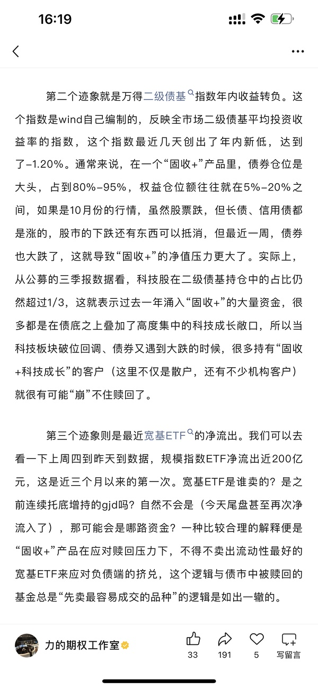
- 你结合昨天余老师的 8月死叉后需要半年 指向三月
太子爷是1.27解禁 2月上半部分过年 资金也不会攻击
都是观点匹配的

### 纳斯达克100 指数（他用来对照场内 ETF 溢价/涨幅的基准，非标的）｜11-13 00:16『今天图上看 nana依然是大阳线』＋07:57『昨天-0.7收盘 但是nana晚上其实只有-0.3 现在期货+0.5 今天场内应该开盘+0.9%』→ 实测 513300 开盘 2.710＝+0.82%（误差 0.08pp）（提及 2 次，占比 0%）2026-11-17 18:03:10
- 我对这个结论表示疑问🤣🤣🤣🤣

一是因为在3-6月主动基金这个70%那个80%收益时候
如果大家大头在涨不动的nana 不骂人估计就不错了 6月时候还是会做出相同的操作

二是后来调整初期
有很长一段时间 nana没怎么跌 主动连续大跌 钱
- 小远三连冠的今日冠军含金量很高啊

-2.19都大胜nana了！！！

### 华宝致远混合(QDII)C｜只在盯，未证他持有（提及 2 次，占比 0%）2026-11-17 18:26:07
- 今天投票大缩量
小远三连冠😂😂😂😂😂😂
- 小远要四连冠了………

### 大连圣亚（提及 2 次，占比 0%）2026-11-18 14:39:54
- 嗯
我在大连和cbs里做出了二选一
- 我加了大连 明天还要买雪儿
冰雪总仓位就这点
cbs自然需要卖出
我在给你们示范 什么是仓位控制
也不是无限子弹 能一直买的

冰雪是组合 最后只要组合赚钱就行

### 601595 上海电影｜**他空仓**（11-09 起未回接）；11-12 09:38『天天念叨sy的给你们机会了』＋09:41『现在-6给你们机会了哈』＋13:15『马上sy跌停 bn还要尊敬一下他』＋13:51『与此同时 sy跌停』＋14:00『sy历来以残暴虐杀手法闻名』；实测收 42.15 −9.99% 跌停（提及 2 次，占比 0%）2026-11-18 14:53:30
- 你们现在的样子

像极了上周初天天发sy 然后幸福不涨的样子

很有意思

大家可以记录下
- 你们上周也很佩服sy的😂

### 国产自主（半导体设备/芯片制造）（提及 1 次，占比 0%）2026-11-17 08:42:39
- 海外呀
爱国都在科创

### 新易盛＋中际旭创＋天孚通信（CPO三巨头合称）｜11-11 14:13「都去易中天了🤣」（非持仓）（提及 1 次，占比 0%）2026-11-17 09:59:53
- 你看看易中天不是在上吗

### 东方海洋（提及 1 次，占比 0%）2026-11-17 10:07:48
- “东方海洋上演地天板”

我等着这个推送

### 安记食品（提及 1 次，占比 0%）2026-11-17 11:32:42
- 但你要跟踪
因为随时都可以杀溢价
你要知道是正常跌 还是杀溢价

我是真金白银 这不是场外那么的安安稳稳
我每天都关心的

心里肯定要清楚 他漏跌了多少
到时候是正常归还这个漏的还是大杀溢价

### 创业板50ETF（提及 1 次，占比 0%）2026-11-17 11:46:42
- 你如果是按照我那个配比来的 别担心 这次是全球联动
比如最近C50跌幅大 
但其实总持仓不到中国基金三分之一 
已经尽可能减少拖累账户整体

### 中证2000指数（他当微盘股基准）｜11-11 11:11「除了机器人 今天其他题材全输给了2000」（提及 1 次，占比 0%）2026-11-17 14:00:35
- 2000今天翻绿了

### 中国移动（他当指标用，非持仓）（提及 1 次，占比 0%）2026-11-17 14:27:23
- 今天空调一直1%顶着暗示银行假摔呀 包括10086

### 某个特别牛逼的散户（提及 1 次，占比 0%）2026-11-17 16:00:31
- 提桶大师plu今天提桶信号消失和温暖老师观点激情碰撞

精彩

### 人物·永远看空印度的博主（非标的）｜11-16 19:11『他永远看空印度的…924一开始他也看空的 不过他就一点好 看错了马上改』（提及 1 次，占比 0%）2026-11-17 16:01:54
- plu厉害啊
下午还在加仓30债10债

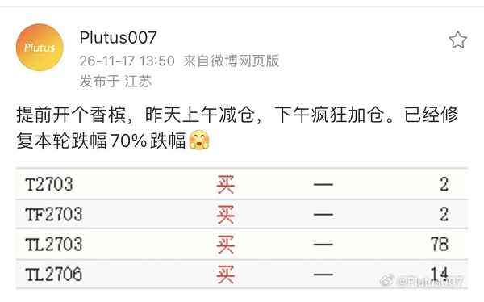

### 建设工业（提及 1 次，占比 0%）2026-11-17 16:59:01
- 加码大屏！红果短剧被曝筹备电视端独立APP 

11月17日消息，字节跳动正招聘红果短剧OTT端产品经理。从岗位介绍来看，主要负责红果短剧OTT端（大屏/电视端）产品从0到1建设；设计OTT端变现路径，探索投屏会员、会员订阅、衍生权益等变现

### ＝小华兄弟·华夏移动互联混合(QDII)（推断·证据不足不入表）｜11-16 17:26 裸报 -2.5% 疑似场外持有，无第一人称买入/持有自述、无截图（提及 1 次，占比 0%）2026-11-17 18:18:46
- 华夏兄弟每个阶段都跑输了网易云了

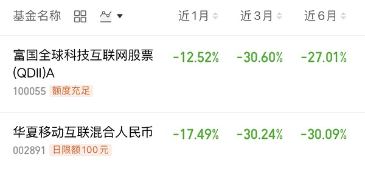

### 广发全球精选股票(QDII)A（提及 1 次，占比 0%）2026-11-17 19:21:17
- 昨天小浦小广也都-3啊？

### 600715（院线·他只在盯，非持仓）｜11-13 09:33 传媒板块截图 +10.03% 涨停、本月涨幅 66.67%（＝10-30 收盘基准独立复算分毫不差）；配 09:33『市场有转院线迹象』（提及 1 次，占比 0%）2026-11-17 19:29:36
- 个股层面来看，今日市场亏钱效应仍处于高位，已是连续两个交易日超百家个股跌停或跌幅超10%，短线连板高度压缩至3板，短线情绪持续走弱。其中高位人气股持续退潮，大东方、百洋股份、永臻股份、闽发铝业走出3连跌停，东方环宇、金辰股份、日出东方、海洋

### Anthropic（美股IPO）｜11-11 12:11「接下来是不是ant IPO也是利好」（提及 1 次，占比 0%）2026-11-17 19:44:15
- 就ant官宣他要IPO了 定价也没变 不知道为什么就火箭发射了😂😂😂😂😂😂

### 浦银安盛全球智能科技(QDII)A（提及 1 次，占比 0%）2026-11-17 20:23:26
- 小浦很牛逼

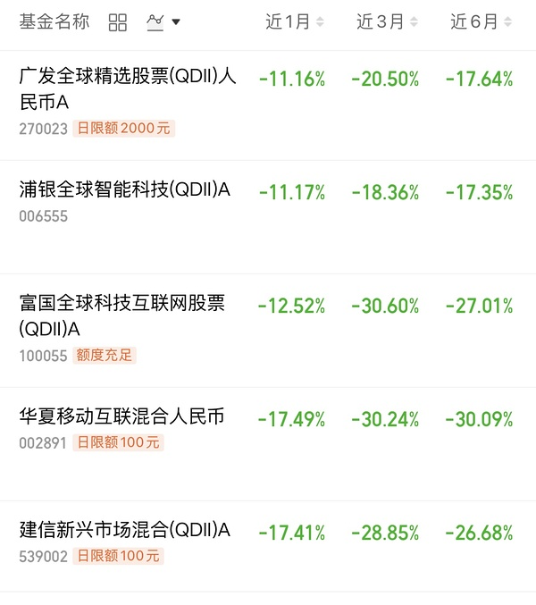

### 双义：他本人口径=603533 掌阅科技（用户 11-05 确认）；11-09 楼友两条『zy』按 16 元/电影语境指 600977 中国电影。引用必须带语境，不许收敛（提及 1 次，占比 0%）2026-11-18 13:22:44
- 我不是zy😂

### 科创50（提及 1 次，占比 0%）2026-11-18 13:27:41
- 今天科创半导体怎么不在前面了 没赢k50？

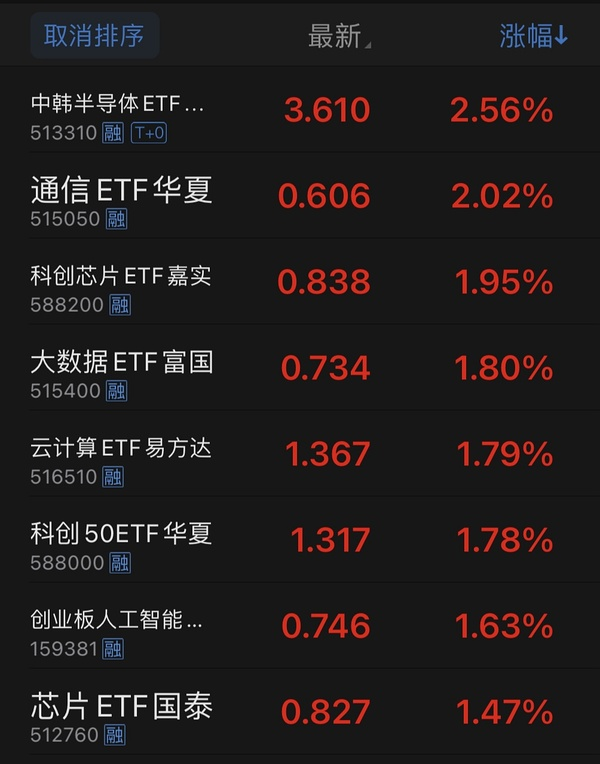

### 001318 阳光乳业（他的『喝的』/牛奶）｜11-09 A级：13:59 分时截图 S 标记≈13.5＋10:52「我去掉了羊来抄底」（提及 1 次，占比 0%）2026-11-18 14:08:13
- 乳业奶粉板块震荡走弱，阳光乳业跌停
乳业奶粉板块震荡走弱，阳光乳业跌停，南方乳业、均瑶健康、品渥食品、骑士乳业、妙可蓝多、熊猫乳品等跟跌。

### 航空航天板块（提及 1 次，占比 0%）2026-11-18 15:40:03
- 我客观说一句 我也没有那个😂

其实我觉得机器人应该先来 他们先调整的

传媒机器人传统最垃圾的两个 （宇航员这两年才有）

### 📄 全部发言（共 411 条）
- (2026-11-17 07:34:19) [图] 

- (2026-11-17 07:52:09) 那要裁员了  ⊳ （引用 @六倍做多退休）按照这种下调 半导体要杀eps了 那么纳斯达克的前瞻pe完全没有用了

- (2026-11-17 08:04:59) 然而甚至不知道债是因为昨天股市避险还是因为说话…….不过美债连绿中断了 现在看中债了🥲🥲🥲  ⊳ （引用 @六倍做多退休）所有的一切都是为了美债 债始终优先级高于股

- (2026-11-17 08:06:34) [图] 市场抹去上周第四次加息的高预期 回到本来的三次

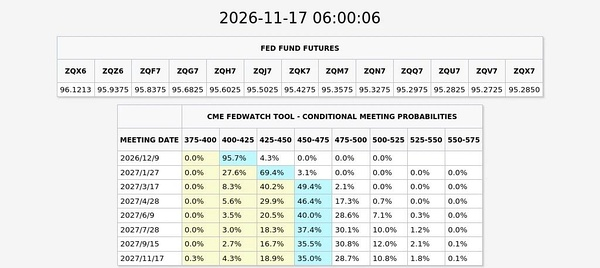

- (2026-11-17 08:08:54) 这份表看的就很舒服
12月一次
1月一次
三月就可能是最后次

三月真是玄乎 很多都指向三月 
明年过完年应该挺有意思的  ⊳ （引用 @不知道还能说啥）市场抹去上周第四次加息的高预期 回到本来的三次

- (2026-11-17 08:12:46) 目前除了现金 好像没有不是风险资产的了😂  ⊳ （引用 @六倍做多退休）美银警告：强美元正在抽干全球流动性，风险资产的机会可能要等到明年春天。

- (2026-11-17 08:13:45) 冰雪都有啊 又没改过
今天雪儿1584完全有可能到啊

现在场外一塌糊涂 场内更要认真了😂  ⊳ （引用 @吃西瓜的人）是不是只有xf有单子？

- (2026-11-17 08:16:42) 好了 重新计算下今天的3300
昨天三点收盘时候-1 计算得出3300其实还少了0.7跌幅

最终nana收盘-2.67% 现在+0.2 合计这里还要补跌-1.47%

如果算上少的0.7 就是开盘-2.17%
如果0.7忘了不要了 就是-1.47开盘

- (2026-11-17 08:17:00) 694定价
这价格应该不是涨停  ⊳ （引用 @招招碎片收集中）bn直接挂涨停就可以了对吧

- (2026-11-17 08:18:56) 设置694 买一 定价卖出

如果直接拉板 也会695卖出的  ⊳ （引用 @招招碎片收集中）我刚刚看涨停695😂😂，我去改一下

- (2026-11-17 08:27:54) 电脑内存条 电脑硬盘这次是不是要叠加了？
手机涨上去的要不要降回来  ⊳ （引用 @moli）一路闭眼玩到3月再回来看看

- (2026-11-17 08:30:29) 盘后多条小作文

1，市场将于近期降准缓解债券流动性

2，被禁止买长债的机构据说问了监管，居然已告知不再限制买长债了

3，央妈将于本周开始亲自下场加大买债规模

其中2已有多家机构确认其真实性

- (2026-11-17 08:31:34) 笑死
妈妈不容易
两边都要救

上周部分流出股市 是因为债券市场也要花钱是吗  ⊳ （引用 @不知道还能说啥）盘后多条小作文

1，市场将于近期降准缓解债券流动性

2，被禁止买长债的机构据说问了监管，居然已告知不再限制买长债了

3，央妈将于本周开始亲自下场加大买债规模

其中2已有多家机构确认其真实性

- (2026-11-17 08:34:04) 没有
上周五抄底的 还是2494好 
虽然我自己修改到了2574😂  ⊳ （引用 @shirla）plus是不是2624

- (2026-11-17 08:42:39) 海外呀
爱国都在科创  ⊳ （引用 @高手云集上钻）楼我有个问题，按照海外链和爱国链的说法，C50属于哪边呢

- (2026-11-17 08:45:30) [图] 有用

加上昨天盘后 长债抹去了昨天所有跌幅

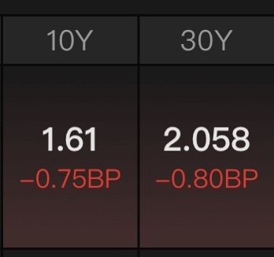  ⊳ （引用 @不知道还能说啥）盘后多条小作文

1，市场将于近期降准缓解债券流动性

2，被禁止买长债的机构据说问了监管，居然已告知不再限制买长债了

3，央妈将于本周开始亲自下场加大买债规模

其中2已有多家机构确认其真实性

- (2026-11-17 08:48:45) 🤣🤣🤣🤣🤣🤣🤣🤣

融资盘：qnmd 又被骗了  ⊳ （引用 @稀里不糊涂）融资出去200个亿

- (2026-11-17 08:49:51) 笑死 昨天多么可笑的是华子也才0.39😂  ⊳ （引用 @噜啦啦噜啦啦）昨天我的短债-0.18%，嘛呀，最大跌幅了吧😢，前面都才-0.10%😭😭😭

- (2026-11-17 09:04:52) 利率债大概率是的！我没钱了 不然我昨天肯定买😂  ⊳ （引用 @momomomomomo哒）那我昨天加债是加到低点了吗

- (2026-11-17 09:05:28) 肯定是债

债斯达克不是盖的  ⊳ （引用 @咬着一颗绿苹果）先保债还是先保股？先保债吧那我们还要吃苦一段时间了

- (2026-11-17 09:08:23) [图] 今天就安心了
终于是红色的了

- (2026-11-17 09:08:55) 这比股市血腥多了
有些债券三天抹掉了半年😂  ⊳ （引用 @不知道还能说啥）今天就安心了
终于是红色的了

- (2026-11-17 09:13:07) 看来昨天大家都没准备

bn694
幸福因为加仓了 保守开1864 贪心的我开2044 
雪儿1584今天是有可能到的 要开
plus雪2494继续就行对应周五抄底利润并不低 虽然我又抬高了

你们有些小伙伴自己抄底过大连cbs的别忘了自己开

- (2026-11-17 09:17:53) [图] 明天有可能大跌 有可能不跌 怎么样都是对的了

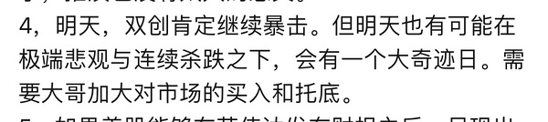  ⊳ （引用 @云小朵飘啊飘）大佳
1，今晚美股下跌。主要是半导体带动的科技的集体回调。硬件再次遭受重创，软件也不乐观。硬件有一个利空，有一个大行发了报告，说flash闪存价格下跌了20%。这不是预测，而是正在发生的事情。具体情况有待证实。软件则是英伟达风波的后续。明晚

- (2026-11-17 09:19:02) 不一定啊 昨天我们科技基本是计提了晚上的😂  ⊳ （引用 @点-重生炒垃圾）收到，全靠楼主这边来点红了

- (2026-11-17 09:19:54) 没有😂  ⊳ （引用 @🅰失而复🉐😎）你昨天最后买的是不是在里面😏

- (2026-11-17 09:24:40) 这个是美联储任期 不是主席任期
鲍威尔现在也是美联储的  ⊳ （引用 @樱桃小丸犊子）话说他的任期是14年。。。

- (2026-11-17 09:26:09) 等会看吧
今天最多就捞雪儿  ⊳ （引用 @shirla）楼楼一会儿捞哪个

- (2026-11-17 09:29:40) 跌了七八十了看到泡沫了……  ⊳ （引用 @👑）素，主要是我身边的大佬也看到了ai泡沫了😵‍💫😵‍💫😵‍💫害怕民主党简直

- (2026-11-17 09:30:41) 这还被称为大佬呢  ⊳ （引用 @招招碎片收集中）kkkkkk，好嘴哈哈哈哈哈哈哈

- (2026-11-17 09:31:21) 买入了

- (2026-11-17 09:31:37) 开单1484卖今天的
1584照常  ⊳ （引用 @不知道还能说啥）买入了

- (2026-11-17 09:33:59) 看到的时候直接14整了 笑死  ⊳ （引用 @shirla）耶，开单子

- (2026-11-17 09:35:10) 那你应该不知道14.2的绝佳买点 说三天的  ⊳ （引用 @番茄炒鸡蛋）我是错过哪条信息了？只看到卖单呀

- (2026-11-17 09:38:17) 有中韩不吃亏  ⊳ （引用 @稀里不糊涂）科技这么硬？红了都

- (2026-11-17 09:39:28) 爆量针😂  ⊳ （引用 @家不住海边）蓝色光标。贱人

- (2026-11-17 09:40:41) 25跌停开局  ⊳ （引用 @招招碎片收集中）地板好多东方啊

- (2026-11-17 09:43:51) -4.3换回-7

- (2026-11-17 09:44:06) 光线完成了任务  ⊳ （引用 @不知道还能说啥）-4.3换回-7

- (2026-11-17 09:45:21) 问题不大
今天冰雪前面因为羊
也开的很低很低  ⊳ （引用 @🅰失而复🉐😎）拉科技了😵

- (2026-11-17 09:48:10) 有的 上周买的在  ⊳ （引用 @去他喵的大a）你没有光线了吗

- (2026-11-17 09:48:35) 光线做出了防守贡献
接下来进攻我靠幸福  ⊳ （引用 @去他喵的大a）你没有光线了吗

- (2026-11-17 09:49:26) 居然有过3.5差价…  ⊳ （引用 @shirla）-5换-8.5😂😂😂

- (2026-11-17 09:51:01) 早上抄底雪儿的利润居然比plus还多点

- (2026-11-17 09:51:46) 回踩十日线是吗！  ⊳ （引用 @点-重生炒垃圾）Zy还能送钱吗？

- (2026-11-17 09:51:59) 科技股没用 看美国的  ⊳ （引用 @红红火火的anya）楼主，这种大跌情况下，技术指标还有用吗，我手里的股基本都破位了

- (2026-11-17 09:53:13) 高位人气股今早持续低迷，大东方、百洋股份、永臻股份、闽发铝业走出3连跌停，东方环宇、金辰股份、日出东方、海洋王连续2日跌停

有三连板的  情绪完全不行

- (2026-11-17 09:54:06) uu们买了第二天没马上赚到就这个不行那个不行
买了第二天马上赚到的是余额宝呀

债券都大跌呢  ⊳ （引用 @稀里不糊涂）现在买什么不跌

- (2026-11-17 09:54:48) plus表示不服😂😂😂😂  ⊳ （引用 @不知道还能说啥）早上抄底雪儿的利润居然比plus还多点

- (2026-11-17 09:55:50) 管用啊 没执行 犯错了  ⊳ （引用 @高手云集上钻）国庆之前写了四条减仓C50的条件，是不是已经不用管了1.美联储加息2.黄金弱3.人民币转弱4.国庆之后无增量

- (2026-11-17 09:56:50) 我记得周五楼里都是冰雪

今天冰雪不错了 开始唉声叹气了

- (2026-11-17 09:57:22) 除了RMB 都满足了  ⊳ （引用 @shirla）啊不是说条件不满足吗🤣🤣

- (2026-11-17 09:59:53) 你看看易中天不是在上吗  ⊳ （引用 @稀里不糊涂）科技下了，垃圾能不能上

- (2026-11-17 10:00:18) 而且今天垃圾不是因为科技

是因为这个

高位人气股今早持续低迷，大东方、百洋股份、永臻股份、闽发铝业走出3连跌停，东方环宇、金辰股份、日出东方、海洋王连续2日跌停。  ⊳ （引用 @稀里不糊涂）科技下了，垃圾能不能上

- (2026-11-17 10:05:37) 这是情绪核心之一 很关键  ⊳ （引用 @lacey）dfhy还从地板拉起来了🫣🫣

- (2026-11-17 10:05:55) 再看看呢  ⊳ （引用 @🅰失而复🉐😎）还是上影😕

- (2026-11-17 10:07:11) 今天市场是情绪下杀 因为那群羊
今天科技还可以的  ⊳ （引用 @🅰失而复🉐😎）红1900+是谁😵

- (2026-11-17 10:07:48) “东方海洋上演地天板”

我等着这个推送

- (2026-11-17 10:09:22) 他跌停我都没看到😂😂😂😂  ⊳ （引用 @六倍做多退休）我以为是九阳 九阳地板拉红了

- (2026-11-17 10:09:58) 想要做跨年妖股
就是要在危在旦夕时候挺身而出
不然也是fw  ⊳ （引用 @VVV坚定持有VVV）加油啊东方！

- (2026-11-17 10:11:22) 今天是第三天了 加油  ⊳ （引用 @招招碎片收集中）今天会是羊羊队立大功吗？

- (2026-11-17 10:12:16) [图] 牛股 我买完雪儿这边已经上去了 22+了

  ⊳ （引用 @ekiwang）我21.9抄的plus

- (2026-11-17 10:12:35) 但是九阳比他更厉害  ⊳ （引用 @vio）快红了

- (2026-11-17 10:13:54) 暂时确实是盟友
不过到最后只会剩一个🤣🤣  ⊳ （引用 @招招碎片收集中）我们是盟友不是对手，它越强越好啊，不要批量跌停我已心满意足

- (2026-11-17 10:15:40) [图] 信用债厉害的

- (2026-11-17 10:15:56) 宇树科技跌超10％，领跌物理AI板块，上纬新材、索辰科技、凡拓数创、福莱新材、襄阳轴承、华阳智能大幅调整。

- (2026-11-17 10:16:11) 传媒+物理ai
都被情绪干崩了  ⊳ （引用 @不知道还能说啥）宇树科技跌超10％，领跌物理AI板块，上纬新材、索辰科技、凡拓数创、福莱新材、襄阳轴承、华阳智能大幅调整。

- (2026-11-17 10:17:09) 今天就是第三天  ⊳ （引用 @招招碎片收集中）先活下去好吗？老大！！我一想到拔网线绕异动第三天抄底，我就玉玉了，感觉时不时打我一下

- (2026-11-17 10:17:44) 纯利率债其实很少的 

因为之前信用债太稳了  ⊳ （引用 @momomomomomo哒）早上你说利率债应该是最低 我去豆包了一下我的买的 是利率债+信用债

- (2026-11-17 10:18:29) [图] 笑死
爱国和海外都是对手盘了

- (2026-11-17 10:19:25) [图] 接下来大家别问我买什么了

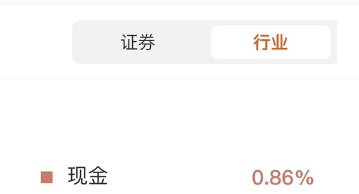

- (2026-11-17 10:21:08) 有可能过会儿就可以不是  ⊳ （引用 @稀里不糊涂）都满仓了😂😂

- (2026-11-17 10:32:16) 那还是忘记了那个0.7
按照我们推送的-1.47附近开  ⊳ （引用 @shirla）开盘才-0.6好像~不过一直在往下掉，现在-1.5了

- (2026-11-17 10:33:17) 跟风闽发的😂  ⊳ （引用 @只想搞钱）惠惠三连跌停，这是什么死罪吗

- (2026-11-17 10:36:38) 所以我恋爱脑要撤走😂😂😂

老消费人了 都是大量学费的

没涨的 跌起来不会含糊

垃圾消费里越是看起来抗跌的  等情绪崩的时候 跌的更猛  ⊳ （引用 @只想搞钱）而且整的整个消费没涨的也血洗

- (2026-11-17 10:41:24) 羊是核心 让她们多多加油 你才有希望  ⊳ （引用 @只想搞钱）我的安安和东百被套了，无语从芳子跑了还在庆幸结果跑到另一个坑

- (2026-11-17 10:43:14) 我没钱  ⊳ （引用 @Aaa摆烂咸鱼🥳）楼，纳斯达克etf是不是又可以买了，很符合你的图

- (2026-11-17 10:43:39) 那就是今天了
今天第三天 情绪资金会率先尝试核心目标  ⊳ （引用 @VVV坚定持有VVV）地天！我还没吃过地天板呢

- (2026-11-17 10:45:43) [图] 你最好仔细看下我的估算
然后看着期货按计算器

他们现在还是漏了0.7跌幅 你是否无视 
当然长期也无所谓 就看你投资目的

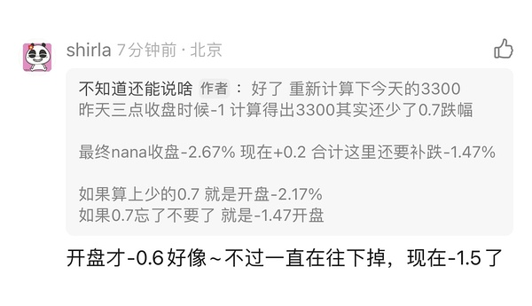  ⊳ （引用 @Aaa摆烂咸鱼🥳）那我去转换一下😂

- (2026-11-17 10:47:10) 钱不够🤣🤣🤣🤣要抄底东西太多了  ⊳ （引用 @招招碎片收集中）但是冰雪为啥反向了嘞，我以为小雪只怕科技反攻呢

- (2026-11-17 10:47:43) 就像我 因为前面干满仓了

今天冰雪继续往下 我也买不了了🤣

钱不够  ⊳ （引用 @招招碎片收集中）但是冰雪为啥反向了嘞，我以为小雪只怕科技反攻呢

- (2026-11-17 10:48:27) [图] 因为他们带队

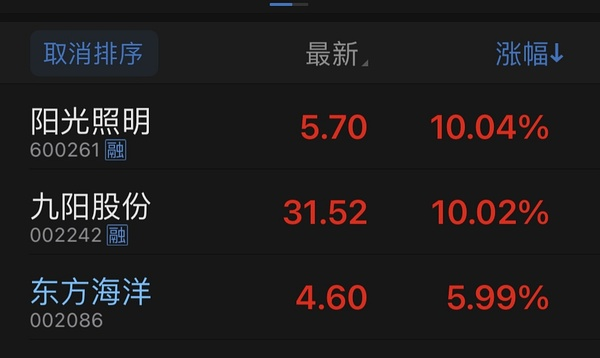  ⊳ （引用 @稀里不糊涂）跌停减少了

- (2026-11-17 10:49:39) [图] 谢谢他们 情绪绝对的核心

  ⊳ （引用 @该用户已过期）在尝试起床了🥹🥹

- (2026-11-17 10:51:28) 之前羊全部跌停不就一天发了N遍控制仓位

今天第三天了 情绪应该修复 我all in了🤣  ⊳ （引用 @只想搞钱）所以今天是留着钱去抄地板才是最优嘛，谁还有钱这个时候

- (2026-11-17 10:52:08) 这才是牛逼  ⊳ （引用 @sickid）凯撒涨停了

- (2026-11-17 10:52:54) 所以尼玛 要找跌停的  ⊳ （引用 @🅰失而复🉐😎）还有它

- (2026-11-17 10:53:42) 今天是情绪第三天呀 很正常其实  ⊳ （引用 @momo）凯撒文化盘中涨停，上演“地天板”，现报4.80元，成交额11.59亿元。
今天要批量地天吗

- (2026-11-17 10:56:05) 没问题的 14.2以下狠狠干  ⊳ （引用 @👑）哎？雪人⛄

- (2026-11-17 10:56:20) 不好意思
看的是羊的脸色  ⊳ （引用 @miumiu）怎么天天看冰山脸色啊

- (2026-11-17 10:56:58) yeah
不会是满仓了  ⊳ （引用 @该用户已过期）求雪人不扭！

- (2026-11-17 10:57:55) 2494的plus
你们周五抄底该兑现了

- (2026-11-17 10:58:19) 雪人触发1484今天买单

- (2026-11-17 10:58:27) 1584等待继续触发  ⊳ （引用 @不知道还能说啥）雪人触发1484今天买单

- (2026-11-17 10:59:01) 那两个在和旅游板块筑底 留给12月不好嘛  ⊳ （引用 @速派女孩将发财）大连 你可以后发制人嘛？？？
球球你了 我真的买了很多你 你再不努力我真的会换掉你了

- (2026-11-17 11:01:03) 我要赶紧去逆回购了
不然贱手又要买买买了

- (2026-11-17 11:01:33) SY如果跌到20日线
将重新纳入目标品

- (2026-11-17 11:02:00) SY此前都是沿着20日线运行  ⊳ （引用 @不知道还能说啥）SY如果跌到20日线
将重新纳入目标品

- (2026-11-17 11:02:23) 谢谢九阳 

这是市场情绪的绝对核心股票了  ⊳ （引用 @稀里不糊涂）红的变多了，情绪好转

- (2026-11-17 11:03:33) 阳光照明：那我呢  ⊳ （引用 @稀里不糊涂）九阳可以成今年妖股了，东方你退下吧

- (2026-11-17 11:06:01) 我昨天也着急
想要先手😂
如果今天加仓会更好  ⊳ （引用 @钱多多多多多）这次的教训对我来说，是3天。忍到了周五尾盘，但周五尾盘买的有点多了，导致昨天和今天很被动，下一次情绪崩盘，不能着急，控制好仓位。

- (2026-11-17 11:09:52) [图] 不需要今天 雪人接下来都是震荡向上

  ⊳ （引用 @momo）雪人今天能期盼到15.84吗，我还没卖出😐

- (2026-11-17 11:13:15) 没有 
今天第三天 只能先修复核心抱团的  ⊳ （引用 @momomomomomo哒）幸福是否有翻红的风险

- (2026-11-17 11:14:22) 叫夜盘

新浪财经就有  ⊳ （引用 @momo）现在哪可以看暗盘的coherent吗

- (2026-11-17 11:15:54) [图] 谢谢妈妈

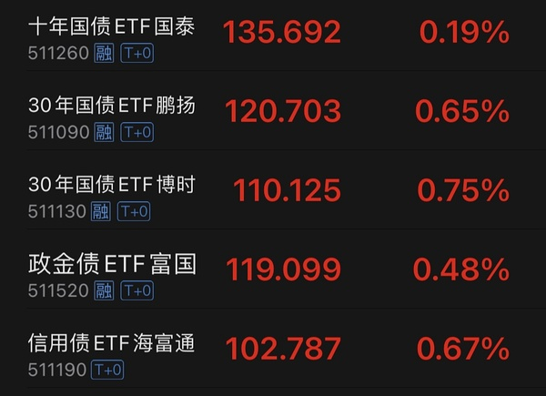  ⊳ （引用 @不知道还能说啥）盘后多条小作文

1，市场将于近期降准缓解债券流动性

2，被禁止买长债的机构据说问了监管，居然已告知不再限制买长债了

3，央妈将于本周开始亲自下场加大买债规模

其中2已有多家机构确认其真实性

- (2026-11-17 11:17:06) 让冰雪来呗
大家轮轮班  ⊳ （引用 @该用户已过期）电影们，你们方向错了

- (2026-11-17 11:21:59) 这个债券抄底居然还只能是昨天
如果今天 买点就不太好😂😂😂😂

- (2026-11-17 11:22:45) 我之前讲过的 
代入大家作为散户的视角 来判断最容易买入的点位 而这种点位就是批量套牢盘的地方  ⊳ （引用 @吃西瓜的人）楼你这些条件单价格的技巧是什么呀？可以偷师一下嘛

- (2026-11-17 11:26:01) [图] 旅游板块你看 走势是这样的

暂时目标锁定在雪人他们非纯种上

  ⊳ （引用 @该用户已过期）那还是大连先来吧🤣🤣电影看起来不是很想动

- (2026-11-17 11:27:11) 最近爱姐姐 珀莱雅那种好弱啊 都玩大的消费了还是不行  ⊳ （引用 @六倍做多退休）安井食品是真牛😂还以为增速到顶了 结果又起来了

- (2026-11-17 11:28:06) 场内3300也在拉升溢价

昨天少跌的0.7 就当过去了就过去了不要啦？

- (2026-11-17 11:32:42) 但你要跟踪
因为随时都可以杀溢价
你要知道是正常跌 还是杀溢价

我是真金白银 这不是场外那么的安安稳稳
我每天都关心的

心里肯定要清楚 他漏跌了多少
到时候是正常归还这个漏的还是大杀溢价  ⊳ （引用 @monica）所以，这个3300的涨跌毫无规律可言，主打一个应涨尽涨。

- (2026-11-17 11:35:19) 这不对吧
你买票不可能就为了今天要翻红吧

今天是崩盘情绪第三天

不是情绪高涨第三天呀🤣  ⊳ （引用 @小猫白-发财版）惨 我今天还加仓幸福了

- (2026-11-17 11:36:32) 中韩最近靠的都是中

韩国人都是嘴炮 比我们妈妈垃圾多了😂  ⊳ （引用 @六倍做多退休）场内纳+中韩 真的还不错 

- (2026-11-17 11:38:17) [图] 东方财富这个垃圾指标 冰你个大头鬼
财联社现在温度58度😂😂😂

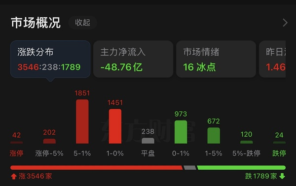

- (2026-11-17 11:42:06) [图] 买债券的又可以记录日子了
今天11/17日是债券反攻日

抗跌的里面有没有涨起来又猛的（夏普比猛的）
值得关注

因为今天是利率债 信用债 政金债集体暴力反弹 是很好的观察日

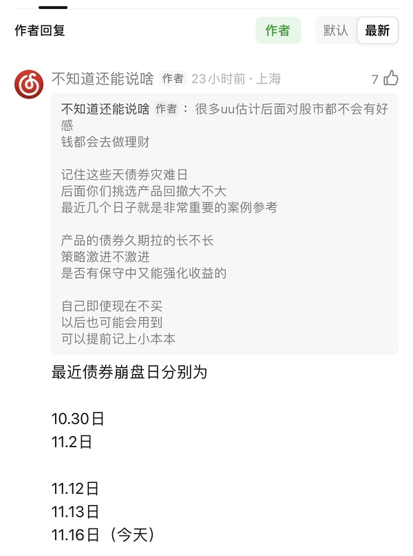

- (2026-11-17 11:46:42) 你如果是按照我那个配比来的 别担心 这次是全球联动
比如最近C50跌幅大 
但其实总持仓不到中国基金三分之一 
已经尽可能减少拖累账户整体  ⊳ （引用 @momo）我中买得比美多，就怕到时候反弹，美都填不平中的亏损😂

- (2026-11-17 11:47:55) 11月17日消息，日前，阿里巴巴发布全员通知，调整了员工回流政策。

根据最新规定，从阿里集团主动离职1次的员工，需满6个月后方可重新应聘；但如果是回流至集团内未曾任职过的业务集团岗位，则不受该时间限制。

而对于主动离职达到2次的员工，将无法回流至原业务集团，仅能去往集团体系内未曾任职过的其他业务线。例如，若从阿里控股离职两次，将不能再回阿里控股，但仍可前往淘天、阿里云、AIDC等其他业务线。

据新浪科技报道，针对外界关于该政策“史上最严”的讨论，有知情人士透露，本次调整只是对集团各业务线原有“二雇政策”的统一，属于既往政策的延续，并非收紧，“史上最严”的说法系误读。  ⊳ （引用 @六倍做多退休）阿里巴巴港股下跌5%，至85.6港元，为2025年1月以来最低水平。

- (2026-11-17 11:50:40) 👍👍👍👍  ⊳ （引用 @VVV坚定持有VVV）这题我会，因为人家在“套牢”的同时，可以反手做空，等到反弹回“套牢”位置的时候已经赚了空的钱，不用卖出正股可以开始赚多的钱

- (2026-11-17 12:00:52) [图] 昨天买先手 也有理由的🤣毕竟今天第三天 大有修复可能
比如这个你今天跌停买 暂时也是纸面富贵 🤣还不知道会如何
不过如果昨天拿到筹码 今天就能真的赚了出了

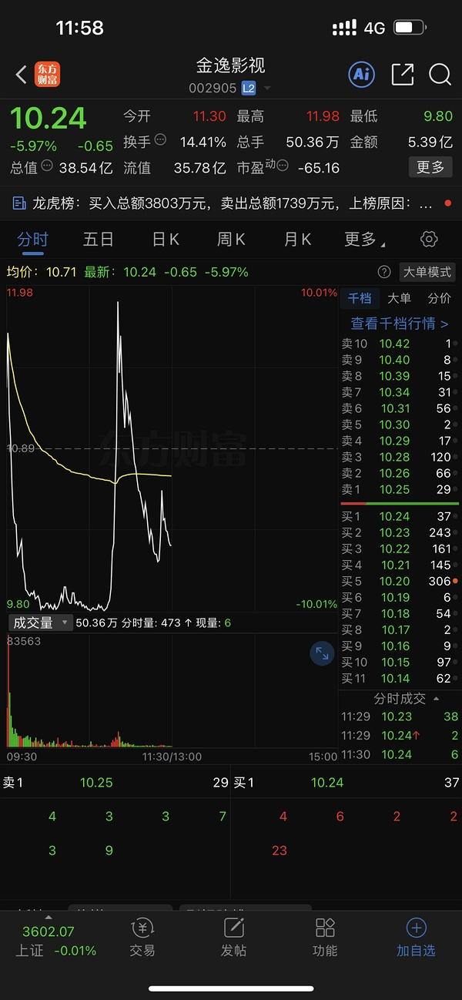  ⊳ （引用 @lacey）呜呜呜我也吉吉国王了🫠🫠今天差点绷不住

- (2026-11-17 12:16:01) 他打了伊朗后
3-6月可是中美硬科技最猛的😂  ⊳ （引用 @sickid）一切责任在以色列

- (2026-11-17 12:17:21) 所以一天到晚看上证指数的都是小丑
今天科技嗨了 上证指数反而是绿的  ⊳ （引用 @momo（富姐版））心情是科技不要再跌了影响大盘 就这样横盘吧 让大家开开心心炒几个小垃圾明年再说

- (2026-11-17 12:24:52) 昨日盘后传闻央行降为了债券市场立即降准，目前消息面无法证实也无法证伪。

不过今日央行重新释放流动性，11月17日央行开展了7140亿元隔夜逆回购操作，今日有4600亿元隔夜逆回购到期。

- (2026-11-17 12:24:57) 谢谢妈  ⊳ （引用 @不知道还能说啥）昨日盘后传闻央行降为了债券市场立即降准，目前消息面无法证实也无法证伪。

不过今日央行重新释放流动性，11月17日央行开展了7140亿元隔夜逆回购操作，今日有4600亿元隔夜逆回购到期。

- (2026-11-17 12:25:29) 妈妈最近可太忙了 左右夹击 妈妈太累了  ⊳ （引用 @不知道还能说啥）昨日盘后传闻央行降为了债券市场立即降准，目前消息面无法证实也无法证伪。

不过今日央行重新释放流动性，11月17日央行开展了7140亿元隔夜逆回购操作，今日有4600亿元隔夜逆回购到期。

- (2026-11-17 12:28:45) 这还不只是我的心肝🤣🤣🤣🤣

养老金 企业年金 很多地方政府的钱也是债券占据绝对大头的🤣  ⊳ （引用 @招招碎片收集中）好好笑，债是妈的心肝也是你的心肝

- (2026-11-17 12:35:39) [图] 我也得说句公道话
银行股全是破净也是本来市场的错误😂
现在很多银行股pb还是低于地产股 本来也不合理😂😂😂😂😂

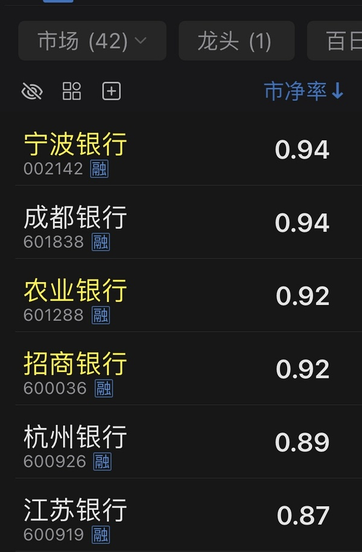  ⊳ （引用 @六倍做多退休）银行牛逼

- (2026-11-17 12:39:22) 但是余额宝利率也是确实越来越低
怎么说呢 珍惜还有5%股息率的招行（也已经不到了）  ⊳ （引用 @moli）但股息率这么低

- (2026-11-17 12:48:47) 我懂你们的
我讲句老实话
如果我当初20笔配置里有5份红利
也肯定被你们自己转出去干了😂  ⊳ （引用 @momo）😭谢谢楼楼按摩，我是差生，梭哈了C50和畅畅，这两对半，其他割了

- (2026-11-17 12:53:04) 不过我后来也在思考
这个实时股息率其实都是针对现在买的人说的

比如对于我来说 
我招行就是几年前30多买了7000股20万的人
只要他的分红稳定提高 
就按照2元来看 对我持有者来说 我就是每年20万投入分得14000的人 不会因为他股价是60元还是40元的高低
而降低我持有人的分红股息率

我就是那个20万  ⊳ （引用 @moli）但股息率这么低

- (2026-11-17 12:59:50) 🤣其实你们的操作比我更相信科技  ⊳ （引用 @momomomomomo哒）我是其他割了都去买了美 😂

- (2026-11-17 13:02:57) 过两天就赚了  ⊳ （引用 @momo）被我反指了哈哈哈

- (2026-11-17 13:04:19) 空调暗示银行假摔  ⊳ （引用 @去他喵的大a）今天钱都去科技了？？

- (2026-11-17 13:13:05) 你好像本轮自始至终都不相信电影  ⊳ （引用 @去他喵的大a）电影不会a杀把，楼

- (2026-11-17 13:16:14) 今天空调也暗示银行下跌是假的🤣工行马上翻红  ⊳ （引用 @一切都会过去的）茅台又要拐头向上了 打扰了

- (2026-11-17 13:16:50) 今天确实不会了
因为已经嗨过了
我们都已经兑现筹码了  ⊳ （引用 @家不住海边）又来了
今天我也不相信冰雪能支棱起来

- (2026-11-17 13:19:03) [图] 今天不行

  ⊳ （引用 @YuanZi💕）那午后电影来接力吧😂

- (2026-11-17 13:27:28) 今天早上bn-7.5 sy-1
再次实际教导 不能在情绪不好的时候
大跌的换跌的少的 不然日内可以连亏两把

- (2026-11-17 13:28:16) 他是不是不服气😂  ⊳ （引用 @该用户已过期）⛄️楼看不起你今天还能起来一波，你看着办吧🤣🤣（我忍不了，你呢？）

- (2026-11-17 13:29:23) bdd走势完全复刻传媒
我要删除他在冰雪分组了

- (2026-11-17 13:30:44) 上一段要在这地方来来回回几天呢
会给我们送很多零花钱的  ⊳ （引用 @该用户已过期）超级不服气，马上干波大的🤣🤣

- (2026-11-17 13:32:26) 美国只要知道哪一次是最后一次就会好（美联储会给信号的）  ⊳ （引用 @一切都会过去的）楼楼 宏观上是不是得熬过加息周期才能有大行情了 达子这些也只是短期扰动了

- (2026-11-17 13:34:53) [图] 那下次你知道了 ycm之前也这样

  ⊳ （引用 @该用户已过期）我还是希望它先触发一下1584的单子，不然没钱套它了🤣🤣没想到下来这么多，15.3+和8+打满了

- (2026-11-17 13:36:42) 坐等bn今天反超sy  ⊳ （引用 @🅰失而复🉐😎）早删了就它这样的真难把控

- (2026-11-17 13:38:49) [图] 妈妈真忙碌啊 还有这里妈妈也要竭尽全力

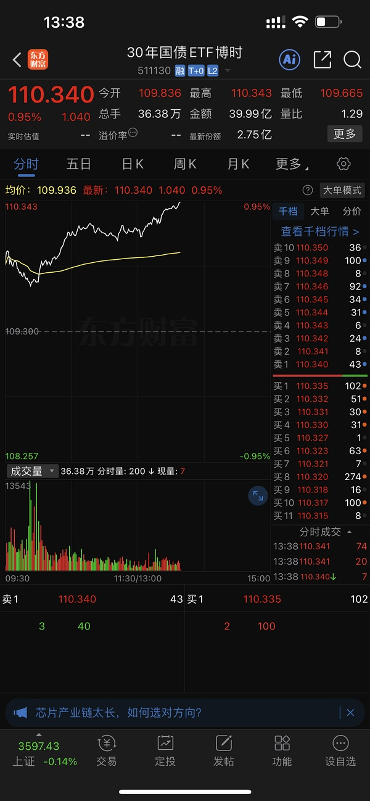  ⊳ （引用 @速派女孩将发财）娜娜期货在跳水 这个时候妈妈来 又是一点半 omg
我们冰冰还是有机会的

- (2026-11-17 13:43:30) 幸福这个月给了我幸福
现在我肯定先追随幸福🤣  ⊳ （引用 @该用户已过期）完了，又得给sy留钱🤣🤣我这钱咋就这么少呢

- (2026-11-17 13:44:49) 你不应该啊
我今天还说了20日线跌到才纳入观察目标
今天跌停也到不了的  ⊳ （引用 @momo）楼楼今天补了sy吗

- (2026-11-17 13:49:48) [图] 但是冰山又是看九阳的😂

  ⊳ （引用 @该用户已过期）过几天吧🤣今天就⛄️给了点好脸色，冰山崩了就没了🤣🤣

- (2026-11-17 13:52:32) 我场内之前也操作过通信ETF
既然是场内 错了及时砍呗 来去自如😂  ⊳ （引用 @Waiting一下）我场内的C50室场外所有的总和，我原本只想做个T没想到，从8号到现在，诶

- (2026-11-17 13:52:56) 涨停跌停数量同时大幅增加😂😂😂😂😂

- (2026-11-17 13:54:18) [图] 后排倒下了

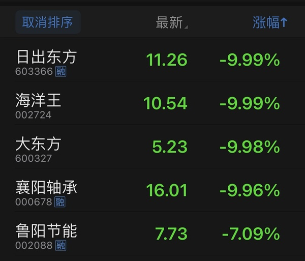  ⊳ （引用 @该用户已过期）九阳太硬了🤣封单几乎无变化

- (2026-11-17 13:57:20) 每次这时候
那个平潭就来了

- (2026-11-17 13:58:25) 上午已经不到9了 现在我也不想看😂  ⊳ （引用 @该用户已过期）楼，你这个月的收益还有一半吗？🥹🥹

- (2026-11-17 13:59:46) 割干净了吗  ⊳ （引用 @想当富有的咸鱼）早上实在没钱买雪PLUS了，还好割了个科技买了雪……

- (2026-11-17 14:00:35) 2000今天翻绿了  ⊳ （引用 @该用户已过期）我只剩高点的1/7了，即将清零🥹🥹这个月没保卫

- (2026-11-17 14:02:20) 冰山自己都是九阳带的😂
现在你想要带要靠plus雪了
冰山已经+8 还能怎么带🤣而且雪人冲过一次1484了
个人让我没有动力单日连过两个关口哈哈  ⊳ （引用 @高手云集上钻）老大能不能让冰山带一下冰雪人的持仓😭

- (2026-11-17 14:04:22) [图] 今天跌停是强者的证明🤣🤣🤣🤣

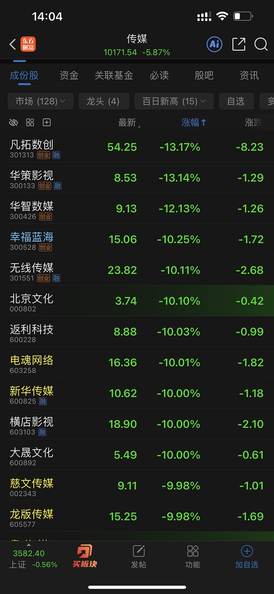  ⊳ （引用 @只想搞钱）Bn要奔着跌停去吗🥲🥲

- (2026-11-17 14:07:45) 都是大跌了
大家有不看好的 东西
可以调仓换股了

- (2026-11-17 14:08:00) [图] 在这

  ⊳ （引用 @家不住海边）救市主在哪

- (2026-11-17 14:08:57) 我要算算我今天-4.3换-7赚了没有  ⊳ （引用 @该用户已过期）没事，这两天这么跌，他们该割了

- (2026-11-17 14:11:34) 情绪崩盘 消费垃圾是最该跌的
消费那边小票才是真的小

而且没什么成交量 很容易大幅度降价卖  ⊳ （引用 @只想搞钱）不是，我真心不理解消费是为什么啊，全是三天-20个点左右的

- (2026-11-17 14:12:52) 老消费人
有几个学费我都交过

情绪你看着不行了（羊提示很久了） 不能买垃圾消费

过节之前 你不能买消费

市场反攻你不能买垃圾消费  ⊳ （引用 @只想搞钱）不是，我真心不理解消费是为什么啊，全是三天-20个点左右的

- (2026-11-17 14:14:31) [图] 是的 就是这样子
之前传媒不能加仓的原因

然而今天第三天 我已经以身入局了
传媒我也没有那么谨慎了😂😂😂😂😂😂

略微错在昨天抢先手 可惜博纳不是金逸

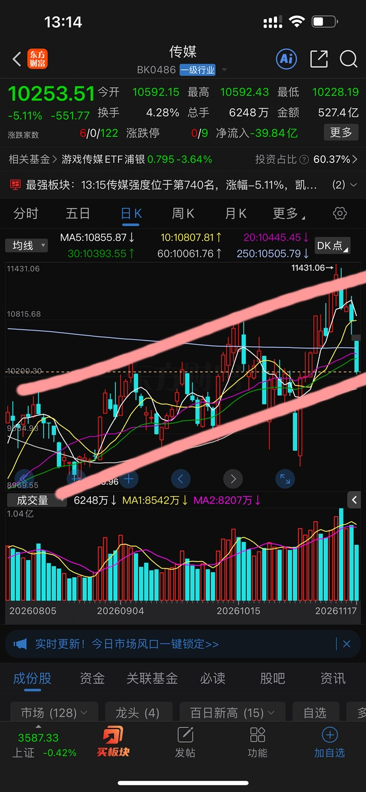  ⊳ （引用 @去他喵的大a）楼，你前面说那几个高位票给的指引，警惕情绪大崩盘，这就来了

- (2026-11-17 14:16:28) 你们肯定很喜欢安安那几个

你看安安成交量才多少

我如果着急卖 我还得降价几分钱才能马上卖掉

上周我恋爱脑降低了三分才马上出手成交

这就是危难时刻不能买垃圾消费的  ⊳ （引用 @只想搞钱）好的谢谢楼

- (2026-11-17 14:18:16) 今天抗跌的吸引资金 可能反而不是好事
让他们跌 本来就都是大跌  ⊳ （引用 @momo）zy你。。。

- (2026-11-17 14:20:14) 😂😂😂😂😂每次情绪崩盘
垃圾食品商场 你写下来“要跑的远远的”

你不可能有我吃的亏多的
这是学费

只要情绪不好了
垃圾食品你要快点出去  ⊳ （引用 @只想搞钱）光想着在消费等总没错，忽略主要问题了

- (2026-11-17 14:22:44) 如果指数好 就有机器人
机器人好像很会共振指数😂  ⊳ （引用 @sickid）不过我看的短线博主说明天传媒机器人有机会

- (2026-11-17 14:23:15) 我会有的😂  ⊳ （引用 @速派女孩将发财）明天还会有法定香槟日嘛？

- (2026-11-17 14:25:35) 现在跌幅都差不多
你看好哪个去哪个  ⊳ （引用 @圈圈儿）楼楼，只跟上了雪人，雪plus早上没来得及低吸只有兑现了。幸福有操作，zy可以什么时候介入？今天吗？

- (2026-11-17 14:25:56) 跌停上都是强者 赶紧的  ⊳ （引用 @乖乖是只嘤嘤怪）难顶 bn要跌停啊

- (2026-11-17 14:27:23) 今天空调一直1%顶着暗示银行假摔呀 包括10086  ⊳ （引用 @海贼）银行太牛逼了

- (2026-11-17 14:30:23) 市场不可能在目前情绪下跑出新的强势题材的
所以情绪反攻都是延续之前

除了冰雪旅游那种滑稽东西
如果没有反攻 大家都末日 也没什么区别  ⊳ （引用 @该用户已过期）咱都一样的持仓，你有我也有！

- (2026-11-17 14:31:52) 你不知道我满仓了？  ⊳ （引用 @👑）bn zy如果跌停接吗

- (2026-11-17 14:33:11) 跌停暴增  ⊳ （引用 @速派女孩将发财）woc 两点半急速跳水 什么意思

- (2026-11-17 14:33:59) 妈妈今天管债券🤣  ⊳ （引用 @速派女孩将发财）老师 我们的剧本不是两点半拉升嘛？都怪妈妈一点半乱买 烦死了

- (2026-11-17 14:35:18) 我买的我都看好
不看好的不买  ⊳ （引用 @圈圈儿）楼楼更看好幸福么

- (2026-11-17 14:36:12) 所以满仓了啊 没有余额

雪儿明天还是给雪儿的 14.3以下  ⊳ （引用 @🅰失而复🉐😎）你不是雪人出来逆回购了

- (2026-11-17 14:38:08) 在太子爷两件事没落地之前你们就有这个感觉😂  ⊳ （引用 @晓）我也感觉科创比创业容易回本

- (2026-11-17 14:39:27) -4.3 的光线现在-8.3 4%
-7的幸福现在-11% 4%

没区别😂😂😂  ⊳ （引用 @招招碎片收集中）你算好了吗？光线在你这是不是又稍微挽回点面子

- (2026-11-17 14:43:01) 幸福是量化专业户 线没有任何看头

就看板块情绪如何  ⊳ （引用 @招招碎片收集中）xf要是现价收盘刚好抹掉大阳线，它也学到奶茶的吃一天揍三天了吗hhhhhh

- (2026-11-17 14:46:11) 反正我都是提前说
就像6月发中芯国际图提醒一样
至于大家怎么看各自有看法很正常  ⊳ （引用 @高手云集上钻）太子上面有爹妈，失业板有谁😎

- (2026-11-17 14:49:10) 今天大绿的是我场内账户😂  ⊳ （引用 @招招碎片收集中）睡醒一看很绿但没有绿的想象中多，不知道谁救了我

- (2026-11-17 14:51:37) 如果明天开局立马强力修复抢反弹
一定要抓紧把今天买的ssss
记住哦 这个很重要

- (2026-11-17 14:54:05) 做好准备

传媒开局强力抢反攻 经常做  ⊳ （引用 @该用户已过期）感觉不会强力🤣🤣最多能坐起来

- (2026-11-17 14:55:28) 你发截图时候
那个空调红着1%就在暗示银行是假摔了
我女朋友的东西我可关心了  ⊳ （引用 @momo）没想到模拟盘我竟然红了，我要把模拟盘清掉，不能占用中下旬收入特高这个预言！！！

- (2026-11-17 14:57:59) bn 614
幸福 1584

雪儿明天重新买入  ⊳ （引用 @shirla）手动来不及哎，条件单求抄作业😂😂😂

- (2026-11-17 15:02:35) 那个1584不动啊
明天重新买入后继续设置1484卖新买的 1584继续开

plus雪你今天没出去吗
2494啊😂😂😂😂
我开的2564 今天也触发回落了
就这两个
你自己看

超预期牛逼 不在计划内 依然按部就班  ⊳ （引用 @shirla）已有的雪儿建议设置多少哇，还有plus

- (2026-11-17 15:05:25) 明天收益重新回来 加油🤣

而且最好希望他们不要开局立马强力修复 会适得其反😂😂😂😂😂😂😂稍微给点时间来去交换一下  ⊳ （引用 @shirla）这个月的收益暂时无了😂😂😂希望明天开始扬起来啊！别抑了啊！

- (2026-11-17 15:06:36) 这两天不都来了吗  ⊳ （引用 @稀里不糊涂）我发现最近这段时间捡尸队不来了，不仅不来了还卖

- (2026-11-17 15:07:15) 今天还能问咋了😂  ⊳ （引用 @-却行）卧槽bn咋了

- (2026-11-17 15:09:17) uu真猛啊 plus日内就回接了  ⊳ （引用 @shirla）好的！感谢楼楼一次次地喂饭啊哈哈~plus雪我今天顺利出去啦，尾盘又接回来了，雪儿是没出去后来就没动了，希望明天出去一下给我点零花钱！（下次得设买三才行）

- (2026-11-17 15:12:12) [图] 今天你们没出发雪儿挺意外的
因为10:57:36开始回落以后
即使一开始没报价出去
后面股价还返回来的可以交易成功的

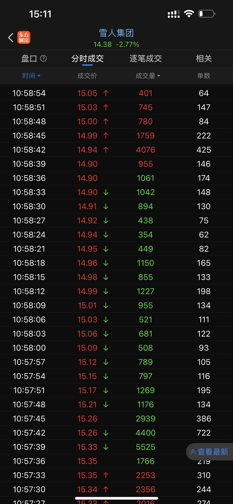  ⊳ （引用 @shirla）好的！感谢楼楼一次次地喂饭啊哈哈~plus雪我今天顺利出去啦，尾盘又接回来了，雪儿是没出去后来就没动了，希望明天出去一下给我点零花钱！（下次得设买三才行）

- (2026-11-17 15:13:24) 债券更重要

还有空买A 不错了 债券那边啥情况你也知道的  ⊳ （引用 @稀里不糊涂）和之前比买的少很多了吧，之前不是都说3.5百亿的买

- (2026-11-17 15:22:33) 最强势板块补跌 情绪崩盘总要经历的
好在这三天电影人就是回归到周四
中间还是高抛兑现几笔的 
除去昨天的先手有点问题 今天买入也正常  ⊳ （引用 @-却行）🤯没想到一觉起来都跳了

- (2026-11-17 15:33:27) 这个我要说一句
不要赌票房
在密集消息之前就要提前撤
再觉得票房牛逼 也要提前跑
到时候流浪地球也是

当然今天是普杀 也不管什么票是什么东西 
这一天总要来的  ⊳ （引用 @👑）中影我其实还蛮有信心的，就是昨天去看了电影，感觉好萧条😅然后不是说复联五预测首周15亿美元吗，如果真爆发就好了🤣🥲

- (2026-11-17 15:35:04) 现在楼里到底命在传媒还是冰雪？
我已经被大家整迷糊了  ⊳ （引用 @momomomomomo哒）等明天了😩😩😩

- (2026-11-17 15:40:29) 雪人来来回回已经赚了很多次隔日就8%以上利润了
都是雪儿帮你赚来的吧？  ⊳ （引用 @统统S掉）我全仓冰雪，因为场内焊死了只放2w，买不了那么多。但是这个月收益率还+11.2%，我也不知道咋算的

- (2026-11-17 15:42:44) 现在除了流浪地球
还有什么定档春节的影片不？  ⊳ （引用 @qiu啾）说起来今天小姐妹们开始讨论春节档了哈哈哈复仇者联盟什么的

- (2026-11-17 15:43:44) 今天雪儿日内就7+到手了
雪儿利润都是靠他来来回回积攒的😂😂😂😂
大家更喜欢的一直都是这个赚钱模式  ⊳ （引用 @统统S掉）确实是，雪人+20，大连-10

- (2026-11-17 15:45:29) uu纳斯达克怎么样了？现在都没年初1月到三月底的回撤大啊😂  ⊳ （引用 @小鱼）我想问个问题，纳指都这样了，有没有纳指基开放额度了啊？开放了要不要买啊，我不敢打开我的账户😂😂

- (2026-11-17 15:50:09) 我提醒你一下
不是因为哪吒
而是因为DS横空出世
因为碰巧他哪吒 所以放大了情绪交易
如果没有DS
回来第一天20 然后就A杀了  ⊳ （引用 @生动的羊）赌票房还走出来的 只记得光线 哪吒多么现象级的产品啊

- (2026-11-17 15:51:30) [图] 没有一个赌票房是成功的 光线只是运气好碰到了DS

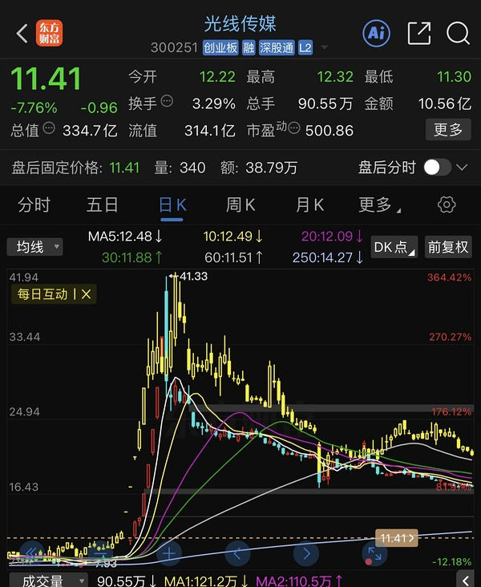  ⊳ （引用 @生动的羊）赌票房还走出来的 只记得光线 哪吒多么现象级的产品啊

- (2026-11-17 15:57:57) 那群东方和羊总要死掉一批的 必经之路😂😂😂
每次都有情绪炒作周期呀没办法

闽发7连板歇菜应该是本轮情绪受损的开始😅
你看跟风的惠发哈哈 一地鸡毛  ⊳ （引用 @速派女孩将发财）现在是双创恶劣还要带崩微盘股 就很烦 以前双创坏微盘会和银行一样红的

- (2026-11-17 16:00:31) 提桶大师plu今天提桶信号消失和温暖老师观点激情碰撞

精彩

- (2026-11-17 16:01:54) [图] plu厉害啊
下午还在加仓30债10债

- (2026-11-17 16:02:25) 我看看我上周三什么情况  ⊳ （引用 @点-重生炒垃圾）星期三法定香槟日😂😂😂

- (2026-11-17 16:04:03) 上周三我靠冰雪小红 香槟不是我场内😂😂😂  ⊳ （引用 @点-重生炒垃圾）星期三法定香槟日😂😂😂

- (2026-11-17 16:05:24) 你都不看的 提供消失说的是大A

债券他每调买机的 你忘了他有多看空印度啊
看空印度本质就是买债券  ⊳ （引用 @👑）他的桶都是债啊，那和温暖老师不冲突

- (2026-11-17 16:07:29) 我现在也不看的
因为每天他都是看空印度各方面😂
反正都是已知情况

难得刷到今天提桶消失  ⊳ （引用 @👑）哦哦哦，我真没看他，错了
主要是他老是开黄腔很烦

- (2026-11-17 16:10:02) 英伟达：哥说了算  ⊳ （引用 @👑）反正看明天了

- (2026-11-17 16:12:25) 那我的标题就不复存在了  ⊳ （引用 @vio）万一，我是说万一财报不好呢😭

- (2026-11-17 16:16:00) 其实中间都在乱搞

今天科创板开盘1212 收盘1221
创业板2297开 收盘2292 

都不到10点数😂😂😂😂😂😂😂
基本开盘啥样收盘就啥样  ⊳ （引用 @👑）股市下午跳水太刺激，害我十块钱奶茶优惠券没抢到

- (2026-11-17 16:17:55) 话说传媒人6月好几次满仓批量跌停 -9-8啥的
今天因为有一半冰雪的 甚至都觉得还行🤣🤣

- (2026-11-17 16:20:28) [图] 余老师还是很理智分析的 
怎么可能是gjd

  ⊳ （引用 @招招碎片收集中）感觉现在啥指标都失效了 哦，趋势动物的趋势还有效还有余力老师的数据

- (2026-11-17 16:21:31) 由于10月末以来债券的连续回撤，导致“固收+”产品的亏损扩大，客户看到亏损而赎回后，基金不得不再同比例地卖出债券和股票，从而形成股票的卖压，所以这一波的下跌何时企稳，关键不在于猜测指数点位，一定程度上在于“固收+”的赎回压力得到缓解。解铃还须系铃人，债市先稳特别关键，至少对于今天而言，30年国债的重新反包，算是一个非常重要的好消息！……

- (2026-11-17 16:27:06) 活在啥时代了
还4%年化

2.5的债券都三天给你去掉半年了  ⊳ （引用 @人间月）十年。。。。放进年化4的理财里都多少收益了，以后我也是收息佬了专注收息

- (2026-11-17 16:31:38) 是二级债基 在银行里叫固收+理财 （我特别反对这种 做的好的没几个）

这种都是80-90债券 10%的股票
以前都是股票买的高股息那种 今年因为6月的情况
6月你知道的 他们不得不高股息股票换成科技股

后面的故事你也知道了  ⊳ （引用 @招招碎片收集中）不知道今天的宽基etf，晚上回去用发财姐妹说的那个skill跑一下，民工那我翻到昨天的宽基etf也还是净流入来着，这一波算不算他们搬起石头砸自己的脚了，债基也买了科技股？（我没理解错的话）为了一个心肝害了另一个心肝

- (2026-11-17 16:36:56) [图] 你看这个
我们生态就这样
永远不会改变的😂😂😂

你肯定也记得我们6月楼里晒那个金梓才基金400%收益 什么华商基金 张明昕 都是看得收益前列的

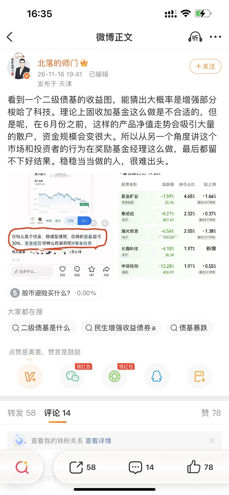  ⊳ （引用 @招招碎片收集中）妈快加大力度来救！基民别赎回了！我一看到流动性危机就脑袋大

- (2026-11-17 16:39:22) 半年涨30%的“稳健型理财”？

你知道他为什么买吗 因为半年涨30%啊😂  ⊳ （引用 @👑）难道今年稳健型理财也崩了吗，我竟然没注意到（因为没配置…）

- (2026-11-17 16:43:15) 是的
去年出台的基金经理薪资考核与业绩排名挂钩
出来的时候我就知道 
高层出发点肯定是好的 但事情肯定会更坏
这必然会加大抱团😂

有点类似以前高层出台垃圾票限制减持
这反而方便炒垃圾了🤣🤣🤣🤣🤣🤣🤣🤣🤣  ⊳ （引用 @招招碎片收集中）这个是不是又跟你之前说的基金经理要卷排名的挂钩上了！总感觉啥玩意儿加了科技就是加了杠杆，谁能想到吴老师说的跌百分之八九十都正常原来是纪实文学呢！挤水分要给我挤死了呀

- (2026-11-17 16:45:13) 弄不了的
美国科技说了算
这次全球联动！！

七月底八月初美国暴力反弹
韩国反弹台湾反弹我们也是反弹
大家都是一样的

这次妈妈没用 
而且妈妈不停买300 反而银行更受益了
本来里面就没资金卖 还加大了资金流入  ⊳ （引用 @Aaa摆烂咸鱼🥳）感觉这波gjd 高层弄的很差啊，今年是不是决策层换人了，弄这么极端，这么疯，6月对比现在

- (2026-11-17 16:47:07) 就像当初妈妈卖

美国在涨 我们跟着涨 也根本停不下来

妈妈没用的这一次

只能延缓下跌速度 结局不会改变
要改变还得看你的美国基金
这个好起来了
妈妈不花钱也会好起来

而不是现在大家每天说的
晚上扣钱又开始了😂😂😂😂  ⊳ （引用 @Aaa摆烂咸鱼🥳）感觉这波gjd 高层弄的很差啊，今年是不是决策层换人了，弄这么极端，这么疯，6月对比现在

- (2026-11-17 16:50:07) [图] 还有这个（不过这个很牛逼 科技逃顶了的）
但是一年20% 和稳定两个字你说会有关系吗😂

他们买债券也喜欢看收益率买
买一年40% 50%的 （6月时很多债券基金有40%年内涨幅）😂

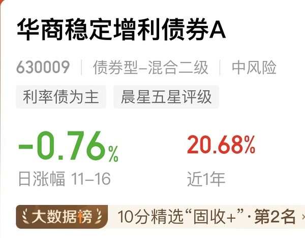  ⊳ （引用 @招招碎片收集中）谜底写在谜面上！增强收益，你买债图的不就是稳吗？

- (2026-11-17 16:53:53) [图] 二级债基可以买股票的
最高可以买15%股票 15%可转债呢

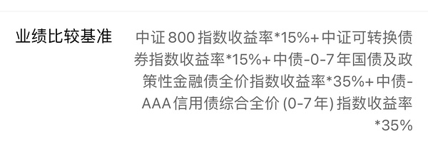  ⊳ （引用 @👑）买个“债🐔也能绿30%呢，那我绿三十很合理（不是，自我安慰，不是）

- (2026-11-17 16:55:38) 所以他的小程序涨价三次了  ⊳ （引用 @momo）趋势动物自己发的

- (2026-11-17 16:58:42) 做的肯定不是银行😂😂😂😂  ⊳ （引用 @六倍做多退休）我以为按照趋势买入银行这段时间胜率100%

- (2026-11-17 16:59:01) 加码大屏！红果短剧被曝筹备电视端独立APP 

11月17日消息，字节跳动正招聘红果短剧OTT端产品经理。从岗位介绍来看，主要负责红果短剧OTT端（大屏/电视端）产品从0到1建设；设计OTT端变现路径，探索投屏会员、会员订阅、衍生权益等变现模式；此外要深度参与OTT牌照申请全流程，设计OTT端内容分发体系，包括首页推荐、分类导航、搜索、追剧等功能，推动红果短剧主端与OTT端多端协同。

- (2026-11-17 17:01:11) 我抖音拍我们女主播日常的 有8000粉了🤣
我也在做呢😂😂😂😂😂😂😂  ⊳ （引用 @小鸡哔哔哔）一起三倍做多自媒体

- (2026-11-17 17:04:22) 那你明天记得就不是满仓了
如果情绪修复 自然不是满仓了
如果情绪不对 及时纠正今天的买入 也不会是满仓  ⊳ （引用 @稀里不糊涂）大家几成仓了啊，今天满仓回过味来又焦虑起来了。。。害，什么时候是个头啊。。。

- (2026-11-17 17:05:15) 英特尔盘前股价下跌3.3%，此前英伟达将其持股比例削减25%。

- (2026-11-17 17:05:55) [图] 债斯达克不包括可转债哈哈哈哈！

大家老老实实慢就是快 是不亏钱的

我女朋友提款机就是这么来的

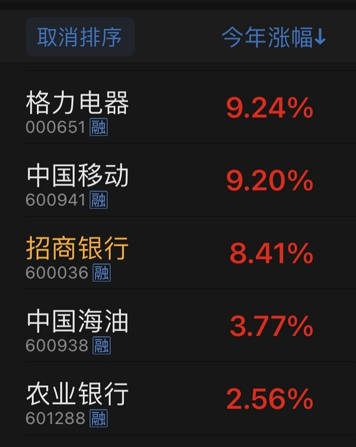  ⊳ （引用 @momo）他准备上线可转债了

- (2026-11-17 17:06:09) 下午uu发过了  ⊳ （引用 @未注销）达子要什么样的业绩才是好消息啊

- (2026-11-17 17:08:02) 反攻了你明天也不是满仓
不反攻你明天更不应该满仓

交易纪律  ⊳ （引用 @稀里不糊涂）好业绩还会带来反攻吗，我感觉现在都好弱

- (2026-11-17 17:11:24) 这个不会的
之前清盘线5000万呀 （现在改了 你看下新规则 我忘了）

十个清盘最多也就5亿😂😂😂😂
不如百亿基金一次的大赎回  ⊳ （引用 @点-重生炒垃圾）话说，有的垃圾基金清盘了，会进一步加剧大科技的资金流失吗？

- (2026-11-17 17:13:15) 你看你的本意就不对
不给机会你更要减仓不满仓呀🤣🤣🤣

场内很忌讳“等个反弹走” 尤其现在情况
不好了就马上走呀  ⊳ （引用 @稀里不糊涂）明天给个机会减仓吧

- (2026-11-17 17:16:37) 抖音我这种粉丝没有播放收入的
我这种拍女主播的难道还能接广告？🤣🤣🤣

B站视频播放有收入  ⊳ （引用 @高手云集上钻）8000粉一个月收入有多少啊

- (2026-11-17 17:21:27) 你们女孩子应该不会的
除非你们账号经常看娱乐直播啥的😂😂😂😂😂😂

我那个账号也都是男粉
我开号本意是为了让小姑娘看到的 来找我们做主播的
但是还是都推给了男的 我被迫改为给我们女主播直播间引流😂  ⊳ （引用 @点-重生炒垃圾）说不定哪天我就刷到了

- (2026-11-17 17:24:20) 是的
妈妈今天没有买1000
多好的机会啊 早上羊都开始修复了

可能今天债券那边也要用钱 钱不够了  ⊳ （引用 @稀里不糊涂）温暖老师不是说上头只救科技反而影响了小票回流修复吗

- (2026-11-17 17:26:16) 这个挺好的
但是因为挺好的所以就1.6%了

现在哪里和大家说国内稳定4%年化的都可以当诈骗处理了🤣🤣🤣🤣  ⊳ （引用 @红烧肉肉）最后一笔加仓完后的钱都扔建信宝22号了....

- (2026-11-17 17:30:00) [图] 没的 抖音8000不值钱

还不如B站1500粉丝的呢 B站播放还给钱呢 🤣赚点给她们买彩票的钱

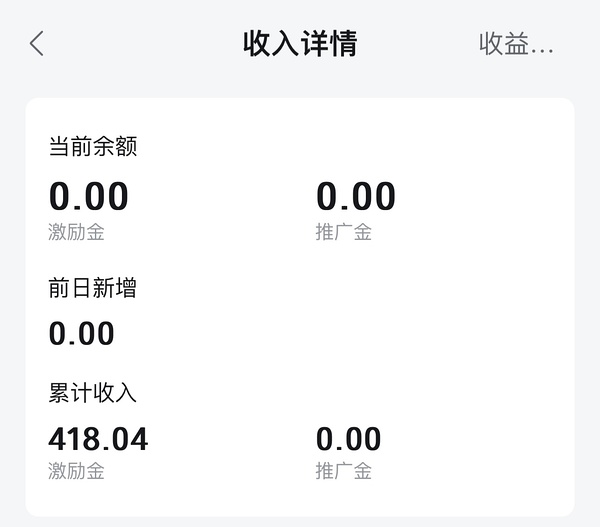  ⊳ （引用 @momo）抖音8000粉也没有播放收入吗

- (2026-11-17 18:03:10) 我对这个结论表示疑问🤣🤣🤣🤣

一是因为在3-6月主动基金这个70%那个80%收益时候
如果大家大头在涨不动的nana 不骂人估计就不错了 6月时候还是会做出相同的操作

二是后来调整初期
有很长一段时间 nana没怎么跌 主动连续大跌 钱估计也去买这个 应该还会有很多nana调仓去主动的操作  ⊳ （引用 @招招碎片收集中）点了！！！这一轮nana没限购的话应该也是指数基大头搭配主动基增强的，啧！

- (2026-11-17 18:13:13) 还是先算算今天3300了
在漏了-0.7的情况下

今天-1.55收盘对应nana期货0

Mark 明天早上再来算  ⊳ （引用 @招招碎片收集中）这倒是的，感觉咋做都是跟人性作斗争！就像在a求稳选了指数基 没想到跌起来跟个股也不分伯仲了

- (2026-11-17 18:18:46) [图] 华夏兄弟每个阶段都跑输了网易云了

  ⊳ （引用 @vio）网易云-3.45

- (2026-11-17 18:24:00) 落后的别气馁
领先的别骄傲
😂  ⊳ （引用 @混乱中立同人女）可恶啊！我对华兄寄予厚望

- (2026-11-17 18:25:14) 是的 这次路漫漫 暂时的落后和领先不意味着什么😂  ⊳ （引用 @钱多多多多多）可能只有熬出头，才知道到底谁是最棒的😂

- (2026-11-17 18:25:42) 你看10/30 10/31帖子  ⊳ （引用 @momomomomomo哒）今天看回复数这算是又一次爆量了么

- (2026-11-17 18:26:07) 今天投票大缩量
小远三连冠😂😂😂😂😂😂  ⊳ （引用 @momomomomomo哒）今天看回复数这算是又一次爆量了么

- (2026-11-17 18:32:21) 大家不愿意看
但是我们还是得计算下
截至目前大A最近三个月（天天基金有三个月收益率 好计算）亏了多少

-37*30% -30*42.5% -17*17.5% -15*10%

-11-13-3-1.5=-28.5%

CC暂时贡献了最大的负收益

结合美国基金近三个月-30% 两边半斤八两

- (2026-11-17 18:34:47) 你能忍到现在？别骗自己了 最多比我少亏10个点吧  ⊳ （引用 @如梦令）如果还有下次，我一定抄楼的屁股

- (2026-11-17 18:45:48) 我都怕uu等着抄我底
然后八月那一波大反弹时候又觉得没有低点
实在忍不住买到8.17日高点上😂😂😂😂😂😂😂  ⊳ （引用 @招招碎片收集中）哈哈哈哈哈哈哈哈哈哈哈哈哈火力全开

- (2026-11-17 19:17:21) [图] 嗯
少亏一点😂

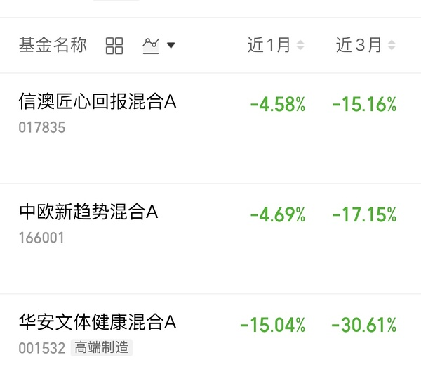  ⊳ （引用 @未注销）我还留了一点张经理，是几个中基里跌幅最小的吧

- (2026-11-17 19:21:17) 昨天小浦小广也都-3啊？

- (2026-11-17 19:26:19) 2026年7-9月，黄金珠宝社零同比分别下降10.1%、17.5%和9.6%，行业需求端，感受到了更大的凉意。

受到打击最重的，莫过于老铺黄金。老铺黄金的商业模式——全直营、全一口价、只进顶奢商场，在金价上涨时放大了利润，在金价下跌时，同样也遭受了更大的反噬。此前，老铺黄金毛利率一度做到47%，净利率超过20%，几乎跳脱出了黄金珠宝行业的定价。

但金价的迅速掉头，又将它打回原形。根据花旗估算，老铺黄金三季度收入约36亿元人民币，环比增长9%，但净利润降至5.89亿元，毛利率从二季度的47%压缩到41.8%左右。这意味着，金价回调时，老铺的销售同步走弱，此前市场所期望的，品牌力让销售与金价脱钩的逻辑被部分证伪了。

老铺黄金并没有逃开黄金珠宝行业的规律，那就是，金价上涨会通过涨价预期刺激抢购，金价下跌则触发观望。消费者对金价的敏感度，并没有因为老铺所谓古法黄金工艺的招牌而消失。

逻辑证伪、金价下行，最直观的表现就是股价。近一年多以来，老铺股价跌幅超过70%，市值从最高接近1900亿港元缩到507亿港元，跌掉的市值比周大福当前的总市值还多。

如今老铺的估值是在为不确定性打折，而周大福的估值是在为确定性付溢价。市场对于老铺的分歧其实一直存在，那就是，它到底是奢侈品公司，还是金饰公司。

市场显然已经给出了答案。

- (2026-11-17 19:27:47) 昨天很多割肉了 今天又是大批量割肉 已经推送了  ⊳ （引用 @初筱玖）突然想起来上周柚子平铺题材的新闻。。。是不是全都埋在里面了。

- (2026-11-17 19:29:36) 个股层面来看，今日市场亏钱效应仍处于高位，已是连续两个交易日超百家个股跌停或跌幅超10%，短线连板高度压缩至3板，短线情绪持续走弱。其中高位人气股持续退潮，大东方、百洋股份、永臻股份、闽发铝业走出3连跌停，东方环宇、金辰股份、日出东方、海洋王等标的连续两日封死跌停。

另一方面，前期热门题材集体兑现，机器人、物理AI概念集体遭遇重挫，杰克科技、福莱新材、汉王科技跌停，索辰科技大跌超15%，宇树科技、凡拓数创、海天瑞声、华依科技、上纬新材等一大批前期人气标的跌幅超10%。AI漫剧板块同样大幅杀跌，文投控股、浙文影业、电魂网络、横店影视跌停，华策影视、华是科技、幸福蓝海等跌超10%。

不过在情绪连续达冰点之后，短期存在一定的修复博弈预期，但资金回流的强度及持续性仍需验证，后续可重点关注能够和指数企稳形成共振、资金合力共识较强的题材方向。

- (2026-11-17 19:32:12) 😂😂😂😂😂😂平铺策略无效 全死绝

估计策略和之前一样的 不知道哪里是活口回流 索性全跑了？  ⊳ （引用 @初筱玖）他们还是跑得快

- (2026-11-17 19:35:17) 从交易热度看，目前中证红利周成交额占全A比重为3.6%，较7月初的低点1.7%明显回升，分别处近5年64.7%分位/2010年以来21.3%分位。换手率方面，中证红利周换手率（年化）为73.3%，处近5年57.6%分位/2010年以来72.0%分位。整体看，近期市场对红利的关注度有所回升，但尚未达到极端拥挤水平。  ⊳ （引用 @初筱玖）😂唯一的活口是红利吧

- (2026-11-17 19:39:01) 标普500指数期货抹去跌幅，转为上涨 。消息面上，ANTHROPIC官宣：我们已获准在纳斯达克全球精选市场上市我们的A类普通股，股票代码为“ANT”。

- (2026-11-17 19:41:03) 纳斯达克100指数期货收复此前0.7%的跌幅而转涨

纳斯达克100指数期货转涨，此前一度下跌0.7%，现报27287点。  ⊳ （引用 @不知道还能说啥）标普500指数期货抹去跌幅，转为上涨 。消息面上，ANTHROPIC官宣：我们已获准在纳斯达克全球精选市场上市我们的A类普通股，股票代码为“ANT”。

- (2026-11-17 19:41:19) 市场对ANT好激动啊😂😂😂这不是已经确定的吗  ⊳ （引用 @小鱼）激动的心，今晚英伟达业绩如何。

- (2026-11-17 19:42:02) 为什么ANT发了一个都知道的消息 都那么激动啊？  ⊳ （引用 @sickid）英伟达股价在盘前交易中扭转跌势，最新涨幅接近1%。

- (2026-11-17 19:42:37) Anthropic IPO定价区间未变。

你看也没什么变化  ⊳ （引用 @sickid）不怕吸血啊？看不懂

- (2026-11-17 19:43:05) 👍👍👍👍👍👍👍👍👍养老金买养老资产 无敌呀  ⊳ （引用 @小鱼）我养老金账户放了一万二红利，今年涨幅7.3%😓

- (2026-11-17 19:43:41) 还要明天早上英伟达配合呢😂  ⊳ （引用 @海贼）美股光从-1拉倒+5，感觉今天抄底科技硬件的明天会好过

- (2026-11-17 19:44:15) 就ant官宣他要IPO了 定价也没变 不知道为什么就火箭发射了😂😂😂😂😂😂  ⊳ （引用 @招招碎片收集中）是不是想看看投资者对AI的态度是不是还是积极啊

- (2026-11-17 19:49:03) 现在都是防守至上😂😂😂没资金赌博了  ⊳ （引用 @长成大🌲）看样子今天我们这没有聪明资金预判啊

- (2026-11-17 20:08:24) 你结合昨天余老师的 8月死叉后需要半年 指向三月
太子爷是1.27解禁 2月上半部分过年 资金也不会攻击
都是观点匹配的  ⊳ （引用 @momo）趋势动物新文说老登红利跨年

- (2026-11-17 20:11:02) 🤣明年我女朋友空调成本要变成33.5了
如果董阿姨身体健康 按照目前再战11年 有机会11年成本变0  ⊳ （引用 @momomomomomo哒）憋说了 今天打开大号 想给我的空调做个日内T 给我T飞了 期待本周科技反攻红利给我跌下让我拿回我失去的吧

- (2026-11-17 20:13:51) 等我结完婚买完房 就一起加入你们😂😂😂😂😂  ⊳ （引用 @sickid）再这样下去我真的要启动红利退休回本大法了

- (2026-11-17 20:19:06) 没有动
但是这个跌幅肯定是很多人卖的 
大家心里接受能力不一样
你应该偶尔看几条会经常看到“卖了”的  ⊳ （引用 @钱包鼓鼓💰）😳加班慌忙看到认错了C50，没有出吧？我就确认一句(没有别的意思
最近工作忙的焦头烂额实在有点跟不上节奏

- (2026-11-17 20:19:26) 估值-5.7 差不多 猛干  ⊳ （引用 @VVV坚定持有VVV）建信-6.31

- (2026-11-17 20:19:55) 是的
我之前说过的呀
1月中大家就可以过年去了

随便弄点瞎玩玩  ⊳ （引用 @混乱中立同人女）楼 太子爷解禁和春节13天假期 场内小垃圾是不是也要走完啊

- (2026-11-17 20:20:41) 他好像很喜欢煤炭 但是最近红利里煤炭不太好😂  ⊳ （引用 @sickid）我看万家黄海的防守🐔最近一个月也不行

- (2026-11-17 20:23:26) [图] 小浦很牛逼

  ⊳ （引用 @🅰失而复🉐😎）步履艰难😒

- (2026-11-17 20:24:52) [图] 我的债拿回来好多了🤣🤣🤣🤣🤣🤣🤣🤣
第二个真牛逼啊 
减都是1 2 涨是10👍👍👍

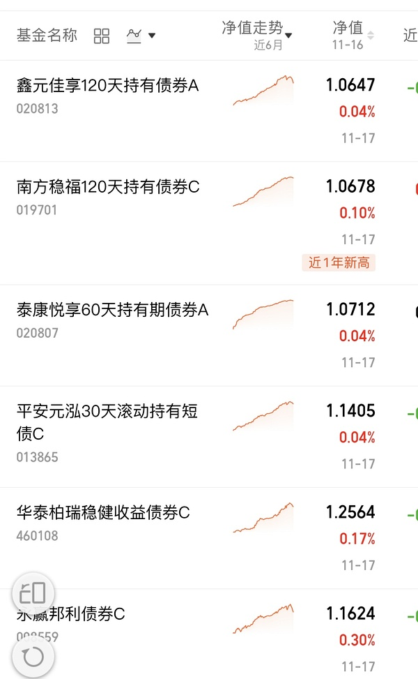  ⊳ （引用 @招招碎片收集中）最近感觉真就通杀！股也杀债也杀

- (2026-11-17 20:26:14) 炒啊 放心
场内的钱不会动的呀😂
我买房的钱是我现在债券里的  ⊳ （引用 @momo）家人们2029年见  楼主你结婚买房就不炒了吗直接红利养老了

- (2026-11-17 20:26:38) 🤣高兴啊 而且我看出各自特色和持仓了  ⊳ （引用 @招招碎片收集中）夫人 少爷今天终于笑了（bushi）

- (2026-11-17 20:42:05) 找到了 不过第二个限购了😂  ⊳ （引用 @招招碎片收集中）找到你想要的抗揍又猛攻的了吗？😂😂😂

- (2026-11-17 20:43:38) 2肯定是最好的 但是限购1000

这里面356是利率债多点
其他都是信用债为主

今天利率债修复的好  ⊳ （引用 @momo）那么楼楼最心水是哪个

- (2026-11-17 20:46:08) 👍👍👍👍👍👍👍👍  ⊳ （引用 @momomomomomo哒）这个南方C和A 我昨天都补了1000hhhhh 

- (2026-11-17 20:47:05) 直接今天就历史新高的债券
我这边自选一共有五六十个 我看了唯独他一个！
真尼玛牛逼
不愧是限购的  ⊳ （引用 @momomomomomo哒）这个南方C和A 我昨天都补了1000hhhhh 

- (2026-11-17 20:55:47) [图] 信用债里面今天银行资本债 永续债都是大涨 图里这些名字的

但是地方和企业债的短端是涨的 长端还是跌的

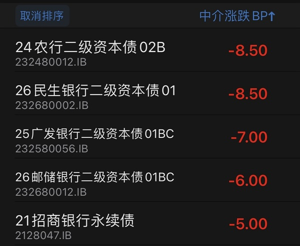  ⊳ （引用 @有人区生菜）楼楼我买的那个债今天是0，是不是今天大涨的都是利率债啊，信用债一点都没吗

- (2026-11-17 20:59:41) 你这个看这五个没用
你看五大重仓只有9%
债券一共128%

有119%的债券你都看不到买的什么🤣  ⊳ （引用 @有人区生菜）我看名字是中短债，赛道是中长，我好像又精挑细选了一坨😇😇😇

- (2026-11-17 21:02:30) 信用债多 有的是批量买一大堆
今天没有所有信用都大涨 所以有些产品今天不行😂
利率债今天确实更好

利率债的基本面依靠是国内经济差 这个逻辑很硬🤣  ⊳ （引用 @有人区生菜）啊啊感觉又上当了，还锁定我到期一定扬了它

- (2026-11-17 22:01:28) 每年还目标cpi3%呢  ⊳ （引用 @去他喵的大a）起码平开吧，拉回4023，不然说明根本没有kpi，骗走2w亿才是真的

- (2026-11-17 22:01:58) 小远三连冠的今日冠军含金量很高啊

-2.19都大胜nana了！！！

- (2026-11-17 22:02:41) [图] 了不起的极致防守

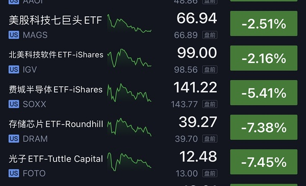  ⊳ （引用 @不知道还能说啥）小远三连冠的今日冠军含金量很高啊

-2.19都大胜nana了！！！

- (2026-11-17 22:04:22) 快看今天的债 基本上什么利率债多一目了然了
以后要抄底利率还是信用完全有数了😂  ⊳ （引用 @去他喵的大a）😇😅

- (2026-11-17 22:09:51) [图] 但是他应该是信用啊 就是牛逼的一笔 

我觉得这个好 纯利率 而且两次修复都很好

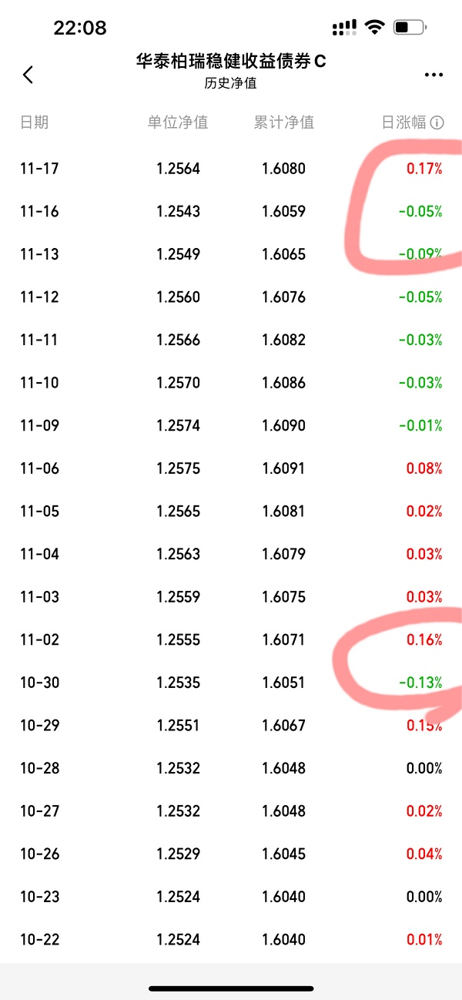  ⊳ （引用 @去他喵的大a）南方稳福最多吧！

- (2026-11-17 22:18:57) 英伟达Q3业绩兑现度与Q4指引，能否达到1250亿美元门槛。

Q4营收指引的“生死线”：市场普遍预计英伟达Q3营收小幅超预期问题不大，真正的股价催化在于Q4 FY27的营收指引。此前管理层曾暗示超大规模云厂商（Hyperscalers）的需求将在Q4重新加速，目前华尔街对Q4营收的一致预期在1,247亿–1,250亿美元左右。若指引能站稳1,250亿美元上方，将有力回击近期市场对AI资本开支见顶的担忧。

今天uu问的

- (2026-11-17 22:44:00) [图] 我刚看
大家看到的是红利

而我对中间两个字两眼放光🤩

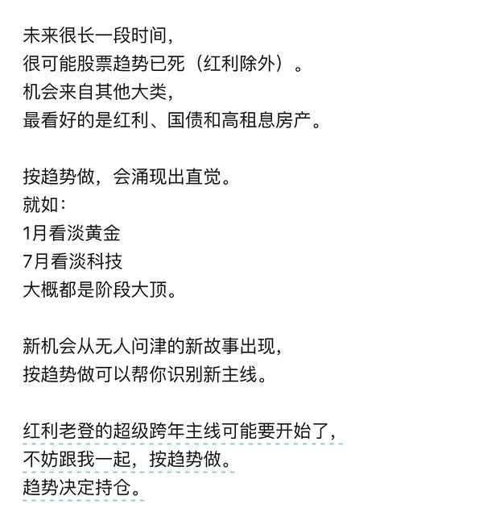

- (2026-11-17 22:48:14) 盘后就是财报 没什么猛冲的意义啊😂
美国人又不玩预期你预期  ⊳ （引用 @一切都会过去的）好弱 难顶

- (2026-11-17 22:49:32) [图] 😅😅😅

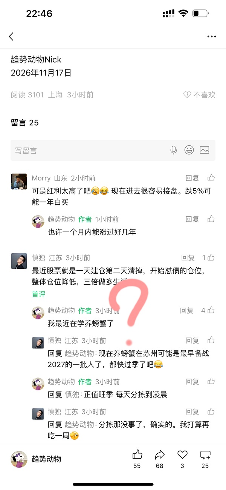  ⊳ （引用 @招招碎片收集中）国债

- (2026-11-17 22:53:32) 2倍做多英伟达已买好
明天模拟盘大赚还是大亏盘后就知道了😂  ⊳ （引用 @VVV坚定持有VVV）下班！怎么个事啊，为啥模拟盘也亏钱，这不对劲🤔

- (2026-11-17 22:58:29) 好像个股都两倍 ETF才有三倍😂  ⊳ （引用 @VVV坚定持有VVV）跟一手！咋没有三倍做多🤔

- (2026-11-17 23:03:55) [图] 😂年内159%的金梓才也翻绿了

159%时候人满为患 需要限购才行
现在无人问津了 都是骂的了

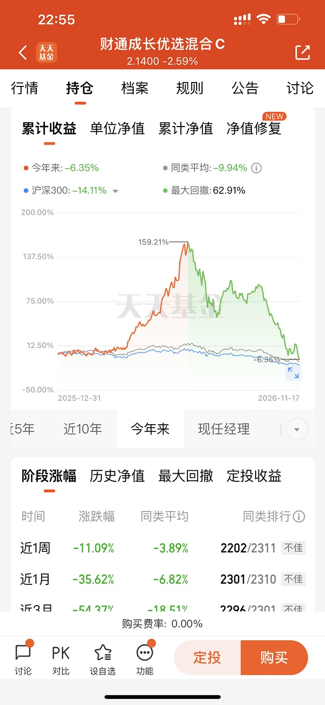

- (2026-11-17 23:13:14) 这个就是满仓30债
不是我选的 他就是代表场内那个30债ETF
（ETF也是一堆30债集合 华子是帮你选几个30债）
华子业绩比场内30债ETF好

如果不看好经济复苏 但是又觉得短债来钱太慢了 他们就是买这个30债 波动收益都加大😂😂😂😂😂😂

30债就怕三件事
1，经济复苏 （预期复苏）
2，A股超级超级牛逼
3，突发事件 类似本次  ⊳ （引用 @Molis）华子昨天4.77今天变5.45。。。楼你当时咋选的，好强。。不过这样就有点大起大落了，不如上面那个限购选手稳当。

- (2026-11-17 23:21:08) 首批18只主动ETF最高仓位超90%，下周一上市

截至11月17日晚间10点半，首批18只主动ETF全部披露上市公告书，18只ETF360亿份上市份额中，个人投资者以逾270亿份的持有量占逾七成份额。18只ETF将于下周一（11月23日）集中上市，记者根据公告书数据统计发现，截至11月16日，18只ETF的平均股票仓位水平（以股票资产金额占基金总资产占比为口径，下同）超过了55%，过半产品的股票仓位接近60%，最高仓位水平超90%。

- (2026-11-17 23:21:40) 明天看看他们公告 都买了点啥  ⊳ （引用 @不知道还能说啥）首批18只主动ETF最高仓位超90%，下周一上市

截至11月17日晚间10点半，首批18只主动ETF全部披露上市公告书，18只ETF360亿份上市份额中，个人投资者以逾270亿份的持有量占逾七成份额。18只ETF将于下周一（11月23

- (2026-11-17 23:57:14) 小远要四连冠了………  ⊳ （引用 @VVV坚定持有VVV）怎么恐慌指数又起来了？

- (2026-11-17 23:57:31) 我反应也是这个  ⊳ （引用 @VVV坚定持有VVV）小远明天该不会是四冠王吧，我接受不了

- (2026-11-17 23:59:01) 黄来了  ⊳ （引用 @VVV坚定持有VVV）我接受不了

- (2026-11-17 23:59:25) 黄仁勋打破沉默，表示若获董事会邀请愿重返英伟达担任CEO
前英伟达首席执行官黄仁勋周二上午发表卸任后的首次公开声明，表示如果董事会邀请，他愿意重返这家科技巨头担任CEO。黄仁勋称，自其离职以来，收到了来自英伟达员工、投资者、商业伙伴及客户的强烈呼声，要求他回归。“如果董事会认为我的回归符合股东、员工、公司及美国的最佳利益，我将很荣幸回应这些呼吁并重新担任CEO。”

两倍做多英伟达  ⊳ （引用 @VVV坚定持有VVV）我接受不了

- (2026-11-18 00:01:13) 小波动
盘后来一把大的😂  ⊳ （引用 @VVV坚定持有VVV）在V了！就是买早了🤣

- (2026-11-18 00:01:44) 最近空头太顺了
上一点强度😂😂  ⊳ （引用 @moli）怪不得我的收益瞬间缩水

- (2026-11-18 00:02:34) 早说 
就不会有那么多空头了啊
多空来回收割才好  ⊳ （引用 @华尔街之猪）一句话这么管用吗 我去早说啊

- (2026-11-18 00:03:42) 😂😂😂😂😂😂我以前回家确实特意放慢过
因为似乎是真有用

最近已经没用了 虽然我就在路上  ⊳ （引用 @六倍做多退休）我现在特别理解每天在车里坐半个小时再回家的人 我也喜欢上了这种感觉

- (2026-11-18 00:04:34) 刚刚下跌应该不是ai的问题
道琼斯跌的比纳斯达克还多  ⊳ （引用 @海贼）一波拉升，AI离不开黄仁勋😂

- (2026-11-18 00:05:15) 我都准备开新帖了😂😂😂整不会了  ⊳ （引用 @moli）怪不得我的收益瞬间缩水

- (2026-11-18 00:11:32) 不知道前面发生了什么
诡异的是道琼斯跌幅更大 而且与此同时黄金白银飙升  ⊳ （引用 @moli）模拟盘最高5万收益，现在剩6000，明天起来看看还剩多少😂

- (2026-11-18 00:13:00) 这次而且黄金不同路

我就看到油飙了 黄金居然向上  ⊳ （引用 @VVV坚定持有VVV）我看了下恐慌指数11:30开始升的，但对应消息也没看出什么大事来，不知道他们怎么了

- (2026-11-18 00:28:05) 在英伟达发布财报之前几个小时发文 有意思

- (2026-11-18 00:30:21) 那就是怎么样都是利好😂😂😂😂  ⊳ （引用 @去他喵的大a）老黄发推释放可能信号-财报拉稀-正式回归-顺理成章

- (2026-11-18 00:31:22) 话说美国的igv软件 好像下坡路了……  ⊳ （引用 @去他喵的大a）真不是操纵市场吗。。黄仁勋8分钟前才发推特，这新闻领先了20多分钟

- (2026-11-18 07:12:52) 😂李经理美国人不按套路

实际上是 财报牛逼 黄不回归😂😂😂😂  ⊳ （引用 @去他喵的大a）老黄发推释放可能信号-财报拉稀-正式回归-顺理成章

- (2026-11-18 11:53:32) 加了3000 被识别了  ⊳ （引用 @该用户已过期）印度不是天天说，应该不是这个🤣🤣

- (2026-11-18 11:53:50) uu说了 3000 🤣  ⊳ （引用 @👑）咋回事，没说啥啊，不是讨论黄金吗

- (2026-11-18 12:00:36) 还没显示违规原因 等出来了我看看  ⊳ （引用 @sickid）我以为又是举报底了呢

- (2026-11-18 12:03:55) 上证  ⊳ （引用 @VVV坚定持有VVV）我也不知道3k是啥啊😂

- (2026-11-18 12:05:59) [图] 是内容违规

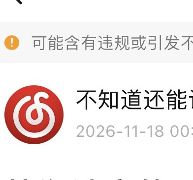

- (2026-11-18 12:06:36) 我把你们敏感内容都删了 避免麻烦  ⊳ （引用 @不知道还能说啥）是内容违规

- (2026-11-18 12:08:13) 兑现加仓冰雪  ⊳ （引用 @qiu啾）我去，经典再现，请问uu们今天楼什么操作

- (2026-11-18 12:13:51) [图] 我刚刚去看了一眼
这两天大A追上了落后的2%

现在中国光和美国光 跌幅完全一样了😂😂

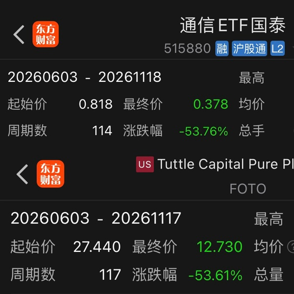  ⊳ （引用 @sickid）刚发现今天cpo和pcb居然红的

- (2026-11-18 12:15:09) 这个字你们真少发 没啥意思
除了容易被封号 并没好处😂😂😂😂😂😂  ⊳ （引用 @lacey）[该回复已被删除]

- (2026-11-18 12:19:00) 你说的是垃圾消费
垃圾消费都是小微盘呀
情绪受挫最影响垃圾消费了

大家以前苦头没吃够
只要情绪不好了
第一个要去掉的就是那些食品商场
还有垃圾地产（这个大家不玩）

真正的大消费现在好得很😂😂😂  ⊳ （引用 @嘻嘻嘻嘻）消费都被a杀了吗，除了冰雪

- (2026-11-18 12:22:13) 我只兑现了plus和今天加的雪儿 😂
其他没买啊  ⊳ （引用 @一直在摸🐟）三个平均加么

- (2026-11-18 12:25:55) 微盘股指数A了 哪个题材现在都是A😂  ⊳ （引用 @第四个影子）感觉还是资金面的问题，有宽基etf流入，老登大票都还行的，科创这周其实也还行，这几天感觉是题材资金全面撤退了，机器人已经A杀了，传媒和游戏感觉也在a杀途中，要看到跌停数量减少到个位数情绪才会好转了吧

- (2026-11-18 12:42:54) 一个看你是否坚定看好 
就像之前上周五我觉得羊临近崩盘 那我把我没那么坚定的都去掉了 机器人啊恋爱脑那些

还有种就是比如奶茶之前
板块其他同类型都无敌牛逼时候 他无动于衷 那这种说明是他单独很弱

最后一种就是你说的了 不让赢转亏总是对的
我上个月ycm就是这个 他太容易-8那种
我也是临近转亏就走了
结果自然也是走了就大V
那这种也没什么懊恼的
再找其他的赚就是了  ⊳ （引用 @嘻嘻嘻嘻）楼，要怎么平衡坚定看好和止损？xf十二块多的时候，我是亏损5k的，现在差不多不亏了。这种时候是继续坚定看好坐电梯呢，还是应该先保住本金

- (2026-11-18 13:14:57) 不错
今天这个走势虽然我也亏钱
但依然觉得是最好的  ⊳ （引用 @🅰失而复🉐😎）😕

- (2026-11-18 13:17:50) 哭啥啊

三连跌有人割肉有人减仓有人止盈了 好事  ⊳ （引用 @🅰失而复🉐😎）想哭😭😭😭

- (2026-11-18 13:18:53) 😂😂😂  ⊳ （引用 @🅰失而复🉐😎）激动滴

- (2026-11-18 13:20:24) 今天最差的情况就是开盘暴力反弹
现在这样低位痛彻心扉我觉得非常棒  ⊳ （引用 @🅰失而复🉐😎）😏

- (2026-11-18 13:21:56) 都是老朋友 😂😂😂😂😂我就不说了  ⊳ （引用 @🅰失而复🉐😎）楼快说你昨天摸了谁个传媒，是不是新华

- (2026-11-18 13:22:44) 我不是zy😂  ⊳ （引用 @该用户已过期）掌阅啊，她也摸了

- (2026-11-18 13:23:10) 美国在反弹😂  ⊳ （引用 @六倍做多退休）汪汪还能拉nana的溢价（？？）有点搞笑了

- (2026-11-18 13:23:49) 要和羊羊们说再见了
新周期不再看羊

- (2026-11-18 13:25:13) 九阳要天地板了

- (2026-11-18 13:26:19) 现在只要晚上多跌的 这玩意就当没发生了😅  ⊳ （引用 @六倍做多退休）场内的比期货弹的还快

- (2026-11-18 13:27:41) [图] 今天科创半导体怎么不在前面了 没赢k50？

- (2026-11-18 13:28:03) 刚来
来的慢了😂  ⊳ （引用 @不知道还能说啥）今天科创半导体怎么不在前面了 没赢k50？

- (2026-11-18 13:28:57) 机器人先调整的 反弹也不给力啊

- (2026-11-18 13:29:40) 靠

债跳大水

- (2026-11-18 13:31:02) 这是最好的垃圾票模式
没有抢开局！再拉一根奇丑无比的上影线

而是选择午后上攻

- (2026-11-18 13:31:47) 我现在又是传媒多于冰雪了

- (2026-11-18 13:33:07) [图] 下限到了加大传媒
接近上限降低传媒

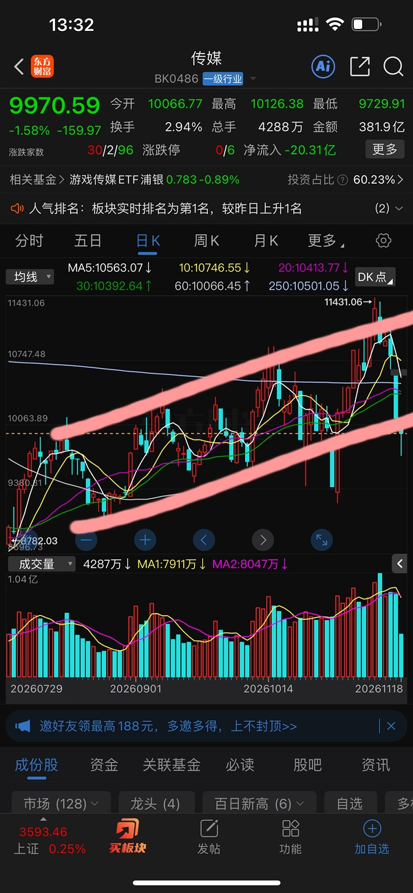  ⊳ （引用 @🅰失而复🉐😎）我也，这两天能买的都买了，能花的都花光了

- (2026-11-18 13:34:02) 你国内多？  ⊳ （引用 @高手云集上钻）天啦C50红了，今天场外终于能红一天了吗

- (2026-11-18 13:35:05) 上周因为到上面了 所以不加传媒
但是这两天明显靠近下面了  ⊳ （引用 @🅰失而复🉐😎）就看你这个波段了做了

- (2026-11-18 13:35:51) 今天大家的雪儿 plus雪 都要拿高抛奖状了😂😂😂

- (2026-11-18 13:41:48) 10月9日，证监会发布《公开募集证券投资基金运作管理办法》，运行满三年规模不足2亿元即强制清盘的硬性条款拟被正式删除，发起式基金退出门槛与普通基金拉平。  ⊳ （引用 @云小朵飘啊飘）大佳
A股现在有两个肉眼可见的冲击。一个是大量的公募基金跌破或者即将跌破5000万的红线，从而被迫清盘。目前，已经公布清盘的基金有8个。我们最近测算了一下，大概有1000只基金，进入到了潜在清盘线。其中高危的有500只，已经跌破5000万的

- (2026-11-18 13:42:52) 我也觉得不是
卡在情绪转换点

而且我楼的标题是 四个字  ⊳ （引用 @去他喵的大a）我觉得不是

- (2026-11-18 13:45:14) 1484 要记住哦

还要玩好几天1484应该  ⊳ （引用 @-却行）上午雪儿贪了没出是我的错 满仓容易操作变形

- (2026-11-18 13:46:03) 以为机器人先回调会先反击的
没看到

- (2026-11-18 13:46:22) 你们买的都银行？上证指数能给大家带来啥钱  ⊳ （引用 @yiko）今天上证能收红么

- (2026-11-18 13:48:08) 😂-3都没有一个 坚决还远  ⊳ （引用 @去他喵的大a）主要午后红利跳水太坚决了，感觉有资金在腾挪

- (2026-11-18 13:49:02) 如果你说的“都出来了”是真的
那不是更好拉？  ⊳ （引用 @👑）关键是没那么容易拉了，不是说保险那波钱都出来了

- (2026-11-18 13:50:52) 美国说了算  ⊳ （引用 @👑）😳拉科技吗

- (2026-11-18 13:53:58) 挺好的 再度满仓了

后面电影会释放筹码🤣  ⊳ （引用 @🅰失而复🉐😎）大连背刺

- (2026-11-18 13:55:00) 先借一笔
后面问cbs借  ⊳ （引用 @🅰失而复🉐😎）你的雪人去的？

- (2026-11-18 13:57:20) 如果有必要 也可以整个去掉cbs😂
钱不够也没办法  ⊳ （引用 @该用户已过期）cbs不是借过了？

- (2026-11-18 13:57:53) 小伙伴
上午说了 市场反击 冰雪下  ⊳ （引用 @稀里不糊涂）冰雪难不成真结束了？？？

- (2026-11-18 14:01:12) 以前双子星经常发生这样的情况
尤其情绪好转的时候

里面的防守资金出去要做进攻票了

- (2026-11-18 14:04:46) 九阳股份走出“天地板”行情 成交额超51亿 换手率超20%

- (2026-11-18 14:05:03) 你场内都是垃圾

你看看双创呀  ⊳ （引用 @momomomomomo哒）我的场内也毫无感觉 更绿了

- (2026-11-18 14:05:51) 冰山跟上  ⊳ （引用 @不知道还能说啥）九阳股份走出“天地板”行情 成交额超51亿 换手率超20%

- (2026-11-18 14:07:52) 只要美国别太惨
这个情绪卡点 是真不错的  ⊳ （引用 @六倍做多退休）结合羊羊抱团倒下 感觉会有持续性 毕竟量出来了

- (2026-11-18 14:08:13) 乳业奶粉板块震荡走弱，阳光乳业跌停
乳业奶粉板块震荡走弱，阳光乳业跌停，南方乳业、均瑶健康、品渥食品、骑士乳业、妙可蓝多、熊猫乳品等跟跌。  ⊳ （引用 @不知道还能说啥）九阳股份走出“天地板”行情 成交额超51亿 换手率超20%

- (2026-11-18 14:08:29) 市场在变化中  ⊳ （引用 @不知道还能说啥）乳业奶粉板块震荡走弱，阳光乳业跌停
乳业奶粉板块震荡走弱，阳光乳业跌停，南方乳业、均瑶健康、品渥食品、骑士乳业、妙可蓝多、熊猫乳品等跟跌。

- (2026-11-18 14:11:06) 会炒的
不玩抽象的了😂  ⊳ （引用 @🅰失而复🉐😎）不炒垃圾了😕

- (2026-11-18 14:15:16) 3774  ⊳ （引用 @招招碎片收集中）今天接的大连开单多少啊，我只是个无情的条件单机器

- (2026-11-18 14:19:00) 我在考虑我收盘之前要卖cbs 
不然明天没办法快速买入雪儿
小白防守可以 感谢付出  ⊳ （引用 @招招碎片收集中）好的！

- (2026-11-18 14:19:25) 你有额外加仓要卖  ⊳ （引用 @豆芽）楼没时间看的话直接锁仓也行吧

- (2026-11-18 14:23:54) 我们冰雪是组合
单独看一只票没用 管他+-多少
我连带雪儿一起看的  ⊳ （引用 @梳碧湖砍柴人）高点加仓现在-7，你是要清仓？

- (2026-11-18 14:25:25) 433 442组合
变成64 或者55组合都行呀
cbs之前上攻乏力 目前这个位置防守价值不高了  ⊳ （引用 @梳碧湖砍柴人）所以是卖掉加仓的还是清仓啊

- (2026-11-18 14:27:33) 主要是我没钱了
明天还要买雪人
早上可能手速没办法一卖一买😂😂  ⊳ （引用 @招招碎片收集中）行，那你不要cbs了记得说一下哈，我速速跟上

- (2026-11-18 14:31:25) 雪儿还是要不停来回倒腾的
去掉cbs肯定是用来给雪儿玩  ⊳ （引用 @招招碎片收集中）你卖是一换一还是全切留点资金部分t

- (2026-11-18 14:33:10) 哈哈哈哈哈哈哈

你再看桂发  ⊳ （引用 @vio）我天， 看了一眼小惠    你说你瞎蹭什么呀

- (2026-11-18 14:33:49) 我也没钱😂
就是没钱才多了思考😂😂😂😂  ⊳ （引用 @招招碎片收集中）没钱不好搞，我直接抄作业得了

- (2026-11-18 14:36:15) 我卖了 
又有钱了
赶紧逆回购去了  ⊳ （引用 @招招碎片收集中）不行不能再聊这个了，等一下我好不容易骗到的小钱钱又要充进去了

- (2026-11-18 14:36:54) 这两个不是都冰雪吗  ⊳ （引用 @🌼（躺平版））啊？？这不是要卖CBS搞雪人吗我再去刷刷

- (2026-11-18 14:39:54) 嗯
我在大连和cbs里做出了二选一  ⊳ （引用 @西西西西）卖cbs了？

- (2026-11-18 14:41:46) 雪儿收益要算上去的呀

组合  ⊳ （引用 @寒灯思旧事）我是大连-12，cbs-11

- (2026-11-18 14:42:27) 已经换回去了 你现在换回去差价更多  ⊳ （引用 @we）幸福换的光线还在吗 又亏16个点了 唉

- (2026-11-18 14:43:53) 他明天回接我的
双向奔赴
我钱都给他留好了  ⊳ （引用 @🅰失而复🉐😎）一起来的

- (2026-11-18 14:45:04) 小伙伴
我说了三天了

14.2以下  ⊳ （引用 @momo）楼明天准备多少接

- (2026-11-18 14:46:39) 你看10.27-11月初那几天
就是现在的
每天都在送钱
但是呢 你一看都过不去五日线的模式
所以没有变化  ⊳ （引用 @momo）😂😂还以为连着买了两天41.2明天会有不同呢

- (2026-11-18 14:48:09) 我今天就是条件单买到14.17的😂  ⊳ （引用 @招招碎片收集中）你说我没空盯盘的话，搞个条件单如何🤔🤔🤔

- (2026-11-18 14:50:40) 是的 后面有机会再买  ⊳ （引用 @想当富有的咸鱼）楼你雪PLUS清完了吗？

- (2026-11-18 14:53:30) 你们现在的样子

像极了上周初天天发sy 然后幸福不涨的样子

很有意思

大家可以记录下  ⊳ （引用 @👑）冰山你，大连你。。。。

- (2026-11-18 14:54:11) 几乎一模一样 让我们期待后续  ⊳ （引用 @不知道还能说啥）你们现在的样子

像极了上周初天天发sy 然后幸福不涨的样子

很有意思

大家可以记录下

- (2026-11-18 14:55:27) 那你就玩雪儿
雪儿都做了五六次隔日8+和当日7-8的
我们是冰雪组合
不要单边押注  ⊳ （引用 @稀里不糊涂）这次会不会冰雪经济不带长白山和大连玩了

- (2026-11-18 14:56:30) 你们上周也很佩服sy的😂  ⊳ （引用 @🅰失而复🉐😎）不得不佩服死火山🌋

- (2026-11-18 15:01:34) 咱们也就这三天不咋滴
但是这三天也没啥办法
周五才刚开过  ⊳ （引用 @该用户已过期）什么时候轮到我们开香槟？

- (2026-11-18 15:02:13) 今天大家场外国内红了  ⊳ （引用 @👑）我真的以为今天会红呢，这市场弱的我都不知道说啥

- (2026-11-18 15:06:04) 今天不需要嘲讽吧

大家今天的样子又让我觉得你们场外还是喜欢亏钱😂

你们是真希望一直炒垃圾 科技一直跌呀😂😂😂😂  ⊳ （引用 @云小朵飘啊飘）好好好，指数全红666

- (2026-11-18 15:06:56) 之前大家说我 场内赚的开心 不在乎场外😂😂😂
今天大家的反馈 变成你们是这样了  ⊳ （引用 @不知道还能说啥）今天不需要嘲讽吧

大家今天的样子又让我觉得你们场外还是喜欢亏钱😂

你们是真希望一直炒垃圾 科技一直跌呀😂😂😂😂

- (2026-11-18 15:10:49) 11.9日电影人绿 冰雪人大红 场外绿 
大家怒喷

上周五电影人大红特红 冰雪绿 场外大绿
大家破防

今天 电影人冰雪人绿 场外红
大家破房加剧了

😂我觉得很有意思

- (2026-11-18 15:14:38) 👍👍👍👍👍uu你这个忙碌的 忙里偷闲啊  ⊳ （引用 @ü）我看了下，这个月收益还有几个点！这两天在医院没跟上楼楼手把手的雪儿和plus，gx转换也没跟上，明天打算状态好了全跟上！哦，还有sy，打算抄楼楼的底哈哈哈哈

- (2026-11-18 15:20:40) 大家连绿五天是因为微盘股连绿五天
只有电影人周五有一个超级日（不过这两天也归还了）

这样的情况每个周期总会经历的😂
不管是最高连板倒下了 还是抱团题材崩了 都会引发情绪推倒重来 大家应该习惯的呀

场内一但心态没有做好准备 完全破防 操作肯定会更错误连连 大家要好好调整啊

- (2026-11-18 15:26:29) 但是成交量只要稳在25000以上
市场必将交易科技股
垃圾题材微盘股马上拜拜

因为目前科技股才是跌幅更深位置更低的
随便涨个四五十太容易了
而很多垃圾都被炒作过

所以量一旦回来了
我们场内就可能直接结束
大家要做好心理准备的

场内只要不玩科技
极大概率将始终反场外  ⊳ （引用 @小毛驴儿）只要量不持续，三角总有一头要挨打的，只能放平心态🙂‍↔️

- (2026-11-18 15:30:10) [图] 有图为证！
中美光几乎一模一样
中还是负面缠身 没有多跌
我会持续跟踪

  ⊳ （引用 @茅五泸荣誉黑粉）楼楼之前说了一万次，本次科技是全球联动，美硬件好了，我们海外链也会起来（虽然但是我也很悲观就是了）

- (2026-11-18 15:33:55) 我加了大连 明天还要买雪儿
冰雪总仓位就这点
cbs自然需要卖出
我在给你们示范 什么是仓位控制
也不是无限子弹 能一直买的

冰雪是组合 最后只要组合赚钱就行  ⊳ （引用 @云小朵飘啊飘）啊？？？我真的跟不上操作😂😂

- (2026-11-18 15:34:58) 🤣除了医药
你后面提的板块他们有一个统称：“垃圾”  ⊳ （引用 @第四个影子）感觉风格确实在变化中，昨天爆发的是光刻胶概念，今天是算力租赁概念，开始与科技有关联了，而前期有过行情的机器人，传媒，消费小垃圾，军工，甚至医药，没怎么涨过的商业航天，全都在A杀中

- (2026-11-18 15:37:52) 等你先看到25000亿能一直稳住再说吧🤣🤣🤣

如果场外资金愿意入场了 你如果最近都没参与过
你看下现在的各大板块 你会买什么
我觉得跌了60% 70% 80%的科技必然是首选呀  ⊳ （引用 @招招碎片收集中）哎，那电影冰雪也不埋伏了吗？我再看一遍

- (2026-11-18 15:40:03) 我客观说一句 我也没有那个😂

其实我觉得机器人应该先来 他们先调整的

传媒机器人传统最垃圾的两个 （宇航员这两年才有）  ⊳ （引用 @🅰失而复🉐😎）明后两天电影能不能上席吃饭🫣

- (2026-11-18 15:41:30) 大家对科技感觉又信心十足了
在美国基金没有我开投票 连续进攻冠军是谁之前
任何乐观都毫无必要

这周强一点 难说不是深圳开会  ⊳ （引用 @招招碎片收集中）那我每天搂一眼成交量，打的仁勋黄黄的

- (2026-11-18 15:43:58) 我觉得差不多了啊 我都用实际行动买买买了

上周我一直喊 不要加仓传媒 不要加仓传媒 千万不要加仓传媒 控制仓位

这周我开干了😂😂😂😂  ⊳ （引用 @稀里不糊涂）之前楼说因为当时传媒续了一下所以后面这波调整幅度可能会更大，我看5根阴线直接杀下来了这算调整幅度大吗

- (2026-11-18 15:46:10) 责任都在国台办
当然我们电影也有责任
连续两天都不该续命
都加大了调整幅度😂😂😂😂😂😂  ⊳ （引用 @稀里不糊涂）之前楼说因为当时传媒续了一下所以后面这波调整幅度可能会更大，我看5根阴线直接杀下来了这算调整幅度大吗

- (2026-11-18 15:48:11) 你提醒我了 我这就去计算  ⊳ （引用 @招招碎片收集中）今天的nana还算吗？确定3300就是纯赖皮啦？

- (2026-11-18 15:49:10) 还是别知道了😂也亏呢 笑死

很多都有规律到下沿了 你们可以自己买喜欢的  ⊳ （引用 @shirla）我今天跟上冰雪调仓了！但是传媒到底买了哪个啊楼楼我好捉急

- (2026-11-18 15:55:20) 来3300了 越来越离谱了
今天15点收盘 期货0.6%

无视漏了0.7的话应该
正常跟随收盘应该-0.1%
但是实际3300收盘大涨0.85（好算点）
（离谱至极 比收盘期货涨幅更多）

也就是3300在本来就偏离了0.7%基础上又进一步偏离了0.95%
这玩意现在每天晚上实际多跌的 都当没看到😅😅😅😅

- (2026-11-18 15:56:22) 目前3300一共漏了1.65%跌幅  ⊳ （引用 @不知道还能说啥）来3300了 越来越离谱了
今天15点收盘 期货0.6%

无视漏了0.7的话应该
正常跟随收盘应该-0.1%
但是实际3300收盘大涨0.85（好算点）
（离谱至极 比收盘期货涨幅更多）

也就是3300在本来就偏离了0.7%基础上又进一

- (2026-11-18 15:58:58) [图] 明天早上再算 我这个先记录下😂

我感觉这几个都在追国泰他们溢价率？

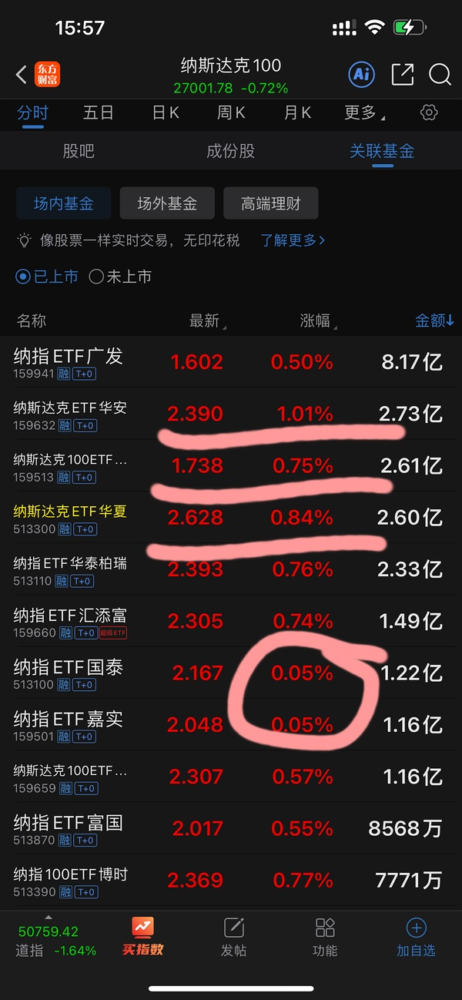  ⊳ （引用 @六倍做多退休）期货现在1.2%了

## 🧠 投资风格分析
> 📏 增量更新指引：仅当今日发言确有新依据时才修订对应维度，无变化不强行重写；单维度修订建议 ≤150 字。

- 投资理念与方法：坚持机会成本与性价比比较，强调只赚份内的钱；对机构抱团与题材炒作保持警惕，跟踪基金相对基准的贴合度。今日进一步从持有人现金流角度理解红利：招行多年前30多元买7000股，按稳定分红2元/年计，20万投入年分红约1.4万，不因现价高低降低持有股息率。操作上强调组合思维而非单边押注（冰雪是组合，最后组合赚钱即可），并用债券与固收+赎回观察股市卖压来源。
- 风险偏好：整体回避高波动、高拥挤的垃圾消费与微盘股，认为情绪退潮时这类小票流动性差、跌幅更猛；对机构抱团和题材炒作保持警惕。对美股认可其强势但持续跟踪纳指ETF溢价与漏跌，不盲目追高。仍参与冰雪、传媒等情绪博弈，但强调组合分散、及时兑现，并关注债市波动通过固收+向股市传导的风险。
- 交易与仓位：偏好低吸不追高，严格执行条件单；强调「不加仓和持有是两回事」。今日以条件单14.17低吸雪人，并卖出长白山腾资金买雪人，自述是在示范仓位控制；满仓后卖出资金去做逆回购以管住手。明确反对场内「等个反弹走」，认为情况不好应马上走；并提出「反攻了你明天也不是满仓，不反攻你明天更不应该满仓」的仓位纪律。
- 心理特质：对波动保持幽默与自我调节，强调心态准备不足会导致操作错误；能公开复盘抢先手等失误，不因短期连绿破防。面对债市与股市大幅波动，倾向用纪律和仓位管理稳定心态，而非情绪化追涨杀跌。

> ⚠️ 本板块由 Actions 全自动增量更新（复用当日发言与今日总览），每次仅在内容足够支撑时才改动。

## 🏷️ 昵称映射表
### 📖 昵称规律（供 AI 判断新昵称时参考）
【昵称命名规律（用于推断未知新昵称）】
- 拼音首字母缩写：取标的/基金名汉字拼音首字母串（含数字代码），多为 ETF/股票代码口语化｜示例：yl=引力传媒｜zy=掌阅科技｜sj=视觉中国｜cc=华安文体健康混合｜C50=创业板50ETF｜k50=科创50｜kun=昆仑万维｜xhxc=新瀚新材｜zxfc=中欣氟材
- 小/老+姓氏代指：「小X」「老X」通常指姓 X 的标的或该标的的基金经理；「X兄弟」多为同系基金｜示例：小惠=惠发食品｜老莫=万家品质生活(莫海波)｜小华=华夏全球科技先锋(QDII)A｜小华兄弟=华夏移动互联(QDII)｜小浦=浦银安盛全球智能科技(QDII)A｜小广=广发全球精选(QDII)A｜小远=华宝致远(QDII)C｜招招=招商银行｜小德=德明利｜赵姨=兆易创新｜露露=泸州老窖｜空调=格力电器
- 戏称/黑话→题材板块：生活化比喻或黑话对应某个题材/板块，而非单一标的；出现时多指板块方向｜示例：卖国=PCB板块(英伟达AI链)｜爱国=国产自主(半导体设备/芯片)｜奶茶=易点天下｜老师=中文在线｜蓝色=蓝色光标｜宇航员=航空航天板块｜华子=华泰保兴安悦债券｜国际=国际复材｜巨无霸=长鑫科技等重大IPO
- 谐音/取字：昵称含标的名关键字（取一字或谐音），多为 A 股个股或基金简称｜示例：万华=万华化学｜东百=东百集团｜宝=保利发展｜讨饭/亚洲讨饭/建信新兴=建信新兴市场(QDII)A｜华宝zy=华宝致远(QDII)A
- 机构/基金经理昵称：以基金公司名、经理姓、或平台代称指代对应基金产品｜示例：周经理=中欧新趋势混合(LOF)A｜张经理=信澳匠心回报混合A｜网易云/音乐世家=富国全球科技互联网股票(QDII)A｜国富亚洲=国富亚洲机会股票(QDII)A｜国泰纳指=国泰纳斯达克100指数(QDII)｜易方达全球=易方达全球成长精选混合(QDII)A｜浦银安盛=浦银安盛全球智能科技(QDII)A

### 📋 已收录映射
| 昵称 | 对应名称 |
|------|----------|
| C50 | 创业板50ETF |
| cc | 双义：股票=中国长城 / 基金=华安文体健康混合（用户 11-05 指认） |
| k50 | 科创50 |
| kun | 昆仑万维 |
| sj | 视觉中国 |
| xhxc | 新瀚新材（用户确认；代码待核） |
| yl | 引力传媒 603598（对手盘，非他持仓）｜11-06 +37.15%；11-09 本月+37.79% |
| zxfc | 中欣氟材 |
| zy | 双义：他本人口径=603533 掌阅科技（用户 11-05 确认）；11-09 楼友两条『zy』按 16 元/电影语境指 600977 中国电影。引用必须带语境，不许收敛 |
| 万华 | 万华化学 |
| 东百 | 东百集团 |
| 亚洲讨饭 | 建信新兴市场混合(QDII)A |
| 保利发展 | 保利发展 |
| 华子 | 华子＝007540 华泰保兴安悦债券A（华泰保兴基金·安悦债券A类份额），满仓30年超长利率债的长债基金（用户 2026-11-16 确认，无歧义，不是歧义项）；00:42 楼友『华子今年战绩无敌吧』→他答『30超长债牛逼没办法』；13:47『纯利率债就是华子那种 不过华子满仓30债 有些是满仓5-10年』；**与460108不是同一只**：460108＝华泰柏瑞稳健收益债券C（他持有的纯利率债·重仓国开/农发/国债，见六基行），华子007540 是华泰保兴的长债基金，勿混 |
| 华宝 zy | 华宝致远混合(QDII)A |
| 华宝zy | 华宝致远混合(QDII)A |
| 卖国 | PCB、光模块、通信板块（英伟达AI产业链） |
| 周经理 | 中欧新趋势混合(LOF)A |
| 国富亚洲 | 国富亚洲机会股票(QDII)A |
| 国泰纳指 | 国泰纳斯达克100指数(QDII) |
| 奶茶 | 301171 易点天下（对手盘，非持仓）｜11-13 10:07『奶茶out 幸福人的底气是可以说芒果out』；当日 −6.72% |
| 宇航员 | 航空航天板块 |
| 宝 | 保利发展 |
| 小华 | 华夏全球科技先锋混合(QDII)A |
| 小华兄弟 | 华夏移动互联混合(QDII) |
| 小广 | 广发全球精选股票(QDII)A |
| 小德 | 德明利 |
| 小惠 | 惠发食品 |
| 小浦 | 浦银安盛全球智能科技(QDII)A |
| 小远 | 华宝致远混合(QDII)C｜只在盯，未证他持有 |
| 巨无霸 | 长鑫科技等重大IPO企业 |
| 建信新兴 | 建信新兴市场混合(QDII)A |
| 张经理 | 信澳匠心回报混合A |
| 招招 | 招商银行 |
| 易方达全球 | 易方达全球成长精选混合(QDII)A |
| 浦银安盛 | 浦银安盛全球智能科技(QDII)A |
| 爱国 | 国产自主（半导体设备/芯片制造） |
| 空调 | 格力电器 |
| 网易云 | 富国全球科技互联网股票(QDII)A |
| 老师 | 中文在线 |
| 老莫 | 万家品质生活混合A(519195) |
| 蓝色 | 300058 蓝色光标（广告组合，非他持仓）｜11-12 高 15.97＝20cm 涨停价、收 14.76 +10.89%（炸板）；10:21『他和蓝色 奶茶 sg他们是广告组合』 |
| 讨饭 | 建信新兴市场混合(QDII)A |
| 赵姨 | 兆易创新 |
| 赵哥 | 兆易创新 |
| 露露 | 泸州老窖 |
| 安安 | 安记食品 |
| 音乐世家 | 富国全球科技互联网股票(QDII)A |
| 老伯伯 | 铜冠铜箔 |
| nk | 纳指科技ETF景顺 159509（联接=景顺长城纳斯达克科技ETF联接A）｜11-06 A级：截图溢价率37.08% |
| bk | 标普信息科技LOF 161128（场外=易方达标普信息科技QDII-LOF）｜11-06 A级 |
| txx | 天下秀 |
| 媛媛 | 今世缘 |
| uu | 友友、网友们 |
| 温暖老师 | 某个特别牛逼的散户 |
| 余老师 | 余利，某牛逼投资者 |
| ycm | 粤传媒 002181｜11-09 12:12「非电影传媒就留给大家玩了 我一个都不会碰了」→ 推断已不持有 |
| 江老师 | 江琪（投资博主） |
| 水果老师 | 投资博主 |
| 小爱 | 我爱我家 |
| ty | 天娱数科 |
| bn | 博纳影业 |
| sy | 601595 上海电影｜**他空仓**（11-09 起未回接）；11-12 09:38『天天念叨sy的给你们机会了』＋09:41『现在-6给你们机会了哈』＋13:15『马上sy跌停 bn还要尊敬一下他』＋13:51『与此同时 sy跌停』＋14:00『sy历来以残暴虐杀手法闻名』；实测收 42.15 −9.99% 跌停 |
| CBS | 长白山 |
| 东哥 | 东百集团 |
| 芒果 | 300413 芒果超媒（对照，非持仓）｜11-13 14:01 本月涨幅 41.70% vs 幸福 53.76% →『幸福已经拉开芒果12%』＝12.06pp 精确命中；当日 −4.83% |
| 阿中 | 中国电影 |
| 欢欢 | 欢瑞世纪 |
| 雪人 | 雪人集团 |
| 大连 | 大连圣亚 |
| 幸福 | 幸福蓝海 |
| 小粤 | 粤传媒 |
| 阿博 | 博纳影业 |
| 创成长 | 创业板成长etf |
| asd | 002747 埃斯顿｜11-11 15:09『我昨天去的另外一个 今天也吸到asd了』＝11-11 低吸买入；11-12 10:17『我昨天加了asd今天刚刚加了另外个』＋10:35『asd火箭发射』（盘中高 32.19，收 29.95 −4.37%）；买价未披露。**11-11 轮误删、11-12 恢复** |
| 恋爱脑 | 002582 好想你｜11-12 14:39:31『清了恋爱脑』＝清仓（卖价未披露；10.48 卖单两日均未触及→手动卖）；14:28『我如果去掉恋爱脑 也就比你多一个机器人』；当日收 9.76 −2.89% |
| 恋爱 | 002582 好想你（同『恋爱脑』）｜11-12 14:39 已清仓，不再持有 |
| 小羊 | 000678 襄阳轴承｜11-05 已卖（卡当日最高 20.40）；11-12 14:16『襄阳掉了』＋14:44『厉害襄阳』＝只评论走势，非持仓 |
| 中马 | 中马传动 |
| 晶雪 | 晶雪节能 |
| xf | 幸福蓝海 |
| 建设 | 建设工业 |
| 北方 | 北方导航/北方国际（未定，11-04「我在北方了」） |
| _ambiguity_note | 歧义未收敛（禁止当唯一映射）：轮子=巨轮智能/五洲新春；sj=视觉中国（传媒语境）/神剑股份（宇航员语境）；cc=中国长城/华安文体健康混合；北方=北方导航或北方国际；zy=掌阅科技（用户 11-05 确认原值正确）。证据分级：A=价位/均线/月涨幅实测命中；B=量级或单日命中/用户口述；C=仅昵称或语义，不得据此写『他持有』；沿用原仓=本轮未复核，不写进结论正文。三条判据：①条件单四位数要先按同时段动词行判买卖方向（cbs 3644 是买单不是卖单）；②『祝福/你们/你的X』句式＝评论他人持仓，不是他的操作；③同一昵称在不同语境可指两只票（zy=掌阅/中影），按价位与板块取，不许收敛成一个。 11-11 补：plus雪＝他自己也没说清（11:12「你应该不知道plus雪是哪个」），不许猜；bdd＝有传媒属性所以他不去（13:42），仍未定案；『五连阳』这类盘中口径不等于日K实测（招行 11-06 为平盘十字星）。 11-12 补：①盘中快照≠收盘（14:15 三日账第三日 幸福+0.5/光线−4.5 为盘中值，收盘 −0.53/−4.97；他写的『拉开5.3%』按自列数字相加应为 5.5，属口算误差，不得据此推翻实测）；②历史卖单不重复计触发（中影 15.84 虽∈11-12 区间[15.39,15.98]，但 11-10 已成交、无存续卖单）；③清仓自述不封锁后续再买（asd 11-06 清→11-11 15:09 再吸，11-11 轮据此误删）；④『果果』只是推断映射，不得当持仓证据；⑤机器人第二仓与传媒低位10cm 代码未披露，福赛仅为楼友提问他作答，不许映射。 11-13 补：①**本月涨幅类口述可核**，基准＝10-30 收盘，且要用**发言时刻的分钟价**复算（14:01 截图 53.76% 与分钟线独立复算分毫不差，『拉开芒果12%』＝12.06pp）；②**基金表『折价率』列负号＝溢价**（513300 −15.28% ⇒ 溢价 15.28%，与 11-06 的 16.36% 同口径），别读成折价；③**『我手里就7只股票了/我只有电影冰雪了』是他题材仓口径**，不得据此删除无卖出自述的持仓行（铁律 6）；④**『全部跌停』类口述是盘中快照**（东方海洋盘中最低 4.64＝跌停价、收 −6.59%，未封死）；⑤plus雪＝晶雪只是**品种识别**，他 11-09 已自述清仓，不得当持有证据。 11-16补：①华子与460108是否同一只未定案（华子亦可能楼友昵称），不得据华子写他持有30债；②14:22『T掉追加的』对象歧义（主读法＝大连11-10加筆T，备选＝幸福老股T），无成交自述不改笔数；③博纳09:52『今天』与底仓口径冲突，加仓@6.37按09:45『加仓bn』＋09:46『-6』取；④『2开头招行』语义未定不映射；⑤华夏兄弟17:26裸报-2.5%证据不足不入表。 11-16补：①14:22『T掉追加的』对象歧义（主读法＝大连11-10加筆T，备选＝幸福老股T），无成交自述不改笔数；②博纳09:52『今天』与底仓口径冲突，加仓@6.37按09:45『加仓bn』＋09:46『-6』取；③『2开头招行』语义未定不映射；④华夏兄弟17:26裸报-2.5%证据不足不入表。 11-17补：①『太子爷』『bdd』『畅畅』未定案不映射；②雪人今日14.01加仓笔受T+1，14.84卖单卖的是可卖老仓（非当日买笔）；③晶雪25.64回落单他自述触发、日K高25.78证实（分钟接口H25.35偏低为已知不稳）；④光线11-17部分卖出@11.82按11-16追高笔推定(B)，仍持老仓；⑤传媒『以身入局』拒绝点名不外推代码。 11-17补：①『太子爷』『bdd』『畅畅』未定案不映射；②雪人今日14.01加仓笔受T+1，14.84卖单卖的是可卖老仓（非当日买笔）；③晶雪25.64回落单他自述触发、日K高25.78证实（分钟接口H25.35偏低为已知不稳）；④光线11-17部分卖出@11.82按11-16追高笔推定(B)，仍持老仓；⑤传媒『以身入局』拒绝点名不外推代码。 11-17补：①『太子爷』『bdd』『畅畅』未定案不映射；②雪人今日14.01加仓笔受T+1，14.84卖单卖的是可卖老仓（非当日买笔）；③晶雪25.64回落单他自述触发、日K高25.78证实（分钟接口H25.35偏低为已知不稳）；④光线11-17部分卖出@11.82按11-16追高笔推定(B)，仍持老仓；⑤传媒『以身入局』拒绝点名不外推代码。 |
| nana场内 | 513300 纳斯达克ETF华夏｜11-09 14:34「不愧是513300 当年的普通nana ETF之王」，当日唯一红的纳指ETF |
| 雪儿 | 雪人集团 002639｜11-06「大连和雪儿」＋11-11 14:26「雪儿今天不错啊 大家昨天不是期待他接人嘛 这个任务做到了今天」（接人＝5日线接回，与雪人条件单口径一致） |
| 存钱罐 | 光线传媒 300251（他自述小仓）｜11-13 15:11『我相信光虽迟但到 我会肯定保留上周的存钱仓位』＝存钱罐口径再次落到光线 |
| 枣子 | 002582 好想你（同『恋爱脑』）｜11-12 14:39 已清仓，不再持有 |
| 王老师 | 人：王博雅投资（QDII 场内溢价口径），不是标的 |
| 印度 | 自嘲代指中国（推断，勿当事实） |
| 10086 | 中国移动（他当指标用，非持仓） |
| 阳光乳业 | 001318 阳光乳业（他的『喝的』/牛奶）｜11-09 A级：13:59 分时截图 S 标记≈13.5＋10:52「我去掉了羊来抄底」 |
| 羊 | 生肖羊概念组（带阳/洋/光/太/泉的一篮子）｜11-09 14:04 他自己贴的分组；**11-13 崩盘实证**：15:58 截图跌幅榜 澳洋健康 −10.06、阳光照明 −10.05、红太阳 −10.04、大东方 −10.03、阳光乳业 −10.02、襄阳轴承 −9.98、鲁阳节能 −9.95、大西洋 −9.73、太阳电缆 −9.29、圣阳股份 −8.64、泉阳泉 −6.60、东方海洋 −6.59；他 14:48『我昨天起码说了6次 控制仓位 因为羊和东方昨天松动了！！！！这是情绪核心』 |
| 小明 | 605179 一鸣食品｜11-09 10:07 有人问『喝的小明？』他答『羊』＝喝的已换成阳光乳业 |
| 皇台 | 000995 皇台酒业｜11-09 与雪人 PK 当日换手率龙虎榜 |
| 海哥 | 人：转债估值博主（不是标的）｜11-09 12:48「海哥周五那个新债…我买了点试试看是市场错了还是海哥错了」 |
| 申菱转债 | 123290（申菱环境 301018 的转债）｜11-09 13:50 买 150 张 @133 多；11-10 11:20『我开了149.9』卖单；11-12 分钟线 10:03–11:12 持续≥149.9（高 152.313）→触发推定清仓，+12.28%（成本 133.5 推定）记入 stock_pnl，已从持仓表删除 |
| 盛天 | 300494 盛天网络｜11-11 A级：11:29 分时截图 B 标记 @11.00＋「不止 而且我跟了他一把」（跟摄像大哥） |
| dfhy | 002086 东方海洋｜11-11 13:56 楼友问 dfhy 绕异动→他『我没算 这几天可能都是异动吧』；11-12 14:39 涨停 5.16 卖出（＝4.69×1.10 到分＋分钟 14:36 封板＋财联社 17天9板）；**11-16 09:28『看东方海洋了』＋15:17『东方海洋上周四不好示范』＝买回探针仓 <2%**，羊仪表盘四图蓝高亮 002086，当日跌停收 4.34（昨 4.82）；探针非重仓 |
| xys | 300502 新易盛｜11-11 13:19「我那个买xys的女主播终于要开心了」＋13:21「她现在成本327了」→ **是女主播的仓，不是他的** |
| 冰山 | 000530 冰山冷热｜11-11 10:16「万一冰山跌停 他能跌到哪里再去」＋10:27「今天把冰山 晶雪按死 大连 CBS 正统上位」（非持仓，冰雪板块的山寨对照） |
| 冰冰 | 000530 冰山冷热｜11-11 14:03「那冰冰准备」（同『冰山』，非持仓） |
| 龙版 | 605577 龙版传媒｜11-11 11:50「最早龙版也是因为自己每次公告文案都不一样才4连板就被监管」（讲监管规则，非持仓） |
| 3300 | 513300 纳斯达克ETF华夏｜11-11 10:49「3300还行 不过今天我不满意」＋13:24「咱们3300还是近期数据最好的」 |
| nana100 | 纳斯达克100指数（他对照场内ETF溢价的基准）｜11-11 08:14「昨天513300涨了3.53% 但是nana100实际也就涨了3.4」 |
| 易中天 | 新易盛＋中际旭创＋天孚通信（CPO三巨头合称）｜11-11 14:13「都去易中天了🤣」（非持仓） |
| 冰雪双子星 | 大连圣亚600593＋长白山603099（他的正牌冰雪双仓）｜11-11 10:29「从不担心冰雪双子星」 |
| 2000 | 中证2000指数（他当微盘股基准）｜11-11 11:11「除了机器人 今天其他题材全输给了2000」 |
| cw | CoreWeave（CRWV，美股AI算力）｜11-11 11:18「cw那玩意硬起来了 大家看夜盘数字」 |
| ant | Anthropic（美股IPO）｜11-11 12:11「接下来是不是ant IPO也是利好」 |
| 摄像大哥 | 人：楼友（不是标的）｜11-11 他的两笔游戏＝电魂网络涨停＋顺网科技≈+7，属楼友口径；楼主自己买的是盛天网络＋另一只未披露代码的游戏 |
| 游戏哥哥 | 游戏板块拟人化（不是具体票）｜11-11 12:58「游戏哥哥：我来也」＋13:01「妹妹休息 哥哥接力？」 |
| 传媒妹妹 | 传媒板块拟人化（不是具体票）｜11-11 11:40「被传媒妹妹压制了」＋13:01「妹妹休息 哥哥接力？」 |
| sg | 002400 省广集团（广告组合，非他持仓）｜11-12 A级映射：10:09:32『省广带起来了』＋10:21:36『他和蓝色 奶茶 sg他们是广告组合』；分钟线 10:00 6.70→10:09 6.89→10:21 6.94（昨收 6.70）命中『带起来』；当日收 6.64 −0.90%（冲高回落） |
| 果果 | 301052 果麦文化（**推断·B**，非持仓）｜11-12 13:05:01『果果紧随其后了』紧接 13:04:34『传媒出现两位数跌幅了 华策』；实测华策 −13.97%、果麦 −10.38% 同为两位数跌幅→谐音＋当日跌幅与语境命中；未见他自述买卖，不得当持仓证据 |
| 老登 | 机构抱团的老牌权重（白酒/消费/地产一类，**不是单只票**）｜11-12 07:51:44『如果这些资金回去重新抱团 最近涨起来的老登们非常危险…老登后续又要惨遭抛售 比如昨天大跌的白酒』 |
| plus雪 | 301010 晶雪节能（**B·推断；11-16 已买回持有**）｜11-13 10:04『plus雪是-20的…还能再跌-10』＝20cm，实测当日 −10.10%；15:25 答『多少出』报 24.94＝11-05 老卖单价（当日高 24.92 差 2 分未触及）；11-09 曾自述清仓 → **11-16 09:39『上周买了plus』＋14:53『掌声雪儿plus雪』＝上周买回、重新持有**；11-16 卖单 24.94 沿用，当日高 24.39 未触及；持仓屏 13:42:36 晶雪 23.110 |
| 复仇者联盟 | 电影档期锚（不是标的）｜11-13 10:18『复仇者联盟没有到来 全都不会清仓』＋10:29『复仇者联盟是12月的 流浪地球要2月』＝他把电影仓的兑现条件挂在片单档期上 |
| 流浪地球 | 电影档期锚（不是标的）｜同上，10:29『流浪地球要2月』 |
| nana | 纳斯达克100 指数（他用来对照场内 ETF 溢价/涨幅的基准，非标的）｜11-13 00:16『今天图上看 nana依然是大阳线』＋07:57『昨天-0.7收盘 但是nana晚上其实只有-0.3 现在期货+0.5 今天场内应该开盘+0.9%』→ 实测 513300 开盘 2.710＝+0.82%（误差 0.08pp） |
| 千红转债 | 楼友中签的新债（**不是他的标的**）｜11-13 09:17 他教对方『9:30就130停牌了 开个闹钟 14:56上号』『就是最后14:57去挂』＝转债上市首日尾盘挂单卖法 |
| 文投控股 | 600715（院线·他只在盯，非持仓）｜11-13 09:33 传媒板块截图 +10.03% 涨停、本月涨幅 66.67%（＝10-30 收盘基准独立复算分毫不差）；配 09:33『市场有转院线迹象』 |
| 华智数媒 | 300426（传媒·他只在盯，非持仓）｜11-13 本月涨幅榜第一（09:47 截图 78.91%／14:01 74.11%） |
| 横店影视 | 603103（院线·非持仓）｜11-13 09:33 截图 19.31 +10.03% 涨停，与文投/金逸并列＝『转院线迹象』的另外两票 |
| 金逸影视 | 002905（院线·非持仓）｜11-13 09:33 截图 9.90 +10.00% 涨停 |
| 日出东方 | 603366（羊字辈·情绪核心，非持仓）｜11-13 15:58『尤其今天表态的日出东方 别周一又跌停躺平了』；实测 +5.54%、最高 14.21 距涨停 14.49 一步 |
| plus | 301010 晶雪节能（上周买回、11-16 持有）｜09:39『上周买了plus』＋14:53『掌声雪儿plus雪』；卖单 24.94 沿用 11-05 老价，当日高 24.39 未触及 |
| 东方海洋 | 002086（＝dfhy）｜11-16 买回探针仓 <2%，当日跌停收 4.34（昨 4.82）；11-12 曾涨停 5.16 卖出；09:28『看东方海洋了』＋15:17『东方海洋上周四不好示范』 |
| 晶雪节能 | 301010（＝plus/plus雪）｜11-16 持有，卖单 24.94 未触及（高 24.39）；持仓屏 13:42:36 晶雪 23.110 |
| gjd | 国家队（推断 B）｜11-16 15:19/16:42 护盘语境，非具体标的 |
| plu | 人物·永远看空印度的博主（非标的）｜11-16 19:11『他永远看空印度的…924一开始他也看空的 不过他就一点好 看错了马上改』 |
| 华夏兄弟 | ＝小华兄弟·华夏移动互联混合(QDII)（推断·证据不足不入表）｜11-16 17:26 裸报 -2.5% 疑似场外持有，无第一人称买入/持有自述、无截图 |

> ⚠️ 以下为 LLM **建议**，未自动写入状态文件。请人工确认后，本地编辑 `state.json` 的 `nickname_map` / `positions`，或 `nickname_rules.json` 的 `rules` 并 push 生效。

## 持仓建议（待你确认）
- **大连圣亚**（600593）〔加仓〕— 依据：我加了大连
- **雪人集团**（002639）〔加仓〕— 依据：只兑现了plus和今天加的雪儿
- **晶雪节能**（301010）〔卖出〕— 依据：只兑现了plus和今天加的雪儿 | 2564触发回落 | 14:53已掌声雪儿plus雪
- **长白山**（603099）〔卖出〕— 依据：我在考虑我收盘之前要卖cbs | 我加了大连 明天还要买雪儿 冰雪总仓位就这点 cbs自然需要卖出 | 我在大连和cbs里做出了二选一 | 我卖了 又有钱了 赶紧逆回购去了

*🤖 自动生成于 2026-11-18 16:06:02 ｜ 豆瓣楼主发言追踪*