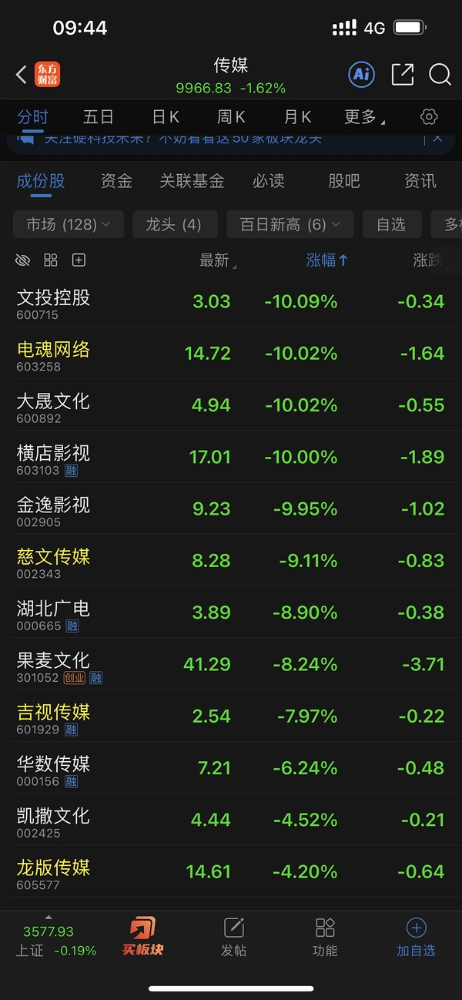
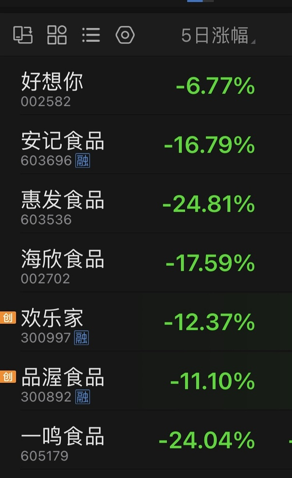
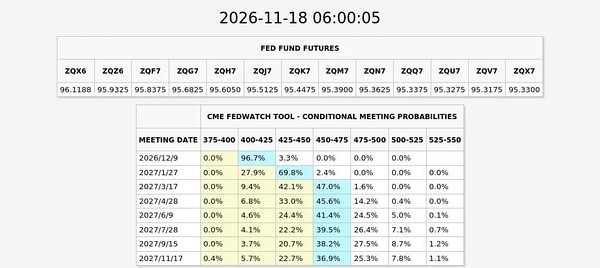
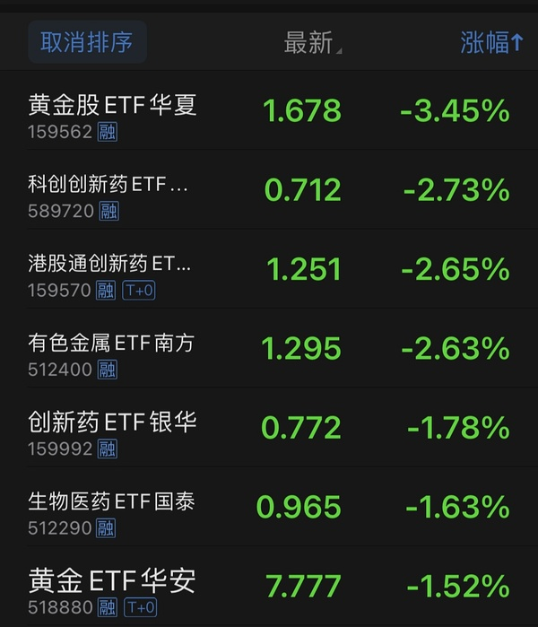
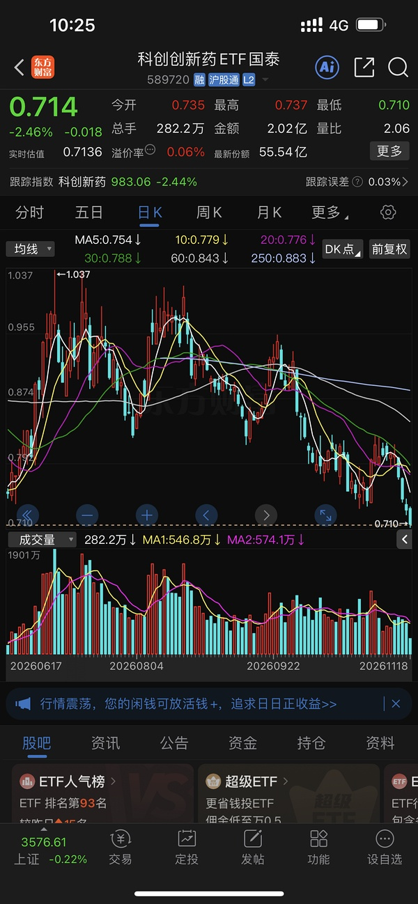
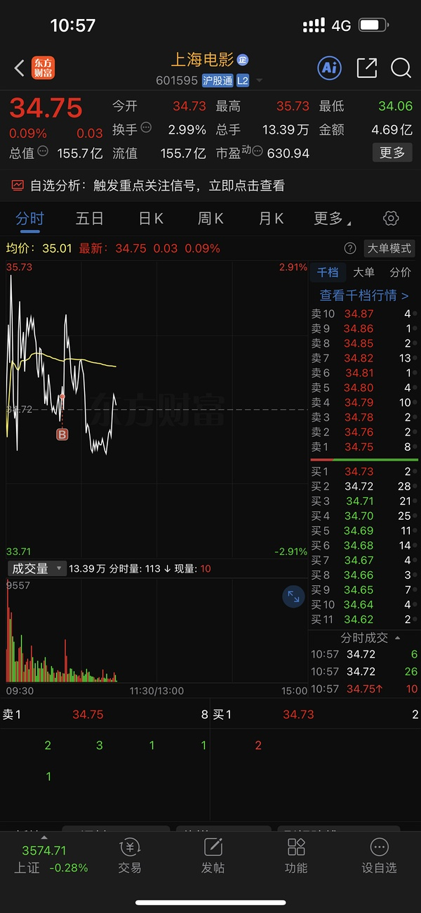

# 📋 楼主每日发言推送

> **推送日期**：2026-11-18 ｜ **执行时间**：2026-11-18 11:08:59 ｜ **监控用户**：`不知道还能说啥`
> **追踪模式**：`topic`（用户主页广播·豆瓣话题）

## 📊 持仓追踪
> 上次更新：2026-11-18 ｜ 基于楼主发言持续追踪（共 17 项）

| 标的 | 状态 | 类型 | 现价 | 提及 |
|------|------|------|------|------|
| 招商银行 | 底仓·四年前 32 元×7000 股买入·四年分红未复投仍 7000 股·不动 | 红利/银行 | 43.25（-0.46%） | 底仓·不动；四年前 32元×7000股买入；四年累…；成本约32元 |
| 大连圣亚 | 持有 5 笔·卖单 46.90/45.22 未触发·『那两个在和旅游板块筑底 留给12月』 | 冰雪·正牌双子星 | 38.16（0.29%） | 持有5笔；11-17 -3.08%；『大连 你可以… |
| 长白山 | 持有 3 笔·锁仓·不开单不接 | 冰雪·正牌双子星 | 35.09（-0.06%） | 持有3笔·锁仓；11-17 -1.46%（冰雪里最… |
| 雪人集团 | 持有·今日加仓买入 1 笔@≈14.01（09:31）＋卖单 14.84 已触发（10:56 卖老仓）＋15.84 未触及（高 15.38）·明日 14.3 以下计划再买 | 冰雪·交易仓 | 14.62（1.67%） | 09:31『买入了』『开单1484卖今天的/158… |
| 幸福蓝海 | 持有·今日换仓买入 1 笔@≈15.50（09:43）＋11-16 笔@16.91·明日卖单 15.84（由 18.64/20.44 下移） | 电影 | 14.08（-5.95%） | 09:43『-4.3换回-7』『光线完成了任务』＝… |
| 中国电影 | 持有·剩余仓无单·锁仓『慢就是快』 | 电影·核心不动仓 | 15.42（0.59%） | 持有·锁仓无单『慢就是快』；11-17 普跌 -8… |
| 光线传媒 | 持有·今日部分卖出@11.82（-4.3% 换仓入幸福）·仍持上周老仓 | 电影·低位备选 | 11.03（-3.33%） | 09:43『-4.3换回-7』＝09:43 卖光线… |
| 博纳影业 | 持有小仓·今日跌停 5.69（=6.32×0.9）·卖单 6.94 未触及（高 6.22）·明日买 614 计划 | 电影 | 5.47（-3.87%） | 08:17-08:18『694定价…设置694买一… |
| 纳斯达克ETF华夏 | 持有·不卖场内（溢价品种）·开盘预测 -1.5% 落空他自己认赖皮 | QDII·场内纳指 | 2.609（0.12%） | 持有·不卖场内；08:16『3300其实还少了0.… |
| 中韩半导体ETF | 持有·今日无动作自述 | QDII·场内 | 3.566（1.31%） | 持有；11-17 +0.92%（逆势红）；09:3… |
| 盛天网络 | 11-11 买入·持有（口径仍待确认） | 游戏·电竞 | 9.11（-3.70%） | 持有（口径仍待确认：11-16『只有电影冰雪7只』… |
| 游戏自建仓 | 11-10 买入·持有·11-11 自述 +5%（时点值未更新） | 游戏·电竞 | 暂无 | 11-10买入·持有·11-11自述+5%（时点值… |
| 美债场外基金 | 持有·国庆前买入·11-11 自述 +1.4%（时点值未更新）·债灾自述接近转亏 | 场外·美债 | 暂无 | 持有·国庆前买入；08:04『美债连绿中断了 现在… |
| 传媒低位10cm | 11-12 自述『只加一个低位的』＋11-16 14:22『我要去买一个传媒了』（是否执行无自述）·拒绝点名 | 传媒·低位 | 暂无 | 11-12『只加一个低位的』·11-16『我要去买… |
| 东方海洋 | 11-16 买入探针仓 <2%·无卖单自述·当日跌停（11-12 曾涨停 5.16 卖出，见 day_actions_1112） | 探针·羊情绪组 | 3.73（-9.90%） | 11.16；探针仓<2%·持有；11-17 地天板（跌停3.9… |
| 晶雪节能 | 上周买回·今日 25.64 回落单触发卖出（他自述）·是否回接无自述→保留持仓待确认 | 冰雪·交易仓（plus/plus雪） | 24.89（6.73%） | 11.16；08:34『上周五抄底的还是2494好 虽然我自己… |
| 六只债券基金 | 持有·00:38『这些我都有 第二个和第三个在这轮中灾难中经受住了考验』·债灾自述实亏·『债持不炒，每调买机』 | 场外·债基 | 暂无 | 11.16；持有；11-17 债券反攻日：08:49『昨天华子… |

> ⚠️ 执行任务时如发现新操作，请更新 `state.json` 的 `positions`。成本价和市值有数据才填，没有则保留「暂无」。

## 🌅 今日总览
### 📌 市场背景
（本次 LLM 未产出，建议重跑）

### 📌 今日操作
（本次 LLM 未产出，建议重跑）

### 📌 今日议题
（本次 LLM 未产出，建议重跑）

### 📌 看好板块/方向
（本次 LLM 未产出，建议重跑）

### 📌 风险提示
（本次 LLM 未产出，建议重跑）

## 📊 本次结果
- **今日发言**：80 条
- **累计存档**：22156 条

## 📝 该最新广播作者发言聚合（共 80 条）
### 其他讨论（提及 62 次，占比 78%）2026-11-18 07:04:13
- 本周先抑后扬
- 财联社11月18日电，美股股指期货集体高开，其中纳指期货涨1.38%，标普500指数期货涨0.75%。英伟达股价盘后涨超4%。(来自财联社APP)
- 在英伟达公司公布的销售预测超出华尔街预期后，美国股指期货上涨，这为近期芯片制造商抛售加剧后的投资者提供了一定的喘息之机。标普500指数期货上涨0.7%，纳斯达克100指数期货跃升1.4%。在该公司给出超出华尔街预期的销售预测后，其股价在盘后

### 513300 纳斯达克ETF华夏｜11-11 10:49「3300还行 不过今天我不满意」＋13:24「咱们3300还是近期数据最好的」（提及 4 次，占比 5%）2026-11-18 07:41:06
- 今天11/18这个算起来复杂多了

昨天3300 -1.55%对应期货三点是0%
凌晨最终nana收盘-0.72
但是现在期货+1.4
这样等于+0.7

所以今天3300如果那个漏了的-0.7不要了的话
正常将0.7%涨幅左右开盘

如果
- 期货目前只有0.1%

不算0.7遗漏应该现在-0.6
补0.7应该-1.3

目前3300甚至还是平盘
- 今天场内3300非常强势
国内资金开始预判😂😂😂😂😂😂😂

### 雪人集团 002639｜11-06「大连和雪儿」＋11-11 14:26「雪儿今天不错啊 大家昨天不是期待他接人嘛 这个任务做到了今天」（接人＝5日线接回，与雪人条件单口径一致）（提及 3 次，占比 4%）2026-11-18 09:57:46
- 雪儿那个1584单子别忘了开 继续开着的
- 雪儿完全复刻上一段怎么下来怎么上去走势了
- 满多最近有规律 大家可以自己找哈哈哈

就像雪儿规律很强😂😂😂

### 纳斯达克100 指数（他用来对照场内 ETF 溢价/涨幅的基准，非标的）｜11-13 00:16『今天图上看 nana依然是大阳线』＋07:57『昨天-0.7收盘 但是nana晚上其实只有-0.3 现在期货+0.5 今天场内应该开盘+0.9%』→ 实测 513300 开盘 2.710＝+0.82%（误差 0.08pp）（提及 2 次，占比 2%）2026-11-18 08:35:49
- 🤣最近黄金都和nana同步的

昨天晚上他们分道扬镳 今天大家重新相互归还😂😂😂😂😂😂😂
- nana非但没有收回0.7

并且又加大了遗漏

### 301010 晶雪节能（上周买回、11-16 持有）｜09:39『上周买了plus』＋14:53『掌声雪儿plus雪』；卖单 24.94 沿用 11-05 老价，当日高 24.39 未触及（提及 2 次，占比 2%）2026-11-18 09:48:20
- 你们2494plus也应该触发了
- 目前大家的plus和雪儿额外买入部分
应该都回到手里了
至少不应该是满仓的

### 大连圣亚（提及 2 次，占比 2%）2026-11-18 09:49:18
- 大连加油 你要第二次拐弯了我懂的
- 大连今天就相当于10/28日 都是一个模版

### 华宝致远混合(QDII)C｜只在盯，未证他持有（提及 1 次，占比 1%）2026-11-18 07:07:08
- 夜里反弹的也不错
小远不一定能取得四连冠😂

### 双义：股票=中国长城 / 基金=华安文体健康混合（用户 11-05 指认）（提及 1 次，占比 1%）2026-11-18 09:44:55
- 不着急的
不就是上周冰雪吗🤣

### 雪人集团（提及 1 次，占比 1%）2026-11-18 10:01:34
- 上周冰雪人等待
这周电影人等待

### 友友、网友们（提及 1 次，占比 1%）2026-11-18 10:10:16
- 有没有uu帮我看看
昨天那几个三连板跌停的

有没有四连板跌停的 还是没有了

### 002582 好想你｜11-12 14:39:31『清了恋爱脑』＝清仓（卖价未披露；10.48 卖单两日均未触及→手动卖）；14:28『我如果去掉恋爱脑 也就比你多一个机器人』；当日收 9.76 −2.89%（提及 1 次，占比 1%）2026-11-18 10:43:31
- 恋爱脑没乱来过 跌幅还行😂

### 📄 全部发言（共 80 条）
- (2026-11-18 07:04:13) 本周先抑后扬  ⊳ （引用 @吃西瓜的人）英伟达财报还是厉害

- (2026-11-18 07:05:01) 财联社11月18日电，美股股指期货集体高开，其中纳指期货涨1.38%，标普500指数期货涨0.75%。英伟达股价盘后涨超4%。(来自财联社APP)

- (2026-11-18 07:07:08) 夜里反弹的也不错
小远不一定能取得四连冠😂

- (2026-11-18 07:09:39) 在英伟达公司公布的销售预测超出华尔街预期后，美国股指期货上涨，这为近期芯片制造商抛售加剧后的投资者提供了一定的喘息之机。标普500指数期货上涨0.7%，纳斯达克100指数期货跃升1.4%。在该公司给出超出华尔街预期的销售预测后，其股价在盘后交易中上涨逾4%，这表明在其首席执行官黄仁勋离职后的首次财报中，市场需求依然强劲。在周二发布的季度财报更新中，英伟达表示，下一财年的营收将增长75%，高于此前70%的预测。第四财季的销售额预计为1300亿美元（上下浮动3%）。

- (2026-11-18 07:11:56) 哈哈那个模拟盘不是杠杆盘 不会爆的🤣

有个A股期货模拟盘 自带八倍杠杆 那个一会儿就亏完了  ⊳ （引用 @moli）感觉今天模拟盘要被爆仓了

- (2026-11-18 07:13:21) 财报牛逼 黄不会回归

市场觉得还是财报重要  ⊳ （引用 @moli）感觉今天模拟盘要被爆仓了

- (2026-11-18 07:17:21) 爱奇艺发布第三季度财报。数据显示，AI在短剧、漫剧上已经跑通，并开启正向循环。更值得注意的是，爱奇艺今年喊出的“All in AI”，在这份财报里露出全貌：从短剧漫剧到网络故事片、中剧、长剧、综艺，AI 正按不同内容形态分层落地。长期看，这是长视频构建更强竞争力的基础设施。

从财报数据看，爱奇艺AI短剧、漫剧已出现闭环信号，核心是形成了“内容供应—成本优化—用户观看—商业收入”的正向飞轮。

报告期内，通过爱奇艺号上传的短剧、漫剧数量呈指数级增长；9 月 AI 短剧数量占比接近 90%，播放 VV 占比接近 80%，漫剧则基本为 AI 原生内容。

同时用户侧的正反馈也来了，爱奇艺短剧Q3 日均播放VV、时长实现两位数增长；漫剧 Q3 日均播放VV 环比增长 100%，观看时长环比增加 50%。

收入层面，爱奇艺短剧Q3实现两位数增长、漫剧环比增长70%。收入增长不只发生在平台侧，也通过分账回流到内容方，供给才有持续的动力。按照爱奇艺短剧漫剧的分账规则：独家首发片方分账比例高达 100%，非独家首发为 70%；S 级内容不分真人还是 AI，单部最高可获 100 万元现金奖励，厂牌一年内上线 4 部及以上 S 级项目，同样可获 100 万元奖励。

- (2026-11-18 07:33:06) 😂那冰雪又要低开了  ⊳ （引用 @点-重生炒垃圾）也给业绩指引了🤣🤣🤣那些算租大单子的项目都继续支持给钱了

- (2026-11-18 07:33:33) 他总的好像一塌糊涂
是AI剧有起色😂😂😂  ⊳ （引用 @🅰失而复🉐😎）赚钱了

- (2026-11-18 07:41:06) 今天11/18这个算起来复杂多了

昨天3300 -1.55%对应期货三点是0%
凌晨最终nana收盘-0.72
但是现在期货+1.4
这样等于+0.7

所以今天3300如果那个漏了的-0.7不要了的话
正常将0.7%涨幅左右开盘

如果补上漏的0.7 那就是平开

但是如果今天那个漏了的也不理会 
目测就是真的不要了 提高0.7溢价

- (2026-11-18 07:50:03) 只有冰雪反情绪

你想 如果情绪一塌糊涂 科技能好吗  ⊳ （引用 @赛博朋克2077）今天科技红，那我们电影和冰雪人怎么办😭

- (2026-11-18 08:35:49) 🤣最近黄金都和nana同步的

昨天晚上他们分道扬镳 今天大家重新相互归还😂😂😂😂😂😂😂  ⊳ （引用 @六倍做多退休）黄金这 瀑布何意味

- (2026-11-18 08:47:41) 但是如果情绪很差 科技也很难大反攻
就像昨天午后 情绪带着科技一起下😂😂  ⊳ （引用 @初筱玖）之前几次硬科技反弹，软AI都还行，不过之前几次都没有像昨天那样大退潮过

- (2026-11-18 08:48:01) 两市融资余额减少186.04亿元
截至11月17日，上交所融资余额报11519.89亿元，较前一交易日减少78.24亿元；深交所融资余额报10577.82亿元，较前一交易日减少107.8亿元；两市合计22097.71亿元，较前一交易日减少186.04亿元。

- (2026-11-18 08:48:12) 融资盘 后悔上周买买买吗😂  ⊳ （引用 @不知道还能说啥）两市融资余额减少186.04亿元
截至11月17日，上交所融资余额报11519.89亿元，较前一交易日减少78.24亿元；深交所融资余额报10577.82亿元，较前一交易日减少107.8亿元；两市合计22097.71亿元，较前一交易日减少1

- (2026-11-18 09:07:12) +1.4变成了+1.1

要对应下降0.3%幅度😂  ⊳ （引用 @不知道还能说啥）今天11/18这个算起来复杂多了

昨天3300 -1.55%对应期货三点是0%
凌晨最终nana收盘-0.72
但是现在期货+1.4
这样等于+0.7

所以今天3300如果那个漏了的-0.7不要了的话
正常将0.7%涨幅左右开盘

如果

- (2026-11-18 09:09:31) [图] 基本抹掉了第四次加息预期

这轮2年美债也没到过5% 没真正交易过第四次加息

- (2026-11-18 09:11:40) 因为财报
盘后电话会确认不会回归  ⊳ （引用 @超幸運小行星✨）涨是因为达子财报还是因为老黄有机会回宫啊 不会跟海峡一样来来回回吧😂😂😂

- (2026-11-18 09:12:40) 现在是375-400的利率

你看12月第一行 +25来到400-425概率96% 就是加息一次25 后面以此类推啦  ⊳ （引用 @点-重生炒垃圾）其实这个图我一直都不知道怎么看哈哈哈

- (2026-11-18 09:15:58) 19号ANT  ⊳ （引用 @超幸運小行星✨）达子财报定了 现在加息又变成3次了  就剩那个上市了 这回真的能十二月底了吧🫨🫨🫨

- (2026-11-18 09:18:17) 你可以看22年下半年走势
其实6月差不多就是最低点附近
但是美国也没有icu马上回归ktv
因为加息预期会变来变去 直到直到最后一次
所以反反复复拉扯

目前情况很类似 估值也类似
那时候七巨头盈利堪忧 现在是AI担忧  ⊳ （引用 @超幸運小行星✨）马上了 好快

- (2026-11-18 09:20:27) 😂😂😂😂😂  ⊳ （引用 @高手云集上钻）原来楼里提的ANT就是指Anthropic上市，只要一直假装不无知，总有一天能看懂楼里的对话😂

- (2026-11-18 09:23:57) 我对比过通信ETF和美国foto ETF 跌幅都是一样的  ⊳ （引用 @速派女孩将发财）通信是红的 看来不在乎那个谁写的文章了

- (2026-11-18 09:26:37) 09:26:19【首批主动ETF十大重仓股出炉 茅台、美的、宁德居前三】财联社11月18日电，11月17日晚间，18只ETF主动ETF发布旗下主动ETF上市公告，从截至11月16日的重仓股来看，多只产品重点配置银行、白酒、煤炭、油气等防御性板块，其中6只ETF合计持有贵州茅台3.36亿元居首，7只ETF合计持有美的集团2.48亿元位居次席，5只ETF合计持有宁德时代2.24亿元位居第三。在主动ETF持仓前20个股中，银行股占据7席，合计持有市值达7.92亿元；科技股占据3席，分别为寒武纪、中际旭创、海康威视。(来自财联社APP)

- (2026-11-18 09:27:29) 买买买
买完又满仓了😂  ⊳ （引用 @Lyra）楼楼又能接到雪人啦，节奏踩太好了

- (2026-11-18 09:30:24) 接完了 低于14.2啊  ⊳ （引用 @momo📈📈📈）已经接完了吗？我刚来

- (2026-11-18 09:30:34) 重新开单1484

- (2026-11-18 09:37:57) 是  ⊳ （引用 @momo）大连和cbs暂时放养吗

- (2026-11-18 09:39:11) 我满仓你不知道？  ⊳ （引用 @圈圈儿）楼楼幸福和zy接么

- (2026-11-18 09:41:22) 最完美的开局
没有开局暴力抢反弹

- (2026-11-18 09:42:48) 是的 先调先反  ⊳ （引用 @该用户已过期）传媒不如冰雪很合理啊，冰雪最近一直杀

- (2026-11-18 09:44:55) [图] 不着急的
不就是上周冰雪吗🤣

  ⊳ （引用 @该用户已过期）电影继续杀🤣🤣

- (2026-11-18 09:45:48) 机器人的高开也都坠亡了

依然是冰雪世界时间🤣  ⊳ （引用 @该用户已过期）电影继续杀呢🤣🤣当下说当下的事儿

- (2026-11-18 09:47:31) 其实这样好

如果开局暴力抢开局反攻

不是好事

我目光没那么短浅  ⊳ （引用 @该用户已过期）也着急的，毕竟满仓🤣🤣冰雪微反弹也不如之前电影涨的好……

- (2026-11-18 09:48:20) 你们2494plus也应该触发了

- (2026-11-18 09:48:43) 触发了

最容易手贱时刻  ⊳ （引用 @扶我起来还能买）雪儿触发了 楼无敌了

- (2026-11-18 09:49:18) 大连加油 你要第二次拐弯了我懂的

- (2026-11-18 09:49:43) 其实冰雪就喜欢现在

题材全部哑火了！科技也不行

- (2026-11-18 09:49:56) 之前题材太多了 资金被分散到各个地方  ⊳ （引用 @不知道还能说啥）其实冰雪就喜欢现在

题材全部哑火了！科技也不行

- (2026-11-18 09:50:42) 还没动 🤣  ⊳ （引用 @shirla）赶紧说手贱去哪了hhhh

- (2026-11-18 09:51:22) 但是这次上去碰到大阴线中间部分 还是会继续下积攒能量  ⊳ （引用 @冬天他一定会来）双底筑好了吗🤩

- (2026-11-18 09:53:59) [图] 黄金 有色 药领跌

- (2026-11-18 09:54:48) 你们太急 ！

冰雪也是连调大反  ⊳ （引用 @平平安安）xf还回来吃饭吗

- (2026-11-18 09:56:16) 目前大家的plus和雪儿额外买入部分
应该都回到手里了
至少不应该是满仓的

- (2026-11-18 09:56:53) 脆弱市场有冰雪  ⊳ （引用 @momo）又接近四千家下跌，这个脆弱的市场

- (2026-11-18 09:57:46) 雪儿那个1584单子别忘了开 继续开着的

- (2026-11-18 09:58:43) 谢谢啊
这样嘛 是我大意了
我去改  ⊳ （引用 @该用户已过期）今天涨停1582到不了，所以我挂了涨停单

- (2026-11-18 09:59:28) 老规矩手动降价1分
我挂1581手动🤣  ⊳ （引用 @该用户已过期）今天涨停1582到不了，所以我挂了涨停单

- (2026-11-18 10:00:24) 韩国在跟进美国接近翻绿

大家注意  ⊳ （引用 @该用户已过期）哈哈哈，跟了，忘了这个事了

- (2026-11-18 10:01:34) 上周冰雪人等待
这周电影人等待  ⊳ （引用 @lacey）等一个bn 呜呜呜 不争气啊

- (2026-11-18 10:08:55) 雪儿完全复刻上一段怎么下来怎么上去走势了

- (2026-11-18 10:10:16) 有没有uu帮我看看
昨天那几个三连板跌停的

有没有四连板跌停的 还是没有了

- (2026-11-18 10:11:19) 不是这批
闽发带了一大群三连板跌停的

今天闽发打开了  ⊳ （引用 @vio）东方海洋  日出东方  都跌停

- (2026-11-18 10:12:18) 厉害的 不过都给打开过是吧  ⊳ （引用 @sickid）大东方

- (2026-11-18 10:13:37) 好的 谢谢🙏不容易  ⊳ （引用 @sickid）对的，除了他之外没有四连的

- (2026-11-18 10:15:08) 微盘股开始复苏  ⊳ （引用 @只想搞钱）看了下温暖老师爽割的青岛今天也是红的

- (2026-11-18 10:17:42) 满多最近有规律 大家可以自己找哈哈哈

就像雪儿规律很强😂😂😂  ⊳ （引用 @Aaa摆烂咸鱼🥳）这个掌阅是调整到60日线吗，我看每次到这个位置都起来

- (2026-11-18 10:19:31) 真牛逼 我看了

我们的SY也回落到20日线

传媒多个强势股回调都到了预定目标  ⊳ （引用 @Aaa摆烂咸鱼🥳）这个掌阅是调整到60日线吗，我看每次到这个位置都起来

- (2026-11-18 10:21:00) 你看10.27-11.3 他能蹭很多天给大家来回赚  ⊳ （引用 @momo）雪人一直在磨蹭

- (2026-11-18 10:22:01) 你懂的  ⊳ （引用 @shirla）那么

- (2026-11-18 10:24:35) 做了点标记了

不过微盘又崩了 当心点

暂时别满仓  ⊳ （引用 @扶我起来还能买）楼手痒了吗 进了说哈 等ing

- (2026-11-18 10:26:02) [图] 反弹都是为了新低？

  ⊳ （引用 @点-重生炒垃圾）额，我关注里面绿的多的是医药和短剧，医药真诈骗啊

- (2026-11-18 10:30:07) 🤣电影冰雪他们挺会搭配的
这边倒了 那边救
那边倒了 这边救  ⊳ （引用 @该用户已过期）卧槽，被辱骂了😭😭亏我还骂我

- (2026-11-18 10:31:44) 没有
纳斯达克我计算时候1.4涨幅的
现在0.2  ⊳ （引用 @👑）娜娜收了那0.7

- (2026-11-18 10:32:07) nana非但没有收回0.7

并且又加大了遗漏  ⊳ （引用 @👑）娜娜收了那0.7

- (2026-11-18 10:37:01) 跌停数量还是太多了  ⊳ （引用 @探路者_）楼 这能说明啥，情绪稳定了吗

- (2026-11-18 10:37:26) 但是这个情况最适合冰雪表演  ⊳ （引用 @探路者_）楼 这能说明啥，情绪稳定了吗

- (2026-11-18 10:39:28) 好起来时候 冰雪就会坏  ⊳ （引用 @该用户已过期）楼，你预计电影这波得杀到啥时候？🤣🤣

- (2026-11-18 10:39:52) 大连今天就相当于10/28日 都是一个模版  ⊳ （引用 @落花烟雨江南梦）期待双子星舞一段

- (2026-11-18 10:43:31) [图] 恋爱脑没乱来过 跌幅还行😂

  ⊳ （引用 @稀里不糊涂）uu你割了没，我在想要不要把消费割了

- (2026-11-18 10:47:42) 11月18日，现货金、银跳水，现货黄金盘中失守3800美元/盎司关口，截至发稿，跌1.41%；

- (2026-11-18 10:51:00) 期货目前只有0.1%

不算0.7遗漏应该现在-0.6
补0.7应该-1.3

目前3300甚至还是平盘  ⊳ （引用 @不知道还能说啥）今天11/18这个算起来复杂多了

昨天3300 -1.55%对应期货三点是0%
凌晨最终nana收盘-0.72
但是现在期货+1.4
这样等于+0.7

所以今天3300如果那个漏了的-0.7不要了的话
正常将0.7%涨幅左右开盘

如果

- (2026-11-18 10:51:59) 那边机器人是不是已经第五天了？😂  ⊳ （引用 @sickid）影视传媒冰第三天了吧，这对吗

- (2026-11-18 10:52:33) 昨天趋势动物强调黄金才刚开始跌😂😂😂  ⊳ （引用 @云水河西）太好了！黄金再跌一些就可以买金首饰了

- (2026-11-18 10:54:16) 九阳带队家电是吗😂😂😂😂  ⊳ （引用 @sickid）机器人里面有点杂，中间物理AI有反弹过的，然后今天是家电+机器人批量涨停

- (2026-11-18 10:55:38) 别急 
忍一下
比开局暴力抢开局要好  ⊳ （引用 @赛博朋克2077）bn这个服了

- (2026-11-18 10:56:35) 美国反弹 你真聪明  ⊳ （引用 @稀里不糊涂）这个时间点，午饭盘？还是老美反弹了

- (2026-11-18 10:57:11) 今天场内3300非常强势
国内资金开始预判😂😂😂😂😂😂😂  ⊳ （引用 @稀里不糊涂）这个时间点，午饭盘？还是老美反弹了

- (2026-11-18 10:57:32) [图] 已经标记了

  ⊳ （引用 @sickid）你sy什么时候上

- (2026-11-18 10:59:42) 这我不知道

但是3300刚刚就算忘了之前0.7

前面也应该-0.6了  ⊳ （引用 @稀里不糊涂）老美要红几天了？

## 🧠 投资风格分析
> 📏 增量更新指引：仅当今日发言确有新依据时才修订对应维度，无变化不强行重写；单维度修订建议 ≤150 字。

- 投资理念与方法：坚持机会成本与性价比比较，强调“只赚份内的钱”；今日进一步强调远离机构重仓，认为公募抱团趋同会制造拥挤风险，主张跟踪基金与基准指数的贴合度，规避机构重仓股。对题材炒作保持警惕，认为消费、地产、传媒等题材“别真的当真”。
- 风险偏好：对高波动、高拥挤的题材股回避，主动规避机构重仓和题材炒作；对美股谨慎但认可其强势；注意控制仓位，担心情绪核心崩盘，周四担心题材杀跌，周五提示『别装逼』。
- 交易与仓位：偏好低吸不追高，强调『不加仓和持有是两回事』；坚决执行条件单，挂单卖出幸福蓝海、触发后买入光线；对传媒不增加仓位但保留持仓；周五躲避利息，今天清仓机器人；注重仓位控制，担心情绪核心崩盘，强调『管住手』。
- 心理特质：自我认知清晰，承认看错传媒，对市场规律有敬畏；重视筹码与机构行为；情绪稳定，不追高、不眼红。今日新增：面对不利账户选择不打开银行/债券查看，称「不看就无视发生」，体现以回避查看波动来维持心态的自我调节习惯。

> ⚠️ 本板块由 Actions 全自动增量更新（复用当日发言与今日总览），每次仅在内容足够支撑时才改动。

## 🏷️ 昵称映射表
### 📖 昵称规律（供 AI 判断新昵称时参考）
【昵称命名规律（用于推断未知新昵称）】
- 拼音首字母缩写：取标的/基金名汉字拼音首字母串（含数字代码），多为 ETF/股票代码口语化｜示例：yl=引力传媒｜zy=掌阅科技｜sj=视觉中国｜cc=华安文体健康混合｜C50=创业板50ETF｜k50=科创50｜kun=昆仑万维｜xhxc=新瀚新材｜zxfc=中欣氟材
- 小/老+姓氏代指：「小X」「老X」通常指姓 X 的标的或该标的的基金经理；「X兄弟」多为同系基金｜示例：小惠=惠发食品｜老莫=万家品质生活(莫海波)｜小华=华夏全球科技先锋(QDII)A｜小华兄弟=华夏移动互联(QDII)｜小浦=浦银安盛全球智能科技(QDII)A｜小广=广发全球精选(QDII)A｜小远=华宝致远(QDII)C｜招招=招商银行｜小德=德明利｜赵姨=兆易创新｜露露=泸州老窖｜空调=格力电器
- 戏称/黑话→题材板块：生活化比喻或黑话对应某个题材/板块，而非单一标的；出现时多指板块方向｜示例：卖国=PCB板块(英伟达AI链)｜爱国=国产自主(半导体设备/芯片)｜奶茶=易点天下｜老师=中文在线｜蓝色=蓝色光标｜宇航员=航空航天板块｜华子=华泰保兴安悦债券｜国际=国际复材｜巨无霸=长鑫科技等重大IPO
- 谐音/取字：昵称含标的名关键字（取一字或谐音），多为 A 股个股或基金简称｜示例：万华=万华化学｜东百=东百集团｜宝=保利发展｜讨饭/亚洲讨饭/建信新兴=建信新兴市场(QDII)A｜华宝zy=华宝致远(QDII)A
- 机构/基金经理昵称：以基金公司名、经理姓、或平台代称指代对应基金产品｜示例：周经理=中欧新趋势混合(LOF)A｜张经理=信澳匠心回报混合A｜网易云/音乐世家=富国全球科技互联网股票(QDII)A｜国富亚洲=国富亚洲机会股票(QDII)A｜国泰纳指=国泰纳斯达克100指数(QDII)｜易方达全球=易方达全球成长精选混合(QDII)A｜浦银安盛=浦银安盛全球智能科技(QDII)A

### 📋 已收录映射
| 昵称 | 对应名称 |
|------|----------|
| C50 | 创业板50ETF |
| cc | 双义：股票=中国长城 / 基金=华安文体健康混合（用户 11-05 指认） |
| k50 | 科创50 |
| kun | 昆仑万维 |
| sj | 视觉中国 |
| xhxc | 新瀚新材（用户确认；代码待核） |
| yl | 引力传媒 603598（对手盘，非他持仓）｜11-06 +37.15%；11-09 本月+37.79% |
| zxfc | 中欣氟材 |
| zy | 双义：他本人口径=603533 掌阅科技（用户 11-05 确认）；11-09 楼友两条『zy』按 16 元/电影语境指 600977 中国电影。引用必须带语境，不许收敛 |
| 万华 | 万华化学 |
| 东百 | 东百集团 |
| 亚洲讨饭 | 建信新兴市场混合(QDII)A |
| 保利发展 | 保利发展 |
| 华子 | 华子＝007540 华泰保兴安悦债券A（华泰保兴基金·安悦债券A类份额），满仓30年超长利率债的长债基金（用户 2026-11-16 确认，无歧义，不是歧义项）；00:42 楼友『华子今年战绩无敌吧』→他答『30超长债牛逼没办法』；13:47『纯利率债就是华子那种 不过华子满仓30债 有些是满仓5-10年』；**与460108不是同一只**：460108＝华泰柏瑞稳健收益债券C（他持有的纯利率债·重仓国开/农发/国债，见六基行），华子007540 是华泰保兴的长债基金，勿混 |
| 华宝 zy | 华宝致远混合(QDII)A |
| 华宝zy | 华宝致远混合(QDII)A |
| 卖国 | PCB、光模块、通信板块（英伟达AI产业链） |
| 周经理 | 中欧新趋势混合(LOF)A |
| 国富亚洲 | 国富亚洲机会股票(QDII)A |
| 国泰纳指 | 国泰纳斯达克100指数(QDII) |
| 奶茶 | 301171 易点天下（对手盘，非持仓）｜11-13 10:07『奶茶out 幸福人的底气是可以说芒果out』；当日 −6.72% |
| 宇航员 | 航空航天板块 |
| 宝 | 保利发展 |
| 小华 | 华夏全球科技先锋混合(QDII)A |
| 小华兄弟 | 华夏移动互联混合(QDII) |
| 小广 | 广发全球精选股票(QDII)A |
| 小德 | 德明利 |
| 小惠 | 惠发食品 |
| 小浦 | 浦银安盛全球智能科技(QDII)A |
| 小远 | 华宝致远混合(QDII)C｜只在盯，未证他持有 |
| 巨无霸 | 长鑫科技等重大IPO企业 |
| 建信新兴 | 建信新兴市场混合(QDII)A |
| 张经理 | 信澳匠心回报混合A |
| 招招 | 招商银行 |
| 易方达全球 | 易方达全球成长精选混合(QDII)A |
| 浦银安盛 | 浦银安盛全球智能科技(QDII)A |
| 爱国 | 国产自主（半导体设备/芯片制造） |
| 空调 | 格力电器 |
| 网易云 | 富国全球科技互联网股票(QDII)A |
| 老师 | 中文在线 |
| 老莫 | 万家品质生活混合A(519195) |
| 蓝色 | 300058 蓝色光标（广告组合，非他持仓）｜11-12 高 15.97＝20cm 涨停价、收 14.76 +10.89%（炸板）；10:21『他和蓝色 奶茶 sg他们是广告组合』 |
| 讨饭 | 建信新兴市场混合(QDII)A |
| 赵姨 | 兆易创新 |
| 赵哥 | 兆易创新 |
| 露露 | 泸州老窖 |
| 安安 | 安记食品 |
| 音乐世家 | 富国全球科技互联网股票(QDII)A |
| 老伯伯 | 铜冠铜箔 |
| nk | 纳指科技ETF景顺 159509（联接=景顺长城纳斯达克科技ETF联接A）｜11-06 A级：截图溢价率37.08% |
| bk | 标普信息科技LOF 161128（场外=易方达标普信息科技QDII-LOF）｜11-06 A级 |
| txx | 天下秀 |
| 媛媛 | 今世缘 |
| uu | 友友、网友们 |
| 温暖老师 | 某个特别牛逼的散户 |
| 余老师 | 余利，某牛逼投资者 |
| ycm | 粤传媒 002181｜11-09 12:12「非电影传媒就留给大家玩了 我一个都不会碰了」→ 推断已不持有 |
| 江老师 | 江琪（投资博主） |
| 水果老师 | 投资博主 |
| 小爱 | 我爱我家 |
| ty | 天娱数科 |
| bn | 博纳影业 |
| sy | 601595 上海电影｜**他空仓**（11-09 起未回接）；11-12 09:38『天天念叨sy的给你们机会了』＋09:41『现在-6给你们机会了哈』＋13:15『马上sy跌停 bn还要尊敬一下他』＋13:51『与此同时 sy跌停』＋14:00『sy历来以残暴虐杀手法闻名』；实测收 42.15 −9.99% 跌停 |
| CBS | 长白山 |
| 东哥 | 东百集团 |
| 芒果 | 300413 芒果超媒（对照，非持仓）｜11-13 14:01 本月涨幅 41.70% vs 幸福 53.76% →『幸福已经拉开芒果12%』＝12.06pp 精确命中；当日 −4.83% |
| 阿中 | 中国电影 |
| 欢欢 | 欢瑞世纪 |
| 雪人 | 雪人集团 |
| 大连 | 大连圣亚 |
| 幸福 | 幸福蓝海 |
| 小粤 | 粤传媒 |
| 阿博 | 博纳影业 |
| 创成长 | 创业板成长etf |
| asd | 002747 埃斯顿｜11-11 15:09『我昨天去的另外一个 今天也吸到asd了』＝11-11 低吸买入；11-12 10:17『我昨天加了asd今天刚刚加了另外个』＋10:35『asd火箭发射』（盘中高 32.19，收 29.95 −4.37%）；买价未披露。**11-11 轮误删、11-12 恢复** |
| 恋爱脑 | 002582 好想你｜11-12 14:39:31『清了恋爱脑』＝清仓（卖价未披露；10.48 卖单两日均未触及→手动卖）；14:28『我如果去掉恋爱脑 也就比你多一个机器人』；当日收 9.76 −2.89% |
| 恋爱 | 002582 好想你（同『恋爱脑』）｜11-12 14:39 已清仓，不再持有 |
| 小羊 | 000678 襄阳轴承｜11-05 已卖（卡当日最高 20.40）；11-12 14:16『襄阳掉了』＋14:44『厉害襄阳』＝只评论走势，非持仓 |
| 中马 | 中马传动 |
| 晶雪 | 晶雪节能 |
| xf | 幸福蓝海 |
| 建设 | 建设工业 |
| 北方 | 北方导航/北方国际（未定，11-04「我在北方了」） |
| _ambiguity_note | 歧义未收敛（禁止当唯一映射）：轮子=巨轮智能/五洲新春；sj=视觉中国（传媒语境）/神剑股份（宇航员语境）；cc=中国长城/华安文体健康混合；北方=北方导航或北方国际；zy=掌阅科技（用户 11-05 确认原值正确）。证据分级：A=价位/均线/月涨幅实测命中；B=量级或单日命中/用户口述；C=仅昵称或语义，不得据此写『他持有』；沿用原仓=本轮未复核，不写进结论正文。三条判据：①条件单四位数要先按同时段动词行判买卖方向（cbs 3644 是买单不是卖单）；②『祝福/你们/你的X』句式＝评论他人持仓，不是他的操作；③同一昵称在不同语境可指两只票（zy=掌阅/中影），按价位与板块取，不许收敛成一个。 11-11 补：plus雪＝他自己也没说清（11:12「你应该不知道plus雪是哪个」），不许猜；bdd＝有传媒属性所以他不去（13:42），仍未定案；『五连阳』这类盘中口径不等于日K实测（招行 11-06 为平盘十字星）。 11-12 补：①盘中快照≠收盘（14:15 三日账第三日 幸福+0.5/光线−4.5 为盘中值，收盘 −0.53/−4.97；他写的『拉开5.3%』按自列数字相加应为 5.5，属口算误差，不得据此推翻实测）；②历史卖单不重复计触发（中影 15.84 虽∈11-12 区间[15.39,15.98]，但 11-10 已成交、无存续卖单）；③清仓自述不封锁后续再买（asd 11-06 清→11-11 15:09 再吸，11-11 轮据此误删）；④『果果』只是推断映射，不得当持仓证据；⑤机器人第二仓与传媒低位10cm 代码未披露，福赛仅为楼友提问他作答，不许映射。 11-13 补：①**本月涨幅类口述可核**，基准＝10-30 收盘，且要用**发言时刻的分钟价**复算（14:01 截图 53.76% 与分钟线独立复算分毫不差，『拉开芒果12%』＝12.06pp）；②**基金表『折价率』列负号＝溢价**（513300 −15.28% ⇒ 溢价 15.28%，与 11-06 的 16.36% 同口径），别读成折价；③**『我手里就7只股票了/我只有电影冰雪了』是他题材仓口径**，不得据此删除无卖出自述的持仓行（铁律 6）；④**『全部跌停』类口述是盘中快照**（东方海洋盘中最低 4.64＝跌停价、收 −6.59%，未封死）；⑤plus雪＝晶雪只是**品种识别**，他 11-09 已自述清仓，不得当持有证据。 11-16补：①华子与460108是否同一只未定案（华子亦可能楼友昵称），不得据华子写他持有30债；②14:22『T掉追加的』对象歧义（主读法＝大连11-10加筆T，备选＝幸福老股T），无成交自述不改笔数；③博纳09:52『今天』与底仓口径冲突，加仓@6.37按09:45『加仓bn』＋09:46『-6』取；④『2开头招行』语义未定不映射；⑤华夏兄弟17:26裸报-2.5%证据不足不入表。 11-16补：①14:22『T掉追加的』对象歧义（主读法＝大连11-10加筆T，备选＝幸福老股T），无成交自述不改笔数；②博纳09:52『今天』与底仓口径冲突，加仓@6.37按09:45『加仓bn』＋09:46『-6』取；③『2开头招行』语义未定不映射；④华夏兄弟17:26裸报-2.5%证据不足不入表。 11-17补：①『太子爷』『bdd』『畅畅』未定案不映射；②雪人今日14.01加仓笔受T+1，14.84卖单卖的是可卖老仓（非当日买笔）；③晶雪25.64回落单他自述触发、日K高25.78证实（分钟接口H25.35偏低为已知不稳）；④光线11-17部分卖出@11.82按11-16追高笔推定(B)，仍持老仓；⑤传媒『以身入局』拒绝点名不外推代码。 11-17补：①『太子爷』『bdd』『畅畅』未定案不映射；②雪人今日14.01加仓笔受T+1，14.84卖单卖的是可卖老仓（非当日买笔）；③晶雪25.64回落单他自述触发、日K高25.78证实（分钟接口H25.35偏低为已知不稳）；④光线11-17部分卖出@11.82按11-16追高笔推定(B)，仍持老仓；⑤传媒『以身入局』拒绝点名不外推代码。 11-17补：①『太子爷』『bdd』『畅畅』未定案不映射；②雪人今日14.01加仓笔受T+1，14.84卖单卖的是可卖老仓（非当日买笔）；③晶雪25.64回落单他自述触发、日K高25.78证实（分钟接口H25.35偏低为已知不稳）；④光线11-17部分卖出@11.82按11-16追高笔推定(B)，仍持老仓；⑤传媒『以身入局』拒绝点名不外推代码。 |
| nana场内 | 513300 纳斯达克ETF华夏｜11-09 14:34「不愧是513300 当年的普通nana ETF之王」，当日唯一红的纳指ETF |
| 雪儿 | 雪人集团 002639｜11-06「大连和雪儿」＋11-11 14:26「雪儿今天不错啊 大家昨天不是期待他接人嘛 这个任务做到了今天」（接人＝5日线接回，与雪人条件单口径一致） |
| 存钱罐 | 光线传媒 300251（他自述小仓）｜11-13 15:11『我相信光虽迟但到 我会肯定保留上周的存钱仓位』＝存钱罐口径再次落到光线 |
| 枣子 | 002582 好想你（同『恋爱脑』）｜11-12 14:39 已清仓，不再持有 |
| 王老师 | 人：王博雅投资（QDII 场内溢价口径），不是标的 |
| 印度 | 自嘲代指中国（推断，勿当事实） |
| 10086 | 中国移动（他当指标用，非持仓） |
| 阳光乳业 | 001318 阳光乳业（他的『喝的』/牛奶）｜11-09 A级：13:59 分时截图 S 标记≈13.5＋10:52「我去掉了羊来抄底」 |
| 羊 | 生肖羊概念组（带阳/洋/光/太/泉的一篮子）｜11-09 14:04 他自己贴的分组；**11-13 崩盘实证**：15:58 截图跌幅榜 澳洋健康 −10.06、阳光照明 −10.05、红太阳 −10.04、大东方 −10.03、阳光乳业 −10.02、襄阳轴承 −9.98、鲁阳节能 −9.95、大西洋 −9.73、太阳电缆 −9.29、圣阳股份 −8.64、泉阳泉 −6.60、东方海洋 −6.59；他 14:48『我昨天起码说了6次 控制仓位 因为羊和东方昨天松动了！！！！这是情绪核心』 |
| 小明 | 605179 一鸣食品｜11-09 10:07 有人问『喝的小明？』他答『羊』＝喝的已换成阳光乳业 |
| 皇台 | 000995 皇台酒业｜11-09 与雪人 PK 当日换手率龙虎榜 |
| 海哥 | 人：转债估值博主（不是标的）｜11-09 12:48「海哥周五那个新债…我买了点试试看是市场错了还是海哥错了」 |
| 申菱转债 | 123290（申菱环境 301018 的转债）｜11-09 13:50 买 150 张 @133 多；11-10 11:20『我开了149.9』卖单；11-12 分钟线 10:03–11:12 持续≥149.9（高 152.313）→触发推定清仓，+12.28%（成本 133.5 推定）记入 stock_pnl，已从持仓表删除 |
| 盛天 | 300494 盛天网络｜11-11 A级：11:29 分时截图 B 标记 @11.00＋「不止 而且我跟了他一把」（跟摄像大哥） |
| dfhy | 002086 东方海洋｜11-11 13:56 楼友问 dfhy 绕异动→他『我没算 这几天可能都是异动吧』；11-12 14:39 涨停 5.16 卖出（＝4.69×1.10 到分＋分钟 14:36 封板＋财联社 17天9板）；**11-16 09:28『看东方海洋了』＋15:17『东方海洋上周四不好示范』＝买回探针仓 <2%**，羊仪表盘四图蓝高亮 002086，当日跌停收 4.34（昨 4.82）；探针非重仓 |
| xys | 300502 新易盛｜11-11 13:19「我那个买xys的女主播终于要开心了」＋13:21「她现在成本327了」→ **是女主播的仓，不是他的** |
| 冰山 | 000530 冰山冷热｜11-11 10:16「万一冰山跌停 他能跌到哪里再去」＋10:27「今天把冰山 晶雪按死 大连 CBS 正统上位」（非持仓，冰雪板块的山寨对照） |
| 冰冰 | 000530 冰山冷热｜11-11 14:03「那冰冰准备」（同『冰山』，非持仓） |
| 龙版 | 605577 龙版传媒｜11-11 11:50「最早龙版也是因为自己每次公告文案都不一样才4连板就被监管」（讲监管规则，非持仓） |
| 3300 | 513300 纳斯达克ETF华夏｜11-11 10:49「3300还行 不过今天我不满意」＋13:24「咱们3300还是近期数据最好的」 |
| nana100 | 纳斯达克100指数（他对照场内ETF溢价的基准）｜11-11 08:14「昨天513300涨了3.53% 但是nana100实际也就涨了3.4」 |
| 易中天 | 新易盛＋中际旭创＋天孚通信（CPO三巨头合称）｜11-11 14:13「都去易中天了🤣」（非持仓） |
| 冰雪双子星 | 大连圣亚600593＋长白山603099（他的正牌冰雪双仓）｜11-11 10:29「从不担心冰雪双子星」 |
| 2000 | 中证2000指数（他当微盘股基准）｜11-11 11:11「除了机器人 今天其他题材全输给了2000」 |
| cw | CoreWeave（CRWV，美股AI算力）｜11-11 11:18「cw那玩意硬起来了 大家看夜盘数字」 |
| ant | Anthropic（美股IPO）｜11-11 12:11「接下来是不是ant IPO也是利好」 |
| 摄像大哥 | 人：楼友（不是标的）｜11-11 他的两笔游戏＝电魂网络涨停＋顺网科技≈+7，属楼友口径；楼主自己买的是盛天网络＋另一只未披露代码的游戏 |
| 游戏哥哥 | 游戏板块拟人化（不是具体票）｜11-11 12:58「游戏哥哥：我来也」＋13:01「妹妹休息 哥哥接力？」 |
| 传媒妹妹 | 传媒板块拟人化（不是具体票）｜11-11 11:40「被传媒妹妹压制了」＋13:01「妹妹休息 哥哥接力？」 |
| sg | 002400 省广集团（广告组合，非他持仓）｜11-12 A级映射：10:09:32『省广带起来了』＋10:21:36『他和蓝色 奶茶 sg他们是广告组合』；分钟线 10:00 6.70→10:09 6.89→10:21 6.94（昨收 6.70）命中『带起来』；当日收 6.64 −0.90%（冲高回落） |
| 果果 | 301052 果麦文化（**推断·B**，非持仓）｜11-12 13:05:01『果果紧随其后了』紧接 13:04:34『传媒出现两位数跌幅了 华策』；实测华策 −13.97%、果麦 −10.38% 同为两位数跌幅→谐音＋当日跌幅与语境命中；未见他自述买卖，不得当持仓证据 |
| 老登 | 机构抱团的老牌权重（白酒/消费/地产一类，**不是单只票**）｜11-12 07:51:44『如果这些资金回去重新抱团 最近涨起来的老登们非常危险…老登后续又要惨遭抛售 比如昨天大跌的白酒』 |
| plus雪 | 301010 晶雪节能（**B·推断；11-16 已买回持有**）｜11-13 10:04『plus雪是-20的…还能再跌-10』＝20cm，实测当日 −10.10%；15:25 答『多少出』报 24.94＝11-05 老卖单价（当日高 24.92 差 2 分未触及）；11-09 曾自述清仓 → **11-16 09:39『上周买了plus』＋14:53『掌声雪儿plus雪』＝上周买回、重新持有**；11-16 卖单 24.94 沿用，当日高 24.39 未触及；持仓屏 13:42:36 晶雪 23.110 |
| 复仇者联盟 | 电影档期锚（不是标的）｜11-13 10:18『复仇者联盟没有到来 全都不会清仓』＋10:29『复仇者联盟是12月的 流浪地球要2月』＝他把电影仓的兑现条件挂在片单档期上 |
| 流浪地球 | 电影档期锚（不是标的）｜同上，10:29『流浪地球要2月』 |
| nana | 纳斯达克100 指数（他用来对照场内 ETF 溢价/涨幅的基准，非标的）｜11-13 00:16『今天图上看 nana依然是大阳线』＋07:57『昨天-0.7收盘 但是nana晚上其实只有-0.3 现在期货+0.5 今天场内应该开盘+0.9%』→ 实测 513300 开盘 2.710＝+0.82%（误差 0.08pp） |
| 千红转债 | 楼友中签的新债（**不是他的标的**）｜11-13 09:17 他教对方『9:30就130停牌了 开个闹钟 14:56上号』『就是最后14:57去挂』＝转债上市首日尾盘挂单卖法 |
| 文投控股 | 600715（院线·他只在盯，非持仓）｜11-13 09:33 传媒板块截图 +10.03% 涨停、本月涨幅 66.67%（＝10-30 收盘基准独立复算分毫不差）；配 09:33『市场有转院线迹象』 |
| 华智数媒 | 300426（传媒·他只在盯，非持仓）｜11-13 本月涨幅榜第一（09:47 截图 78.91%／14:01 74.11%） |
| 横店影视 | 603103（院线·非持仓）｜11-13 09:33 截图 19.31 +10.03% 涨停，与文投/金逸并列＝『转院线迹象』的另外两票 |
| 金逸影视 | 002905（院线·非持仓）｜11-13 09:33 截图 9.90 +10.00% 涨停 |
| 日出东方 | 603366（羊字辈·情绪核心，非持仓）｜11-13 15:58『尤其今天表态的日出东方 别周一又跌停躺平了』；实测 +5.54%、最高 14.21 距涨停 14.49 一步 |
| plus | 301010 晶雪节能（上周买回、11-16 持有）｜09:39『上周买了plus』＋14:53『掌声雪儿plus雪』；卖单 24.94 沿用 11-05 老价，当日高 24.39 未触及 |
| 东方海洋 | 002086（＝dfhy）｜11-16 买回探针仓 <2%，当日跌停收 4.34（昨 4.82）；11-12 曾涨停 5.16 卖出；09:28『看东方海洋了』＋15:17『东方海洋上周四不好示范』 |
| 晶雪节能 | 301010（＝plus/plus雪）｜11-16 持有，卖单 24.94 未触及（高 24.39）；持仓屏 13:42:36 晶雪 23.110 |
| gjd | 国家队（推断 B）｜11-16 15:19/16:42 护盘语境，非具体标的 |
| plu | 人物·永远看空印度的博主（非标的）｜11-16 19:11『他永远看空印度的…924一开始他也看空的 不过他就一点好 看错了马上改』 |
| 华夏兄弟 | ＝小华兄弟·华夏移动互联混合(QDII)（推断·证据不足不入表）｜11-16 17:26 裸报 -2.5% 疑似场外持有，无第一人称买入/持有自述、无截图 |

> ⚠️ 以下为 LLM **建议**，未自动写入状态文件。请人工确认后，本地编辑 `state.json` 的 `nickname_map` / `positions`，或 `nickname_rules.json` 的 `rules` 并 push 生效。

*🤖 自动生成于 2026-11-18 11:08:59 ｜ 豆瓣楼主发言追踪*