# 📋 楼主每日发言推送

> **推送日期**：2026-11-19 ｜ **执行时间**：2026-11-19 21:33:17 ｜ **监控用户**：`不知道还能说啥`
> **追踪模式**：`topic`（用户主页广播·豆瓣话题）

## 📊 持仓追踪
> 上次更新：2026-11-19 ｜ 基于楼主发言持续追踪（共 16 项）

| 标的 | 状态 | 类型 | 现价 | 提及 |
|------|------|------|------|------|
| 招商银行 | 底仓·四年前 32 元×7000 股买入·四年分红未复投仍 7000 股·不动 | 红利/银行 | 43.32（0.46%） | 底仓·不动；7000股/摊薄成本约24.27元（原…；成本约32元 |
| 大连圣亚 | 持有 5 笔＋11-18 加仓 1 笔@37.74·卖单 46.90/45.22 未触及 | 冰雪·正牌双子星 | 32.33（-9.99%） | 继续持有，对楼友提醒「不要重仓自己不看好的东西 记… |
| 雪人集团 | 持有 | 冰雪·交易仓 | 13.07（-9.99%） | 昨天卖CBS腾资金，今天分三笔挂单1384/148… |
| 幸福蓝海 | 持有·今日换仓买入 1 笔@≈15.50（09:43）＋11-16 笔@16.91·明日卖单 15.84（由 18.64/20.44 下移） | 电影 | 13.50（-6.44%） | 持有（11-16@16.91＋11-17换仓@15… |
| 中国电影 | 持有·剩余仓无单·锁仓『慢就是快』 | 电影·核心不动仓 | 15.26（-0.33%） | 继续持有，抗跌属性获认可：「前天跌停几个电影只有抄… |
| 光线传媒 | 持有·今日部分卖出@11.82（-4.3% 换仓入幸福）·仍持上周老仓 | 电影·低位备选 | 10.68（-4.30%） | 持有·老仓（11-17换仓卖出11-16追高笔后仍… |
| 博纳影业 | 持有小仓·今日跌停 5.69（=6.32×0.9）·卖单 6.94 未触及（高 6.22）·明日买 614 计划 | 电影 | 5.09（-6.95%） | 持有小仓；11-18 -3.87%；卖单6.94未… |
| 纳斯达克ETF华夏 | 持有·不卖场内（溢价品种）·开盘预测 -1.5% 落空他自己认赖皮 | QDII·场内纳指 | 2.645（0.65%） | 继续持有并逐日核算漏跌：「3300目前只遗漏跌幅0… |
| 中韩半导体ETF | 持有·今日无动作自述 | QDII·场内 | 3.610（0.56%） | 持有；11-18 +1.99%逆势红；13:27『… |
| 盛天网络 | 11-11 买入·持有（口径仍待确认） | 游戏·电竞 | 8.71（-3.76%） | 持有（口径待确认，无卖出自述）；11-18 -4.… |
| 游戏自建仓 | 11-10 买入·持有·11-11 自述 +5%（时点值未更新） | 游戏·电竞 | 暂无 | 持有·11-17曾「今天机器人都割了」但游戏自建仓… |
| 美债场外基金 | 持有·国庆前买入·11-11 自述 +1.4%（时点值未更新）·债灾自述接近转亏 | 场外·美债 | 暂无 | 持有·国庆前买入；11-18 15:02『今天大家… |
| 传媒低位10cm | 11-12 自述『只加一个低位的』＋11-16 14:22『我要去买一个传媒了』（是否执行无自述）·拒绝点名 | 传媒·低位 | 暂无 | 持有并加仓；11-18 15:43『我都用实际行动… |
| 东方海洋 | 11-16 买入探针仓 <2%·无卖单自述·当日跌停（11-12 曾涨停 5.16 卖出，见 day_actions_1112） | 探针·羊情绪组 | 3.41（-8.58%） | 11.16；探针仓<2%·持有；11-18 跌停收3.73（=… |
| 六只债券基金 | 持有·00:38『这些我都有 第二个和第三个在这轮中灾难中经受住了考验』·债灾自述实亏·『债持不炒，每调买机』 | 场外·债基 | 暂无 | 11.16；持有；11-18 13:29『债跳大水』；15:0… |
| 中证1000ETF | 卖出 |  | 暂无 | 11.19；发言中「象征性扫了点1000」后明确「我说的是gj… |

> ⚠️ 执行任务时如发现新操作，请更新 `state.json` 的 `positions`。成本价和市值有数据才填，没有则保留「暂无」。

## 🌅 今日总览
### 📌 市场背景
今日发言聚焦微盘情绪与题材退潮：「现在是微盘情绪问题 消息面暂时都没用」「上周我说了崩盘在即 现在我也说下周情绪转暖」；同时持续跟踪纳指ETF漏跌与溢价：「3300归还了遗漏的1.65%里的1.25%」「nana下跌时候溢价被抬升 nana上涨时候溢价会下降」。盘面提及百股跌停扩散、缩量、ETF未批量-4，冰点条件不满足；大类资产普跌而纳指相对坚韧。

### 📌 今日操作
| 操作 | 标的 | 详情 |
|---|---|---|
| ✅ | 雪人集团（雪儿） | 昨天卖CBS腾资金，今天分三笔挂单1384/1484/1584接回；自述「今天手动赢了」「我也13.5 还没回本」 |
| ⏭️ | 长白山（CBS） | 昨日尾盘已卖出，今日两笔资金都搬去雪儿；今日无新卖出动作 |
| ❌ | 中证1000 | 发言中「象征性扫了点1000」后明确「我说的是gjd」，非本人操作 |
| ❌ | 纳指ETF（3300） | 只做漏跌/溢价跟踪，未述今日买卖 |

### 📌 今日议题
| 议题 | 态度 | 核心观点 | 关键引用 |
|---|---|---|---|
| 微盘情绪与周期 | ➡️中性 | 当前是微盘情绪问题，消息面暂时无效；三周炒作周期，12月中下旬或再退潮 | 「现在是微盘情绪问题 消息面暂时都没用」「下次类似的情况将发生在12.17-12.19附近」 |
| 纳指ETF漏跌/溢价 | 📈看多 | 持续核算3300漏跌；下跌时抄底意愿抬升溢价、上涨时溢价下降 | 「3300归还了遗漏的1.65%里的1.25%」「nana下跌时候溢价被抬升」 |
| 冰雪 vs CBS | 📈看多冰雪 | 进攻时大连雪儿强于CBS，CBS无防守价值；昨天卖CBS换雪儿 | 「如果今天进攻 大连雪儿强于cbs」「危难时刻cbs没有防守价值」 |
| 电影/传媒 | ➡️中性 | 电影仓抗跌，中影漂亮，幸福本月还有17%；一月计划两只电影 | 「中影这两天都没大跌 这对账户略微抗亏损也有帮助」「幸福本月还有17%」 |
| 黄金/白银/大类资产 | 📉看空黄金 | 黄金脆弱，美元跳水也无反应；金银比大增 | 「黄金自己也很脆弱」「黄金好弱 美元大跳水 黄金都没反应」 |
| 含权债基 | 📉看空 | 求稳债基实则股性重，含权债基拉黑不碰 | 「你求稳买的债基 实则股性很重」「这些都拉黑不碰」 |
| 一月垃圾股 | 📉看空 | 1月有ST预告踩雷风险，1.15前撤，控制仓位 | 「一月份就别玩了」「1.15日之前就要撤了」 |
| 机器人/襄阳 | 💬讨论 | 襄阳率先正反馈、带动跌停打开，但机器人整体没带起来 | 「襄阳是今天第一个给正反馈的」「机器人也没怎么带起来 可惜了」 |
| 科技/半导体 | ➡️中性 | 楼里风向有变化，半导体承接热度；要信早信，信晚站岗 | 「楼里今天开始逐渐有觉得科技好了」「要信早信 信晚了站岗」 |
| Anthropic IPO/英伟达 | 📈看多情绪 | 英伟达业绩过关、ANT IPO提振纳指期货 | 「英伟达业绩 过关了」「ANT 现在犹如办喜事」 |

### 📌 看好板块/方向
- **冰雪（大连圣亚、雪人集团）**：今天楼里集中冰雪；认为进攻时大连雪儿强于CBS，昨天卖CBS换雪儿。
- **电影/传媒（中影、幸福蓝海、光线）**：中影抗跌，「幸福本月还有17%」，一月计划春节档两只电影。
- **纳指ETF（3300/513300）**：持续跟踪漏跌与溢价，称「3300不愧是初代第一王者」。
- **科技/半导体（观察）**：楼里风向有变化，半导体承接交易热度；但强调「要信早信 信晚了站岗」。
- **QDII亚洲/网易云/小浦**：当日表现领先，「亚洲1.87%夺冠」「网易云音乐打败了今天建信」「最近几个月小浦非常不错」。

### 📌 风险提示
- 「现在是微盘情绪问题 消息面暂时都没用」——微盘/题材情绪主导，消息面难对冲。
- 「昨天uu们拿nana换冰雪 是一个不佳的转换」——板块间追换易双输，转换时点很关键。
- 「你求稳买的债基 实则股性很重」——含权债基/固收+在科技调整时回撤放大，已拉黑不碰。
- 「一月份就别玩了」「1.15日之前就要撤了」——1月垃圾股有ST预告踩雷风险，需提前撤、控仓位。
- 「黄金自己也很脆弱」「黄金好弱 美元大跳水 黄金都没反应」——黄金下行趋势中反弹乏力。
- 「但是溢价率太高了 安全度有很多折扣」——纳指ETF高溢价有回归风险，需每日核算漏跌。
- 「这样下去马上百股跌停了」「不爆量 就没有冰点一说」——跌停扩散但冰点条件未满足，不宜盲目抄底。
- 「12月嗨起来以后 还在猛干 最终才是一败涂地」——12月中下旬高位股退潮风险。
- 「这两天是没办法 题材都是一塌糊涂」——题材接力弱，机器人等方向未成气候。

## 📊 本次结果
- **今日发言**：263 条
- **累计存档**：22750 条

## 📝 该最新广播作者发言聚合（共 263 条）
### 其他讨论（提及 186 次，占比 71%）2026-11-19 00:07:12
- 厉害啊
- 😂😂😂😂
- 现在是微盘情绪问题 消息面暂时都没用

### 513300 纳斯达克ETF华夏｜11-11 10:49「3300还行 不过今天我不满意」＋13:24「咱们3300还是近期数据最好的」（提及 12 次，占比 5%）2026-11-19 00:37:02
- 然后场内3300他就看白天的

晚上正式盘跌了他就不算了🤣🤣🤣🤣🤣🤣🤣
- 来计算3300今天开盘了
如果1.65%不要了提升溢价

昨天期货三点收盘0.6 晚上实际nana收盘0.4 
少0.2
但是现在期货+0.9

合计+0.7

![图片](https://raw.githubusercontent.com/homjanon/douban-tracker/main/data/images/2026-11-19/d0ec6bf8c8
- 场内3300抹掉了昨天遗漏的0.9%

### 纳斯达克100 指数（他用来对照场内 ETF 溢价/涨幅的基准，非标的）｜11-13 00:16『今天图上看 nana依然是大阳线』＋07:57『昨天-0.7收盘 但是nana晚上其实只有-0.3 现在期货+0.5 今天场内应该开盘+0.9%』→ 实测 513300 开盘 2.710＝+0.82%（误差 0.08pp）（提及 11 次，占比 4%）2026-11-19 01:20:16
- 今天晚上nana看得令人感动 
大类资产一片绿 nana坚韧不屈
- nana昨天晚上看得我都感动了
就像一个富公子去了非洲难民营依然气质在线😂
- 沃勒那个🐶 昨天把黄金和B全部干崩了
nana艰难守住了自己😂😂😂😂😂😂😂😂

### 长白山 603099（CBS黑话；11-18 已清仓卖出）（提及 11 次，占比 4%）2026-11-19 09:35:23
- 昨天我卖cbs是为了今天买雪儿的

双向奔赴了
- 今天手动赢了🤣🤣🤣🤣 不过我也13.5 还没回本

雪儿看我昨天为了迎接他 卖了cbs 太激动了 双向奔赴太激动
- 先跌停的果然是cbs 不是大连😂

### 友友、网友们（提及 5 次，占比 2%）2026-11-19 09:53:14
- 你还记得uu之前还反问我
为什么不直接买核心
这次我做了
- 我没有 
我都说了我配置不到三分之一 20笔里的6笔
很多uu自己的配置都改动过
- 我之前配置里如果有5笔红利
uu们6月或者7月时候肯定也转出全线进攻了😂

### 605577 龙版传媒｜11-11 11:50「最早龙版也是因为自己每次公告文案都不一样才4连板就被监管」（讲监管规则，非持仓）（提及 4 次，占比 2%）2026-11-19 09:40:44
- 龙版火箭发射
- 龙版在11/11日打出爆量针
襄阳在11/12日暂时见顶
此后行情变成了这样

下跌家数
11月12日4643家　
11月13日4748家　
11月16日4344家　
11月17日4119家　
11月18日4133家　
11月19日5030
- 今天龙版襄阳盘中双双封板

### 双义：股票=中国长城 / 基金=华安文体健康混合（用户 11-05 指认）（提及 4 次，占比 2%）2026-11-19 11:50:53
- 如果不是中影我就不会比你少😂

- 奶茶早已过去🤣

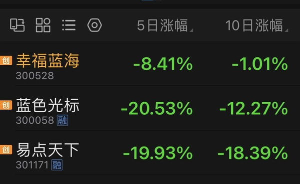
- 你求“稳”买的债基 实则“股性”很重

近日，部分债基甚至R2级银行理财也出现净值回撤，民生加银增强收益债券更因单日净值大跌超6%引发关注。很多人困惑：买债基本是图个稳，为什么也会亏？

民生加银增强收益债券就是一个例子。截至三季度末，该基

### 东百集团（提及 3 次，占比 1%）2026-11-19 10:02:42
- 去年东哥不是三连跌停才启动的吗

正常啊
- 没有啊
今年就晚了两天

去年这时候刚刚三连跌停东百
小慧七连阴🤣
- 因为我有笔记的
我那时候也到处出击

你去九牧王因为他和东哥后面都拐弯了🤣

### 保利发展（提及 3 次，占比 1%）2026-11-19 12:43:47
- 那个红宝丽现在是芯片了！😂
- 余额宝是货币基金 
余利宝可不是货币基金哦
- 看了
1年1% 不如余额宝呆着吧

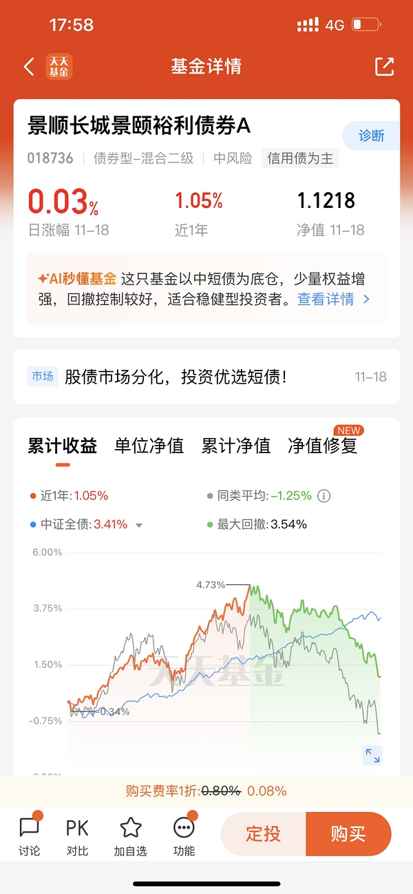

### 雪人集团 002639｜11-06「大连和雪儿」＋11-11 14:26「雪儿今天不错啊 大家昨天不是期待他接人嘛 这个任务做到了今天」（接人＝5日线接回，与雪人条件单口径一致）（提及 2 次，占比 1%）2026-11-19 09:25:56
- 雪儿还是双向奔赴😂
- 雪儿11.2日也是-9.5开盘 拭目以待

### 中文在线（提及 2 次，占比 1%）2026-11-19 13:35:31
- V老师去年这时候应该也是吧 
什么九牧王乱七八糟的就这个时间点的🤣
- 他们注入300 这些就是300成分股啊 根本倒不下

很多老师又要妈妈来又看空这些 矛盾不

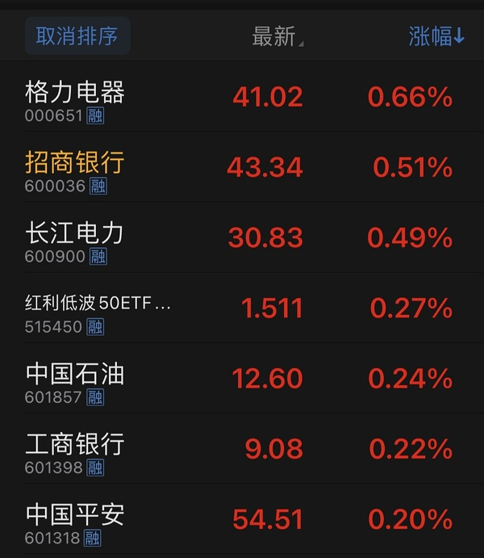

### 航空航天板块（提及 2 次，占比 1%）2026-11-19 16:55:30
- 今天uu问我这么跌会没信心吗
我想说我三月买宇航员可是这样的
这才哪儿到哪儿啊
老垃圾人啥没见过

你三月也肯定很刺激🤣🤣🤣

A（提及 2 次，占比 1%）2026-11-19 18:12:09
- 只有亚洲能和网易云音乐PK昨天了
- 网易云音乐打败了今天建信

### 建设工业（提及 1 次，占比 0%）2026-11-19 08:13:05
- 昨天午后传：要发行两万亿特别国债支持人工智能基础设施建设；信用债ETF直线跳水，10年上至1.599%，30年上至2.052%；

盘后这一条小作文已被证伪

### 中证1000ETF（提及 1 次，占比 0%）2026-11-19 08:14:33
- ETF追踪丨11月18日股票型ETF净申购119亿元 资金加仓沪深300ETF华泰柏瑞

股票型ETF中，当日净申购前3依次为：沪深300ETF华泰柏瑞，净申购54.36亿元；创业板ETF易方达，净申购50.08亿元；沪深300ETF华夏，

### 大连圣亚（提及 1 次，占比 0%）2026-11-19 09:39:35
- 大连自己跌下去的 😂

### 000530 冰山冷热｜11-11 10:16「万一冰山跌停 他能跌到哪里再去」＋10:27「今天把冰山 晶雪按死 大连 CBS 正统上位」（非持仓，冰雪板块的山寨对照）（提及 1 次，占比 0%）2026-11-19 09:48:17
- 襄阳把冰山打开了

### 幸福蓝海（提及 1 次，占比 0%）2026-11-19 12:06:30
- 幸福本月还有17%

而且还有涨停给我们兑现

怎么都怪不到他

### 300502 新易盛｜11-11 13:19「我那个买xys的女主播终于要开心了」＋13:21「她现在成本327了」→ **是女主播的仓，不是他的**（提及 1 次，占比 0%）2026-11-19 13:27:19
- 最近xys为什么比中和天好那么多

### 301010 晶雪节能（**B·推断；11-16 已买回持有**）｜11-13 10:04『plus雪是-20的…还能再跌-10』＝20cm，实测当日 −10.10%；15:25 答『多少出』报 24.94＝11-05 老卖单价（当日高 24.92 差 2 分未触及）；11-09 曾自述清仓 → **11-16 09:39『上周买了plus』＋14:53『掌声雪儿plus雪』＝上周买回、重新持有**；11-16 卖单 24.94 沿用，当日高 24.39 未触及；持仓屏 13:42:36 晶雪 23.110（提及 1 次，占比 0%）2026-11-19 13:34:17
- 还是plus雪善良吧🤣🤣
昨天给大家25卖 今天20买
20%差价😂😂😂😂😂😂😂

### 002582 好想你｜11-12 14:39:31『清了恋爱脑』＝清仓（卖价未披露；10.48 卖单两日均未触及→手动卖）；14:28『我如果去掉恋爱脑 也就比你多一个机器人』；当日收 9.76 −2.89%（提及 1 次，占比 0%）2026-11-19 13:49:19
- 在恋爱脑 青岛食品玩呢他们🤣

### 雪人集团（提及 1 次，占比 0%）2026-11-19 14:36:08
- 看来你是满仓冰雪人啊
我们这种电影人还得承担跳水的😂😂😂

### 国家队（推断 B）｜11-16 15:19/16:42 护盘语境，非具体标的（提及 1 次，占比 0%）2026-11-19 14:52:26
- 我说的是gjd😂

### 引力传媒 603598（对手盘，非他持仓）｜11-06 +37.15%；11-09 本月+37.79%（提及 1 次，占比 0%）2026-11-19 15:34:48
- 因为都下来了
就算情绪反转
人家也有可能去掌阅 去yl 去芒果 这也是传媒对吧
但我手里现在没有

### 生肖羊概念组（带阳/洋/光/太/泉的一篮子）｜11-09 14:04 他自己贴的分组；**11-13 崩盘实证**：15:58 截图跌幅榜 澳洋健康 −10.06、阳光照明 −10.05、红太阳 −10.04、大东方 −10.03、阳光乳业 −10.02、襄阳轴承 −9.98、鲁阳节能 −9.95、大西洋 −9.73、太阳电缆 −9.29、圣阳股份 −8.64、泉阳泉 −6.60、东方海洋 −6.59；他 14:48『我昨天起码说了6次 控制仓位 因为羊和东方昨天松动了！！！！这是情绪核心』（提及 1 次，占比 0%）2026-11-19 16:22:06
- 就现在这个情绪 如果他们还能把福建炒作起来
马上今天的羊和现在的“华”就肯定跟进一波
然后情绪就复活了🤣🤣🤣🤣🤣🤣🤣

### ＝小华兄弟·华夏移动互联混合(QDII)（推断·证据不足不入表）｜11-16 17:26 裸报 -2.5% 疑似场外持有，无第一人称买入/持有自述、无截图（提及 1 次，占比 0%）2026-11-19 18:06:46
- 华夏兄弟0.88% 输了

### 600715（院线·他只在盯，非持仓）｜11-13 09:33 传媒板块截图 +10.03% 涨停、本月涨幅 66.67%（＝10-30 收盘基准独立复算分毫不差）；配 09:33『市场有转院线迹象』（提及 1 次，占比 0%）2026-11-19 18:20:10
- 市场角度来，盘中九阳股份地天板走出极强辨识度，快速带动家电板块局部情绪回暖。本轮家电板块上涨更多属于存量资金下的高低切换，板块内部多数个股市值偏小、前期调整充分、位置偏低，博弈资金借成本改善、出口回暖的催化，发起一波独立性题材行情，但对于市

### 浦银安盛全球智能科技(QDII)A（提及 1 次，占比 0%）2026-11-19 19:26:47
- 最近几个月小浦非常不错

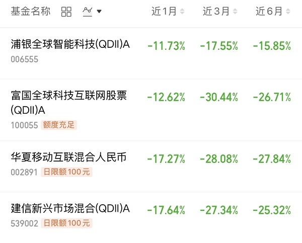

### 301171 易点天下（对手盘，非持仓）｜11-13 10:07『奶茶out 幸福人的底气是可以说芒果out』；当日 −6.72%（提及 1 次，占比 0%）2026-11-19 19:44:43
- 你们这种心态以后真的真的别碰题材了
垃圾就是这样的呀
之前都没经历过吗 看看6 7月奶茶怎么跌的😂

### 📄 全部发言（共 263 条）
- (2026-11-19 00:07:12) 厉害啊  ⊳ （引用 @VVV坚定持有VVV）第一！

- (2026-11-19 00:07:17) 😂😂😂😂  ⊳ （引用 @吃五包螺蛳粉）连续刷新楼主页20次都没抢到第一 楼上两位太强了

- (2026-11-19 00:20:25) 现在是微盘情绪问题 消息面暂时都没用  ⊳ （引用 @康贝瑞拉）这个对传媒算利好吗

- (2026-11-19 00:22:02) 造孽啊 是真不能回到家啊😂😂😂

那黄金是要和我们科技比赛？

- (2026-11-19 00:35:39) 这个是有什么说法吗😂  ⊳ （引用 @qiu啾）下周黑色星期五，会再现辉煌吗

- (2026-11-19 00:37:02) 然后场内3300他就看白天的

晚上正式盘跌了他就不算了🤣🤣🤣🤣🤣🤣🤣  ⊳ （引用 @超幸運小行星✨）现在老美都是盘前涨开盘就跌吗

- (2026-11-19 01:19:04) 最近原油都加入循环保证金行列了 太神奇了
黄金跌 白银跌 币跌 然后原油跌的更起劲了😂  ⊳ （引用 @点-重生炒垃圾）真实服了vix打到30好吗？天天在这干嘛呢。摸鱼

- (2026-11-19 01:20:16) 今天晚上nana看得令人感动 
大类资产一片绿 nana坚韧不屈

- (2026-11-19 07:49:24) nana昨天晚上看得我都感动了
就像一个富公子去了非洲难民营依然气质在线😂  ⊳ （引用 @moli）昨天道指跌得猛，全球医疗俯冲。娜娜万绿丛中一点红。

- (2026-11-19 07:50:25) 一关关过 本周第二关

美国股指期货上涨 Anthropic已将IPO价格定在推介区间之上
美国股指期货于亚洲早盘上涨。Anthropic已将IPO价格定在每股83美元，高于此前推介区间，而且IPO规模扩大至9.8亿股，从而将成为有史以来最大一宗IPO。标普500指数指数期货上涨0.45%，纳斯达克100指数期货上涨0.97%。

- (2026-11-19 07:55:40) [图] 来计算3300今天开盘了
如果1.65%不要了提升溢价

昨天期货三点收盘0.6 晚上实际nana收盘0.4 
少0.2
但是现在期货+0.9

合计+0.7

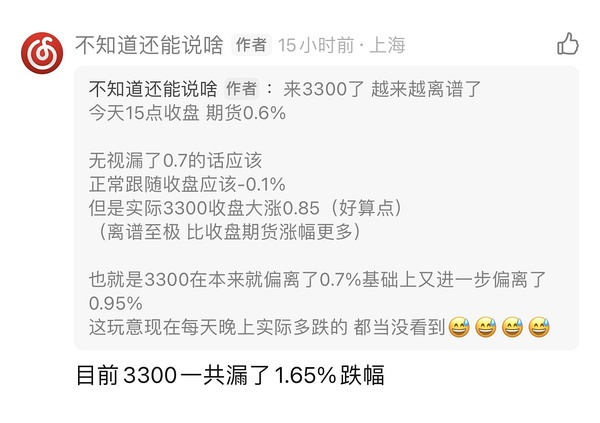

- (2026-11-19 08:00:21) 100时安全😂去年起初我是100买白银的

但是因为我们没有空
下行时我们做不了

因为可以黄金跌更多完成
而不是白银补涨

去年是白银补涨 因为上涨趋势
现在下跌趋势 可以黄金补跌修复  ⊳ （引用 @moli）之前这个时候，是空黄金多白银？

- (2026-11-19 08:01:11) 优秀啊🤣🤣  ⊳ （引用 @招招碎片收集中）我有笔记！！！

- (2026-11-19 08:01:45) 这几天白银大跌特跌造成的金银比大增  ⊳ （引用 @🅰失而复🉐😎）和价格成反比啊😇

- (2026-11-19 08:02:58) [图] 12月
92.7%加息25 
7.3%加息50

依然定价三次加息

- (2026-11-19 08:04:36) 美债回落到4.80 接近4.75 基本也是没有定价第四次  ⊳ （引用 @不知道还能说啥）12月
92.7%加息25 
7.3%加息50

依然定价三次加息

- (2026-11-19 08:06:35) 沃勒那个🐶 昨天把黄金和B全部干崩了
nana艰难守住了自己😂😂😂😂😂😂😂😂  ⊳ （引用 @不知道还能说啥）美债回落到4.80 接近4.75 基本也是没有定价第四次

- (2026-11-19 08:13:05) 昨天午后传：要发行两万亿特别国债支持人工智能基础设施建设；信用债ETF直线跳水，10年上至1.599%，30年上至2.052%；

盘后这一条小作文已被证伪

- (2026-11-19 08:14:33) ETF追踪丨11月18日股票型ETF净申购119亿元 资金加仓沪深300ETF华泰柏瑞

股票型ETF中，当日净申购前3依次为：沪深300ETF华泰柏瑞，净申购54.36亿元；创业板ETF易方达，净申购50.08亿元；沪深300ETF华夏，净申购33.10亿元。

股票型ETF当日净赎回前3为：银行ETF华宝，净赎回5.26亿元；科创50ETF华夏，净赎回4.76亿元；中证1000ETF广发，净赎回4.34亿元。

- (2026-11-19 08:16:13) 美债会提示的🤣到时候会快速下行 因为只要接近最后次 市场马上会开始预期降息启动  ⊳ （引用 @招招碎片收集中）我比较好奇怎么能确认是最后一次加息了，美股猛攻不再防守吗？

- (2026-11-19 08:17:44) 咱们可没空管他们了
希望nana继续做贵公子 不要和难民同流合污  ⊳ （引用 @🅰失而复🉐😎）又开始跳了，柔弱不堪🫣

- (2026-11-19 08:18:34) ……………  ⊳ （引用 @sickid）高考，延时开盘

- (2026-11-19 08:46:31) 纳斯达克期货提升至1.3%  ⊳ （引用 @不知道还能说啥）来计算3300今天开盘了
如果1.65%不要了提升溢价

昨天期货三点收盘0.6 晚上实际nana收盘0.4 
少0.2
但是现在期货+0.9

合计+0.7

- (2026-11-19 08:48:15) [图] 他现在在深圳吧？这是发推？

- (2026-11-19 08:48:30) 现在总没有答记者问吧  ⊳ （引用 @不知道还能说啥）他现在在深圳吧？这是发推？

- (2026-11-19 08:57:52) 😂  ⊳ （引用 @六倍做多退休）民主党说上供350亿美元就给建数据中心😂

- (2026-11-19 08:58:21) 两市融资余额减少87.68亿元
截至11月18日，上交所融资余额报11486.98亿元，较前一交易日减少32.91亿元；深交所融资余额报10523.05亿元，较前一交易日减少54.77亿元；两市合计22010.03亿元，较前一交易日减少87.68亿元。

- (2026-11-19 09:02:55) 我没钱  ⊳ （引用 @不要熬夜）今天除了雪人14.2，还有啥单子吗？翻了好久没翻到🥹

- (2026-11-19 09:03:15) 阿克曼建仓英伟达了吗  ⊳ （引用 @去他喵的大a）阿克曼狂喷，开始搞董事会？

- (2026-11-19 09:06:50) 昨天我看有uu卖nana买冰雪了😂不知道这个决策是牛逼还是错误  ⊳ （引用 @🅰失而复🉐😎）今天T0高开了🤣

- (2026-11-19 09:07:30) 我昨天开的0.1😂  ⊳ （引用 @🅰失而复🉐😎）楼雪人这个反弹买入单这样开？

- (2026-11-19 09:08:32) 这已经是第二次沃勒说加息50
黄金大跌 美债不予理会了

黄金自己也很脆弱

- (2026-11-19 09:10:00) 这时候没人说央行买买买买了🤣  ⊳ （引用 @👑）黄金现在属于空头绝对强势的一方

- (2026-11-19 09:12:17) 现在很多时候都同向了😂😂😂😂  ⊳ （引用 @🅰失而复🉐😎）跳了又去拉油了😇

- (2026-11-19 09:16:58) 一定要跌的多才要😂

那个-5 -6不好下手

毕竟很容易-10开外  ⊳ （引用 @🅰失而复🉐😎）那个雪人加大板不要了？

- (2026-11-19 09:18:38) 竞价全是疯子 看晕了

- (2026-11-19 09:18:50) 一会儿跌停一会儿涨停的 滑稽啊  ⊳ （引用 @不知道还能说啥）竞价全是疯子 看晕了

- (2026-11-19 09:20:03) 那玩意-16有种别扯单  ⊳ （引用 @🅰失而复🉐😎）大连🤣

- (2026-11-19 09:25:56) 雪儿还是双向奔赴😂

- (2026-11-19 09:26:43) 传媒是不是就慈文和横店是三连板了？

- (2026-11-19 09:27:25) 竞价就买上啦？我还没 要靠自己双手了  ⊳ （引用 @momo📈📈📈）我捡了，给点甜头好吗

- (2026-11-19 09:34:02) 今天是悠哉悠哉买完这个买那个

- (2026-11-19 09:34:55) 小伙伴 我哪有钱啊  ⊳ （引用 @冰雪go）楼，大连买了吗？

- (2026-11-19 09:35:23) 昨天我卖cbs是为了今天买雪儿的

双向奔赴了  ⊳ （引用 @冰雪go）楼，大连买了吗？

- (2026-11-19 09:35:44) 中影漂亮

- (2026-11-19 09:36:02) 今天搞成了差不多5+5  ⊳ （引用 @冰雪go）你难道是单挑雪人？

- (2026-11-19 09:36:48) 留着呗  ⊳ （引用 @冰雪go）和我一样诶，就是我手里还有一份多出来的，不知道要给谁

- (2026-11-19 09:39:35) 大连自己跌下去的 😂  ⊳ （引用 @西西西西）⛄️大连1:1？

- (2026-11-19 09:40:44) 龙版火箭发射

- (2026-11-19 09:40:52) 你觉得可能吗  ⊳ （引用 @该用户已过期）你没去plus ？

- (2026-11-19 09:41:23) 漂亮机器人来了
这是新号
他们最先调整

- (2026-11-19 09:41:43) 襄阳带着大体量托普一起  ⊳ （引用 @不知道还能说啥）漂亮机器人来了
这是新号
他们最先调整

- (2026-11-19 09:42:50) 襄阳带起大批跌停打开  ⊳ （引用 @不知道还能说啥）襄阳带着大体量托普一起

- (2026-11-19 09:43:56) 襄阳触及涨停  ⊳ （引用 @不知道还能说啥）襄阳带起大批跌停打开

- (2026-11-19 09:44:54) 你可以降低今天要求  ⊳ （引用 @Molis）雪儿还是1484吗

- (2026-11-19 09:47:05) 机器人带的😂  ⊳ （引用 @🅰失而复🉐😎）拉电影了

- (2026-11-19 09:48:17) 襄阳把冰山打开了  ⊳ （引用 @🅰失而复🉐😎）21买了一手晶😇

- (2026-11-19 09:50:47) 我说过的核心  ⊳ （引用 @🅰失而复🉐😎）楼快说你到底去哪浪了，今天红的可以说啦吧

- (2026-11-19 09:51:46) 如果后面回忆这轮谁是救世主

就是 襄阳

- (2026-11-19 09:52:08) 一己之力激活了各路跌停票  ⊳ （引用 @不知道还能说啥）如果后面回忆这轮谁是救世主

就是 襄阳

- (2026-11-19 09:52:49) 核心只有他
我之前说过的 都是看他吃饭  ⊳ （引用 @该用户已过期）那不就是龙版

- (2026-11-19 09:53:14) 你还记得uu之前还反问我
为什么不直接买核心
这次我做了  ⊳ （引用 @该用户已过期）那不就是龙版

- (2026-11-19 09:54:42) 😂😂说明上半段非常努力 没事还有下半段  ⊳ （引用 @momo）本月收益率就像瀑布一样没了😭

- (2026-11-19 09:57:15) 应该是襄阳牛逼
都是他带动的  ⊳ （引用 @点-重生炒垃圾）龙版牛逼啊

- (2026-11-19 09:59:19) 襄阳在跨年妖股里率先占据优势😂😂😂  ⊳ （引用 @速派女孩将发财）微盘股要翻红了 

- (2026-11-19 10:02:42) 去年东哥不是三连跌停才启动的吗

正常啊  ⊳ （引用 @momo📈📈📈）三个多地板，能熬住也不容易耶，羊这大起大落的

- (2026-11-19 10:05:09) 雪儿11.2日也是-9.5开盘 拭目以待  ⊳ （引用 @该用户已过期）电影冰雪咋还玩此消彼长呢

- (2026-11-19 10:07:24) 今天手动赢了🤣🤣🤣🤣 不过我也13.5 还没回本

雪儿看我昨天为了迎接他 卖了cbs 太激动了 双向奔赴太激动  ⊳ （引用 @该用户已过期）它今天不扭就好了🤣条件单买太高了

- (2026-11-19 10:08:46) 先跌停的果然是cbs 不是大连😂

- (2026-11-19 10:09:28) 襄阳啊 今天他带的  ⊳ （引用 @sickid）除了九阳没有活口

- (2026-11-19 10:14:26) 不是1026
你得希望是11.2日 -9.5的早上

大家那天也都买了  ⊳ （引用 @-却行）雪儿能不能再现一下1026

- (2026-11-19 10:16:17) 由于今天两笔cbs都搬去雪儿
所以今天有三个单子
1384 1484 1584

- (2026-11-19 10:17:17) 由于今天两笔cbs都搬去雪儿
所以今天有三个单子
1384 1484 1584  ⊳ （引用 @一切都会过去的）今天买的挂多少哇

- (2026-11-19 10:19:15) 11.2日都不这样  ⊳ （引用 @YuanZi💕）做梦一下 希望是15.84😂

- (2026-11-19 10:28:05) 别忘了开单子  ⊳ （引用 @不知道还能说啥）由于今天两笔cbs都搬去雪儿
所以今天有三个单子
1384 1484 1584

- (2026-11-19 10:30:03) 我忘了天普停牌三天期 今天才复牌

所以动手早了一天半  ⊳ （引用 @稀里不糊涂）这是不是楼昨天说的，早盘最好不要拉，等下午来？

- (2026-11-19 10:31:49) [图] 这是怎么回事😂

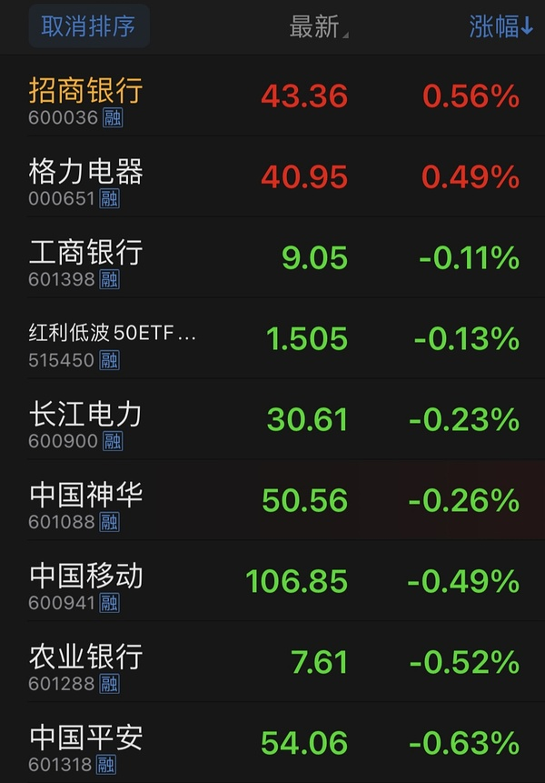

- (2026-11-19 10:32:11) 祝你来回赚两次  ⊳ （引用 @钱多多多多多）卖了恋爱脑，去了雪儿。

- (2026-11-19 10:37:05) 昨天发了3774
你们有人今天又买的 自然不能这个  ⊳ （引用 @mimimomo）大连的呢有吗🥹

- (2026-11-19 10:38:27) 涨停刚回本😂  ⊳ （引用 @shirla）原来传媒是龙版！

- (2026-11-19 10:40:46) 我没看 我没买 
你有几个点利润就撤出呗

我再强调下
本来计划是多少 不要超载

我昨天示范了 我要买雪儿买大连
那我就不得不清掉cbs

并没有提高冰雪  ⊳ （引用 @mimimomo）那今天买的开哪个？

- (2026-11-19 10:42:01) 没有 周期转折中  ⊳ （引用 @🅰失而复🉐😎）走了没

- (2026-11-19 10:43:29) 你也很牛逼😂😂😂😂😂  ⊳ （引用 @🅰失而复🉐😎）那我要去了🫣

- (2026-11-19 10:48:32) 😂  ⊳ （引用 @六倍做多退休）哎 市场资金也在打架 有的想拉妖股 有的想拉科创 红利自己岁月静好 其他的边角料就是一脚踢开

- (2026-11-19 10:50:10) 因为每年这个时候也很绝望
三周周期到了

你平时不玩垃圾 我老垃圾人  ⊳ （引用 @稀里不糊涂）楼，你真的好淡定，我都快急死了，这盘面看着真让人绝望

- (2026-11-19 10:51:48) [图] 都是一模一样剧情而已

去年此时此刻在小慧挨打

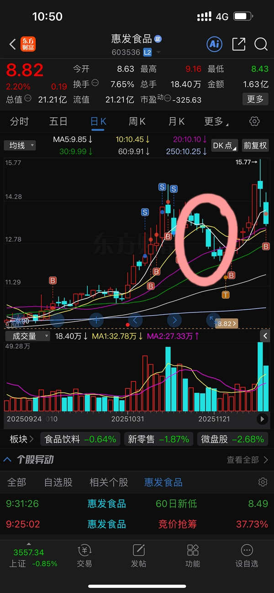  ⊳ （引用 @稀里不糊涂）楼，你真的好淡定，我都快急死了，这盘面看着真让人绝望

- (2026-11-19 10:53:15) 很正常 去年小慧和一群食品就是七连跌八连跌

因为福建导致崩盘  ⊳ （引用 @稀里不糊涂）从上周四就开始挨打了，已经7天了。。。

- (2026-11-19 10:53:45) 那个海光是因为啥？

- (2026-11-19 10:54:03) 没钱  ⊳ （引用 @钱多多多多多）楼主，昨天sy买了观察，今天还有操作不？

- (2026-11-19 10:55:16) 事实证明 危难时刻cbs没有防守价值
昨天选择并没错 他们是一样的😂😂😂
由于昨天尾盘卖cbs 今天接雪儿还少亏了两笔钱  ⊳ （引用 @稀里不糊涂）楼选择进攻了，换到雪人和长白山了

- (2026-11-19 10:55:38) 😂😂😂😂😂😂😂😂😂

- (2026-11-19 10:56:26) [图] 感觉还行哎

  ⊳ （引用 @miumiu）今天金属按的好死啊。。。这几个月死拿买什么都亏光裤衩啊

- (2026-11-19 10:57:15) 如果我钱还有很多 利润还有很大 我应该不会这么做😂钱少的好处 被迫执行纪律  ⊳ （引用 @shirla）非常果断！幸好昨天跟上了😆😆

- (2026-11-19 11:00:43) 符合 你可以调整  ⊳ （引用 @晕晕企鹅）楼主想问一下之前不是说加息行情就要清仓c50吗，这个还符合吗

- (2026-11-19 11:01:26) 紫金是铜 这两天铜加速暴跌  ⊳ （引用 @miumiu）楼，黄金瞬间打下800了，我就加了自选紫金和云铝有朋友在做，亏麻了

- (2026-11-19 11:03:20) 对啊
所以去掉了cbs啊  ⊳ （引用 @酸奶不舔盖）cbs走势和大连不是一模一样嘛

- (2026-11-19 11:04:31) 你好像对你买的东西只要跌了就心态失衡了

上次你盯着问我的还是你的指南针  ⊳ （引用 @稀里不糊涂）楼，大连这种一直不跌停是不是在发套啊，要不要倒一下等明天接回来啊

- (2026-11-19 11:05:46) 我没有 
我都说了我配置不到三分之一 20笔里的6笔
很多uu自己的配置都改动过  ⊳ （引用 @shirla）纳尼(°ロ°)!楼楼你调了吗？

- (2026-11-19 11:06:53) 我之前配置里如果有5笔红利
uu们6月或者7月时候肯定也转出全线进攻了😂  ⊳ （引用 @shirla）纳尼(°ロ°)!楼楼你调了吗？

- (2026-11-19 11:10:40) 场内3300抹掉了昨天遗漏的0.9%

- (2026-11-19 11:11:37) 跨板块换来换去很容易这么亏😂  ⊳ （引用 @miumiu）买什么亏这么多啊。。。

- (2026-11-19 11:13:02) 可以 别增加计划仓位就行  ⊳ （引用 @酸奶不舔盖）那不卖还是之前说的三个继续守着可以吗

- (2026-11-19 11:14:15) 如果今天妈不来 
保持这样到午后
很有机会上演几百个跌停

- (2026-11-19 11:15:28) 缩量的 不符合  ⊳ （引用 @👑）那就是冰点吧

- (2026-11-19 11:16:17) 我那个冰点可没有那么容易达成
而且现在300只跌1%也不符合
全部指数大跌  ⊳ （引用 @👑）那就是冰点吧

- (2026-11-19 11:18:45) [图] 暂时不如去年11.21

那天89跌停

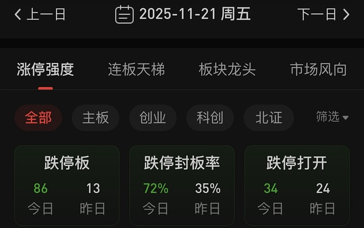  ⊳ （引用 @shirla）别冰点了还是，没钱给冰点现在😂😂😂😂

- (2026-11-19 11:21:08) Mark一下
3300归还了昨天遗漏的0.9%

还差本来的0.7%没有归还

- (2026-11-19 11:37:31) 今天楼里大家还是集中在冰雪
我都没看见几句呐喊电影的😂😂😂

- (2026-11-19 11:38:36) 前两天就不算啦😂  ⊳ （引用 @momo）因为电影今天没有冰雪背刺的那么痛

- (2026-11-19 11:42:55) 你该和我女朋友一样 买真正的慢就是快😂
你看需要操心吗

但是我知道你不会的
所以只能锻炼心态了
或者多经历

比如现在的情况 
每年11月这个时候总要经历的

我是不会说这个时候我躲开
我上周不加仓就是主动躲了
手贱改不了 也不会改 心里清楚得很
所以习惯大A特定玩法就行  ⊳ （引用 @稀里不糊涂）有电影，但是跌幅不算可怕就没啥喷的想法了，毕竟还有更差劲的，好多时候真该像楼楼学习，这么淡定，我心态太差劲了

- (2026-11-19 11:44:59) 发生在大家情绪低落的时候
我现在和你们说
这次情绪周期重新翻转以后

下次类似的情况将发生在12.17-12.19附近
也是三周炒作周期
届时新的高位股将再次全面退潮

你们可以记一下
不要12月中旬了
这个牛逼那个牛逼猛干

- (2026-11-19 11:48:05) 这次是你牛逼 我今天翻绿了😂😂😂😂😂
上个月是我牛逼  ⊳ （引用 @vio）幸福也没占太多   我刚才看本月居然还剩5.9

- (2026-11-19 11:48:43) 确实
我今天翻绿了😂
但我对本月重新逆转回收益很有信心🤣  ⊳ （引用 @该用户已过期）那就是传媒那波反弹了🤣🤣你应该是为数不多本月还红的了

- (2026-11-19 11:50:53) [图] 如果不是中影我就不会比你少😂

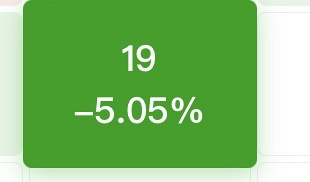  ⊳ （引用 @西西西西）今天单日-6了🚬

- (2026-11-19 11:52:34) 他们技术派是不是要所有指数结构一致 
因为科创没新低所以也要做一个新低结构？  ⊳ （引用 @sickid）对，我记得他是说觉得科创可能会补跌，所以先1:1

- (2026-11-19 11:54:19) 前天跌停几个电影只有抄底中影是不亏钱🤣  ⊳ （引用 @西西西西）我中影不多哈哈哈哈

- (2026-11-19 12:01:13) 但是中影这两天都没大跌 这对账户略微抗亏损也有帮助
不然我昨天就得翻绿了😂  ⊳ （引用 @该用户已过期）抄早的我还在亏钱🤣🤣

- (2026-11-19 12:03:33) 特朗普：必须善待黄仁勋和马斯克这样的天才

美国总统特朗普接受采访时称：“我们必须善待我们的天才。这样的天才其实并不多。当我们拥有像黄仁勋（Jensen）这样才华横溢的人才时，我们不能仅仅轻描淡写地说：“哦，你看，他做了这件事。”在我的第一个任期内，我曾给予埃隆（马斯克）很多帮助。很多人并不知道这一点。如果没有当年的支持，恐怕也就不会有今天的埃隆了。我们必须善待我们的天才。”

- (2026-11-19 12:03:41) 国内的采访？？？？？  ⊳ （引用 @不知道还能说啥）特朗普：必须善待黄仁勋和马斯克这样的天才

美国总统特朗普接受采访时称：“我们必须善待我们的天才。这样的天才其实并不多。当我们拥有像黄仁勋（Jensen）这样才华横溢的人才时，我们不能仅仅轻描淡写地说：“哦，你看，他做了这件事。”在我的第一

- (2026-11-19 12:06:30) 幸福本月还有17%

而且还有涨停给我们兑现

怎么都怪不到他  ⊳ （引用 @👑）我也想说！

- (2026-11-19 12:12:17) [图] 奶茶早已过去🤣

  ⊳ （引用 @momo）这个月对我最好的是幸福zy雪人  对我最坏的是打脸脖子奶茶吃鼻屎 我会一直诅咒打脸跛子奶茶吃鼻屎的 我恨你们4个

- (2026-11-19 12:15:26) 11:30收盘时候
nana期货+0.8
对应3300-0.1

3300还是归还了昨天错误遗漏的0.9%

不过似乎上周的那个0.7%是真不还了

- (2026-11-19 12:17:55) [图] 其他的归还的更多了😂😂😂

3300不愧是初代第一王者

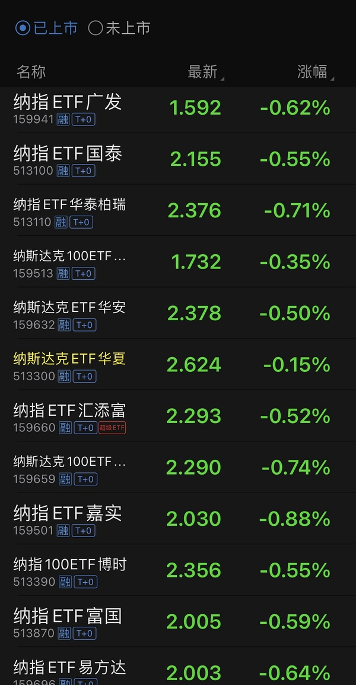  ⊳ （引用 @不知道还能说啥）11:30收盘时候
nana期货+0.8
对应3300-0.1

3300还是归还了昨天错误遗漏的0.9%

不过似乎上周的那个0.7%是真不还了

- (2026-11-19 12:19:29) uu你的字里行间非常不看好大连
不要重仓自己不看好的东西 记得减仓  ⊳ （引用 @稀里不糊涂）原来是等二波吗，会不会之前那么短就是二波了。。。

- (2026-11-19 12:26:21) 龙版在11/11日打出爆量针
襄阳在11/12日暂时见顶
此后行情变成了这样

下跌家数
11月12日4643家　
11月13日4748家　
11月16日4344家　
11月17日4119家　
11月18日4133家　
11月19日5030家

- (2026-11-19 12:27:03) 今天龙版襄阳盘中双双封板  ⊳ （引用 @不知道还能说啥）龙版在11/11日打出爆量针
襄阳在11/12日暂时见顶
此后行情变成了这样

下跌家数
11月12日4643家　
11月13日4748家　
11月16日4344家　
11月17日4119家　
11月18日4133家　
11月19日5030

- (2026-11-19 12:43:47) 那个红宝丽现在是芯片了！😂

- (2026-11-19 12:55:25) 技术派很多看空美股 看多大A也是很搞笑的  ⊳ （引用 @Waiting一下）应该是

- (2026-11-19 13:01:32) 哪家媒体提问啊 ？  ⊳ （引用 @去他喵的大a）特朗普：我想我已经得到了头条新闻。我与之间的关系非常好。你看到了座位安排。从未去机场接见过任何人。这对我们来说是一个巨大的胜利。

问：黄仁勋的话题有提到吗？

我昨晚整夜都和在一起。我们没有讨论它。我可能简要提了一下，这是一场悲剧。

问

- (2026-11-19 13:02:56) 不是在深圳吗  ⊳ （引用 @去他喵的大a）外媒，fox news

- (2026-11-19 13:03:14) 不跌停你们不放心 跌停了又是哎了🤣🤣🤣🤣  ⊳ （引用 @momo）哎。。。

- (2026-11-19 13:27:19) 最近xys为什么比中和天好那么多  ⊳ （引用 @sickid）易中我的妈，来了

- (2026-11-19 13:28:43) 去年这时候还有-5%的微盘股  ⊳ （引用 @🅰失而复🉐😎）今个微盘跌这么多🤮🤮🤮

- (2026-11-19 13:31:32) [图] 去年这个腾空一阴-4.9穿破多线

如果你在去年这一天比现在恐慌多了

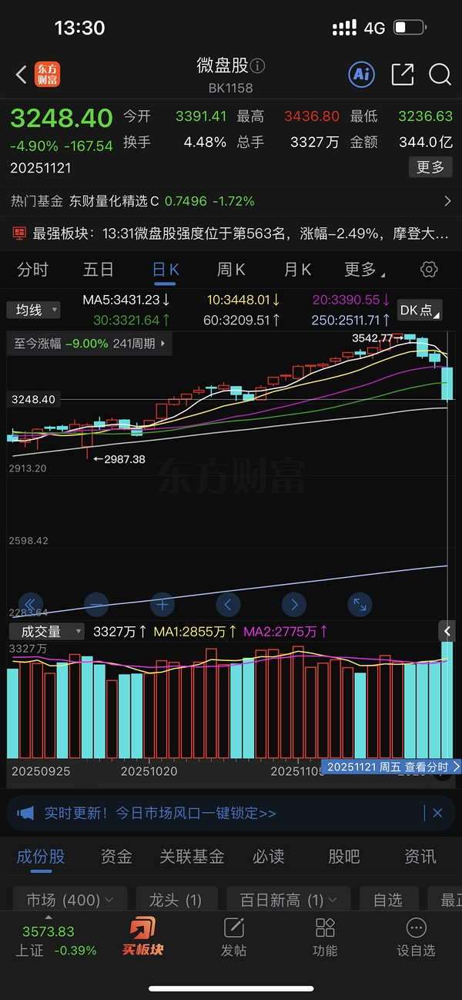  ⊳ （引用 @稀里不糊涂）我看了去年微盘，好像幅度没有这么大

- (2026-11-19 13:32:40) 襄阳回封
带动机器人一般😂  ⊳ （引用 @🅰失而复🉐😎）龙板这时候回封就好了🫠

- (2026-11-19 13:34:17) 还是plus雪善良吧🤣🤣
昨天给大家25卖 今天20买
20%差价😂😂😂😂😂😂😂  ⊳ （引用 @🅰失而复🉐😎）龙板这时候回封就好了🫠

- (2026-11-19 13:35:31) V老师去年这时候应该也是吧 
什么九牧王乱七八糟的就这个时间点的🤣  ⊳ （引用 @VVV坚定持有VVV）已经很久没这样满手跌停了，窝囊啊

- (2026-11-19 13:37:15) 这样下去马上百股跌停了

不拉之前24个跌停 拉完现在40+  ⊳ （引用 @去他喵的大a）大连还是在二次找底嘛

- (2026-11-19 13:40:37) 今天冰点条件除了放量最基本的没有看到

ETF不同行业批量-4以上也是没有的

- (2026-11-19 13:41:17) 除了大数据-4 

其他都没-4的ETF  ⊳ （引用 @不知道还能说啥）今天冰点条件除了放量最基本的没有看到

ETF不同行业批量-4以上也是没有的

- (2026-11-19 13:42:46) 没有啊
今年就晚了两天

去年这时候刚刚三连跌停东百
小慧七连阴🤣  ⊳ （引用 @VVV坚定持有VVV）今年时间好像有点错位，去年这个时候应该在海欣和东百之类的了，蓄势待发
今天真是感觉被人打了一巴掌还不了手，憋屈

- (2026-11-19 13:43:21) 手里还有个红色呢🤣🤣🤣🤣  ⊳ （引用 @该用户已过期）割了cbs 的人均俩，还有个plus在路上了

- (2026-11-19 13:44:01) 不爆量 就没有冰点一说  ⊳ （引用 @小白吐司）感觉不放量就很难冰点啊，话说以前有过不放量的冰点吗

- (2026-11-19 13:44:42) 今天不是量不满足

ETF没有批量-4
涨停家数很多
三大指数都是微跌

全部都不满足！！！  ⊳ （引用 @小白吐司）感觉不放量就很难冰点啊，话说以前有过不放量的冰点吗

- (2026-11-19 13:45:21) 好转了你才去的！ 也就是下周那会你去了  ⊳ （引用 @VVV坚定持有VVV）那我可能在小惠，因为我印象中九牧王没这么早打我🤣好像是再冷一点的时候

- (2026-11-19 13:45:57) 我在等他火箭发射😂😂😂😂  ⊳ （引用 @该用户已过期）希望阿中挺住🥹🥹

- (2026-11-19 13:47:09) 那要看我的龙龙了啊  ⊳ （引用 @该用户已过期）🤣今天还有机会吗？急需一支强心针

- (2026-11-19 13:48:36) 因为我有笔记的
我那时候也到处出击

你去九牧王因为他和东哥后面都拐弯了🤣  ⊳ （引用 @VVV坚定持有VVV）哈哈哈哈哈哈哈楼记我的持仓比我清楚，我脑子内存不足，一天就清空了😂

- (2026-11-19 13:49:19) 在恋爱脑 青岛食品玩呢他们🤣  ⊳ （引用 @只想搞钱）能不能顺势来消费玩啊，直接把消费拉起来玩到过年再说

- (2026-11-19 13:49:53) 不叫割 是转换 内部调仓  ⊳ （引用 @小猫白-发财版）大家已经割cbs了吗

- (2026-11-19 13:50:50) 老垃圾人了

垃圾人吃三个跌停都是家常便饭  ⊳ （引用 @稀里不糊涂）楼你真的好冷静

- (2026-11-19 13:53:48) 是的
只不过我觉得如果今天进攻
大连雪儿强于cbs
如果今天一地鸡毛 他们也差不多 事实确实是差不多😂  ⊳ （引用 @茅五泸荣誉黑粉）我的理解是楼需要💰去买雪人，cbs并没有展现出比大连更强的防守能力，在有大连的情况下就挪了cbs去雪人。应该不是觉得cbs后面不好的意思吧，雪人和大连吃肉，cbs怎么也能喝口汤吧（cbs爱好者强行找补🤣）

- (2026-11-19 13:55:54) 主要是雪人今天肯定会低开
我昨天说过了 昨天不要日内接 今天肯定有更低价格

所以昨天提前卖了cbs 方便今天早上操作😂  ⊳ （引用 @茅五泸荣誉黑粉）那么如果还想玩冰雪，正好可以趁着都跌停去调仓换股🤣

- (2026-11-19 13:57:43) 基本上下周情绪转暖 又是玩三个礼拜到你说12.19左右就新的歇菜血洗😂😂😂  ⊳ （引用 @VVV坚定持有VVV）🤣我去翻了下回忆起来了，我应该是七成仓小惠跌破防了，中间有一段四处乱买，最终12.11全仓进了九牧王

然后就开始坐它涨停跌停交替的过山车，12.19两连板我开始做梦九连板，周一回来就开始跌停了😂

这个12.19还真是要注意

- (2026-11-19 14:03:56) 上周我说了崩盘在即 现在我也说下周情绪转暖  ⊳ （引用 @momo）下周怎么情绪转暖

- (2026-11-19 14:04:46) 注定不可能都跟上😂😂😂😂😂
肯定有区别的  ⊳ （引用 @稀里不糊涂）下周情绪好转反弹跟上就行，不要跌都跌这么多了，结果反弹还跟不上

- (2026-11-19 14:13:30) 按照现在看
有件遗憾的事情
昨天uu们拿nana换冰雪 
是一个不佳的转换😂😂😂  ⊳ （引用 @该用户已过期）明天小跌，下周一不跌，然后微红，这就转暖了啊

- (2026-11-19 14:14:48) 我今天才翻绿…不至于  ⊳ （引用 @Aaa摆烂咸鱼🥳）估计等楼也失去信心了就差不多了🥲

- (2026-11-19 14:15:39) 楼里今天开始逐渐有觉得科技好了 
至少风向有变化 对科技和对垃圾来说都是好事啊  ⊳ （引用 @momo）现在问题是我没看到科技有拉多少

- (2026-11-19 14:20:59) 要信早信
信晚了站岗  ⊳ （引用 @小肥肥）其实我也觉得科技这两天很好，我都要转向了😂，我这个韭菜

- (2026-11-19 14:27:30) [图] 去年此时 86

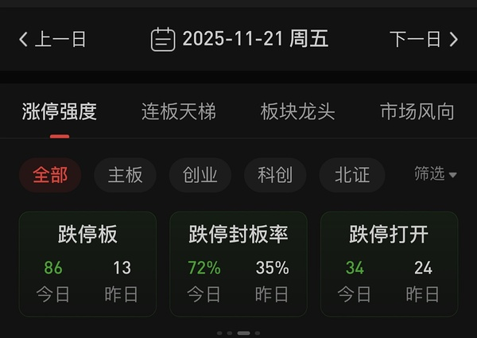  ⊳ （引用 @sickid）跌停66了

- (2026-11-19 14:29:53) 3300想把0.7也归还  ⊳ （引用 @该用户已过期）我娜娜买老号的，看都不看🤣🤣

- (2026-11-19 14:31:32) [图] 财联社9度

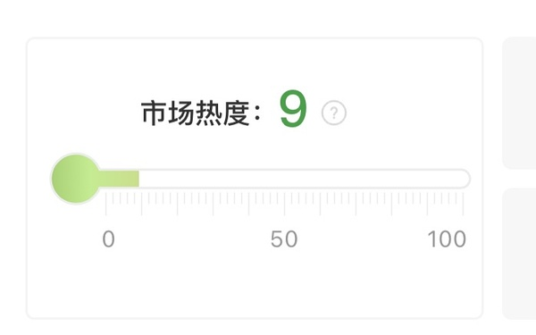

- (2026-11-19 14:33:50) 7.17比今天惨😂  ⊳ （引用 @小肥肥）比7月我都觉得还差

- (2026-11-19 14:36:08) 看来你是满仓冰雪人啊
我们这种电影人还得承担跳水的😂😂😂  ⊳ （引用 @lacey）账户早都止跌 没参与两点半的跳水🥹🥹

- (2026-11-19 14:37:06) 但是溢价率太高了 安全度有很多折扣😂不然我也不会每天盯着计算漏跌多少了

好在今天补了点遗漏跌幅  ⊳ （引用 @六倍做多退休）11.06那天楼主抄底纳指的时候 我委托我妈妈把账户里所有剩余的钱都购入了纳指 这几年浮浮沉沉 适合普通人（在a子有时候承认自己是笨比其实会比较轻松）就是楼主长期账户里的东西  a股聪明人太多了 大伙想想对手都是楼主这样的人 挣不到钱也是正

- (2026-11-19 14:37:52) 部分宽基ETF持续放量，中证500ETF南方(510500)成交超100亿元，已超昨日3倍，

就不能顺手抄一下1000呗？故意的咯

- (2026-11-19 14:38:33) 跌停在不断增加呀 而且越来越快啊😂😂😂😂  ⊳ （引用 @乖乖是只嘤嘤怪）还想说2点半 有点起色 谁知道是扁担那头也塌了

- (2026-11-19 14:40:12) [图] 跌停数量 火箭发射了

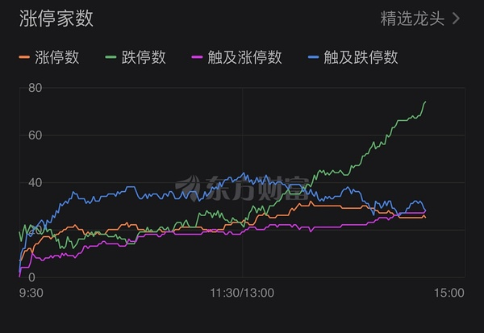

- (2026-11-19 14:43:26) 3300目前涨幅0.3% 纳斯达克期货1.6%

此前欠着的1.6%归还了1.3%

- (2026-11-19 14:46:00) 会的
都是一样的

大家是之前快乐太多了？不习惯了？
这不是一直经历的吗😂

之前传媒人不管是爱丽家居拔网线 还是天娱因为物理ai带崩全部传媒 还是后面的龙版监管 和新华停牌

都是连续大跌特跌 杀情绪  ⊳ （引用 @稀里不糊涂）要和去年打平了，话说去年后面怎么样了，会好起来吗

- (2026-11-19 14:47:41) 对手盘啊  ⊳ （引用 @vio）指数拉升，跌停数增加，何意味

- (2026-11-19 14:48:21) 小伙伴
上周我说过吧
这次多涨了两天
跌幅必然加大  ⊳ （引用 @稀里不糊涂）这次看着文化传媒板块跟a杀一样

- (2026-11-19 14:51:14) 象征性扫了点1000

我们就像要饭的  ⊳ （引用 @稀里不糊涂）好像拉起来了一点，xf和中影

- (2026-11-19 14:51:43) 因为看到马上百股跌停了 稍微扫了点👍

- (2026-11-19 14:52:26) 我说的是gjd😂  ⊳ （引用 @shirla）楼你不是没钱了吗！

- (2026-11-19 14:53:28) 3300又准备忘记遗漏的跌幅了 我也是醉了  ⊳ （引用 @高手云集上钻）3300让我减亏了😭

- (2026-11-19 14:54:29) 我是真的没钱😂  ⊳ （引用 @shirla）害，我还想追问呢，怎么是1000不是2000增强那个3300吗😂😂😂

- (2026-11-19 14:56:34) [图] 他们注入300 这些就是300成分股啊 根本倒不下

很多老师又要妈妈来又看空这些 矛盾不

  ⊳ （引用 @一切都会过去的）招招疯了😂

- (2026-11-19 14:57:53) 机器人也没怎么带起来 可惜了  ⊳ （引用 @sickid）九阳和襄阳都封板了

- (2026-11-19 14:58:27) 余额宝是货币基金 
余利宝可不是货币基金哦  ⊳ （引用 @华尔街之猪）是只有余额宝幸存吗

- (2026-11-19 15:01:27) 来了 mark下

收盘目前1.9%

3300 是0.65%

3300归还了遗漏的1.65%里的1.25%

还差0.4%遗漏了  ⊳ （引用 @小白吐司）娜娜都1.8了，今晚坚持一下给我回点血吧

- (2026-11-19 15:03:05) Mark
截止19号三点收盘
3300目前只遗漏跌幅0.4%了
在今天基本上归还了漏跌的部分

明天早上我们再来计算

- (2026-11-19 15:04:29) 没有了
之前冰点后一段时间转给诺安了
但是诺安就赚到1% 也不错了 😂😂😂😂😂
现在这个钱也在3300里呢  ⊳ （引用 @六倍做多退休）楼你的北证还在吗 😂这玩意我清仓后下跌了40% 太恐怖了

- (2026-11-19 15:06:42) 这说明场内的资金 对于下跌的nana抄底意愿极度强

涨了就不买了 乃至落袋👍

所以nana下跌时候溢价被抬升 nana上涨时候溢价会下降  ⊳ （引用 @一切都会过去的）趁涨的时候归还 太善良了

- (2026-11-19 15:07:21) 咱们每天跟踪 也是为了更好的掌握规律

现在场外是真的买不到nana 😂😂😂😂  ⊳ （引用 @一切都会过去的）趁涨的时候归还 太善良了

- (2026-11-19 15:09:23) 😂这我真不知道 我买也是博一下北交所政策的
一年了 毛也没看到  ⊳ （引用 @困困熊猫）楼主，我还没走，那现在走还合适吗

- (2026-11-19 15:11:27) 是的 cbs之前那段上涨完全不如大连迅猛 但是下跌也很柔和 所以我昨天对他夸赞了 感谢他的付出😂  ⊳ （引用 @momo）事实上这个月cbs比大连少亏5个点 如果我没看错的话。。

- (2026-11-19 15:15:26) 明天我就不提醒大家了
因为我也不需要提醒自己了
没有机会犯周五的错误
那段我就不复制了

相信美国好转大家也会很乐意

- (2026-11-19 15:16:31) 四天是这样的真的很多 不好说😂😂😂😂😂  ⊳ （引用 @六倍做多退休）王姐应该在传媒吧。

- (2026-11-19 15:17:20) 嗯 今天用完了 省心
无需再责怪周五手贱的自己了  ⊳ （引用 @奶茶今天40了吗）楼没钱也就没机会乱买了🤣

- (2026-11-19 15:20:09) 比如今天你抄底的 那你有赚就得出去
或者你不看好 就像uu觉得还要大跌很多天的 
那你就减
自己怎么想的就怎么做呗  ⊳ （引用 @豆友1349361881）冰雪后续怎么操作啊 cbs已经跌破前几次的低点了

- (2026-11-19 15:22:22) 😂我个人感觉
大家昨天用nana换冰雪
很大原因是很多老师们说nana还要大跌特跌

然后动用了nana去换 我不知道我猜的对不对  ⊳ （引用 @一切都会过去的）还好我这个月唯一充值是给它

- (2026-11-19 15:25:36) 如果是你这个原因
那真是造大大大大大孽啊
现在每天大家都是表达多恨大A 对A嗤之以鼻 

然后自己用nana换大A🤣🤣🤣🤣🤣🤣🤣🤣🤣🤣  ⊳ （引用 @👑）我猜是因为娜娜是唯一还红的

- (2026-11-19 15:31:20) 你通过我增强信心毛用没有 一个跌停你就不看好了

就和六七月传媒杀跌一样 你后面回头来看杀的傻不拉几的  ⊳ （引用 @稀里不糊涂）楼楼，你当初买冰雪的逻辑是啥，现在还坚持吗

- (2026-11-19 15:31:40) out ！  ⊳ （引用 @vio）小远 0.16

- (2026-11-19 15:32:33) 期待住

不过是不是电影就不知道了  ⊳ （引用 @带薪养生中）明天还是我们传媒的星期五吗

- (2026-11-19 15:34:48) 因为都下来了
就算情绪反转
人家也有可能去掌阅 去yl 去芒果 这也是传媒对吧
但我手里现在没有  ⊳ （引用 @👑）这样啊

- (2026-11-19 15:38:50) 那你满全面的 哈哈 希望都可以
毕竟他们会互相联动  ⊳ （引用 @带薪养生中）我有zy，奶茶跟xf，求求了

- (2026-11-19 15:39:30) [图] 咱们还要期待这个呢

这周过了英伟达的关

现在等待第二道关 目前来看还顺利

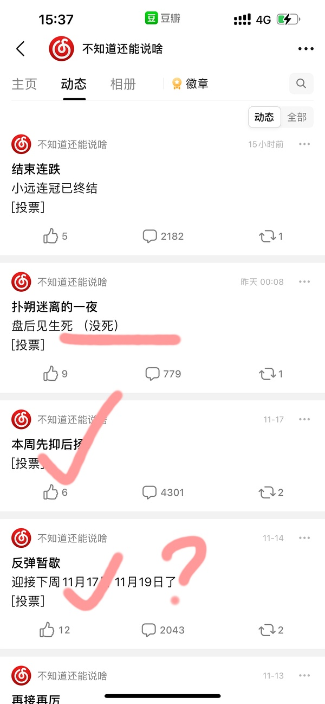  ⊳ （引用 @shirla）周五大奇迹日！

- (2026-11-19 15:41:06) 那玩意说跌停就跌停了🥲🥲  ⊳ （引用 @shirla）没事啊你还有龙版

- (2026-11-19 15:41:54) 也有可能是机器人
人家有襄阳😂😂😂😂
襄阳是今天第一个给正反馈的
九阳都比他慢  ⊳ （引用 @赚💰💰易如反掌）希望，我感觉传媒又可以买了，今天应该补点仓

- (2026-11-19 15:42:58) 🤣🤣🤣🤣🤣🤣🤣🤣🤣🤣  ⊳ （引用 @vio）哈哈哈啥时候加的（没死）

- (2026-11-19 15:46:14) 现在楼里很明显
全都是冰雪为主😂
你还看不明白吗  ⊳ （引用 @momo）都期待的时候，一般就不是电影，虽然我电影很多

- (2026-11-19 15:47:44) 你比我猛
我那天买是因为他跌停了😂
今天这样半空中我也不敢😂😂😂😂😂😂  ⊳ （引用 @🅰失而复🉐😎）我们都有龙了😏

- (2026-11-19 15:51:32) 不 
上周五就明显是了😂😂😂
因为都是愁眉苦脸的 喜悦的人不多

还有钱的估计前两天买电影了
但是这两天冰雪也买了
总的我猜测还是冰雪多的

可能原因也很简单
冰雪本月一上来也很猛的  ⊳ （引用 @sickid）只是今天冰雪都跌停所以哭声比较大吧，比如我就是影视两倍冰雪

- (2026-11-19 15:56:53) [图] 希望今天就是去年这一天
襄阳就是领路人

  ⊳ （引用 @👑）原来今天跌停72…

- (2026-11-19 16:03:23) 我没机器人 但我也很希望他们好起来
这个就像你说的那情绪传导起来很快的

大家别紧张
去年小慧大家亏钱不是因为十一月这个退潮🤣
这个退潮后是有更强的第二波的！

大家是死在了 
第二波12月嗨起来以后 还在猛干😂
最终才是一败涂地的

因为临近下个月月末季度末年末三重效应了  ⊳ （引用 @👑）襄阳先起来，是不是还是机器人啊，机器人起来带传媒，传媒起来带冰雪，（就这样）

- (2026-11-19 16:06:25) 我笔记是17-19😂😂😂😂  ⊳ （引用 @👑）记笔记！

- (2026-11-19 16:07:29) 这个盘前纳斯达克和硬件是因为ANT大涨的吗？

- (2026-11-19 16:14:45) [图] 台湾是因为什么？？

恒科也把我们赚的55%全部抹干净了😂😂😂

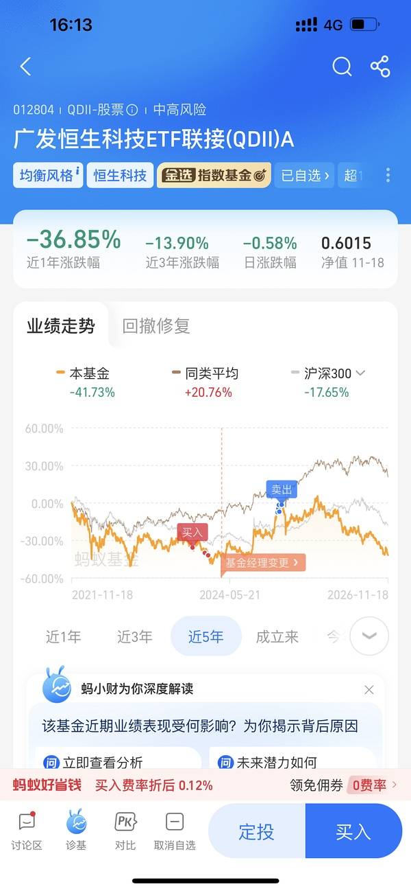  ⊳ （引用 @六倍做多退休）台湾今天也大跌诶 周五又要限制卖空了

- (2026-11-19 16:19:29) 哈哈看到了

平潭五天也是-23%😂确实是通杀  ⊳ （引用 @VVV坚定持有VVV）那是不是又可以炒福建了？

- (2026-11-19 16:20:37) [图] 🤣🤣🤣🤣🤣🤣🤣🤣🤣🤣🤣

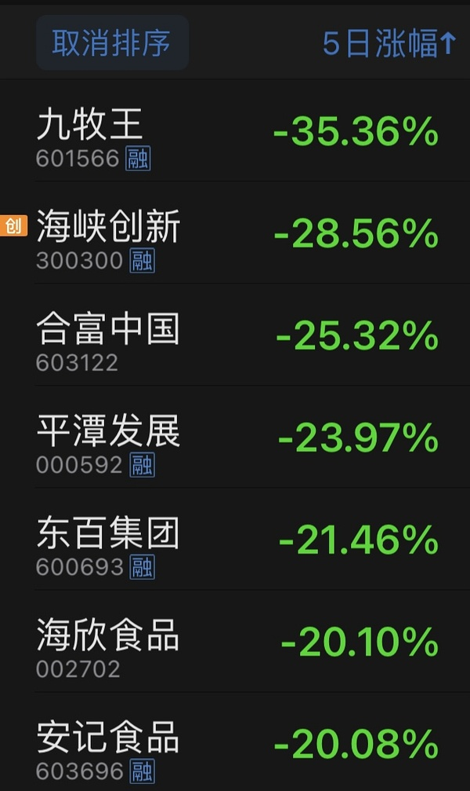  ⊳ （引用 @VVV坚定持有VVV）俺要去福建板块扒拉一下了

- (2026-11-19 16:22:06) 就现在这个情绪 如果他们还能把福建炒作起来
马上今天的羊和现在的“华”就肯定跟进一波
然后情绪就复活了🤣🤣🤣🤣🤣🤣🤣  ⊳ （引用 @VVV坚定持有VVV）俺要去福建板块扒拉一下了

- (2026-11-19 16:22:53) 我没钱 瞎看看

这次九牧王之前为什么涨上去的 因为“九”？  ⊳ （引用 @VVV坚定持有VVV）又九牧王啊，我有心理心影😂

- (2026-11-19 16:24:03) 九牧王这次更加血腥🤔
慢慢嗨了三个月
四天就跌完了😂😂😂😂😂😂😂😂😂😂  ⊳ （引用 @VVV坚定持有VVV）又九牧王啊，我有心理心影😂

- (2026-11-19 16:27:20) 年初怒亏18%割肉
这次8月埋伏大赚40%
后来三进三出一共
一赢两亏大概抹掉了10个点

这一次开局再次-20%😂  ⊳ （引用 @-却行）感觉楼里蛮多uu栽倒在博子的 年初那会楼楼都走完了 洗了几天又来大的

- (2026-11-19 16:28:57) 那他这次弱爆了
他上涨很慢 没有去年气势如虹的连板

但是这次下跌依然气势如虹 🤣🤣🤣🤣🤣  ⊳ （引用 @VVV坚定持有VVV）我依稀记得叠加了商业航空（做宇航员裤子）+马年概念（牧马）+数字（belike七匹狼）🤔

- (2026-11-19 16:33:07) 这次我没骂
买类似的东西这几天都很容易-20附近😂
等修复时候摆烂我才骂  ⊳ （引用 @落花烟雨江南梦）真是个磨人的家伙【苦涩】

- (2026-11-19 16:35:57) 我和你们说句客观的
一月份就别玩了
一月份有一批最垃圾的会预告ST
大家玩垃圾有踩雷的可能 
然后我之前说的1.15日之前就要撤了
算上元旦回来也没几天

所以手贱的
如果本来20万的 
就拿三四万玩玩得了
一月不是一个很适合炒垃圾的月份  ⊳ （引用 @momo）2026除夕是2.16  2027除夕是2.5，是不是得更早跑路

- (2026-11-19 16:36:42) 买卖都有

还行 不是家人罢榜😂  ⊳ （引用 @柚又）好消息家人们是卖出的

- (2026-11-19 16:41:18) 问题不大的
最关键的问题是
这一次起来以后 是真的不能猛干了哦！！！
大家去年不是这一波死的
是死在了12月😂😂😂😂😂  ⊳ （引用 @momo）我12月能从泥潭里挣扎出来吗

- (2026-11-19 16:44:20) 这两天是没办法😂题材都是一塌糊涂

我之前机器人还说那个春哥走的好看
没情绪了也是直接A 都没怎么好好嗨 也是一样A下来  ⊳ （引用 @扶我起来还能买）冰雪起来在科技最差的时候了吧，这一来一回可能uu们跟的不及时多少也会有影响，大连的利润没有雪儿垫的厚，体感会有差异的

- (2026-11-19 16:50:59) [图] 😂😂😂我看了今年一月份的

大家1/12日应该都很不错的！

事实上 1/12日以后不再玩也是最好的
后面被xxz害惨了😂😂😂😂连绿了很多天

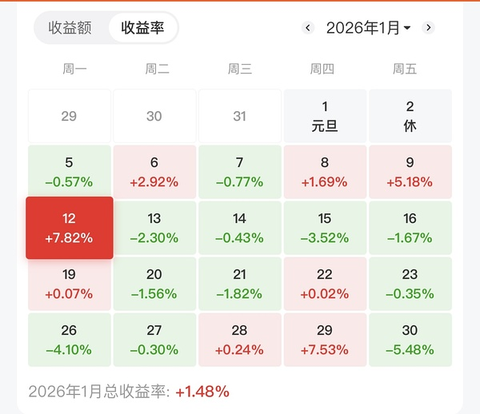  ⊳ （引用 @哄哄🐮）好的，我记住了😂到时候我直接清掉。楼觉得不行就会一定不行。

- (2026-11-19 16:52:43) Anthropic股价在暗盘市场上涨约20%

Anthropic将于周四在纽约挂牌交易，这势将考验投资者对科技板块的胃口。当前股市正处于紧要关头，英伟达本月重挫了26%，因首席执行官黄仁勋下台，而且市场对科技支出放缓的担忧加剧。在Anthropic IPO定价后，纳斯达克100指数期货合约上涨，亚洲时段下午扩大了涨幅。

- (2026-11-19 16:55:30) [图] 今天uu问我这么跌会没信心吗
我想说我三月买宇航员可是这样的
这才哪儿到哪儿啊
老垃圾人啥没见过

你三月也肯定很刺激🤣🤣🤣

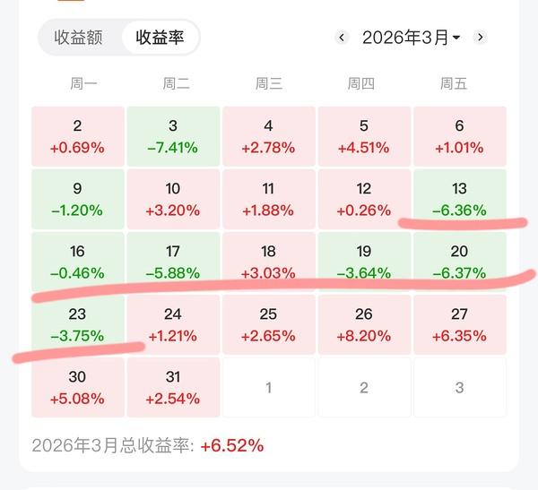  ⊳ （引用 @🅰失而复🉐😎）只能玩半个月🫠

- (2026-11-19 17:02:09) 一月我早就思考过
我就拿两个电影 因为春节档嘛
总仓位控制在30%多😂
15%一个 15%另外个
然后和你们每天侃大山 其他我就不买了🤣
到时候大家提前过年去了 楼里也没啥人的 我自娱自乐  ⊳ （引用 @🅰失而复🉐😎）大凶还是别浪一月了😇

- (2026-11-19 17:09:08) 本周两件大事

英伟达业绩 过关了
ANT 现在犹如办喜事😂😂😂😂😂😂  ⊳ （引用 @YuanZi💕）我朋友圈一个大佬发的 不知道明天能不能实现一把

- (2026-11-19 17:10:00) 回老家了 一般陪陪家人父母孩子啥的吧😂这个应该看的少？  ⊳ （引用 @云小朵飘啊飘）楼，村里是通网的，提前过年也能聊

- (2026-11-19 17:12:37) 少，不多的  ⊳ （引用 @招招碎片收集中）有点想不起去年过年楼里氛围了，有人聊天吗？

- (2026-11-19 17:15:51) 昨天黄金跌3% （油大跌 白银大跌 铜大跌 币大跌）
nana顽强不屈翻红0.4%

现在黄金反弹0.2%
nana涨1.8%

nana这两天太令人感动了😇

- (2026-11-19 17:19:22) 是不是只有我们沪深股市是市值打新啊？  ⊳ （引用 @六倍做多退休）被ant锁住的打新资金出来了 哈哈哈 这段时间 我从没见过那么多空头 看的真让人顶不住

- (2026-11-19 17:20:50) 😂有没有可能
买股票人家都当赌博
但是买黄金大家当存款理财在做？😂😂😂😂  ⊳ （引用 @大连海底站岗员）黄金好多人抄底，不像俺们古茗早早就满仓了
https://www.douban.com/doubanapp/dispatch?uri=%2Fgroup%2Ftopic%2F506118717%3F_spm_id%3DMjU1MDQ1MTMy

- (2026-11-19 17:40:45) [图] 挺好的
我也满仓😂😂😂😂
我不会再有任何权益股票基金投入了

我会记住2026.11.6日的
就像我记住四年前2022.7.1第一笔一样

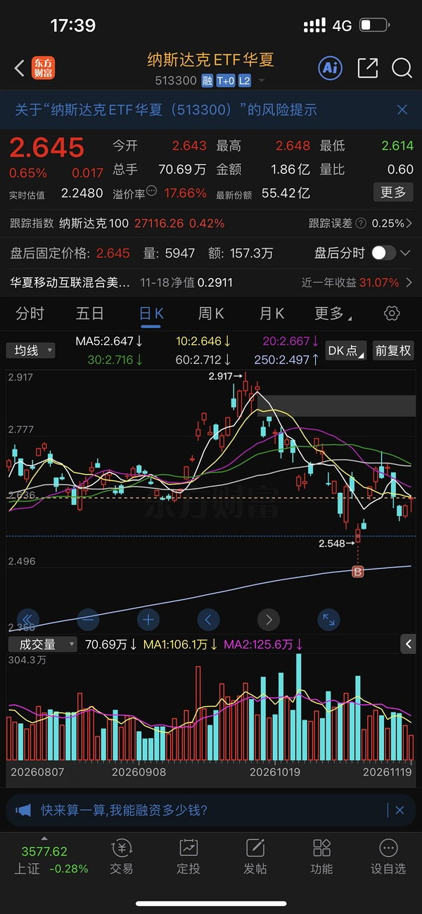

- (2026-11-19 17:49:24) [图] 我这次总结经验了 
既然觉得目前位置大差不差
直接省去了四年前的定投

四年前 后面也有更低点 但是因为定投上升段也全部买到了 高点低点都买了😂😂😂这就导致总持仓成本甚至高于第一笔点位

这次我果断躺平all in🥲

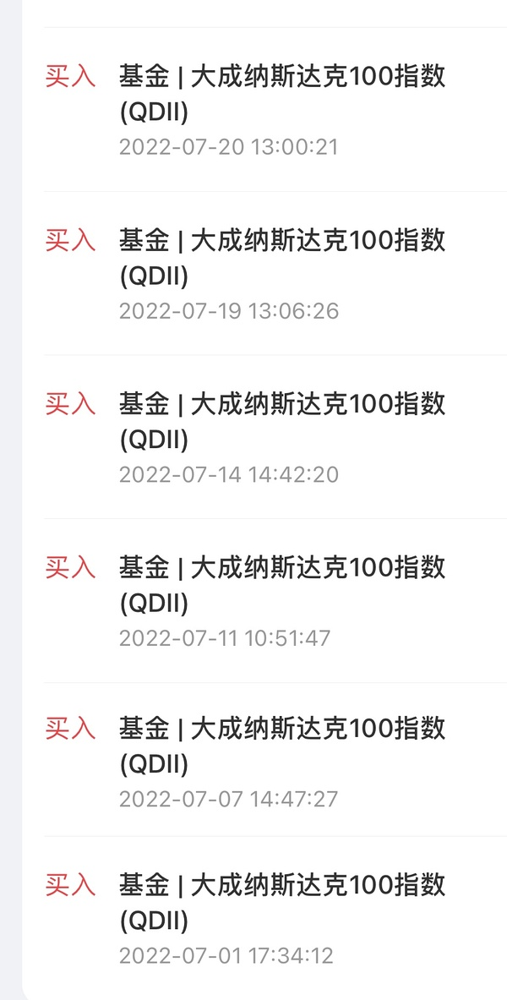  ⊳ （引用 @Waiting一下）希望娜娜能够带动C50让我把钱取出

- (2026-11-19 17:51:02) 悟了  ⊳ （引用 @qiu啾）我那个群大部分在sz我想起来了

- (2026-11-19 17:52:56) 五这个宇航员
今年我们还是可以的😂😂😂😂😂

但是除去我们三四月玩的时间 
后面跌下来的每一次回手掏都是难度暴增  ⊳ （引用 @高手云集上钻）2026年最贵的七句话：
一、时间会证明算力和光模块的。
二、全球央行都在抢黄金，你在等什么？
三、今年白银将是你一生最大的一次机会。
四、短期缺算力，长期缺电力，永远缺存储。
五、航天先惩罚了不相信他的人，又惩罚了背叛他的人，最后惩罚了不

- (2026-11-19 17:55:11) [图] 你求“稳”买的债基 实则“股性”很重

近日，部分债基甚至R2级银行理财也出现净值回撤，民生加银增强收益债券更因单日净值大跌超6%引发关注。很多人困惑：买债基本是图个稳，为什么也会亏？

民生加银增强收益债券就是一个例子。截至三季度末，该基金股票市值占总资产的18%，可转债占61%，两者合计约79%。其中，股票和转债持仓均涉及科技板块，相关资产同时调整时，对净值的冲击也会叠加。

这些都拉黑不碰

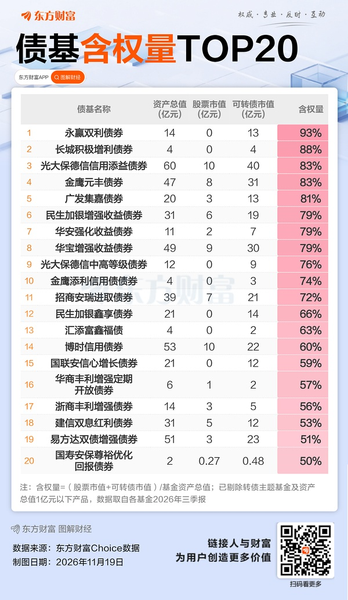

- (2026-11-19 17:57:23) 含权量之外，含权规模同样值得关注。一只规模较大的债基，即使含权比例不算突出，配置的股票与可转债也可能达到上百亿元。

按股票与可转债持仓市值之和排名，景顺长城景颐丰利债券以166亿元居首。该基金资产总值686亿元，含权量约24%，其中股票持仓117亿元，在全市场债基中居首。

进一步看，该债基的前四大重仓股分别是中际旭创、新易盛、东山精密和源杰科技，均与光通信产业链有关。买入这只债基的资金，也就与这些科技股的涨跌产生了联系。

😂

- (2026-11-19 17:59:08) [图] 看了
1年1% 不如余额宝呆着吧

  ⊳ （引用 @不知道还能说啥）含权量之外，含权规模同样值得关注。一只规模较大的债基，即使含权比例不算突出，配置的股票与可转债也可能达到上百亿元。

按股票与可转债持仓市值之和排名，景顺长城景颐丰利债券以166亿元居首。该基金资产总值686亿元，含权量约24%，其中股票持

- (2026-11-19 18:05:18) 会是今天冠军吗！  ⊳ （引用 @vio）网易云1.31

- (2026-11-19 18:06:22) 新浪小编 3.2%就是爆涨了？

阿里巴巴ADR盘前暴涨3.2%，此前该公司公布财报。

- (2026-11-19 18:06:46) 华夏兄弟0.88% 输了  ⊳ （引用 @vio）网易云1.31

- (2026-11-19 18:09:08) 我觉得是的🤣  ⊳ （引用 @该用户已过期）不是！

- (2026-11-19 18:10:39) [图] 应该高兴啊 给你看看对比

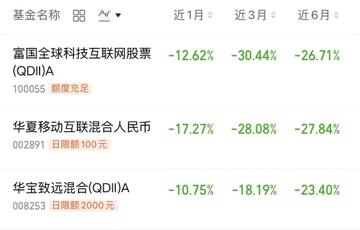  ⊳ （引用 @咬着一颗绿苹果）我小远-25，心痛啊

- (2026-11-19 18:12:09) 只有亚洲能和网易云音乐PK昨天了  ⊳ （引用 @该用户已过期）错觉🤣🤣我要跟你你赌1毛钱的💰

- (2026-11-19 18:16:32) 敏感东西 都发不出来的 少说为好  ⊳ （引用 @没有感情的村民）楼里怎么没人总结会晤

- (2026-11-19 18:20:10) 市场角度来，盘中九阳股份地天板走出极强辨识度，快速带动家电板块局部情绪回暖。本轮家电板块上涨更多属于存量资金下的高低切换，板块内部多数个股市值偏小、前期调整充分、位置偏低，博弈资金借成本改善、出口回暖的催化，发起一波独立性题材行情，但对于市场整体的带动作用有限。

个股层面来看，市场整体情绪依旧低迷，全市场超4800股收跌，逾百股跌停或跌幅超10%。前期高位人气标的负反馈得以延续，日出东方、金辰股份、亚玛顿、海洋王连续4日跌停；AI漫剧题材迎来集中退潮，文投控股、大晟文化、慈文传媒等走出三连跌停，短线高位博弈资金出逃意愿较强。

国产算力与半导体主线内部分歧显著加大，卡莱特冲击20CM3连板，真视通、华升股份顺利晋级，晶圆制造龙头华虹宏力、中芯国际同步大涨超6%，光刻胶分支热度延续，全筑股份、盛剑科技双双拿下3连板；

但另一方面，燧原科技、深圳华强、恒为科技跌停，拓维信息、神州数码等跌幅超9%。资金在算力上游设备、先进制造方向抱团，对前期涨幅较高的华为算力、算力芯片等方向承压明显。

当前市场暂未释放明确的转强信号，但盘中承接力量较前期有所回暖，叠加两市处于缩量调整状态，短期抛压得到持续释放，卖压逐步出清，指数具备一定短线修复基础，后续能否放量站稳5日均线，是判断短期修复成色的核心观测点。

盘面上，随着多数前期热点陆续退潮，半导体产业链承接了市场主要的交易热度，成为当下盘面活跃度最高核心赛道。因此该方向能否持续强化、带动板块内标的共振扩散，进而拉动大盘反弹，同样是衡量后续市场情绪与盘面强弱的关键。

- (2026-11-19 19:24:46) 网易云音乐打败了今天建信

- (2026-11-19 19:26:47) [图] 最近几个月小浦非常不错

- (2026-11-19 19:27:45) 边风炜：这一次保险资金割肉科技 重回红利 将会在未来非常非常非常长的时间里呆在红利里不会再出来 哪怕红利下跌

- (2026-11-19 19:33:20) 黄金好弱 美元大跳水 黄金都没反应😂  ⊳ （引用 @六倍做多退休）真的是不愧第一买入

- (2026-11-19 19:33:46) 比特币升破64000美元，日内涨1.49%

- (2026-11-19 19:38:29) 受Anthropic创纪录的首次公开募股（IPO）提振市场情绪影响，美股“七巨头”盘前交易普遍上涨，Anthropic股票预计将在正式上市后大幅高开。

纳斯达克100指数期货上涨2.3%，标普500指数期货上涨1.2%。

- (2026-11-19 19:38:49) 19:38:25 财联社11月19日电，拼多多美股盘前涨6%。(来自财联社APP)  ⊳ （引用 @monica）全民进入过日子时代，都不消费了属实是。

- (2026-11-19 19:40:19) 红利今年6月坐过了呀 🤣

我以为我女朋友提款机神话将在今年终结 

是我小看她了  ⊳ （引用 @华尔街之猪）那就呆在里面安心下跌吧 就像我们科技人在科技里做滑梯一下

- (2026-11-19 19:40:52) pdd业绩如果好 也会水果会很差哈哈

这次不好了就安心啦  ⊳ （引用 @速派女孩将发财）拼多多 美股盘前涨超5%，现报81.5美元。2026年Q3净利润295亿元，上年同期293.3亿元，市场预期261.75亿元。

- (2026-11-19 19:41:20) 其实可以的 香港够差了吧？IPO嗨翻天  ⊳ （引用 @momo）长江ipo还抬得上来？

- (2026-11-19 19:42:42) 拼多多盘前短线暴涨，现涨超9%。

这次是爆涨了

- (2026-11-19 19:44:43) 你们这种心态以后真的真的别碰题材了
垃圾就是这样的呀
之前都没经历过吗 看看6 7月奶茶怎么跌的😂  ⊳ （引用 @momo）😩现在到处都说小微盘要补跌 我们真的还有辣椒玩吗  怎么感觉会一潭死水

- (2026-11-19 19:47:38) 我和你说的6月 7月 三万亿哦  ⊳ （引用 @momo）主要是感觉缩量缩成这样都没活人了  下次不玩了😩😩😭😭😭

- (2026-11-19 19:49:14) 亚洲1.87%夺冠🏆

- (2026-11-19 20:33:33) 应该不一定吧 
今天4800家下跌哎  ⊳ （引用 @六倍做多退休）畅姐今天才跌0.66% 姐看来还是有很多科技😂 

## 🧠 投资风格分析
> 📏 增量更新指引：仅当今日发言确有新依据时才修订对应维度，无变化不强行重写；单维度修订建议 ≤150 字。

- 投资理念与方法：坚持机会成本与性价比比较，只赚份内的钱；对机构抱团与题材炒作保持警惕。重视场内ETF相对指数实际的「漏跌/漏涨」核算，逐日跟踪溢价与基准差值，认为下跌时抄底意愿推高溢价、上涨时溢价回落。操作上强调组合思维与内部调仓（「不叫割 是转换 内部调仓」），替换而非加仓，反对超计划加仓。
- 风险偏好：整体回避高波动、高拥挤的垃圾消费与微盘股，警惕机构抱团和题材炒作；对美股认可强势但持续跟踪纳指ETF溢价与漏跌。新增回避含权债基/固收+，认为“求稳”债基实则股性重；对1月垃圾股ST预告风险有纪律，主张1月不玩、1.15前撤。
- 交易与仓位：强调组合思维与内部调仓，卖出是为了腾挪资金买计划内标的，而非割肉；严格执行计划仓位，反对超载加仓。习惯条件单分批挂单、低吸不追高；认为钱少反而帮助执行纪律。会在预期风险前主动不加仓以控制暴露，但自认手贱难改、心里清楚。
- 心理特质：对波动与回撤高度钝化，自嘲“老垃圾人”，吃三个跌停家常便饭；面对翻绿不破防，强调心态与经历积累。会提醒他人不要因单日下跌心态失衡，并承认自己手贱但心里清楚，不会改。

> ⚠️ 本板块由 Actions 全自动增量更新（复用当日发言与今日总览），每次仅在内容足够支撑时才改动。

## 🏷️ 昵称映射表
### 📖 昵称规律（供 AI 判断新昵称时参考）
【昵称命名规律（用于推断未知新昵称）】
- 拼音首字母缩写：取标的/基金名汉字拼音首字母串（含数字代码），多为 ETF/股票代码口语化｜示例：yl=引力传媒｜zy=掌阅科技｜sj=视觉中国｜cc=华安文体健康混合｜C50=创业板50ETF｜k50=科创50｜kun=昆仑万维｜xhxc=新瀚新材｜zxfc=中欣氟材
- 小/老+姓氏代指：「小X」「老X」通常指姓 X 的标的或该标的的基金经理；「X兄弟」多为同系基金｜示例：小惠=惠发食品｜老莫=万家品质生活(莫海波)｜小华=华夏全球科技先锋(QDII)A｜小华兄弟=华夏移动互联(QDII)｜小浦=浦银安盛全球智能科技(QDII)A｜小广=广发全球精选(QDII)A｜小远=华宝致远(QDII)C｜招招=招商银行｜小德=德明利｜赵姨=兆易创新｜露露=泸州老窖｜空调=格力电器
- 戏称/黑话→题材板块：生活化比喻或黑话对应某个题材/板块，而非单一标的；出现时多指板块方向｜示例：卖国=PCB板块(英伟达AI链)｜爱国=国产自主(半导体设备/芯片)｜奶茶=易点天下｜老师=中文在线｜蓝色=蓝色光标｜宇航员=航空航天板块｜华子=华泰保兴安悦债券｜国际=国际复材｜巨无霸=长鑫科技等重大IPO
- 谐音/取字：昵称含标的名关键字（取一字或谐音），多为 A 股个股或基金简称｜示例：万华=万华化学｜东百=东百集团｜宝=保利发展｜讨饭/亚洲讨饭/建信新兴=建信新兴市场(QDII)A｜华宝zy=华宝致远(QDII)A
- 机构/基金经理昵称：以基金公司名、经理姓、或平台代称指代对应基金产品｜示例：周经理=中欧新趋势混合(LOF)A｜张经理=信澳匠心回报混合A｜网易云/音乐世家=富国全球科技互联网股票(QDII)A｜国富亚洲=国富亚洲机会股票(QDII)A｜国泰纳指=国泰纳斯达克100指数(QDII)｜易方达全球=易方达全球成长精选混合(QDII)A｜浦银安盛=浦银安盛全球智能科技(QDII)A

### 📋 已收录映射
| 昵称 | 对应名称 |
|------|----------|
| C50 | 创业板50ETF |
| cc | 双义：股票=中国长城 / 基金=华安文体健康混合（用户 11-05 指认） |
| k50 | 科创50 |
| kun | 昆仑万维 |
| sj | 视觉中国 |
| xhxc | 新瀚新材（用户确认；代码待核） |
| yl | 引力传媒 603598（对手盘，非他持仓）｜11-06 +37.15%；11-09 本月+37.79% |
| zxfc | 中欣氟材 |
| zy | 双义：他本人口径=603533 掌阅科技（用户 11-05 确认）；11-09 楼友两条『zy』按 16 元/电影语境指 600977 中国电影。引用必须带语境，不许收敛 |
| 万华 | 万华化学 |
| 东百 | 东百集团 |
| 亚洲讨饭 | 建信新兴市场混合(QDII)A |
| 保利发展 | 保利发展 |
| 华子 | 华子＝007540 华泰保兴安悦债券A（华泰保兴基金·安悦债券A类份额），满仓30年超长利率债的长债基金（用户 2026-11-16 确认，无歧义，不是歧义项）；00:42 楼友『华子今年战绩无敌吧』→他答『30超长债牛逼没办法』；13:47『纯利率债就是华子那种 不过华子满仓30债 有些是满仓5-10年』；**与460108不是同一只**：460108＝华泰柏瑞稳健收益债券C（他持有的纯利率债·重仓国开/农发/国债，见六基行），华子007540 是华泰保兴的长债基金，勿混 |
| 华宝 zy | 华宝致远混合(QDII)A |
| 华宝zy | 华宝致远混合(QDII)A |
| 卖国 | PCB、光模块、通信板块（英伟达AI产业链） |
| 周经理 | 中欧新趋势混合(LOF)A |
| 国富亚洲 | 国富亚洲机会股票(QDII)A |
| 国泰纳指 | 国泰纳斯达克100指数(QDII) |
| 奶茶 | 301171 易点天下（对手盘，非持仓）｜11-13 10:07『奶茶out 幸福人的底气是可以说芒果out』；当日 −6.72% |
| 宇航员 | 航空航天板块 |
| 宝 | 保利发展 |
| 小华 | 华夏全球科技先锋混合(QDII)A |
| 小华兄弟 | 华夏移动互联混合(QDII) |
| 小广 | 广发全球精选股票(QDII)A |
| 小德 | 德明利 |
| 小惠 | 惠发食品 |
| 小浦 | 浦银安盛全球智能科技(QDII)A |
| 小远 | 华宝致远混合(QDII)C｜只在盯，未证他持有 |
| 巨无霸 | 长鑫科技等重大IPO企业 |
| 建信新兴 | 建信新兴市场混合(QDII)A |
| 张经理 | 信澳匠心回报混合A |
| 招招 | 招商银行 |
| 易方达全球 | 易方达全球成长精选混合(QDII)A |
| 浦银安盛 | 浦银安盛全球智能科技(QDII)A |
| 爱国 | 国产自主（半导体设备/芯片制造） |
| 空调 | 格力电器 |
| 网易云 | 富国全球科技互联网股票(QDII)A |
| 老师 | 中文在线 |
| 老莫 | 万家品质生活混合A(519195) |
| 蓝色 | 300058 蓝色光标（广告组合，非他持仓）｜11-12 高 15.97＝20cm 涨停价、收 14.76 +10.89%（炸板）；10:21『他和蓝色 奶茶 sg他们是广告组合』 |
| 讨饭 | 建信新兴市场混合(QDII)A |
| 赵姨 | 兆易创新 |
| 赵哥 | 兆易创新 |
| 露露 | 泸州老窖 |
| 安安 | 安记食品 |
| 音乐世家 | 富国全球科技互联网股票(QDII)A |
| 老伯伯 | 铜冠铜箔 |
| nk | 纳指科技ETF景顺 159509（联接=景顺长城纳斯达克科技ETF联接A）｜11-06 A级：截图溢价率37.08% |
| bk | 标普信息科技LOF 161128（场外=易方达标普信息科技QDII-LOF）｜11-06 A级 |
| txx | 天下秀 |
| 媛媛 | 今世缘 |
| uu | 友友、网友们 |
| 温暖老师 | 某个特别牛逼的散户 |
| 余老师 | 余利，某牛逼投资者 |
| ycm | 粤传媒 002181｜11-09 12:12「非电影传媒就留给大家玩了 我一个都不会碰了」→ 推断已不持有 |
| 江老师 | 江琪（投资博主） |
| 水果老师 | 投资博主 |
| 小爱 | 我爱我家 |
| ty | 天娱数科 |
| bn | 博纳影业 |
| sy | 601595 上海电影｜**他空仓**（11-09 起未回接）；11-12 09:38『天天念叨sy的给你们机会了』＋09:41『现在-6给你们机会了哈』＋13:15『马上sy跌停 bn还要尊敬一下他』＋13:51『与此同时 sy跌停』＋14:00『sy历来以残暴虐杀手法闻名』；实测收 42.15 −9.99% 跌停 |
| CBS | 长白山 |
| 东哥 | 东百集团 |
| 芒果 | 300413 芒果超媒（对照，非持仓）｜11-13 14:01 本月涨幅 41.70% vs 幸福 53.76% →『幸福已经拉开芒果12%』＝12.06pp 精确命中；当日 −4.83% |
| 阿中 | 中国电影 |
| 欢欢 | 欢瑞世纪 |
| 雪人 | 雪人集团 |
| 大连 | 大连圣亚 |
| 幸福 | 幸福蓝海 |
| 小粤 | 粤传媒 |
| 阿博 | 博纳影业 |
| 创成长 | 创业板成长etf |
| asd | 002747 埃斯顿｜11-11 15:09『我昨天去的另外一个 今天也吸到asd了』＝11-11 低吸买入；11-12 10:17『我昨天加了asd今天刚刚加了另外个』＋10:35『asd火箭发射』（盘中高 32.19，收 29.95 −4.37%）；买价未披露。**11-11 轮误删、11-12 恢复** |
| 恋爱脑 | 002582 好想你｜11-12 14:39:31『清了恋爱脑』＝清仓（卖价未披露；10.48 卖单两日均未触及→手动卖）；14:28『我如果去掉恋爱脑 也就比你多一个机器人』；当日收 9.76 −2.89% |
| 恋爱 | 002582 好想你（同『恋爱脑』）｜11-12 14:39 已清仓，不再持有 |
| 小羊 | 000678 襄阳轴承｜11-05 已卖（卡当日最高 20.40）；11-12 14:16『襄阳掉了』＋14:44『厉害襄阳』＝只评论走势，非持仓 |
| 中马 | 中马传动 |
| 晶雪 | 晶雪节能 |
| xf | 幸福蓝海 |
| 建设 | 建设工业 |
| 北方 | 北方导航/北方国际（未定，11-04「我在北方了」） |
| _ambiguity_note | 歧义未收敛（禁止当唯一映射）：轮子=巨轮智能/五洲新春；sj=视觉中国（传媒语境）/神剑股份（宇航员语境）；cc=中国长城/华安文体健康混合；北方=北方导航或北方国际；zy=掌阅科技（用户 11-05 确认原值正确）。证据分级：A=价位/均线/月涨幅实测命中；B=量级或单日命中/用户口述；C=仅昵称或语义，不得据此写『他持有』；沿用原仓=本轮未复核，不写进结论正文。三条判据：①条件单四位数要先按同时段动词行判买卖方向（cbs 3644 是买单不是卖单）；②『祝福/你们/你的X』句式＝评论他人持仓，不是他的操作；③同一昵称在不同语境可指两只票（zy=掌阅/中影），按价位与板块取，不许收敛成一个。 11-11 补：plus雪＝他自己也没说清（11:12「你应该不知道plus雪是哪个」），不许猜；bdd＝有传媒属性所以他不去（13:42），仍未定案；『五连阳』这类盘中口径不等于日K实测（招行 11-06 为平盘十字星）。 11-12 补：①盘中快照≠收盘（14:15 三日账第三日 幸福+0.5/光线−4.5 为盘中值，收盘 −0.53/−4.97；他写的『拉开5.3%』按自列数字相加应为 5.5，属口算误差，不得据此推翻实测）；②历史卖单不重复计触发（中影 15.84 虽∈11-12 区间[15.39,15.98]，但 11-10 已成交、无存续卖单）；③清仓自述不封锁后续再买（asd 11-06 清→11-11 15:09 再吸，11-11 轮据此误删）；④『果果』只是推断映射，不得当持仓证据；⑤机器人第二仓与传媒低位10cm 代码未披露，福赛仅为楼友提问他作答，不许映射。 11-13 补：①**本月涨幅类口述可核**，基准＝10-30 收盘，且要用**发言时刻的分钟价**复算（14:01 截图 53.76% 与分钟线独立复算分毫不差，『拉开芒果12%』＝12.06pp）；②**基金表『折价率』列负号＝溢价**（513300 −15.28% ⇒ 溢价 15.28%，与 11-06 的 16.36% 同口径），别读成折价；③**『我手里就7只股票了/我只有电影冰雪了』是他题材仓口径**，不得据此删除无卖出自述的持仓行（铁律 6）；④**『全部跌停』类口述是盘中快照**（东方海洋盘中最低 4.64＝跌停价、收 −6.59%，未封死）；⑤plus雪＝晶雪只是**品种识别**，他 11-09 已自述清仓，不得当持有证据。 11-16补：①华子与460108是否同一只未定案（华子亦可能楼友昵称），不得据华子写他持有30债；②14:22『T掉追加的』对象歧义（主读法＝大连11-10加筆T，备选＝幸福老股T），无成交自述不改笔数；③博纳09:52『今天』与底仓口径冲突，加仓@6.37按09:45『加仓bn』＋09:46『-6』取；④『2开头招行』语义未定不映射；⑤华夏兄弟17:26裸报-2.5%证据不足不入表。 11-16补：①14:22『T掉追加的』对象歧义（主读法＝大连11-10加筆T，备选＝幸福老股T），无成交自述不改笔数；②博纳09:52『今天』与底仓口径冲突，加仓@6.37按09:45『加仓bn』＋09:46『-6』取；③『2开头招行』语义未定不映射；④华夏兄弟17:26裸报-2.5%证据不足不入表。 11-17补：①『太子爷』『bdd』『畅畅』未定案不映射；②雪人今日14.01加仓笔受T+1，14.84卖单卖的是可卖老仓（非当日买笔）；③晶雪25.64回落单他自述触发、日K高25.78证实（分钟接口H25.35偏低为已知不稳）；④光线11-17部分卖出@11.82按11-16追高笔推定(B)，仍持老仓；⑤传媒『以身入局』拒绝点名不外推代码。 11-17补：①『太子爷』『bdd』『畅畅』未定案不映射；②雪人今日14.01加仓笔受T+1，14.84卖单卖的是可卖老仓（非当日买笔）；③晶雪25.64回落单他自述触发、日K高25.78证实（分钟接口H25.35偏低为已知不稳）；④光线11-17部分卖出@11.82按11-16追高笔推定(B)，仍持老仓；⑤传媒『以身入局』拒绝点名不外推代码。 11-17补：①『太子爷』『bdd』『畅畅』未定案不映射；②雪人今日14.01加仓笔受T+1，14.84卖单卖的是可卖老仓（非当日买笔）；③晶雪25.64回落单他自述触发、日K高25.78证实（分钟接口H25.35偏低为已知不稳）；④光线11-17部分卖出@11.82按11-16追高笔推定(B)，仍持老仓；⑤传媒『以身入局』拒绝点名不外推代码。 11-18补：①雪人『兑现今天加的雪儿』受T+1，今日14.17买笔不可当日卖，兑现的是可卖老仓；②传媒『这周开干』拒绝点名不外推代码；③晶雪上週买回成本未披露、清仓收益不计算；④长白山(cbs)两笔成本36.44/38.8、同价33.65卖出。 |
| nana场内 | 513300 纳斯达克ETF华夏｜11-09 14:34「不愧是513300 当年的普通nana ETF之王」，当日唯一红的纳指ETF |
| 雪儿 | 雪人集团 002639｜11-06「大连和雪儿」＋11-11 14:26「雪儿今天不错啊 大家昨天不是期待他接人嘛 这个任务做到了今天」（接人＝5日线接回，与雪人条件单口径一致） |
| 存钱罐 | 光线传媒 300251（他自述小仓）｜11-13 15:11『我相信光虽迟但到 我会肯定保留上周的存钱仓位』＝存钱罐口径再次落到光线 |
| 枣子 | 002582 好想你（同『恋爱脑』）｜11-12 14:39 已清仓，不再持有 |
| 王老师 | 人：王博雅投资（QDII 场内溢价口径），不是标的 |
| 印度 | 自嘲代指中国（推断，勿当事实） |
| 10086 | 中国移动（他当指标用，非持仓） |
| 阳光乳业 | 001318 阳光乳业（他的『喝的』/牛奶）｜11-09 A级：13:59 分时截图 S 标记≈13.5＋10:52「我去掉了羊来抄底」 |
| 羊 | 生肖羊概念组（带阳/洋/光/太/泉的一篮子）｜11-09 14:04 他自己贴的分组；**11-13 崩盘实证**：15:58 截图跌幅榜 澳洋健康 −10.06、阳光照明 −10.05、红太阳 −10.04、大东方 −10.03、阳光乳业 −10.02、襄阳轴承 −9.98、鲁阳节能 −9.95、大西洋 −9.73、太阳电缆 −9.29、圣阳股份 −8.64、泉阳泉 −6.60、东方海洋 −6.59；他 14:48『我昨天起码说了6次 控制仓位 因为羊和东方昨天松动了！！！！这是情绪核心』 |
| 小明 | 605179 一鸣食品｜11-09 10:07 有人问『喝的小明？』他答『羊』＝喝的已换成阳光乳业 |
| 皇台 | 000995 皇台酒业｜11-09 与雪人 PK 当日换手率龙虎榜 |
| 海哥 | 人：转债估值博主（不是标的）｜11-09 12:48「海哥周五那个新债…我买了点试试看是市场错了还是海哥错了」 |
| 申菱转债 | 123290（申菱环境 301018 的转债）｜11-09 13:50 买 150 张 @133 多；11-10 11:20『我开了149.9』卖单；11-12 分钟线 10:03–11:12 持续≥149.9（高 152.313）→触发推定清仓，+12.28%（成本 133.5 推定）记入 stock_pnl，已从持仓表删除 |
| 盛天 | 300494 盛天网络｜11-11 A级：11:29 分时截图 B 标记 @11.00＋「不止 而且我跟了他一把」（跟摄像大哥） |
| dfhy | 002086 东方海洋｜11-11 13:56 楼友问 dfhy 绕异动→他『我没算 这几天可能都是异动吧』；11-12 14:39 涨停 5.16 卖出（＝4.69×1.10 到分＋分钟 14:36 封板＋财联社 17天9板）；**11-16 09:28『看东方海洋了』＋15:17『东方海洋上周四不好示范』＝买回探针仓 <2%**，羊仪表盘四图蓝高亮 002086，当日跌停收 4.34（昨 4.82）；探针非重仓 |
| xys | 300502 新易盛｜11-11 13:19「我那个买xys的女主播终于要开心了」＋13:21「她现在成本327了」→ **是女主播的仓，不是他的** |
| 冰山 | 000530 冰山冷热｜11-11 10:16「万一冰山跌停 他能跌到哪里再去」＋10:27「今天把冰山 晶雪按死 大连 CBS 正统上位」（非持仓，冰雪板块的山寨对照） |
| 冰冰 | 000530 冰山冷热｜11-11 14:03「那冰冰准备」（同『冰山』，非持仓） |
| 龙版 | 605577 龙版传媒｜11-11 11:50「最早龙版也是因为自己每次公告文案都不一样才4连板就被监管」（讲监管规则，非持仓） |
| 3300 | 513300 纳斯达克ETF华夏｜11-11 10:49「3300还行 不过今天我不满意」＋13:24「咱们3300还是近期数据最好的」 |
| nana100 | 纳斯达克100指数（他对照场内ETF溢价的基准）｜11-11 08:14「昨天513300涨了3.53% 但是nana100实际也就涨了3.4」 |
| 易中天 | 新易盛＋中际旭创＋天孚通信（CPO三巨头合称）｜11-11 14:13「都去易中天了🤣」（非持仓） |
| 冰雪双子星 | 大连圣亚600593＋长白山603099（他的正牌冰雪双仓）｜11-11 10:29「从不担心冰雪双子星」 |
| 2000 | 中证2000指数（他当微盘股基准）｜11-11 11:11「除了机器人 今天其他题材全输给了2000」 |
| cw | CoreWeave（CRWV，美股AI算力）｜11-11 11:18「cw那玩意硬起来了 大家看夜盘数字」 |
| ant | Anthropic（美股IPO）｜11-11 12:11「接下来是不是ant IPO也是利好」 |
| 摄像大哥 | 人：楼友（不是标的）｜11-11 他的两笔游戏＝电魂网络涨停＋顺网科技≈+7，属楼友口径；楼主自己买的是盛天网络＋另一只未披露代码的游戏 |
| 游戏哥哥 | 游戏板块拟人化（不是具体票）｜11-11 12:58「游戏哥哥：我来也」＋13:01「妹妹休息 哥哥接力？」 |
| 传媒妹妹 | 传媒板块拟人化（不是具体票）｜11-11 11:40「被传媒妹妹压制了」＋13:01「妹妹休息 哥哥接力？」 |
| sg | 002400 省广集团（广告组合，非他持仓）｜11-12 A级映射：10:09:32『省广带起来了』＋10:21:36『他和蓝色 奶茶 sg他们是广告组合』；分钟线 10:00 6.70→10:09 6.89→10:21 6.94（昨收 6.70）命中『带起来』；当日收 6.64 −0.90%（冲高回落） |
| 果果 | 301052 果麦文化（**推断·B**，非持仓）｜11-12 13:05:01『果果紧随其后了』紧接 13:04:34『传媒出现两位数跌幅了 华策』；实测华策 −13.97%、果麦 −10.38% 同为两位数跌幅→谐音＋当日跌幅与语境命中；未见他自述买卖，不得当持仓证据 |
| 老登 | 机构抱团的老牌权重（白酒/消费/地产一类，**不是单只票**）｜11-12 07:51:44『如果这些资金回去重新抱团 最近涨起来的老登们非常危险…老登后续又要惨遭抛售 比如昨天大跌的白酒』 |
| plus雪 | 301010 晶雪节能（**B·推断；11-16 已买回持有**）｜11-13 10:04『plus雪是-20的…还能再跌-10』＝20cm，实测当日 −10.10%；15:25 答『多少出』报 24.94＝11-05 老卖单价（当日高 24.92 差 2 分未触及）；11-09 曾自述清仓 → **11-16 09:39『上周买了plus』＋14:53『掌声雪儿plus雪』＝上周买回、重新持有**；11-16 卖单 24.94 沿用，当日高 24.39 未触及；持仓屏 13:42:36 晶雪 23.110 |
| 复仇者联盟 | 电影档期锚（不是标的）｜11-13 10:18『复仇者联盟没有到来 全都不会清仓』＋10:29『复仇者联盟是12月的 流浪地球要2月』＝他把电影仓的兑现条件挂在片单档期上 |
| 流浪地球 | 电影档期锚（不是标的）｜同上，10:29『流浪地球要2月』 |
| nana | 纳斯达克100 指数（他用来对照场内 ETF 溢价/涨幅的基准，非标的）｜11-13 00:16『今天图上看 nana依然是大阳线』＋07:57『昨天-0.7收盘 但是nana晚上其实只有-0.3 现在期货+0.5 今天场内应该开盘+0.9%』→ 实测 513300 开盘 2.710＝+0.82%（误差 0.08pp） |
| 千红转债 | 楼友中签的新债（**不是他的标的**）｜11-13 09:17 他教对方『9:30就130停牌了 开个闹钟 14:56上号』『就是最后14:57去挂』＝转债上市首日尾盘挂单卖法 |
| 文投控股 | 600715（院线·他只在盯，非持仓）｜11-13 09:33 传媒板块截图 +10.03% 涨停、本月涨幅 66.67%（＝10-30 收盘基准独立复算分毫不差）；配 09:33『市场有转院线迹象』 |
| 华智数媒 | 300426（传媒·他只在盯，非持仓）｜11-13 本月涨幅榜第一（09:47 截图 78.91%／14:01 74.11%） |
| 横店影视 | 603103（院线·非持仓）｜11-13 09:33 截图 19.31 +10.03% 涨停，与文投/金逸并列＝『转院线迹象』的另外两票 |
| 金逸影视 | 002905（院线·非持仓）｜11-13 09:33 截图 9.90 +10.00% 涨停 |
| 日出东方 | 603366（羊字辈·情绪核心，非持仓）｜11-13 15:58『尤其今天表态的日出东方 别周一又跌停躺平了』；实测 +5.54%、最高 14.21 距涨停 14.49 一步 |
| plus | 301010 晶雪节能（上周买回、11-16 持有）｜09:39『上周买了plus』＋14:53『掌声雪儿plus雪』；卖单 24.94 沿用 11-05 老价，当日高 24.39 未触及 |
| 东方海洋 | 002086（＝dfhy）｜11-16 买回探针仓 <2%，当日跌停收 4.34（昨 4.82）；11-12 曾涨停 5.16 卖出；09:28『看东方海洋了』＋15:17『东方海洋上周四不好示范』 |
| 晶雪节能 | 301010（＝plus/plus雪）｜11-16 持有，卖单 24.94 未触及（高 24.39）；持仓屏 13:42:36 晶雪 23.110 |
| gjd | 国家队（推断 B）｜11-16 15:19/16:42 护盘语境，非具体标的 |
| plu | 人物·永远看空印度的博主（非标的）｜11-16 19:11『他永远看空印度的…924一开始他也看空的 不过他就一点好 看错了马上改』 |
| 华夏兄弟 | ＝小华兄弟·华夏移动互联混合(QDII)（推断·证据不足不入表）｜11-16 17:26 裸报 -2.5% 疑似场外持有，无第一人称买入/持有自述、无截图 |
| cbs | 长白山 603099（CBS黑话；11-18 已清仓卖出） |

> ⚠️ 以下为 LLM **建议**，未自动写入状态文件。请人工确认后，本地编辑 `state.json` 的 `nickname_map` / `positions`，或 `nickname_rules.json` 的 `rules` 并 push 生效。

*🤖 自动生成于 2026-11-19 21:33:17 ｜ 豆瓣楼主发言追踪*