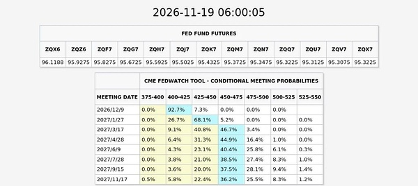
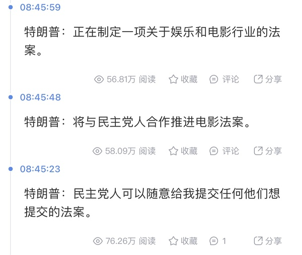
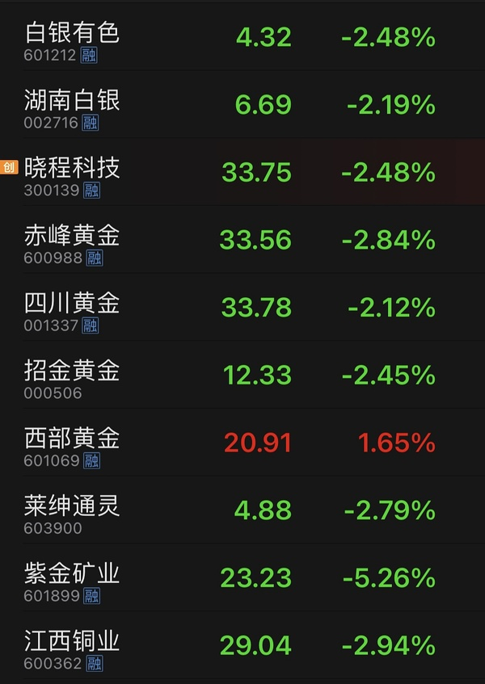

# 📋 楼主每日发言推送

> **推送日期**：2026-11-19 ｜ **执行时间**：2026-11-19 11:02:21 ｜ **监控用户**：`不知道还能说啥`
> **追踪模式**：`topic`（用户主页广播·豆瓣话题）

## 📊 持仓追踪
> 上次更新：2026-11-19 ｜ 基于楼主发言持续追踪（共 15 项）

| 标的 | 状态 | 类型 | 现价 | 提及 |
|------|------|------|------|------|
| 招商银行 | 底仓·四年前 32 元×7000 股买入·四年分红未复投仍 7000 股·不动 | 红利/银行 | 43.23（0.26%） | 底仓·不动；7000股/摊薄成本约24.27元（原…；成本约32元 |
| 大连圣亚 | 持有 5 笔＋11-18 加仓 1 笔@37.74·卖单 46.90/45.22 未触及 | 冰雪·正牌双子星 | 32.47（-9.60%） | 11-18 14:15『今天接的大连开单』→『37… |
| 雪人集团 | 持有·11-18 条件单加仓@14.17（低14.10成交）·明日 14.2 以下再买·卖单 1484/1584 继续 | 冰雪·交易仓 | 13.33（-8.20%） | 11-18 14:48『我今天就是条件单买到14.… |
| 幸福蓝海 | 持有·今日换仓买入 1 笔@≈15.50（09:43）＋11-16 笔@16.91·明日卖单 15.84（由 18.64/20.44 下移） | 电影 | 13.81（-4.30%） | 持有（11-16@16.91＋11-17换仓@15… |
| 中国电影 | 持有·剩余仓无单·锁仓『慢就是快』 | 电影·核心不动仓 | 15.36（0.33%） | 持有·锁仓无单；11-18 -0.13%（电影里最… |
| 光线传媒 | 持有·今日部分卖出@11.82（-4.3% 换仓入幸福）·仍持上周老仓 | 电影·低位备选 | 10.83（-2.96%） | 持有·老仓（11-17换仓卖出11-16追高笔后仍… |
| 博纳影业 | 持有小仓·今日跌停 5.69（=6.32×0.9）·卖单 6.94 未触及（高 6.22）·明日买 614 计划 | 电影 | 5.16（-5.67%） | 持有小仓；11-18 -3.87%；卖单6.94未… |
| 纳斯达克ETF华夏 | 持有·不卖场内（溢价品种）·开盘预测 -1.5% 落空他自己认赖皮 | QDII·场内纳指 | 2.626（-0.08%） | 持有·不卖场内；11-18 +0.84%逆势红；1… |
| 中韩半导体ETF | 持有·今日无动作自述 | QDII·场内 | 3.581（-0.25%） | 持有；11-18 +1.99%逆势红；13:27『… |
| 盛天网络 | 11-11 买入·持有（口径仍待确认） | 游戏·电竞 | 8.65（-4.42%） | 持有（口径待确认，无卖出自述）；11-18 -4.… |
| 游戏自建仓 | 11-10 买入·持有·11-11 自述 +5%（时点值未更新） | 游戏·电竞 | 暂无 | 持有·11-17曾「今天机器人都割了」但游戏自建仓… |
| 美债场外基金 | 持有·国庆前买入·11-11 自述 +1.4%（时点值未更新）·债灾自述接近转亏 | 场外·美债 | 暂无 | 持有·国庆前买入；11-18 15:02『今天大家… |
| 传媒低位10cm | 11-12 自述『只加一个低位的』＋11-16 14:22『我要去买一个传媒了』（是否执行无自述）·拒绝点名 | 传媒·低位 | 暂无 | 持有并加仓；11-18 15:43『我都用实际行动… |
| 东方海洋 | 11-16 买入探针仓 <2%·无卖单自述·当日跌停（11-12 曾涨停 5.16 卖出，见 day_actions_1112） | 探针·羊情绪组 | 3.46（-7.24%） | 11.16；探针仓<2%·持有；11-18 跌停收3.73（=… |
| 六只债券基金 | 持有·00:38『这些我都有 第二个和第三个在这轮中灾难中经受住了考验』·债灾自述实亏·『债持不炒，每调买机』 | 场外·债基 | 暂无 | 11.16；持有；11-18 13:29『债跳大水』；15:0… |

> ⚠️ 执行任务时如发现新操作，请更新 `state.json` 的 `positions`。成本价和市值有数据才填，没有则保留「暂无」。

## 🌅 今日总览
### 📌 市场背景
今日市场整体处于微盘情绪主导、消息面钝化的状态。楼主明确指出「现在是微盘情绪问题 消息面暂时都没用」，并观察到全球大类资产同步承压：「黄金跌 白银跌 币跌 然后原油跌的更起劲了」。海外方面，美股期货反弹带动纳指强势，称「nana昨天晚上看得我都感动了」，同时关注Anthropic IPO定价83美元/股、规模扩至9.8亿股的消息。国内方面，两市融资余额减少87.68亿元，资金面偏谨慎；盘中两万亿特别国债小作文被证伪，10年国债收益率一度上至1.599%。

### 📌 今日操作
（本次 LLM 未产出，建议重跑）

### 📌 今日议题
请输入楼主今日发言内容

### 📌 看好板块/方向
（本次 LLM 未产出，建议重跑）

### 📌 风险提示
（本次 LLM 未产出，建议重跑）

## 📊 本次结果
- **今日发言**：94 条
- **累计存档**：22519 条

## 📝 该最新广播作者发言聚合（共 94 条）
### 其他讨论（提及 71 次，占比 76%）2026-11-19 00:07:12
- 厉害啊
- 😂😂😂😂
- 现在是微盘情绪问题 消息面暂时都没用

### 长白山 603099（CBS黑话；11-18 已清仓卖出）（提及 7 次，占比 7%）2026-11-19 09:35:23
- 昨天我卖cbs是为了今天买雪儿的

双向奔赴了
- 今天手动赢了🤣🤣🤣🤣 不过我也13.5 还没回本

雪儿看我昨天为了迎接他 卖了cbs 太激动了 双向奔赴太激动
- 先跌停的果然是cbs 不是大连😂

### 纳斯达克100 指数（他用来对照场内 ETF 溢价/涨幅的基准，非标的）｜11-13 00:16『今天图上看 nana依然是大阳线』＋07:57『昨天-0.7收盘 但是nana晚上其实只有-0.3 现在期货+0.5 今天场内应该开盘+0.9%』→ 实测 513300 开盘 2.710＝+0.82%（误差 0.08pp）（提及 5 次，占比 5%）2026-11-19 01:20:16
- 今天晚上nana看得令人感动 
大类资产一片绿 nana坚韧不屈
- nana昨天晚上看得我都感动了
就像一个富公子去了非洲难民营依然气质在线😂
- 沃勒那个🐶 昨天把黄金和B全部干崩了
nana艰难守住了自己😂😂😂😂😂😂😂😂

### 513300 纳斯达克ETF华夏｜11-11 10:49「3300还行 不过今天我不满意」＋13:24「咱们3300还是近期数据最好的」（提及 2 次，占比 2%）2026-11-19 00:37:02
- 然后场内3300他就看白天的

晚上正式盘跌了他就不算了🤣🤣🤣🤣🤣🤣🤣
- 来计算3300今天开盘了
如果1.65%不要了提升溢价

昨天期货三点收盘0.6 晚上实际nana收盘0.4 
少0.2
但是现在期货+0.9

合计+0.7

![图片](https://raw.githubusercontent.com/homjanon/douban-tracker/main/data/images/2026-11-19/d0ec6bf8c8

### 雪人集团 002639｜11-06「大连和雪儿」＋11-11 14:26「雪儿今天不错啊 大家昨天不是期待他接人嘛 这个任务做到了今天」（接人＝5日线接回，与雪人条件单口径一致）（提及 2 次，占比 2%）2026-11-19 09:25:56
- 雪儿还是双向奔赴😂
- 雪儿11.2日也是-9.5开盘 拭目以待

### 建设工业（提及 1 次，占比 1%）2026-11-19 08:13:05
- 昨天午后传：要发行两万亿特别国债支持人工智能基础设施建设；信用债ETF直线跳水，10年上至1.599%，30年上至2.052%；

盘后这一条小作文已被证伪

### 保利发展（提及 1 次，占比 1%）2026-11-19 08:14:33
- ETF追踪丨11月18日股票型ETF净申购119亿元 资金加仓沪深300ETF华泰柏瑞

股票型ETF中，当日净申购前3依次为：沪深300ETF华泰柏瑞，净申购54.36亿元；创业板ETF易方达，净申购50.08亿元；沪深300ETF华夏，

### 大连圣亚（提及 1 次，占比 1%）2026-11-19 09:39:35
- 大连自己跌下去的 😂

### 605577 龙版传媒｜11-11 11:50「最早龙版也是因为自己每次公告文案都不一样才4连板就被监管」（讲监管规则，非持仓）（提及 1 次，占比 1%）2026-11-19 09:40:44
- 龙版火箭发射

### 000530 冰山冷热｜11-11 10:16「万一冰山跌停 他能跌到哪里再去」＋10:27「今天把冰山 晶雪按死 大连 CBS 正统上位」（非持仓，冰雪板块的山寨对照）（提及 1 次，占比 1%）2026-11-19 09:48:17
- 襄阳把冰山打开了

### 友友、网友们（提及 1 次，占比 1%）2026-11-19 09:53:14
- 你还记得uu之前还反问我
为什么不直接买核心
这次我做了

### 东百集团（提及 1 次，占比 1%）2026-11-19 10:02:42
- 去年东哥不是三连跌停才启动的吗

正常啊

### 📄 全部发言（共 94 条）
- (2026-11-19 00:07:12) 厉害啊  ⊳ （引用 @VVV坚定持有VVV）第一！

- (2026-11-19 00:07:17) 😂😂😂😂  ⊳ （引用 @吃五包螺蛳粉）连续刷新楼主页20次都没抢到第一 楼上两位太强了

- (2026-11-19 00:20:25) 现在是微盘情绪问题 消息面暂时都没用  ⊳ （引用 @康贝瑞拉）这个对传媒算利好吗

- (2026-11-19 00:22:02) 造孽啊 是真不能回到家啊😂😂😂

那黄金是要和我们科技比赛？

- (2026-11-19 00:35:39) 这个是有什么说法吗😂  ⊳ （引用 @qiu啾）下周黑色星期五，会再现辉煌吗

- (2026-11-19 00:37:02) 然后场内3300他就看白天的

晚上正式盘跌了他就不算了🤣🤣🤣🤣🤣🤣🤣  ⊳ （引用 @超幸運小行星✨）现在老美都是盘前涨开盘就跌吗

- (2026-11-19 01:19:04) 最近原油都加入循环保证金行列了 太神奇了
黄金跌 白银跌 币跌 然后原油跌的更起劲了😂  ⊳ （引用 @点-重生炒垃圾）真实服了vix打到30好吗？天天在这干嘛呢。摸鱼

- (2026-11-19 01:20:16) 今天晚上nana看得令人感动 
大类资产一片绿 nana坚韧不屈

- (2026-11-19 07:49:24) nana昨天晚上看得我都感动了
就像一个富公子去了非洲难民营依然气质在线😂  ⊳ （引用 @moli）昨天道指跌得猛，全球医疗俯冲。娜娜万绿丛中一点红。

- (2026-11-19 07:50:25) 一关关过 本周第二关

美国股指期货上涨 Anthropic已将IPO价格定在推介区间之上
美国股指期货于亚洲早盘上涨。Anthropic已将IPO价格定在每股83美元，高于此前推介区间，而且IPO规模扩大至9.8亿股，从而将成为有史以来最大一宗IPO。标普500指数指数期货上涨0.45%，纳斯达克100指数期货上涨0.97%。

- (2026-11-19 07:55:40) [图] 来计算3300今天开盘了
如果1.65%不要了提升溢价

昨天期货三点收盘0.6 晚上实际nana收盘0.4 
少0.2
但是现在期货+0.9

合计+0.7

- (2026-11-19 08:00:21) 100时安全😂去年起初我是100买白银的

但是因为我们没有空
下行时我们做不了

因为可以黄金跌更多完成
而不是白银补涨

去年是白银补涨 因为上涨趋势
现在下跌趋势 可以黄金补跌修复  ⊳ （引用 @moli）之前这个时候，是空黄金多白银？

- (2026-11-19 08:01:11) 优秀啊🤣🤣  ⊳ （引用 @招招碎片收集中）我有笔记！！！

- (2026-11-19 08:01:45) 这几天白银大跌特跌造成的金银比大增  ⊳ （引用 @🅰失而复🉐😎）和价格成反比啊😇

- (2026-11-19 08:02:58) [图] 12月
92.7%加息25 
7.3%加息50

依然定价三次加息

- (2026-11-19 08:04:36) 美债回落到4.80 接近4.75 基本也是没有定价第四次  ⊳ （引用 @不知道还能说啥）12月
92.7%加息25 
7.3%加息50

依然定价三次加息

- (2026-11-19 08:06:35) 沃勒那个🐶 昨天把黄金和B全部干崩了
nana艰难守住了自己😂😂😂😂😂😂😂😂  ⊳ （引用 @不知道还能说啥）美债回落到4.80 接近4.75 基本也是没有定价第四次

- (2026-11-19 08:13:05) 昨天午后传：要发行两万亿特别国债支持人工智能基础设施建设；信用债ETF直线跳水，10年上至1.599%，30年上至2.052%；

盘后这一条小作文已被证伪

- (2026-11-19 08:14:33) ETF追踪丨11月18日股票型ETF净申购119亿元 资金加仓沪深300ETF华泰柏瑞

股票型ETF中，当日净申购前3依次为：沪深300ETF华泰柏瑞，净申购54.36亿元；创业板ETF易方达，净申购50.08亿元；沪深300ETF华夏，净申购33.10亿元。

股票型ETF当日净赎回前3为：银行ETF华宝，净赎回5.26亿元；科创50ETF华夏，净赎回4.76亿元；中证1000ETF广发，净赎回4.34亿元。

- (2026-11-19 08:16:13) 美债会提示的🤣到时候会快速下行 因为只要接近最后次 市场马上会开始预期降息启动  ⊳ （引用 @招招碎片收集中）我比较好奇怎么能确认是最后一次加息了，美股猛攻不再防守吗？

- (2026-11-19 08:17:44) 咱们可没空管他们了
希望nana继续做贵公子 不要和难民同流合污  ⊳ （引用 @🅰失而复🉐😎）又开始跳了，柔弱不堪🫣

- (2026-11-19 08:18:34) ……………  ⊳ （引用 @sickid）高考，延时开盘

- (2026-11-19 08:46:31) 纳斯达克期货提升至1.3%  ⊳ （引用 @不知道还能说啥）来计算3300今天开盘了
如果1.65%不要了提升溢价

昨天期货三点收盘0.6 晚上实际nana收盘0.4 
少0.2
但是现在期货+0.9

合计+0.7

- (2026-11-19 08:48:15) [图] 他现在在深圳吧？这是发推？

- (2026-11-19 08:48:30) 现在总没有答记者问吧  ⊳ （引用 @不知道还能说啥）他现在在深圳吧？这是发推？

- (2026-11-19 08:57:52) 😂  ⊳ （引用 @六倍做多退休）民主党说上供350亿美元就给建数据中心😂

- (2026-11-19 08:58:21) 两市融资余额减少87.68亿元
截至11月18日，上交所融资余额报11486.98亿元，较前一交易日减少32.91亿元；深交所融资余额报10523.05亿元，较前一交易日减少54.77亿元；两市合计22010.03亿元，较前一交易日减少87.68亿元。

- (2026-11-19 09:02:55) 我没钱  ⊳ （引用 @不要熬夜）今天除了雪人14.2，还有啥单子吗？翻了好久没翻到🥹

- (2026-11-19 09:03:15) 阿克曼建仓英伟达了吗  ⊳ （引用 @去他喵的大a）阿克曼狂喷，开始搞董事会？

- (2026-11-19 09:06:50) 昨天我看有uu卖nana买冰雪了😂不知道这个决策是牛逼还是错误  ⊳ （引用 @🅰失而复🉐😎）今天T0高开了🤣

- (2026-11-19 09:07:30) 我昨天开的0.1😂  ⊳ （引用 @🅰失而复🉐😎）楼雪人这个反弹买入单这样开？

- (2026-11-19 09:08:32) 这已经是第二次沃勒说加息50
黄金大跌 美债不予理会了

黄金自己也很脆弱

- (2026-11-19 09:10:00) 这时候没人说央行买买买买了🤣  ⊳ （引用 @👑）黄金现在属于空头绝对强势的一方

- (2026-11-19 09:12:17) 现在很多时候都同向了😂😂😂😂  ⊳ （引用 @🅰失而复🉐😎）跳了又去拉油了😇

- (2026-11-19 09:16:58) 一定要跌的多才要😂

那个-5 -6不好下手

毕竟很容易-10开外  ⊳ （引用 @🅰失而复🉐😎）那个雪人加大板不要了？

- (2026-11-19 09:18:38) 竞价全是疯子 看晕了

- (2026-11-19 09:18:50) 一会儿跌停一会儿涨停的 滑稽啊  ⊳ （引用 @不知道还能说啥）竞价全是疯子 看晕了

- (2026-11-19 09:20:03) 那玩意-16有种别扯单  ⊳ （引用 @🅰失而复🉐😎）大连🤣

- (2026-11-19 09:25:56) 雪儿还是双向奔赴😂

- (2026-11-19 09:26:43) 传媒是不是就慈文和横店是三连板了？

- (2026-11-19 09:27:25) 竞价就买上啦？我还没 要靠自己双手了  ⊳ （引用 @momo📈📈📈）我捡了，给点甜头好吗

- (2026-11-19 09:34:02) 今天是悠哉悠哉买完这个买那个

- (2026-11-19 09:34:55) 小伙伴 我哪有钱啊  ⊳ （引用 @冰雪go）楼，大连买了吗？

- (2026-11-19 09:35:23) 昨天我卖cbs是为了今天买雪儿的

双向奔赴了  ⊳ （引用 @冰雪go）楼，大连买了吗？

- (2026-11-19 09:35:44) 中影漂亮

- (2026-11-19 09:36:02) 今天搞成了差不多5+5  ⊳ （引用 @冰雪go）你难道是单挑雪人？

- (2026-11-19 09:36:48) 留着呗  ⊳ （引用 @冰雪go）和我一样诶，就是我手里还有一份多出来的，不知道要给谁

- (2026-11-19 09:39:35) 大连自己跌下去的 😂  ⊳ （引用 @西西西西）⛄️大连1:1？

- (2026-11-19 09:40:44) 龙版火箭发射

- (2026-11-19 09:40:52) 你觉得可能吗  ⊳ （引用 @该用户已过期）你没去plus ？

- (2026-11-19 09:41:23) 漂亮机器人来了
这是新号
他们最先调整

- (2026-11-19 09:41:43) 襄阳带着大体量托普一起  ⊳ （引用 @不知道还能说啥）漂亮机器人来了
这是新号
他们最先调整

- (2026-11-19 09:42:50) 襄阳带起大批跌停打开  ⊳ （引用 @不知道还能说啥）襄阳带着大体量托普一起

- (2026-11-19 09:43:56) 襄阳触及涨停  ⊳ （引用 @不知道还能说啥）襄阳带起大批跌停打开

- (2026-11-19 09:44:54) 你可以降低今天要求  ⊳ （引用 @Molis）雪儿还是1484吗

- (2026-11-19 09:47:05) 机器人带的😂  ⊳ （引用 @🅰失而复🉐😎）拉电影了

- (2026-11-19 09:48:17) 襄阳把冰山打开了  ⊳ （引用 @🅰失而复🉐😎）21买了一手晶😇

- (2026-11-19 09:50:47) 我说过的核心  ⊳ （引用 @🅰失而复🉐😎）楼快说你到底去哪浪了，今天红的可以说啦吧

- (2026-11-19 09:51:46) 如果后面回忆这轮谁是救世主

就是 襄阳

- (2026-11-19 09:52:08) 一己之力激活了各路跌停票  ⊳ （引用 @不知道还能说啥）如果后面回忆这轮谁是救世主

就是 襄阳

- (2026-11-19 09:52:49) 核心只有他
我之前说过的 都是看他吃饭  ⊳ （引用 @该用户已过期）那不就是龙版

- (2026-11-19 09:53:14) 你还记得uu之前还反问我
为什么不直接买核心
这次我做了  ⊳ （引用 @该用户已过期）那不就是龙版

- (2026-11-19 09:54:42) 😂😂说明上半段非常努力 没事还有下半段  ⊳ （引用 @momo）本月收益率就像瀑布一样没了😭

- (2026-11-19 09:57:15) 应该是襄阳牛逼
都是他带动的  ⊳ （引用 @点-重生炒垃圾）龙版牛逼啊

- (2026-11-19 09:59:19) 襄阳在跨年妖股里率先占据优势😂😂😂  ⊳ （引用 @速派女孩将发财）微盘股要翻红了 

- (2026-11-19 10:02:42) 去年东哥不是三连跌停才启动的吗

正常啊  ⊳ （引用 @momo📈📈📈）三个多地板，能熬住也不容易耶，羊这大起大落的

- (2026-11-19 10:05:09) 雪儿11.2日也是-9.5开盘 拭目以待  ⊳ （引用 @该用户已过期）电影冰雪咋还玩此消彼长呢

- (2026-11-19 10:07:24) 今天手动赢了🤣🤣🤣🤣 不过我也13.5 还没回本

雪儿看我昨天为了迎接他 卖了cbs 太激动了 双向奔赴太激动  ⊳ （引用 @该用户已过期）它今天不扭就好了🤣条件单买太高了

- (2026-11-19 10:08:46) 先跌停的果然是cbs 不是大连😂

- (2026-11-19 10:09:28) 襄阳啊 今天他带的  ⊳ （引用 @sickid）除了九阳没有活口

- (2026-11-19 10:14:26) 不是1026
你得希望是11.2日 -9.5的早上

大家那天也都买了  ⊳ （引用 @-却行）雪儿能不能再现一下1026

- (2026-11-19 10:16:17) 由于今天两笔cbs都搬去雪儿
所以今天有三个单子
1384 1484 1584

- (2026-11-19 10:17:17) 由于今天两笔cbs都搬去雪儿
所以今天有三个单子
1384 1484 1584  ⊳ （引用 @一切都会过去的）今天买的挂多少哇

- (2026-11-19 10:19:15) 11.2日都不这样  ⊳ （引用 @YuanZi💕）做梦一下 希望是15.84😂

- (2026-11-19 10:28:05) 别忘了开单子  ⊳ （引用 @不知道还能说啥）由于今天两笔cbs都搬去雪儿
所以今天有三个单子
1384 1484 1584

- (2026-11-19 10:30:03) 我忘了天普停牌三天期 今天才复牌

所以动手早了一天半  ⊳ （引用 @稀里不糊涂）这是不是楼昨天说的，早盘最好不要拉，等下午来？

- (2026-11-19 10:31:49) [图] 这是怎么回事😂

- (2026-11-19 10:32:11) 祝你来回赚两次  ⊳ （引用 @钱多多多多多）卖了恋爱脑，去了雪儿。

- (2026-11-19 10:37:05) 昨天发了3774
你们有人今天又买的 自然不能这个  ⊳ （引用 @mimimomo）大连的呢有吗🥹

- (2026-11-19 10:38:27) 涨停刚回本😂  ⊳ （引用 @shirla）原来传媒是龙版！

- (2026-11-19 10:40:46) 我没看 我没买 
你有几个点利润就撤出呗

我再强调下
本来计划是多少 不要超载

我昨天示范了 我要买雪儿买大连
那我就不得不清掉cbs

并没有提高冰雪  ⊳ （引用 @mimimomo）那今天买的开哪个？

- (2026-11-19 10:42:01) 没有 周期转折中  ⊳ （引用 @🅰失而复🉐😎）走了没

- (2026-11-19 10:43:29) 你也很牛逼😂😂😂😂😂  ⊳ （引用 @🅰失而复🉐😎）那我要去了🫣

- (2026-11-19 10:48:32) 😂  ⊳ （引用 @六倍做多退休）哎 市场资金也在打架 有的想拉妖股 有的想拉科创 红利自己岁月静好 其他的边角料就是一脚踢开

- (2026-11-19 10:50:10) 因为每年这个时候也很绝望
三周周期到了

你平时不玩垃圾 我老垃圾人  ⊳ （引用 @稀里不糊涂）楼，你真的好淡定，我都快急死了，这盘面看着真让人绝望

- (2026-11-19 10:51:48) [图] 都是一模一样剧情而已

去年此时此刻在小慧挨打

  ⊳ （引用 @稀里不糊涂）楼，你真的好淡定，我都快急死了，这盘面看着真让人绝望

- (2026-11-19 10:53:15) 很正常 去年小慧和一群食品就是七连跌八连跌

因为福建导致崩盘  ⊳ （引用 @稀里不糊涂）从上周四就开始挨打了，已经7天了。。。

- (2026-11-19 10:53:45) 那个海光是因为啥？

- (2026-11-19 10:54:03) 没钱  ⊳ （引用 @钱多多多多多）楼主，昨天sy买了观察，今天还有操作不？

- (2026-11-19 10:55:16) 事实证明 危难时刻cbs没有防守价值
昨天选择并没错 他们是一样的😂😂😂
由于昨天尾盘卖cbs 今天接雪儿还少亏了两笔钱  ⊳ （引用 @稀里不糊涂）楼选择进攻了，换到雪人和长白山了

- (2026-11-19 10:55:38) 😂😂😂😂😂😂😂😂😂

- (2026-11-19 10:56:26) [图] 感觉还行哎

  ⊳ （引用 @miumiu）今天金属按的好死啊。。。这几个月死拿买什么都亏光裤衩啊

- (2026-11-19 10:57:15) 如果我钱还有很多 利润还有很大 我应该不会这么做😂钱少的好处 被迫执行纪律  ⊳ （引用 @shirla）非常果断！幸好昨天跟上了😆😆

- (2026-11-19 11:00:43) 符合 你可以调整  ⊳ （引用 @晕晕企鹅）楼主想问一下之前不是说加息行情就要清仓c50吗，这个还符合吗

## 🧠 投资风格分析
> 📏 增量更新指引：仅当今日发言确有新依据时才修订对应维度，无变化不强行重写；单维度修订建议 ≤150 字。

- 投资理念与方法：坚持机会成本与性价比比较，强调只赚份内的钱；对机构抱团与题材炒作保持警惕，跟踪基金相对基准的贴合度。今日进一步从持有人现金流角度理解红利：招行多年前30多元买7000股，按稳定分红2元/年计，20万投入年分红约1.4万，不因现价高低降低持有股息率。操作上强调组合思维而非单边押注（冰雪是组合，最后组合赚钱即可），并用债券与固收+赎回观察股市卖压来源。
- 风险偏好：整体回避高波动、高拥挤的垃圾消费与微盘股，认为情绪退潮时这类小票流动性差、跌幅更猛；对机构抱团和题材炒作保持警惕。对美股认可其强势但持续跟踪纳指ETF溢价与漏跌，不盲目追高。仍参与冰雪、传媒等情绪博弈，但强调组合分散、及时兑现，并关注债市波动通过固收+向股市传导的风险。
- 交易与仓位：偏好低吸不追高，严格执行条件单；强调「不加仓和持有是两回事」。今日以条件单14.17低吸雪人，并卖出长白山腾资金买雪人，自述是在示范仓位控制；满仓后卖出资金去做逆回购以管住手。明确反对场内「等个反弹走」，认为情况不好应马上走；并提出「反攻了你明天也不是满仓，不反攻你明天更不应该满仓」的仓位纪律。
- 心理特质：对波动保持幽默与自我调节，强调心态准备不足会导致操作错误；能公开复盘抢先手等失误，不因短期连绿破防。面对债市与股市大幅波动，倾向用纪律和仓位管理稳定心态，而非情绪化追涨杀跌。

> ⚠️ 本板块由 Actions 全自动增量更新（复用当日发言与今日总览），每次仅在内容足够支撑时才改动。

## 🏷️ 昵称映射表
### 📖 昵称规律（供 AI 判断新昵称时参考）
【昵称命名规律（用于推断未知新昵称）】
- 拼音首字母缩写：取标的/基金名汉字拼音首字母串（含数字代码），多为 ETF/股票代码口语化｜示例：yl=引力传媒｜zy=掌阅科技｜sj=视觉中国｜cc=华安文体健康混合｜C50=创业板50ETF｜k50=科创50｜kun=昆仑万维｜xhxc=新瀚新材｜zxfc=中欣氟材
- 小/老+姓氏代指：「小X」「老X」通常指姓 X 的标的或该标的的基金经理；「X兄弟」多为同系基金｜示例：小惠=惠发食品｜老莫=万家品质生活(莫海波)｜小华=华夏全球科技先锋(QDII)A｜小华兄弟=华夏移动互联(QDII)｜小浦=浦银安盛全球智能科技(QDII)A｜小广=广发全球精选(QDII)A｜小远=华宝致远(QDII)C｜招招=招商银行｜小德=德明利｜赵姨=兆易创新｜露露=泸州老窖｜空调=格力电器
- 戏称/黑话→题材板块：生活化比喻或黑话对应某个题材/板块，而非单一标的；出现时多指板块方向｜示例：卖国=PCB板块(英伟达AI链)｜爱国=国产自主(半导体设备/芯片)｜奶茶=易点天下｜老师=中文在线｜蓝色=蓝色光标｜宇航员=航空航天板块｜华子=华泰保兴安悦债券｜国际=国际复材｜巨无霸=长鑫科技等重大IPO
- 谐音/取字：昵称含标的名关键字（取一字或谐音），多为 A 股个股或基金简称｜示例：万华=万华化学｜东百=东百集团｜宝=保利发展｜讨饭/亚洲讨饭/建信新兴=建信新兴市场(QDII)A｜华宝zy=华宝致远(QDII)A
- 机构/基金经理昵称：以基金公司名、经理姓、或平台代称指代对应基金产品｜示例：周经理=中欧新趋势混合(LOF)A｜张经理=信澳匠心回报混合A｜网易云/音乐世家=富国全球科技互联网股票(QDII)A｜国富亚洲=国富亚洲机会股票(QDII)A｜国泰纳指=国泰纳斯达克100指数(QDII)｜易方达全球=易方达全球成长精选混合(QDII)A｜浦银安盛=浦银安盛全球智能科技(QDII)A

### 📋 已收录映射
| 昵称 | 对应名称 |
|------|----------|
| C50 | 创业板50ETF |
| cc | 双义：股票=中国长城 / 基金=华安文体健康混合（用户 11-05 指认） |
| k50 | 科创50 |
| kun | 昆仑万维 |
| sj | 视觉中国 |
| xhxc | 新瀚新材（用户确认；代码待核） |
| yl | 引力传媒 603598（对手盘，非他持仓）｜11-06 +37.15%；11-09 本月+37.79% |
| zxfc | 中欣氟材 |
| zy | 双义：他本人口径=603533 掌阅科技（用户 11-05 确认）；11-09 楼友两条『zy』按 16 元/电影语境指 600977 中国电影。引用必须带语境，不许收敛 |
| 万华 | 万华化学 |
| 东百 | 东百集团 |
| 亚洲讨饭 | 建信新兴市场混合(QDII)A |
| 保利发展 | 保利发展 |
| 华子 | 华子＝007540 华泰保兴安悦债券A（华泰保兴基金·安悦债券A类份额），满仓30年超长利率债的长债基金（用户 2026-11-16 确认，无歧义，不是歧义项）；00:42 楼友『华子今年战绩无敌吧』→他答『30超长债牛逼没办法』；13:47『纯利率债就是华子那种 不过华子满仓30债 有些是满仓5-10年』；**与460108不是同一只**：460108＝华泰柏瑞稳健收益债券C（他持有的纯利率债·重仓国开/农发/国债，见六基行），华子007540 是华泰保兴的长债基金，勿混 |
| 华宝 zy | 华宝致远混合(QDII)A |
| 华宝zy | 华宝致远混合(QDII)A |
| 卖国 | PCB、光模块、通信板块（英伟达AI产业链） |
| 周经理 | 中欧新趋势混合(LOF)A |
| 国富亚洲 | 国富亚洲机会股票(QDII)A |
| 国泰纳指 | 国泰纳斯达克100指数(QDII) |
| 奶茶 | 301171 易点天下（对手盘，非持仓）｜11-13 10:07『奶茶out 幸福人的底气是可以说芒果out』；当日 −6.72% |
| 宇航员 | 航空航天板块 |
| 宝 | 保利发展 |
| 小华 | 华夏全球科技先锋混合(QDII)A |
| 小华兄弟 | 华夏移动互联混合(QDII) |
| 小广 | 广发全球精选股票(QDII)A |
| 小德 | 德明利 |
| 小惠 | 惠发食品 |
| 小浦 | 浦银安盛全球智能科技(QDII)A |
| 小远 | 华宝致远混合(QDII)C｜只在盯，未证他持有 |
| 巨无霸 | 长鑫科技等重大IPO企业 |
| 建信新兴 | 建信新兴市场混合(QDII)A |
| 张经理 | 信澳匠心回报混合A |
| 招招 | 招商银行 |
| 易方达全球 | 易方达全球成长精选混合(QDII)A |
| 浦银安盛 | 浦银安盛全球智能科技(QDII)A |
| 爱国 | 国产自主（半导体设备/芯片制造） |
| 空调 | 格力电器 |
| 网易云 | 富国全球科技互联网股票(QDII)A |
| 老师 | 中文在线 |
| 老莫 | 万家品质生活混合A(519195) |
| 蓝色 | 300058 蓝色光标（广告组合，非他持仓）｜11-12 高 15.97＝20cm 涨停价、收 14.76 +10.89%（炸板）；10:21『他和蓝色 奶茶 sg他们是广告组合』 |
| 讨饭 | 建信新兴市场混合(QDII)A |
| 赵姨 | 兆易创新 |
| 赵哥 | 兆易创新 |
| 露露 | 泸州老窖 |
| 安安 | 安记食品 |
| 音乐世家 | 富国全球科技互联网股票(QDII)A |
| 老伯伯 | 铜冠铜箔 |
| nk | 纳指科技ETF景顺 159509（联接=景顺长城纳斯达克科技ETF联接A）｜11-06 A级：截图溢价率37.08% |
| bk | 标普信息科技LOF 161128（场外=易方达标普信息科技QDII-LOF）｜11-06 A级 |
| txx | 天下秀 |
| 媛媛 | 今世缘 |
| uu | 友友、网友们 |
| 温暖老师 | 某个特别牛逼的散户 |
| 余老师 | 余利，某牛逼投资者 |
| ycm | 粤传媒 002181｜11-09 12:12「非电影传媒就留给大家玩了 我一个都不会碰了」→ 推断已不持有 |
| 江老师 | 江琪（投资博主） |
| 水果老师 | 投资博主 |
| 小爱 | 我爱我家 |
| ty | 天娱数科 |
| bn | 博纳影业 |
| sy | 601595 上海电影｜**他空仓**（11-09 起未回接）；11-12 09:38『天天念叨sy的给你们机会了』＋09:41『现在-6给你们机会了哈』＋13:15『马上sy跌停 bn还要尊敬一下他』＋13:51『与此同时 sy跌停』＋14:00『sy历来以残暴虐杀手法闻名』；实测收 42.15 −9.99% 跌停 |
| CBS | 长白山 |
| 东哥 | 东百集团 |
| 芒果 | 300413 芒果超媒（对照，非持仓）｜11-13 14:01 本月涨幅 41.70% vs 幸福 53.76% →『幸福已经拉开芒果12%』＝12.06pp 精确命中；当日 −4.83% |
| 阿中 | 中国电影 |
| 欢欢 | 欢瑞世纪 |
| 雪人 | 雪人集团 |
| 大连 | 大连圣亚 |
| 幸福 | 幸福蓝海 |
| 小粤 | 粤传媒 |
| 阿博 | 博纳影业 |
| 创成长 | 创业板成长etf |
| asd | 002747 埃斯顿｜11-11 15:09『我昨天去的另外一个 今天也吸到asd了』＝11-11 低吸买入；11-12 10:17『我昨天加了asd今天刚刚加了另外个』＋10:35『asd火箭发射』（盘中高 32.19，收 29.95 −4.37%）；买价未披露。**11-11 轮误删、11-12 恢复** |
| 恋爱脑 | 002582 好想你｜11-12 14:39:31『清了恋爱脑』＝清仓（卖价未披露；10.48 卖单两日均未触及→手动卖）；14:28『我如果去掉恋爱脑 也就比你多一个机器人』；当日收 9.76 −2.89% |
| 恋爱 | 002582 好想你（同『恋爱脑』）｜11-12 14:39 已清仓，不再持有 |
| 小羊 | 000678 襄阳轴承｜11-05 已卖（卡当日最高 20.40）；11-12 14:16『襄阳掉了』＋14:44『厉害襄阳』＝只评论走势，非持仓 |
| 中马 | 中马传动 |
| 晶雪 | 晶雪节能 |
| xf | 幸福蓝海 |
| 建设 | 建设工业 |
| 北方 | 北方导航/北方国际（未定，11-04「我在北方了」） |
| _ambiguity_note | 歧义未收敛（禁止当唯一映射）：轮子=巨轮智能/五洲新春；sj=视觉中国（传媒语境）/神剑股份（宇航员语境）；cc=中国长城/华安文体健康混合；北方=北方导航或北方国际；zy=掌阅科技（用户 11-05 确认原值正确）。证据分级：A=价位/均线/月涨幅实测命中；B=量级或单日命中/用户口述；C=仅昵称或语义，不得据此写『他持有』；沿用原仓=本轮未复核，不写进结论正文。三条判据：①条件单四位数要先按同时段动词行判买卖方向（cbs 3644 是买单不是卖单）；②『祝福/你们/你的X』句式＝评论他人持仓，不是他的操作；③同一昵称在不同语境可指两只票（zy=掌阅/中影），按价位与板块取，不许收敛成一个。 11-11 补：plus雪＝他自己也没说清（11:12「你应该不知道plus雪是哪个」），不许猜；bdd＝有传媒属性所以他不去（13:42），仍未定案；『五连阳』这类盘中口径不等于日K实测（招行 11-06 为平盘十字星）。 11-12 补：①盘中快照≠收盘（14:15 三日账第三日 幸福+0.5/光线−4.5 为盘中值，收盘 −0.53/−4.97；他写的『拉开5.3%』按自列数字相加应为 5.5，属口算误差，不得据此推翻实测）；②历史卖单不重复计触发（中影 15.84 虽∈11-12 区间[15.39,15.98]，但 11-10 已成交、无存续卖单）；③清仓自述不封锁后续再买（asd 11-06 清→11-11 15:09 再吸，11-11 轮据此误删）；④『果果』只是推断映射，不得当持仓证据；⑤机器人第二仓与传媒低位10cm 代码未披露，福赛仅为楼友提问他作答，不许映射。 11-13 补：①**本月涨幅类口述可核**，基准＝10-30 收盘，且要用**发言时刻的分钟价**复算（14:01 截图 53.76% 与分钟线独立复算分毫不差，『拉开芒果12%』＝12.06pp）；②**基金表『折价率』列负号＝溢价**（513300 −15.28% ⇒ 溢价 15.28%，与 11-06 的 16.36% 同口径），别读成折价；③**『我手里就7只股票了/我只有电影冰雪了』是他题材仓口径**，不得据此删除无卖出自述的持仓行（铁律 6）；④**『全部跌停』类口述是盘中快照**（东方海洋盘中最低 4.64＝跌停价、收 −6.59%，未封死）；⑤plus雪＝晶雪只是**品种识别**，他 11-09 已自述清仓，不得当持有证据。 11-16补：①华子与460108是否同一只未定案（华子亦可能楼友昵称），不得据华子写他持有30债；②14:22『T掉追加的』对象歧义（主读法＝大连11-10加筆T，备选＝幸福老股T），无成交自述不改笔数；③博纳09:52『今天』与底仓口径冲突，加仓@6.37按09:45『加仓bn』＋09:46『-6』取；④『2开头招行』语义未定不映射；⑤华夏兄弟17:26裸报-2.5%证据不足不入表。 11-16补：①14:22『T掉追加的』对象歧义（主读法＝大连11-10加筆T，备选＝幸福老股T），无成交自述不改笔数；②博纳09:52『今天』与底仓口径冲突，加仓@6.37按09:45『加仓bn』＋09:46『-6』取；③『2开头招行』语义未定不映射；④华夏兄弟17:26裸报-2.5%证据不足不入表。 11-17补：①『太子爷』『bdd』『畅畅』未定案不映射；②雪人今日14.01加仓笔受T+1，14.84卖单卖的是可卖老仓（非当日买笔）；③晶雪25.64回落单他自述触发、日K高25.78证实（分钟接口H25.35偏低为已知不稳）；④光线11-17部分卖出@11.82按11-16追高笔推定(B)，仍持老仓；⑤传媒『以身入局』拒绝点名不外推代码。 11-17补：①『太子爷』『bdd』『畅畅』未定案不映射；②雪人今日14.01加仓笔受T+1，14.84卖单卖的是可卖老仓（非当日买笔）；③晶雪25.64回落单他自述触发、日K高25.78证实（分钟接口H25.35偏低为已知不稳）；④光线11-17部分卖出@11.82按11-16追高笔推定(B)，仍持老仓；⑤传媒『以身入局』拒绝点名不外推代码。 11-17补：①『太子爷』『bdd』『畅畅』未定案不映射；②雪人今日14.01加仓笔受T+1，14.84卖单卖的是可卖老仓（非当日买笔）；③晶雪25.64回落单他自述触发、日K高25.78证实（分钟接口H25.35偏低为已知不稳）；④光线11-17部分卖出@11.82按11-16追高笔推定(B)，仍持老仓；⑤传媒『以身入局』拒绝点名不外推代码。 11-18补：①雪人『兑现今天加的雪儿』受T+1，今日14.17买笔不可当日卖，兑现的是可卖老仓；②传媒『这周开干』拒绝点名不外推代码；③晶雪上週买回成本未披露、清仓收益不计算；④长白山(cbs)两笔成本36.44/38.8、同价33.65卖出。 |
| nana场内 | 513300 纳斯达克ETF华夏｜11-09 14:34「不愧是513300 当年的普通nana ETF之王」，当日唯一红的纳指ETF |
| 雪儿 | 雪人集团 002639｜11-06「大连和雪儿」＋11-11 14:26「雪儿今天不错啊 大家昨天不是期待他接人嘛 这个任务做到了今天」（接人＝5日线接回，与雪人条件单口径一致） |
| 存钱罐 | 光线传媒 300251（他自述小仓）｜11-13 15:11『我相信光虽迟但到 我会肯定保留上周的存钱仓位』＝存钱罐口径再次落到光线 |
| 枣子 | 002582 好想你（同『恋爱脑』）｜11-12 14:39 已清仓，不再持有 |
| 王老师 | 人：王博雅投资（QDII 场内溢价口径），不是标的 |
| 印度 | 自嘲代指中国（推断，勿当事实） |
| 10086 | 中国移动（他当指标用，非持仓） |
| 阳光乳业 | 001318 阳光乳业（他的『喝的』/牛奶）｜11-09 A级：13:59 分时截图 S 标记≈13.5＋10:52「我去掉了羊来抄底」 |
| 羊 | 生肖羊概念组（带阳/洋/光/太/泉的一篮子）｜11-09 14:04 他自己贴的分组；**11-13 崩盘实证**：15:58 截图跌幅榜 澳洋健康 −10.06、阳光照明 −10.05、红太阳 −10.04、大东方 −10.03、阳光乳业 −10.02、襄阳轴承 −9.98、鲁阳节能 −9.95、大西洋 −9.73、太阳电缆 −9.29、圣阳股份 −8.64、泉阳泉 −6.60、东方海洋 −6.59；他 14:48『我昨天起码说了6次 控制仓位 因为羊和东方昨天松动了！！！！这是情绪核心』 |
| 小明 | 605179 一鸣食品｜11-09 10:07 有人问『喝的小明？』他答『羊』＝喝的已换成阳光乳业 |
| 皇台 | 000995 皇台酒业｜11-09 与雪人 PK 当日换手率龙虎榜 |
| 海哥 | 人：转债估值博主（不是标的）｜11-09 12:48「海哥周五那个新债…我买了点试试看是市场错了还是海哥错了」 |
| 申菱转债 | 123290（申菱环境 301018 的转债）｜11-09 13:50 买 150 张 @133 多；11-10 11:20『我开了149.9』卖单；11-12 分钟线 10:03–11:12 持续≥149.9（高 152.313）→触发推定清仓，+12.28%（成本 133.5 推定）记入 stock_pnl，已从持仓表删除 |
| 盛天 | 300494 盛天网络｜11-11 A级：11:29 分时截图 B 标记 @11.00＋「不止 而且我跟了他一把」（跟摄像大哥） |
| dfhy | 002086 东方海洋｜11-11 13:56 楼友问 dfhy 绕异动→他『我没算 这几天可能都是异动吧』；11-12 14:39 涨停 5.16 卖出（＝4.69×1.10 到分＋分钟 14:36 封板＋财联社 17天9板）；**11-16 09:28『看东方海洋了』＋15:17『东方海洋上周四不好示范』＝买回探针仓 <2%**，羊仪表盘四图蓝高亮 002086，当日跌停收 4.34（昨 4.82）；探针非重仓 |
| xys | 300502 新易盛｜11-11 13:19「我那个买xys的女主播终于要开心了」＋13:21「她现在成本327了」→ **是女主播的仓，不是他的** |
| 冰山 | 000530 冰山冷热｜11-11 10:16「万一冰山跌停 他能跌到哪里再去」＋10:27「今天把冰山 晶雪按死 大连 CBS 正统上位」（非持仓，冰雪板块的山寨对照） |
| 冰冰 | 000530 冰山冷热｜11-11 14:03「那冰冰准备」（同『冰山』，非持仓） |
| 龙版 | 605577 龙版传媒｜11-11 11:50「最早龙版也是因为自己每次公告文案都不一样才4连板就被监管」（讲监管规则，非持仓） |
| 3300 | 513300 纳斯达克ETF华夏｜11-11 10:49「3300还行 不过今天我不满意」＋13:24「咱们3300还是近期数据最好的」 |
| nana100 | 纳斯达克100指数（他对照场内ETF溢价的基准）｜11-11 08:14「昨天513300涨了3.53% 但是nana100实际也就涨了3.4」 |
| 易中天 | 新易盛＋中际旭创＋天孚通信（CPO三巨头合称）｜11-11 14:13「都去易中天了🤣」（非持仓） |
| 冰雪双子星 | 大连圣亚600593＋长白山603099（他的正牌冰雪双仓）｜11-11 10:29「从不担心冰雪双子星」 |
| 2000 | 中证2000指数（他当微盘股基准）｜11-11 11:11「除了机器人 今天其他题材全输给了2000」 |
| cw | CoreWeave（CRWV，美股AI算力）｜11-11 11:18「cw那玩意硬起来了 大家看夜盘数字」 |
| ant | Anthropic（美股IPO）｜11-11 12:11「接下来是不是ant IPO也是利好」 |
| 摄像大哥 | 人：楼友（不是标的）｜11-11 他的两笔游戏＝电魂网络涨停＋顺网科技≈+7，属楼友口径；楼主自己买的是盛天网络＋另一只未披露代码的游戏 |
| 游戏哥哥 | 游戏板块拟人化（不是具体票）｜11-11 12:58「游戏哥哥：我来也」＋13:01「妹妹休息 哥哥接力？」 |
| 传媒妹妹 | 传媒板块拟人化（不是具体票）｜11-11 11:40「被传媒妹妹压制了」＋13:01「妹妹休息 哥哥接力？」 |
| sg | 002400 省广集团（广告组合，非他持仓）｜11-12 A级映射：10:09:32『省广带起来了』＋10:21:36『他和蓝色 奶茶 sg他们是广告组合』；分钟线 10:00 6.70→10:09 6.89→10:21 6.94（昨收 6.70）命中『带起来』；当日收 6.64 −0.90%（冲高回落） |
| 果果 | 301052 果麦文化（**推断·B**，非持仓）｜11-12 13:05:01『果果紧随其后了』紧接 13:04:34『传媒出现两位数跌幅了 华策』；实测华策 −13.97%、果麦 −10.38% 同为两位数跌幅→谐音＋当日跌幅与语境命中；未见他自述买卖，不得当持仓证据 |
| 老登 | 机构抱团的老牌权重（白酒/消费/地产一类，**不是单只票**）｜11-12 07:51:44『如果这些资金回去重新抱团 最近涨起来的老登们非常危险…老登后续又要惨遭抛售 比如昨天大跌的白酒』 |
| plus雪 | 301010 晶雪节能（**B·推断；11-16 已买回持有**）｜11-13 10:04『plus雪是-20的…还能再跌-10』＝20cm，实测当日 −10.10%；15:25 答『多少出』报 24.94＝11-05 老卖单价（当日高 24.92 差 2 分未触及）；11-09 曾自述清仓 → **11-16 09:39『上周买了plus』＋14:53『掌声雪儿plus雪』＝上周买回、重新持有**；11-16 卖单 24.94 沿用，当日高 24.39 未触及；持仓屏 13:42:36 晶雪 23.110 |
| 复仇者联盟 | 电影档期锚（不是标的）｜11-13 10:18『复仇者联盟没有到来 全都不会清仓』＋10:29『复仇者联盟是12月的 流浪地球要2月』＝他把电影仓的兑现条件挂在片单档期上 |
| 流浪地球 | 电影档期锚（不是标的）｜同上，10:29『流浪地球要2月』 |
| nana | 纳斯达克100 指数（他用来对照场内 ETF 溢价/涨幅的基准，非标的）｜11-13 00:16『今天图上看 nana依然是大阳线』＋07:57『昨天-0.7收盘 但是nana晚上其实只有-0.3 现在期货+0.5 今天场内应该开盘+0.9%』→ 实测 513300 开盘 2.710＝+0.82%（误差 0.08pp） |
| 千红转债 | 楼友中签的新债（**不是他的标的**）｜11-13 09:17 他教对方『9:30就130停牌了 开个闹钟 14:56上号』『就是最后14:57去挂』＝转债上市首日尾盘挂单卖法 |
| 文投控股 | 600715（院线·他只在盯，非持仓）｜11-13 09:33 传媒板块截图 +10.03% 涨停、本月涨幅 66.67%（＝10-30 收盘基准独立复算分毫不差）；配 09:33『市场有转院线迹象』 |
| 华智数媒 | 300426（传媒·他只在盯，非持仓）｜11-13 本月涨幅榜第一（09:47 截图 78.91%／14:01 74.11%） |
| 横店影视 | 603103（院线·非持仓）｜11-13 09:33 截图 19.31 +10.03% 涨停，与文投/金逸并列＝『转院线迹象』的另外两票 |
| 金逸影视 | 002905（院线·非持仓）｜11-13 09:33 截图 9.90 +10.00% 涨停 |
| 日出东方 | 603366（羊字辈·情绪核心，非持仓）｜11-13 15:58『尤其今天表态的日出东方 别周一又跌停躺平了』；实测 +5.54%、最高 14.21 距涨停 14.49 一步 |
| plus | 301010 晶雪节能（上周买回、11-16 持有）｜09:39『上周买了plus』＋14:53『掌声雪儿plus雪』；卖单 24.94 沿用 11-05 老价，当日高 24.39 未触及 |
| 东方海洋 | 002086（＝dfhy）｜11-16 买回探针仓 <2%，当日跌停收 4.34（昨 4.82）；11-12 曾涨停 5.16 卖出；09:28『看东方海洋了』＋15:17『东方海洋上周四不好示范』 |
| 晶雪节能 | 301010（＝plus/plus雪）｜11-16 持有，卖单 24.94 未触及（高 24.39）；持仓屏 13:42:36 晶雪 23.110 |
| gjd | 国家队（推断 B）｜11-16 15:19/16:42 护盘语境，非具体标的 |
| plu | 人物·永远看空印度的博主（非标的）｜11-16 19:11『他永远看空印度的…924一开始他也看空的 不过他就一点好 看错了马上改』 |
| 华夏兄弟 | ＝小华兄弟·华夏移动互联混合(QDII)（推断·证据不足不入表）｜11-16 17:26 裸报 -2.5% 疑似场外持有，无第一人称买入/持有自述、无截图 |
| cbs | 长白山 603099（CBS黑话；11-18 已清仓卖出） |

> ⚠️ 以下为 LLM **建议**，未自动写入状态文件。请人工确认后，本地编辑 `state.json` 的 `nickname_map` / `positions`，或 `nickname_rules.json` 的 `rules` 并 push 生效。

## 持仓建议（待你确认）
- **雪人集团**（002639）〔加仓〕— 依据：昨天我卖cbs是为了今天买雪儿的；由于今天两笔cbs都搬去雪儿 所以今天有三个单子 1384 1484 1584；昨天示范了 我要买雪儿买大连 那我就不得不清掉cbs

*🤖 自动生成于 2026-11-19 11:02:21 ｜ 豆瓣楼主发言追踪*