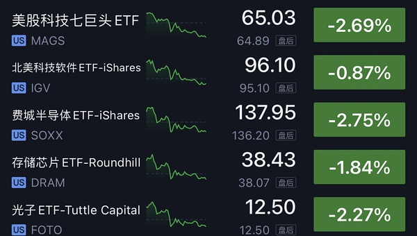
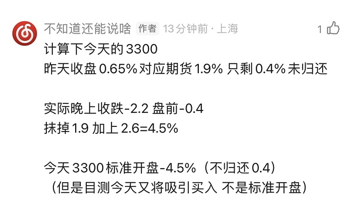
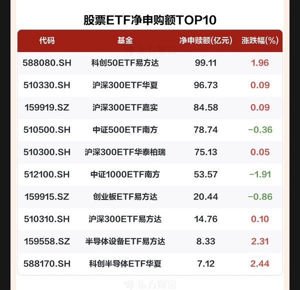
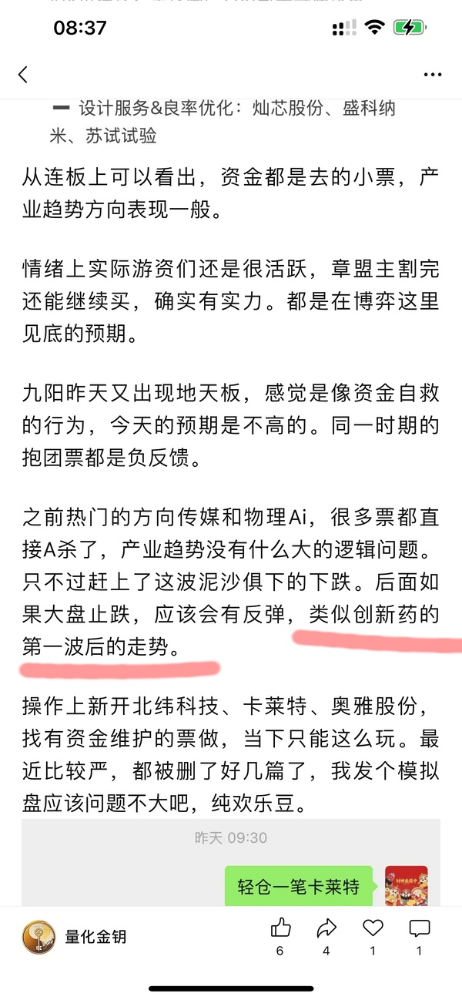
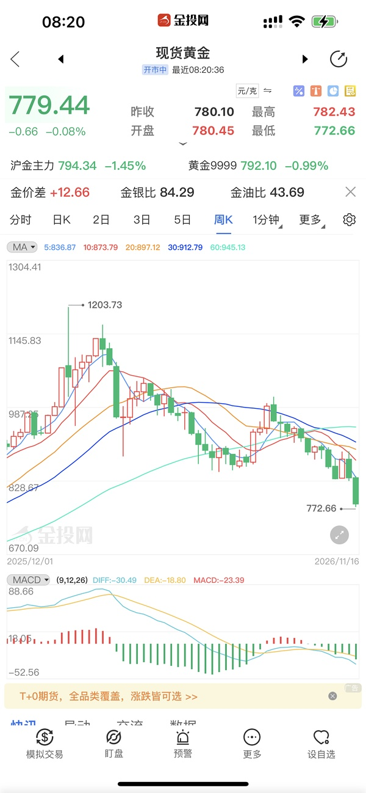
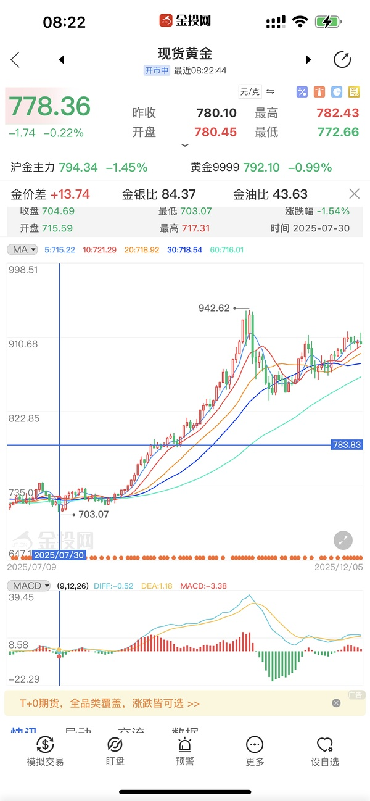
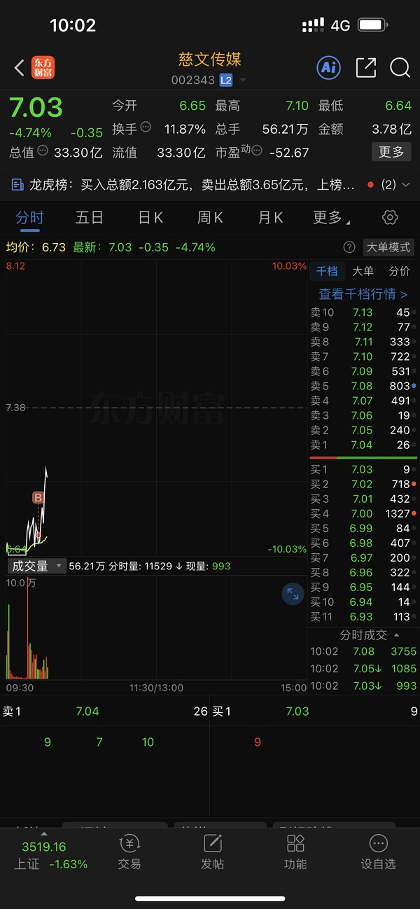
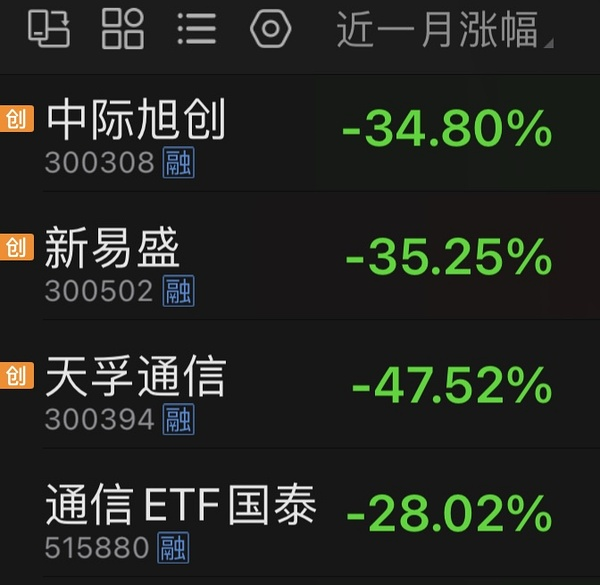
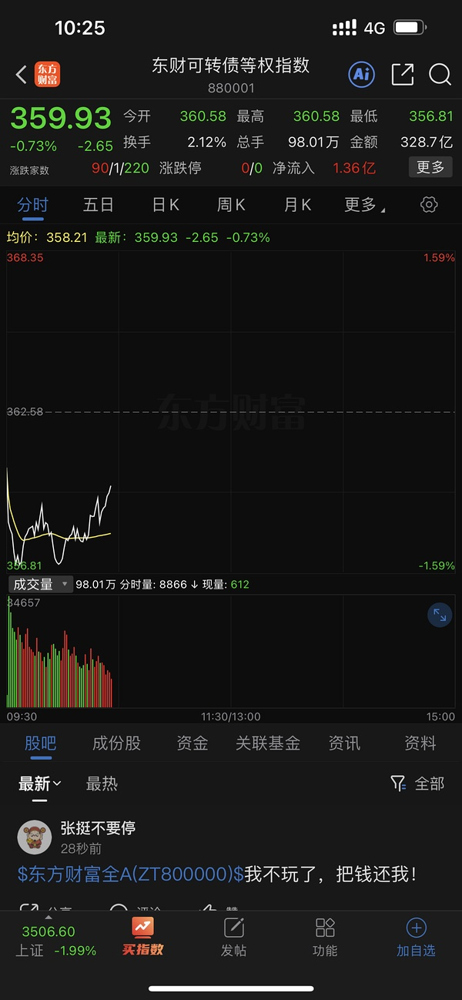
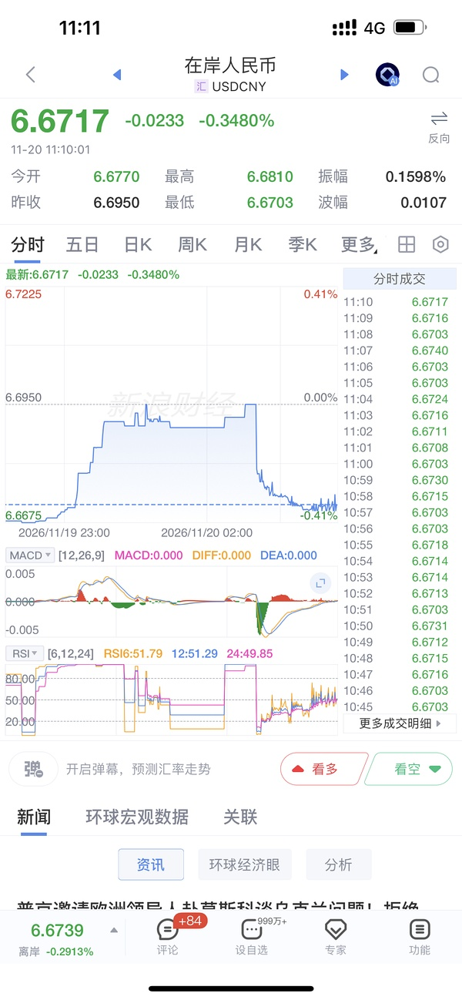

# 📋 楼主每日发言推送

> **推送日期**：2026-11-20 ｜ **执行时间**：2026-11-20 11:18:56 ｜ **监控用户**：`不知道还能说啥`
> **追踪模式**：`topic`（用户主页广播·豆瓣话题）

## 📊 持仓追踪
> 上次更新：2026-11-20 ｜ 基于楼主发言持续追踪（共 15 项）

| 标的 | 状态 | 类型 | 现价 | 提及 |
|------|------|------|------|------|
| 招商银行 | 底仓·四年前 32 元×7000 股买入·四年分红未复投仍 7000 股·不动 | 红利/银行 | 42.81（-1.18%） | 底仓·不动；7000股/摊薄成本约24.27元；1…；成本约32元 |
| 大连圣亚 | 持有（11-18 加仓@37.74 被深套）·今日无动作·卖单 46.90/45.22 未触及 | 冰雪·正牌双子星 | 30.30（-6.28%） | 11-19 跌停收32.33（=35.92×0.9… |
| 雪人集团 | 持有·11-19 手动买入 2 笔@≈13.5（两笔 cbs 钱搬入）·卖单 13.84/14.84/15.84 | 冰雪·交易仓 | 12.22（-6.50%） | 09:35『昨天卖cbs是为了今天买雪儿 双向奔赴… |
| 幸福蓝海 | 持有·今日换仓买入 1 笔@≈15.50（09:43）＋11-16 笔@16.91·明日卖单 15.84（由 18.64/20.44 下移） | 电影 | 13.16（-2.52%） | 持有（@13.0＋@16.91＋@15.50 三笔… |
| 中国电影 | 持有·剩余仓无单·锁仓『慢就是快』 | 电影·核心不动仓 | 14.90（-2.36%） | 持有·锁仓无单；11-19 -0.33%（普跌里最… |
| 光线传媒 | 持有·今日部分卖出@11.82（-4.3% 换仓入幸福）·仍持上周老仓 | 电影·低位备选 | 10.34（-3.18%） | 持有·老仓；11-19 -4.30% |
| 博纳影业 | 持有小仓·今日跌停 5.69（=6.32×0.9）·卖单 6.94 未触及（高 6.22）·明日买 614 计划 | 电影 | 5.04（-0.98%） | 持有小仓；11-19 -6.95%；卖单6.94未… |
| 纳斯达克ETF华夏 | 持有·不卖场内（溢价品种）·开盘预测 -1.5% 落空他自己认赖皮 | QDII·场内纳指 | 2.516（-4.88%） | 持有·不卖场内；11-19 +0.65%；17:1… |
| 中韩半导体ETF | 持有·今日无动作自述 | QDII·场内 | 3.508（-2.83%） | 持有；11-19 +0.56% |
| 盛天网络 | 11-11 买入·持有（口径仍待确认） | 游戏·电竞 | 8.91（2.30%） | 持有（口径待确认）；11-19 -3.76% |
| 游戏自建仓 | 11-10 买入·持有·11-11 自述 +5%（时点值未更新） | 游戏·电竞 | 暂无 | 持有；11-19无提及 |
| 美债场外基金 | 持有·国庆前买入·11-11 自述 +1.4%（时点值未更新）·债灾自述接近转亏 | 场外·美债 | 暂无 | 持有；11-19无新自述（08:04美债回落4.8… |
| 传媒低位10cm | 11-12 自述『只加一个低位的』＋11-16 14:22『我要去买一个传媒了』（是否执行无自述）·拒绝点名 | 传媒·低位 | 暂无 | 持有（11-18『这周开干传媒』已加）；11-19… |
| 东方海洋 | 11-16 买入探针仓 <2%·无卖单自述·当日跌停（11-12 曾涨停 5.16 卖出，见 day_actions_1112） | 探针·羊情绪组 | 3.75（9.97%） | 11.16；探针仓<2%·持有；11-19开3.36(-10%… |
| 六只债券基金 | 持有·00:38『这些我都有 第二个和第三个在这轮中灾难中经受住了考验』·债灾自述实亏·『债持不炒，每调买机』 | 场外·债基 | 暂无 | 11.16；持有；11-19 17:55-17:59 债基含权… |

> ⚠️ 执行任务时如发现新操作，请更新 `state.json` 的 `positions`。成本价和市值有数据才填，没有则保留「暂无」。

## 🌅 今日总览
### 📌 市场背景
市场背景：美股科技股大幅回调，「七巨头跌的比存储和光还多」；A股跌停家数从前一日大量减少，情绪出现回暖迹象。「跌停-7以上跌幅从560个降低到140个了」「跌停数减少是第一步」。纳指ETF 3300受期货影响低开，溢价率被放大。「标准开-4.7 刚刚到 而且nana还在跳」

### 📌 今日操作
| 操作 | 标的 | 详情 |
|---|---|---|
| ⏭️ | plus雪（晶雪节能） | 今日接近回本，未操作，等待15%兑现机会 |

### 📌 今日议题
| 议题 | 态度 | 核心观点 | 关键引用 |
|---|---|---|---|
| 纳指ETF 3300溢价 | 💬讨论 | 计算标准开跌幅，认为有资金抢筹推高溢价 | 「标准开-4.7 刚刚到 而且nana还在跳」|
| A股情绪拐点 | 📈看多 | 跌停数量骤减是情绪转换信号，下周有望反攻 | 「跌停数减少是第一步」「这两天就是情绪转换点」|
| PCB板块 | 💬讨论 | 盘中再度拉升，超声电子澳弘电子涨停 | 「PCB概念再度拉升 超声电子、澳弘电子双双涨停」|
| 小远（华宝致远）| 📉看空 | 因重仓七巨头今日跌幅会很大 | 「今天小远跌幅应该不会少 他跟七巨头」|
| 光线传媒 | ➡️中性 | 防守功能已完成，少跌但涨不动 | 「光线跌的少也确实涨不动」|
| 网易云音乐(QDII) | 📉看空 | 本周净值回撤严重 | 「网易-20」|
| 传媒龙头慈文传媒 | 💬讨论 | 四连板后能否继续？期待地天板 | 「慈文敢博地天吗」「慈文火箭发射」|
| 可转债 | 💬讨论 | 市场先行指标，今日拉升 | 「可转债是市场先行指标」|
| 芒果超媒 | 💬讨论 | 抗跌但磨叽，希望带头反攻 | 「芒果你跌不动就赶紧带个头」|

### 📌 看好板块/方向
- **PCB（英伟达AI产业链）**：盘中再度拉升，超声电子、澳弘电子涨停，带动板块情绪
- **农业股**：万向德农冲击涨停，秋乐种业、康农种业等异动拉升
- **可转债**：市场先行指标，资金参与情绪活跃

### 📌 风险提示
「这周大家都跌 我不会说bn一句不好」——博纳影业本周同样承压，需警惕下周考核压力下的被动操作
「网易-20」——QDII基金本周净值回撤约20%，重仓美股科技股风险显著
「比如yl就没有🤣」——引力传媒今日无正反馈，持仓可能继续承压
「慈文传媒四连板」「慈文敢博地天吗」——高位连板股博弈加剧，追高风险大
「vix新高了」——市场恐慌指数创新高，波动率上升系统性风险增加

## 📊 本次结果
- **今日发言**：116 条
- **累计存档**：22866 条

## 📝 该最新广播作者发言聚合（共 116 条）
### 其他讨论（提及 82 次，占比 71%）2026-11-20 01:28:48
- 洗完澡一看 确实是动荡不安😅
- 这也是挺有意思
七巨头跌的比存储和光还多

- 美国都这样 中鸡哪有希望 我们又不是红利

你们自己看着办吧

### 东方海洋（提及 5 次，占比 4%）2026-11-20 09:42:13
- 东方海洋带带我们龙版啊
- 漂亮啊东方海洋
- 昨天襄阳 九阳
今天东方海洋

### 513300 纳斯达克ETF华夏｜11-11 10:49「3300还行 不过今天我不满意」＋13:24「咱们3300还是近期数据最好的」（提及 4 次，占比 3%）2026-11-20 07:51:54
- 计算下今天的3300
昨天收盘0.65%对应期货1.9% 只剩0.4%未归还

实际晚上收跌-2.2 盘前-0.4
抹掉1.9 加上2.6=4.5%

今天3300标准开盘-4.5%（不归还0.4）
（但是目测今天又将吸引买入 不是标准开盘
- 嗯 但也是最近少有的情况

今天看看3300打多少溢价 正常开要-4.5了
- 今天我开闹钟了
我要看看十点半3300的资金是否还和6号一样争先恐后

### 301010 晶雪节能（上周买回、11-16 持有）｜09:39『上周买了plus』＋14:53『掌声雪儿plus雪』；卖单 24.94 沿用 11-05 老价，当日高 24.39 未触及（提及 4 次，占比 3%）2026-11-20 09:04:58
- plus有人买的自己看着有机会兑现吧
- 我plus马上回本了 笑死
- 不如期待我们plus 15%嗨翻天

### 纳斯达克100 指数（他用来对照场内 ETF 溢价/涨幅的基准，非标的）｜11-13 00:16『今天图上看 nana依然是大阳线』＋07:57『昨天-0.7收盘 但是nana晚上其实只有-0.3 现在期货+0.5 今天场内应该开盘+0.9%』→ 实测 513300 开盘 2.710＝+0.82%（误差 0.08pp）（提及 3 次，占比 3%）2026-11-20 07:56:02
- 凌晨情况是
我们的主动基金都跌的比nana少
这是近期少见的
- nana-0.6现在
标准开应该-4.7

- 标准开-4.7 刚刚到

而且nana还在跳

### 605577 龙版传媒｜11-11 11:50「最早龙版也是因为自己每次公告文案都不一样才4连板就被监管」（讲监管规则，非持仓）（提及 3 次，占比 3%）2026-11-20 09:37:00
- 让龙版新华一起来吧
- 传媒永恒核心

龙版
- 也有可能襄阳那边吧

不过只要传媒继续龙版应该都是领队😂

### 300413 芒果超媒（对照，非持仓）｜11-13 14:01 本月涨幅 41.70% vs 幸福 53.76% →『幸福已经拉开芒果12%』＝12.06pp 精确命中；当日 −4.83%（提及 3 次，占比 3%）2026-11-20 10:22:44
- 芒果你跌不动就赶紧带个头 
要么爽快大跌
要么嗨起来啊
磨磨叽叽的
- 芒果火箭发射
- 加油芒果 
8月初9月初都是你带队的
我愿意订你一年会员

### 1000＝中证1000（指数／相关ETF）；2026-11-19 14:51『象征性扫了点1000』后他澄清『我说的是gjd』＝**国家队(gjd)在象征性买中证1000**（他在评论国家队托市行为，**不是他本人买入、也不是他的持仓**）；切勿读成他买了中证1000ETF（提及 1 次，占比 1%）2026-11-20 08:13:21
- 昨天最终他们扫了一些1000

### 富国全球科技互联网股票(QDII)A（提及 1 次，占比 1%）2026-11-20 08:25:57
- 网易云音乐：你们投票有bug 🏆是我

### 中文在线（提及 1 次，占比 1%）2026-11-20 08:38:42
- 第一波创新药啥样子啊？点老师那时候在做的吧？

### 华宝致远混合(QDII)C｜只在盯，未证他持有（提及 1 次，占比 1%）2026-11-20 08:43:49
- 今天小远跌幅应该不会少 他跟七巨头😂😂😂😂😂😂

### 安记食品（提及 1 次，占比 1%）2026-11-20 08:50:05
- 不用防止周五手贱了！太太平平 安安心心的

### 000530 冰山冷热｜11-11 10:16「万一冰山跌停 他能跌到哪里再去」＋10:27「今天把冰山 晶雪按死 大连 CBS 正统上位」（非持仓，冰雪板块的山寨对照）（提及 1 次，占比 1%）2026-11-20 09:32:37
- 加油啊襄阳 海洋
龙版 冰山 新华都加油啊

### 雪人集团 002639｜11-06「大连和雪儿」＋11-11 14:26「雪儿今天不错啊 大家昨天不是期待他接人嘛 这个任务做到了今天」（接人＝5日线接回，与雪人条件单口径一致）（提及 1 次，占比 1%）2026-11-20 10:03:59
- 这周雪儿怎么跌的 下周怎么回来

### 航空航天板块（提及 1 次，占比 1%）2026-11-20 10:06:33
- 这可没三月宇航员惨烈

### 引力传媒 603598（对手盘，非他持仓）｜11-06 +37.15%；11-09 本月+37.79%（提及 1 次，占比 1%）2026-11-20 11:05:44
- 比如yl就没有🤣🤣🤣🤣

### 601595 上海电影｜**他空仓**（11-09 起未回接）；11-12 09:38『天天念叨sy的给你们机会了』＋09:41『现在-6给你们机会了哈』＋13:15『马上sy跌停 bn还要尊敬一下他』＋13:51『与此同时 sy跌停』＋14:00『sy历来以残暴虐杀手法闻名』；实测收 42.15 −9.99% 跌停（提及 1 次，占比 1%）2026-11-20 11:09:47
- 对不起sy
是我太穷了没能再助力他一笔

### 博纳影业（提及 1 次，占比 1%）2026-11-20 11:12:25
- 这周大家都跌 我不会说bn一句不好

下周情绪回暖反击 阿博自己看着办吧 下周我就有考核了

### 光线传媒 300251（他自述小仓）｜11-13 15:11『我相信光虽迟但到 我会肯定保留上周的存钱仓位』＝存钱罐口径再次落到光线（提及 1 次，占比 1%）2026-11-20 11:13:43
- 哈哈哈哈你忘了我们有个存钱罐
存钱罐干嘛用的
需要花钱时候摔碎它取钱🤣🤣🤣🤣🤣

### 📄 全部发言（共 116 条）
- (2026-11-20 01:28:48) 洗完澡一看 确实是动荡不安😅  ⊳ （引用 @vio）半夜醒来怎么看见这惊悚画面

- (2026-11-20 07:43:37) [图] 这也是挺有意思
七巨头跌的比存储和光还多

- (2026-11-20 07:51:54) 计算下今天的3300
昨天收盘0.65%对应期货1.9% 只剩0.4%未归还

实际晚上收跌-2.2 盘前-0.4
抹掉1.9 加上2.6=4.5%

今天3300标准开盘-4.5%（不归还0.4）
（但是目测今天又将吸引买入 不是标准开盘）

- (2026-11-20 07:53:02) 美国都这样 中鸡哪有希望 我们又不是红利

你们自己看着办吧  ⊳ （引用 @混乱中立同人女）楼，汇率有影响吗，会不会影响中基卖出计划？

- (2026-11-20 07:56:02) 凌晨情况是
我们的主动基金都跌的比nana少
这是近期少见的  ⊳ （引用 @🅰失而复🉐😎）是因为这个😕

- (2026-11-20 07:58:15) 嗯 但也是最近少有的情况

今天看看3300打多少溢价 正常开要-4.5了  ⊳ （引用 @🅰失而复🉐😎）指数是因为七巨头吧

- (2026-11-20 08:00:40) 白银：哥放大跌幅了  ⊳ （引用 @🅰失而复🉐😎）最刺激的还是它😇

- (2026-11-20 08:03:41) 是的 指数跌幅都大于我们基金  ⊳ （引用 @招招碎片收集中）昨天是通杀耶，标普道指也没少跌🤔

- (2026-11-20 08:06:43) 所以下行趋势的金银比我们做不了😂  ⊳ （引用 @🅰失而复🉐😎）再跌跌就差不多回到最初的模样了

- (2026-11-20 08:06:54) vix新高了  ⊳ （引用 @shirla）美股冰点？但是vix没有继续暴涨

- (2026-11-20 08:08:27) 今天我开闹钟了
我要看看十点半3300的资金是否还和6号一样争先恐后  ⊳ （引用 @shirla）美股冰点？但是vix没有继续暴涨

- (2026-11-20 08:09:44) 近在咫尺了  ⊳ （引用 @招招碎片收集中）打到余老师要的30

- (2026-11-20 08:13:21) [图] 昨天最终他们扫了一些1000

- (2026-11-20 08:14:26) 这个延迟一天更新的 你看顶上面时间

新浪财经是实时  ⊳ （引用 @Lyra）我是不是看错vix了😅这个图上还没有

- (2026-11-20 08:20:53) [图] 我有app
没有错

  ⊳ （引用 @招招碎片收集中）我看她们攒金的APP金价已经780左右了

- (2026-11-20 08:23:12) 我们免费版 你懂的😂  ⊳ （引用 @shirla）堂堂wind竟然没有实时数据

- (2026-11-20 08:24:07) [图] 700是2025.7.30金价 那一天就是

  ⊳ （引用 @monica）金价700对应的伦金价格，我算错了

- (2026-11-20 08:25:57) 网易云音乐：你们投票有bug 🏆是我

- (2026-11-20 08:38:42) [图] 第一波创新药啥样子啊？点老师那时候在做的吧？

  ⊳ （引用 @点-重生炒垃圾）看大佳爱国链也分化了，要剔除假爱国，只剩华虹中芯那些了，感觉是好事吧，总算找了一个集中做多的地方了，再不打就说不过去了。芯片应该卒，这么多俏咪咪找韩国代工😅😅😅

- (2026-11-20 08:41:11) 日本最近跌的少 都要补回来  ⊳ （引用 @👑）日经225指数日内大跌3%，报57591.2点。软银集团暴跌14%，铠侠控股大跌近10%。

财联社的推送好吓人

- (2026-11-20 08:43:49) 今天小远跌幅应该不会少 他跟七巨头😂😂😂😂😂😂  ⊳ （引用 @招招碎片收集中）我也有这种感觉，前段时间被吹抗跌的通通补回来，小远又要挨骂一段时间了吗

- (2026-11-20 08:45:59) 懂了 熬呗😂  ⊳ （引用 @点-重生炒垃圾）看这个，第二波还挺大的

- (2026-11-20 08:47:20) 我在新浪A股模拟盘开了都是机器人的 周-20%🤣  ⊳ （引用 @速派女孩将发财）这周新浪财经分不到钱了

- (2026-11-20 08:48:31) 今天周五！  ⊳ （引用 @海贼）冰雪有反向科技不暴跌的风险吗😥

- (2026-11-20 08:50:05) 不用防止周五手贱了！太太平平 安安心心的  ⊳ （引用 @招招碎片收集中）你终于也跟我们一样了！满仓硬抗周五

- (2026-11-20 08:51:30) 你现在快去报  ⊳ （引用 @moli）还有钱分的吗，靠着做空一切我是不是有希望了😂

- (2026-11-20 08:52:46) 周五的期待始终是少跌是福😂  ⊳ （引用 @我超爱哭的）今天电影or冰雪会挺身而出拯救账户吗🙃

- (2026-11-20 09:01:57) A股钱多🤣🤣🤣🤣  ⊳ （引用 @moli）可恶总盘子才200块😂

- (2026-11-20 09:04:58) plus有人买的自己看着有机会兑现吧  ⊳ （引用 @shirla）今天是不是只有雪人两个条件单呀其他的也到不了都

- (2026-11-20 09:16:23) 给襄阳加油吧
昨天的领军者 别今天又跌停了  ⊳ （引用 @🅰失而复🉐😎）😕什么鬼吓死谁

- (2026-11-20 09:28:03) 最安稳的周五开局
无所事事

- (2026-11-20 09:28:39) 为襄阳呐喊助威  ⊳ （引用 @不知道还能说啥）最安稳的周五开局
无所事事

- (2026-11-20 09:29:55) 不用考虑抢什么
也不考虑卖什么了

真正的无所事事  ⊳ （引用 @vio）哈哈哈哈  不用合计抢哪个了

- (2026-11-20 09:32:37) 加油啊襄阳 海洋
龙版 冰山 新华都加油啊

- (2026-11-20 09:34:52) 跌停15个？还可以

- (2026-11-20 09:36:45) 慈文传媒四连板  ⊳ （引用 @lacey）金逸这是3连板了

- (2026-11-20 09:37:00) 让龙版新华一起来吧  ⊳ （引用 @公主要发财）龙版来了

- (2026-11-20 09:38:09) 今天跌停家数就不符合冰点😂
我们那个冰点果然是发生不了

- (2026-11-20 09:41:06) 我plus马上回本了 笑死  ⊳ （引用 @招招碎片收集中）180多家红的，我居然有一个，虽然也是深套😂😂

- (2026-11-20 09:41:25) 不如期待我们plus 15%嗨翻天  ⊳ （引用 @momomomomomo哒）冰山能不能板一个然后带其他冰雪一起板

- (2026-11-20 09:42:13) 东方海洋带带我们龙版啊

- (2026-11-20 09:42:21) 漂亮啊东方海洋  ⊳ （引用 @不知道还能说啥）东方海洋带带我们龙版啊

- (2026-11-20 09:43:00) 昨天襄阳 九阳
今天东方海洋  ⊳ （引用 @不知道还能说啥）东方海洋带带我们龙版啊

- (2026-11-20 09:43:18) 襄阳能不能两连板 情绪回暖很重要啊  ⊳ （引用 @招招碎片收集中）哈哈哈哈哈哈哈哈哈哈哈哈买到龙头啦，有一个涨停，开局大好

- (2026-11-20 09:44:08) 我没设置  ⊳ （引用 @shirla）2294我设置的是，你是多少啊楼楼

- (2026-11-20 09:44:20) 你们自己看着搞

我今天什么单子都没开  ⊳ （引用 @shirla）2294我设置的是，你是多少啊楼楼

- (2026-11-20 09:45:32) 东方海洋也是消费也是医疗
襄阳是机器人

他们有其他板块的  ⊳ （引用 @该用户已过期）还是🐑？

- (2026-11-20 09:45:47) 不走的 我昨天说了  ⊳ （引用 @🅰失而复🉐😎）龙走不走

- (2026-11-20 09:46:17) 我昨天说过
下周情绪回暖
你让我今天走？不可能的事情

我怎么想的就是怎么操作的  ⊳ （引用 @🅰失而复🉐😎）我也，跌这么狠只能等回血了

- (2026-11-20 09:47:32) 传媒永恒核心

龙版

- (2026-11-20 09:47:52) 他会带动大家的！漂亮龙龙  ⊳ （引用 @YuanZi💕）龙板涨停

- (2026-11-20 09:48:25) 跌停缩小至个位数

- (2026-11-20 09:48:40) 比去年86跌停次日暂时更好  ⊳ （引用 @不知道还能说啥）跌停缩小至个位数

- (2026-11-20 09:49:23) 也有可能襄阳那边吧

不过只要传媒继续龙版应该都是领队😂  ⊳ （引用 @sickid）5日线拐头了，难道他是跨年妖？

- (2026-11-20 09:49:35) 祝福襄阳两连板

- (2026-11-20 09:50:55) 慈文传媒打开！！

- (2026-11-20 09:51:31) 慈文敢博地天吗🤣🤣🤣🤣🤣🤣🤣🤣  ⊳ （引用 @🅰失而复🉐😎）带它们俩🫠

- (2026-11-20 09:57:57) 只有他继续往上 传媒才有希望  ⊳ （引用 @🅰失而复🉐😎）昨天开板速度拉板，今天能不能封住

- (2026-11-20 09:59:15) 慈文传媒火箭发射

- (2026-11-20 09:59:21) 冲起来  ⊳ （引用 @不知道还能说啥）慈文传媒火箭发射

- (2026-11-20 10:00:49) 早上大部分都是-9 跌停 没区别吧？  ⊳ （引用 @超级无敌迷你装）又忘记周五组训，手贱补了……

- (2026-11-20 10:01:10) 我已经在为慈文呐喊了  ⊳ （引用 @YuanZi💕）慈文要来了？

- (2026-11-20 10:01:49) 今天跌停很少了
下周情绪会回暖很有希望 耐心持有了  ⊳ （引用 @红红火火的anya）今天科技跌的还真不多，中际都没新低，杀得只是我的账户

- (2026-11-20 10:02:10) 我能看到plus15+吗😂  ⊳ （引用 @sickid）冰山涨停

- (2026-11-20 10:02:32) [图] 

  ⊳ （引用 @🅰失而复🉐😎）我去了

- (2026-11-20 10:03:59) 这周雪儿怎么跌的 下周怎么回来  ⊳ （引用 @momo）雪人地天一个吧求求了

- (2026-11-20 10:04:24) 下周我们会大丰收的 
下周情绪会反攻

- (2026-11-20 10:06:33) 这可没三月宇航员惨烈  ⊳ （引用 @momo）你是什么大心脏怪物啊？你好可怕真的。（非辱骂）我们全部都已经吓尿了。

- (2026-11-20 10:07:49) 网易-20  ⊳ （引用 @招招碎片收集中）恒科跌幅超4%

- (2026-11-20 10:08:33) PCB概念再度拉升 超声电子、澳弘电子双双涨停
PCB概念盘中再度拉升，超声电子、澳弘电子涨停，此前中京电子、光华科技涨停，满坤科技涨超10%，中瓷电子、逸豪新材、四会富仕等跟涨。

- (2026-11-20 10:08:48) 天少跌很多啊  ⊳ （引用 @大连海底站岗员）gx真垃圾啊

- (2026-11-20 10:09:11) 农业股异动拉升，万向德农冲击涨停，秋乐种业、康农种业、花溪科技、神农种业、金健米业纷纷冲高。

- (2026-11-20 10:10:03) 昨天快手 网易业绩不及预期  ⊳ （引用 @招招碎片收集中）它咋啦，总不能是因为那个游戏关服吧

- (2026-11-20 10:13:16) 他变强有原因吗😂  ⊳ （引用 @六倍做多退休）woww新易盛又红了 你小子真变强了

- (2026-11-20 10:15:56) 哈哈哈哈哈哈哈  ⊳ （引用 @Frances）恒生科技已经比上证还低了

- (2026-11-20 10:16:02) 是的  ⊳ （引用 @momo）放量是好信号吗

- (2026-11-20 10:19:01) [图] 哦你这么一说我看了下 我悟了

  ⊳ （引用 @六倍做多退休）😂不知道 但是的确他今年跌的最惨

- (2026-11-20 10:21:20) 跌停数减少是第一步  ⊳ （引用 @长成大🌲）看了一眼怎么还是5000+下跌

- (2026-11-20 10:22:44) 芒果你跌不动就赶紧带个头 
要么爽快大跌
要么嗨起来啊
磨磨叽叽的

- (2026-11-20 10:24:47) 嗯 但当他跌的多
三天-6 -17 -11😂  ⊳ （引用 @点-重生炒垃圾）果麦已经带头了？

- (2026-11-20 10:25:55) [图] 可转债拉升

- (2026-11-20 10:26:54) 我有个东西能换 
高风险操作就不多说了

毕竟马上就跌停了  ⊳ （引用 @shirla）楼你不是没钱了嘛！

- (2026-11-20 10:28:17) 可转债是市场先行指标  ⊳ （引用 @招招碎片收集中）老大，这个代表啥

- (2026-11-20 10:29:41) [图] nana-0.6现在
标准开应该-4.7

- (2026-11-20 10:32:18) 都没达到标准开
又提高了溢价  ⊳ （引用 @早八走狗来财）开盘马上掉。。。

- (2026-11-20 10:36:55) nana在跳水
3300拉升

每次大跌 都有人疯狂bbbbbbbb  ⊳ （引用 @仓部加措）按楼设置的，最后一滴买到最低了吧今天！

- (2026-11-20 10:39:53) 以前他们玩法 这时候批量扫四连板三连板的跌停 博几率😂😂😂  ⊳ （引用 @VVV坚定持有VVV）摸完一圈电门之后，我知道了，我不是秦始皇

- (2026-11-20 10:42:18) -7以上跌幅从560个
降低到140个了

- (2026-11-20 10:43:07) 小声说我也去了 两个  ⊳ （引用 @VVV坚定持有VVV）我就去摸了这些😂看看下周一电不电死我，还是能赢麻了

- (2026-11-20 10:43:35) 现在和你说你也不信
你下周就知道了  ⊳ （引用 @momo）为什么下周情绪会回暖呢

- (2026-11-20 10:45:20) 传媒的连续跌停就那几个 我就不说了 高风险  ⊳ （引用 @UPUP）楼楼去了哪两个

- (2026-11-20 10:47:15) 我们其实已经对过一只了😂  ⊳ （引用 @VVV坚定持有VVV）和哈哈哈哈哈哈哈哈哈哈哈哈下周一对答案

- (2026-11-20 10:48:33) 老垃圾人经验
跌停数量最多的一天外加次日跌停急剧减少
那这两天就是情绪转换点

只要今天午后跌停数量不要又爆增
就已经看到了

- (2026-11-20 10:49:00) 我偏心 我买的都是传媒的
其他的我也懒得看了😂😂😂  ⊳ （引用 @VVV坚定持有VVV）哈哈哈哈哈我另一支好像没摸对，还是没好好学习，昨晚没复习跌停连板的票😂

- (2026-11-20 10:49:46) 没有
我不是说了吗
连续跌停的  ⊳ （引用 @🅰失而复🉐😎）新华去了没

- (2026-11-20 10:50:51) 期待襄阳两连板 彻底激活  ⊳ （引用 @点-重生炒垃圾）👑

- (2026-11-20 10:51:58) 4:6  ⊳ （引用 @🐮）楼现在冰雪和电影的比例是怎么样的

- (2026-11-20 10:52:31) 物理ai  ⊳ （引用 @YuanZi💕）ty都拉红了

- (2026-11-20 10:53:15) 东方海洋不是已经涨停了吗哈哈

下周一再期待他

襄阳人家昨天领队啊 今天继续领队 炒作情绪就容易回来了  ⊳ （引用 @招招碎片收集中）怎么瞧不起我们小东方吗？

- (2026-11-20 10:56:33) 梦一个今天不亏钱 或者亏很少？

- (2026-11-20 10:57:06) 有地天板大家互相通知 不管是什么😂  ⊳ （引用 @VVV坚定持有VVV）哇超另一个电门反超cw了，cw你行不行啊

- (2026-11-20 10:58:35) 现在是我这两天亏最少的😂  ⊳ （引用 @🅰失而复🉐😎）我现在还是碧绿🫣

- (2026-11-20 10:59:11) 期待复刻我们三月份收益率超级V的名场面  ⊳ （引用 @🅰失而复🉐😎）我现在还是碧绿🫣

- (2026-11-20 11:02:37) 光线防守用处已经完成了 少跌了 
去不去掉看你自己了  ⊳ （引用 @we）幸福和光线是电影吧

- (2026-11-20 11:05:44) 比如yl就没有🤣🤣🤣🤣  ⊳ （引用 @只想搞钱）一看持仓全是被缺口压下去的，但是这两天的跌法谁能没缺口啊

- (2026-11-20 11:06:45) 芒果火箭发射

- (2026-11-20 11:06:54) 跌不动就站出来👍  ⊳ （引用 @不知道还能说啥）芒果火箭发射

- (2026-11-20 11:08:23) 👍👍👍👍👍👍👍👍

跌得动的使劲跌 下周反攻

跌不动的及时站出来做表率

大家互相配合呀  ⊳ （引用 @点-重生炒垃圾）我今天借了点大连去的

- (2026-11-20 11:09:14) 加油芒果 
8月初9月初都是你带队的
我愿意订你一年会员

- (2026-11-20 11:09:47) 对不起sy
是我太穷了没能再助力他一笔  ⊳ （引用 @招招碎片收集中）这个上影也一身牛劲

- (2026-11-20 11:10:37) 周五冰雪你懂的
周五电影人  ⊳ （引用 @🅰失而复🉐😎）今天冰人们上冻了😵

- (2026-11-20 11:11:50) [图] rmb在玩什么

  ⊳ （引用 @六倍做多退休）全球资产主跌浪了 看了眼黄金😂 

- (2026-11-20 11:12:25) 这周大家都跌 我不会说bn一句不好

下周情绪回暖反击 阿博自己看着办吧 下周我就有考核了  ⊳ （引用 @招招碎片收集中）bn目前没有输给他！恰信一搜！！

- (2026-11-20 11:13:43) 哈哈哈哈你忘了我们有个存钱罐
存钱罐干嘛用的
需要花钱时候摔碎它取钱🤣🤣🤣🤣🤣  ⊳ （引用 @vio）你还有钱 你不正常！

- (2026-11-20 11:14:55) 标准开-4.7 刚刚到

而且nana还在跳  ⊳ （引用 @招招碎片收集中）nana溢价率好像在掉耶🤔

- (2026-11-20 11:16:47) 光线拆成两个

目前转换的很好 光线跌的少也确实涨不动😂😂😂  ⊳ （引用 @🅰失而复🉐😎）楼你买了多少龙是小试牛刀还是大刀破斧那种

## 🧠 投资风格分析
> 📏 增量更新指引：仅当今日发言确有新依据时才修订对应维度，无变化不强行重写；单维度修订建议 ≤150 字。

- 投资理念与方法：坚持机会成本与性价比比较，只赚份内的钱；对机构抱团与题材炒作保持警惕。重视场内ETF相对指数实际的「漏跌/漏涨」核算，逐日跟踪溢价与基准差值，认为下跌时抄底意愿推高溢价、上涨时溢价回落。操作上强调组合思维与内部调仓（「不叫割 是转换 内部调仓」），替换而非加仓，反对超计划加仓。
- 风险偏好：整体回避高波动、高拥挤的垃圾消费与微盘股，警惕机构抱团和题材炒作；对美股认可强势但持续跟踪纳指ETF溢价与漏跌。新增回避含权债基/固收+，认为“求稳”债基实则股性重；对1月垃圾股ST预告风险有纪律，主张1月不玩、1.15前撤。
- 交易与仓位：强调组合思维与内部调仓，卖出是为了腾挪资金买计划内标的，而非割肉；严格执行计划仓位，反对超载加仓。习惯条件单分批挂单、低吸不追高；认为钱少反而帮助执行纪律。会在预期风险前主动不加仓以控制暴露，但自认手贱难改、心里清楚。
- 心理特质：对波动与回撤高度钝化，自嘲「老垃圾人」；面对翻绿不破防，强调心态与经历积累。会通过统计跌停数量来判断情绪拐点（「跌停数量最多的一天外加次日跌停急剧减少 那这两天就是情绪转换点」）。乐观主义底色——即便在普跌当日仍期待「下周我们会大丰收的」「期待复刻我们三月份收益率超级V的名场面」。

> ⚠️ 本板块由 Actions 全自动增量更新（复用当日发言与今日总览），每次仅在内容足够支撑时才改动。

## 🏷️ 昵称映射表
### 📖 昵称规律（供 AI 判断新昵称时参考）
【昵称命名规律（用于推断未知新昵称）】
- 拼音首字母缩写：取标的/基金名汉字拼音首字母串（含数字代码），多为 ETF/股票代码口语化｜示例：yl=引力传媒｜zy=掌阅科技｜sj=视觉中国｜cc=华安文体健康混合｜C50=创业板50ETF｜k50=科创50｜kun=昆仑万维｜xhxc=新瀚新材｜zxfc=中欣氟材
- 小/老+姓氏代指：「小X」「老X」通常指姓 X 的标的或该标的的基金经理；「X兄弟」多为同系基金｜示例：小惠=惠发食品｜老莫=万家品质生活(莫海波)｜小华=华夏全球科技先锋(QDII)A｜小华兄弟=华夏移动互联(QDII)｜小浦=浦银安盛全球智能科技(QDII)A｜小广=广发全球精选(QDII)A｜小远=华宝致远(QDII)C｜招招=招商银行｜小德=德明利｜赵姨=兆易创新｜露露=泸州老窖｜空调=格力电器
- 戏称/黑话→题材板块：生活化比喻或黑话对应某个题材/板块，而非单一标的；出现时多指板块方向｜示例：卖国=PCB板块(英伟达AI链)｜爱国=国产自主(半导体设备/芯片)｜奶茶=易点天下｜老师=中文在线｜蓝色=蓝色光标｜宇航员=航空航天板块｜华子=华泰保兴安悦债券｜国际=国际复材｜巨无霸=长鑫科技等重大IPO
- 谐音/取字：昵称含标的名关键字（取一字或谐音），多为 A 股个股或基金简称｜示例：万华=万华化学｜东百=东百集团｜宝=保利发展｜讨饭/亚洲讨饭/建信新兴=建信新兴市场(QDII)A｜华宝zy=华宝致远(QDII)A
- 机构/基金经理昵称：以基金公司名、经理姓、或平台代称指代对应基金产品｜示例：周经理=中欧新趋势混合(LOF)A｜张经理=信澳匠心回报混合A｜网易云/音乐世家=富国全球科技互联网股票(QDII)A｜国富亚洲=国富亚洲机会股票(QDII)A｜国泰纳指=国泰纳斯达克100指数(QDII)｜易方达全球=易方达全球成长精选混合(QDII)A｜浦银安盛=浦银安盛全球智能科技(QDII)A

### 📋 已收录映射
| 昵称 | 对应名称 |
|------|----------|
| C50 | 创业板50ETF |
| cc | 双义：股票=中国长城 / 基金=华安文体健康混合（用户 11-05 指认） |
| k50 | 科创50 |
| kun | 昆仑万维 |
| sj | 视觉中国 |
| xhxc | 新瀚新材（用户确认；代码待核） |
| yl | 引力传媒 603598（对手盘，非他持仓）｜11-06 +37.15%；11-09 本月+37.79% |
| zxfc | 中欣氟材 |
| zy | 双义：他本人口径=603533 掌阅科技（用户 11-05 确认）；11-09 楼友两条『zy』按 16 元/电影语境指 600977 中国电影。引用必须带语境，不许收敛 |
| 万华 | 万华化学 |
| 东百 | 东百集团 |
| 亚洲讨饭 | 建信新兴市场混合(QDII)A |
| 保利发展 | 保利发展 |
| 华子 | 华子＝007540 华泰保兴安悦债券A（华泰保兴基金·安悦债券A类份额），满仓30年超长利率债的长债基金（用户 2026-11-16 确认，无歧义，不是歧义项）；00:42 楼友『华子今年战绩无敌吧』→他答『30超长债牛逼没办法』；13:47『纯利率债就是华子那种 不过华子满仓30债 有些是满仓5-10年』；**与460108不是同一只**：460108＝华泰柏瑞稳健收益债券C（他持有的纯利率债·重仓国开/农发/国债，见六基行），华子007540 是华泰保兴的长债基金，勿混 |
| 华宝 zy | 华宝致远混合(QDII)A |
| 华宝zy | 华宝致远混合(QDII)A |
| 卖国 | PCB、光模块、通信板块（英伟达AI产业链） |
| 周经理 | 中欧新趋势混合(LOF)A |
| 国富亚洲 | 国富亚洲机会股票(QDII)A |
| 国泰纳指 | 国泰纳斯达克100指数(QDII) |
| 奶茶 | 301171 易点天下（对手盘，非持仓）｜11-13 10:07『奶茶out 幸福人的底气是可以说芒果out』；当日 −6.72% |
| 宇航员 | 航空航天板块 |
| 宝 | 保利发展 |
| 小华 | 华夏全球科技先锋混合(QDII)A |
| 小华兄弟 | 华夏移动互联混合(QDII) |
| 小广 | 广发全球精选股票(QDII)A |
| 小德 | 德明利 |
| 小惠 | 惠发食品 |
| 小浦 | 浦银安盛全球智能科技(QDII)A |
| 小远 | 华宝致远混合(QDII)C｜只在盯，未证他持有 |
| 巨无霸 | 长鑫科技等重大IPO企业 |
| 建信新兴 | 建信新兴市场混合(QDII)A |
| 张经理 | 信澳匠心回报混合A |
| 招招 | 招商银行 |
| 易方达全球 | 易方达全球成长精选混合(QDII)A |
| 浦银安盛 | 浦银安盛全球智能科技(QDII)A |
| 爱国 | 国产自主（半导体设备/芯片制造） |
| 空调 | 格力电器 |
| 网易云 | 富国全球科技互联网股票(QDII)A |
| 老师 | 中文在线 |
| 老莫 | 万家品质生活混合A(519195) |
| 蓝色 | 300058 蓝色光标（广告组合，非他持仓）｜11-12 高 15.97＝20cm 涨停价、收 14.76 +10.89%（炸板）；10:21『他和蓝色 奶茶 sg他们是广告组合』 |
| 讨饭 | 建信新兴市场混合(QDII)A |
| 赵姨 | 兆易创新 |
| 赵哥 | 兆易创新 |
| 露露 | 泸州老窖 |
| 安安 | 安记食品 |
| 音乐世家 | 富国全球科技互联网股票(QDII)A |
| 老伯伯 | 铜冠铜箔 |
| nk | 纳指科技ETF景顺 159509（联接=景顺长城纳斯达克科技ETF联接A）｜11-06 A级：截图溢价率37.08% |
| bk | 标普信息科技LOF 161128（场外=易方达标普信息科技QDII-LOF）｜11-06 A级 |
| txx | 天下秀 |
| 媛媛 | 今世缘 |
| uu | 友友、网友们 |
| 温暖老师 | 某个特别牛逼的散户 |
| 余老师 | 余利，某牛逼投资者 |
| ycm | 粤传媒 002181｜11-09 12:12「非电影传媒就留给大家玩了 我一个都不会碰了」→ 推断已不持有 |
| 江老师 | 江琪（投资博主） |
| 水果老师 | 投资博主 |
| 小爱 | 我爱我家 |
| ty | 天娱数科 |
| bn | 博纳影业 |
| sy | 601595 上海电影｜**他空仓**（11-09 起未回接）；11-12 09:38『天天念叨sy的给你们机会了』＋09:41『现在-6给你们机会了哈』＋13:15『马上sy跌停 bn还要尊敬一下他』＋13:51『与此同时 sy跌停』＋14:00『sy历来以残暴虐杀手法闻名』；实测收 42.15 −9.99% 跌停 |
| CBS | 长白山 |
| 东哥 | 东百集团 |
| 芒果 | 300413 芒果超媒（对照，非持仓）｜11-13 14:01 本月涨幅 41.70% vs 幸福 53.76% →『幸福已经拉开芒果12%』＝12.06pp 精确命中；当日 −4.83% |
| 阿中 | 中国电影 |
| 欢欢 | 欢瑞世纪 |
| 雪人 | 雪人集团 |
| 大连 | 大连圣亚 |
| 幸福 | 幸福蓝海 |
| 小粤 | 粤传媒 |
| 阿博 | 博纳影业 |
| 创成长 | 创业板成长etf |
| asd | 002747 埃斯顿｜11-11 15:09『我昨天去的另外一个 今天也吸到asd了』＝11-11 低吸买入；11-12 10:17『我昨天加了asd今天刚刚加了另外个』＋10:35『asd火箭发射』（盘中高 32.19，收 29.95 −4.37%）；买价未披露。**11-11 轮误删、11-12 恢复** |
| 恋爱脑 | 002582 好想你｜11-12 14:39:31『清了恋爱脑』＝清仓（卖价未披露；10.48 卖单两日均未触及→手动卖）；14:28『我如果去掉恋爱脑 也就比你多一个机器人』；当日收 9.76 −2.89% |
| 恋爱 | 002582 好想你（同『恋爱脑』）｜11-12 14:39 已清仓，不再持有 |
| 小羊 | 000678 襄阳轴承｜11-05 已卖（卡当日最高 20.40）；11-12 14:16『襄阳掉了』＋14:44『厉害襄阳』＝只评论走势，非持仓 |
| 中马 | 中马传动 |
| 晶雪 | 晶雪节能 |
| xf | 幸福蓝海 |
| 建设 | 建设工业 |
| 北方 | 北方导航/北方国际（未定，11-04「我在北方了」） |
| _ambiguity_note | 歧义未收敛（禁止当唯一映射）：轮子=巨轮智能/五洲新春；sj=视觉中国（传媒语境）/神剑股份（宇航员语境）；cc=中国长城/华安文体健康混合；北方=北方导航或北方国际；zy=掌阅科技（用户 11-05 确认原值正确）。证据分级：A=价位/均线/月涨幅实测命中；B=量级或单日命中/用户口述；C=仅昵称或语义，不得据此写『他持有』；沿用原仓=本轮未复核，不写进结论正文。三条判据：①条件单四位数要先按同时段动词行判买卖方向（cbs 3644 是买单不是卖单）；②『祝福/你们/你的X』句式＝评论他人持仓，不是他的操作；③同一昵称在不同语境可指两只票（zy=掌阅/中影），按价位与板块取，不许收敛成一个。 11-11 补：plus雪＝他自己也没说清（11:12「你应该不知道plus雪是哪个」），不许猜；bdd＝有传媒属性所以他不去（13:42），仍未定案；『五连阳』这类盘中口径不等于日K实测（招行 11-06 为平盘十字星）。 11-12 补：①盘中快照≠收盘（14:15 三日账第三日 幸福+0.5/光线−4.5 为盘中值，收盘 −0.53/−4.97；他写的『拉开5.3%』按自列数字相加应为 5.5，属口算误差，不得据此推翻实测）；②历史卖单不重复计触发（中影 15.84 虽∈11-12 区间[15.39,15.98]，但 11-10 已成交、无存续卖单）；③清仓自述不封锁后续再买（asd 11-06 清→11-11 15:09 再吸，11-11 轮据此误删）；④『果果』只是推断映射，不得当持仓证据；⑤机器人第二仓与传媒低位10cm 代码未披露，福赛仅为楼友提问他作答，不许映射。 11-13 补：①**本月涨幅类口述可核**，基准＝10-30 收盘，且要用**发言时刻的分钟价**复算（14:01 截图 53.76% 与分钟线独立复算分毫不差，『拉开芒果12%』＝12.06pp）；②**基金表『折价率』列负号＝溢价**（513300 −15.28% ⇒ 溢价 15.28%，与 11-06 的 16.36% 同口径），别读成折价；③**『我手里就7只股票了/我只有电影冰雪了』是他题材仓口径**，不得据此删除无卖出自述的持仓行（铁律 6）；④**『全部跌停』类口述是盘中快照**（东方海洋盘中最低 4.64＝跌停价、收 −6.59%，未封死）；⑤plus雪＝晶雪只是**品种识别**，他 11-09 已自述清仓，不得当持有证据。 11-16补：①华子与460108是否同一只未定案（华子亦可能楼友昵称），不得据华子写他持有30债；②14:22『T掉追加的』对象歧义（主读法＝大连11-10加筆T，备选＝幸福老股T），无成交自述不改笔数；③博纳09:52『今天』与底仓口径冲突，加仓@6.37按09:45『加仓bn』＋09:46『-6』取；④『2开头招行』语义未定不映射；⑤华夏兄弟17:26裸报-2.5%证据不足不入表。 11-16补：①14:22『T掉追加的』对象歧义（主读法＝大连11-10加筆T，备选＝幸福老股T），无成交自述不改笔数；②博纳09:52『今天』与底仓口径冲突，加仓@6.37按09:45『加仓bn』＋09:46『-6』取；③『2开头招行』语义未定不映射；④华夏兄弟17:26裸报-2.5%证据不足不入表。 11-17补：①『太子爷』『bdd』『畅畅』未定案不映射；②雪人今日14.01加仓笔受T+1，14.84卖单卖的是可卖老仓（非当日买笔）；③晶雪25.64回落单他自述触发、日K高25.78证实（分钟接口H25.35偏低为已知不稳）；④光线11-17部分卖出@11.82按11-16追高笔推定(B)，仍持老仓；⑤传媒『以身入局』拒绝点名不外推代码。 11-17补：①『太子爷』『bdd』『畅畅』未定案不映射；②雪人今日14.01加仓笔受T+1，14.84卖单卖的是可卖老仓（非当日买笔）；③晶雪25.64回落单他自述触发、日K高25.78证实（分钟接口H25.35偏低为已知不稳）；④光线11-17部分卖出@11.82按11-16追高笔推定(B)，仍持老仓；⑤传媒『以身入局』拒绝点名不外推代码。 11-17补：①『太子爷』『bdd』『畅畅』未定案不映射；②雪人今日14.01加仓笔受T+1，14.84卖单卖的是可卖老仓（非当日买笔）；③晶雪25.64回落单他自述触发、日K高25.78证实（分钟接口H25.35偏低为已知不稳）；④光线11-17部分卖出@11.82按11-16追高笔推定(B)，仍持老仓；⑤传媒『以身入局』拒绝点名不外推代码。 11-18补：①雪人『兑现今天加的雪儿』受T+1，今日14.17买笔不可当日卖，兑现的是可卖老仓；②传媒『这周开干』拒绝点名不外推代码；③晶雪上週买回成本未披露、清仓收益不计算；④长白山(cbs)两笔成本36.44/38.8、同价33.65卖出。 11-19补：①雪人13.84卖单在开盘高13.94时可能触发（不写死成交价，记B待核）；②晶雪『今天20买』是给楼友的话、无第一人称买入→不回接；③中证1000ETF象征性小额买入、金额未披露；④大连11-18加仓@37.74 被套（11-19跌停32.33），11-19『我没买』无动作。 11-19补：①【1000】＝gjd国家队（他澄清『我说的是gjd』），非中证1000ETF、非本人买入，已从持仓删除；②雪人13.84卖单在开盘高13.94时可能触发（记B待核）；③晶雪『今天20买』是给楼友的话、无第一人称买入→不回接；④大连11-18加仓@37.74 被套（11-19跌停32.33），11-19无动作。 11-19补：①『1000』＝中证1000，『gjd』＝国家队；合起来是『国家队在象征性买中证1000』——他评论国家队托市，非本人买入/持仓（已从持仓删除误记）；②雪人13.84卖单在开盘高13.94时可能触发（记B待核）；③晶雪『今天20买』是给楼友的话、无第一人称买入→不回接；④大连11-18加仓@37.74 被套（11-19跌停32.33），11-19无动作。 |
| nana场内 | 513300 纳斯达克ETF华夏｜11-09 14:34「不愧是513300 当年的普通nana ETF之王」，当日唯一红的纳指ETF |
| 雪儿 | 雪人集团 002639｜11-06「大连和雪儿」＋11-11 14:26「雪儿今天不错啊 大家昨天不是期待他接人嘛 这个任务做到了今天」（接人＝5日线接回，与雪人条件单口径一致） |
| 存钱罐 | 光线传媒 300251（他自述小仓）｜11-13 15:11『我相信光虽迟但到 我会肯定保留上周的存钱仓位』＝存钱罐口径再次落到光线 |
| 枣子 | 002582 好想你（同『恋爱脑』）｜11-12 14:39 已清仓，不再持有 |
| 王老师 | 人：王博雅投资（QDII 场内溢价口径），不是标的 |
| 印度 | 自嘲代指中国（推断，勿当事实） |
| 10086 | 中国移动（他当指标用，非持仓） |
| 阳光乳业 | 001318 阳光乳业（他的『喝的』/牛奶）｜11-09 A级：13:59 分时截图 S 标记≈13.5＋10:52「我去掉了羊来抄底」 |
| 羊 | 生肖羊概念组（带阳/洋/光/太/泉的一篮子）｜11-09 14:04 他自己贴的分组；**11-13 崩盘实证**：15:58 截图跌幅榜 澳洋健康 −10.06、阳光照明 −10.05、红太阳 −10.04、大东方 −10.03、阳光乳业 −10.02、襄阳轴承 −9.98、鲁阳节能 −9.95、大西洋 −9.73、太阳电缆 −9.29、圣阳股份 −8.64、泉阳泉 −6.60、东方海洋 −6.59；他 14:48『我昨天起码说了6次 控制仓位 因为羊和东方昨天松动了！！！！这是情绪核心』 |
| 小明 | 605179 一鸣食品｜11-09 10:07 有人问『喝的小明？』他答『羊』＝喝的已换成阳光乳业 |
| 皇台 | 000995 皇台酒业｜11-09 与雪人 PK 当日换手率龙虎榜 |
| 海哥 | 人：转债估值博主（不是标的）｜11-09 12:48「海哥周五那个新债…我买了点试试看是市场错了还是海哥错了」 |
| 申菱转债 | 123290（申菱环境 301018 的转债）｜11-09 13:50 买 150 张 @133 多；11-10 11:20『我开了149.9』卖单；11-12 分钟线 10:03–11:12 持续≥149.9（高 152.313）→触发推定清仓，+12.28%（成本 133.5 推定）记入 stock_pnl，已从持仓表删除 |
| 盛天 | 300494 盛天网络｜11-11 A级：11:29 分时截图 B 标记 @11.00＋「不止 而且我跟了他一把」（跟摄像大哥） |
| dfhy | 002086 东方海洋｜11-11 13:56 楼友问 dfhy 绕异动→他『我没算 这几天可能都是异动吧』；11-12 14:39 涨停 5.16 卖出（＝4.69×1.10 到分＋分钟 14:36 封板＋财联社 17天9板）；**11-16 09:28『看东方海洋了』＋15:17『东方海洋上周四不好示范』＝买回探针仓 <2%**，羊仪表盘四图蓝高亮 002086，当日跌停收 4.34（昨 4.82）；探针非重仓 |
| xys | 300502 新易盛｜11-11 13:19「我那个买xys的女主播终于要开心了」＋13:21「她现在成本327了」→ **是女主播的仓，不是他的** |
| 冰山 | 000530 冰山冷热｜11-11 10:16「万一冰山跌停 他能跌到哪里再去」＋10:27「今天把冰山 晶雪按死 大连 CBS 正统上位」（非持仓，冰雪板块的山寨对照） |
| 冰冰 | 000530 冰山冷热｜11-11 14:03「那冰冰准备」（同『冰山』，非持仓） |
| 龙版 | 605577 龙版传媒｜11-11 11:50「最早龙版也是因为自己每次公告文案都不一样才4连板就被监管」（讲监管规则，非持仓） |
| 3300 | 513300 纳斯达克ETF华夏｜11-11 10:49「3300还行 不过今天我不满意」＋13:24「咱们3300还是近期数据最好的」 |
| nana100 | 纳斯达克100指数（他对照场内ETF溢价的基准）｜11-11 08:14「昨天513300涨了3.53% 但是nana100实际也就涨了3.4」 |
| 易中天 | 新易盛＋中际旭创＋天孚通信（CPO三巨头合称）｜11-11 14:13「都去易中天了🤣」（非持仓） |
| 冰雪双子星 | 大连圣亚600593＋长白山603099（他的正牌冰雪双仓）｜11-11 10:29「从不担心冰雪双子星」 |
| 2000 | 中证2000指数（他当微盘股基准）｜11-11 11:11「除了机器人 今天其他题材全输给了2000」 |
| cw | CoreWeave（CRWV，美股AI算力）｜11-11 11:18「cw那玩意硬起来了 大家看夜盘数字」 |
| ant | Anthropic（美股IPO）｜11-11 12:11「接下来是不是ant IPO也是利好」 |
| 摄像大哥 | 人：楼友（不是标的）｜11-11 他的两笔游戏＝电魂网络涨停＋顺网科技≈+7，属楼友口径；楼主自己买的是盛天网络＋另一只未披露代码的游戏 |
| 游戏哥哥 | 游戏板块拟人化（不是具体票）｜11-11 12:58「游戏哥哥：我来也」＋13:01「妹妹休息 哥哥接力？」 |
| 传媒妹妹 | 传媒板块拟人化（不是具体票）｜11-11 11:40「被传媒妹妹压制了」＋13:01「妹妹休息 哥哥接力？」 |
| sg | 002400 省广集团（广告组合，非他持仓）｜11-12 A级映射：10:09:32『省广带起来了』＋10:21:36『他和蓝色 奶茶 sg他们是广告组合』；分钟线 10:00 6.70→10:09 6.89→10:21 6.94（昨收 6.70）命中『带起来』；当日收 6.64 −0.90%（冲高回落） |
| 果果 | 301052 果麦文化（**推断·B**，非持仓）｜11-12 13:05:01『果果紧随其后了』紧接 13:04:34『传媒出现两位数跌幅了 华策』；实测华策 −13.97%、果麦 −10.38% 同为两位数跌幅→谐音＋当日跌幅与语境命中；未见他自述买卖，不得当持仓证据 |
| 老登 | 机构抱团的老牌权重（白酒/消费/地产一类，**不是单只票**）｜11-12 07:51:44『如果这些资金回去重新抱团 最近涨起来的老登们非常危险…老登后续又要惨遭抛售 比如昨天大跌的白酒』 |
| plus雪 | 301010 晶雪节能（**B·推断；11-16 已买回持有**）｜11-13 10:04『plus雪是-20的…还能再跌-10』＝20cm，实测当日 −10.10%；15:25 答『多少出』报 24.94＝11-05 老卖单价（当日高 24.92 差 2 分未触及）；11-09 曾自述清仓 → **11-16 09:39『上周买了plus』＋14:53『掌声雪儿plus雪』＝上周买回、重新持有**；11-16 卖单 24.94 沿用，当日高 24.39 未触及；持仓屏 13:42:36 晶雪 23.110 |
| 复仇者联盟 | 电影档期锚（不是标的）｜11-13 10:18『复仇者联盟没有到来 全都不会清仓』＋10:29『复仇者联盟是12月的 流浪地球要2月』＝他把电影仓的兑现条件挂在片单档期上 |
| 流浪地球 | 电影档期锚（不是标的）｜同上，10:29『流浪地球要2月』 |
| nana | 纳斯达克100 指数（他用来对照场内 ETF 溢价/涨幅的基准，非标的）｜11-13 00:16『今天图上看 nana依然是大阳线』＋07:57『昨天-0.7收盘 但是nana晚上其实只有-0.3 现在期货+0.5 今天场内应该开盘+0.9%』→ 实测 513300 开盘 2.710＝+0.82%（误差 0.08pp） |
| 千红转债 | 楼友中签的新债（**不是他的标的**）｜11-13 09:17 他教对方『9:30就130停牌了 开个闹钟 14:56上号』『就是最后14:57去挂』＝转债上市首日尾盘挂单卖法 |
| 文投控股 | 600715（院线·他只在盯，非持仓）｜11-13 09:33 传媒板块截图 +10.03% 涨停、本月涨幅 66.67%（＝10-30 收盘基准独立复算分毫不差）；配 09:33『市场有转院线迹象』 |
| 华智数媒 | 300426（传媒·他只在盯，非持仓）｜11-13 本月涨幅榜第一（09:47 截图 78.91%／14:01 74.11%） |
| 横店影视 | 603103（院线·非持仓）｜11-13 09:33 截图 19.31 +10.03% 涨停，与文投/金逸并列＝『转院线迹象』的另外两票 |
| 金逸影视 | 002905（院线·非持仓）｜11-13 09:33 截图 9.90 +10.00% 涨停 |
| 日出东方 | 603366（羊字辈·情绪核心，非持仓）｜11-13 15:58『尤其今天表态的日出东方 别周一又跌停躺平了』；实测 +5.54%、最高 14.21 距涨停 14.49 一步 |
| plus | 301010 晶雪节能（上周买回、11-16 持有）｜09:39『上周买了plus』＋14:53『掌声雪儿plus雪』；卖单 24.94 沿用 11-05 老价，当日高 24.39 未触及 |
| 东方海洋 | 002086（＝dfhy）｜11-16 买回探针仓 <2%，当日跌停收 4.34（昨 4.82）；11-12 曾涨停 5.16 卖出；09:28『看东方海洋了』＋15:17『东方海洋上周四不好示范』 |
| 晶雪节能 | 301010（＝plus/plus雪）｜11-16 持有，卖单 24.94 未触及（高 24.39）；持仓屏 13:42:36 晶雪 23.110 |
| gjd | 国家队（推断 B）｜11-16 15:19/16:42 护盘语境，非具体标的 |
| plu | 人物·永远看空印度的博主（非标的）｜11-16 19:11『他永远看空印度的…924一开始他也看空的 不过他就一点好 看错了马上改』 |
| 华夏兄弟 | ＝小华兄弟·华夏移动互联混合(QDII)（推断·证据不足不入表）｜11-16 17:26 裸报 -2.5% 疑似场外持有，无第一人称买入/持有自述、无截图 |
| cbs | 长白山 603099（CBS黑话；11-18 已清仓卖出） |
| 1000 | 1000＝中证1000（指数／相关ETF）；2026-11-19 14:51『象征性扫了点1000』后他澄清『我说的是gjd』＝**国家队(gjd)在象征性买中证1000**（他在评论国家队托市行为，**不是他本人买入、也不是他的持仓**）；切勿读成他买了中证1000ETF |

> ⚠️ 以下为 LLM **建议**，未自动写入状态文件。请人工确认后，本地编辑 `state.json` 的 `nickname_map` / `positions`，或 `nickname_rules.json` 的 `rules` 并 push 生效。

*🤖 自动生成于 2026-11-20 11:18:56 ｜ 豆瓣楼主发言追踪*