# 📋 楼主每日发言推送

> **推送日期**：2026-11-21 ｜ **执行时间**：2026-11-21 16:05:16 ｜ **监控用户**：`不知道还能说啥`
> **追踪模式**：`topic`（用户主页广播·豆瓣话题）

## 📊 持仓追踪
> 上次更新：2026-11-21 ｜ 基于楼主发言持续追踪（共 15 项）

| 标的 | 状态 | 类型 | 现价 | 提及 |
|------|------|------|------|------|
| 招商银行 | 底仓·四年前 32 元×7000 股买入·四年分红未复投仍 7000 股·不动 | 红利/银行 | 44.00（1.57%） | 底仓·不动；7000股/摊薄成本约24.27元；1…；成本约32元 |
| 大连圣亚 | 持有（11-18 加仓@37.74 被深套）·今日无动作·卖单 46.90/45.22 未触及 | 冰雪·正牌双子星 | 29.10（-9.99%） | 持有（11-18加仓@37.74被深套）；11-2… |
| 雪人集团 | 持有·11-19 手动买入 2 笔@≈13.5（两笔 cbs 钱搬入）·卖单 13.84/14.84/15.84 | 冰雪·交易仓 | 11.82（-9.56%） | 称若plus 15+则「雪儿我那边不开单子」「雪儿… |
| 幸福蓝海 | 持有·今日换仓买入 1 笔@≈15.50（09:43）＋11-16 笔@16.91·明日卖单 15.84（由 18.64/20.44 下移） | 电影 | 12.68（-6.07%） | 持有；11-20 -6.07%；无新买卖 |
| 中国电影 | 持有·剩余仓无单·锁仓『慢就是快』 | 电影·核心不动仓 | 15.41（0.98%） | 持有·锁仓；11-20 +0.98%（逆势红） |
| 光线传媒 | 持有·今日部分卖出@11.82（-4.3% 换仓入幸福）·仍持上周老仓 | 电影·低位备选 | 10.19（-4.59%） | 持有·老仓（存钱罐）；11-20 -4.59%；1… |
| 博纳影业 | 持有小仓·今日跌停 5.69（=6.32×0.9）·卖单 6.94 未触及（高 6.22）·明日买 614 计划 | 电影 | 4.94（-2.95%） | 持有小仓；11-20 -2.95% |
| 纳斯达克ETF华夏 | 持有·不卖场内（溢价品种）·开盘预测 -1.5% 落空他自己认赖皮 | QDII·场内纳指 | 2.523（-4.61%） | 仅计算标准开盘与漏跌幅度，未进行买卖 |
| 中韩半导体ETF | 持有·今日无动作自述 | QDII·场内 | 3.375（-6.51%） | 持有；11-20 -6.51% |
| 盛天网络 | 11-11 买入·持有（口径仍待确认） | 游戏·电竞 | 8.56（-1.72%） | 持有（口径待确认）；11-20 -1.72% |
| 游戏自建仓 | 11-10 买入·持有·11-11 自述 +5%（时点值未更新） | 游戏·电竞 | 暂无 | 持有；11-20无提及 |
| 美债场外基金 | 持有·国庆前买入·11-11 自述 +1.4%（时点值未更新）·债灾自述接近转亏 | 场外·美债 | 暂无 | 持有；11-20无新自述 |
| 传媒低位10cm | 11-12 自述『只加一个低位的』＋11-16 14:22『我要去买一个传媒了』（是否执行无自述）·拒绝点名 | 传媒·低位 | 暂无 | 持有；11-20 10:49『我偏心 我买的都是传… |
| 东方海洋 | 11-16 买入探针仓 <2%·无卖单自述·当日跌停（11-12 曾涨停 5.16 卖出，见 day_actions_1112） | 探针·羊情绪组 | 3.75（9.97%） | 11.16；探针仓<2%·持有；11-20涨停收3.75（=3… |
| 六只债券基金 | 持有·00:38『这些我都有 第二个和第三个在这轮中灾难中经受住了考验』·债灾自述实亏·『债持不炒，每调买机』 | 场外·债基 | 暂无 | 11.16；持有；11-20无新自述 |

> ⚠️ 执行任务时如发现新操作，请更新 `state.json` 的 `positions`。成本价和市值有数据才填，没有则保留「暂无」。

## 🌅 今日总览
### 📌 市场背景
今日楼主聚焦全球风险资产同步走弱与A股情绪冰点：他称「洗完澡一看 确实是动荡不安😅」，并注意到「七巨头跌的比存储和光还多」。对纳指ETF华夏（3300），他按期货与净值延迟推算「标准开应该-4.7」，收盘后核算「又漏了0.5%」，合计遗漏0.4+0.5。A股端他观察「跌停缩小至个位数」，并以经验判断「跌停数量最多的一天外加次日跌停急剧减少 那这两天就是情绪转换点」，认为「下周情绪会回暖很有希望」。此外他提到「今天也就红了四个银行」「最垃圾的是今天最后拉50」，并称「这周我只在港股是正收益」。

### 📌 今日操作
| 操作 | 标的 | 详情 |
|---|---|---|
| ⏭️ | 全部持仓 | 今日未开任何单子，明确「我今天什么单子都没开了」「其他我一个都不卖」 |
| ⏭️ | plus/晶雪节能 | 计划「15%以上走的」，若15%+则手动S，今日未触发 |
| ⏭️ | 3300/纳斯达克ETF华夏 | 仅计算标准开盘与漏跌幅度，未进行买卖 |
| ⏭️ | 雪儿/雪人集团 | 称若plus 15+则「雪儿我那边不开单子」「雪儿我就不动」 |

### 📌 今日议题
| 议题 | 态度 | 核心观点 | 关键引用 |
|---|---|---|---|
| 3300溢价与漏跌核算 | 💬讨论 | 按期货与净值延迟推算标准开盘，实际继续漏跌0.5%，合计遗漏0.4+0.5 | 「标准开应该-4.7」「又漏了0.5%」 |
| 下周A股情绪 | 📈看多 | 跌停家数大幅减少，认为冰点已现、下周情绪反攻 | 「跌停缩小至个位数」「下周情绪会回暖很有希望」 |
| 传媒板块与龙版 | 📈看多 | 龙版是传媒核心与领队，其爆量/触底领先板块 | 「传媒永恒核心 龙版」「我看他每次爆量见顶 传媒板块就见顶」 |
| 周五电影与冰雪 | ➡️中性 | 周五冰雪偏弱，更期待电影防守 | 「周五冰雪不行的 期待电影拯救比较现实」 |
| 黄金避险属性 | 📉看空 | 黄金与避险无关，大涨后理由才被包装得完美 | 「黄金和避险 两个字 一点关系都没有」 |
| 主动基金抗跌对比 | 💬讨论 | 主动基金整体跌得比nana少，小远跟七巨头 | 「我们的主动基金都跌的比nana少」「小远都买成七巨头了」 |
| 12月炒作节奏 | 💬讨论 | 反弹后有小卡点12月4-5、大卡点12月17-19 | 「小卡点12月4-5」「大卡点12月17-19」 |

### 📌 看好板块/方向
- **传媒**：称「传媒永恒核心 龙版」，认为龙版是板块领队，传媒连续跌停后下周有反攻希望；自述「我偏心 我买的都是传媒的」。
- **电影**：周五语境下「期待电影拯救比较现实」，并称光线防守用处已完成、少跌了。
- **冰雪**：持有雪儿/plus，期待「这周雪儿怎么跌的 下周怎么回来」，但短线承认「周五冰雪不行的」。
- **超跌垃圾股/情绪反攻方向**：以跌停数减少判断情绪转换点，「下周情绪会反攻」「情绪回暖怎么买都对」。

### 📌 风险提示
- 「传媒的连续跌停就那几个 我就不说了 高风险」——连续跌停传媒股博弈风险高，楼主明确不点名。
- 「小卡点12月4-5」「大卡点12月17-19」——反弹后高位股可能做双头、部分炒作彻底结束。
- 「一旦这样 我手贱就大幅度强化」——顺境易放大手贱，需外部提醒防飘。
- 「我今天什么单子都没开了」——周五刻意不开单，避免情绪化交易。
- 「12月那次肯定会加的 超过95%概率了」——加息预期仍构成外部约束。
- 「卖黄金补科技…爆仓在即」——循环保证金与流动性挤压风险。

## 📊 本次结果
- **今日发言**：364 条
- **累计存档**：23184 条

## 📝 该最新广播作者发言聚合（共 364 条）
### 其他讨论（提及 262 次，占比 72%）2026-11-20 01:28:48
- 洗完澡一看 确实是动荡不安😅
- 这也是挺有意思
七巨头跌的比存储和光还多

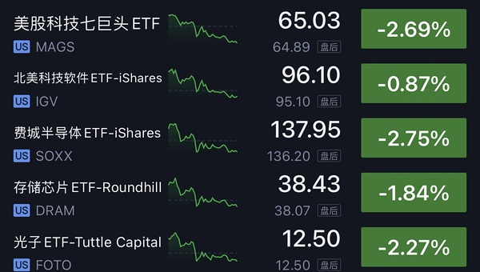
- 美国都这样 中鸡哪有希望 我们又不是红利

你们自己看着办吧

### 友友、网友们（提及 14 次，占比 4%）2026-11-20 12:41:38
- 楼里uu问我为什么一点不慌
经历多了自然是

因为一直给你们举例2025年此时是因为大家还记忆比较深刻 虽然大家遇到了也就忘记了去年这时候也这样 连续跌停

2024 924那年的11月18日也是80+跌停

- 标准开-4.7 刚刚到

而且nana还在跳

### 301010 晶雪节能（上周买回、11-16 持有）｜09:39『上周买了plus』＋14:53『掌声雪儿plus雪』；卖单 24.94 沿用 11-05 老价，当日高 24.39 未触及（提及 6 次，占比 2%）2026-11-20 09:04:58
- plus有人买的自己看着有机会兑现吧
- 我plus马上回本了 笑死
- 不如期待我们plus 15%嗨翻天

### 东方海洋（提及 6 次，占比 2%）2026-11-20 09:42:13
- 东方海洋带带我们龙版啊
- 漂亮啊东方海洋
- 昨天襄阳 九阳
今天东方海洋

### 双义：股票=中国长城 / 基金=华安文体健康混合（用户 11-05 指认）（提及 5 次，占比 1%）2026-11-20 11:29:01
- 没有襄阳
但我始终在为你加油呐喊

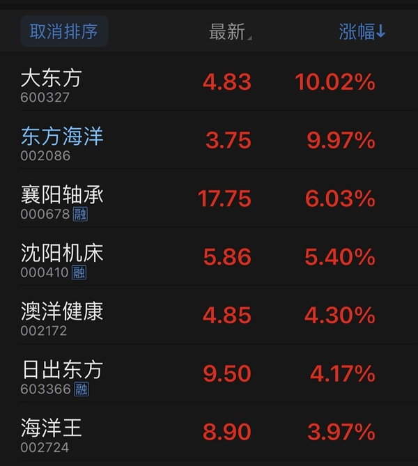
- 果然我们心有灵犀

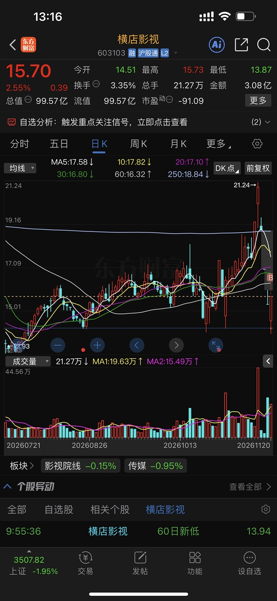
- 6月中国移动跌成狗啊 你会去才怪了
这是该去的时候 不会去的呀🤣🤣🤣

6月你在心心念念兆易创新 我都记得呢

在象征性买中证1000**（他在评论国家队托市行为，**不是他本人买入、也不是他的持仓**）；切勿读成他买了中证1000ETF（提及 3 次，占比 1%）2026-11-20 08:13:21
- 昨天最终他们扫了一些1000

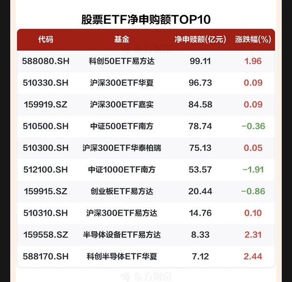
- 上证50ETF华夏放量超10倍
上证50ETF华夏（510050）强势拉升翻红，成交额超220亿元创历史最高成交记录，较昨日同时刻放量近10倍

脑子有病 分点钱来1000啊
- 是的啊 1000买这点 都能ETF狂飙了😂😂😂

### 华宝致远混合(QDII)C｜只在盯，未证他持有（提及 3 次，占比 1%）2026-11-20 08:43:49
- 今天小远跌幅应该不会少 他跟七巨头😂😂😂😂😂😂
- 今天很多基金都比他好应该 

昨天存储和光跌幅小于 七巨头
小远是七巨头主导
- 小远都买成七巨头了 你还担心啥😂😂😂

### 安记食品（提及 3 次，占比 1%）2026-11-20 08:50:05
- 不用防止周五手贱了！太太平平 安安心心的
- 去年12.17日
我做出了一次精美绝伦的转换
砍掉小慧转换安安 爽吃安安第二大波🤣🤣🤣🤣🤣🤣

去年安安就是那个能抵御双头的票🤣
- 但是不能太顺
一旦这样 我手贱就大幅度强化😂😂😂😂
最终安安赚的被xxz大幅度收割

### 300413 芒果超媒（对照，非持仓）｜11-13 14:01 本月涨幅 41.70% vs 幸福 53.76% →『幸福已经拉开芒果12%』＝12.06pp 精确命中；当日 −4.83%（提及 3 次，占比 1%）2026-11-20 10:22:44
- 芒果你跌不动就赶紧带个头 
要么爽快大跌
要么嗨起来啊
磨磨叽叽的
- 芒果火箭发射
- 加油芒果 
8月初9月初都是你带队的
我愿意订你一年会员

### 博纳影业（提及 3 次，占比 1%）2026-11-20 11:12:25
- 这周大家都跌 我不会说bn一句不好

下周情绪回暖反击 阿博自己看着办吧 下周我就有考核了
- bn sy你们重新对决吧
- 我需要阿博这种
时刻和我搞脑子 鞭策我不能太飘🤣🤣🤣🤣

### 东百集团（提及 3 次，占比 1%）2026-11-20 11:18:30
- 好戏在下周情绪反攻的时候

今天就是东哥去年拐弯的时候
- 你参考去年东哥好像12.2日就因为双头卡顿
一个跌停 一个-7下来重新聚集能量
- 我因为 27 28都在买东哥😂😂😂😂无暇顾及外加仓位问题

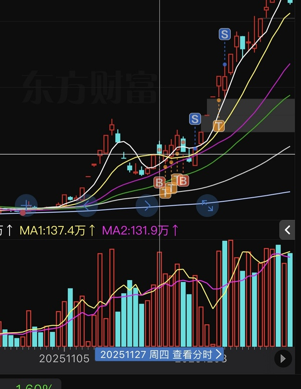

### 大连圣亚（提及 3 次，占比 1%）2026-11-20 14:49:25
- 没有 如果没有大连
我中午就是红色了
- 很遗憾 大连以这个方式荣登龙虎榜
- 大连在的啊😂现在1:1

### 富国全球科技互联网股票(QDII)A（提及 2 次，占比 1%）2026-11-20 08:25:57
- 网易云音乐：你们投票有bug 🏆是我
- 今天大家满平均

小广-1.86
小浦-1.73
网易云-1.62
华兄-1.59
小远-1.84

暂时华兄第一😂😂

### 中文在线（提及 2 次，占比 1%）2026-11-20 08:38:42
- 第一波创新药啥样子啊？点老师那时候在做的吧？

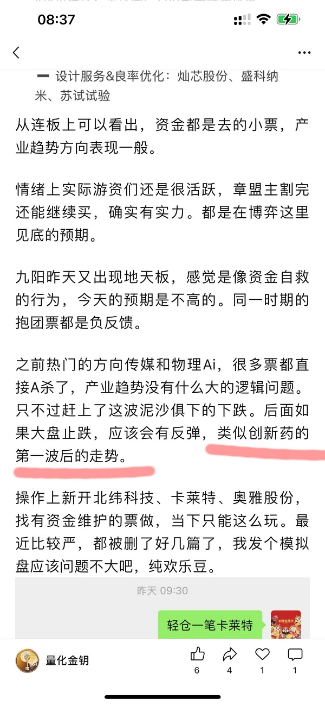
- 希望龙龙加油啊
V老师估计今天摸了不少类似的东西🤣

别学襄阳 没气质！
给做大哥 自己又不做了

### 引力传媒 603598（对手盘，非他持仓）｜11-06 +37.15%；11-09 本月+37.79%（提及 2 次，占比 1%）2026-11-20 11:05:44
- 比如yl就没有🤣🤣🤣🤣
- 我五一之前就买了和zy yl一起买的 一上来他就攻了50% 兑现几笔成本就下来了

### 招商银行（提及 2 次，占比 1%）2026-11-20 14:33:44
- 招招其实这个月也绿的
我女朋友这个月靠空调
- uu银行里区别也很大哦 
比如招招忙了半天一看1%

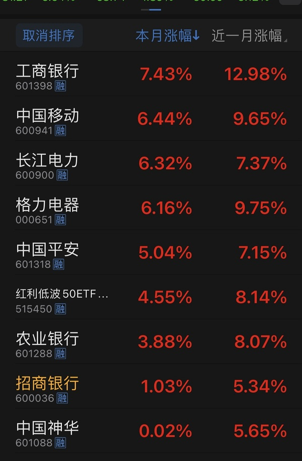

### ＝小华兄弟·华夏移动互联混合(QDII)（推断·证据不足不入表）｜11-16 17:26 裸报 -2.5% 疑似场外持有，无第一人称买入/持有自述、无截图（提及 2 次，占比 1%）2026-11-20 19:06:24
- 昨天挺奇怪 七巨头跌的比存储光很多
小远都输给华夏兄弟了
- 今天华夏兄弟居然以抗跌赢了😂

### 000530 冰山冷热｜11-11 10:16「万一冰山跌停 他能跌到哪里再去」＋10:27「今天把冰山 晶雪按死 大连 CBS 正统上位」（非持仓，冰雪板块的山寨对照）（提及 1 次，占比 0%）2026-11-20 09:32:37
- 加油啊襄阳 海洋
龙版 冰山 新华都加油啊

### 航空航天板块（提及 1 次，占比 0%）2026-11-20 10:06:33
- 这可没三月宇航员惨烈

### 601595 上海电影｜**他空仓**（11-09 起未回接）；11-12 09:38『天天念叨sy的给你们机会了』＋09:41『现在-6给你们机会了哈』＋13:15『马上sy跌停 bn还要尊敬一下他』＋13:51『与此同时 sy跌停』＋14:00『sy历来以残暴虐杀手法闻名』；实测收 42.15 −9.99% 跌停（提及 1 次，占比 0%）2026-11-20 11:09:47
- 对不起sy
是我太穷了没能再助力他一笔

### 600715（院线·他只在盯，非持仓）｜11-13 09:33 传媒板块截图 +10.03% 涨停、本月涨幅 66.67%（＝10-30 收盘基准独立复算分毫不差）；配 09:33『市场有转院线迹象』（提及 1 次，占比 0%）2026-11-20 13:04:34
- 你看文投控股

### 长白山 603099（CBS黑话；11-18 已清仓卖出）（提及 1 次，占比 0%）2026-11-20 15:15:54
- 我没有砍冰雪 只是cbs调仓给了雪儿

### 泸州老窖（提及 1 次，占比 0%）2026-11-20 16:58:28
- 毛毛沪深300 和 50 权重股！！！
第一大权重！！！！！！！！！！
因为妈妈不停买300 50

露露五粮液那种深圳票 不在50里面
而且沪深300权重现在也很低了 很很很后面 拿不到资金

 洗完澡一看 确实是动荡不安😅  ⊳ （引用 @vio）半夜醒来怎么看见这惊悚画面

- (2026-11-20 07:43:37) [图] 这也是挺有意思
七巨头跌的比存储和光还多

- (2026-11-20 07:51:54) 计算下今天的3300
昨天收盘0.65%对应期货1.9% 只剩0.4%未归还

实际晚上收跌-2.2 盘前-0.4
抹掉1.9 加上2.6=4.5%

今天3300标准开盘-4.5%（不归还0.4）
（但是目测今天又将吸引买入 不是标准开盘）

- (2026-11-20 07:53:02) 美国都这样 中鸡哪有希望 我们又不是红利

你们自己看着办吧  ⊳ （引用 @混乱中立同人女）楼，汇率有影响吗，会不会影响中基卖出计划？

- (2026-11-20 07:56:02) 凌晨情况是
我们的主动基金都跌的比nana少
这是近期少见的  ⊳ （引用 @🅰失而复🉐😎）是因为这个😕

- (2026-11-20 07:58:15) 嗯 但也是最近少有的情况

今天看看3300打多少溢价 正常开要-4.5了  ⊳ （引用 @🅰失而复🉐😎）指数是因为七巨头吧

- (2026-11-20 08:00:40) 白银：哥放大跌幅了  ⊳ （引用 @🅰失而复🉐😎）最刺激的还是它😇

- (2026-11-20 08:03:41) 是的 指数跌幅都大于我们基金  ⊳ （引用 @招招碎片收集中）昨天是通杀耶，标普道指也没少跌🤔

- (2026-11-20 08:06:43) 所以下行趋势的金银比我们做不了😂  ⊳ （引用 @🅰失而复🉐😎）再跌跌就差不多回到最初的模样了

- (2026-11-20 08:06:54) vix新高了  ⊳ （引用 @shirla）美股冰点？但是vix没有继续暴涨

- (2026-11-20 08:08:27) 今天我开闹钟了
我要看看十点半3300的资金是否还和6号一样争先恐后  ⊳ （引用 @shirla）美股冰点？但是vix没有继续暴涨

- (2026-11-20 08:09:44) 近在咫尺了  ⊳ （引用 @招招碎片收集中）打到余老师要的30

- (2026-11-20 08:13:21) [图] 昨天最终他们扫了一些1000

- (2026-11-20 08:14:26) 这个延迟一天更新的 你看顶上面时间

新浪财经是实时  ⊳ （引用 @Lyra）我是不是看错vix了😅这个图上还没有

- (2026-11-20 08:20:53) [图] 我有app
没有错

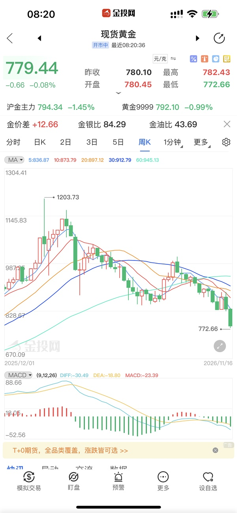  ⊳ （引用 @招招碎片收集中）我看她们攒金的APP金价已经780左右了

- (2026-11-20 08:23:12) 我们免费版 你懂的😂  ⊳ （引用 @shirla）堂堂wind竟然没有实时数据

- (2026-11-20 08:24:07) [图] 700是2025.7.30金价 那一天就是

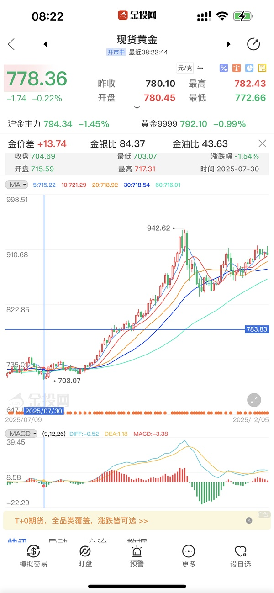  ⊳ （引用 @monica）金价700对应的伦金价格，我算错了

- (2026-11-20 08:25:57) 网易云音乐：你们投票有bug 🏆是我

- (2026-11-20 08:38:42) [图] 第一波创新药啥样子啊？点老师那时候在做的吧？

  ⊳ （引用 @点-重生炒垃圾）看大佳爱国链也分化了，要剔除假爱国，只剩华虹中芯那些了，感觉是好事吧，总算找了一个集中做多的地方了，再不打就说不过去了。芯片应该卒，这么多俏咪咪找韩国代工😅😅😅

- (2026-11-20 08:41:11) 日本最近跌的少 都要补回来  ⊳ （引用 @👑）日经225指数日内大跌3%，报57591.2点。软银集团暴跌14%，铠侠控股大跌近10%。

财联社的推送好吓人

- (2026-11-20 08:43:49) 今天小远跌幅应该不会少 他跟七巨头😂😂😂😂😂😂  ⊳ （引用 @招招碎片收集中）我也有这种感觉，前段时间被吹抗跌的通通补回来，小远又要挨骂一段时间了吗

- (2026-11-20 08:45:59) 懂了 熬呗😂  ⊳ （引用 @点-重生炒垃圾）看这个，第二波还挺大的

- (2026-11-20 08:47:20) 我在新浪A股模拟盘开了都是机器人的 周-20%🤣  ⊳ （引用 @速派女孩将发财）这周新浪财经分不到钱了

- (2026-11-20 08:48:31) 今天周五！  ⊳ （引用 @海贼）冰雪有反向科技不暴跌的风险吗😥

- (2026-11-20 08:50:05) 不用防止周五手贱了！太太平平 安安心心的  ⊳ （引用 @招招碎片收集中）你终于也跟我们一样了！满仓硬抗周五

- (2026-11-20 08:51:30) 你现在快去报  ⊳ （引用 @moli）还有钱分的吗，靠着做空一切我是不是有希望了😂

- (2026-11-20 08:52:46) 周五的期待始终是少跌是福😂  ⊳ （引用 @我超爱哭的）今天电影or冰雪会挺身而出拯救账户吗🙃

- (2026-11-20 09:01:57) A股钱多🤣🤣🤣🤣  ⊳ （引用 @moli）可恶总盘子才200块😂

- (2026-11-20 09:04:58) plus有人买的自己看着有机会兑现吧  ⊳ （引用 @shirla）今天是不是只有雪人两个条件单呀其他的也到不了都

- (2026-11-20 09:16:23) 给襄阳加油吧
昨天的领军者 别今天又跌停了  ⊳ （引用 @🅰失而复🉐😎）😕什么鬼吓死谁

- (2026-11-20 09:28:03) 最安稳的周五开局
无所事事

- (2026-11-20 09:28:39) 为襄阳呐喊助威  ⊳ （引用 @不知道还能说啥）最安稳的周五开局
无所事事

- (2026-11-20 09:29:55) 不用考虑抢什么
也不考虑卖什么了

真正的无所事事  ⊳ （引用 @vio）哈哈哈哈  不用合计抢哪个了

- (2026-11-20 09:32:37) 加油啊襄阳 海洋
龙版 冰山 新华都加油啊

- (2026-11-20 09:34:52) 跌停15个？还可以

- (2026-11-20 09:36:45) 慈文传媒四连板  ⊳ （引用 @lacey）金逸这是3连板了

- (2026-11-20 09:37:00) 让龙版新华一起来吧  ⊳ （引用 @公主要发财）龙版来了

- (2026-11-20 09:38:09) 今天跌停家数就不符合冰点😂
我们那个冰点果然是发生不了

- (2026-11-20 09:41:06) 我plus马上回本了 笑死  ⊳ （引用 @招招碎片收集中）180多家红的，我居然有一个，虽然也是深套😂😂

- (2026-11-20 09:41:25) 不如期待我们plus 15%嗨翻天  ⊳ （引用 @momomomomomo哒）冰山能不能板一个然后带其他冰雪一起板

- (2026-11-20 09:42:13) 东方海洋带带我们龙版啊

- (2026-11-20 09:42:21) 漂亮啊东方海洋  ⊳ （引用 @不知道还能说啥）东方海洋带带我们龙版啊

- (2026-11-20 09:43:00) 昨天襄阳 九阳
今天东方海洋  ⊳ （引用 @不知道还能说啥）东方海洋带带我们龙版啊

- (2026-11-20 09:43:18) 襄阳能不能两连板 情绪回暖很重要啊  ⊳ （引用 @招招碎片收集中）哈哈哈哈哈哈哈哈哈哈哈哈买到龙头啦，有一个涨停，开局大好

- (2026-11-20 09:44:08) 我没设置  ⊳ （引用 @shirla）2294我设置的是，你是多少啊楼楼

- (2026-11-20 09:44:20) 你们自己看着搞

我今天什么单子都没开  ⊳ （引用 @shirla）2294我设置的是，你是多少啊楼楼

- (2026-11-20 09:45:32) 东方海洋也是消费也是医疗
襄阳是机器人

他们有其他板块的  ⊳ （引用 @该用户已过期）还是🐑？

- (2026-11-20 09:45:47) 不走的 我昨天说了  ⊳ （引用 @🅰失而复🉐😎）龙走不走

- (2026-11-20 09:46:17) 我昨天说过
下周情绪回暖
你让我今天走？不可能的事情

我怎么想的就是怎么操作的  ⊳ （引用 @🅰失而复🉐😎）我也，跌这么狠只能等回血了

- (2026-11-20 09:47:32) 传媒永恒核心

龙版

- (2026-11-20 09:47:52) 他会带动大家的！漂亮龙龙  ⊳ （引用 @YuanZi💕）龙板涨停

- (2026-11-20 09:48:25) 跌停缩小至个位数

- (2026-11-20 09:48:40) 比去年86跌停次日暂时更好  ⊳ （引用 @不知道还能说啥）跌停缩小至个位数

- (2026-11-20 09:49:23) 也有可能襄阳那边吧

不过只要传媒继续龙版应该都是领队😂  ⊳ （引用 @sickid）5日线拐头了，难道他是跨年妖？

- (2026-11-20 09:49:35) 祝福襄阳两连板

- (2026-11-20 09:50:55) 慈文传媒打开！！

- (2026-11-20 09:51:31) 慈文敢博地天吗🤣🤣🤣🤣🤣🤣🤣🤣  ⊳ （引用 @🅰失而复🉐😎）带它们俩🫠

- (2026-11-20 09:57:57) 只有他继续往上 传媒才有希望  ⊳ （引用 @🅰失而复🉐😎）昨天开板速度拉板，今天能不能封住

- (2026-11-20 09:59:15) 慈文传媒火箭发射

- (2026-11-20 09:59:21) 冲起来  ⊳ （引用 @不知道还能说啥）慈文传媒火箭发射

- (2026-11-20 10:00:49) 早上大部分都是-9 跌停 没区别吧？  ⊳ （引用 @超级无敌迷你装）又忘记周五组训，手贱补了……

- (2026-11-20 10:01:10) 我已经在为慈文呐喊了  ⊳ （引用 @YuanZi💕）慈文要来了？

- (2026-11-20 10:01:49) 今天跌停很少了
下周情绪会回暖很有希望 耐心持有了  ⊳ （引用 @红红火火的anya）今天科技跌的还真不多，中际都没新低，杀得只是我的账户

- (2026-11-20 10:02:10) 我能看到plus15+吗😂  ⊳ （引用 @sickid）冰山涨停

- (2026-11-20 10:02:32) [图] 

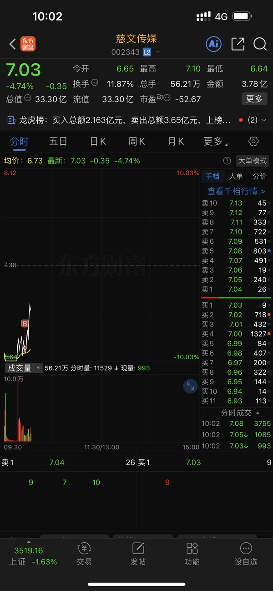  ⊳ （引用 @🅰失而复🉐😎）我去了

- (2026-11-20 10:03:59) 这周雪儿怎么跌的 下周怎么回来  ⊳ （引用 @momo）雪人地天一个吧求求了

- (2026-11-20 10:04:24) 下周我们会大丰收的 
下周情绪会反攻

- (2026-11-20 10:06:33) 这可没三月宇航员惨烈  ⊳ （引用 @momo）你是什么大心脏怪物啊？你好可怕真的。（非辱骂）我们全部都已经吓尿了。

- (2026-11-20 10:07:49) 网易-20  ⊳ （引用 @招招碎片收集中）恒科跌幅超4%

- (2026-11-20 10:08:33) PCB概念再度拉升 超声电子、澳弘电子双双涨停
PCB概念盘中再度拉升，超声电子、澳弘电子涨停，此前中京电子、光华科技涨停，满坤科技涨超10%，中瓷电子、逸豪新材、四会富仕等跟涨。

- (2026-11-20 10:08:48) 天少跌很多啊  ⊳ （引用 @大连海底站岗员）gx真垃圾啊

- (2026-11-20 10:09:11) 农业股异动拉升，万向德农冲击涨停，秋乐种业、康农种业、花溪科技、神农种业、金健米业纷纷冲高。

- (2026-11-20 10:10:03) 昨天快手 网易业绩不及预期  ⊳ （引用 @招招碎片收集中）它咋啦，总不能是因为那个游戏关服吧

- (2026-11-20 10:13:16) 他变强有原因吗😂  ⊳ （引用 @六倍做多退休）woww新易盛又红了 你小子真变强了

- (2026-11-20 10:15:56) 哈哈哈哈哈哈哈  ⊳ （引用 @Frances）恒生科技已经比上证还低了

- (2026-11-20 10:16:02) 是的  ⊳ （引用 @momo）放量是好信号吗

- (2026-11-20 10:19:01) [图] 哦你这么一说我看了下 我悟了

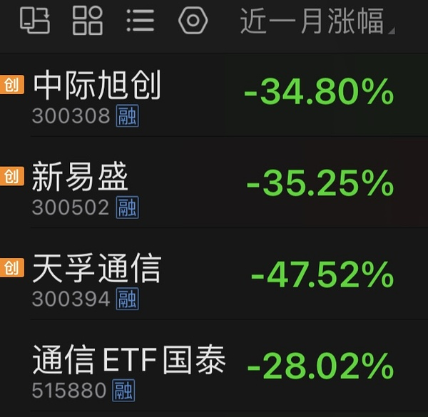  ⊳ （引用 @六倍做多退休）😂不知道 但是的确他今年跌的最惨

- (2026-11-20 10:21:20) 跌停数减少是第一步  ⊳ （引用 @长成大🌲）看了一眼怎么还是5000+下跌

- (2026-11-20 10:22:44) 芒果你跌不动就赶紧带个头 
要么爽快大跌
要么嗨起来啊
磨磨叽叽的

- (2026-11-20 10:24:47) 嗯 但当他跌的多
三天-6 -17 -11😂  ⊳ （引用 @点-重生炒垃圾）果麦已经带头了？

- (2026-11-20 10:25:55) [图] 可转债拉升

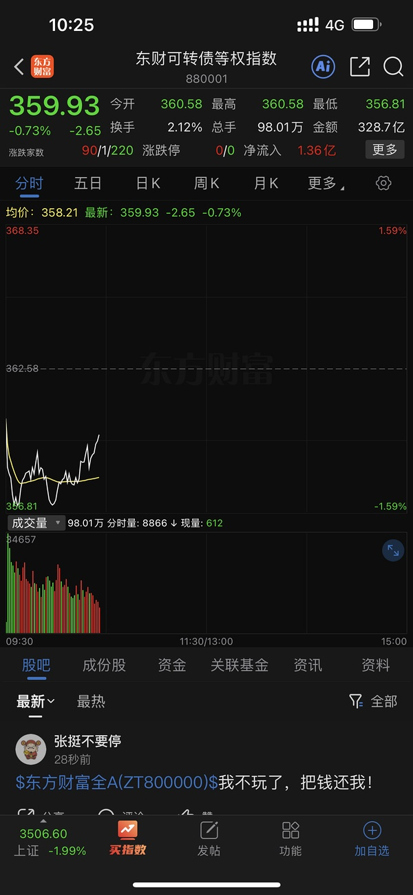

- (2026-11-20 10:26:54) 我有个东西能换 
高风险操作就不多说了

毕竟马上就跌停了  ⊳ （引用 @shirla）楼你不是没钱了嘛！

- (2026-11-20 10:28:17) 可转债是市场先行指标  ⊳ （引用 @招招碎片收集中）老大，这个代表啥

- (2026-11-20 10:29:41) [图] nana-0.6现在
标准开应该-4.7

- (2026-11-20 10:32:18) 都没达到标准开
又提高了溢价  ⊳ （引用 @早八走狗来财）开盘马上掉。。。

- (2026-11-20 10:36:55) nana在跳水
3300拉升

每次大跌 都有人疯狂bbbbbbbb  ⊳ （引用 @仓部加措）按楼设置的，最后一滴买到最低了吧今天！

- (2026-11-20 10:39:53) 以前他们玩法 这时候批量扫四连板三连板的跌停 博几率😂😂😂  ⊳ （引用 @VVV坚定持有VVV）摸完一圈电门之后，我知道了，我不是秦始皇

- (2026-11-20 10:42:18) -7以上跌幅从560个
降低到140个了

- (2026-11-20 10:43:07) 小声说我也去了 两个  ⊳ （引用 @VVV坚定持有VVV）我就去摸了这些😂看看下周一电不电死我，还是能赢麻了

- (2026-11-20 10:43:35) 现在和你说你也不信
你下周就知道了  ⊳ （引用 @momo）为什么下周情绪会回暖呢

- (2026-11-20 10:45:20) 传媒的连续跌停就那几个 我就不说了 高风险  ⊳ （引用 @UPUP）楼楼去了哪两个

- (2026-11-20 10:47:15) 我们其实已经对过一只了😂  ⊳ （引用 @VVV坚定持有VVV）和哈哈哈哈哈哈哈哈哈哈哈哈下周一对答案

- (2026-11-20 10:48:33) 老垃圾人经验
跌停数量最多的一天外加次日跌停急剧减少
那这两天就是情绪转换点

只要今天午后跌停数量不要又爆增
就已经看到了

- (2026-11-20 10:49:00) 我偏心 我买的都是传媒的
其他的我也懒得看了😂😂😂  ⊳ （引用 @VVV坚定持有VVV）哈哈哈哈哈我另一支好像没摸对，还是没好好学习，昨晚没复习跌停连板的票😂

- (2026-11-20 10:49:46) 没有
我不是说了吗
连续跌停的  ⊳ （引用 @🅰失而复🉐😎）新华去了没

- (2026-11-20 10:50:51) 期待襄阳两连板 彻底激活  ⊳ （引用 @点-重生炒垃圾）👑

- (2026-11-20 10:51:58) 4:6  ⊳ （引用 @🐮）楼现在冰雪和电影的比例是怎么样的

- (2026-11-20 10:52:31) 物理ai  ⊳ （引用 @YuanZi💕）ty都拉红了

- (2026-11-20 10:53:15) 东方海洋不是已经涨停了吗哈哈

下周一再期待他

襄阳人家昨天领队啊 今天继续领队 炒作情绪就容易回来了  ⊳ （引用 @招招碎片收集中）怎么瞧不起我们小东方吗？

- (2026-11-20 10:56:33) 梦一个今天不亏钱 或者亏很少？

- (2026-11-20 10:57:06) 有地天板大家互相通知 不管是什么😂  ⊳ （引用 @VVV坚定持有VVV）哇超另一个电门反超cw了，cw你行不行啊

- (2026-11-20 10:58:35) 现在是我这两天亏最少的😂  ⊳ （引用 @🅰失而复🉐😎）我现在还是碧绿🫣

- (2026-11-20 10:59:11) 期待复刻我们三月份收益率超级V的名场面  ⊳ （引用 @🅰失而复🉐😎）我现在还是碧绿🫣

- (2026-11-20 11:02:37) 光线防守用处已经完成了 少跌了 
去不去掉看你自己了  ⊳ （引用 @we）幸福和光线是电影吧

- (2026-11-20 11:05:44) 比如yl就没有🤣🤣🤣🤣  ⊳ （引用 @只想搞钱）一看持仓全是被缺口压下去的，但是这两天的跌法谁能没缺口啊

- (2026-11-20 11:06:45) 芒果火箭发射

- (2026-11-20 11:06:54) 跌不动就站出来👍  ⊳ （引用 @不知道还能说啥）芒果火箭发射

- (2026-11-20 11:08:23) 👍👍👍👍👍👍👍👍

跌得动的使劲跌 下周反攻

跌不动的及时站出来做表率

大家互相配合呀  ⊳ （引用 @点-重生炒垃圾）我今天借了点大连去的

- (2026-11-20 11:09:14) 加油芒果 
8月初9月初都是你带队的
我愿意订你一年会员

- (2026-11-20 11:09:47) 对不起sy
是我太穷了没能再助力他一笔  ⊳ （引用 @招招碎片收集中）这个上影也一身牛劲

- (2026-11-20 11:10:37) 周五冰雪你懂的
周五电影人  ⊳ （引用 @🅰失而复🉐😎）今天冰人们上冻了😵

- (2026-11-20 11:11:50) [图] rmb在玩什么

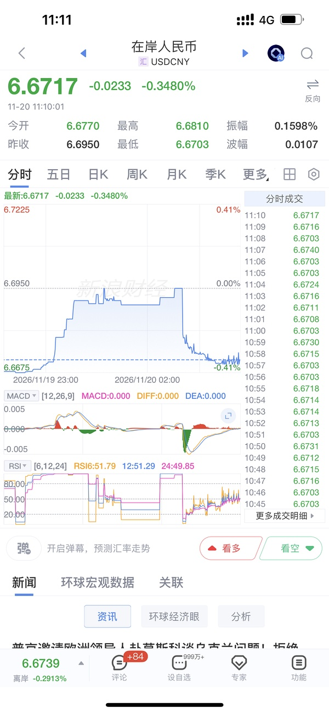  ⊳ （引用 @六倍做多退休）全球资产主跌浪了 看了眼黄金😂 

- (2026-11-20 11:12:25) 这周大家都跌 我不会说bn一句不好

下周情绪回暖反击 阿博自己看着办吧 下周我就有考核了  ⊳ （引用 @招招碎片收集中）bn目前没有输给他！恰信一搜！！

- (2026-11-20 11:13:43) 哈哈哈哈你忘了我们有个存钱罐
存钱罐干嘛用的
需要花钱时候摔碎它取钱🤣🤣🤣🤣🤣  ⊳ （引用 @vio）你还有钱 你不正常！

- (2026-11-20 11:14:55) 标准开-4.7 刚刚到

而且nana还在跳  ⊳ （引用 @招招碎片收集中）nana溢价率好像在掉耶🤔

- (2026-11-20 11:16:47) 光线拆成两个

目前转换的很好 光线跌的少也确实涨不动😂😂😂  ⊳ （引用 @🅰失而复🉐😎）楼你买了多少龙是小试牛刀还是大刀破斧那种

- (2026-11-20 11:17:31) 只要情绪回暖 怎么买都是对的😂祝你嗨翻天  ⊳ （引用 @shirla）差生挠头，不管了，反正我已经摔碎存钱罐把楼提到的cw yl mg都买了！

- (2026-11-20 11:18:08) 四连板到底？

是不是没有五连板的  ⊳ （引用 @六倍做多退休）文投也开了😂放人了

- (2026-11-20 11:18:30) 好戏在下周情绪反攻的时候

今天就是东哥去年拐弯的时候  ⊳ （引用 @VVV坚定持有VVV）来人，给我上35kV高压电！

- (2026-11-20 11:19:44) mg牛逼啊每次都带队
我忘了😂😂😂😂😂😂😂😂
太贪了 只想着地天 忘记还有20cm的  ⊳ （引用 @shirla）差生挠头，不管了，反正我已经摔碎存钱罐把楼提到的cw yl mg都买了！

- (2026-11-20 11:20:22) 我们之后再对答案吧
大家选的也许更好
不要互相干扰  ⊳ （引用 @仓部加措）楼买了金逸么

- (2026-11-20 11:20:48) 情绪回暖怎么买都对
无非涨的多涨的少  ⊳ （引用 @仓部加措）楼买了金逸么

- (2026-11-20 11:21:52) 全线回暖 开始大范围扩散情绪了
乱七八糟的小垃圾都火箭发射了

- (2026-11-20 11:24:16) plus如果15+走不走？我在考虑这个😂  ⊳ （引用 @🅰失而复🉐😎）好了剩下两手扔了去博纳

- (2026-11-20 11:25:27) 垃圾人只能领悟垃圾情绪
这科技领悟起来真费劲  ⊳ （引用 @点-重生炒垃圾）所有的不开心就留在今天把，包括美股 ，希望美股差不多得了，今天再跌就刷新vix来个30漂亮收尾吧 ！！！

- (2026-11-20 11:26:00) bn sy你们重新对决吧

- (2026-11-20 11:27:04) 考虑好了 15%以上走的

因为我仓位太高了 如果15+ 雪儿我那边不开单子
必然激活雪儿 雪儿我就不动  ⊳ （引用 @shirla）考虑好了告诉我哦！我条件单看看要不要关

- (2026-11-20 11:29:01) [图] 没有襄阳
但我始终在为你加油呐喊

- (2026-11-20 11:29:31) 没呢
今天目标少亏

下周活血  ⊳ （引用 @🅰失而复🉐😎）你们红了没啊我咋还绿🫣

- (2026-11-20 11:29:48) 那我就有希望翻红了  ⊳ （引用 @西西西西）zy和xf也红啦

- (2026-11-20 11:30:43) 谢谢他了 改不掉暴涨暴跌的坏毛病  ⊳ （引用 @招招碎片收集中）xf又降临在你手心了

- (2026-11-20 11:34:11) [图] 去年86个跌停的 次日29个跌停 
此后越来越少 涨停越来越多 开启垃圾第二波

目前暂时好于去年大跌停次日

考虑到目前市场情绪远不及去年此时 
今天还是周五 能这样子非常不错了

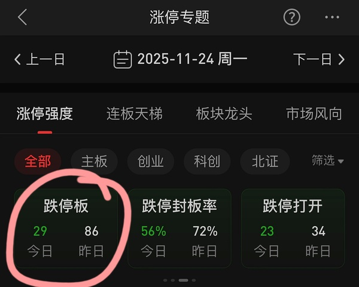

- (2026-11-20 11:35:23) 我们有存钱罐 😂😂😂
而且存钱罐和买的是一类  ⊳ （引用 @高手云集上钻）你们咋都还有钱这里抄一股那里抄一股，我恨我的穷😅

- (2026-11-20 11:36:06) 对情绪有帮助都行呀
你看我买的传媒 也一直在为襄阳加油呐喊😂  ⊳ （引用 @招招碎片收集中）话说老大，有个好当家其实勉强算地天，但他不是传媒板块 是不是就无效观测

- (2026-11-20 11:37:20) 我猜测今天温暖老师也大举扫货开始测试😂不知道对不对

- (2026-11-20 11:43:21) [图] 趁着大家现在还是悲观为主情绪
乐观了就没人看了😂😂😂😂😂

如果下周开启反攻 第二波垃圾必然到12月下旬又会歇菜
有时候还有第三波有时候就彻底歇菜了
大家记得日期啊 

还有就是如果下周反攻后 
也很容易在12.4-12.5附近中断几天卡壳
因为差不多运行到这个时候一批高位股回去做双头
一批能抵御双头再创新高
有一批就彻底结束了炒作

小卡点12月4-5
大卡点12月17-19
这都是垃圾人的时间效应

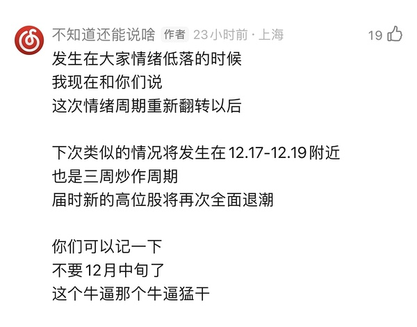

- (2026-11-20 11:47:42) 去年12.17日
我做出了一次精美绝伦的转换
砍掉小慧转换安安 爽吃安安第二大波🤣🤣🤣🤣🤣🤣

去年安安就是那个能抵御双头的票🤣  ⊳ （引用 @VVV坚定持有VVV）我昨天已经严肃复习过了，12.19九牧王害我

- (2026-11-20 11:48:32) 那批高位股反弹到双头一定有一部分会卡壳 应该肯定有小卡点😂  ⊳ （引用 @vio）对比去年，今年调整这波好猛烈，会不会没有小卡点

- (2026-11-20 11:49:17) 你参考去年东哥好像12.2日就因为双头卡顿
一个跌停 一个-7下来重新聚集能量  ⊳ （引用 @vio）对比去年，今年调整这波好猛烈，会不会没有小卡点

- (2026-11-20 11:53:01) [图] 然后做得太顺 问题就来了
手贱强化 飘了
最终被xxz大幅收割
最后四天如果没有xxz收割
去年12月15%以上稳如狗啊😅😅😅😅

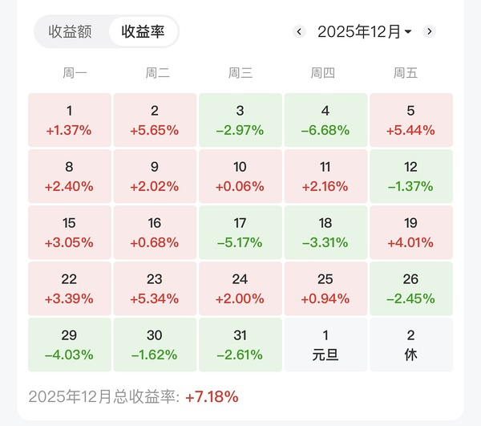  ⊳ （引用 @招招碎片收集中）我记得 那天跟着抄安安地板！！！

- (2026-11-20 11:53:38) 但是不能太顺
一旦这样 我手贱就大幅度强化😂😂😂😂
最终安安赚的被xxz大幅度收割  ⊳ （引用 @vio）就是那天
还有一次是hf换卫星，太完美了

- (2026-11-20 11:54:05) 我需要阿博这种
时刻和我搞脑子 鞭策我不能太飘🤣🤣🤣🤣  ⊳ （引用 @招招碎片收集中）是地板对吧！但我忘了是不是当天就拉起了！

- (2026-11-20 11:55:29) 不是第二天开盘还是深水开的好像  ⊳ （引用 @招招碎片收集中）是地板对吧！但我忘了是不是当天就拉起了！

- (2026-11-20 11:57:26) 我看好下周情绪反攻的呀
我今天什么单子都没开了😂

那个plus15+ 我就去手动S 其他我一个都不卖
我怎么看的就怎么做 言行合一  ⊳ （引用 @Lyra）今天xf都不开单吧？

- (2026-11-20 12:03:34) 11/28日😂😂😂
我看了下 我在26号卖了😂
那天跌停我也没去 楼里很多人都去了  ⊳ （引用 @招招碎片收集中）还有一天很精彩的就是xxz地天！楼里蛮多uu抄了的，也是肌肉哥的封神之战😂😂😂

- (2026-11-20 12:05:19) [图] 我因为 27 28都在买东哥😂😂😂😂无暇顾及外加仓位问题

  ⊳ （引用 @vio）记忆犹新😂那天眼看着没敢捞，错过那一大波

- (2026-11-20 12:10:15) 那你去年12月挺好的啊（如果没和我一样xxz悲剧的话）  ⊳ （引用 @vio）看我严格跟随，基本一模一样😂

- (2026-11-20 12:11:53) 砸碎存钱罐搞了连续跌停的 高风险操作 误看
主要的都在  ⊳ （引用 @一切都会过去的）楼上午什么操作 换仓了吗

- (2026-11-20 12:15:45) [图] 没红呢
但是进步了 也值得高兴啊😂

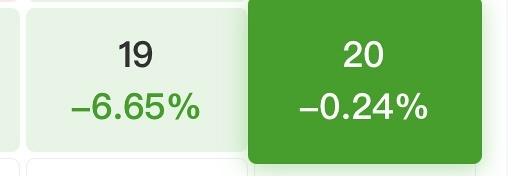  ⊳ （引用 @想当富有的咸鱼）楼里大家好嗨，我瞅了眼我的仓，跟大家悲喜不同步啊😂

- (2026-11-20 12:19:48) 应该是我冰雪没那么多 电影今天跌的少 而且我有龙哥😂  ⊳ （引用 @一切都会过去的）我还是-2 哪里出问题了😂😂😂就没跟上抄跌停吗

- (2026-11-20 12:21:01) ？？？？？？？？？  ⊳ （引用 @想当富有的咸鱼）我比早上开盘还更绿了😂

- (2026-11-20 12:22:47) 但是红利和开盘也差不多
科技也比开盘好吧😂  ⊳ （引用 @想当富有的咸鱼）我有科技和红利啊😂你忘了吗

- (2026-11-20 12:26:45) 那你昨天绿的比我多不😂

你们只有一个不知道呀 那个不知道的还不如慈文的表现呢🤣🤣🤣🤣  ⊳ （引用 @🅰失而复🉐😎）我还绿2你就0.2了？我电影更多也是4/6怎么就没这样体现出来，你难道是后面买的隐藏款传媒多

- (2026-11-20 12:32:47) 主要还是看下午
咱们手里除了中影
其他几个攻击力都不弱的  ⊳ （引用 @🅰失而复🉐😎）说的晚了仓位没跟上，主要还是没钱😒

- (2026-11-20 12:33:40) 慈文今天开局可是四连板😂😂😂  ⊳ （引用 @🅰失而复🉐😎）后排就这几个不如慈文了

- (2026-11-20 12:41:38) [图] 楼里uu问我为什么一点不慌
经历多了自然是

因为一直给你们举例2025年此时是因为大家还记忆比较深刻 虽然大家遇到了也就忘记了去年这时候也这样 连续跌停

2024 924那年的11月18日也是80+跌停

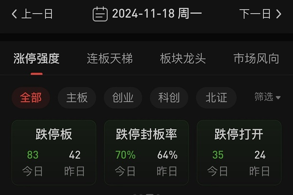

- (2026-11-20 12:42:04) 这是十一月份进入第三周时候
炒作打到顶峰以后的常规情绪退潮  ⊳ （引用 @不知道还能说啥）楼里uu问我为什么一点不慌
经历多了自然是

因为一直给你们举例2025年此时是因为大家还记忆比较深刻 虽然大家遇到了也就忘记了去年这时候也这样 连续跌停

2024 924那年的11月18日也是80+跌停

- (2026-11-20 12:45:58) 昨天回本就一会儿就亏了啊
今天才是回本了😂  ⊳ （引用 @该用户已过期）前几天就摸了，他说自己去了个传媒，但不说，我就猜到是龙版了😂😂但是没钱就没去了……他昨天才回本的😆🤣🤣

- (2026-11-20 12:48:28) 之前有个uu不是反问我的嘛
看好龙版是每次的核心为什么不直接去龙版呢😂  ⊳ （引用 @该用户已过期）前几天就摸了，他说自己去了个传媒，但不说，我就猜到是龙版了😂😂但是没钱就没去了……他昨天才回本的😆🤣🤣

- (2026-11-20 12:54:44) [图] 我看他每次爆量见顶 传媒板块就见顶

每次他触底 板块就触底 两次还先于板块触底

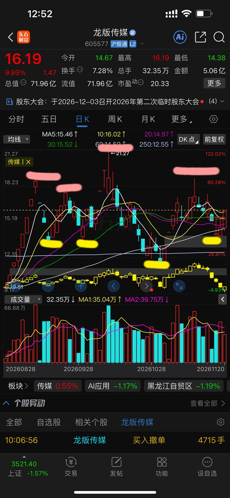  ⊳ （引用 @sickid）请教一下楼，龙版这个图在前两天看来很像三顶啊，你为啥觉得是核心呢？

- (2026-11-20 12:56:09) 是不是因为这个更垃圾🤣🤣🤣🤣  ⊳ （引用 @第四个影子）还有这个，互联网金融都还行的，感觉是有资金一直在博弈反弹了，银之杰啥的走势也还行

- (2026-11-20 12:59:51) 嗯 但是大针就是提示
而且那天有许许多多针 我记得uu发了很多还是对子顶  ⊳ （引用 @想当富有的咸鱼）上一个爆量的红柱子感觉没有前前面那个红柱子高啊

- (2026-11-20 13:00:56) 和中影道歉

对不起  ⊳ （引用 @不知道还能说啥）主要还是看下午
咱们手里除了中影
其他几个攻击力都不弱的

- (2026-11-20 13:01:23) 已经道歉  ⊳ （引用 @🅰失而复🉐😎）中反向

- (2026-11-20 13:02:45) 😂😂😂😂😂😂😂😂😂  ⊳ （引用 @该用户已过期）什么上影什么幸福，全是垃圾

- (2026-11-20 13:04:34) 你看文投控股  ⊳ （引用 @🅰失而复🉐😎）上影背刺😵

- (2026-11-20 13:04:47) 我也看到了👍👍👍  ⊳ （引用 @点-重生炒垃圾）地天还是文投厉害啊，2+了🤣🤣🤣

- (2026-11-20 13:06:14) 是有的哎
如果收入不足三亿的话😂  ⊳ （引用 @六倍做多退休）😂笑死楼友说它有st的风险 这个股吧里全是地板卖出的截图

- (2026-11-20 13:07:11) 所以加息预期还减弱了😂  ⊳ （引用 @moli）2年期美债都4.729了

- (2026-11-20 13:16:30) [图] 果然我们心有灵犀

  ⊳ （引用 @VVV坚定持有VVV）hd站起来，把什么脖子zysy都给我干下去！！！

- (2026-11-20 13:17:38) 扫的就是四连板😂  ⊳ （引用 @VVV坚定持有VVV）原来我们去的是同一个！！

- (2026-11-20 13:19:51) 😂我不熟悉他之前炒作的是什么方向的 而且300万封单好像😂😂😂😂😂😂😂😂😂  ⊳ （引用 @sickid）那为啥没去文投哈哈

- (2026-11-20 13:27:05) 加油
我和他诚挚道歉
他是本周最棒的  ⊳ （引用 @稀里不糊涂）中影加油

- (2026-11-20 13:29:29) [图] 没有
我说了这句😂

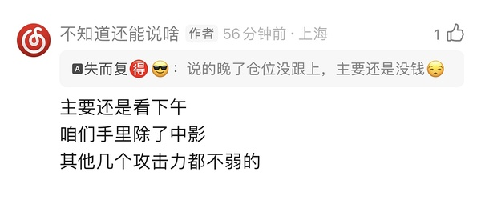  ⊳ （引用 @sickid）为啥道歉，你没减仓吧？

- (2026-11-20 13:31:56) 芒果加把劲啊
正好有几个uu都去了  ⊳ （引用 @sickid）今天就靠果麦华智在撑

- (2026-11-20 13:36:38) 😂😂😂😂😂😂PK 3K？  ⊳ （引用 @六倍做多退休）😂

- (2026-11-20 13:38:30) 今天也就红了四个银行😂  ⊳ （引用 @👑）又天天拉银行，真是无语

- (2026-11-20 13:42:41) 存钱罐呀😂  ⊳ （引用 @该用户已过期）光线这会怎么稳住了？

- (2026-11-20 13:44:58) 周五还是有威力

- (2026-11-20 13:46:44) 周五冰雪不行的
期待电影拯救比较现实  ⊳ （引用 @👑）哈哈哈，雪人又一个跌停

- (2026-11-20 13:48:31) 快讯：科创50指数跌幅扩大至4% 海光信息、沐曦股份跌超9%

这算补跌？

- (2026-11-20 13:53:38) 这个溢价失真
因为凌晨-2净值没更新
你晚上等场外更新看溢价率就不一样了  ⊳ （引用 @速派女孩将发财）3300溢价好像只有14了  是不是提前算入了晚上的跌幅

- (2026-11-20 13:55:26) 因为贵金属都在反弹  ⊳ （引用 @👑）紫金矿业都拉了三个点🌚

- (2026-11-20 13:56:57) 不用去年😂
三月 六月就是  ⊳ （引用 @稀里不糊涂）什么时候好转啊，这局面去年也经历过吗，怎么感觉这更恐怖

- (2026-11-20 13:57:09) 就是期货在反弹啊  ⊳ （引用 @👑）感觉先于期货反弹也，是预判吧

- (2026-11-20 14:02:52) 所以不是某个票某个板块自身的问题
机器人那边很多没涨过的也是节节败退  ⊳ （引用 @赚💰💰易如反掌）惠发也很可怕啊，我没跑完本周一到现在就跌了36个点

- (2026-11-20 14:04:12) 周五下午反正也很熟悉的  ⊳ （引用 @🅰失而复🉐😎）拉大盘了

- (2026-11-20 14:11:40) 20几个点吧  ⊳ （引用 @点-重生炒垃圾）你朋友的针一直都没卖吗？应该也亏不少了吧

- (2026-11-20 14:19:25) 因为-2%的净值没更新 晚上你去看就会加上2%溢价  ⊳ （引用 @一切都会过去的）3300溢价好像下来了点

- (2026-11-20 14:22:20) 场外都是大的  ⊳ （引用 @稀里不糊涂）真不怪我爸说，买就买大的，死也要死在大的里面，小的风险太大了

- (2026-11-20 14:29:14) 200个红的
大家手里是不是也有至少一个

- (2026-11-20 14:30:56) 这个我看得开
不吃这个
吃的也是传媒的😂  ⊳ （引用 @该用户已过期）你说的对🥹🥹生吃冰雪俩两连跌停

- (2026-11-20 14:33:44) 招招其实这个月也绿的
我女朋友这个月靠空调  ⊳ （引用 @一切都会过去的）招招😅

- (2026-11-20 14:35:25) 周五尾盘他们都是跳水
这一次周五尾盘冰雪没办法跳了  ⊳ （引用 @👑）雪人都不开门

- (2026-11-20 14:41:44) 你这？
这个月一直都是雪儿给大家赚钱啊  ⊳ （引用 @Mint妤）雪人都比大连起来快

- (2026-11-20 14:42:04) 你又不是刚知道  ⊳ （引用 @小确幸）为什么大连和长白山不跟啊

- (2026-11-20 14:44:22) 去年赚很多的 
毕竟恒科的55%大部分和创综的35%都结在去年  ⊳ （引用 @茅五泸荣誉黑粉）好奇问一下，经历了这几个月，还有人这两年累计是盈利的吗🤣

- (2026-11-20 14:46:22) 我不是昨天就是这么做了吗  ⊳ （引用 @we）快卖了大连cbs去雪人

- (2026-11-20 14:47:56) 招行有一个坚不可摧的趋势线你发现没  ⊳ （引用 @一切都会过去的）今天加的招继续赚钱（我真的不想

- (2026-11-20 14:49:25) 没有 如果没有大连
我中午就是红色了  ⊳ （引用 @一切都会过去的）大连也卖了吗😂

- (2026-11-20 14:53:23) 哈哈哈 这些东西大家都半斤八两  ⊳ （引用 @只想搞钱）昨天没走的安跟东又是两巴掌抽过来

- (2026-11-20 14:54:29) 今天周五 不说现在情绪 周五午后也是老特色  ⊳ （引用 @只想搞钱）中午安还拉红了的，真以为有希望呢下午亏损翻倍抽过来

- (2026-11-20 14:56:32) 他们今天50 300买太多了  ⊳ （引用 @点-重生炒垃圾）银行好像给判死刑了一样

- (2026-11-20 14:56:54) 上证50ETF华夏放量超10倍
上证50ETF华夏（510050）强势拉升翻红，成交额超220亿元创历史最高成交记录，较昨日同时刻放量近10倍

脑子有病 分点钱来1000啊  ⊳ （引用 @不知道还能说啥）他们今天50 300买太多了

- (2026-11-20 14:59:05) 😂不知道啊
这个买了十倍又有啥用😂😂😂😂  ⊳ （引用 @六倍做多退休）是不是换人了 去年救的蛮好的 今年好像是新兵蛋子上岗一样

- (2026-11-20 14:59:39) [图] 真的牛逼 去年4.7也没多少

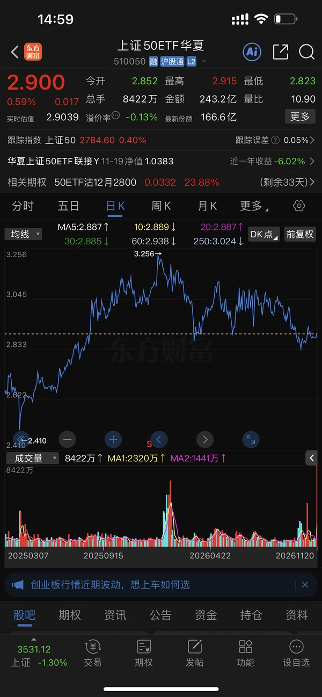  ⊳ （引用 @六倍做多退休）是不是换人了 去年救的蛮好的 今年好像是新兵蛋子上岗一样

- (2026-11-20 15:00:10) 有出口呢 人家无所谓消费 😂  ⊳ （引用 @家不住海边）早上没喷错吧
就是这么拉
活该消费不起来

- (2026-11-20 15:01:36) 算了 我也喷不了
我女朋友毕竟当提款机的😂😂😂😂  ⊳ （引用 @👑）这态度我认为就是表达，自己是想收割

- (2026-11-20 15:02:43) 😂😂😂😂  ⊳ （引用 @钱多多多多多）累了

- (2026-11-20 15:03:12) 是的 Q3 GDP超额完成 大超预期  ⊳ （引用 @aoao钱来）对应国内的经济形势，是不是好不起来了？

- (2026-11-20 15:06:13) 是的啊 1000买这点 都能ETF狂飙了😂😂😂  ⊳ （引用 @moli）花大钱办小事

- (2026-11-20 15:06:58) 六月呢uu🤣🤣🤣🤣虽然这周血亏
但是和六月比 依然小巫见大巫了
6月我忍受了一个月类似的情况 七月继续忍受  ⊳ （引用 @👑）说实话 四月七都没让我觉得这么恶心，眼看他只拉50，呵呵

- (2026-11-20 15:09:18) 上面uu都说了啊
多条趋势线保护  ⊳ （引用 @仓部加措）是什么

- (2026-11-20 15:14:16) 你们问我这个想找我的信心没用
我还在 但是我C50配置占比国内的三分之一不到 
是6/20的大家都知道的

而且除了月初nana确实超出计划额外买了以外
我并没有在今年加大投入 
钱都是以前恒科和nana赚的那些继续投入而已  ⊳ （引用 @爆米花好美）请问楼的C50还在吗

- (2026-11-20 15:15:54) 我没有砍冰雪 只是cbs调仓给了雪儿  ⊳ （引用 @Mint妤）好奇楼还有大连吗，就cbs割了对吧

- (2026-11-20 15:18:38) 这个氛围清仓也特别正常😂
今天还是周五 我最后二十分钟都没看哈哈
还是看大家都发了雪儿 我又去看  ⊳ （引用 @赚💰💰易如反掌）啊咋楼里有的人都要清仓了，今天还补了点传媒

- (2026-11-20 15:20:26) [图] uu银行里区别也很大哦 
比如招招忙了半天一看1%

  ⊳ （引用 @爱吃小笼包）下周买银行还来得及吗哈哈哈哈有些许崩溃

- (2026-11-20 15:21:56) 这次全球联动 国内机构做不出大反弹

银行不是在反弹吗 你没有的 这个国内资金说了算🤣  ⊳ （引用 @潇湘烟雨）现在的问题是我早认识到是熊了，但没想到这么直着下来啊，一直想等个大点的反弹，就没有，以前的熊前期也不这样啊

- (2026-11-20 15:24:22) 我没自选建行 今年应该他牛逼

他们每年换一个打

工行中坚力量贯穿😂😂

去年农行 今年建行 明年是不是交行中行了  ⊳ （引用 @茅五泸荣誉黑粉）爱存不存永远的神

- (2026-11-20 15:30:36) [图] 6月中国移动跌成狗啊 你会去才怪了
这是该去的时候 不会去的呀🤣🤣🤣

6月你在心心念念兆易创新 我都记得呢

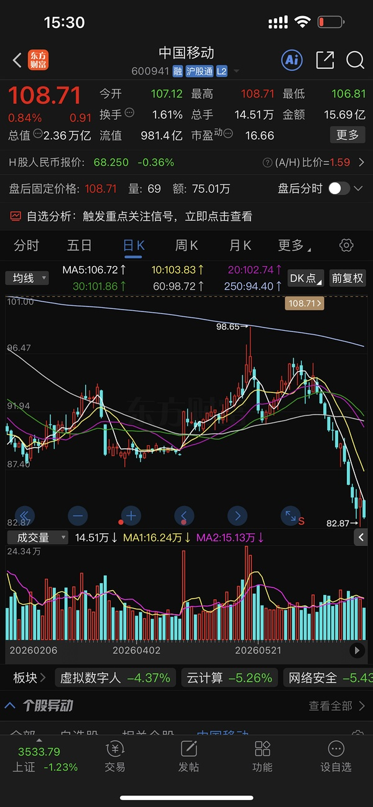  ⊳ （引用 @👑）哎，找个中字头做中特估算了（中影加油）

- (2026-11-20 15:32:13) 你现在心心念念啥 那个啥就是不能去的

你可以记下来 过几个月看是不是这样  ⊳ （引用 @👑）我没在哈哈哈，我在传媒，我在就不会心心念念了嗷呜

- (2026-11-20 15:33:54) 是的
问题就在这里
楼里每天说银行
招行本月1% 牛逼工行7%
在上周三之前

很多uu账户都是10+ 20+%😂😂😂😂😂
银行看不上的  ⊳ （引用 @六倍做多退休）其实82到108块钱 科技股的弹性 2天就能赚到 笑死

- (2026-11-20 15:36:19) [图] 你们被谁影响了？

中字头是这个走势

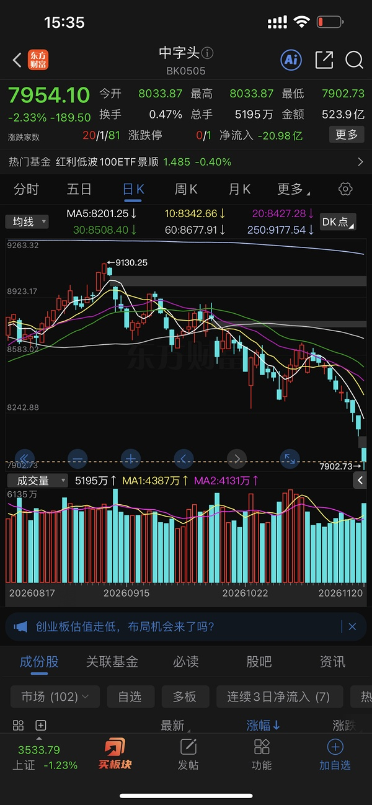  ⊳ （引用 @👑）但是我现在么有真心心念念中字头，我就怕和科技一样一路走高…我的仓完蛋了

- (2026-11-20 15:38:23) 那没办法的 
昨天襄阳带不动机器人
今天龙版也带不动所有传媒
一开始总归是这样的情况

不然大家都一样 怎么做龙头😂  ⊳ （引用 @第四个影子）主要冰雪这几个在现在的市场下太尴尬了，冰山昨天跌停，这三个全部跌停，今天冰山午后拉涨停了，雪人和晶雪拉升了一下又被砸下去了，大连那两跟以前一样不跟。
这三个太看冰山脸色了，如果下周一冰山连板还好，要是像九阳一样又跌停的话，那这三个也完了，资

- (2026-11-20 15:46:21) 要多看这种提前发 不马后炮 且判断还对
哪怕观点和你完全背离
但你需要这样的人

既能避免上头
也能避免悲观（他年中有几次说科技继续的）  ⊳ （引用 @momo）趋势动物好贱啊。

- (2026-11-20 15:47:56) 你看我有钱吗
这次储蓄罐也没了呀😂

要有出去的才能再进货了  ⊳ （引用 @仓部加措）楼下周一还准备抄底哪个

- (2026-11-20 15:50:31) 希望龙龙加油啊
V老师估计今天摸了不少类似的东西🤣

别学襄阳 没气质！
给做大哥 自己又不做了  ⊳ （引用 @招招碎片收集中）搞不懂了，我刚刚随机点了好几个股，感觉看线都是一泄如注那种走势！有点6月微盘股ptsd内味儿了

- (2026-11-20 15:54:11) 她今天都喊了九牧王😂😂😂😂😂😂说明就是主攻这些玩意的  ⊳ （引用 @招招碎片收集中）不得不说，你真的很懂V老师！每天一副新牌

- (2026-11-20 15:54:30) 也可能牛和死对半开啊😂  ⊳ （引用 @VVV坚定持有VVV）哈哈哈哈哈我觉得我现在的持仓，要么下周一很牛，要么下周一死透
事已至此，祝我好运吧！🤣

- (2026-11-20 15:57:40) 你去看看温暖老师手法
人家都是博半路
还是我们贪😂😂  ⊳ （引用 @VVV坚定持有VVV）哈哈哈哈哈那也行，0轴收盘我也能接受🤣

- (2026-11-20 15:58:48) 今天很多基金都比他好应该 

昨天存储和光跌幅小于 七巨头
小远是七巨头主导  ⊳ （引用 @茅五泸荣誉黑粉）现在跌不到两个点的，都算赢

- (2026-11-20 16:01:10) 小远都买成七巨头了 你还担心啥😂😂😂  ⊳ （引用 @Mint妤）谢谢姐妹，不过娜娜我不怕，是美基的主动基，小远，网易云建信这些

- (2026-11-20 16:04:37) 而且温暖老师还不是用条件单的
他每次早上能一大批买到最低点 我可以说他是提前做了准备的 或者躲在厕所的 盯着的

但是他卖很多手动也能最高点 很神奇
都是高速回落的 这个是真牛逼🤣🤣🤣
而且他票也很多的 一起冲刺时候怎么一个个看 统一行动的  ⊳ （引用 @VVV坚定持有VVV）至今我们都不知道，一个要上班的人，一个用手机操作的人，怎么手速能这么快🤔未解之谜

- (2026-11-20 16:06:32) 今天午后看的很无语
大好形势葬送了
希望只是因为周五吧
你们可以去看看温暖老师有三个结论
只要不是3 大家回血在望

- (2026-11-20 16:06:55) 我要去看3300计算了
都差点忘了  ⊳ （引用 @招招碎片收集中）我记得他以前说过他是盯着那些卖单买单操作的，真的很牛

- (2026-11-20 16:09:35) [图] Mark计算下3300

今天盘前截止15:00点期货-1
不归还0.4情况下 标准应该-5.1%收盘
实际3300 -4.6%收盘 又漏了0.5%

目前合计遗漏0.4+0.5
我估计这个0.4就真的忘记了😂😂😂

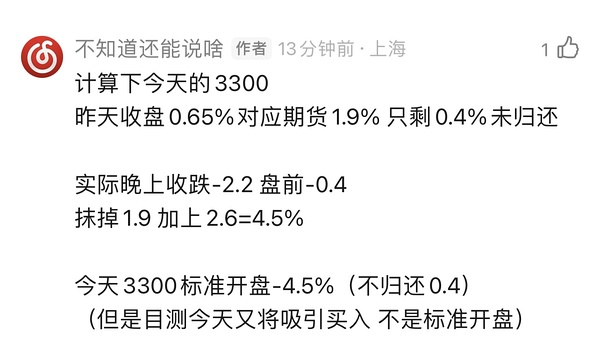

- (2026-11-20 16:10:51) [图] 今天场内nana跌幅五花八门
我们反正是计算自己的3300

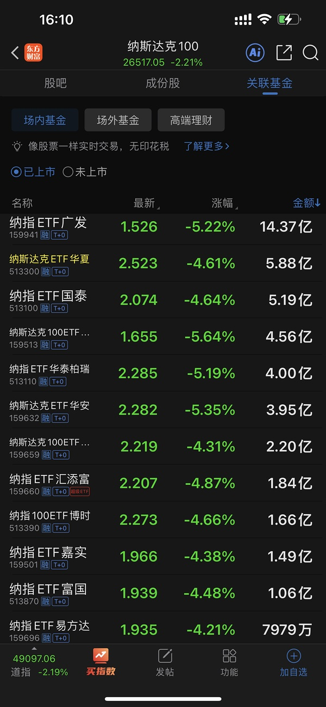  ⊳ （引用 @不知道还能说啥）Mark计算下3300

今天盘前截止15:00点期货-1
不归还0.4情况下 标准应该-5.1%收盘
实际3300 -4.6%收盘 又漏了0.5%

目前合计遗漏0.4+0.5
我估计这个0.4就真的忘记了😂😂😂

- (2026-11-20 16:14:02) 还有一个月
楼嫂今年还是能说出大A是提款机😂😂

我在六月一度以为她今年输定了😂😂😂😂😂😂😂😂😂😂😂😂😂😂😂😂😂  ⊳ （引用 @招招碎片收集中）去吧，孩子！替我转达一下对楼嫂的敬意！我要当她第一个粉丝！！

- (2026-11-20 16:15:24) 昨天不太行啊
昨天没有中午这种气势过  ⊳ （引用 @一切都会过去的）昨天本来也有机会的吧
现在这不就是故意的
那真的会这么好给我们回血吗哈哈哈

- (2026-11-20 16:20:29) 楼嫂那个天天基金账户里南方红利是网易云音乐2倍多😂
现在一涨一跌大概快要三倍了

你有没有想过 南方红利低波使劲涨 就能覆盖网易云音乐了😂😂😂😂😂😂😂😂😂😂😂😂

还记得那个无敌投资策略吗

中国红利+美国nana 所向披靡😅  ⊳ （引用 @momo）楼嫂作法在网易云可以吗

- (2026-11-20 16:21:55) 现在也是的
大家不是都盯着夜盘和盘前在做的吗  ⊳ （引用 @monica）话说下个月美股23小时交易会对行情有啥影响，楼里讨论过吗（叠甲差生提问）

- (2026-11-20 16:24:20) 所以我之前说到过这个

假设我本来的20笔做进一步保守的配置 
去掉一些现在的 替换5-6笔红利基金

在六七月uu们也很容易自己换出去
效果上看 前六个月红利毫无意义 
一点价值没有 非常拖累账户 尤其看着科技嗨 😂😂  ⊳ （引用 @茅五泸荣誉黑粉）我年初也买了红利，后面一直跌，就卖了买美🐔😅

- (2026-11-20 16:27:02) [图] 😂其实今天-4我能接受 周五经常-3 -4 上周五是例外

但是午后看的是真无语

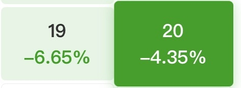  ⊳ （引用 @🅰失而复🉐😎）上午结束是给我拉回来不少🫠

- (2026-11-20 16:38:37) 我反问你一个
你觉得那个大家都很爱玩的商场的猫猫能不能修复这六根阴线
也是没怎么跟他们之前的垃圾消费 但是现在连续被杀

你的问题和我的问题其实一样
可能跳出自己的持仓能看得更好一些  ⊳ （引用 @柚子mm）楼楼，我觉得大连能回来的对不对？

- (2026-11-20 16:50:22) 就看喜欢炒消费旅游的12月还喜不喜欢玩了😂  ⊳ （引用 @VVV坚定持有VVV）我觉得能，毕竟我都买九牧王了！

- (2026-11-20 16:51:34) 卧槽啊
我才发现

今天拉那些破玩意
最终债券也都绿了啊

- (2026-11-20 16:53:28) 与此同时 投票新低  ⊳ （引用 @茅五泸荣誉黑粉）今天楼里回复数量爆量了

- (2026-11-20 16:54:39) 传媒冰雪啊😂主要的你们都知道
不知道的都是博 不知道为好  ⊳ （引用 @小肥肥）楼楼，你现在持仓是些啥？参考一下

- (2026-11-20 16:58:28) [图] 毛毛沪深300 和 50 权重股！！！
第一大权重！！！！！！！！！！
因为妈妈不停买300 50

露露五粮液那种深圳票 不在50里面
而且沪深300权重现在也很低了 很很很后面 拿不到资金

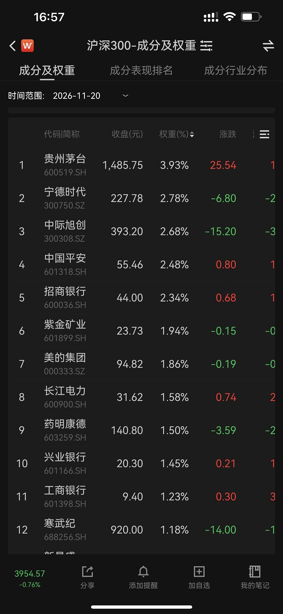  ⊳ （引用 @点-重生炒垃圾）为什么会这样，之前最担心白酒拐头，毛毛好着呢，怎么也这样

- (2026-11-20 17:01:40) [图] 

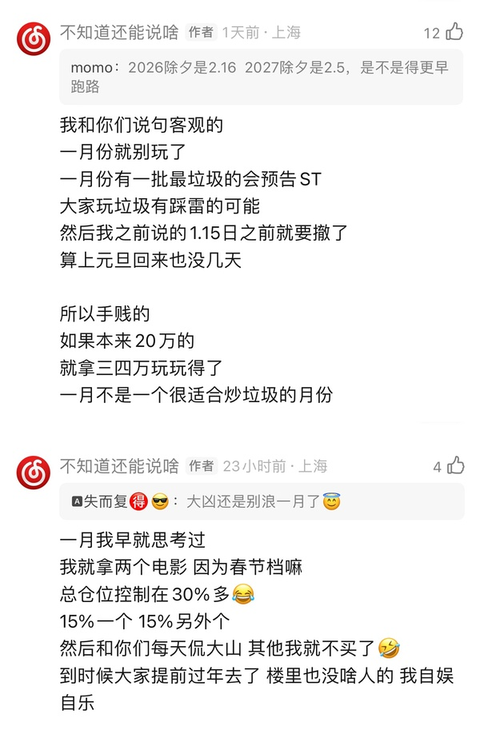  ⊳ （引用 @稀里不糊涂）楼电影会拿到春节档吗，现在看起来还没有炒作复联的迹象啊

- (2026-11-20 17:05:16) [图] 

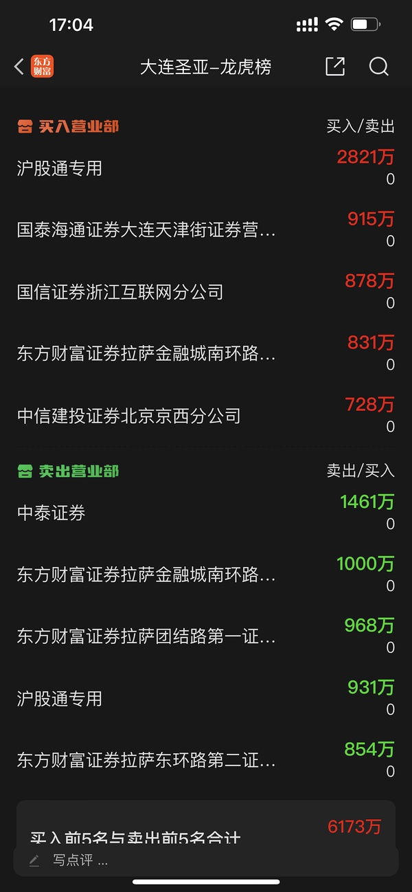

- (2026-11-20 17:05:31) 很遗憾 大连以这个方式荣登龙虎榜

- (2026-11-20 17:07:09) 你有没有看阳光照明
那个好像很恶心
中间那个涨停是为了把人套住啊😂  ⊳ （引用 @招招碎片收集中）哇靠，美帝凶残

- (2026-11-20 17:08:13) 哈哈哈哈哈哈
比惨大会  ⊳ （引用 @赚💰💰易如反掌）你看下惠发吧，6天5个地板😂😂😂😂太惨咯

- (2026-11-20 17:09:15) 我们的东方海洋还有机会做跨年妖股吗🤣  ⊳ （引用 @招招碎片收集中）看了，我还在说我我眼光真不行😂😂😂，真无语了，不过s姐的大东方加一分

- (2026-11-20 17:11:43) 这里卖方家人更多啊  ⊳ （引用 @momo📈📈📈）家人+1，，，，，，，，

- (2026-11-20 17:14:25) nonono
24年1-2月我在场的
你去看看🤣🤣🤣🤣🤣🤣  ⊳ （引用 @小毛驴儿）这个星期微盘股指数累计跌了15.57% 创造历史了

- (2026-11-20 17:22:52) 同花顺有的  ⊳ （引用 @小毛驴儿）看到了😥2000指数24.2.2那周是-16.78%，那会还没微盘股指数就没翻到

- (2026-11-20 17:38:24) 我五一之前就买了和zy yl一起买的 一上来他就攻了50% 兑现几笔成本就下来了  ⊳ （引用 @钱多多多多多）我印象中很早之前有一次，楼说他的奶茶成本在15还是25的时候，我的成本在38……当时我就觉得我在干嘛…

- (2026-11-20 17:40:50) 大连在的啊😂现在1:1  ⊳ （引用 @小鱼）楼cbs和大连都换去雪人了吗😂我还是平铺三个，我甚至不想管他们了，都卖了买3300算了😓

- (2026-11-20 17:41:34) 恐慌指数逼近30

- (2026-11-20 17:42:47) 他之前没有涨停上不了😂😂😂😂  ⊳ （引用 @没有感情的村民）这代表啥意思呀

- (2026-11-20 17:44:51) 😂😂😂

通过金融资产下跌 让美债收益率下跌 加息预期下降吗

这模式真恶心  ⊳ （引用 @六倍做多退休）美债又准备回本

- (2026-11-20 17:45:34) 不过这一波也强化了一个2020年的认知

黄金和避险 两个字 一点关系都没有的  ⊳ （引用 @六倍做多退休）美债又准备回本

- (2026-11-20 17:46:48) 12月那次肯定会加的 超过95%概率了 不可能改变了
就看明年的了 明年所有都是待定的  ⊳ （引用 @👑）👍有本事他真不加息了，开启暴力反弹，要不一切当放屁

- (2026-11-20 17:50:03) 循环保证金问题
原油加入了🤣🤣🤣🤣🤣  ⊳ （引用 @速派女孩将发财）WTI原油跌超2%，现报80.79美元/桶。 油价不是跌了吗？老师 为什么会这样

- (2026-11-20 17:51:27) 爆仓在即

卖黄金补科技
卖科技补白银
卖白银补币
卖币补原油
卖原油补黄金
🤣🤣🤣🤣🤣

最近铜 铂金都加入循环系列  ⊳ （引用 @速派女孩将发财）WTI原油跌超2%，现报80.79美元/桶。 油价不是跌了吗？老师 为什么会这样

- (2026-11-20 17:58:15) nana不用跌
只要两个月横盘 他们很快发财报
估值就会逼近和刷新2022年我买的那次
因为那次估值在下半年的骤降不是因为nana下跌
就是nana来来回回 中间发了好几次财报  ⊳ （引用 @小鱼）纳指pe25，百分位12.16%了😂

- (2026-11-20 18:00:02) 23呀和美股一样的
休息一小时就有夜盘了 现在盘前  ⊳ （引用 @点-重生炒垃圾）vix也是24小时交易的吗？

- (2026-11-20 18:01:27) 😂😂😂😂😂😂这本来是好消息
都是他们用的方法很坏  ⊳ （引用 @moli）楼楼的美债要开始赚钱了

- (2026-11-20 18:03:13) 最垃圾的是今天最后拉50

把国内债券也都拉绿了😅😅😅  ⊳ （引用 @moli）楼楼的美债要开始赚钱了

- (2026-11-20 18:05:24) 买原油的还要按摩啊？
😂😂😂😂😂😂😂😂
看好战争升级做多原油的
100+原油不应该做空吗🤣  ⊳ （引用 @momo）现在大组全是手握各种资产求按摩的  今天的新英雄是原油

- (2026-11-20 18:06:45) 估计被妈妈买入金额吓到了
但是谁能想到他们只盯着50干啊  ⊳ （引用 @moli）卖债券买50？

- (2026-11-20 18:43:08) 已经打了一个倒锤头😂  ⊳ （引用 @sickid）我感觉Vix今天会上影线，日线超买+顶背离了

- (2026-11-20 18:46:37) 恒生指数公司今日宣布恒生指数系列季检结果，恒生科技指数纳入立讯精密、宁德时代、胜宏科技等20只个股，成份股数目将由30只增加至50只。恒生指数成份股没有变动，成份股数目维持95只。  ⊳ （引用 @点-重生炒垃圾）你说那天乘胜追击多好30+，非要隔这么，现在我是真的无所谓了，随便他们表演吧

- (2026-11-20 18:50:23) [图] 我在这里等你们
我现在浮亏1.56%

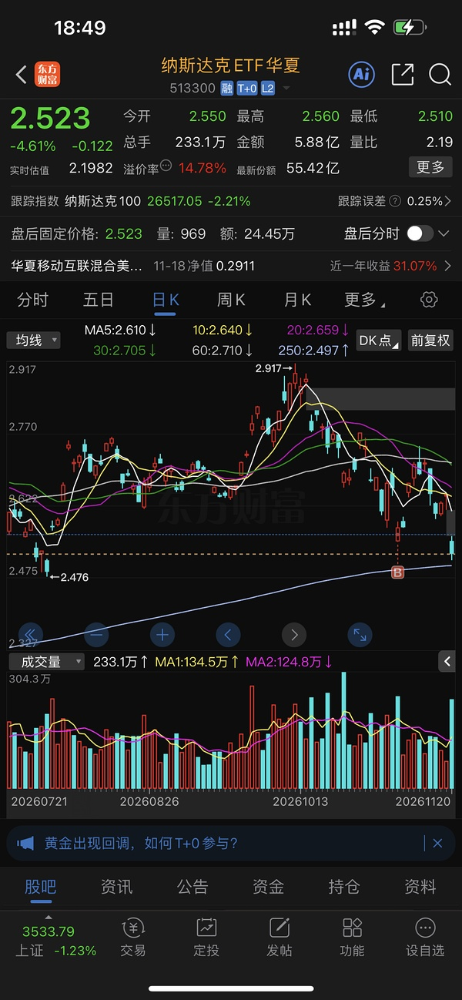  ⊳ （引用 @momo）快了快了严肃等待中

- (2026-11-20 18:52:13) 这个人说要到哪个点位数字？  ⊳ （引用 @momo）那没辙了，而且我想知道他是买场内还是场外额

- (2026-11-20 18:55:22) 他是nana 不是nana100哈哈
那就7%多 

plu那个是nana100

- (2026-11-20 18:57:20) [图] 没多少 7% 他是nana
和我当年买完厚真正的低点差不多
画全是我第一笔买的地方 后来这一段上升我买了好几笔高价😂

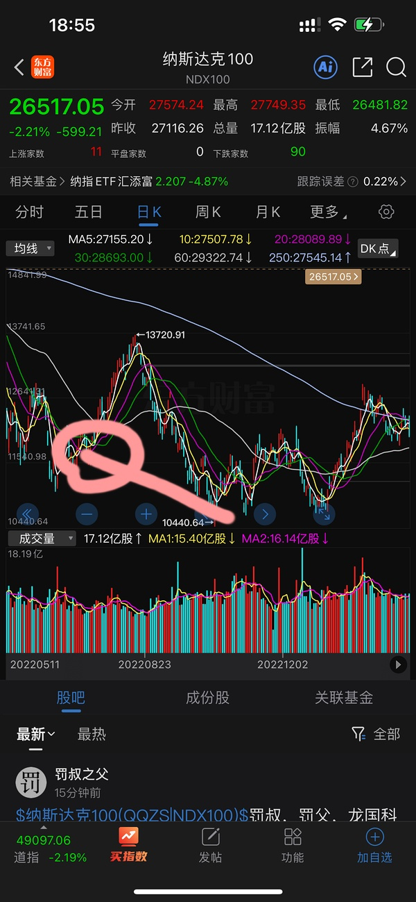  ⊳ （引用 @点-重生炒垃圾）这还有的跌啊

- (2026-11-20 19:06:24) 昨天挺奇怪 七巨头跌的比存储光很多
小远都输给华夏兄弟了  ⊳ （引用 @点-重生炒垃圾）感觉今天差不多了吧

- (2026-11-20 19:09:07) 看了 但没什么明显的观点  ⊳ （引用 @点-重生炒垃圾）今天晚上新闻有阳子老师啊，周四你们怎么都不看吴老师😂😂😂过了点我又不想看了

- (2026-11-20 19:11:32) 今天大家满平均

小广-1.86
小浦-1.73
网易云-1.62
华兄-1.59
小远-1.84

暂时华兄第一😂😂

- (2026-11-20 19:28:32) 没区别 都是散户😂  ⊳ （引用 @扒上船离开印度）其实我不太会看榜，这几个人拉萨有什么区别啊😳

- (2026-11-20 19:57:53) 爱过 可惜了

十月份一次赚了18% 一次割肉8%

- (2026-11-20 19:59:36) 楼里好几个uu吃了东哥三个跌停的
我在小慧里每天绿 中间小慧还发了重大减持😂  ⊳ （引用 @飒飒）好想老楼回来😭我将细细品读去年今日的楼友发言，虽然是类似的微盘崩盘境况，但是完全不记得了，只觉得这几天好难熬啊啊啊😭😭😭

- (2026-11-20 20:04:23) 那我倒没觉得
科技狠狠拉三根阳线
别说垃圾股的人
融资盘就屁颠屁颠去啦
之前那根10% 大家去的很积极的  ⊳ （引用 @没有感情的村民）感觉上面就是为了让垃圾股的人跑去科技？？不救在先，现在又拔网线

- (2026-11-20 20:05:33) 不如担心冰雪  ⊳ （引用 @稀里不糊涂）欢瑞这个不会带崩传媒吧，和影视里面中影幸福相关吗，怎么什么事都能碰见啊。。。

- (2026-11-20 20:07:08) 亏本出不是11月底的事情 你去看看就知道

很多uu12月再去猛干才是亏本的原因  ⊳ （引用 @稀里不糊涂）是的，小惠还是亏本出来的

- (2026-11-20 20:13:06) 哈哈等会把黄金白银干崩了 可又得卖油补黄金白银了  ⊳ （引用 @👑）这下做原油的开心了（没辙了）

- (2026-11-20 20:14:48) 小伙伴下午还在说下周还要继续崩的！

现在居然在讨论“不会带崩吧”🤣🤣🤣🤣  ⊳ （引用 @家不住海边）这也不是传媒领头的 不至于 吧
跟龙板 新华 没得比

- (2026-11-20 21:18:56) 先等下周情绪回暖  ⊳ （引用 @柚子mm）楼楼，我觉得修复不了😂，所以大连反弹要走吗，你会怎么操作？

- (2026-11-20 21:20:02) 今天华夏兄弟居然以抗跌赢了😂

- (2026-11-20 22:12:58) 建信垫底吧估计 亚洲不算的话  ⊳ （引用 @速派女孩将发财）没事 今晚就要输了

- (2026-11-20 22:22:35) [图] 这个排名 意味着 没有东西是好的😂

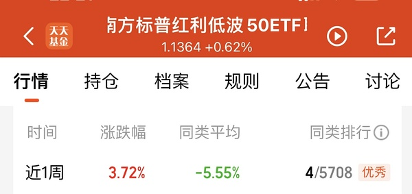

- (2026-11-20 22:28:21) 东方阿尔法近一周-23%垫底

之前的网红基金吗？  ⊳ （引用 @moli）有很长一段时间，红利类基金全市场排名倒数

- (2026-11-20 22:31:04) 欢瑞世纪：历史会计处理事项落定 轻装上阵新业务转型已跑出加速度

11月20日晚间，欢瑞世纪(000892)发布《关于公司及相关当事人收到的公告》。根据公告，重庆证监局经调查认为，公司2022年年度报告存在虚假记载，主要涉及增值税加计抵减额的会计处理问题。目前，该事件对应的历史财务影响已清理完毕。

在历史事项尘埃落定的同时，欢瑞世纪经营基本面保持向上态势，转型成效持续显现。欢瑞世纪在2026年前三季度实现营业收入2.83亿元，半年度影视剧及衍生品收入同比增长45.57%。营收增长既来自影视剧业务贡献，短剧、互动影游等新业务也实现实质产出。

业务端，欢瑞世纪坚持夯实传统影视业务底盘，同步培育新增量。2026年上半年，公司长剧《佳偶天成》《千香》播出取得不错市场反响，同时《古剑奇谭》系列网络电影盘活了存量优质IP价值。目前公司有四十余部IP储备有序筹备，保障后续项目供给。

综合来看，欢瑞世纪已就相关历史会计处理事项进行更正及处理，并持续完善财务内控机制。随着IP储备、影视制作能力与AI新技术的协同落地，传统影视业务与短剧、互动影游等新业务的发展持续推进，多元化业务布局有望为公司未来经营发展提供更多支撑。

😂😂😂😂😂😂😂

- (2026-11-20 22:34:00) 有点回忆😂当时涨的牛逼的基金太多了  ⊳ （引用 @六倍做多退休）这个我6月怎么天天看到😂 还有楼友说什么不懂的朋友都要买入

- (2026-11-20 22:35:10) 买不起来的 别说这次全球联动了

924还是靠消息起来的 
他们2023开始买买到924 放消息才开始好
但是放消息前提是918美国降息了  ⊳ （引用 @👑）反正我感觉妈妈是买的起来的，但是远远没到她觉得值得大力下手的地方

- (2026-11-20 22:39:31) 上次问的好像是东方人工智能？？😂  ⊳ （引用 @招招碎片收集中）素，楼，我记住你黑历史了 这是你第二次问它了！

- (2026-11-20 22:44:08) [图] 说不定12月他最猛😂本月食品饮料最牛逼的就是两个ST😅😅😅😅😅

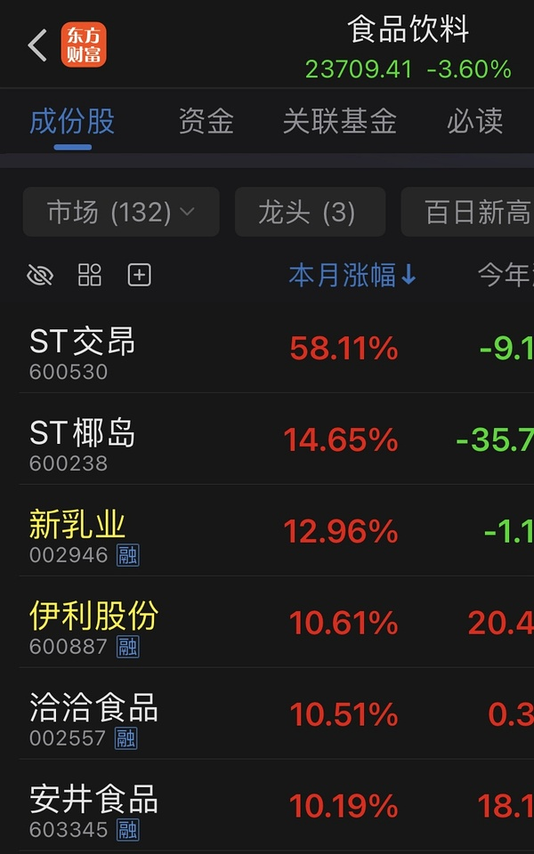  ⊳ （引用 @momo（富姐版））金典丧事喜办

- (2026-11-20 22:46:12) 道琼斯这几天大阴线确实厉害  ⊳ （引用 @moli）恐慌怎么跟道指不跟纳指了

- (2026-11-20 22:47:32) 本周玩新浪模拟盘uu正收益有吗
明天记得10点去领红包😂😂😂😂😂

- (2026-11-20 22:51:52) [图] 同花顺微盘 今天已经26%
东方财富微盘 24%

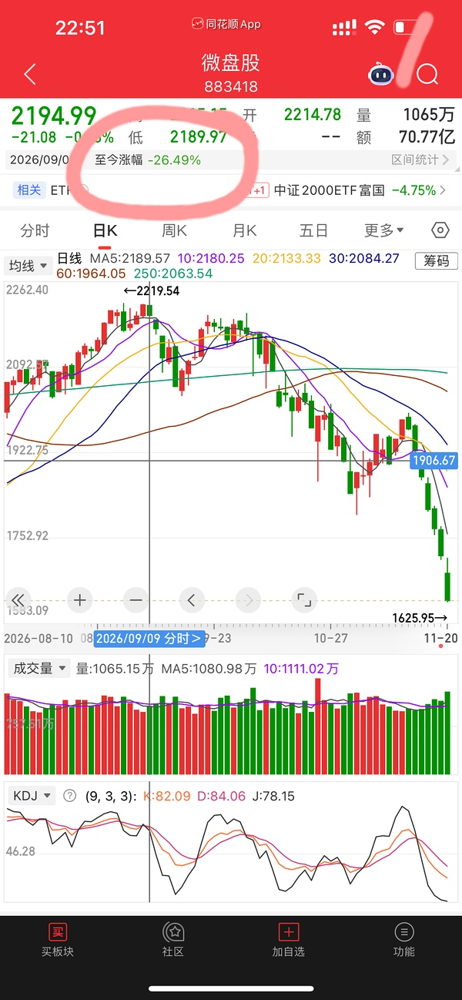  ⊳ （引用 @速派女孩将发财）微盘回撤25%-30%后 反弹会更好！ 我准备到时候转一些50过去

- (2026-11-20 22:52:14) 已经到了  ⊳ （引用 @招招碎片收集中）补兑！什么叫回撤20%-30%啊，我er一下睡过去了

- (2026-11-20 22:54:09) [图] wind微盘也到了 正好今天到

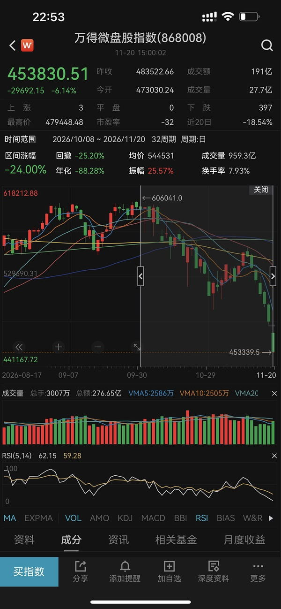  ⊳ （引用 @招招碎片收集中）那就好，我以为刚要开始打我，下周情绪务必回暖

- (2026-11-20 22:59:06) 我没说他会起来
我意思大家都是类似这种图😂  ⊳ （引用 @点-重生炒垃圾）到底为什么楼楼看看猫猫那个线觉得他会回来啊😂😂😂好绝望的走势，猫猫感觉跌破形态的时候很少啊

- (2026-11-20 23:01:34) 这你要问速派女孩了😂
你知道我的 如果我不换仓 我可没钱

这一次买nana动用了我余下的所有储备资金
一旦出现冰点 我也操作不了  ⊳ （引用 @Lyra）那个鑫啥鑫对吧！

- (2026-11-20 23:02:52) 绝望在希望中孕育
希望在绝望中诞生  ⊳ （引用 @招招碎片收集中）nana要拉红吗？

- (2026-11-20 23:10:23) 这周我只在港股是正收益 没想到吧🤣我红包居然只有港股给我了  ⊳ （引用 @招招碎片收集中）我都只剩2万块了，我一直在哭，玩妖股会一直输

- (2026-11-20 23:12:31) 美国11月一年期通胀率预期终值 3.7%，预期4.20%，前值4.30%。

- (2026-11-20 23:13:09) 笑死 怪不得市场反弹 美债收益率继续下 原来有好消息  ⊳ （引用 @不知道还能说啥）美国11月一年期通胀率预期终值 3.7%，预期4.20%，前值4.30%。

- (2026-11-20 23:14:11) 第三次加息预期骤降  ⊳ （引用 @点-重生炒垃圾）啥意思，12月以后加息那个风险解决了？

- (2026-11-20 23:14:31) 12月那个不可能改变的了 这个加息几乎百分百  ⊳ （引用 @点-重生炒垃圾）啥意思，12月以后加息那个风险解决了？

- (2026-11-21 07:34:26) 新帖见uu们

- (2026-11-21 07:38:50) 而且取消第三次加息预期😂  ⊳ （引用 @sickid）唯一的好消息是跌太多了之后交易员不再完全押注12月加息

- (2026-11-21 07:49:00) 这估值就是按照持仓来的呀 （不是变化的持仓）
昨天几个A没大跌 你点进去看就知道了  ⊳ （引用 @么感情吃瓜中）易方达不知道买了什么，不管对比中基还是美基，防守得都很优秀

- (2026-11-21 08:49:43) 我真服了
你们又说不能说的东西😂😂😂😂

- (2026-11-21 08:50:17) 新帖再度审核
现在八小时起步😂  ⊳ （引用 @不知道还能说啥）我真服了
你们又说不能说的东西😂😂😂😂

- (2026-11-21 08:51:08) 是我们这边太敏感了
你看看我ID🤣🤣🤣🤣🤣  ⊳ （引用 @momo）对不起楼楼我也没说啥啊

- (2026-11-21 08:52:42) 早就亏惨了
公募基金也有量化基金的呀 你也可以搜
有几个产品比私募好  ⊳ （引用 @木李）想知道这个局面下玩量化的是什么情况，还在赚钱吗

- (2026-11-21 08:53:43) [图] 你们胆大包天
这是比口罩更不能聊的话题😂
你们小心自己的号啊

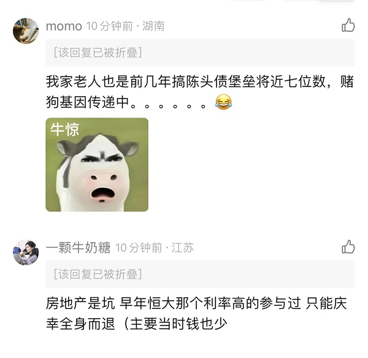

- (2026-11-21 08:55:48) 帮你们都删了  ⊳ （引用 @一颗牛奶糖）🥲看到了我

- (2026-11-21 08:57:19) 😂八小时后帖子会恢复的
我把敏感的删掉了  ⊳ （引用 @混乱中立同人女）楼您刚才回复我这条，对的，我也很后悔，为什么没有在反弹的时候减，还因为额度开了5000AC框框加仓

- (2026-11-21 08:59:22) 所以金毛不会出来说话
在那边暂时偷着乐😂
跌了的锅全都甩出去了
可以撇清自己当时伊朗问题
毕竟3-6月伊朗问题没有阻止上涨  ⊳ （引用 @点-重生炒垃圾）跌跌跌！让民主党看看自己捅了多大的篓子

- (2026-11-21 09:14:20) 台 干了啥？  ⊳ （引用 @点-重生炒垃圾）这次发现只有台湾是真干事！！！美国选择性干事

- (2026-11-21 09:18:30) 第一个毛用没有
韩国早就做了 
因为不能卖空 没有对冲保护 进一步加大股票卖出

平准也许是嘴炮  ⊳ （引用 @点-重生炒垃圾）跌的多限制卖空，平准基金积极入场，好快好多啊。效率真高

- (2026-11-21 09:18:38) 这是最没用的  ⊳ （引用 @monica）台湾周五起实施卖空限制

- (2026-11-21 09:21:47) [图] 你可能不知道 台湾6号出台限制卖空
然后最近下跌明显加剧了
无法对冲保护 那就只能抛售股票保护账户了

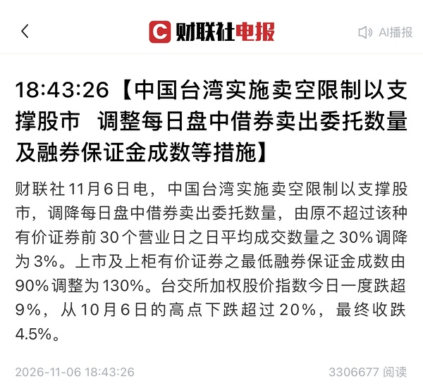  ⊳ （引用 @monica）台湾周五起实施卖空限制

- (2026-11-21 09:22:25) 然后越跌越多了？🤣  ⊳ （引用 @点-重生炒垃圾）真花钱了啊，韩国没花钱，台湾买了！

- (2026-11-21 09:25:53) 确实

“黄金是避险资产 乱世买黄金 包赢”
“他们打仗了 买黄金稳赢 包的”

就这两句话 我口罩和俄乌开始听他们讲的😂😂  ⊳ （引用 @一切都会过去的）买黄金的很多风偏也很低的 觉得稳赚不赔

- (2026-11-21 09:27:09) 😂不知道台湾银行股 消费股什么走势
我们妈妈也买呀 是真的是有东西买上去的  ⊳ （引用 @点-重生炒垃圾）只管三天😂😂😂

- (2026-11-21 09:29:02) 最近三次大异常

关税
2024.8 日元套息风波
再上一次那么高就是口罩

后两次都直接下场交易参与了😂  ⊳ （引用 @一切都会过去的）还不超过前期最高点 这个前期是指什么时候 
昨天最高冲到40了 最高还是之前关税60

- (2026-11-21 09:29:59) 我会和你播报我亏损幅度的！

周一早上新帖见（新帖被审核了暂时）我会计算下3300开盘标准跌幅  ⊳ （引用 @小鱼）好消息是周一买3300比楼低了😂

- (2026-11-21 10:31:02) uu们
把自己这两天的留言都好好截图下来
以后总还会有上头的时候
自己多拿出来看看啊
很可惜那个6月的帖子不存在了
不然对比一下冰与火的完全交融
是很有意义的一次现实案例

但肯定还会在以后交替发生
今年多个资产都发生了这样的情况
包括年初的黄金
而且黄金那句“黄金怕什么 总会更高的”也都是蛮吓人的

大家在担心科技
而我也担心
我在担心目前这个幅度的跌幅
万一明年直接开启降息反攻
债券是否顶得住 债斯达克能不能顶住反攻
大家都有需要思考的东西

比如心态严重失衡的是否需要在下周做出仓位调整
比如美国那边额度打开 是否有基金转换
是防守转进攻（可能短期亏的很多）
还是进攻转防守（可能短期稳住心态）
又比如一键清仓的uu是否看到大反弹又要冲进来
又比如继续大跌你还能承受多少

不妨趁着这两天也不开盘
大家重新盘静下心来为自己重新审视一下吧

- (2026-11-21 10:36:26) 她还在定投呢  ⊳ （引用 @24/7）那狄经理现在可以写信告诉我坚持一下吗

- (2026-11-21 10:47:35) 你们新浪模拟盘赢钱的可以上去领红包了

- (2026-11-21 10:50:55) 现在也来得及！只要你当真话

因为毕竟你18号晚上看到 19号盘前大涨2% 你会觉得是假的 但是昨天实际+2到-2了

然后你选择相信 卖出也会卖在今天的-5%上 并没有区别

所以现在你可以重新选择相信！  ⊳ （引用 @小狗咩咩）把趋势动物 1118 发的美股下行当做一句空话🚬

- (2026-11-21 10:51:53) 不管是什么资产的行情😂
都会在连续大涨的时候包装完美无瑕的理由的  ⊳ （引用 @momo）我也是，我还记得20年的时候，很多人都在说女生要买婚前房，那个时候房价还是比较贵的，就一直在说女生适合LOFT，那个时候我也是魔了很想买，旅游的时候特地住了一次loft民宿然后祛魅了，很不方便。

- (2026-11-21 10:54:18) [图] 港股6毛7😂

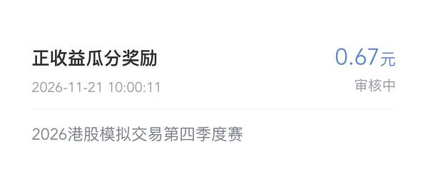  ⊳ （引用 @招招碎片收集中）能不能领到2毛巨款，我的模拟盘已巨亏，早知道昨晚睡前开做空了

- (2026-11-21 10:56:27) 年初黄金也一样的
当初2000 3000你也没看到有人吹黄金吧
没有人包装黄金信息的
在4500+时候疯狂涌现😂
没有一个理由是有漏洞的🤣我看着也是完美无瑕  ⊳ （引用 @momo）🚬素这样，很多时候接收到的信息是有人有意让你看到的。

- (2026-11-21 10:58:22) 😂😂😂昨天下午我买黄金的主播已经让她们卖力点了 

不能光买科技的主播努力赚钱  ⊳ （引用 @点-重生炒垃圾）记得多打几份工

- (2026-11-21 10:59:40) 大跌时候你能看到 就不会大跌了🤣
这和大涨时候你也看不到回调迹象差不多啊😂

所以大涨大跌时候 我都喜欢看反向观点  ⊳ （引用 @👑）无论内外部都看不到企稳回调现象…

- (2026-11-21 11:03:54) [图] 你报名的地方 点进去

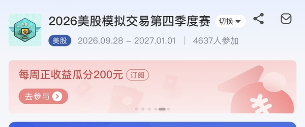  ⊳ （引用 @moli）我怎么找不到领奖入口，是不是错过了

- (2026-11-21 11:05:57) 没有口罩也会崩的  就是慢一点😂
你们可以查生育率 早两三年就开始下滑了

他们说用来住 不炒时候就差不多接近危在旦夕了  ⊳ （引用 @👑）感觉口罩加速了房的崩盘，本来说是稳房价（或者也是只拖不举吧）

- (2026-11-21 11:11:13) 我被科技套了啊😂😂😂😂😂😂😂😂😂😂😂

不过我确实没买房是因为房子完全没企稳😅
会相信企稳的应该很天真吧？
无论哪个方面都不支持现在房价企稳  ⊳ （引用 @招招碎片收集中）楼，请多开这种大师课，让我们多涨涨心眼子😂😂

- (2026-11-21 11:12:49) 你之前报名的不是这个嘛  ⊳ （引用 @moli）555点进去都没有领取的😰

- (2026-11-21 11:14:45) 看了我们北京上海的消费数据没？

这个都没企稳 简直是崩塌！
就这样还想企稳房价呢  ⊳ （引用 @没有感情的村民）再来一个：钱都套在股市了，消费继续↓🏠继续↓

- (2026-11-21 11:17:08) 北上是最差的 深圳也不行 我都看了😂

但是这三个地方才是楼市标杆 所以房价没戏

可能部分老破小因为租金收益好 现在是企稳 但不能代表全部  ⊳ （引用 @没有感情的村民）我以为只有北京，昨天看了上海得，大家都一样💩

- (2026-11-21 11:32:39) [图] 怀念鲍威尔不😂
土狗9月文章里说了 沃什坏的很
他就是那个心眼子拉满的男人 要靠收紧金融条件
🐶东西先把美债利率拉高

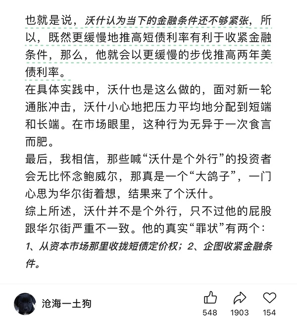  ⊳ （引用 @没有感情的村民）美联储不是基于数据吗，而且不是一句话，他们是在jj政策演讲中讲的，不像川子发推点名股票，额(#－.－)

- (2026-11-21 11:35:26) 既然市场强攻银行
不把招行股息率拉涨到4%以内我是不服气的😂  ⊳ （引用 @六倍做多退休）朋友为了搞崩银行上个月开始每天买一手工商银行因为成了账户持仓个股中红的最多的了 🚬他都快爱上银行了hhhhh

- (2026-11-21 11:37:12) [图] 你看美股崩了 美债收益率就会不断下行呢😂然后加息预期大幅度退散
昨天真的是很好的证明

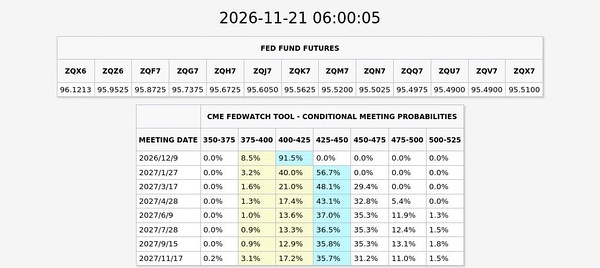  ⊳ （引用 @没有感情的村民）提问：如果他玩脱了，美股他救不救

- (2026-11-21 11:39:53) [图] 你两张利率表 对比上周五的😂😂😂

这就是美股大跌带来的 😅😅😅😅

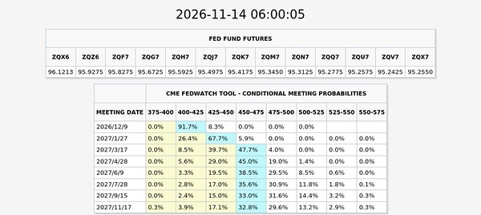  ⊳ （引用 @没有感情的村民）这是在俄罗斯套娃吗。。因为加息，美股崩，美股崩了，不加息了

- (2026-11-21 11:42:01) 我应该上周那个cpi时候 再调一点中债给美债😂不过美债波动太大  ⊳ （引用 @六倍做多退休）我也一直在思考 而且每次硬件股大幅度拉升 美债就抬头 绷不住 真跟土狗说的一样 美联储vs华尔街了 也好像那什么个新旧秩序交替 但是永远有一批人要付出代价

- (2026-11-21 12:04:02) 924时候美国很棒的
现在连美国都没看到好😂  ⊳ （引用 @咬着一颗绿苹果）这下跌啥时候是个头啊，924也没这么惨吧

- (2026-11-21 12:07:36) 下周开始
如果有我们美国基金打开额度的话
大家相互告知哈
可能大家会需要新的转来转去😂

- (2026-11-21 12:09:11) [图] 盘后美股反弹 美债就下跌 真有意思

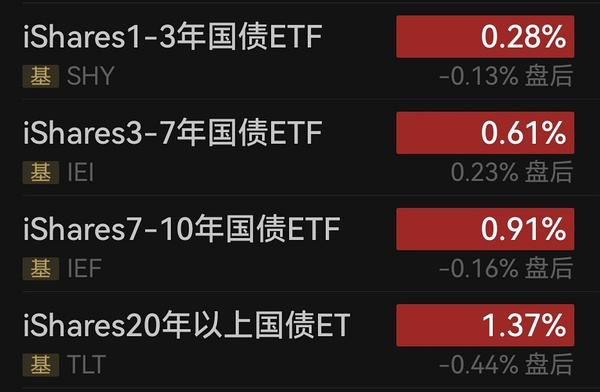  ⊳ （引用 @六倍做多退休）我也一直在思考 而且每次硬件股大幅度拉升 美债就抬头 绷不住 真跟土狗说的一样 美联储vs华尔街了 也好像那什么个新旧秩序交替 但是永远有一批人要付出代价

- (2026-11-21 12:11:01) ……  ⊳ （引用 @招招碎片收集中）比特币跌破56000美元，日内跌5.12%。

- (2026-11-21 12:12:20) A股基金可以直接转美国基金的🤣🤣🤣

肯定有uu会需要这个  ⊳ （引用 @VVV坚定持有VVV）支付宝：已严肃拒绝转换🤣

- (2026-11-21 12:15:08) 让金融下跌 如果能压制cpi 就有机会一起好
现在主要cpi太高  ⊳ （引用 @六倍做多退休）是的我觉得这个就很麻烦 就是股债只能保一个的既视感 不要啊

- (2026-11-21 12:16:32) 是的 美国人赶紧少花点吧 别浪费钱了 减减肥不好吗  ⊳ （引用 @稀里不糊涂）希望后面老美全是差到不行的数据，直接把明年1月变成最后1次加息，想想还是挺快的，年前或许加息就能结束了

- (2026-11-21 12:17:54) 我们cpi要上去 但是上不去
他们cpi要下去 但是下不去
🤣  ⊳ （引用 @VVV坚定持有VVV）最终海内外大家都一样了？只能保一边🤔

- (2026-11-21 12:20:09) 你不的不承认目前都跟了 幅度大小的区别而已

不过通信ETF和foto跌幅是一样的 就说明大家确实都是一样 我们而且利空堆积  ⊳ （引用 @一切都会过去的）这波虽然是联动的 但是就算美起来了也是下一波了 a也是有可能不跟的

- (2026-11-21 12:20:47) 哈哈 八小时后见  ⊳ （引用 @一直在摸🐟）不是 新楼咋又不见了

- (2026-11-21 12:21:19) 半夜的我都不看了 猜得到😂😂😂😂😂😂😂  ⊳ （引用 @VVV坚定持有VVV）这楼我昨天只看到18页，有60页可以陪伴早茶细细品鉴☺️

## 🧠 投资风格分析
> 📏 增量更新指引：仅当今日发言确有新依据时才修订对应维度，无变化不强行重写；单维度修订建议 ≤150 字。

- 投资理念与方法：坚持机会成本与性价比比较，只赚份内的钱，对机构抱团与题材炒作保持警惕。用跌停家数变化判断情绪冰点与转换点（跌停最多日叠加次日跌停急剧减少）；认为大涨大跌时资产理由都会被包装得完美无瑕，偏好在大涨大跌时看反向观点；总结垃圾股炒作的经验性时间卡点（12月上旬、中旬）作为节奏参考，而非固定行情判断。
- 风险偏好：整体回避高波动、高拥挤的垃圾消费与微盘股，警惕机构抱团和题材炒作；对美股认可强势但持续跟踪纳指ETF溢价与漏跌。新增回避含权债基/固收+，认为“求稳”债基实则股性重；对1月垃圾股ST预告风险有纪律，主张1月不玩、1.15前撤。
- 交易与仓位：强调言行合一与计划内操作，反对超计划加仓；习惯提前挂条件单、分批低吸，不追高。今日无单，称「我今天什么单子都没开了」「其他我一个都不卖」，并预设plus 15%以上手动S。仓位偏高，买nana动用余下储备资金，自述「一旦出现冰点 我也操作不了」，因此对加仓与腾挪更谨慎。
- 心理特质：对波动与回撤高度钝化，自嘲「老垃圾人」，面对普跌不破防，称「经历多了自然是」。顺境中易手贱、会飘，需外部提醒鞭策；周五刻意不开单以守纪律。乐观主义底色，普跌中仍期待「下周我们会大丰收的」「期待复刻我们三月份收益率超级V的名场面」。

> ⚠️ 本板块由 Actions 全自动增量更新（复用当日发言与今日总览），每次仅在内容足够支撑时才改动。

## 🏷️ 昵称映射表
### 📖 昵称规律（供 AI 判断新昵称时参考）
【昵称命名规律（用于推断未知新昵称）】
- 拼音首字母缩写：取标的/基金名汉字拼音首字母串（含数字代码），多为 ETF/股票代码口语化｜示例：yl=引力传媒｜zy=掌阅科技｜sj=视觉中国｜cc=华安文体健康混合｜C50=创业板50ETF｜k50=科创50｜kun=昆仑万维｜xhxc=新瀚新材｜zxfc=中欣氟材
- 小/老+姓氏代指：「小X」「老X」通常指姓 X 的标的或该标的的基金经理；「X兄弟」多为同系基金｜示例：小惠=惠发食品｜老莫=万家品质生活(莫海波)｜小华=华夏全球科技先锋(QDII)A｜小华兄弟=华夏移动互联(QDII)｜小浦=浦银安盛全球智能科技(QDII)A｜小广=广发全球精选(QDII)A｜小远=华宝致远(QDII)C｜招招=招商银行｜小德=德明利｜赵姨=兆易创新｜露露=泸州老窖｜空调=格力电器
- 戏称/黑话→题材板块：生活化比喻或黑话对应某个题材/板块，而非单一标的；出现时多指板块方向｜示例：卖国=PCB板块(英伟达AI链)｜爱国=国产自主(半导体设备/芯片)｜奶茶=易点天下｜老师=中文在线｜蓝色=蓝色光标｜宇航员=航空航天板块｜华子=华泰保兴安悦债券｜国际=国际复材｜巨无霸=长鑫科技等重大IPO
- 谐音/取字：昵称含标的名关键字（取一字或谐音），多为 A 股个股或基金简称｜示例：万华=万华化学｜东百=东百集团｜宝=保利发展｜讨饭/亚洲讨饭/建信新兴=建信新兴市场(QDII)A｜华宝zy=华宝致远(QDII)A
- 机构/基金经理昵称：以基金公司名、经理姓、或平台代称指代对应基金产品｜示例：周经理=中欧新趋势混合(LOF)A｜张经理=信澳匠心回报混合A｜网易云/音乐世家=富国全球科技互联网股票(QDII)A｜国富亚洲=国富亚洲机会股票(QDII)A｜国泰纳指=国泰纳斯达克100指数(QDII)｜易方达全球=易方达全球成长精选混合(QDII)A｜浦银安盛=浦银安盛全球智能科技(QDII)A

### 📋 已收录映射
| 昵称 | 对应名称 |
|------|----------|
| C50 | 创业板50ETF |
| cc | 双义：股票=中国长城 / 基金=华安文体健康混合（用户 11-05 指认） |
| k50 | 科创50 |
| kun | 昆仑万维 |
| sj | 视觉中国 |
| xhxc | 新瀚新材（用户确认；代码待核） |
| yl | 引力传媒 603598（对手盘，非他持仓）｜11-06 +37.15%；11-09 本月+37.79% |
| zxfc | 中欣氟材 |
| zy | 双义：他本人口径=603533 掌阅科技（用户 11-05 确认）；11-09 楼友两条『zy』按 16 元/电影语境指 600977 中国电影。引用必须带语境，不许收敛 |
| 万华 | 万华化学 |
| 东百 | 东百集团 |
| 亚洲讨饭 | 建信新兴市场混合(QDII)A |
| 保利发展 | 保利发展 |
| 华子 | 华子＝007540 华泰保兴安悦债券A（华泰保兴基金·安悦债券A类份额），满仓30年超长利率债的长债基金（用户 2026-11-16 确认，无歧义，不是歧义项）；00:42 楼友『华子今年战绩无敌吧』→他答『30超长债牛逼没办法』；13:47『纯利率债就是华子那种 不过华子满仓30债 有些是满仓5-10年』；**与460108不是同一只**：460108＝华泰柏瑞稳健收益债券C（他持有的纯利率债·重仓国开/农发/国债，见六基行），华子007540 是华泰保兴的长债基金，勿混 |
| 华宝 zy | 华宝致远混合(QDII)A |
| 华宝zy | 华宝致远混合(QDII)A |
| 卖国 | PCB、光模块、通信板块（英伟达AI产业链） |
| 周经理 | 中欧新趋势混合(LOF)A |
| 国富亚洲 | 国富亚洲机会股票(QDII)A |
| 国泰纳指 | 国泰纳斯达克100指数(QDII) |
| 奶茶 | 301171 易点天下（对手盘，非持仓）｜11-13 10:07『奶茶out 幸福人的底气是可以说芒果out』；当日 −6.72% |
| 宇航员 | 航空航天板块 |
| 宝 | 保利发展 |
| 小华 | 华夏全球科技先锋混合(QDII)A |
| 小华兄弟 | 华夏移动互联混合(QDII) |
| 小广 | 广发全球精选股票(QDII)A |
| 小德 | 德明利 |
| 小惠 | 惠发食品 |
| 小浦 | 浦银安盛全球智能科技(QDII)A |
| 小远 | 华宝致远混合(QDII)C｜只在盯，未证他持有 |
| 巨无霸 | 长鑫科技等重大IPO企业 |
| 建信新兴 | 建信新兴市场混合(QDII)A |
| 张经理 | 信澳匠心回报混合A |
| 招招 | 招商银行 |
| 易方达全球 | 易方达全球成长精选混合(QDII)A |
| 浦银安盛 | 浦银安盛全球智能科技(QDII)A |
| 爱国 | 国产自主（半导体设备/芯片制造） |
| 空调 | 格力电器 |
| 网易云 | 富国全球科技互联网股票(QDII)A |
| 老师 | 中文在线 |
| 老莫 | 万家品质生活混合A(519195) |
| 蓝色 | 300058 蓝色光标（广告组合，非他持仓）｜11-12 高 15.97＝20cm 涨停价、收 14.76 +10.89%（炸板）；10:21『他和蓝色 奶茶 sg他们是广告组合』 |
| 讨饭 | 建信新兴市场混合(QDII)A |
| 赵姨 | 兆易创新 |
| 赵哥 | 兆易创新 |
| 露露 | 泸州老窖 |
| 安安 | 安记食品 |
| 音乐世家 | 富国全球科技互联网股票(QDII)A |
| 老伯伯 | 铜冠铜箔 |
| nk | 纳指科技ETF景顺 159509（联接=景顺长城纳斯达克科技ETF联接A）｜11-06 A级：截图溢价率37.08% |
| bk | 标普信息科技LOF 161128（场外=易方达标普信息科技QDII-LOF）｜11-06 A级 |
| txx | 天下秀 |
| 媛媛 | 今世缘 |
| uu | 友友、网友们 |
| 温暖老师 | 某个特别牛逼的散户 |
| 余老师 | 余利，某牛逼投资者 |
| ycm | 粤传媒 002181｜11-09 12:12「非电影传媒就留给大家玩了 我一个都不会碰了」→ 推断已不持有 |
| 江老师 | 江琪（投资博主） |
| 水果老师 | 投资博主 |
| 小爱 | 我爱我家 |
| ty | 天娱数科 |
| bn | 博纳影业 |
| sy | 601595 上海电影｜**他空仓**（11-09 起未回接）；11-12 09:38『天天念叨sy的给你们机会了』＋09:41『现在-6给你们机会了哈』＋13:15『马上sy跌停 bn还要尊敬一下他』＋13:51『与此同时 sy跌停』＋14:00『sy历来以残暴虐杀手法闻名』；实测收 42.15 −9.99% 跌停 |
| CBS | 长白山 |
| 东哥 | 东百集团 |
| 芒果 | 300413 芒果超媒（对照，非持仓）｜11-13 14:01 本月涨幅 41.70% vs 幸福 53.76% →『幸福已经拉开芒果12%』＝12.06pp 精确命中；当日 −4.83% |
| 阿中 | 中国电影 |
| 欢欢 | 欢瑞世纪 |
| 雪人 | 雪人集团 |
| 大连 | 大连圣亚 |
| 幸福 | 幸福蓝海 |
| 小粤 | 粤传媒 |
| 阿博 | 博纳影业 |
| 创成长 | 创业板成长etf |
| asd | 002747 埃斯顿｜11-11 15:09『我昨天去的另外一个 今天也吸到asd了』＝11-11 低吸买入；11-12 10:17『我昨天加了asd今天刚刚加了另外个』＋10:35『asd火箭发射』（盘中高 32.19，收 29.95 −4.37%）；买价未披露。**11-11 轮误删、11-12 恢复** |
| 恋爱脑 | 002582 好想你｜11-12 14:39:31『清了恋爱脑』＝清仓（卖价未披露；10.48 卖单两日均未触及→手动卖）；14:28『我如果去掉恋爱脑 也就比你多一个机器人』；当日收 9.76 −2.89% |
| 恋爱 | 002582 好想你（同『恋爱脑』）｜11-12 14:39 已清仓，不再持有 |
| 小羊 | 000678 襄阳轴承｜11-05 已卖（卡当日最高 20.40）；11-12 14:16『襄阳掉了』＋14:44『厉害襄阳』＝只评论走势，非持仓 |
| 中马 | 中马传动 |
| 晶雪 | 晶雪节能 |
| xf | 幸福蓝海 |
| 建设 | 建设工业 |
| 北方 | 北方导航/北方国际（未定，11-04「我在北方了」） |
| _ambiguity_note | 歧义未收敛（禁止当唯一映射）：轮子=巨轮智能/五洲新春；sj=视觉中国（传媒语境）/神剑股份（宇航员语境）；cc=中国长城/华安文体健康混合；北方=北方导航或北方国际；zy=掌阅科技（用户 11-05 确认原值正确）。证据分级：A=价位/均线/月涨幅实测命中；B=量级或单日命中/用户口述；C=仅昵称或语义，不得据此写『他持有』；沿用原仓=本轮未复核，不写进结论正文。三条判据：①条件单四位数要先按同时段动词行判买卖方向（cbs 3644 是买单不是卖单）；②『祝福/你们/你的X』句式＝评论他人持仓，不是他的操作；③同一昵称在不同语境可指两只票（zy=掌阅/中影），按价位与板块取，不许收敛成一个。 11-11 补：plus雪＝他自己也没说清（11:12「你应该不知道plus雪是哪个」），不许猜；bdd＝有传媒属性所以他不去（13:42），仍未定案；『五连阳』这类盘中口径不等于日K实测（招行 11-06 为平盘十字星）。 11-12 补：①盘中快照≠收盘（14:15 三日账第三日 幸福+0.5/光线−4.5 为盘中值，收盘 −0.53/−4.97；他写的『拉开5.3%』按自列数字相加应为 5.5，属口算误差，不得据此推翻实测）；②历史卖单不重复计触发（中影 15.84 虽∈11-12 区间[15.39,15.98]，但 11-10 已成交、无存续卖单）；③清仓自述不封锁后续再买（asd 11-06 清→11-11 15:09 再吸，11-11 轮据此误删）；④『果果』只是推断映射，不得当持仓证据；⑤机器人第二仓与传媒低位10cm 代码未披露，福赛仅为楼友提问他作答，不许映射。 11-13 补：①**本月涨幅类口述可核**，基准＝10-30 收盘，且要用**发言时刻的分钟价**复算（14:01 截图 53.76% 与分钟线独立复算分毫不差，『拉开芒果12%』＝12.06pp）；②**基金表『折价率』列负号＝溢价**（513300 −15.28% ⇒ 溢价 15.28%，与 11-06 的 16.36% 同口径），别读成折价；③**『我手里就7只股票了/我只有电影冰雪了』是他题材仓口径**，不得据此删除无卖出自述的持仓行（铁律 6）；④**『全部跌停』类口述是盘中快照**（东方海洋盘中最低 4.64＝跌停价、收 −6.59%，未封死）；⑤plus雪＝晶雪只是**品种识别**，他 11-09 已自述清仓，不得当持有证据。 11-16补：①华子与460108是否同一只未定案（华子亦可能楼友昵称），不得据华子写他持有30债；②14:22『T掉追加的』对象歧义（主读法＝大连11-10加筆T，备选＝幸福老股T），无成交自述不改笔数；③博纳09:52『今天』与底仓口径冲突，加仓@6.37按09:45『加仓bn』＋09:46『-6』取；④『2开头招行』语义未定不映射；⑤华夏兄弟17:26裸报-2.5%证据不足不入表。 11-16补：①14:22『T掉追加的』对象歧义（主读法＝大连11-10加筆T，备选＝幸福老股T），无成交自述不改笔数；②博纳09:52『今天』与底仓口径冲突，加仓@6.37按09:45『加仓bn』＋09:46『-6』取；③『2开头招行』语义未定不映射；④华夏兄弟17:26裸报-2.5%证据不足不入表。 11-17补：①『太子爷』『bdd』『畅畅』未定案不映射；②雪人今日14.01加仓笔受T+1，14.84卖单卖的是可卖老仓（非当日买笔）；③晶雪25.64回落单他自述触发、日K高25.78证实（分钟接口H25.35偏低为已知不稳）；④光线11-17部分卖出@11.82按11-16追高笔推定(B)，仍持老仓；⑤传媒『以身入局』拒绝点名不外推代码。 11-17补：①『太子爷』『bdd』『畅畅』未定案不映射；②雪人今日14.01加仓笔受T+1，14.84卖单卖的是可卖老仓（非当日买笔）；③晶雪25.64回落单他自述触发、日K高25.78证实（分钟接口H25.35偏低为已知不稳）；④光线11-17部分卖出@11.82按11-16追高笔推定(B)，仍持老仓；⑤传媒『以身入局』拒绝点名不外推代码。 11-17补：①『太子爷』『bdd』『畅畅』未定案不映射；②雪人今日14.01加仓笔受T+1，14.84卖单卖的是可卖老仓（非当日买笔）；③晶雪25.64回落单他自述触发、日K高25.78证实（分钟接口H25.35偏低为已知不稳）；④光线11-17部分卖出@11.82按11-16追高笔推定(B)，仍持老仓；⑤传媒『以身入局』拒绝点名不外推代码。 11-18补：①雪人『兑现今天加的雪儿』受T+1，今日14.17买笔不可当日卖，兑现的是可卖老仓；②传媒『这周开干』拒绝点名不外推代码；③晶雪上週买回成本未披露、清仓收益不计算；④长白山(cbs)两笔成本36.44/38.8、同价33.65卖出。 11-19补：①雪人13.84卖单在开盘高13.94时可能触发（不写死成交价，记B待核）；②晶雪『今天20买』是给楼友的话、无第一人称买入→不回接；③中证1000ETF象征性小额买入、金额未披露；④大连11-18加仓@37.74 被套（11-19跌停32.33），11-19『我没买』无动作。 11-19补：①【1000】＝gjd国家队（他澄清『我说的是gjd』），非中证1000ETF、非本人买入，已从持仓删除；②雪人13.84卖单在开盘高13.94时可能触发（记B待核）；③晶雪『今天20买』是给楼友的话、无第一人称买入→不回接；④大连11-18加仓@37.74 被套（11-19跌停32.33），11-19无动作。 11-19补：①『1000』＝中证1000，『gjd』＝国家队；合起来是『国家队在象征性买中证1000』——他评论国家队托市，非本人买入/持仓（已从持仓删除误记）；②雪人13.84卖单在开盘高13.94时可能触发（记B待核）；③晶雪『今天20买』是给楼友的话、无第一人称买入→不回接；④大连11-18加仓@37.74 被套（11-19跌停32.33），11-19无动作。 11-20补：①今日无交易（11:57『我今天什么单子都没开了』『其他一个都不卖』）；②雪人13.84/14.84/15.84卖单未触及（11-20高12.76＜13.84）；③大连再跌停29.10、东方海洋涨停3.75(探针)；④xxz/东哥 未定案不映射。当日盈亏总结已写入 stock_pnl_note（等权涨跌率口径）。 |
| nana场内 | 513300 纳斯达克ETF华夏｜11-09 14:34「不愧是513300 当年的普通nana ETF之王」，当日唯一红的纳指ETF |
| 雪儿 | 雪人集团 002639｜11-06「大连和雪儿」＋11-11 14:26「雪儿今天不错啊 大家昨天不是期待他接人嘛 这个任务做到了今天」（接人＝5日线接回，与雪人条件单口径一致） |
| 存钱罐 | 光线传媒 300251（他自述小仓）｜11-13 15:11『我相信光虽迟但到 我会肯定保留上周的存钱仓位』＝存钱罐口径再次落到光线 |
| 枣子 | 002582 好想你（同『恋爱脑』）｜11-12 14:39 已清仓，不再持有 |
| 王老师 | 人：王博雅投资（QDII 场内溢价口径），不是标的 |
| 印度 | 自嘲代指中国（推断，勿当事实） |
| 10086 | 中国移动（他当指标用，非持仓） |
| 阳光乳业 | 001318 阳光乳业（他的『喝的』/牛奶）｜11-09 A级：13:59 分时截图 S 标记≈13.5＋10:52「我去掉了羊来抄底」 |
| 羊 | 生肖羊概念组（带阳/洋/光/太/泉的一篮子）｜11-09 14:04 他自己贴的分组；**11-13 崩盘实证**：15:58 截图跌幅榜 澳洋健康 −10.06、阳光照明 −10.05、红太阳 −10.04、大东方 −10.03、阳光乳业 −10.02、襄阳轴承 −9.98、鲁阳节能 −9.95、大西洋 −9.73、太阳电缆 −9.29、圣阳股份 −8.64、泉阳泉 −6.60、东方海洋 −6.59；他 14:48『我昨天起码说了6次 控制仓位 因为羊和东方昨天松动了！！！！这是情绪核心』 |
| 小明 | 605179 一鸣食品｜11-09 10:07 有人问『喝的小明？』他答『羊』＝喝的已换成阳光乳业 |
| 皇台 | 000995 皇台酒业｜11-09 与雪人 PK 当日换手率龙虎榜 |
| 海哥 | 人：转债估值博主（不是标的）｜11-09 12:48「海哥周五那个新债…我买了点试试看是市场错了还是海哥错了」 |
| 申菱转债 | 123290（申菱环境 301018 的转债）｜11-09 13:50 买 150 张 @133 多；11-10 11:20『我开了149.9』卖单；11-12 分钟线 10:03–11:12 持续≥149.9（高 152.313）→触发推定清仓，+12.28%（成本 133.5 推定）记入 stock_pnl，已从持仓表删除 |
| 盛天 | 300494 盛天网络｜11-11 A级：11:29 分时截图 B 标记 @11.00＋「不止 而且我跟了他一把」（跟摄像大哥） |
| dfhy | 002086 东方海洋｜11-11 13:56 楼友问 dfhy 绕异动→他『我没算 这几天可能都是异动吧』；11-12 14:39 涨停 5.16 卖出（＝4.69×1.10 到分＋分钟 14:36 封板＋财联社 17天9板）；**11-16 09:28『看东方海洋了』＋15:17『东方海洋上周四不好示范』＝买回探针仓 <2%**，羊仪表盘四图蓝高亮 002086，当日跌停收 4.34（昨 4.82）；探针非重仓 |
| xys | 300502 新易盛｜11-11 13:19「我那个买xys的女主播终于要开心了」＋13:21「她现在成本327了」→ **是女主播的仓，不是他的** |
| 冰山 | 000530 冰山冷热｜11-11 10:16「万一冰山跌停 他能跌到哪里再去」＋10:27「今天把冰山 晶雪按死 大连 CBS 正统上位」（非持仓，冰雪板块的山寨对照） |
| 冰冰 | 000530 冰山冷热｜11-11 14:03「那冰冰准备」（同『冰山』，非持仓） |
| 龙版 | 605577 龙版传媒｜11-11 11:50「最早龙版也是因为自己每次公告文案都不一样才4连板就被监管」（讲监管规则，非持仓） |
| 3300 | 513300 纳斯达克ETF华夏｜11-11 10:49「3300还行 不过今天我不满意」＋13:24「咱们3300还是近期数据最好的」 |
| nana100 | 纳斯达克100指数（他对照场内ETF溢价的基准）｜11-11 08:14「昨天513300涨了3.53% 但是nana100实际也就涨了3.4」 |
| 易中天 | 新易盛＋中际旭创＋天孚通信（CPO三巨头合称）｜11-11 14:13「都去易中天了🤣」（非持仓） |
| 冰雪双子星 | 大连圣亚600593＋长白山603099（他的正牌冰雪双仓）｜11-11 10:29「从不担心冰雪双子星」 |
| 2000 | 中证2000指数（他当微盘股基准）｜11-11 11:11「除了机器人 今天其他题材全输给了2000」 |
| cw | CoreWeave（CRWV，美股AI算力）｜11-11 11:18「cw那玩意硬起来了 大家看夜盘数字」 |
| ant | Anthropic（美股IPO）｜11-11 12:11「接下来是不是ant IPO也是利好」 |
| 摄像大哥 | 人：楼友（不是标的）｜11-11 他的两笔游戏＝电魂网络涨停＋顺网科技≈+7，属楼友口径；楼主自己买的是盛天网络＋另一只未披露代码的游戏 |
| 游戏哥哥 | 游戏板块拟人化（不是具体票）｜11-11 12:58「游戏哥哥：我来也」＋13:01「妹妹休息 哥哥接力？」 |
| 传媒妹妹 | 传媒板块拟人化（不是具体票）｜11-11 11:40「被传媒妹妹压制了」＋13:01「妹妹休息 哥哥接力？」 |
| sg | 002400 省广集团（广告组合，非他持仓）｜11-12 A级映射：10:09:32『省广带起来了』＋10:21:36『他和蓝色 奶茶 sg他们是广告组合』；分钟线 10:00 6.70→10:09 6.89→10:21 6.94（昨收 6.70）命中『带起来』；当日收 6.64 −0.90%（冲高回落） |
| 果果 | 301052 果麦文化（**推断·B**，非持仓）｜11-12 13:05:01『果果紧随其后了』紧接 13:04:34『传媒出现两位数跌幅了 华策』；实测华策 −13.97%、果麦 −10.38% 同为两位数跌幅→谐音＋当日跌幅与语境命中；未见他自述买卖，不得当持仓证据 |
| 老登 | 机构抱团的老牌权重（白酒/消费/地产一类，**不是单只票**）｜11-12 07:51:44『如果这些资金回去重新抱团 最近涨起来的老登们非常危险…老登后续又要惨遭抛售 比如昨天大跌的白酒』 |
| plus雪 | 301010 晶雪节能（**B·推断；11-16 已买回持有**）｜11-13 10:04『plus雪是-20的…还能再跌-10』＝20cm，实测当日 −10.10%；15:25 答『多少出』报 24.94＝11-05 老卖单价（当日高 24.92 差 2 分未触及）；11-09 曾自述清仓 → **11-16 09:39『上周买了plus』＋14:53『掌声雪儿plus雪』＝上周买回、重新持有**；11-16 卖单 24.94 沿用，当日高 24.39 未触及；持仓屏 13:42:36 晶雪 23.110 |
| 复仇者联盟 | 电影档期锚（不是标的）｜11-13 10:18『复仇者联盟没有到来 全都不会清仓』＋10:29『复仇者联盟是12月的 流浪地球要2月』＝他把电影仓的兑现条件挂在片单档期上 |
| 流浪地球 | 电影档期锚（不是标的）｜同上，10:29『流浪地球要2月』 |
| nana | 纳斯达克100 指数（他用来对照场内 ETF 溢价/涨幅的基准，非标的）｜11-13 00:16『今天图上看 nana依然是大阳线』＋07:57『昨天-0.7收盘 但是nana晚上其实只有-0.3 现在期货+0.5 今天场内应该开盘+0.9%』→ 实测 513300 开盘 2.710＝+0.82%（误差 0.08pp） |
| 千红转债 | 楼友中签的新债（**不是他的标的**）｜11-13 09:17 他教对方『9:30就130停牌了 开个闹钟 14:56上号』『就是最后14:57去挂』＝转债上市首日尾盘挂单卖法 |
| 文投控股 | 600715（院线·他只在盯，非持仓）｜11-13 09:33 传媒板块截图 +10.03% 涨停、本月涨幅 66.67%（＝10-30 收盘基准独立复算分毫不差）；配 09:33『市场有转院线迹象』 |
| 华智数媒 | 300426（传媒·他只在盯，非持仓）｜11-13 本月涨幅榜第一（09:47 截图 78.91%／14:01 74.11%） |
| 横店影视 | 603103（院线·非持仓）｜11-13 09:33 截图 19.31 +10.03% 涨停，与文投/金逸并列＝『转院线迹象』的另外两票 |
| 金逸影视 | 002905（院线·非持仓）｜11-13 09:33 截图 9.90 +10.00% 涨停 |
| 日出东方 | 603366（羊字辈·情绪核心，非持仓）｜11-13 15:58『尤其今天表态的日出东方 别周一又跌停躺平了』；实测 +5.54%、最高 14.21 距涨停 14.49 一步 |
| plus | 301010 晶雪节能（上周买回、11-16 持有）｜09:39『上周买了plus』＋14:53『掌声雪儿plus雪』；卖单 24.94 沿用 11-05 老价，当日高 24.39 未触及 |
| 东方海洋 | 002086（＝dfhy）｜11-16 买回探针仓 <2%，当日跌停收 4.34（昨 4.82）；11-12 曾涨停 5.16 卖出；09:28『看东方海洋了』＋15:17『东方海洋上周四不好示范』 |
| 晶雪节能 | 301010（＝plus/plus雪）｜11-16 持有，卖单 24.94 未触及（高 24.39）；持仓屏 13:42:36 晶雪 23.110 |
| gjd | 国家队（推断 B）｜11-16 15:19/16:42 护盘语境，非具体标的 |
| plu | 人物·永远看空印度的博主（非标的）｜11-16 19:11『他永远看空印度的…924一开始他也看空的 不过他就一点好 看错了马上改』 |
| 华夏兄弟 | ＝小华兄弟·华夏移动互联混合(QDII)（推断·证据不足不入表）｜11-16 17:26 裸报 -2.5% 疑似场外持有，无第一人称买入/持有自述、无截图 |
| cbs | 长白山 603099（CBS黑话；11-18 已清仓卖出） |
| 1000 | 1000＝中证1000（指数／相关ETF）；2026-11-19 14:51『象征性扫了点1000』后他澄清『我说的是gjd』＝**国家队(gjd)在象征性买中证1000**（他在评论国家队托市行为，**不是他本人买入、也不是他的持仓**）；切勿读成他买了中证1000ETF |

> ⚠️ 以下为 LLM **建议**，未自动写入状态文件。请人工确认后，本地编辑 `state.json` 的 `nickname_map` / `positions`，或 `nickname_rules.json` 的 `rules` 并 push 生效。

*🤖 自动生成于 2026-11-21 16:05:16 ｜ 豆瓣楼主发言追踪*