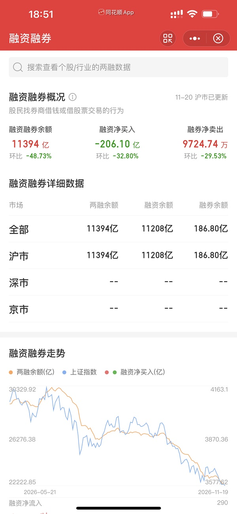
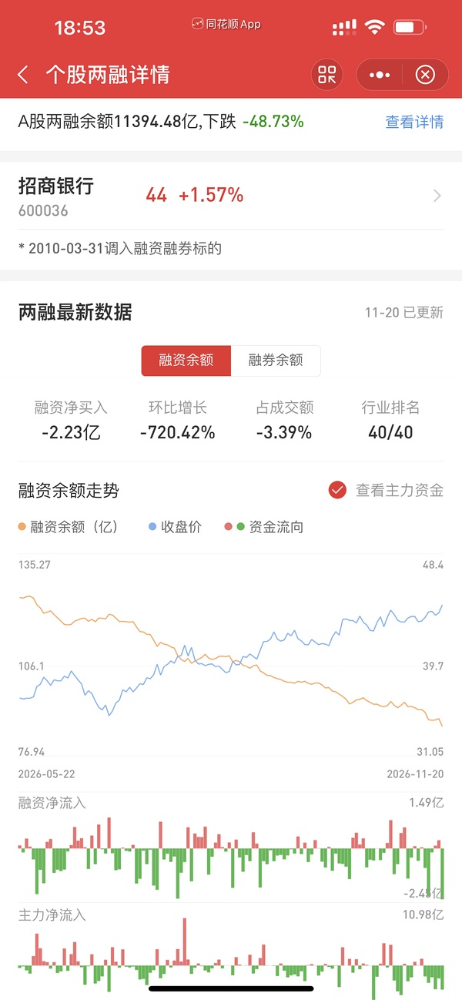

# 📋 楼主每日发言推送

> **推送日期**：2026-11-21 ｜ **执行时间**：2026-11-21 21:03:32 ｜ **监控用户**：`不知道还能说啥`
> **追踪模式**：`topic`（用户主页广播·豆瓣话题）

## 📊 持仓追踪
> 上次更新：2026-11-21 ｜ 基于楼主发言持续追踪（共 15 项）

| 标的 | 状态 | 类型 | 现价 | 提及 |
|------|------|------|------|------|
| 招商银行 | 底仓·四年前 32 元×7000 股买入·四年分红未复投仍 7000 股·不动 | 红利/银行 | 44.00（1.57%） | 底仓·不动；7000股/摊薄成本约24.27元；1…；成本约32元 |
| 大连圣亚 | 持有（11-18 加仓@37.74 被深套）·今日无动作·卖单 46.90/45.22 未触及 | 冰雪·正牌双子星 | 29.10（-9.99%） | 持有（11-18加仓@37.74被深套）；11-2… |
| 雪人集团 | 持有·11-19 手动买入 2 笔@≈13.5（两笔 cbs 钱搬入）·卖单 13.84/14.84/15.84 | 冰雪·交易仓 | 11.82（-9.56%） | 称若plus 15+则「雪儿我那边不开单子」「雪儿… |
| 幸福蓝海 | 持有·今日换仓买入 1 笔@≈15.50（09:43）＋11-16 笔@16.91·明日卖单 15.84（由 18.64/20.44 下移） | 电影 | 12.68（-6.07%） | 持有；11-20 -6.07%；无新买卖 |
| 中国电影 | 持有·剩余仓无单·锁仓『慢就是快』 | 电影·核心不动仓 | 15.41（0.98%） | 持有·锁仓；11-20 +0.98%（逆势红） |
| 光线传媒 | 持有·今日部分卖出@11.82（-4.3% 换仓入幸福）·仍持上周老仓 | 电影·低位备选 | 10.19（-4.59%） | 持有·老仓（存钱罐）；11-20 -4.59%；1… |
| 博纳影业 | 持有小仓·今日跌停 5.69（=6.32×0.9）·卖单 6.94 未触及（高 6.22）·明日买 614 计划 | 电影 | 4.94（-2.95%） | 持有小仓；11-20 -2.95% |
| 纳斯达克ETF华夏 | 持有·不卖场内（溢价品种）·开盘预测 -1.5% 落空他自己认赖皮 | QDII·场内纳指 | 2.523（-4.61%） | 仅计算标准开盘与漏跌幅度，未进行买卖 |
| 中韩半导体ETF | 持有·今日无动作自述 | QDII·场内 | 3.375（-6.51%） | 持有；11-20 -6.51% |
| 盛天网络 | 11-11 买入·持有（口径仍待确认） | 游戏·电竞 | 8.56（-1.72%） | 持有（口径待确认）；11-20 -1.72% |
| 游戏自建仓 | 11-10 买入·持有·11-11 自述 +5%（时点值未更新） | 游戏·电竞 | 暂无 | 持有；11-20无提及 |
| 美债场外基金 | 持有·国庆前买入·11-11 自述 +1.4%（时点值未更新）·债灾自述接近转亏 | 场外·美债 | 暂无 | 持有；11-20无新自述 |
| 传媒低位10cm | 11-12 自述『只加一个低位的』＋11-16 14:22『我要去买一个传媒了』（是否执行无自述）·拒绝点名 | 传媒·低位 | 暂无 | 持有；11-20 10:49『我偏心 我买的都是传… |
| 东方海洋 | 11-16 买入探针仓 <2%·无卖单自述·当日跌停（11-12 曾涨停 5.16 卖出，见 day_actions_1112） | 探针·羊情绪组 | 3.75（9.97%） | 11.16；探针仓<2%·持有；11-20涨停收3.75（=3… |
| 六只债券基金 | 持有·00:38『这些我都有 第二个和第三个在这轮中灾难中经受住了考验』·债灾自述实亏·『债持不炒，每调买机』 | 场外·债基 | 暂无 | 11.16；持有；11-20无新自述 |

> ⚠️ 执行任务时如发现新操作，请更新 `state.json` 的 `positions`。成本价和市值有数据才填，没有则保留「暂无」。

## 🌅 今日总览
### 📌 市场背景
今日发言未涉及A股整体指数判断，主要围绕纳指100长期估值、2022年加息周期复盘与融资盘去杠杆。楼主称「nana100估值百分位2%」「十年纬度 nana100估值百分位4%」，并强调「悲观归悲观 客观数据也得看」；对融资盘则称「融资盘周五 又是400亿级别吧」「爆融资盘是会出冰点的哦」。

### 📌 今日操作
| 操作 | 标的 | 详情 |
|---|---|---|
| ⏭️ | — | 今日发言未披露任何买卖动作；仅称「不过我没钱了」「我没钱了」，无新增资金参与。 |
| ⏭️ | nana100 | 仅讨论五年2%、十年4%估值百分位，未披露交易。 |
| ⏭️ | 融资盘/冰点 | 复习冰点五条件，判断「我判断是没有的呀」，未操作。 |

### 📌 今日议题
| 议题 | 态度 | 核心观点 | 关键引用 |
|---|---|---|---|
| 纳指100长期估值 | 📈看多 | 估值百分位处于历史极低区，但可能因财报再新低，修复需时间消磨。 | 「nana100估值百分位2%」「客观数据也得看」 |
| 2022加息周期复盘 | 💬讨论 | 2022是长时间下跌而非同等跌幅；恐慌压迫感2020口罩强于当前AI故事。 | 「2022是长时间下跌 跌幅并不这样 不太一样」「媲美的肯定是2020口罩」 |
| 修复速度与基金质地 | 💬讨论 | 修复空间相同不代表修复速度相同；夏普/卡玛高、回撤大的修复能力更强。 | 「数字一样 但是真正的修复速度完全不会一样」「回撤大的修复能力就会更强」 |
| 融资盘去杠杆与红利 | 💬讨论 | 融资盘周五约400亿批量流出，最大单票寒武纪不足5亿；融资盘表态绝不买红利，无融资盘传媒也承压。 | 「融资盘周五 又是400亿级别吧」「最大单票流出是寒武纪 但不足5亿」 |
| 冰点条件 | ➡️中性 | 冰点五条件缺一不可，当前判断不满足；爆融资盘可能出冰点，但自己没钱参与。 | 「缺一不可 必须同时满足」「不过我没钱了」 |
| 融资盘背锅叙事 | 💬讨论 | 市场把周五垃圾操作归咎融资盘，他调侃“背锅侠消息”。 | 「融资盘爆爆爆 这次怪融资盘」「妈妈又在放背锅侠消息了」 |

### 📌 看好板块/方向
- **纳斯达克100（nana100）**：五年估值百分位2%、十年4%，长期客观数据处于低位；但估值仍可能因财报新低，修复需时间。

### 📌 风险提示
- 「还有2%的下降空间 只要随便几家公司发布财报就会估值新低的」——纳指100估值仍可能因财报下修再创新低。
- 「2022是长时间下跌 跌幅并不这样 不太一样」——不能把当前简单类比2022加息周期。
- 「爆融资盘是会出冰点的哦」——融资盘强平可能触发冰点，但需五条件同时满足。
- 「不过我没钱了」——即便出现冰点，楼主无资金参与。
- 「我们sy 幸福 大连这种没融资盘的也半斤八两」——无融资盘标的同样承压，去杠杆非局部风险。
- 「融资盘：死也要死的光荣 绝不买红利」——融资盘明确回避红利，红利承接力需观察。

## 📊 本次结果
- **今日发言**：20 条
- **累计存档**：23204 条

## 📝 该最新广播作者发言聚合（共 20 条）
- (2026-11-21 16:49:03) [图] 五年纬度 
nana100估值百分位2%
已经远低于我四年前买入nana的估值区域
还有2%的下降空间 
只要随便几家公司发布财报就会估值新低的

四年前是上上下下几段 消磨了两个财报窗口 估值才变成20倍 现在就算不涨不跌 消磨时间会更低

- (2026-11-21 16:50:23) [图] 十年纬度
nana100估值百分位4%
除了四年前
仅略高于2018毛衣大战和2020口罩崩盘时刻

悲观归悲观
客观数据也得看

- (2026-11-21 17:11:05) 美国上一轮加息周期始于2022年3月16日，终于2023年7月26日，历时16个月，共加息11次，累计加息525个基点，联邦基金利率从0.25%升至5.25%–5.50%，创下22年来最高水平，是近40年来最陡峭的加息周期。

标普500在2022加息周期各阶段的走势

阶段一：加息启动至首次75bp（2022年3月–6月）
标普500从约4,300点下跌至约3,800点，累计跌幅约12%。加息启动初期市场对紧缩速度估计不足，随后连续75bp加息引发剧烈重定价。

阶段二：激进加息高峰（2022年6月–10月）
标普500从约3,800点继续下探至3,502点（2022年10月为本轮熊市最低点），累计再跌约8%。此阶段科技板块首当其冲，2022年全年科技板块大跌27%，通信服务板块暴跌37%。

阶段三：加息放缓至周期终结（2022年11月–2023年7月）
标普500从3,502点反弹至约4,580点，累计涨幅约31%。加息幅度从75bp降至50bp、再降至25bp，市场对利率见顶的预期逐渐形成。

阶段四：加息终结后的二次探底与年末反弹（2023年8月–12月）
标普500在2023年8–10月回调至4,115点（10月末低点），随后在确认加息周期终结后强势反弹，年末收于约4,770点，全年涨幅24.2%。

- (2026-11-21 17:12:54) [图] 

  ⊳ （引用 @不知道还能说啥）美国上一轮加息周期始于2022年3月16日，终于2023年7月26日，历时16个月，共加息11次，累计加息525个基点，联邦基金利率从0.25%升至5.25%–5.50%，创下22年来最高水平，是近40年来最陡峭的加息周期。

标普500在

- (2026-11-21 17:24:14) 2022是长时间下跌 跌幅并不这样 不太一样
如果同等心态考验 外加恐慌程度
媲美的肯定是2020口罩 这个除了暴虐大崩以外
死亡威胁和现实生命的新闻报道压迫感远强于现在的什么AI故事有没有
一个关系到钱一个关系到的是命  ⊳ （引用 @哄哄🐮）经历过22年加息事件的博主是不是都非常稳得住哈哈哈哈😂

- (2026-11-21 18:22:26) 这个数据其实没有什么意义
就像nana还需要50%修复和建信还需要50%修复 
数字一样 但是真正的修复速度完全不会一样
哪怕nana还需要20%修复和建信还需要50%修复
你也无法确定是nana先修复
你的基金夏普比高 卡玛比高 
回撤大的修复能力就会更强  ⊳ （引用 @混乱中立同人女）楼里uu有没有保存楼上次手动做的主动基大跌后修复率的表格，我想参考一下

- (2026-11-21 18:51:34) [图] 融资盘周五 又是400亿级别吧

- (2026-11-21 18:53:56) [图] 融资盘：谁买银行 谁是🐶

- (2026-11-21 18:55:46) [图] 应该是 融资盘：谁买红利 谁是🐶

融资盘：死也要死的光荣 绝不买红利

  ⊳ （引用 @不知道还能说啥）融资盘：谁买银行 谁是🐶

- (2026-11-21 19:03:21) 哈哈
融资盘这一点表态很明确：宁愿站着死 绝不买红利🤣  ⊳ （引用 @一颗牛奶糖）🤣🤣我现在觉得我扛不住去买银行估计就是见顶了 参考我买场内科技

- (2026-11-21 19:05:24) 我们sy 幸福 大连这种没融资盘的也半斤八两😂

妈妈又在放背锅侠消息了
自己周五的垃圾操作就被盖过去了  ⊳ （引用 @招招碎片收集中）尾盘估计又爆不少吧

- (2026-11-21 19:10:59) 融资盘爆爆爆
这次怪融资盘  ⊳ （引用 @没有感情的村民）什么消息

- (2026-11-21 19:13:50) 爆融资盘是会出冰点的哦

不过我没钱了😂😂😂😂😂😂

有钱的uu可以做准备  ⊳ （引用 @稀里不糊涂）大爆炸级别的

- (2026-11-21 19:15:23) 我以为周五最终可以大赚的🤣🤣🤣🤣笑死人了

忘了那是礼拜几  ⊳ （引用 @招招碎片收集中）谁看了早盘不觉得曙光初现，跌停数都到个位数了，一觉睡醒飚到60+，神经病

- (2026-11-21 19:18:49) 他们不是传融资盘爆爆爆嘛😂  ⊳ （引用 @点-重生炒垃圾）怎么还要准备冰点😅😅😅还要跌跌跌啊

- (2026-11-21 19:24:20) [图] 我没钱了
表发给你们
如果有的话

重新复习冰点条件：
1，全部指数大跌特跌
2，涨跌家数1:9
3，跌停家数非常非常多 涨停家数非常非常稀有
4，不同行业板块ETF大批量-4%以上
5，市场出现超级恐慌性的抛售导致成交爆量

- (2026-11-21 19:26:04) 我判断是没有的呀
那大家既然都提了
可以复习做个准备  ⊳ （引用 @稀里不糊涂）不是说真冰点今年没有了吗

- (2026-11-21 19:27:13) 缺一不可 必须同时满足  ⊳ （引用 @不知道还能说啥）我没钱了
表发给你们
如果有的话

重新复习冰点条件：
1，全部指数大跌特跌
2，涨跌家数1:9
3，跌停家数非常非常多 涨停家数非常非常稀有
4，不同行业板块ETF大批量-4%以上
5，市场出现超级恐慌性的抛售导致成交爆量

- (2026-11-21 19:31:15) 根本不可能

1，垃圾票融资盘根本没有多少 最近融资盘是什么情况你早上每天看我发吧 都是卖

2，海外链周五跌的不多

3，国产刚涨了不少 周五才跌

4，我已经看了200亿周五上交所融资盘流出 是批量流出 不是单点股票爆破 最大单票流出是寒武纪 但不足5亿  ⊳ （引用 @Aaa摆烂咸鱼🥳）周五应该很多人爆仓了，很多

- (2026-11-21 19:33:01) 温故而知新 多复习 
既然大家提了 那就复习一遍
我经常自己复习  ⊳ （引用 @稀里不糊涂）楼说过这次融资盘基本没怎么进来，再来大规模爆仓我都不知道咱们要跌去那个地方了。。。

## 🧠 投资风格分析
> 📏 增量更新指引：仅当今日发言确有新依据时才修订对应维度，无变化不强行重写；单维度修订建议 ≤150 字。

- 投资理念与方法：坚持机会成本与性价比，只赚份内的钱，警惕机构抱团与题材炒作；用跌停家数及冰点条件判断情绪转换，今日明确冰点五条件（全部指数大跌、涨跌家数1:9、跌停多涨停少、行业ETF批量-4%、恐慌爆量）缺一不可；看长期估值百分位与夏普/卡玛衡量的修复能力，不以剩余修复空间简单外推；关注融资盘批量流出结构。偏好在大涨大跌时看反向观点，但对恐慌事件强调不可简单类比。
- 风险偏好：整体回避高波动、高拥挤的垃圾消费与微盘股，警惕机构抱团和题材炒作；新增回避含权债基/固收+，认为“求稳”债基实则股性重；对恐慌强度区分生命威胁与叙事冲击，认为2020口罩式恐慌压迫感强于AI故事，强调同等心态考验才可类比；1月垃圾股ST预告风险仍主张不玩、1.15前撤。
- 交易与仓位：强调言行合一与计划内操作，反对超计划加仓；习惯提前挂条件单、分批低吸，不追高。今日无单，称「我今天什么单子都没开了」「其他我一个都不卖」，并预设plus 15%以上手动S。仓位偏高，买nana动用余下储备资金，自述「一旦出现冰点 我也操作不了」，因此对加仓与腾挪更谨慎。
- 心理特质：对波动与回撤高度钝化，自嘲「老垃圾人」，面对普跌不破防，称「经历多了自然是」。顺境中易手贱、会飘，需外部提醒鞭策；周五刻意不开单以守纪律。乐观主义底色，普跌中仍期待「下周我们会大丰收的」「期待复刻我们三月份收益率超级V的名场面」。

> ⚠️ 本板块由 Actions 全自动增量更新（复用当日发言与今日总览），每次仅在内容足够支撑时才改动。

## 🏷️ 昵称映射表
### 📖 昵称规律（供 AI 判断新昵称时参考）
【昵称命名规律（用于推断未知新昵称）】
- 拼音首字母缩写：取标的/基金名汉字拼音首字母串（含数字代码），多为 ETF/股票代码口语化｜示例：yl=引力传媒｜zy=掌阅科技｜sj=视觉中国｜cc=华安文体健康混合｜C50=创业板50ETF｜k50=科创50｜kun=昆仑万维｜xhxc=新瀚新材｜zxfc=中欣氟材
- 小/老+姓氏代指：「小X」「老X」通常指姓 X 的标的或该标的的基金经理；「X兄弟」多为同系基金｜示例：小惠=惠发食品｜老莫=万家品质生活(莫海波)｜小华=华夏全球科技先锋(QDII)A｜小华兄弟=华夏移动互联(QDII)｜小浦=浦银安盛全球智能科技(QDII)A｜小广=广发全球精选(QDII)A｜小远=华宝致远(QDII)C｜招招=招商银行｜小德=德明利｜赵姨=兆易创新｜露露=泸州老窖｜空调=格力电器
- 戏称/黑话→题材板块：生活化比喻或黑话对应某个题材/板块，而非单一标的；出现时多指板块方向｜示例：卖国=PCB板块(英伟达AI链)｜爱国=国产自主(半导体设备/芯片)｜奶茶=易点天下｜老师=中文在线｜蓝色=蓝色光标｜宇航员=航空航天板块｜华子=华泰保兴安悦债券｜国际=国际复材｜巨无霸=长鑫科技等重大IPO
- 谐音/取字：昵称含标的名关键字（取一字或谐音），多为 A 股个股或基金简称｜示例：万华=万华化学｜东百=东百集团｜宝=保利发展｜讨饭/亚洲讨饭/建信新兴=建信新兴市场(QDII)A｜华宝zy=华宝致远(QDII)A
- 机构/基金经理昵称：以基金公司名、经理姓、或平台代称指代对应基金产品｜示例：周经理=中欧新趋势混合(LOF)A｜张经理=信澳匠心回报混合A｜网易云/音乐世家=富国全球科技互联网股票(QDII)A｜国富亚洲=国富亚洲机会股票(QDII)A｜国泰纳指=国泰纳斯达克100指数(QDII)｜易方达全球=易方达全球成长精选混合(QDII)A｜浦银安盛=浦银安盛全球智能科技(QDII)A

### 📋 已收录映射
| 昵称 | 对应名称 |
|------|----------|
| C50 | 创业板50ETF |
| cc | 双义：股票=中国长城 / 基金=华安文体健康混合（用户 11-05 指认） |
| k50 | 科创50 |
| kun | 昆仑万维 |
| sj | 视觉中国 |
| xhxc | 新瀚新材（用户确认；代码待核） |
| yl | 引力传媒 603598（对手盘，非他持仓）｜11-06 +37.15%；11-09 本月+37.79% |
| zxfc | 中欣氟材 |
| zy | 双义：他本人口径=603533 掌阅科技（用户 11-05 确认）；11-09 楼友两条『zy』按 16 元/电影语境指 600977 中国电影。引用必须带语境，不许收敛 |
| 万华 | 万华化学 |
| 东百 | 东百集团 |
| 亚洲讨饭 | 建信新兴市场混合(QDII)A |
| 保利发展 | 保利发展 |
| 华子 | 华子＝007540 华泰保兴安悦债券A（华泰保兴基金·安悦债券A类份额），满仓30年超长利率债的长债基金（用户 2026-11-16 确认，无歧义，不是歧义项）；00:42 楼友『华子今年战绩无敌吧』→他答『30超长债牛逼没办法』；13:47『纯利率债就是华子那种 不过华子满仓30债 有些是满仓5-10年』；**与460108不是同一只**：460108＝华泰柏瑞稳健收益债券C（他持有的纯利率债·重仓国开/农发/国债，见六基行），华子007540 是华泰保兴的长债基金，勿混 |
| 华宝 zy | 华宝致远混合(QDII)A |
| 华宝zy | 华宝致远混合(QDII)A |
| 卖国 | PCB、光模块、通信板块（英伟达AI产业链） |
| 周经理 | 中欧新趋势混合(LOF)A |
| 国富亚洲 | 国富亚洲机会股票(QDII)A |
| 国泰纳指 | 国泰纳斯达克100指数(QDII) |
| 奶茶 | 301171 易点天下（对手盘，非持仓）｜11-13 10:07『奶茶out 幸福人的底气是可以说芒果out』；当日 −6.72% |
| 宇航员 | 航空航天板块 |
| 宝 | 保利发展 |
| 小华 | 华夏全球科技先锋混合(QDII)A |
| 小华兄弟 | 华夏移动互联混合(QDII) |
| 小广 | 广发全球精选股票(QDII)A |
| 小德 | 德明利 |
| 小惠 | 惠发食品 |
| 小浦 | 浦银安盛全球智能科技(QDII)A |
| 小远 | 华宝致远混合(QDII)C｜只在盯，未证他持有 |
| 巨无霸 | 长鑫科技等重大IPO企业 |
| 建信新兴 | 建信新兴市场混合(QDII)A |
| 张经理 | 信澳匠心回报混合A |
| 招招 | 招商银行 |
| 易方达全球 | 易方达全球成长精选混合(QDII)A |
| 浦银安盛 | 浦银安盛全球智能科技(QDII)A |
| 爱国 | 国产自主（半导体设备/芯片制造） |
| 空调 | 格力电器 |
| 网易云 | 富国全球科技互联网股票(QDII)A |
| 老师 | 中文在线 |
| 老莫 | 万家品质生活混合A(519195) |
| 蓝色 | 300058 蓝色光标（广告组合，非他持仓）｜11-12 高 15.97＝20cm 涨停价、收 14.76 +10.89%（炸板）；10:21『他和蓝色 奶茶 sg他们是广告组合』 |
| 讨饭 | 建信新兴市场混合(QDII)A |
| 赵姨 | 兆易创新 |
| 赵哥 | 兆易创新 |
| 露露 | 泸州老窖 |
| 安安 | 安记食品 |
| 音乐世家 | 富国全球科技互联网股票(QDII)A |
| 老伯伯 | 铜冠铜箔 |
| nk | 纳指科技ETF景顺 159509（联接=景顺长城纳斯达克科技ETF联接A）｜11-06 A级：截图溢价率37.08% |
| bk | 标普信息科技LOF 161128（场外=易方达标普信息科技QDII-LOF）｜11-06 A级 |
| txx | 天下秀 |
| 媛媛 | 今世缘 |
| uu | 友友、网友们 |
| 温暖老师 | 某个特别牛逼的散户 |
| 余老师 | 余利，某牛逼投资者 |
| ycm | 粤传媒 002181｜11-09 12:12「非电影传媒就留给大家玩了 我一个都不会碰了」→ 推断已不持有 |
| 江老师 | 江琪（投资博主） |
| 水果老师 | 投资博主 |
| 小爱 | 我爱我家 |
| ty | 天娱数科 |
| bn | 博纳影业 |
| sy | 601595 上海电影｜**他空仓**（11-09 起未回接）；11-12 09:38『天天念叨sy的给你们机会了』＋09:41『现在-6给你们机会了哈』＋13:15『马上sy跌停 bn还要尊敬一下他』＋13:51『与此同时 sy跌停』＋14:00『sy历来以残暴虐杀手法闻名』；实测收 42.15 −9.99% 跌停 |
| CBS | 长白山 |
| 东哥 | 东百集团 |
| 芒果 | 300413 芒果超媒（对照，非持仓）｜11-13 14:01 本月涨幅 41.70% vs 幸福 53.76% →『幸福已经拉开芒果12%』＝12.06pp 精确命中；当日 −4.83% |
| 阿中 | 中国电影 |
| 欢欢 | 欢瑞世纪 |
| 雪人 | 雪人集团 |
| 大连 | 大连圣亚 |
| 幸福 | 幸福蓝海 |
| 小粤 | 粤传媒 |
| 阿博 | 博纳影业 |
| 创成长 | 创业板成长etf |
| asd | 002747 埃斯顿｜11-11 15:09『我昨天去的另外一个 今天也吸到asd了』＝11-11 低吸买入；11-12 10:17『我昨天加了asd今天刚刚加了另外个』＋10:35『asd火箭发射』（盘中高 32.19，收 29.95 −4.37%）；买价未披露。**11-11 轮误删、11-12 恢复** |
| 恋爱脑 | 002582 好想你｜11-12 14:39:31『清了恋爱脑』＝清仓（卖价未披露；10.48 卖单两日均未触及→手动卖）；14:28『我如果去掉恋爱脑 也就比你多一个机器人』；当日收 9.76 −2.89% |
| 恋爱 | 002582 好想你（同『恋爱脑』）｜11-12 14:39 已清仓，不再持有 |
| 小羊 | 000678 襄阳轴承｜11-05 已卖（卡当日最高 20.40）；11-12 14:16『襄阳掉了』＋14:44『厉害襄阳』＝只评论走势，非持仓 |
| 中马 | 中马传动 |
| 晶雪 | 晶雪节能 |
| xf | 幸福蓝海 |
| 建设 | 建设工业 |
| 北方 | 北方导航/北方国际（未定，11-04「我在北方了」） |
| _ambiguity_note | 歧义未收敛（禁止当唯一映射）：轮子=巨轮智能/五洲新春；sj=视觉中国（传媒语境）/神剑股份（宇航员语境）；cc=中国长城/华安文体健康混合；北方=北方导航或北方国际；zy=掌阅科技（用户 11-05 确认原值正确）。证据分级：A=价位/均线/月涨幅实测命中；B=量级或单日命中/用户口述；C=仅昵称或语义，不得据此写『他持有』；沿用原仓=本轮未复核，不写进结论正文。三条判据：①条件单四位数要先按同时段动词行判买卖方向（cbs 3644 是买单不是卖单）；②『祝福/你们/你的X』句式＝评论他人持仓，不是他的操作；③同一昵称在不同语境可指两只票（zy=掌阅/中影），按价位与板块取，不许收敛成一个。 11-11 补：plus雪＝他自己也没说清（11:12「你应该不知道plus雪是哪个」），不许猜；bdd＝有传媒属性所以他不去（13:42），仍未定案；『五连阳』这类盘中口径不等于日K实测（招行 11-06 为平盘十字星）。 11-12 补：①盘中快照≠收盘（14:15 三日账第三日 幸福+0.5/光线−4.5 为盘中值，收盘 −0.53/−4.97；他写的『拉开5.3%』按自列数字相加应为 5.5，属口算误差，不得据此推翻实测）；②历史卖单不重复计触发（中影 15.84 虽∈11-12 区间[15.39,15.98]，但 11-10 已成交、无存续卖单）；③清仓自述不封锁后续再买（asd 11-06 清→11-11 15:09 再吸，11-11 轮据此误删）；④『果果』只是推断映射，不得当持仓证据；⑤机器人第二仓与传媒低位10cm 代码未披露，福赛仅为楼友提问他作答，不许映射。 11-13 补：①**本月涨幅类口述可核**，基准＝10-30 收盘，且要用**发言时刻的分钟价**复算（14:01 截图 53.76% 与分钟线独立复算分毫不差，『拉开芒果12%』＝12.06pp）；②**基金表『折价率』列负号＝溢价**（513300 −15.28% ⇒ 溢价 15.28%，与 11-06 的 16.36% 同口径），别读成折价；③**『我手里就7只股票了/我只有电影冰雪了』是他题材仓口径**，不得据此删除无卖出自述的持仓行（铁律 6）；④**『全部跌停』类口述是盘中快照**（东方海洋盘中最低 4.64＝跌停价、收 −6.59%，未封死）；⑤plus雪＝晶雪只是**品种识别**，他 11-09 已自述清仓，不得当持有证据。 11-16补：①华子与460108是否同一只未定案（华子亦可能楼友昵称），不得据华子写他持有30债；②14:22『T掉追加的』对象歧义（主读法＝大连11-10加筆T，备选＝幸福老股T），无成交自述不改笔数；③博纳09:52『今天』与底仓口径冲突，加仓@6.37按09:45『加仓bn』＋09:46『-6』取；④『2开头招行』语义未定不映射；⑤华夏兄弟17:26裸报-2.5%证据不足不入表。 11-16补：①14:22『T掉追加的』对象歧义（主读法＝大连11-10加筆T，备选＝幸福老股T），无成交自述不改笔数；②博纳09:52『今天』与底仓口径冲突，加仓@6.37按09:45『加仓bn』＋09:46『-6』取；③『2开头招行』语义未定不映射；④华夏兄弟17:26裸报-2.5%证据不足不入表。 11-17补：①『太子爷』『bdd』『畅畅』未定案不映射；②雪人今日14.01加仓笔受T+1，14.84卖单卖的是可卖老仓（非当日买笔）；③晶雪25.64回落单他自述触发、日K高25.78证实（分钟接口H25.35偏低为已知不稳）；④光线11-17部分卖出@11.82按11-16追高笔推定(B)，仍持老仓；⑤传媒『以身入局』拒绝点名不外推代码。 11-17补：①『太子爷』『bdd』『畅畅』未定案不映射；②雪人今日14.01加仓笔受T+1，14.84卖单卖的是可卖老仓（非当日买笔）；③晶雪25.64回落单他自述触发、日K高25.78证实（分钟接口H25.35偏低为已知不稳）；④光线11-17部分卖出@11.82按11-16追高笔推定(B)，仍持老仓；⑤传媒『以身入局』拒绝点名不外推代码。 11-17补：①『太子爷』『bdd』『畅畅』未定案不映射；②雪人今日14.01加仓笔受T+1，14.84卖单卖的是可卖老仓（非当日买笔）；③晶雪25.64回落单他自述触发、日K高25.78证实（分钟接口H25.35偏低为已知不稳）；④光线11-17部分卖出@11.82按11-16追高笔推定(B)，仍持老仓；⑤传媒『以身入局』拒绝点名不外推代码。 11-18补：①雪人『兑现今天加的雪儿』受T+1，今日14.17买笔不可当日卖，兑现的是可卖老仓；②传媒『这周开干』拒绝点名不外推代码；③晶雪上週买回成本未披露、清仓收益不计算；④长白山(cbs)两笔成本36.44/38.8、同价33.65卖出。 11-19补：①雪人13.84卖单在开盘高13.94时可能触发（不写死成交价，记B待核）；②晶雪『今天20买』是给楼友的话、无第一人称买入→不回接；③中证1000ETF象征性小额买入、金额未披露；④大连11-18加仓@37.74 被套（11-19跌停32.33），11-19『我没买』无动作。 11-19补：①【1000】＝gjd国家队（他澄清『我说的是gjd』），非中证1000ETF、非本人买入，已从持仓删除；②雪人13.84卖单在开盘高13.94时可能触发（记B待核）；③晶雪『今天20买』是给楼友的话、无第一人称买入→不回接；④大连11-18加仓@37.74 被套（11-19跌停32.33），11-19无动作。 11-19补：①『1000』＝中证1000，『gjd』＝国家队；合起来是『国家队在象征性买中证1000』——他评论国家队托市，非本人买入/持仓（已从持仓删除误记）；②雪人13.84卖单在开盘高13.94时可能触发（记B待核）；③晶雪『今天20买』是给楼友的话、无第一人称买入→不回接；④大连11-18加仓@37.74 被套（11-19跌停32.33），11-19无动作。 11-20补：①今日无交易（11:57『我今天什么单子都没开了』『其他一个都不卖』）；②雪人13.84/14.84/15.84卖单未触及（11-20高12.76＜13.84）；③大连再跌停29.10、东方海洋涨停3.75(探针)；④xxz/东哥 未定案不映射。当日盈亏总结已写入 stock_pnl_note（等权涨跌率口径）。 |
| nana场内 | 513300 纳斯达克ETF华夏｜11-09 14:34「不愧是513300 当年的普通nana ETF之王」，当日唯一红的纳指ETF |
| 雪儿 | 雪人集团 002639｜11-06「大连和雪儿」＋11-11 14:26「雪儿今天不错啊 大家昨天不是期待他接人嘛 这个任务做到了今天」（接人＝5日线接回，与雪人条件单口径一致） |
| 存钱罐 | 光线传媒 300251（他自述小仓）｜11-13 15:11『我相信光虽迟但到 我会肯定保留上周的存钱仓位』＝存钱罐口径再次落到光线 |
| 枣子 | 002582 好想你（同『恋爱脑』）｜11-12 14:39 已清仓，不再持有 |
| 王老师 | 人：王博雅投资（QDII 场内溢价口径），不是标的 |
| 印度 | 自嘲代指中国（推断，勿当事实） |
| 10086 | 中国移动（他当指标用，非持仓） |
| 阳光乳业 | 001318 阳光乳业（他的『喝的』/牛奶）｜11-09 A级：13:59 分时截图 S 标记≈13.5＋10:52「我去掉了羊来抄底」 |
| 羊 | 生肖羊概念组（带阳/洋/光/太/泉的一篮子）｜11-09 14:04 他自己贴的分组；**11-13 崩盘实证**：15:58 截图跌幅榜 澳洋健康 −10.06、阳光照明 −10.05、红太阳 −10.04、大东方 −10.03、阳光乳业 −10.02、襄阳轴承 −9.98、鲁阳节能 −9.95、大西洋 −9.73、太阳电缆 −9.29、圣阳股份 −8.64、泉阳泉 −6.60、东方海洋 −6.59；他 14:48『我昨天起码说了6次 控制仓位 因为羊和东方昨天松动了！！！！这是情绪核心』 |
| 小明 | 605179 一鸣食品｜11-09 10:07 有人问『喝的小明？』他答『羊』＝喝的已换成阳光乳业 |
| 皇台 | 000995 皇台酒业｜11-09 与雪人 PK 当日换手率龙虎榜 |
| 海哥 | 人：转债估值博主（不是标的）｜11-09 12:48「海哥周五那个新债…我买了点试试看是市场错了还是海哥错了」 |
| 申菱转债 | 123290（申菱环境 301018 的转债）｜11-09 13:50 买 150 张 @133 多；11-10 11:20『我开了149.9』卖单；11-12 分钟线 10:03–11:12 持续≥149.9（高 152.313）→触发推定清仓，+12.28%（成本 133.5 推定）记入 stock_pnl，已从持仓表删除 |
| 盛天 | 300494 盛天网络｜11-11 A级：11:29 分时截图 B 标记 @11.00＋「不止 而且我跟了他一把」（跟摄像大哥） |
| dfhy | 002086 东方海洋｜11-11 13:56 楼友问 dfhy 绕异动→他『我没算 这几天可能都是异动吧』；11-12 14:39 涨停 5.16 卖出（＝4.69×1.10 到分＋分钟 14:36 封板＋财联社 17天9板）；**11-16 09:28『看东方海洋了』＋15:17『东方海洋上周四不好示范』＝买回探针仓 <2%**，羊仪表盘四图蓝高亮 002086，当日跌停收 4.34（昨 4.82）；探针非重仓 |
| xys | 300502 新易盛｜11-11 13:19「我那个买xys的女主播终于要开心了」＋13:21「她现在成本327了」→ **是女主播的仓，不是他的** |
| 冰山 | 000530 冰山冷热｜11-11 10:16「万一冰山跌停 他能跌到哪里再去」＋10:27「今天把冰山 晶雪按死 大连 CBS 正统上位」（非持仓，冰雪板块的山寨对照） |
| 冰冰 | 000530 冰山冷热｜11-11 14:03「那冰冰准备」（同『冰山』，非持仓） |
| 龙版 | 605577 龙版传媒｜11-11 11:50「最早龙版也是因为自己每次公告文案都不一样才4连板就被监管」（讲监管规则，非持仓） |
| 3300 | 513300 纳斯达克ETF华夏｜11-11 10:49「3300还行 不过今天我不满意」＋13:24「咱们3300还是近期数据最好的」 |
| nana100 | 纳斯达克100指数（他对照场内ETF溢价的基准）｜11-11 08:14「昨天513300涨了3.53% 但是nana100实际也就涨了3.4」 |
| 易中天 | 新易盛＋中际旭创＋天孚通信（CPO三巨头合称）｜11-11 14:13「都去易中天了🤣」（非持仓） |
| 冰雪双子星 | 大连圣亚600593＋长白山603099（他的正牌冰雪双仓）｜11-11 10:29「从不担心冰雪双子星」 |
| 2000 | 中证2000指数（他当微盘股基准）｜11-11 11:11「除了机器人 今天其他题材全输给了2000」 |
| cw | CoreWeave（CRWV，美股AI算力）｜11-11 11:18「cw那玩意硬起来了 大家看夜盘数字」 |
| ant | Anthropic（美股IPO）｜11-11 12:11「接下来是不是ant IPO也是利好」 |
| 摄像大哥 | 人：楼友（不是标的）｜11-11 他的两笔游戏＝电魂网络涨停＋顺网科技≈+7，属楼友口径；楼主自己买的是盛天网络＋另一只未披露代码的游戏 |
| 游戏哥哥 | 游戏板块拟人化（不是具体票）｜11-11 12:58「游戏哥哥：我来也」＋13:01「妹妹休息 哥哥接力？」 |
| 传媒妹妹 | 传媒板块拟人化（不是具体票）｜11-11 11:40「被传媒妹妹压制了」＋13:01「妹妹休息 哥哥接力？」 |
| sg | 002400 省广集团（广告组合，非他持仓）｜11-12 A级映射：10:09:32『省广带起来了』＋10:21:36『他和蓝色 奶茶 sg他们是广告组合』；分钟线 10:00 6.70→10:09 6.89→10:21 6.94（昨收 6.70）命中『带起来』；当日收 6.64 −0.90%（冲高回落） |
| 果果 | 301052 果麦文化（**推断·B**，非持仓）｜11-12 13:05:01『果果紧随其后了』紧接 13:04:34『传媒出现两位数跌幅了 华策』；实测华策 −13.97%、果麦 −10.38% 同为两位数跌幅→谐音＋当日跌幅与语境命中；未见他自述买卖，不得当持仓证据 |
| 老登 | 机构抱团的老牌权重（白酒/消费/地产一类，**不是单只票**）｜11-12 07:51:44『如果这些资金回去重新抱团 最近涨起来的老登们非常危险…老登后续又要惨遭抛售 比如昨天大跌的白酒』 |
| plus雪 | 301010 晶雪节能（**B·推断；11-16 已买回持有**）｜11-13 10:04『plus雪是-20的…还能再跌-10』＝20cm，实测当日 −10.10%；15:25 答『多少出』报 24.94＝11-05 老卖单价（当日高 24.92 差 2 分未触及）；11-09 曾自述清仓 → **11-16 09:39『上周买了plus』＋14:53『掌声雪儿plus雪』＝上周买回、重新持有**；11-16 卖单 24.94 沿用，当日高 24.39 未触及；持仓屏 13:42:36 晶雪 23.110 |
| 复仇者联盟 | 电影档期锚（不是标的）｜11-13 10:18『复仇者联盟没有到来 全都不会清仓』＋10:29『复仇者联盟是12月的 流浪地球要2月』＝他把电影仓的兑现条件挂在片单档期上 |
| 流浪地球 | 电影档期锚（不是标的）｜同上，10:29『流浪地球要2月』 |
| nana | 纳斯达克100 指数（他用来对照场内 ETF 溢价/涨幅的基准，非标的）｜11-13 00:16『今天图上看 nana依然是大阳线』＋07:57『昨天-0.7收盘 但是nana晚上其实只有-0.3 现在期货+0.5 今天场内应该开盘+0.9%』→ 实测 513300 开盘 2.710＝+0.82%（误差 0.08pp） |
| 千红转债 | 楼友中签的新债（**不是他的标的**）｜11-13 09:17 他教对方『9:30就130停牌了 开个闹钟 14:56上号』『就是最后14:57去挂』＝转债上市首日尾盘挂单卖法 |
| 文投控股 | 600715（院线·他只在盯，非持仓）｜11-13 09:33 传媒板块截图 +10.03% 涨停、本月涨幅 66.67%（＝10-30 收盘基准独立复算分毫不差）；配 09:33『市场有转院线迹象』 |
| 华智数媒 | 300426（传媒·他只在盯，非持仓）｜11-13 本月涨幅榜第一（09:47 截图 78.91%／14:01 74.11%） |
| 横店影视 | 603103（院线·非持仓）｜11-13 09:33 截图 19.31 +10.03% 涨停，与文投/金逸并列＝『转院线迹象』的另外两票 |
| 金逸影视 | 002905（院线·非持仓）｜11-13 09:33 截图 9.90 +10.00% 涨停 |
| 日出东方 | 603366（羊字辈·情绪核心，非持仓）｜11-13 15:58『尤其今天表态的日出东方 别周一又跌停躺平了』；实测 +5.54%、最高 14.21 距涨停 14.49 一步 |
| plus | 301010 晶雪节能（上周买回、11-16 持有）｜09:39『上周买了plus』＋14:53『掌声雪儿plus雪』；卖单 24.94 沿用 11-05 老价，当日高 24.39 未触及 |
| 东方海洋 | 002086（＝dfhy）｜11-16 买回探针仓 <2%，当日跌停收 4.34（昨 4.82）；11-12 曾涨停 5.16 卖出；09:28『看东方海洋了』＋15:17『东方海洋上周四不好示范』 |
| 晶雪节能 | 301010（＝plus/plus雪）｜11-16 持有，卖单 24.94 未触及（高 24.39）；持仓屏 13:42:36 晶雪 23.110 |
| gjd | 国家队（推断 B）｜11-16 15:19/16:42 护盘语境，非具体标的 |
| plu | 人物·永远看空印度的博主（非标的）｜11-16 19:11『他永远看空印度的…924一开始他也看空的 不过他就一点好 看错了马上改』 |
| 华夏兄弟 | ＝小华兄弟·华夏移动互联混合(QDII)（推断·证据不足不入表）｜11-16 17:26 裸报 -2.5% 疑似场外持有，无第一人称买入/持有自述、无截图 |
| cbs | 长白山 603099（CBS黑话；11-18 已清仓卖出） |
| 1000 | 1000＝中证1000（指数／相关ETF）；2026-11-19 14:51『象征性扫了点1000』后他澄清『我说的是gjd』＝**国家队(gjd)在象征性买中证1000**（他在评论国家队托市行为，**不是他本人买入、也不是他的持仓**）；切勿读成他买了中证1000ETF |

> ⚠️ 以下为 LLM **建议**，未自动写入状态文件。请人工确认后，本地编辑 `state.json` 的 `nickname_map` / `positions`，或 `nickname_rules.json` 的 `rules` 并 push 生效。

*🤖 自动生成于 2026-11-21 21:03:32 ｜ 豆瓣楼主发言追踪*