# 📋 楼主每日发言推送

> **推送日期**：2026-11-23 ｜ **执行时间**：2026-11-23 14:52:44 ｜ **监控用户**：`不知道还能说啥`
> **追踪模式**：`topic`（用户主页广播·豆瓣话题）

## 📊 持仓追踪
> 上次更新：2026-11-23 ｜ 基于楼主发言持续追踪（共 18 项）

| 标的 | 状态 | 类型 | 现价 | 提及 |
|------|------|------|------|------|
| 招商银行 | 底仓·四年前 32 元×7000 股买入·四年分红未复投仍 7000 股·不动 | 红利/银行 | 43.22（-1.77%） | 底仓·不动；7000股/摊薄成本约24.27元；1…；成本约32元 |
| 大连圣亚 | 持有（11-18 加仓@37.74 被深套）·今日无动作·卖单 46.90/45.22 未触及 | 冰雪·正牌双子星 | 30.30（4.12%） | 持有，称「尾盘战神」 |
| 雪人集团 | 持有·11-19 手动买入 2 笔@≈13.5（两笔 cbs 钱搬入）·卖单 13.84/14.84/15.84 | 冰雪·交易仓 | 12.41（4.99%） | 持有，批评其强度不足但未卖出 |
| 幸福蓝海 | 持有·今日换仓买入 1 笔@≈15.50（09:43）＋11-16 笔@16.91·明日卖单 15.84（由 18.64/20.44 下移） | 电影 | 14.08（11.04%） | 持有，盘中+8仍不满意，考核KPI |
| 中国电影 | 持有·剩余仓无单·锁仓『慢就是快』 | 电影·核心不动仓 | 15.90（3.18%） | 持有，称「中影是最棒的」 |
| 光线传媒 | 持有·今日部分卖出@11.82（-4.3% 换仓入幸福）·仍持上周老仓 | 电影·低位备选 | 10.81（6.08%） | 持有（周五部分换出后仍有仓位），定位防守 |
| 博纳影业 | 持有小仓·今日跌停 5.69（=6.32×0.9）·卖单 6.94 未触及（高 6.22）·明日买 614 计划 | 电影 | 5.43（9.92%） | 持有，自述亏18%，要求先搞到15以内 |
| 纳斯达克ETF华夏 | 持有·不卖场内（溢价品种）·开盘预测 -1.5% 落空他自己认赖皮 | QDII·场内纳指 | 2.491（-1.27%） | 持有，浮亏2.6%，「na是长期投资」 |
| 中韩半导体ETF | 持有·今日无动作自述 | QDII·场内 | 3.397（0.65%） | 持有；11-20 -6.51% |
| 盛天网络 | 11-11 买入·持有（口径仍待确认） | 游戏·电竞 | 9.48（10.75%） | 持有（口径待确认）；11-20 -1.72% |
| 游戏自建仓 | 11-10 买入·持有·11-11 自述 +5%（时点值未更新） | 游戏·电竞 | 暂无 | 持有；11-20无提及 |
| 美债场外基金 | 持有·国庆前买入·11-11 自述 +1.4%（时点值未更新）·债灾自述接近转亏 | 场外·美债 | 暂无 | 持有；11-20无新自述 |
| 传媒低位10cm | 11-12 自述『只加一个低位的』＋11-16 14:22『我要去买一个传媒了』（是否执行无自述）·拒绝点名 | 传媒·低位 | 暂无 | 持有；11-21『我们sy 幸福 大连这种没融资盘… |
| 东方海洋 | 11-16 买入探针仓 <2%·无卖单自述·当日跌停（11-12 曾涨停 5.16 卖出，见 day_actions_1112） | 探针·羊情绪组 | 4.13（10.13%） | 持有，两连板；称「我手里可是有东方海洋的」 |
| 六只债券基金 | 持有·00:38『这些我都有 第二个和第三个在这轮中灾难中经受住了考验』·债灾自述实亏·『债持不炒，每调买机』 | 场外·债基 | 暂无 | 持有（"债券被干崩了"） |
| 横店影视 | 卖出 |  | 暂无 | 11.23；触发卖出（S），价格未披露；随后资金转出 |
| 组合 | 买入 |  | 暂无 | 11.23；重新满仓（"好了 我重新满仓了"） |
| 芒果超媒 | 买入 |  | 暂无 | 11.23；由横店/慈文资金转入，「我就转mg了」；价格未披露 |

> ⚠️ 执行任务时如发现新操作，请更新 `state.json` 的 `positions`。成本价和市值有数据才填，没有则保留「暂无」。

## 🌅 今日总览
### 📌 市场背景
今日发言围绕融资盘流出、冰点条件与情绪修复展开。楼主称「融资盘周五 又是400亿级别吧」，并引用两市融资余额单日减少417.24亿元，判断是批量流出而非单点爆破；同时强调「缺一不可 必须同时满足」的冰点五条件目前不成立。盘面结构上，他指出「微盘股没企稳」「机器人 传媒提前于微盘修复」，并称「今天杀溢价了」——场内纳指ETF受周末恐慌传导、溢价被挤压。整体判断为「本周是预期内的大回暖」，情绪周五已触底，强势板块补跌是回暖初期的伴生现象。

### 📌 今日操作
| 操作 | 标的 | 详情 |
|---|---|---|
| ❌ | 横店影视 | 触发卖出（S），价格未披露；随后资金转出 |
| ❌ | 慈文传媒 | 手动卖出（S），理由「不奖励弱者」；价格未披露 |
| ✅ | 芒果超媒 | 由横店/慈文资金转入，「我就转mg了」；价格未披露 |
| ⏭️ | 东方海洋 | 持有，两连板；称「我手里可是有东方海洋的」 |
| ⏭️ | 晶雪节能（plus雪） | 持有不卖，「我今天plus 15%也不准备卖」 |
| ⏭️ | 雪人集团 | 持有，批评其强度不足但未卖出 |
| ⏭️ | 大连圣亚 | 持有，称「尾盘战神」 |
| ⏭️ | 幸福蓝海 | 持有，盘中+8仍不满意，考核KPI |
| ⏭️ | 中国电影 | 持有，称「中影是最棒的」 |
| ⏭️ | 博纳影业 | 持有，自述亏18%，要求先搞到15以内 |
| ⏭️ | 光线传媒 | 持有（周五部分换出后仍有仓位），定位防守 |
| ⏭️ | 纳斯达克ETF华夏（3300） | 持有，浮亏2.6%，「na是长期投资」 |
| ⏭️ | 整体仓位 | 午后「我重新满仓了」，随后「我没操作了 也没单子」 |

### 📌 今日议题
| 议题 | 态度 | 核心观点 | 关键引用 |
|---|---|---|---|
| nana100估值百分位 | 💬讨论 | 五年2%、十年4%已极低，但修复速度不由修复空间决定，夏普/卡玛比高、回撤大的品种修复能力更强 | 「五年纬度 nana100估值百分位2%」「数字一样 但是真正的修复速度完全不会一样」 |
| 融资盘爆仓与冰点 | 📉看空（风险） | 周五融资盘流出400亿级别、批量流出；爆融资盘会出冰点，但当前冰点五条件未同时满足 | 「融资盘周五 又是400亿级别吧」「缺一不可 必须同时满足」 |
| 冰点五条件复习 | 💬讨论 | 全部指数大跌、涨跌1:9、跌停极多、ETF批量-4%、恐慌爆量，缺一不可；目前判断没有 | 「1，全部指数大跌特跌」「我判断是没有的呀」 |
| 情绪回暖与本周回血 | 📈看多 | 情绪周五已触底，本周是预期内大回暖，任何卖出都容易卖飞，关键是卖出资金去向 | 「本周是预期内的大回暖」「重要的是钱卖了去的是哪里」 |
| 机器人与传媒主线 | 📈看多 | 机器人和传媒提前于微盘修复，情绪崩盘前玩的东西不是防守内容，回暖后接着玩 | 「机器人 传媒提前于微盘修复」「机器人和传媒应该依然是接下来主旋律」 |
| 强势板块补跌 | 💬讨论 | 半导体设备上周强、今日补跌，属回暖初期强势板块补跌现象 | 「我觉得是强势板块补跌」「还有强势板块的补跌」 |
| 小盘/2000与1000 | 💬讨论 | 2000太垃圾，不到极端不买；多数时候买1000足以激活流动性，极端崩盘gjd扫2000 | 「因为2000太垃圾 不到极端情况不买」「大部分时候买1000足够激活市场流动性了」 |
| 跨年妖股争夺 | 💬讨论 | 东方海洋、襄阳、九阳争夺跨年妖股，东方海洋两连板是情绪恢复信号 | 「我觉得就是东方海洋 襄阳 九阳争夺冠军了」「东方海洋两连板」 |
| 红利指数成分调整 | 💬讨论 | 红利指数涨多了踢出、跌多了纳入，与其它指数相反；银行四大行已被踢出前十大 | 「和其他指数涨多了放进来相反」「四大行狂飙被踢掉了」 |
| 言行一致与换仓纪律 | 💬讨论 | 操作须与看法一致，不能一边看跌一边换进攻最强跌幅最大的品种 | 「不能一边不看好 一边换进攻最强跌幅最大的」「大家不要心里一套 操作又是另外一套」 |
| 小远被批评 | ➡️中性 | 不因外界批评调整长期品种，小远每年跑赢nana，不会动 | 「我没有动的打算」「人家好歹每年跑赢nana」 |
| 电影仓内部强弱 | 💬讨论 | 中影最棒、博纳不配夸奖、幸福需努力、光线只防守；幸福+8仍不满意 | 「中影是最棒的」「光线作用只是防守 看好进攻果然是幸福」 |
| 债券被干崩 | 💬讨论 | 债券今天被干崩，计划用美债对冲中债亏损 | 「债券被干崩了 头疼」「今天我要靠美债对冲一些中债亏损了是吧」 |
| 主动ETF上市 | ➡️中性 | 首批18只主动ETF上市，但App入口还没找到，暂不参与 | 「首批18只主动ETF今日上市」「主动ETF入口在哪里我都不知道」 |

### 📌 看好板块/方向
- **机器人**：发言明确「机器人牛逼啊 并不是传媒」「机器人ETF快要涨停了」「机器人和传媒应该依然是接下来主旋律」；今日多只机器人ETF涨超3%。
- **传媒（影视/院线）**：称「传媒冲啊」「传媒新的一波才刚开始」「机器人和传媒应该依然是接下来主旋律」；幸福+8、中影抗跌、东方海洋两连板。
- **纳斯达克/3300长期**：强调「na是长期投资」「我6号表态过纳斯达克了」，五年估值百分位2%构成长期持有依据，浮亏2.6%仍不动。
- **冰雪（雪人/plus雪）**：称「plus为王」「雪儿应该继续强化努力」「有钱应该捡雪人 plus那边的」，持有且plus雪当日强势。
- **跨年妖股（东方海洋/襄阳/九阳）**：判断「东方海洋 襄阳 九阳争夺冠军了」，东方海洋两连板作为情绪恢复信号。
- **美债**：称「今天我要靠美债对冲一些中债亏损了是吧」，作为债券端对冲工具。
- **2000/微盘（仅极端情况）**：称「2000太垃圾 不到极端情况不买」「极端崩盘 他们也都是扫货2000的」，非日常配置。

### 📌 风险提示
- 「爆融资盘是会出冰点的哦」——融资盘若加速爆仓，可能触发冰点式恐慌抛售，需防范流动性冲击。
- 「还有强势板块的补跌」——前期抗跌的半导体设备等强势方向存在补跌风险，勿盲目追强。
- 「微盘股没企稳」——微盘不稳则市场情绪难以全面修复，反弹持续性存疑。
- 「今天杀溢价了」——场内纳指ETF在周末恐慌传导下溢价被挤压，持有者承受净值外情绪折价。
- 「不能一边不看好 一边换进攻最强跌幅最大的」——言行不一致的换仓风险，进攻强品种跌幅也最大。
- 「我这次还亏18%博纳」——博纳影业持仓亏损较大且弱于板块，个股风险突出。
- 「债券被干崩了 头疼」——债券端出现回撤，需美债对冲，固收仓位亦有波动。
- 「不过我没钱了」——满仓无现金，极端冰点出现时无法抄底，只能被动持有。

## 📊 本次结果
- **今日发言**：307 条
- **累计存档**：23594 条

## 📝 该最新广播作者发言聚合（共 307 条）
### 其他讨论（提及 226 次，占比 74%）2026-11-21 17:11:05
- 美国上一轮加息周期始于2022年3月16日，终于2023年7月26日，历时16个月，共加息11次，累计加息525个基点，联邦基金利率从0.25%升至5.25%–5.50%，创下22年来最高水平，是近40年来最陡峭的加息周期。

标普500在
- 

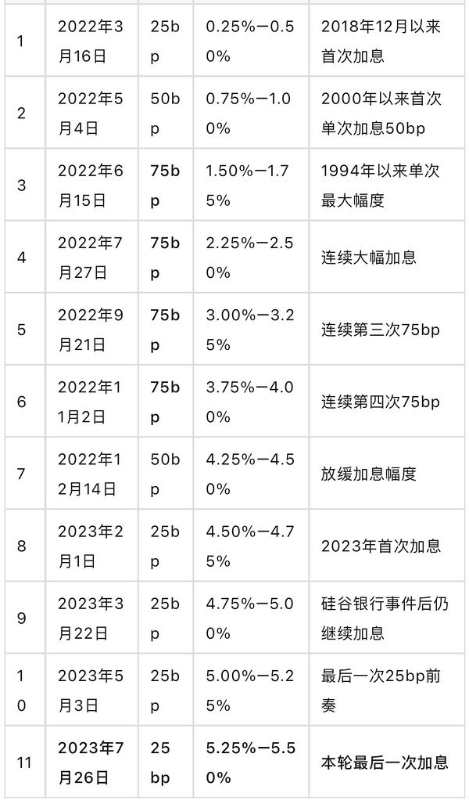
- 2022是长时间下跌 跌幅并不这样 不太一样
如果同等心态考验 外加恐慌程度
媲美的肯定是2020口罩 这个除了暴虐大崩以外
死亡威胁和现实生命的新闻报道压迫感远强于现在的什么AI故事有没有
一个关系到钱一个关系到的是命

### 300413 芒果超媒（对照，非持仓）｜11-13 14:01 本月涨幅 41.70% vs 幸福 53.76% →『幸福已经拉开芒果12%』＝12.06pp 精确命中；当日 −4.83%（提及 11 次，占比 4%）2026-11-23 10:56:14
- 芒果平时不是很牛逼吗 来个一阳包三阴四阴看看真正的实力😂😂😂😂😂
- 😂😂😂😂😂😂😂😂😂😂
那你只要芒果比他牛逼就行了

就像我慈文不在了
- 如果慈文涨停
芒果你没15+你等着被我喷

### 中证2000指数（他当微盘股基准）｜11-11 11:11「除了机器人 今天其他题材全输给了2000」（提及 7 次，占比 2%）2026-11-22 18:51:42
- 是什么就不知道了😂😂😂
许许多多东西都需要回暖😂

以前冰点买2000也是不知道到底先修复什么板块
- 因为2000太垃圾 不到极端情况不买
大部分时候买1000足够激活市场流动性了

不过极端崩盘 他们也都是扫货2000的
去年的4.7 4.8和2024.2.3-6都买了2000的

他们扫的就是我图里写的这基础两个

![图片](data
- 2000当之无愧 万能钥匙

### 513300 纳斯达克ETF华夏｜11-11 10:49「3300还行 不过今天我不满意」＋13:24「咱们3300还是近期数据最好的」（提及 6 次，占比 2%）2026-11-23 07:31:42
- 计算下今天10:30开盘的3300
三小时后期货估计有变动 先知道个大概

上周五15:00期货-1% 实际夜里收盘-5.6% 少了4.6%
但是现在盘前+2.2%
因此实际仅少了2.4%

若0.5%继续遗漏 则开盘-2.4%
若归还0.
- 周末准备乾坤大挪移猛干3300小伙伴是不是有点失望实际今天开盘不会跌多少😂😂😂😂

现在期货+2.8
如果忽视0.5% 实际3300将会只-1.8%开
- 3300今天还是跌幅最小的了

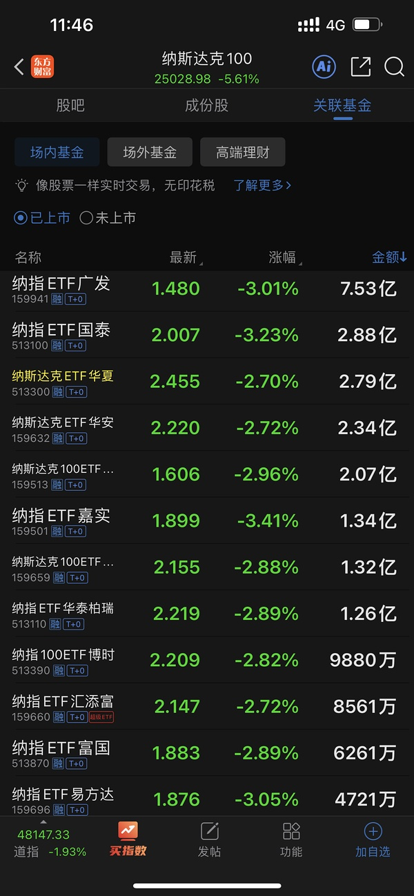

### 幸福蓝海（提及 6 次，占比 2%）2026-11-23 09:51:41
- 光线作用只是防守
看好进攻果然是幸福
- 幸福

传媒机器人强度高啊
- 幸福现在+8 还凑活看

我不满意阿博

### 301010 晶雪节能（上周买回、11-16 持有）｜09:39『上周买了plus』＋14:53『掌声雪儿plus雪』；卖单 24.94 沿用 11-05 老价，当日高 24.39 未触及（提及 5 次，占比 2%）2026-11-23 09:23:07
- 有钱应该捡雪人 plus那边的
- plus也很牛逼🤣
- 我退出登录了
我今天plus 15%也不准备卖
我没操作了
也没单子

### 东方海洋（提及 5 次，占比 2%）2026-11-23 09:35:43
- 东方海洋两连板
- 别忘了
我手里可是有东方海洋的 这个两连板的🤣🤣🤣🤣
注定情绪已恢复
- 情绪其实是周五见底😂
东方海洋 九阳 襄阳连续给信号了

### 友友、网友们（提及 4 次，占比 1%）2026-11-21 19:13:50
- 爆融资盘是会出冰点的哦

不过我没钱了😂😂😂😂😂😂

有钱的uu可以做准备
- uu们有一个担心
市场帮大家化解了

那就是欢瑞ST 根本无所谓
他没有那个影响板块的地位
- 不是很多uu很感兴趣吗

正好杀溢价了

### 纳斯达克100 指数（他用来对照场内 ETF 溢价/涨幅的基准，非标的）｜11-13 00:16『今天图上看 nana依然是大阳线』＋07:57『昨天-0.7收盘 但是nana晚上其实只有-0.3 现在期货+0.5 今天场内应该开盘+0.9%』→ 实测 513300 开盘 2.710＝+0.82%（误差 0.08pp）（提及 3 次，占比 1%）2026-11-21 18:22:26
- 这个数据其实没有什么意义
就像nana还需要50%修复和建信还需要50%修复 
数字一样 但是真正的修复速度完全不会一样
哪怕nana还需要20%修复和建信还需要50%修复
你也无法确定是nana先修复
你的基金夏普比高 卡玛比高 
回撤大
- 小远居然又被批评了 🤣🤣🤣🤣🤣🤣🤣🤣🤣
人家好歹每年跑赢nana 今年现在也是
基金里买AH的大家要喷 
他全美的也要喷 😂

![图片](https://raw.githubusercontent.com/homjanon/douban-tracker/main/data/images/2026-11-23/ca54caaf461967dabb1af6d3772
- 真牛逼！！！！！！防守大师 完胜nana

### 纳斯达克100指数（他对照场内ETF溢价的基准）｜11-11 08:14「昨天513300涨了3.53% 但是nana100实际也就涨了3.4」（提及 2 次，占比 1%）2026-11-21 16:49:03
- 五年纬度 
nana100估值百分位2%
已经远低于我四年前买入nana的估值区域
还有2%的下降空间 
只要随便几家公司发布财报就会估值新低的

四年前是上上下下几段 消磨了两个财报窗口 估值才变成20倍 现在就算不涨不跌 消磨时间会更低
- 十年纬度
nana100估值百分位4%
除了四年前
仅略高于2018毛衣大战和2020口罩崩盘时刻

悲观归悲观
客观数据也得看

### 双义：股票=中国长城 / 基金=华安文体健康混合（用户 11-05 指认）（提及 2 次，占比 1%）2026-11-22 22:00:13
- 杨东的基金恢复申购了

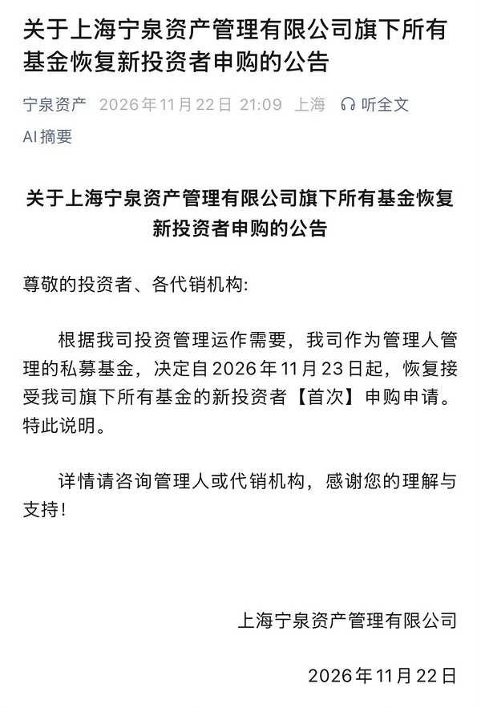
- 

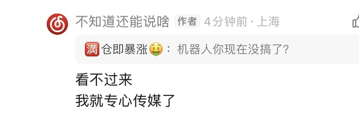

### 博纳影业（提及 2 次，占比 1%）2026-11-23 09:45:00
- 看看sy

bn不配夸奖

这周开始我有kpi考核了
- 阿博上周没骂过你一句
你看看SY 你丢人不

### 中国移动（他当指标用，非持仓）（提及 2 次，占比 1%）2026-11-23 11:14:26
- 好的

我也终于看到10086开阴线了😂
- 空调和10086满硬气

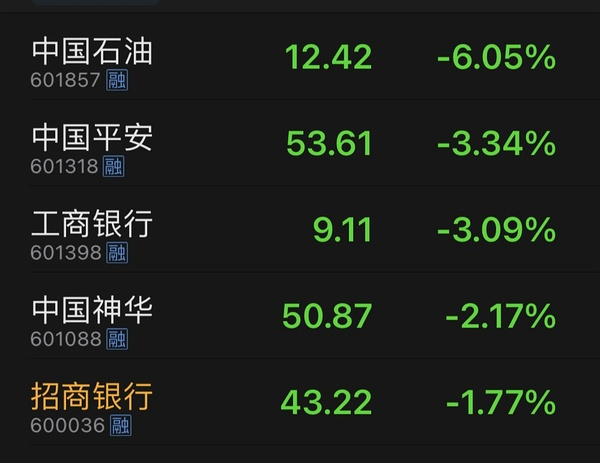

### 生肖羊概念组（带阳/洋/光/太/泉的一篮子）｜11-09 14:04 他自己贴的分组；**11-13 崩盘实证**：15:58 截图跌幅榜 澳洋健康 −10.06、阳光照明 −10.05、红太阳 −10.04、大东方 −10.03、阳光乳业 −10.02、襄阳轴承 −9.98、鲁阳节能 −9.95、大西洋 −9.73、太阳电缆 −9.29、圣阳股份 −8.64、泉阳泉 −6.60、东方海洋 −6.59；他 14:48『我昨天起码说了6次 控制仓位 因为羊和东方昨天松动了！！！！这是情绪核心』（提及 2 次，占比 1%）2026-11-23 11:38:58
- 微盘股决定权不在美国
美国最近几个月没好过
大家在天普被停牌 羊崩塌之前
都赚的不错的
- 九阳也不赖😂
最终应该只有一个羊

### 航空航天板块（提及 2 次，占比 1%）2026-11-23 11:48:22
- 我在坐等复刻3月底宇航员了
- 你也经历过三月底宇航员吧 
就是那样

### 大连圣亚（提及 2 次，占比 1%）2026-11-23 13:24:44
- 大连他们吃微盘股

雪儿应该继续强化努力 我不满意
- 大连是响当当的尾盘战神哦

### 华宝致远混合(QDII)C｜只在盯，未证他持有（提及 1 次，占比 0%）2026-11-22 11:48:45
- 我没有动的打算 你们可以自己看着调
我昨天都说过了 大家的“相信”不一样 承受不一样
就比如大家喷的小远我就不会动的

### 301171 易点天下（对手盘，非持仓）｜11-13 10:07『奶茶out 幸福人的底气是可以说芒果out』；当日 −6.72%（提及 1 次，占比 0%）2026-11-22 12:12:33
- 第一个是奶茶哈哈
难道融资盘都是49买的😂😂😂😂😂

### 中文在线（提及 1 次，占比 0%）2026-11-22 19:01:04
- 不是啊 我和v老师有四连板东西

### 1000＝中证1000（指数／相关ETF）；2026-11-19 14:51『象征性扫了点1000』后他澄清『我说的是gjd』＝**国家队(gjd)在象征性买中证1000**（他在评论国家队托市行为，**不是他本人买入、也不是他的持仓**）；切勿读成他买了中证1000ETF（提及 1 次，占比 0%）2026-11-23 08:33:58
- 金价持续暴跌大妈疯狂抄底 菜百金条连续3天中午前抢光

上周，国际金价遭遇剧烈杀跌，接连失守3800美元/盎司、3700美元/盎司、3600美元/盎司关口，COMEX黄金、伦敦金周跌幅均近9%，双双创下今年3月20日以来最大单周跌幅。金价

### 保利发展（提及 1 次，占比 0%）2026-11-23 08:35:46
- 11月20日股票型ETF净申购921亿元 刷新近一年最高纪录

股票型ETF中，当日净申购前3依次为：沪深300ETF嘉实，净申购226.51亿元；上证50ETF华夏，净申购215.83亿元；沪深300ETF华泰柏瑞，净申购145.83亿元

### 国家队（推断 B）｜11-16 15:19/16:42 护盘语境，非具体标的（提及 1 次，占比 0%）2026-11-23 08:37:12
- gjd干回来了
你们不是说跟着gjd干嘛🤣后悔年初没跟着卖的

现在人家疯狂的买了

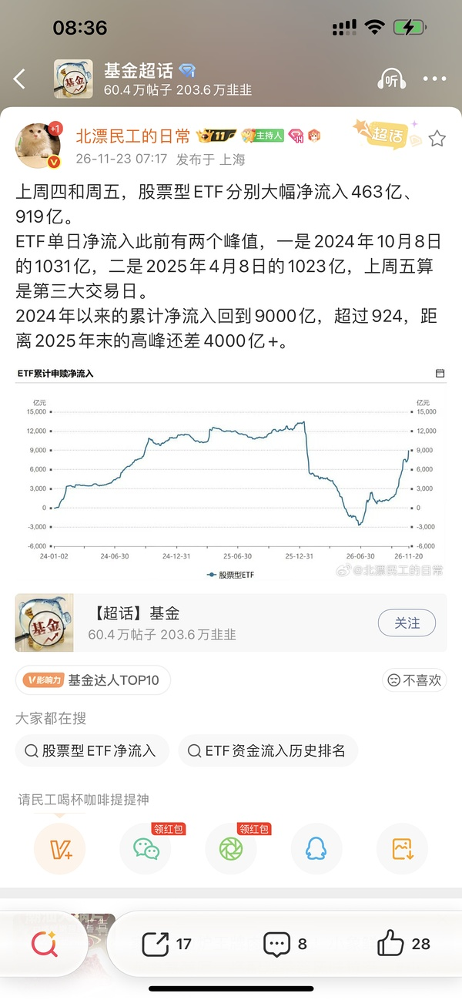

### 科创50（提及 1 次，占比 0%）2026-11-23 09:50:14
- k50之前比较好 迎来补跌

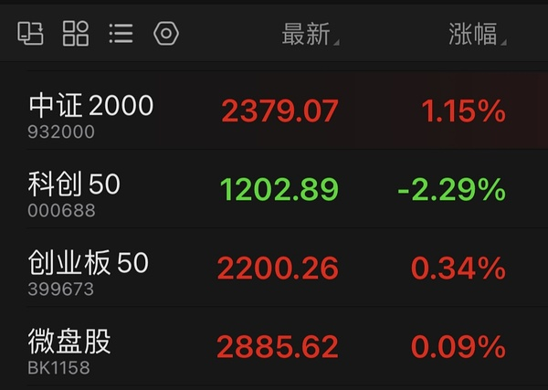

### 513300 纳斯达克ETF华夏｜11-09 14:34「不愧是513300 当年的普通nana ETF之王」，当日唯一红的纳指ETF（提及 1 次，占比 0%）2026-11-23 10:52:41
- 经过双休日的消息蔓延
今天的nana场内投资者没有月初那次的稳如泰山了😂

### 301010 晶雪节能（**B·推断；11-16 已买回持有**）｜11-13 10:04『plus雪是-20的…还能再跌-10』＝20cm，实测当日 −10.10%；15:25 答『多少出』报 24.94＝11-05 老卖单价（当日高 24.92 差 2 分未触及）；11-09 曾自述清仓 → **11-16 09:39『上周买了plus』＋14:53『掌声雪儿plus雪』＝上周买回、重新持有**；11-16 卖单 24.94 沿用，当日高 24.39 未触及；持仓屏 13:42:36 晶雪 23.110（提及 1 次，占比 0%）2026-11-23 13:20:19
- 我不满意 那边plus雪更厉害😂😂😂😂

### 雪人集团 002639｜11-06「大连和雪儿」＋11-11 14:26「雪儿今天不错啊 大家昨天不是期待他接人嘛 这个任务做到了今天」（接人＝5日线接回，与雪人条件单口径一致）（提及 1 次，占比 0%）2026-11-23 13:34:00
- 下面两个跟微盘的  微盘还没反转

雪儿不应该

### 301052 果麦文化（**推断·B**，非持仓）｜11-12 13:05:01『果果紧随其后了』紧接 13:04:34『传媒出现两位数跌幅了 华策』；实测华策 −13.97%、果麦 −10.38% 同为两位数跌幅→谐音＋当日跌幅与语境命中；未见他自述买卖，不得当持仓证据（提及 1 次，占比 0%）2026-11-23 13:46:29
- 果果组合？

### 东百集团（提及 1 次，占比 0%）2026-11-23 13:52:45
- 你们可以记下来

情绪崩盘到转换 只要情绪崩盘之前玩的东西不是反情绪的防守内容 后面情绪回暖就还是接着玩他们

就像去年的东哥啥的

### 雪人集团（提及 1 次，占比 0%）2026-11-23 13:59:53
- 雪人应该不是 18号的表现是不一样的
所以今天他不应该 这是今天非常不满意的一个

### 富国全球科技互联网股票(QDII)A（提及 1 次，占比 0%）2026-11-23 14:25:29
- 没事做了
我们来看看投票啊

小远投票最多
国富 网易云音乐 紧随其后
小广 小浦第三梯队

搞笑二人组今天无人问津

### 📄 全部发言（共 307 条）
- (2026-11-21 16:49:03) [图] 五年纬度 
nana100估值百分位2%
已经远低于我四年前买入nana的估值区域
还有2%的下降空间 
只要随便几家公司发布财报就会估值新低的

四年前是上上下下几段 消磨了两个财报窗口 估值才变成20倍 现在就算不涨不跌 消磨时间会更低

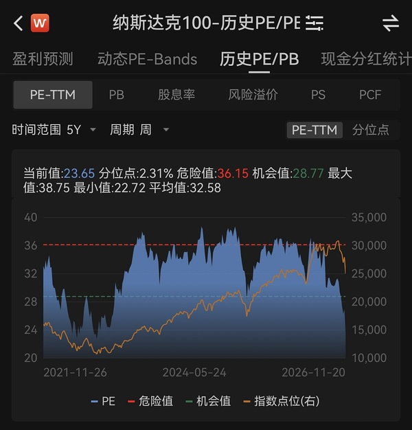

- (2026-11-21 16:50:23) [图] 十年纬度
nana100估值百分位4%
除了四年前
仅略高于2018毛衣大战和2020口罩崩盘时刻

悲观归悲观
客观数据也得看

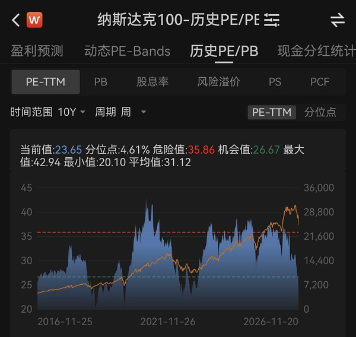

- (2026-11-21 17:11:05) 美国上一轮加息周期始于2022年3月16日，终于2023年7月26日，历时16个月，共加息11次，累计加息525个基点，联邦基金利率从0.25%升至5.25%–5.50%，创下22年来最高水平，是近40年来最陡峭的加息周期。

标普500在2022加息周期各阶段的走势

阶段一：加息启动至首次75bp（2022年3月–6月）
标普500从约4,300点下跌至约3,800点，累计跌幅约12%。加息启动初期市场对紧缩速度估计不足，随后连续75bp加息引发剧烈重定价。

阶段二：激进加息高峰（2022年6月–10月）
标普500从约3,800点继续下探至3,502点（2022年10月为本轮熊市最低点），累计再跌约8%。此阶段科技板块首当其冲，2022年全年科技板块大跌27%，通信服务板块暴跌37%。

阶段三：加息放缓至周期终结（2022年11月–2023年7月）
标普500从3,502点反弹至约4,580点，累计涨幅约31%。加息幅度从75bp降至50bp、再降至25bp，市场对利率见顶的预期逐渐形成。

阶段四：加息终结后的二次探底与年末反弹（2023年8月–12月）
标普500在2023年8–10月回调至4,115点（10月末低点），随后在确认加息周期终结后强势反弹，年末收于约4,770点，全年涨幅24.2%。

- (2026-11-21 17:12:54) [图] 

  ⊳ （引用 @不知道还能说啥）美国上一轮加息周期始于2022年3月16日，终于2023年7月26日，历时16个月，共加息11次，累计加息525个基点，联邦基金利率从0.25%升至5.25%–5.50%，创下22年来最高水平，是近40年来最陡峭的加息周期。

标普500在

- (2026-11-21 17:24:14) 2022是长时间下跌 跌幅并不这样 不太一样
如果同等心态考验 外加恐慌程度
媲美的肯定是2020口罩 这个除了暴虐大崩以外
死亡威胁和现实生命的新闻报道压迫感远强于现在的什么AI故事有没有
一个关系到钱一个关系到的是命  ⊳ （引用 @哄哄🐮）经历过22年加息事件的博主是不是都非常稳得住哈哈哈哈😂

- (2026-11-21 18:22:26) 这个数据其实没有什么意义
就像nana还需要50%修复和建信还需要50%修复 
数字一样 但是真正的修复速度完全不会一样
哪怕nana还需要20%修复和建信还需要50%修复
你也无法确定是nana先修复
你的基金夏普比高 卡玛比高 
回撤大的修复能力就会更强  ⊳ （引用 @混乱中立同人女）楼里uu有没有保存楼上次手动做的主动基大跌后修复率的表格，我想参考一下

- (2026-11-21 18:51:34) [图] 融资盘周五 又是400亿级别吧

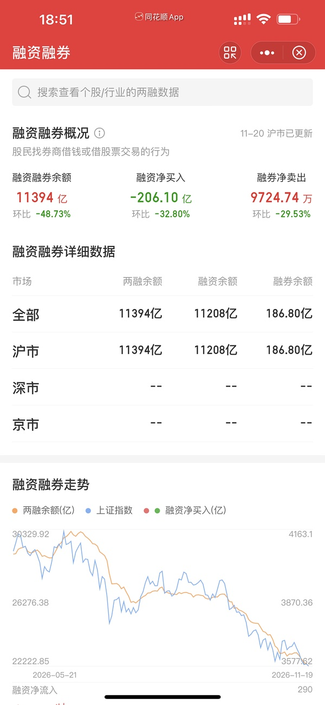

- (2026-11-21 18:53:56) [图] 融资盘：谁买银行 谁是🐶

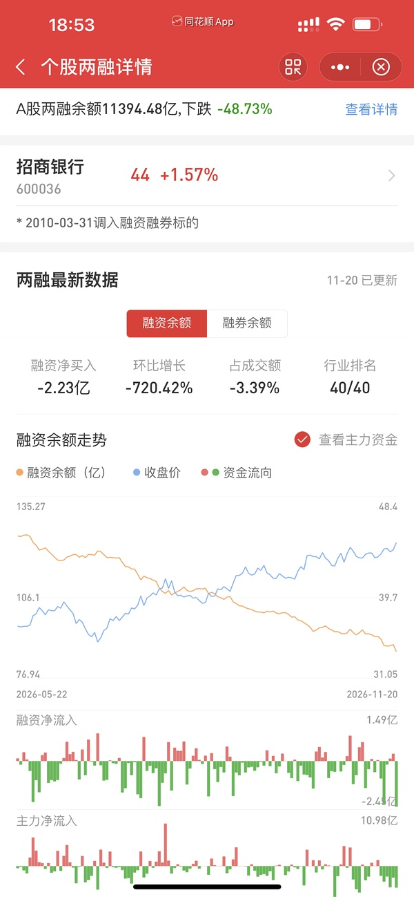

- (2026-11-21 18:55:46) [图] 应该是 融资盘：谁买红利 谁是🐶

融资盘：死也要死的光荣 绝不买红利

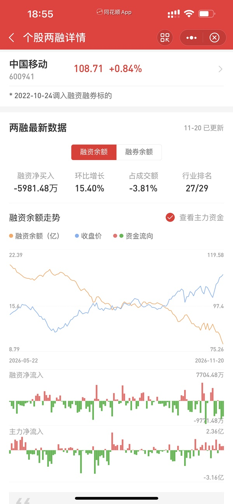  ⊳ （引用 @不知道还能说啥）融资盘：谁买银行 谁是🐶

- (2026-11-21 19:03:21) 哈哈
融资盘这一点表态很明确：宁愿站着死 绝不买红利🤣  ⊳ （引用 @一颗牛奶糖）🤣🤣我现在觉得我扛不住去买银行估计就是见顶了 参考我买场内科技

- (2026-11-21 19:05:24) 我们sy 幸福 大连这种没融资盘的也半斤八两😂

妈妈又在放背锅侠消息了
自己周五的垃圾操作就被盖过去了  ⊳ （引用 @招招碎片收集中）尾盘估计又爆不少吧

- (2026-11-21 19:10:59) 融资盘爆爆爆
这次怪融资盘  ⊳ （引用 @没有感情的村民）什么消息

- (2026-11-21 19:13:50) 爆融资盘是会出冰点的哦

不过我没钱了😂😂😂😂😂😂

有钱的uu可以做准备  ⊳ （引用 @稀里不糊涂）大爆炸级别的

- (2026-11-21 19:15:23) 我以为周五最终可以大赚的🤣🤣🤣🤣笑死人了

忘了那是礼拜几  ⊳ （引用 @招招碎片收集中）谁看了早盘不觉得曙光初现，跌停数都到个位数了，一觉睡醒飚到60+，神经病

- (2026-11-21 19:18:49) 他们不是传融资盘爆爆爆嘛😂  ⊳ （引用 @点-重生炒垃圾）怎么还要准备冰点😅😅😅还要跌跌跌啊

- (2026-11-21 19:24:20) [图] 我没钱了
表发给你们
如果有的话

重新复习冰点条件：
1，全部指数大跌特跌
2，涨跌家数1:9
3，跌停家数非常非常多 涨停家数非常非常稀有
4，不同行业板块ETF大批量-4%以上
5，市场出现超级恐慌性的抛售导致成交爆量

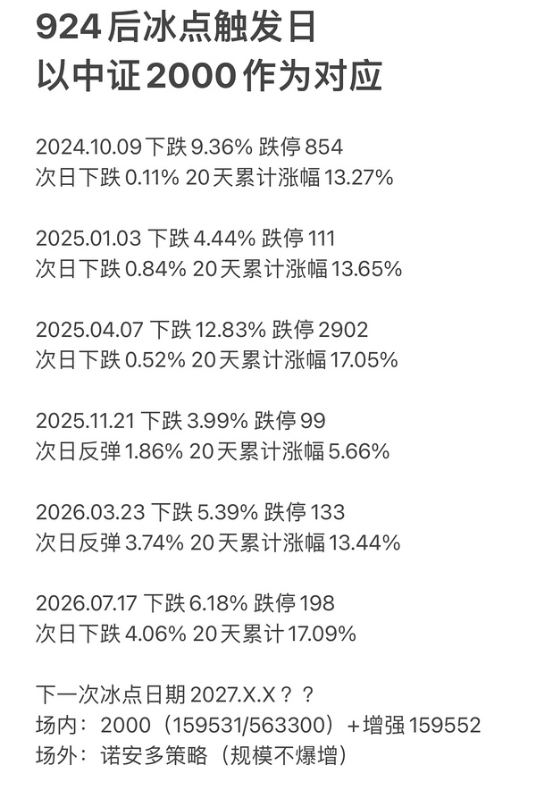

- (2026-11-21 19:26:04) 我判断是没有的呀
那大家既然都提了
可以复习做个准备  ⊳ （引用 @稀里不糊涂）不是说真冰点今年没有了吗

- (2026-11-21 19:27:13) 缺一不可 必须同时满足  ⊳ （引用 @不知道还能说啥）我没钱了
表发给你们
如果有的话

重新复习冰点条件：
1，全部指数大跌特跌
2，涨跌家数1:9
3，跌停家数非常非常多 涨停家数非常非常稀有
4，不同行业板块ETF大批量-4%以上
5，市场出现超级恐慌性的抛售导致成交爆量

- (2026-11-21 19:31:15) 根本不可能

1，垃圾票融资盘根本没有多少 最近融资盘是什么情况你早上每天看我发吧 都是卖

2，海外链周五跌的不多

3，国产刚涨了不少 周五才跌

4，我已经看了200亿周五上交所融资盘流出 是批量流出 不是单点股票爆破 最大单票流出是寒武纪 但不足5亿  ⊳ （引用 @Aaa摆烂咸鱼🥳）周五应该很多人爆仓了，很多

- (2026-11-21 19:33:01) 温故而知新 多复习 
既然大家提了 那就复习一遍
我经常自己复习  ⊳ （引用 @稀里不糊涂）楼说过这次融资盘基本没怎么进来，再来大规模爆仓我都不知道咱们要跌去那个地方了。。。

- (2026-11-21 23:41:20) [图] 我今天仔细研究
好多个红利指数前十大早已银行四大行狂飙被踢掉了😂😂😂😂

我发现我女朋友这个红利低波
五粮液已经第三大红利😂😂😂😂😂😂😂😂😂😂😂😂😂😂😂😂😂😂😂😂😂😂

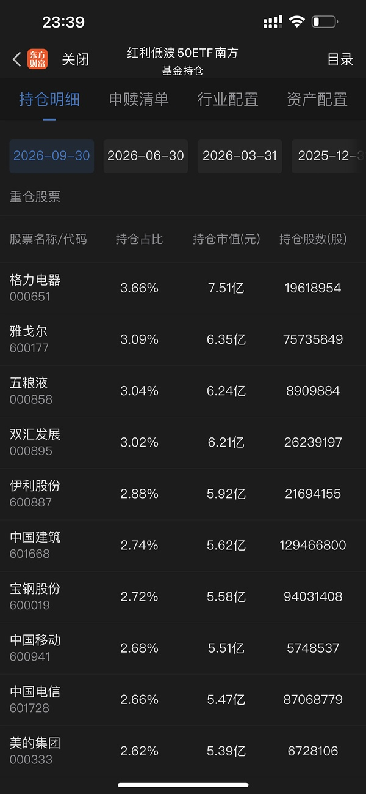  ⊳ （引用 @moli）王老师红利切美股

- (2026-11-21 23:44:34) 😂这个结论得不出
长江电力被踢出快2年了已经

这就是红利指数牛逼的地方
和其他指数涨多了放进来相反  ⊳ （引用 @洋葱头）说明银行危⚠️

- (2026-11-21 23:57:57) [图] 😂只在恐惧和极度恐惧里切换了

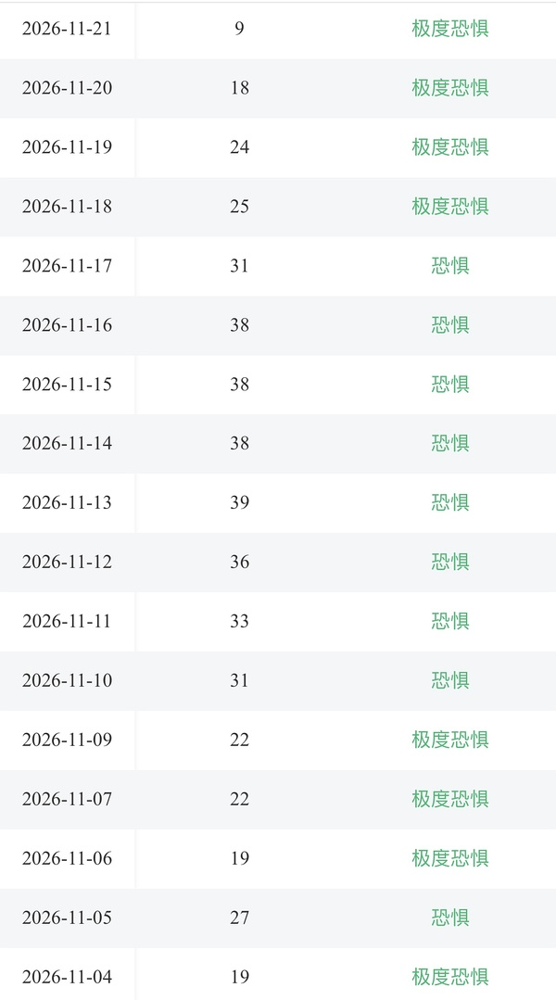

- (2026-11-22 00:24:25) 1年后也许依然是好的转换😂  ⊳ （引用 @荣誉黑粉涨停版）说到舞娘，我卖了一些舞娘进了美🐔，现在利息也没得吃了😅

- (2026-11-22 11:38:25) [图] 小远居然又被批评了 🤣🤣🤣🤣🤣🤣🤣🤣🤣
人家好歹每年跑赢nana 今年现在也是
基金里买AH的大家要喷 
他全美的也要喷 😂

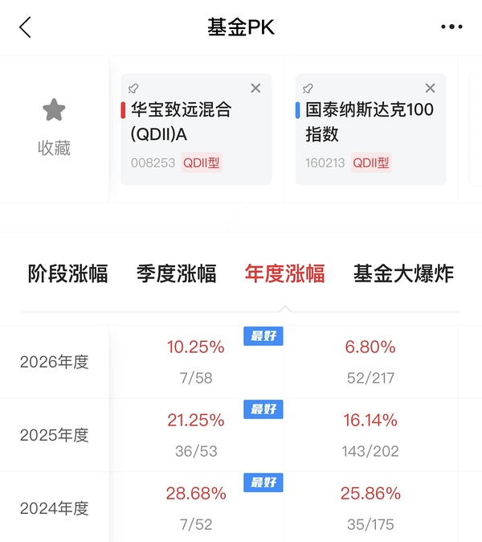  ⊳ （引用 @momo）小远调仓了啊，现在已经买成了娜娜plus😂

- (2026-11-22 11:48:45) 我没有动的打算 你们可以自己看着调
我昨天都说过了 大家的“相信”不一样 承受不一样
就比如大家喷的小远我就不会动的  ⊳ （引用 @Waiting一下）楼楼后面如果主动基开了基金要调仓转换吗？比如把不纯的换成纯美的😂😂😂

- (2026-11-22 11:54:28) 你看这两天楼里的氛围可是继续大跌特跌
都觉得还要跌成狗 
什么七八年十五年回本的😅😅😅

那你们自己转换时候 
应该知道大跌特跌哪几个会更跌的迅猛 
大家不要心里一套 操作又是另外一套就行😂😂😂😂  ⊳ （引用 @Waiting一下）楼楼后面如果主动基开了基金要调仓转换吗？比如把不纯的换成纯美的😂😂😂

- (2026-11-22 12:01:07) 大家都有发表看法的权利
不过大家的操作可得和自己看法一致
不能一边不看好 一边换进攻最强跌幅最大的  ⊳ （引用 @混乱中立同人女）不好意思是我又在传播恐慌氛围了。。

- (2026-11-22 12:08:37) 你们又来了
一边说还要猛猛跌 一边又要补仓了😂😂😂😂

攻击强的尽快回正 是没错的！
但你们现在都是在看跌啊！
攻击强的百分百跌幅就是最大的
你们是不是太矛盾了😂

我们每天投票的
进攻最强的两个你应该知道没变化吧  ⊳ （引用 @混乱中立同人女）主要是想下跌的时候补一下 希望攻击性强的更快回正。。但是我又疑惑如果进攻性强的第二季度也向指数靠拢了，我是不是就白转换了🫪

- (2026-11-22 12:12:33) 第一个是奶茶哈哈
难道融资盘都是49买的😂😂😂😂😂  ⊳ （引用 @点-重生炒垃圾）看不清，这是啥

- (2026-11-22 12:18:56) 是营业部发在群里的  ⊳ （引用 @家不住海边）费解。这种数据怎么拿到手的？

- (2026-11-22 12:45:30) 是大赚完成  ⊳ （引用 @混乱中立同人女）对的对的 搞笑二人组
我刚想了一下，还是没想明白，如果第二阶段被动基比主动基强的话，是不是等楼nana都赚好了，没有调仓的主动基回血还没完成🫪

- (2026-11-22 13:00:12) 全球联动  ⊳ （引用 @一颗牛奶糖）楼那几个中基怎么看

- (2026-11-22 13:02:28) na是长期投资  ⊳ （引用 @冰雪go）我再挣扎一下
楼你觉得周一a里面的钱全买入na
这个胜率怎么样

- (2026-11-22 16:42:07) 我那个买了xys的女主播
抖音直播的账号简介已经改成了

被遗弃的同花顺私生女 😂😂😂😂😂😂

- (2026-11-22 16:58:02) 不发“共和党才能让美股伟大嘛”😂😂😂  ⊳ （引用 @六倍做多退休）金毛果然偷笑hhhhh

- (2026-11-22 17:36:01) 韩国财政部：韩国将准备立即动用市场稳定基金。

韩国爸爸？

- (2026-11-22 17:36:28) 没呢😂  ⊳ （引用 @sickid）那两天拉高没走吗

- (2026-11-22 18:35:55) 来了  ⊳ （引用 @海贼）周末好像我们没啥救市的消息

- (2026-11-22 18:36:15) 最重要的 直击融资盘爆仓问题  ⊳ （引用 @初筱玖）调整融资保证金比例了

- (2026-11-22 18:37:44) 有史以来首次一年里上调又下降😂  ⊳ （引用 @初筱玖）调整融资保证金比例了

- (2026-11-22 18:40:48) 中国结算发布降费政策
11月22日，中国结算发布《关于暂免收取部分债券登记结算费用的通知》，明确自2027年1月1日起至2028年12月31日，继续暂免收取绿色公司债券、科技创新公司债券和民营企业公司债券（不含可转换公司债券）发行人服务费及债券结算费。

债券🤣债券重点之一

- (2026-11-22 18:42:09) 你看看2023.8.28日K线
降yhs会很容易迎来墓碑😂😂😂😂

如果看到了记得高抛  ⊳ （引用 @速派女孩将发财）离岸信托今年硕果累累呀

- (2026-11-22 18:45:40) 科技记住 美国人说了算

这个能缓解爆仓和市场情绪  ⊳ （引用 @momo）明天会影响吗，能高开吗

- (2026-11-22 18:46:57) 下周情绪回暖 之前说过了  ⊳ （引用 @monica）那应该会利好小垃圾？

- (2026-11-22 18:49:35) 那没有
周五中午时候情绪就回暖了
就当是因为周五下午吧😂下午周五崩盘也是老套路了  ⊳ （引用 @凯恩拿下金球😋）respect楼，我怀疑楼上面有人🤪

武林外传：我上面有人~

- (2026-11-22 18:51:42) 是什么就不知道了😂😂😂
许许多多东西都需要回暖😂

以前冰点买2000也是不知道到底先修复什么板块  ⊳ （引用 @momo）我只求冰雪，低开高走也行

- (2026-11-22 18:55:05) 我付过那天学费😂😂😂😂  ⊳ （引用 @速派女孩将发财）好吓人🥰🥰🥰

- (2026-11-22 18:55:58) 笑死
明天不会上头的
因为根本没有钱买
很随意 爱咋咋滴

- (2026-11-22 18:58:18) 这个新闻就是欺骗性了
这个前提是融资盘全部狠狠干 因为又能多借钱了
但是现在他们怎么会狠狠干啊🤣
作用只是爆仓减缓了！  ⊳ （引用 @404找回了）相当于增加了4000亿流动性嗷

- (2026-11-22 18:58:29) 这我昨天就设置了😂  ⊳ （引用 @VVV坚定持有VVV）啊不设几个涨停卖单吗（我就梦这么大

- (2026-11-22 19:00:24) 中韩有交流过吗
前后脚发消息😂  ⊳ （引用 @六倍做多退休）汪汪能不能明天开盘就买入1000

- (2026-11-22 19:01:04) 不是啊 我和v老师有四连板东西  ⊳ （引用 @momomomomomo哒）哈 全是涨停单吗

- (2026-11-22 19:03:15) 本来的涨停也没回本 你们也不会卖的🤣这个我懂的

而且如果有涨停 说明情绪确实回暖啦  ⊳ （引用 @momomomomomo哒）没有条件单那我软件先不下回来了23333

- (2026-11-22 19:32:22) 金毛偷着乐呢  ⊳ （引用 @初筱玖）就差老美了

- (2026-11-22 19:35:40) [图] 因为2000太垃圾 不到极端情况不买
大部分时候买1000足够激活市场流动性了

不过极端崩盘 他们也都是扫货2000的
去年的4.7 4.8和2024.2.3-6都买了2000的

他们扫的就是我图里写的这基础两个

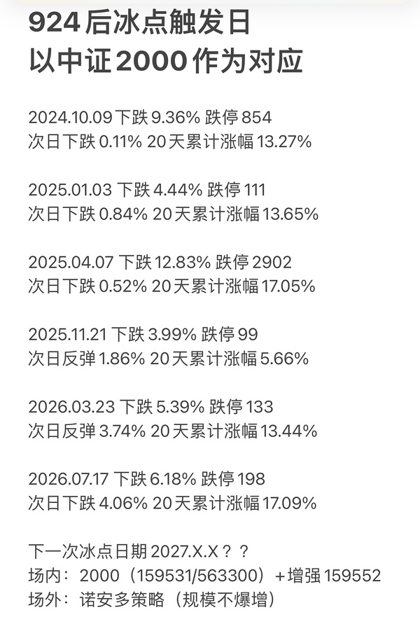  ⊳ （引用 @momo（富姐版））楼主，为什么我们冰点买2000，狗买1000啊有啥区别。

- (2026-11-22 20:34:22) 小伙伴
这个是去年2025.12.17财政部定增的股份解禁
人家不会卖的

明年你还会看到工行那群东西解禁 还记得今年爸爸的定增两家四大行 几个保险公司吗  ⊳ （引用 @Waiting一下）12月17日

交通银行有一个近1100亿的解禁

占当前流通市值的近50%？

- (2026-11-22 20:35:41) 解禁的对象是财政部 不会卖的😂  ⊳ （引用 @速派女孩将发财）交易所不一定会批

- (2026-11-22 21:06:02) [图] 

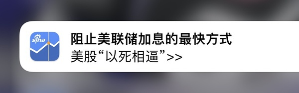

- (2026-11-22 21:09:26) 台湾地区拟下调融资保证金比例至120%以稳定股市
中国台湾地区正考虑下调融资维持保证金比例，以遏制股市抛售潮。中国台湾证券交易所表示，周日与10家券商召开紧急会议，讨论这一潜在举措。根据拟议方案，最低融资维持保证金比例将从目前的130%下调至120%。

- (2026-11-22 21:10:03) 哪个国家和地区第一步总归是这个
没什么好喷的  ⊳ （引用 @不知道还能说啥）台湾地区拟下调融资保证金比例至120%以稳定股市
中国台湾地区正考虑下调融资维持保证金比例，以遏制股市抛售潮。中国台湾证券交易所表示，周日与10家券商召开紧急会议，讨论这一潜在举措。根据拟议方案，最低融资维持保证金比例将从目前的130%下调

- (2026-11-22 21:13:04) 美银首席投资策略师Michael Hartnett在本周最新的Flow Show指出，阻止美联储继续加息的最快方式，是让股市回吐2026年的全部涨幅。这一目标位对应标普500指数6，845点，而该指数上周五收于6，925点，距离触发仅剩80点、约1.2%的空间。

市场已经开始替美联储“做工作”。上周五盘中，美联储理事Waller主张的50个基点“震撼式”加息被移出选项，1月加息概率降至60%以下，10年期美债收益率回落至5%以下。

- (2026-11-22 21:13:22) 江老师半导体买了几个月了
就看空高股息几个月了  ⊳ （引用 @没有感情的村民）江老师看空高股息？

- (2026-11-22 21:15:48) [图] 😂他看好高股息就有鬼了
自己买的半导体还都是-30%

江老师今年-37%的业绩应该不如楼里的大家😂😂😂

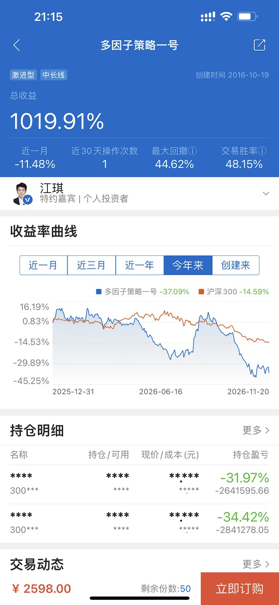  ⊳ （引用 @没有感情的村民）🤣

- (2026-11-22 21:28:59) 别又只上50班了  ⊳ （引用 @没有感情的村民）江老师：明天九点半国家队上班

- (2026-11-22 21:32:19) 妈妈：我预判了周五晚上大跌  ⊳ （引用 @没有感情的村民）求求了😫

- (2026-11-22 21:56:20) 这种都开了涨停定价  ⊳ （引用 @一切都会过去的）楼楼 慈文设置多少

- (2026-11-22 21:58:33) 忘记那天 那天是周五
平时牛逼时候午后也足够垃圾  ⊳ （引用 @小肥肥）我都怕它又上个50下午就又开始

- (2026-11-22 22:00:13) [图] 杨东的基金恢复申购了

- (2026-11-22 22:03:19) [图] 这是杨东自去年10/29日以来首次恢复新投资人的申购

杨东被誉为“业界良心”，在2007年6000点的时候以及2015年股市高位5000点时都提示过风险。在2025年上证指数收盘站上4000点时，盘后杨东的宁泉资产不再接受新投资者首次申购。

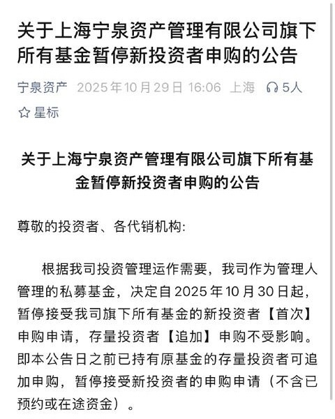  ⊳ （引用 @不知道还能说啥）杨东的基金恢复申购了

- (2026-11-22 22:03:57) 我开的全出 我仓位太高了😂  ⊳ （引用 @sickid）涨停全出吗？还是一半？

- (2026-11-22 22:10:39) [图] 

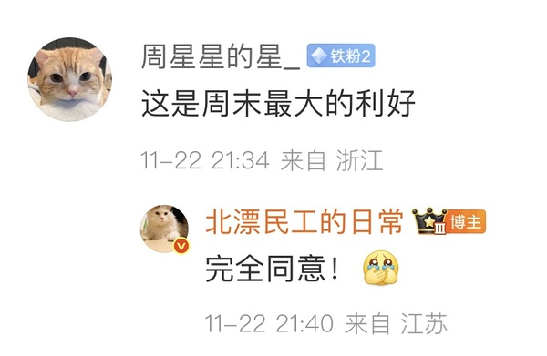  ⊳ （引用 @momo）是不是一个积极信号！

- (2026-11-22 22:33:06) 现在不是锁仓 是有的明天涨停也没得赚  ⊳ （引用 @Lyra）哪些锁仓不卖啊楼楼

- (2026-11-22 23:15:54) [图] 人家泪流满面了😂

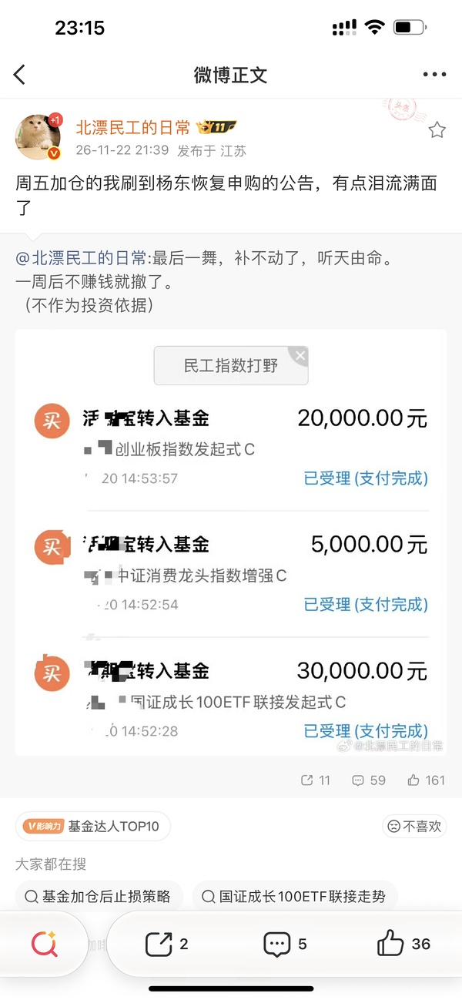  ⊳ （引用 @没有感情的村民）晚上9点发的，看来是看到降低保证金的消息觉得市场有救了哈哈哈

- (2026-11-22 23:22:31) 私募每个月有一份月报给持有人的 会简要分析
其他应该看不到
6月那个警示ai也是给投资者的道歉信😂

我看我们公募里的香港互认基金也是每个月都有月报的
那个摩根太平洋持仓就是每个月都能看到  ⊳ （引用 @没有感情的村民）杨东与外界的互动渠道只有那个公众号吗？我看今天打开限购没有啥理由

- (2026-11-23 07:26:43) 👍👍👍  ⊳ （引用 @🈵仓即暴涨🤑）高开😏

- (2026-11-23 07:31:42) [图] 计算下今天10:30开盘的3300
三小时后期货估计有变动 先知道个大概

上周五15:00期货-1% 实际夜里收盘-5.6% 少了4.6%
但是现在盘前+2.2%
因此实际仅少了2.4%

若0.5%继续遗漏 则开盘-2.4%
若归还0.5% 则开盘-2.9%

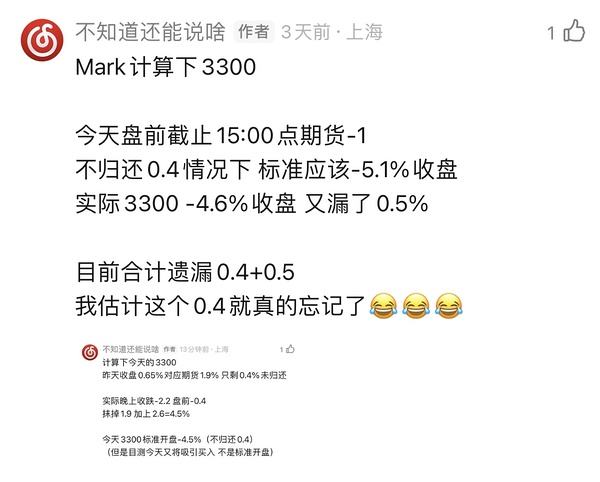

- (2026-11-23 07:34:53) 首批18只主动ETF今日上市 主动投资迈入“明牌”时代

11月23日，首批18只主动ETF正式上市交易，中国公募基金业将迎来“场内主动选股、每日持仓可见、透明化阿尔法”的历史性时刻。按照要求，这些产品需在上市之前将股票仓位提升至不低于80%。从最新净值变化看，主动ETF已呈现出稳健运作特征，为上市后的主动能力验证奠定基础。首批主动ETF上市后，国内主动投资迈入“明牌”时代。主动ETF将与被动ETF、场外主动基金形成差异化权益产品矩阵，公募基金承接长期资金入市的工具丰富度和策略深广度将进一步扩展

- (2026-11-23 07:38:58) 受AI担忧影响 韩国存储芯片股盘前下跌

随着人工智能（AI）交易退潮持续，韩国存储芯片股在盘前交易中下跌，延续了上周五美股的大幅抛售走势。在Nextrade平台上，三星电子股价盘前下跌5.6%，SK海力士下跌6%。尽管韩国当局在周日承诺将加大稳定市场的力度，但上述跌势依然出现。

- (2026-11-23 07:58:12) 海峡没有真正通吧？已经没有海峡消息了😂😂😂😂  ⊳ （引用 @一直在摸🐟）布油为啥就是不下90🌚

- (2026-11-23 08:29:48) 看来阿克曼没有做空美债了😂😂😂
可能都做多美债了  ⊳ （引用 @六倍做多退休）ackman最近火力全开

- (2026-11-23 08:32:14) 周末准备乾坤大挪移猛干3300小伙伴是不是有点失望实际今天开盘不会跌多少😂😂😂😂

现在期货+2.8
如果忽视0.5% 实际3300将会只-1.8%开  ⊳ （引用 @不知道还能说啥）计算下今天10:30开盘的3300
三小时后期货估计有变动 先知道个大概

上周五15:00期货-1% 实际夜里收盘-5.6% 少了4.6%
但是现在盘前+2.2%
因此实际仅少了2.4%

若0.5%继续遗漏 则开盘-2.4%
若归还0.

- (2026-11-23 08:33:34) 👍👍👍👍👍  ⊳ （引用 @六倍做多退休）全力做多微软中

- (2026-11-23 08:33:58) 金价持续暴跌大妈疯狂抄底 菜百金条连续3天中午前抢光

上周，国际金价遭遇剧烈杀跌，接连失守3800美元/盎司、3700美元/盎司、3600美元/盎司关口，COMEX黄金、伦敦金周跌幅均近9%，双双创下今年3月20日以来最大单周跌幅。金价的显著回调，带动市场抄底情绪升温。据记者观察，北京老牌黄金卖场菜百总店连续多日客流高企，其中，投资金条备受投资者青睐，柜台现货连续三日在中午之前就已卖空。 上午11时左右，50克以下投资金条全部售罄；15分钟之后，100克金条售罄；11时20分左右，柜台除了一块1000克的投资金条外，其余均已售罄。

- (2026-11-23 08:35:46) 11月20日股票型ETF净申购921亿元 刷新近一年最高纪录

股票型ETF中，当日净申购前3依次为：沪深300ETF嘉实，净申购226.51亿元；上证50ETF华夏，净申购215.83亿元；沪深300ETF华泰柏瑞，净申购145.83亿元。

股票型ETF当日净赎回前3为：中证A500ETF国泰，净赎回10.02亿元；银行ETF华宝，净赎回4.61亿元；A500ETF易方达，净赎回4.07亿元。

- (2026-11-23 08:37:12) [图] gjd干回来了
你们不是说跟着gjd干嘛🤣后悔年初没跟着卖的

现在人家疯狂的买了

- (2026-11-23 08:38:31) 韩国现在-3.5%

- (2026-11-23 08:42:10) 禁止做空 一个对冲工具被废
只会加剧股票抛售 这个一直都是没用的😂  ⊳ （引用 @赛博朋克2077）棒子也是嘴上功夫

- (2026-11-23 08:44:57) 期待本周回血  ⊳ （引用 @仓部加措）楼楼我们周四也跟着干满仓啦

- (2026-11-23 08:46:36) [图] 美国光截止周五-60
我们差不多-56
由于这两个始终中美保持一致 盘前美国在涨 大家其实很好推算的

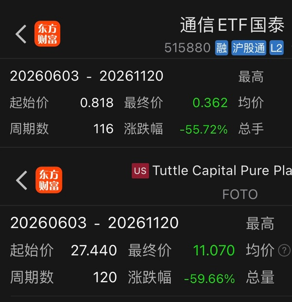

- (2026-11-23 08:48:01) 两市融资余额较上日减少417.24亿元

截至11月20日，上交所融资余额报11207.68亿元，较前一交易日减少206.10亿元；深交所融资余额报10230.23亿元，较前一交易日减少211.14亿元；两市合计21437.91亿元，较前一交易日减少417.24亿元。

融资盘：qnmd

- (2026-11-23 08:48:20) 融资盘很后悔上上周买入吧😂😂😂😂😂  ⊳ （引用 @不知道还能说啥）两市融资余额较上日减少417.24亿元

截至11月20日，上交所融资余额报11207.68亿元，较前一交易日减少206.10亿元；深交所融资余额报10230.23亿元，较前一交易日减少211.14亿元；两市合计21437.91亿元，较前一

- (2026-11-23 08:48:56) 😂😂😂😂😂  ⊳ （引用 @点-重生炒垃圾）话说我这份工作的起点是9.24😂😂😂刚好是国庆之后去的，现在又是新一轮政策底结束，哎，真是一个轮回

- (2026-11-23 09:02:51) 韩国综指跌幅扩大至4%
韩国综指跌幅扩大至4%，现报4674.46点。个股方面，三星电子跌超4%，SK海力士跌超3%。

- (2026-11-23 09:05:01) 👍👍👍👍👍👍👍👍👍👍👍👍👍👍  ⊳ （引用 @momo）早

- (2026-11-23 09:10:15) 周五晚上美国存储ETF跌太多了 -13%呢 要补跌一些😂  ⊳ （引用 @点-重生炒垃圾）韩国是自己的问题？

- (2026-11-23 09:17:52) 特朗普：美股跌了6万亿美元，100%是因为民主党，如果他们不迅速改变，情况只会越来越坏

- (2026-11-23 09:18:00) 同意✅
哈哈哈哈哈哈哈哈  ⊳ （引用 @不知道还能说啥）特朗普：美股跌了6万亿美元，100%是因为民主党，如果他们不迅速改变，情况只会越来越坏

- (2026-11-23 09:19:08) 不出 看好本周情绪回暖啊  ⊳ （引用 @Lyra）龙版涨停出吗楼楼

- (2026-11-23 09:23:07) 有钱应该捡雪人 plus那边的  ⊳ （引用 @momo📈📈📈）楼楼要是你还有仓位，你会捡大连跟雪人吗？

- (2026-11-23 09:24:05) 是的 
那么多连板的 看不出谁是能翻回来的  ⊳ （引用 @Lyra）涨停出慈文是因为他不带队吗😂不懂就问

- (2026-11-23 09:27:10) 依然是跨年妖股强力竞争者🤣🤣  ⊳ （引用 @点-重生炒垃圾）东方海洋挺厉害的

- (2026-11-23 09:32:51) 他也是会st  ⊳ （引用 @🈵仓即暴涨🤑）这个文投没戏了吧这么垃圾

- (2026-11-23 09:34:21) 我们的光亮了  ⊳ （引用 @不知道还能说啥）美国光截止周五-60
我们差不多-56
由于这两个始终中美保持一致 盘前美国在涨 大家其实很好推算的

- (2026-11-23 09:35:43) 东方海洋两连板

- (2026-11-23 09:40:18) 本周情绪回暖 我都不看的 静待回血  ⊳ （引用 @🈵仓即暴涨🤑）来了

- (2026-11-23 09:41:10) 原则来说
周五就情绪回暖了

但是因为周五 被打断了 延迟一天  ⊳ （引用 @🈵仓即暴涨🤑）😎

- (2026-11-23 09:42:14) 今天不设置

情绪回暖才刚开始

我信心十足 你们没信心的自己看着办  ⊳ （引用 @纸飞机）雪人有分批掏底，想问问楼楼条件单怎么设的呀

- (2026-11-23 09:43:44) 那批东西我中午去看看
你也算是新东西的引路人了👍👍👍👍👍  ⊳ （引用 @Aaa摆烂咸鱼🥳）没好意思说我还买了20万的主动etf,没想到这么差，水下

- (2026-11-23 09:44:28) 下跌多暴力
反攻也一样暴力
我退出登录了
大家来聊天

- (2026-11-23 09:45:00) 看看sy

bn不配夸奖

这周开始我有kpi考核了  ⊳ （引用 @YuanZi💕）今天bn来了

- (2026-11-23 09:46:04) [图] 静安嘉里中心圣诞树搭好了 奇奇怪怪的哈哈哈

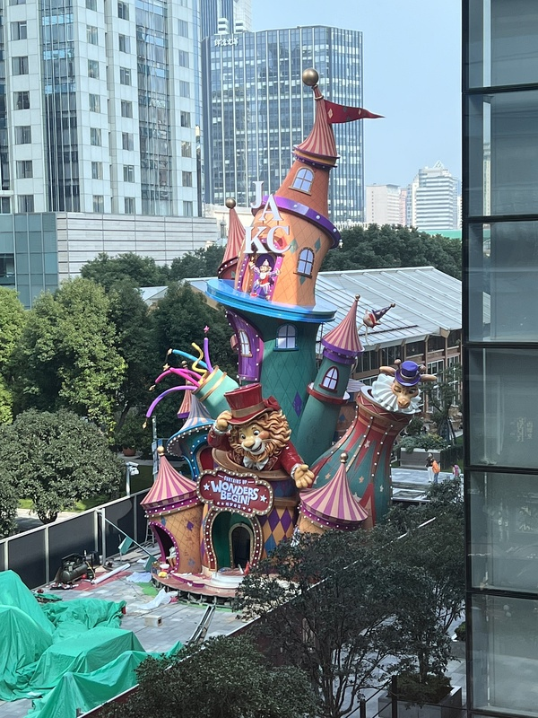  ⊳ （引用 @速派女孩将发财）上海圣诞季开始没 又想去上海玩耍了

- (2026-11-23 09:46:59) 急什么呢
还有一周的11月 还有半个月的十二月呢  ⊳ （引用 @红烧肉肉）持仓的冰雪和电影全都涨停都到不了最后一次加仓的点，太惨了....

- (2026-11-23 09:47:49) [图] 目测市场已经做出了跨年妖股最终晋级赛名单

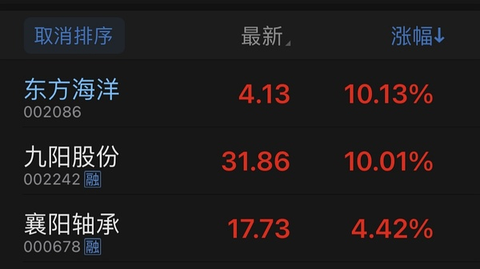

- (2026-11-23 09:50:14) [图] k50之前比较好 迎来补跌

- (2026-11-23 09:50:45) 2000当之无愧 万能钥匙  ⊳ （引用 @不知道还能说啥）k50之前比较好 迎来补跌

- (2026-11-23 09:51:41) 光线作用只是防守
看好进攻果然是幸福

- (2026-11-23 09:52:32) 光线换两个四连板的赚了

- (2026-11-23 09:53:24) 电影遗憾被市场情绪打断了
现在重新续命

- (2026-11-23 09:55:30) 中影真的太棒了
不能因为他今天涨幅少有任何不满意的
他几乎没有怎么跌

- (2026-11-23 09:55:55) 因为重仓中影少亏了不少钱😂😂😂😂  ⊳ （引用 @不知道还能说啥）中影真的太棒了
不能因为他今天涨幅少有任何不满意的
他几乎没有怎么跌

- (2026-11-23 09:56:13) 四部门：鼓励发展适合养老场景的人工智能体、服务机器人、智能穿戴设备、外骨骼等新产品

- (2026-11-23 09:57:24) 横店我被S了 我不满仓了
扶我起来 我又能干了

- (2026-11-23 09:58:21) 你这一看哪里厉害不明白吗
去强的地方啊  ⊳ （引用 @该用户已过期）干雪人？

- (2026-11-23 09:59:20) 现在去不了😂😂😂😂等等看  ⊳ （引用 @🈵仓即暴涨🤑）去哪

- (2026-11-23 10:00:20) 慈文我手动S了
不奖励弱者  ⊳ （引用 @VVV坚定持有VVV）横店：我先涨停的，10cm的叫爸爸（bushi

- (2026-11-23 10:02:08) 还不如我sy😂  ⊳ （引用 @VVV坚定持有VVV）那我也走，太弱啦！

- (2026-11-23 10:04:39) [图] 机器人 传媒提前于微盘修复

高看一眼

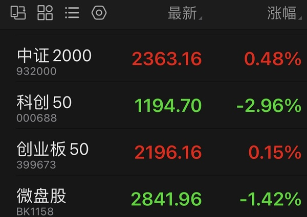

- (2026-11-23 10:04:52) 这两个东西跑在了微盘修复之前！  ⊳ （引用 @不知道还能说啥）机器人 传媒提前于微盘修复

高看一眼

- (2026-11-23 10:06:51) 那就盯着这两个了😂  ⊳ （引用 @sickid）礼拜五也是这两个带队

- (2026-11-23 10:08:50) 看不过来
我就专心传媒了  ⊳ （引用 @🈵仓即暴涨🤑）机器人你现在没搞了？

- (2026-11-23 10:09:41) 他们是不是要让科创50新低 做结构  ⊳ （引用 @sickid）礼拜五也是这两个带队

- (2026-11-23 10:11:22) 好了 我重新满仓了 别问我😂😂😂😂😂😂还是大家老熟人  ⊳ （引用 @🈵仓即暴涨🤑）机器人你现在没搞了？

- (2026-11-23 10:12:40) plus也很牛逼🤣  ⊳ （引用 @🈵仓即暴涨🤑）我还有1500没搞进去😏

- (2026-11-23 10:13:44) [图] 

  ⊳ （引用 @👑）🌚asd？

- (2026-11-23 10:15:36) 幸福

传媒机器人强度高啊  ⊳ （引用 @🈵仓即暴涨🤑）幸福和晶谁牛😏

- (2026-11-23 10:15:58) [图] 中影是最棒的！！！

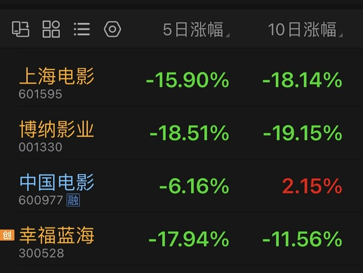  ⊳ （引用 @🈵仓即暴涨🤑）幸福和晶谁牛😏

- (2026-11-23 10:17:01) uu们有一个担心
市场帮大家化解了

那就是欢瑞ST 根本无所谓
他没有那个影响板块的地位

- (2026-11-23 10:18:51) [图] 因为这个并没好

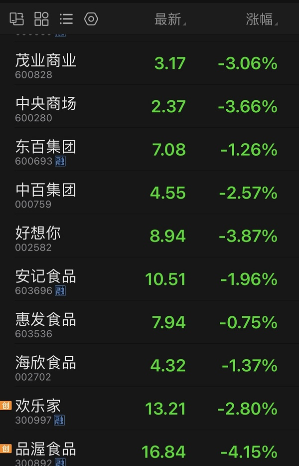  ⊳ （引用 @稀里不糊涂）大连是太沉了吗

- (2026-11-23 10:19:59) [图] 没想到吧
还有强势板块的补跌😂😂😂

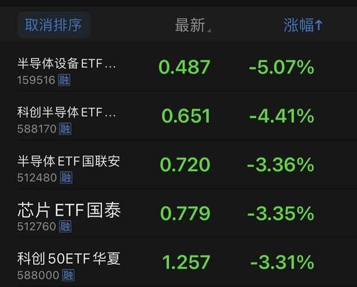

- (2026-11-23 10:21:55) 那我们居然基本都在红的那边  ⊳ （引用 @小毛驴儿）开盘到现在涨跌数变化超级大，又从三千多家红到不到一千家红了

- (2026-11-23 10:23:01) 我就这一个绿的😂  ⊳ （引用 @该用户已过期）那个不基本的就是大连了🥹🥹🤣

- (2026-11-23 10:25:34) 以前也是强的情绪先回

不然怎么区分强弱呢

很明显机器人和传媒会继续  ⊳ （引用 @🈵仓即暴涨🤑）它啥时候稳，要12月？

- (2026-11-23 10:26:43) 银行ETF翻红  ⊳ （引用 @大连海底站岗员）微盘又跳水了

- (2026-11-23 10:29:49) 期货现在+2.5

对应开盘-2.1（补0.5 就是-2.6）  ⊳ （引用 @不知道还能说啥）计算下今天10:30开盘的3300
三小时后期货估计有变动 先知道个大概

上周五15:00期货-1% 实际夜里收盘-5.6% 少了4.6%
但是现在盘前+2.2%
因此实际仅少了2.4%

若0.5%继续遗漏 则开盘-2.4%
若归还0.

- (2026-11-23 10:31:05) 杀溢价了

有恐慌  ⊳ （引用 @不知道还能说啥）期货现在+2.5

对应开盘-2.1（补0.5 就是-2.6）

- (2026-11-23 10:31:24) 没有
在杀溢价

纳斯达克投资人恐慌了！  ⊳ （引用 @🈵仓即暴涨🤑）又在拉溢价

- (2026-11-23 10:32:04) 不是很多uu很感兴趣吗

正好杀溢价了  ⊳ （引用 @monica）跳的好快啊

- (2026-11-23 10:32:41) 传媒冲啊 没吃早饭吗吗

- (2026-11-23 10:33:48) 已经满仓了  ⊳ （引用 @想当富有的咸鱼）慈文出来的楼有意向去哪儿吗

- (2026-11-23 10:34:58) 我不是嘴巴说看好本周情绪回暖
仓位跟不上的人
我还是言行合一  ⊳ （引用 @想当富有的咸鱼）好快的速度

- (2026-11-23 10:36:20) 主动ETF入口在哪里我都不知道

你是真的先进😂😂😂😂😂😂😂  ⊳ （引用 @Aaa摆烂咸鱼🥳）楼我发现我不赚钱的大部分原因是不听话😭😭，然后特别特别特别容易被情绪影响，光线没有全换幸福，长白山也还有，完了还不听劝，又被忽悠买了20万主动etf

- (2026-11-23 10:37:25) 我去的是20 原则上可以干翻他  ⊳ （引用 @🈵仓即暴涨🤑）慈文来了😏

- (2026-11-23 10:37:35) 新东西  ⊳ （引用 @想当富有的咸鱼）主动ETF是什么？

- (2026-11-23 10:37:47) 这个溢价率没有计算-5.6  ⊳ （引用 @👑）是娜娜期货在绿吗，为啥溢价16了，开是接近四个点

- (2026-11-23 10:38:02) M G  ⊳ （引用 @sickid）你是去机器人了？

- (2026-11-23 10:39:29) 我不是帮你们每天都计算吗

只要低于我开盘价

就是在杀溢价

不然我每天都在计算啥玩意

因为我有很多 我很在意  ⊳ （引用 @👑）哦哦哦，这样

- (2026-11-23 10:41:00) 我周五只用光线换了两个四连板  ⊳ （引用 @vio）芒果不是周五就有了，又加了呀

- (2026-11-23 10:42:20) 我好奇啊
主动ETF不是今天才上市交易吗
我还没找到app入口

你是认购的吗  ⊳ （引用 @Aaa摆烂咸鱼🥳）早上沈阳机床犹豫了，果真起来了，主动etf舍不得卖，全错过了害

- (2026-11-23 10:43:30) 是不是赚了 我记得播报过净值 都超过了1%
而且很多都买的红利（今天是跌了）  ⊳ （引用 @Aaa摆烂咸鱼🥳）对啊

- (2026-11-23 10:46:01) [图] 今天微盘股居然还有人作陪

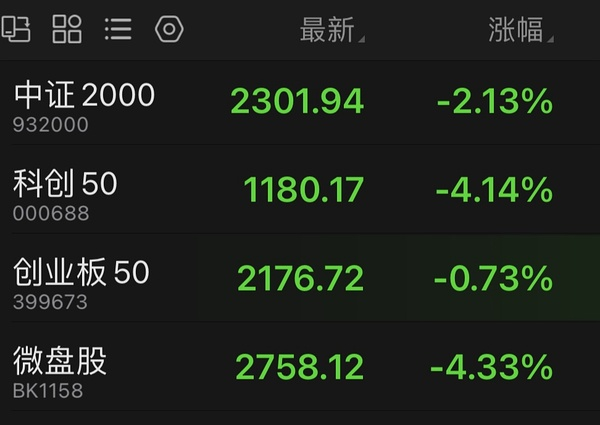

- (2026-11-23 10:46:41) 居然茅台大跌 这些涨😂  ⊳ （引用 @momo）白酒板块走高，皇台酒业涨超5%，古井贡酒、迎驾贡酒、今世缘、洋河股份跟涨
带带消费

- (2026-11-23 10:50:23) 消费的微小市值票太多了
微盘股没企稳  ⊳ （引用 @点-重生炒垃圾）今天也不错了，这么烂的市场，手上大部分还是红的，短剧不如机器人，但起码也有主动性了。感觉今天机器人/物理 AI＞短剧＞端侧芯片＞药 ，消费没计入这个体系，不知道是不是真消费

- (2026-11-23 10:52:41) 经过双休日的消息蔓延
今天的nana场内投资者没有月初那次的稳如泰山了😂  ⊳ （引用 @六倍做多退休）早上-1.5%卖掉了中韩 -4.2加仓了nana😂 

- (2026-11-23 10:53:50) 如果今天微盘股能起死回生 打出探底针
我们可能会大赚啊

早上就-5了 下午有种-8 -9？

- (2026-11-23 10:56:14) 芒果平时不是很牛逼吗 来个一阳包三阴四阴看看真正的实力😂😂😂😂😂  ⊳ （引用 @点-重生炒垃圾）我希望啊

- (2026-11-23 10:57:01) 阿博上周没骂过你一句
你看看SY 你丢人不

- (2026-11-23 10:58:20) 😂😂😂😂😂😂😂😂😂😂
那你只要芒果比他牛逼就行了

就像我慈文不在了  ⊳ （引用 @🈵仓即暴涨🤑）你把它喊起来我就丢人了，卖了点它去了芒果😒

- (2026-11-23 10:59:55) 幸福现在+8 还凑活看

我不满意阿博  ⊳ （引用 @🈵仓即暴涨🤑）你快喊幸福☺

- (2026-11-23 11:01:24) [图] 别玩啦 祖宗

一鼓作气行不

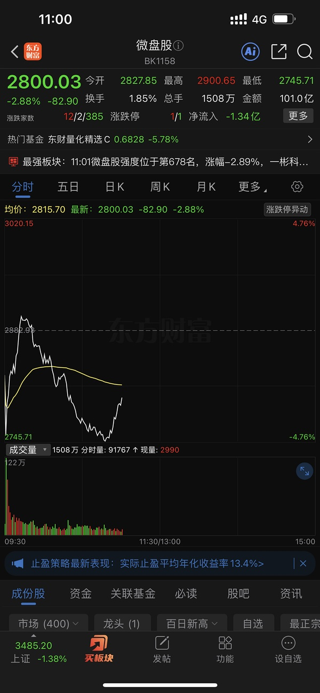  ⊳ （引用 @不知道还能说啥）如果今天微盘股能起死回生 打出探底针
我们可能会大赚啊

早上就-5了 下午有种-8 -9？

- (2026-11-23 11:03:11) 你看 早上拉红过😂  ⊳ （引用 @速派女孩将发财）今天要是可以拉红 我就想买场外微盘了 

- (2026-11-23 11:05:01) 又拉过日内均线了🤣  ⊳ （引用 @vio）是啊祖宗😂给你磕一个

- (2026-11-23 11:06:44) 本周情绪回暖
原则上任何一笔S都注定是卖飞
但是重要的是钱卖了去的是哪里！！！  ⊳ （引用 @🈵仓即暴涨🤑）今天强的是不是能看得久一点

- (2026-11-23 11:08:38) [图] 2000 ：随便你们玩什么 能玩起来就行

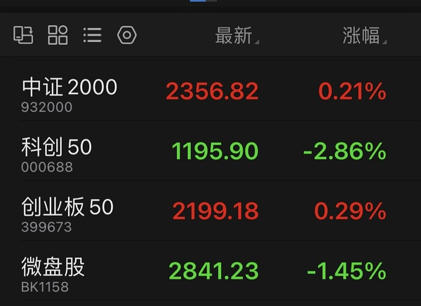

- (2026-11-23 11:09:30) 😂😂😂😂😂😂😂什么图  ⊳ （引用 @monica）又现楼里组训，之前有uu作图，我特意在海底捞打印了照片~

- (2026-11-23 11:11:54) 👍👍👍👍👍👍👍👍👍👍👍👍👍👍

- (2026-11-23 11:12:53) 跌停回到个位数

- (2026-11-23 11:13:22) 还有3800绿的
微盘股没红呢
再坚持一下  ⊳ （引用 @潇湘烟雨）没辙了，我还是绿的，心灰意冷

- (2026-11-23 11:14:26) 好的

我也终于看到10086开阴线了😂  ⊳ （引用 @sickid）银行茅台都下去了

- (2026-11-23 11:14:55) 如果慈文涨停
芒果你没15+你等着被我喷

- (2026-11-23 11:15:13) 是不是李一桐说的 我很会切芒果？  ⊳ （引用 @不知道还能说啥）如果慈文涨停
芒果你没15+你等着被我喷

- (2026-11-23 11:16:21) 嗯 我横店触发以后 我看慈文不咋滴就一起走了

但是因为看好情绪本周反攻 我就转mg了  ⊳ （引用 @点-重生炒垃圾）哈哈哈哈，你是今天去的吗？

- (2026-11-23 11:17:43) 你们都是芒果会员吗  ⊳ （引用 @西西西西）芒果爱你嘻嘻 我会继续追后会友期的

- (2026-11-23 11:19:02) 我不会的
我会一个个骂过来

上周一起跌 你看我一个都不喷的
这周我可是要考核他们kpi的呀😂  ⊳ （引用 @一切都会过去的）楼你叛变了！

- (2026-11-23 11:19:56) 那个我给优酷了
我女朋友喜欢看井柏然 井柏然都是优酷剧集😂  ⊳ （引用 @招招碎片收集中）是！88VIP有送

- (2026-11-23 11:21:15) 有的
但是估计要人家带
一点没有主动 积极的作风  ⊳ （引用 @Eleven） bn 有咩有涨停的风险🤗

- (2026-11-23 11:24:12) 我这次还亏18%博纳😂😂😂😂😂
辣鸡玩意 赶紧给我搞到15以内先  ⊳ （引用 @YuanZi💕）那再多骂骂他！

- (2026-11-23 11:24:57) 跌停个位数
涨停60个

- (2026-11-23 11:25:14) 多只机器人ETF涨超3%
机器人ETF易方达、机器人ETF鹏华、机器人ETF广发、机器人ETF富国等多只机器人ETF涨超3%。宇树科技涨超10%，浙江荣泰触及涨停。

- (2026-11-23 11:27:51) [图] 黄金 机器人 影视 通信领涨

都是上周被爆揍的

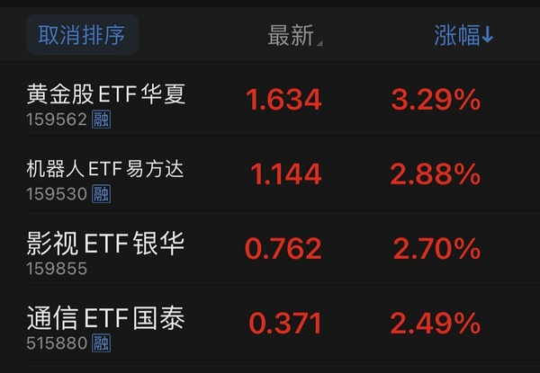

- (2026-11-23 11:30:24) 哈哈哈哈我那个 被遗弃的同花顺私生女 今天爸爸给了点零花钱😂😂😂😂😂😂😂😂😂😂😂

我要去告诉她

- (2026-11-23 11:31:25) 是不是要先等听证会结束啊？  ⊳ （引用 @六倍做多退休）刚刚川普“我希望英伟达董事会把黄仁勋招回去，对公司好，对美国好”

上价值，上压力了

- (2026-11-23 11:32:06) [图] 你看 夜盘光一般般

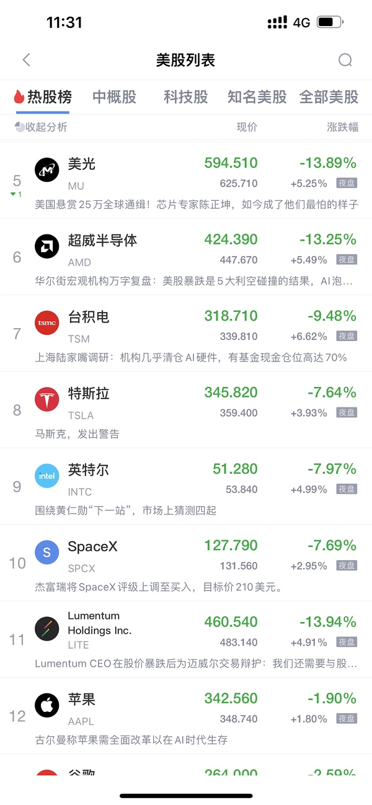  ⊳ （引用 @点-重生炒垃圾）天孚10+了，超过xys，他对美国最敏感，美股暴力反弹？

- (2026-11-23 11:32:53) 我那个买xys的女主播
礼拜六改了个性签名

被遗弃的同花顺私生女  ⊳ （引用 @点-重生炒垃圾）这是啥瓜，我咋不知道

- (2026-11-23 11:34:28) 民主党这样下去会掉选票的吧😂
金毛煽风点火能力还是很强的

2年后民主党还得竞选呢  ⊳ （引用 @六倍做多退休）应该都要等12月 我看老美也是坐不住了 好多投资大佬都在狂喷美联储 说他们守旧又落后哈哈哈 还有musk火上浇油说明年钱会更加紧张

- (2026-11-23 11:37:03) [图] 因为之前跌的多 大家在靠拢

  ⊳ （引用 @一切都会过去的）Xys上周五也跌得不多

- (2026-11-23 11:38:58) 微盘股决定权不在美国
美国最近几个月没好过
大家在天普被停牌 羊崩塌之前
都赚的不错的  ⊳ （引用 @一切都会过去的）我还是有点害怕 感觉老美又在演

- (2026-11-23 11:45:39) 重新来看看
中午收盘时期货+3

遗漏0.5 0.4 应该 -1.6%
归还0.5 应该-2.1
全部归还 应该-2.5

实际-2.7

结论：今天杀溢价了 场内纳斯达克投资者受到了周末消息蔓延的恐慌传导 本轮首次没有在大跌时候bbbbbbb 反而增加了抛售  ⊳ （引用 @不知道还能说啥）计算下今天10:30开盘的3300
三小时后期货估计有变动 先知道个大概

上周五15:00期货-1% 实际夜里收盘-5.6% 少了4.6%
但是现在盘前+2.2%
因此实际仅少了2.4%

若0.5%继续遗漏 则开盘-2.4%
若归还0.

- (2026-11-23 11:47:06) [图] 3300今天还是跌幅最小的了

  ⊳ （引用 @不知道还能说啥）重新来看看
中午收盘时期货+3

遗漏0.5 0.4 应该 -1.6%
归还0.5 应该-2.1
全部归还 应该-2.5

实际-2.7

结论：今天杀溢价了 场内纳斯达克投资者受到了周末消息蔓延的恐慌传导 本轮首次没有在大跌时候bbbbb

- (2026-11-23 11:48:22) 我在坐等复刻3月底宇航员了  ⊳ （引用 @🈵仓即暴涨🤑）给了608亿

- (2026-11-23 11:57:05) [图] 只有三个主动ETF净值在1以上 暂时不亏钱

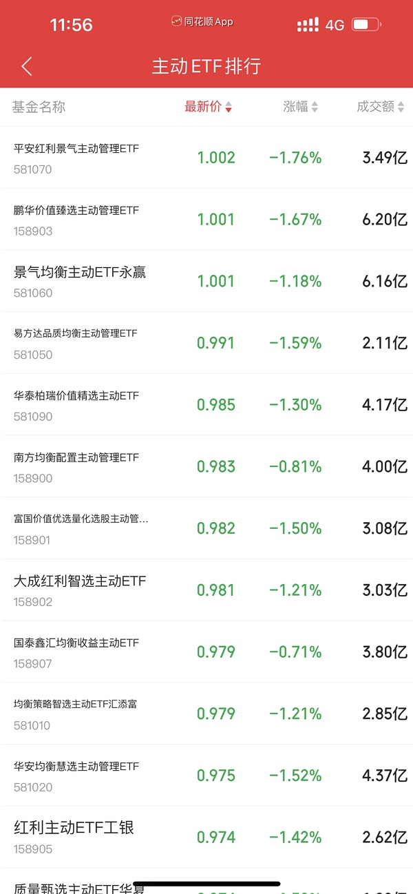

- (2026-11-23 12:00:53) 浙江宣传：炒作中国消费降级是伪命题

- (2026-11-23 12:14:25) [图] 7.17冰点后 （我们是7.20日抄底2000）
小盘的企稳也是慢几拍
这是涨跌图

那次我记得很清楚 K50先反击 大家吐槽2000
但后续在波动中企稳后 小盘依然大幅度胜出

考虑到市场固定11月第三周杀情绪 月底回暖
小盘依然值得期待

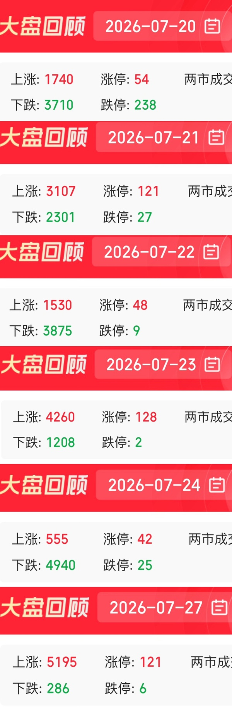

- (2026-11-23 12:15:21) 坐等一个百股涨停信号📶  ⊳ （引用 @不知道还能说啥）7.17冰点后 （我们是7.20日抄底2000）
小盘的企稳也是慢几拍
这是涨跌图

那次我记得很清楚 K50先反击 大家吐槽2000
但后续在波动中企稳后 小盘依然大幅度胜出

考虑到市场固定11月第三周杀情绪 月底回暖
小盘依然值得期待

- (2026-11-23 12:24:25) 能让加息概率下去 都能接受  ⊳ （引用 @小鱼）真的搞笑，民主共和两边互相演戏，最后真的亏了是我们的钱😓

- (2026-11-23 12:28:54) 你也经历过三月底宇航员吧 
就是那样  ⊳ （引用 @🈵仓即暴涨🤑）暴力我要看见

- (2026-11-23 12:29:10) [图] 🤣

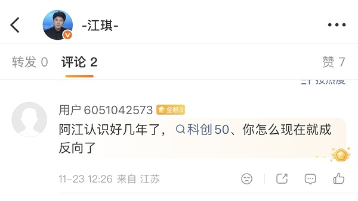  ⊳ （引用 @点-重生炒垃圾）加油⛽

- (2026-11-23 12:32:43) 其实那个时候也是不动最好

那时候三月月底之前 账户悲剧缔造者 是SJ
但是SJ最终完成了自我救赎
我很难忘记三月份  ⊳ （引用 @🈵仓即暴涨🤑）是滴，不过那时候乱动，现在是加仓一动不动😏

- (2026-11-23 12:35:38) 🤣可以再买  ⊳ （引用 @点-重生炒垃圾）Sos，那我后悔早上卖银之杰了，到时候必定有一个20cm金融软件，加3个券商涨停

- (2026-11-23 12:36:23) 我觉得是强势板块补跌
上周半导体设备很强  ⊳ （引用 @第四个影子）科创就是跟韩国吧，韩国10点大跳水，10点50拉升，科创50也差不多的走势

- (2026-11-23 12:41:35) [图] 😂三月份我明年也不会忘记的
而且忘记了的话 这不是app有记录吗🤣

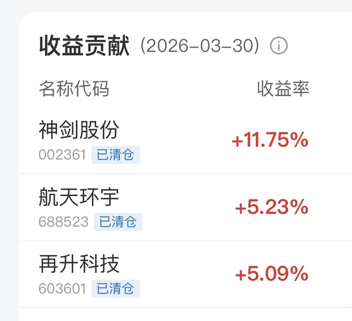  ⊳ （引用 @点-重生炒垃圾）楼主你记性真好，专业炒股，我都忘记三月的具体情况了

- (2026-11-23 12:42:48) A杀再超级V呀🤣🤣🤣🤣  ⊳ （引用 @小鱼）我记得三月底宇航员最后a杀害我没挣到钱😓

- (2026-11-23 12:50:03) 主要是上周韩国没涨过 一路下

但是我们半导体设备是特别强的

所以我觉得今天是补跌😂  ⊳ （引用 @第四个影子）也有可能吧，反正我看韩国9点半就不行了，感觉科创早上的拉升就会跳水了

- (2026-11-23 12:57:55) 其实 情绪周五就开始复苏了 然而周五太有魔力了😂  ⊳ （引用 @sickid）银行今天5日线拐头了

- (2026-11-23 13:02:48) 今天可不是周五了

- (2026-11-23 13:04:35) 吗的
我芒果不如慈文？  ⊳ （引用 @sickid）机器人北纬科技封板

- (2026-11-23 13:05:23) 场内3300开始激活溢价

期货没变还是3%

但是场内心态心态不一样了

- (2026-11-23 13:06:33) 四连板跌停的威力吗😂空间更大是不是  ⊳ （引用 @稀里不糊涂）芒果追上去啊

- (2026-11-23 13:07:12) 👍👍👍  ⊳ （引用 @🈵仓即暴涨🤑）嘿嘿我有掌阅🤗

- (2026-11-23 13:08:34) 悟一下
是不是跌幅大的修复空间更大

收盘我再看看  ⊳ （引用 @🈵仓即暴涨🤑）不得不喷一下龙

- (2026-11-23 13:10:36) 大家熬跌耐揍都不错的

接下来考验大家忍涨能力  ⊳ （引用 @🈵仓即暴涨🤑）此时此刻只想给幸福加油

- (2026-11-23 13:11:01) 机器人牛逼啊 并不是传媒  ⊳ （引用 @啊呆呆呆呆）果然就那么点钱在捣鼓，算力一垮又回传媒了。

- (2026-11-23 13:11:49) [图] 微盘 -5 到红？

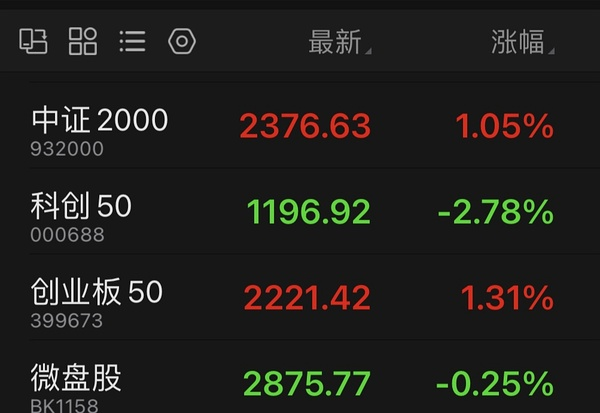

- (2026-11-23 13:12:11) 加油
这只是刚刚开始！  ⊳ （引用 @🈵仓即暴涨🤑）回到早上最高点了🤗

- (2026-11-23 13:12:46) 传媒四连板的今天哪个没涨停？？？金逸？

- (2026-11-23 13:13:12) 情绪周五就触底反弹了

本周是预期内的大回暖🤣  ⊳ （引用 @稀里不糊涂）金针探底？

- (2026-11-23 13:13:54) 别忘了
我手里可是有东方海洋的 这个两连板的🤣🤣🤣🤣
注定情绪已恢复  ⊳ （引用 @稀里不糊涂）金针探底？

- (2026-11-23 13:14:36) 芒果不知道的还以为你也是主板10cm呢

- (2026-11-23 13:15:09) 跨年妖股啊！！  ⊳ （引用 @稀里不糊涂）楼还有东方海洋？

- (2026-11-23 13:16:07) 好好好！！！  ⊳ （引用 @sickid）龙版来了

- (2026-11-23 13:17:00) 是传媒还会继续 他肯定会继续  ⊳ （引用 @稀里不糊涂）上影要二波？

- (2026-11-23 13:17:20) OK 我要喷幸福了  ⊳ （引用 @sickid）晶雪10+了

- (2026-11-23 13:17:36) 幸福不努力 哪来幸福？  ⊳ （引用 @不知道还能说啥）OK 我要喷幸福了

- (2026-11-23 13:17:46) 😂😂😂😂😂😂  ⊳ （引用 @六倍做多退休）突然想起一个好笑的 昨天是不是brtv的老师们全体都空仓😂😂😂

- (2026-11-23 13:18:06) 笑死 ETF确实超了  ⊳ （引用 @sickid）大胆预测下午传媒超过机器人

- (2026-11-23 13:18:38) 芒果：你们别急 他们10已经停了 但我还有两个小时呢

- (2026-11-23 13:19:45) 微盘股-5到差不多+2了 日内新高

- (2026-11-23 13:20:19) 我不满意 那边plus雪更厉害😂😂😂😂  ⊳ （引用 @该用户已过期）幸福来了

- (2026-11-23 13:20:56) 只要卖出肯定飞
因为情绪刚开始
但是重要的是卖的钱去的哪里 这才是最关键的

- (2026-11-23 13:21:37) 没了
比较强的都起来了  ⊳ （引用 @点-重生炒垃圾）还有备选吗？

- (2026-11-23 13:22:17) 我退出登录了
我今天plus 15%也不准备卖
我没操作了
也没单子  ⊳ （引用 @点-重生炒垃圾）还有备选吗？

- (2026-11-23 13:23:07) 是  ⊳ （引用 @👑）满仓状态吗

- (2026-11-23 13:23:40) [图] 

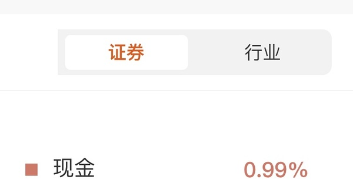  ⊳ （引用 @👑）满仓状态吗

- (2026-11-23 13:24:44) 大连他们吃微盘股

雪儿应该继续强化努力 我不满意  ⊳ （引用 @404找回了）对电影很满意，3冰雪今天能收住小短腿也行

- (2026-11-23 13:25:37) 没有计算晚上的-5.6  ⊳ （引用 @暴富¥(´･ᴗ･`)$）nana溢价20了要

- (2026-11-23 13:26:23) 👍👍👍👍👍👍👍👍

机器人和传媒应该依然是接下来主旋律

和以前一样

情绪崩盘 修复之后玩的还是之前的  ⊳ （引用 @只想搞钱）谢谢楼！！！早上点名机器人和传媒后我就去机器人了

- (2026-11-23 13:26:43) 牛逼  ⊳ （引用 @扶我起来还能买）看来不用问楼你如果早上捞了雪儿要不要出的问题了 谢谢楼你早上给的指引 贴个图吧

- (2026-11-23 13:26:57) 🤣🤣🤣🤣🤣🤣🤣🤣🤣🤣🤣🤣🤣  ⊳ （引用 @稀里不糊涂）等着冲芒果会员了！！！

- (2026-11-23 13:27:15) 一点主动性没有

我依然批评  ⊳ （引用 @西西西西）bn板了

- (2026-11-23 13:27:36) 👍👍👍👍👍看到你说的了 20再卖 高级操作哈哈哈  ⊳ （引用 @momo）引力板了

- (2026-11-23 13:27:59) 债券被干崩了 头疼😂😂😂😂😂😂😂

- (2026-11-23 13:30:20) 就是今天  ⊳ （引用 @不知道还能说啥）坐等一个百股涨停信号📶

- (2026-11-23 13:32:55) 情绪其实是周五见底😂
东方海洋 九阳 襄阳连续给信号了  ⊳ （引用 @🈵仓即暴涨🤑）今天是底😎

- (2026-11-23 13:34:00) 下面两个跟微盘的  微盘还没反转

雪儿不应该  ⊳ （引用 @🈵仓即暴涨🤑）今天不确定因素在这哥三身上了

- (2026-11-23 13:37:20) [图] 影视 机器人 没有对手

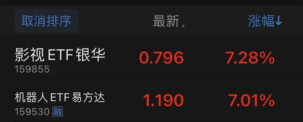

- (2026-11-23 13:39:57) 幸福在干什么
你在等光线追上来？
赶紧冲啊

- (2026-11-23 13:43:02) 超级跌停日的下两天情绪恢复
和去年一模一样  ⊳ （引用 @🈵仓即暴涨🤑）传媒占了3/1🤨

- (2026-11-23 13:43:40) uu们已经不记得周末的情绪了  ⊳ （引用 @momomomomomo哒）还有要换仓的UU们！ 说中鸡要换去美鸡的

- (2026-11-23 13:44:39) [图] 2000就是牛逼在这里

他不管你们涨什么 只要有东西涨就行

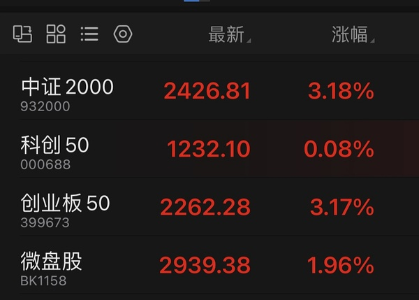

- (2026-11-23 13:45:05) 2000领涨所有指数！！！  ⊳ （引用 @不知道还能说啥）2000就是牛逼在这里

他不管你们涨什么 只要有东西涨就行

- (2026-11-23 13:45:52) 还没结束呢
不一定只有7  ⊳ （引用 @11）今天赚七个点和上周亏五个多点的钱差不多🥹

- (2026-11-23 13:46:15) 机器人ETF快要涨停了

- (2026-11-23 13:46:29) 果果组合？  ⊳ （引用 @点-重生炒垃圾）果麦涨停

- (2026-11-23 13:48:18) 哈哈
期货一直都是3没变过

但是场内纳斯达克ETF的人的心态真的变了  ⊳ （引用 @六倍做多退休）今天场外中基对冲美基勒

- (2026-11-23 13:49:01) 3300又开始重新打溢价了
等盘后来算算了

- (2026-11-23 13:49:44) 中影你等不了
人家上周贡献很伟大了🤣  ⊳ （引用 @🈵仓即暴涨🤑）现在就差中影和幸福了

- (2026-11-23 13:52:45) 你们可以记下来

情绪崩盘到转换 只要情绪崩盘之前玩的东西不是反情绪的防守内容 后面情绪回暖就还是接着玩他们

就像去年的东哥啥的  ⊳ （引用 @momo）感觉还是传媒和机器人板的快，涨停太多了

- (2026-11-23 13:56:25) 晚上的-5.6没来  ⊳ （引用 @👑）娜娜怎么显示溢价20了

- (2026-11-23 13:57:10) 明天能进一步区分强弱  ⊳ （引用 @🈵仓即暴涨🤑）🤣

- (2026-11-23 13:59:53) 雪人应该不是 18号的表现是不一样的
所以今天他不应该 这是今天非常不满意的一个  ⊳ （引用 @momo）看了一下，雪人大连长白山都是跟的微盘，跟消费差不多，不是跟的冰雪。

- (2026-11-23 14:00:26) 迷途知返 可以原谅  ⊳ （引用 @不知道还能说啥）雪人应该不是 18号的表现是不一样的
所以今天他不应该 这是今天非常不满意的一个

- (2026-11-23 14:00:54) 东方海洋会重新五连板六连板吗😂

- (2026-11-23 14:03:09) 九阳也不赖😂
最终应该只有一个羊  ⊳ （引用 @稀里不糊涂）跨年妖，绝对是

- (2026-11-23 14:03:44) 在里面
不过就5000股😂  ⊳ （引用 @只想搞钱）楼在里边吧？直接一个提前恭喜

- (2026-11-23 14:07:10) 除非我有很强烈要去的票 不然不会

比较强烈想要的都在手里了  ⊳ （引用 @👑）大连不会卡4吧，好担心楼要把他扔了，呜呜呜

- (2026-11-23 14:07:21) 👍👍👍👍👍👍  ⊳ （引用 @ü）楼楼！龙版我吃了两个板走了，谢谢楼楼！

- (2026-11-23 14:10:03) 嗯也是强力竞争者
毕竟襄阳周四就试图激活市场情绪了！！

我觉得就是东方海洋 襄阳 九阳争夺冠军了  ⊳ （引用 @Aaa摆烂咸鱼🥳）我猜襄阳轴承，羊➕机器人🤣🤣

- (2026-11-23 14:11:04) 我6号表态过纳斯达克了

我3300现在浮亏2.6%

其他需要你自己做主  ⊳ （引用 @Aaa摆烂咸鱼🥳）楼，我想请教一下，我想把我的20万主动etf换成3300，但是我看溢价起来了，还能换不

- (2026-11-23 14:12:32) 早上芒果不是
刚拐弯  ⊳ （引用 @该用户已过期）今天上啥都是强上🤣🤣🤣

- (2026-11-23 14:14:31) 早上慈文不给力
不然两个涨停一起卖了换
利润更大化🤣🤣🤣🤣🤣🤣🤣🤣🤣  ⊳ （引用 @该用户已过期）我上的时间晚了点😂😂

- (2026-11-23 14:15:21) 没事
这才刚开始🤣🤣🤣🤣🤣
还有好多天呢

小卡点12.4-12.5
大结局要12.17那边呢  ⊳ （引用 @VVV坚定持有VVV）事已至此，今天的败笔是买了报喜鸟😅

- (2026-11-23 14:16:50) 那几个10也不会省心的🤣🤣🤣🤣
毕竟都四连板过 涨停跌停吃饭一样容易  ⊳ （引用 @🈵仓即暴涨🤑）20的不封板，就没10的稳定了

- (2026-11-23 14:18:11) 大连是响当当的尾盘战神哦  ⊳ （引用 @该用户已过期）大连，cbs +5了，你再涨一个点不过分吧？

- (2026-11-23 14:19:48) plus为王 🤣  ⊳ （引用 @YuanZi💕）冰山涨停

- (2026-11-23 14:20:10) 应该马上
plus都给他打样了  ⊳ （引用 @---）雪人两点半后希望你能板一个

- (2026-11-23 14:21:41) 果果组合 芒果辣鸡  ⊳ （引用 @点-重生炒垃圾）【AI漫剧概念再度拉升 果麦文化、华是科技触及20cm涨停】午后AI漫剧概念再度拉升，果麦文化、华是科技触及20cm涨停，此前慈文传媒、浙文影业、引力传媒、德才股份、掌阅科技、上海电影等多股涨停，芒果超媒、华智数媒、海看股份均涨超13%。

- (2026-11-23 14:22:08) 那差不多啊
我也是+3.7去的  ⊳ （引用 @该用户已过期）牛，我+4才去🤣🤣🤣

- (2026-11-23 14:22:52) 工商银行-3%

- (2026-11-23 14:25:29) 没事做了
我们来看看投票啊

小远投票最多
国富 网易云音乐 紧随其后
小广 小浦第三梯队

搞笑二人组今天无人问津

- (2026-11-23 14:27:15) [图] 空调和10086满硬气

- (2026-11-23 14:28:17) 三个平均今天有7%没

他们那个规律是7% 第二天肯定绿😂  ⊳ （引用 @点-重生炒垃圾）明天是不是又要看哪个规律，下半年之后，易中天大涨，第二天百分比翻绿

- (2026-11-23 14:29:19) 你让她们回落点

7%才是第二天必跌 6%就不是了🤣🤣🤣🤣🤣  ⊳ （引用 @速派女孩将发财）你吓到我了 老师

- (2026-11-23 14:29:47) 真牛逼！！！！！！防守大师 完胜nana  ⊳ （引用 @VVV坚定持有VVV）小远4.41

- (2026-11-23 14:30:09) 还有半小时
要不让他们回落一点吧  ⊳ （引用 @招招碎片收集中）有的 11% 8% 5%

- (2026-11-23 14:30:46) 笑死
那索性狠狠干呗 把可耻记录踩在脚下  ⊳ （引用 @招招碎片收集中）往上冲了 我还少报了hhhhhh

- (2026-11-23 14:32:30) [图] 因为之前抗跌

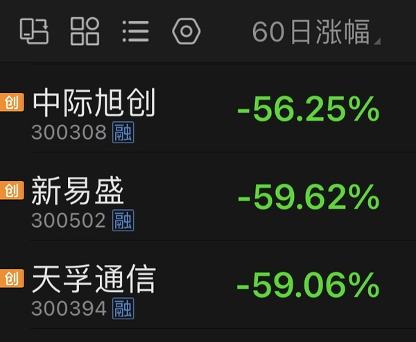  ⊳ （引用 @招招碎片收集中）中为啥差这么多啊

- (2026-11-23 14:33:10) 韩国股指收跌3.3% 政府称着手准备启动股市稳定基金

着手
准备

- (2026-11-23 14:33:42) 可能会在未来几天传媒机器人调整的时候  ⊳ （引用 @赛博朋克2077）冰雪能不能三箭齐发都涨停😭

- (2026-11-23 14:34:51) 我们妈妈已经疯狂买了

你可以喷买的沪深300有点固执 但是并没有嘴炮  ⊳ （引用 @monica）开始竞争谁是亚洲第一嘴炮王者了

- (2026-11-23 14:36:25) 今天我要靠美债对冲一些中债亏损了是吧

到处都很难齐心协力 😂😂😂😂😂😂  ⊳ （引用 @六倍做多退休）没事啊 休息了 今年就这样了吧😂

- (2026-11-23 14:38:21) 明天芒果我开35.94

其他我自己继续全部锁仓 大家根据自己来

- (2026-11-23 14:38:52) 没事做
已经都看完了  ⊳ （引用 @不知道还能说啥）明天芒果我开35.94

其他我自己继续全部锁仓 大家根据自己来

- (2026-11-23 14:41:29) 是的 
38.88那天套牢盘36.7附近 第二天最高点也是这个附近

我规避  ⊳ （引用 @该用户已过期）卖完吗？

- (2026-11-23 14:43:45) 大家周末表达的意思是 还会继续大跌特跌
怎么现在还有个低点就无法接受了😂😂😂😂  ⊳ （引用 @凯恩拿下金球😋）本月还有一个低点吗？不要啊

- (2026-11-23 14:46:10) 是的

传媒新的一波才刚开始  ⊳ （引用 @钱多多）触发不了的话继续等吗

- (2026-11-23 14:47:06) 不开
明天涨停到双头那边 再慢慢考虑  ⊳ （引用 @点-重生炒垃圾）Plus雪开吗？

- (2026-11-23 14:48:58) 不会
大盘太嗨反而会影响

上证指数 双创前期没好过呀
不影响我们玩的风生水起  ⊳ （引用 @点-重生炒垃圾）大盘跌会影响我们垃圾吗？😂😂😂感觉来一波了，大盘再来个低点也无所谓了吧

## 🧠 投资风格分析
> 📏 增量更新指引：仅当今日发言确有新依据时才修订对应维度，无变化不强行重写；单维度修订建议 ≤150 字。

- 投资理念与方法：坚持用长期估值百分位评估资产，如纳指100五年2%、十年4%，不以剩余修复空间简单外推收益；强调夏普/卡玛更高、回撤大的品种修复能力更强。冰点判断坚持五条件缺一不可，融资盘看批量流出而非单点爆破。对恐慌事件要求同等心态与恐慌强度才可类比，区分生命威胁（2020口罩）与叙事冲击（AI故事）。同时关注红利指数成分调整机制，理解涨多踢出、跌多纳入的反向规则。
- 风险偏好：对融资盘爆仓风险敏感，关注融资余额批量流出而非单点爆破，认为爆融资盘会出冰点。回避高波动垃圾微盘，称「2000太垃圾 不到极端情况不买」，但认为极端崩盘时国家队会扫货2000。会在情绪回暖时参与强势板块，同时对强势板块补跌保持警惕。对主题炒作保持一定距离，强调进攻强品种跌幅也最大。
- 交易与仓位：强调操作与观点一致，反对一边看跌一边补仓或切换进攻最强；主张卖出后资金去向比卖出本身更关键，会快速将资金转入强势板块。满仓运作但保留条件单纪律，无机会时不强行设置条件单。对长期品种不因外界批评调整，称「我没有动的打算」。资金不足时不强行加仓，宁可等待条件。今日卖出横店、慈文后转入芒果，并重新满仓，随后称无单子、不操作。
- 心理特质：对波动与回撤高度钝化，普跌中仍信心十足，期待情绪回暖与回血；盘中爱用KPI考核持仓、批评不努力标的，但上周普跌时一个都不喷，区分「一起跌」与「该努力」的语境。卖出后常遇卖飞但接受，强调资金去向。乐观主义底色，认为下跌多暴力反攻也一样暴力；面对外界恐慌传播时坚持按自己的冰点条件与估值框架判断。

> ⚠️ 本板块由 Actions 全自动增量更新（复用当日发言与今日总览），每次仅在内容足够支撑时才改动。

## 🏷️ 昵称映射表
### 📖 昵称规律（供 AI 判断新昵称时参考）
【昵称命名规律（用于推断未知新昵称）】
- 拼音首字母缩写：取标的/基金名汉字拼音首字母串（含数字代码），多为 ETF/股票代码口语化｜示例：yl=引力传媒｜zy=掌阅科技｜sj=视觉中国｜cc=华安文体健康混合｜C50=创业板50ETF｜k50=科创50｜kun=昆仑万维｜xhxc=新瀚新材｜zxfc=中欣氟材
- 小/老+姓氏代指：「小X」「老X」通常指姓 X 的标的或该标的的基金经理；「X兄弟」多为同系基金｜示例：小惠=惠发食品｜老莫=万家品质生活(莫海波)｜小华=华夏全球科技先锋(QDII)A｜小华兄弟=华夏移动互联(QDII)｜小浦=浦银安盛全球智能科技(QDII)A｜小广=广发全球精选(QDII)A｜小远=华宝致远(QDII)C｜招招=招商银行｜小德=德明利｜赵姨=兆易创新｜露露=泸州老窖｜空调=格力电器
- 戏称/黑话→题材板块：生活化比喻或黑话对应某个题材/板块，而非单一标的；出现时多指板块方向｜示例：卖国=PCB板块(英伟达AI链)｜爱国=国产自主(半导体设备/芯片)｜奶茶=易点天下｜老师=中文在线｜蓝色=蓝色光标｜宇航员=航空航天板块｜华子=华泰保兴安悦债券｜国际=国际复材｜巨无霸=长鑫科技等重大IPO
- 谐音/取字：昵称含标的名关键字（取一字或谐音），多为 A 股个股或基金简称｜示例：万华=万华化学｜东百=东百集团｜宝=保利发展｜讨饭/亚洲讨饭/建信新兴=建信新兴市场(QDII)A｜华宝zy=华宝致远(QDII)A
- 机构/基金经理昵称：以基金公司名、经理姓、或平台代称指代对应基金产品｜示例：周经理=中欧新趋势混合(LOF)A｜张经理=信澳匠心回报混合A｜网易云/音乐世家=富国全球科技互联网股票(QDII)A｜国富亚洲=国富亚洲机会股票(QDII)A｜国泰纳指=国泰纳斯达克100指数(QDII)｜易方达全球=易方达全球成长精选混合(QDII)A｜浦银安盛=浦银安盛全球智能科技(QDII)A

### 📋 已收录映射
| 昵称 | 对应名称 |
|------|----------|
| C50 | 创业板50ETF |
| cc | 双义：股票=中国长城 / 基金=华安文体健康混合（用户 11-05 指认） |
| k50 | 科创50 |
| kun | 昆仑万维 |
| sj | 视觉中国 |
| xhxc | 新瀚新材（用户确认；代码待核） |
| yl | 引力传媒 603598（对手盘，非他持仓）｜11-06 +37.15%；11-09 本月+37.79% |
| zxfc | 中欣氟材 |
| zy | 双义：他本人口径=603533 掌阅科技（用户 11-05 确认）；11-09 楼友两条『zy』按 16 元/电影语境指 600977 中国电影。引用必须带语境，不许收敛 |
| 万华 | 万华化学 |
| 东百 | 东百集团 |
| 亚洲讨饭 | 建信新兴市场混合(QDII)A |
| 保利发展 | 保利发展 |
| 华子 | 华子＝007540 华泰保兴安悦债券A（华泰保兴基金·安悦债券A类份额），满仓30年超长利率债的长债基金（用户 2026-11-16 确认，无歧义，不是歧义项）；00:42 楼友『华子今年战绩无敌吧』→他答『30超长债牛逼没办法』；13:47『纯利率债就是华子那种 不过华子满仓30债 有些是满仓5-10年』；**与460108不是同一只**：460108＝华泰柏瑞稳健收益债券C（他持有的纯利率债·重仓国开/农发/国债，见六基行），华子007540 是华泰保兴的长债基金，勿混 |
| 华宝 zy | 华宝致远混合(QDII)A |
| 华宝zy | 华宝致远混合(QDII)A |
| 卖国 | PCB、光模块、通信板块（英伟达AI产业链） |
| 周经理 | 中欧新趋势混合(LOF)A |
| 国富亚洲 | 国富亚洲机会股票(QDII)A |
| 国泰纳指 | 国泰纳斯达克100指数(QDII) |
| 奶茶 | 301171 易点天下（对手盘，非持仓）｜11-13 10:07『奶茶out 幸福人的底气是可以说芒果out』；当日 −6.72% |
| 宇航员 | 航空航天板块 |
| 宝 | 保利发展 |
| 小华 | 华夏全球科技先锋混合(QDII)A |
| 小华兄弟 | 华夏移动互联混合(QDII) |
| 小广 | 广发全球精选股票(QDII)A |
| 小德 | 德明利 |
| 小惠 | 惠发食品 |
| 小浦 | 浦银安盛全球智能科技(QDII)A |
| 小远 | 华宝致远混合(QDII)C｜只在盯，未证他持有 |
| 巨无霸 | 长鑫科技等重大IPO企业 |
| 建信新兴 | 建信新兴市场混合(QDII)A |
| 张经理 | 信澳匠心回报混合A |
| 招招 | 招商银行 |
| 易方达全球 | 易方达全球成长精选混合(QDII)A |
| 浦银安盛 | 浦银安盛全球智能科技(QDII)A |
| 爱国 | 国产自主（半导体设备/芯片制造） |
| 空调 | 格力电器 |
| 网易云 | 富国全球科技互联网股票(QDII)A |
| 老师 | 中文在线 |
| 老莫 | 万家品质生活混合A(519195) |
| 蓝色 | 300058 蓝色光标（广告组合，非他持仓）｜11-12 高 15.97＝20cm 涨停价、收 14.76 +10.89%（炸板）；10:21『他和蓝色 奶茶 sg他们是广告组合』 |
| 讨饭 | 建信新兴市场混合(QDII)A |
| 赵姨 | 兆易创新 |
| 赵哥 | 兆易创新 |
| 露露 | 泸州老窖 |
| 安安 | 安记食品 |
| 音乐世家 | 富国全球科技互联网股票(QDII)A |
| 老伯伯 | 铜冠铜箔 |
| nk | 纳指科技ETF景顺 159509（联接=景顺长城纳斯达克科技ETF联接A）｜11-06 A级：截图溢价率37.08% |
| bk | 标普信息科技LOF 161128（场外=易方达标普信息科技QDII-LOF）｜11-06 A级 |
| txx | 天下秀 |
| 媛媛 | 今世缘 |
| uu | 友友、网友们 |
| 温暖老师 | 某个特别牛逼的散户 |
| 余老师 | 余利，某牛逼投资者 |
| ycm | 粤传媒 002181｜11-09 12:12「非电影传媒就留给大家玩了 我一个都不会碰了」→ 推断已不持有 |
| 江老师 | 江琪（投资博主） |
| 水果老师 | 投资博主 |
| 小爱 | 我爱我家 |
| ty | 天娱数科 |
| bn | 博纳影业 |
| sy | 601595 上海电影｜**他空仓**（11-09 起未回接）；11-12 09:38『天天念叨sy的给你们机会了』＋09:41『现在-6给你们机会了哈』＋13:15『马上sy跌停 bn还要尊敬一下他』＋13:51『与此同时 sy跌停』＋14:00『sy历来以残暴虐杀手法闻名』；实测收 42.15 −9.99% 跌停 |
| CBS | 长白山 |
| 东哥 | 东百集团 |
| 芒果 | 300413 芒果超媒（对照，非持仓）｜11-13 14:01 本月涨幅 41.70% vs 幸福 53.76% →『幸福已经拉开芒果12%』＝12.06pp 精确命中；当日 −4.83% |
| 阿中 | 中国电影 |
| 欢欢 | 欢瑞世纪 |
| 雪人 | 雪人集团 |
| 大连 | 大连圣亚 |
| 幸福 | 幸福蓝海 |
| 小粤 | 粤传媒 |
| 阿博 | 博纳影业 |
| 创成长 | 创业板成长etf |
| asd | 002747 埃斯顿｜11-11 15:09『我昨天去的另外一个 今天也吸到asd了』＝11-11 低吸买入；11-12 10:17『我昨天加了asd今天刚刚加了另外个』＋10:35『asd火箭发射』（盘中高 32.19，收 29.95 −4.37%）；买价未披露。**11-11 轮误删、11-12 恢复** |
| 恋爱脑 | 002582 好想你｜11-12 14:39:31『清了恋爱脑』＝清仓（卖价未披露；10.48 卖单两日均未触及→手动卖）；14:28『我如果去掉恋爱脑 也就比你多一个机器人』；当日收 9.76 −2.89% |
| 恋爱 | 002582 好想你（同『恋爱脑』）｜11-12 14:39 已清仓，不再持有 |
| 小羊 | 000678 襄阳轴承｜11-05 已卖（卡当日最高 20.40）；11-12 14:16『襄阳掉了』＋14:44『厉害襄阳』＝只评论走势，非持仓 |
| 中马 | 中马传动 |
| 晶雪 | 晶雪节能 |
| xf | 幸福蓝海 |
| 建设 | 建设工业 |
| 北方 | 北方导航/北方国际（未定，11-04「我在北方了」） |
| _ambiguity_note | 歧义未收敛（禁止当唯一映射）：轮子=巨轮智能/五洲新春；sj=视觉中国（传媒语境）/神剑股份（宇航员语境）；cc=中国长城/华安文体健康混合；北方=北方导航或北方国际；zy=掌阅科技（用户 11-05 确认原值正确）。证据分级：A=价位/均线/月涨幅实测命中；B=量级或单日命中/用户口述；C=仅昵称或语义，不得据此写『他持有』；沿用原仓=本轮未复核，不写进结论正文。三条判据：①条件单四位数要先按同时段动词行判买卖方向（cbs 3644 是买单不是卖单）；②『祝福/你们/你的X』句式＝评论他人持仓，不是他的操作；③同一昵称在不同语境可指两只票（zy=掌阅/中影），按价位与板块取，不许收敛成一个。 11-11 补：plus雪＝他自己也没说清（11:12「你应该不知道plus雪是哪个」），不许猜；bdd＝有传媒属性所以他不去（13:42），仍未定案；『五连阳』这类盘中口径不等于日K实测（招行 11-06 为平盘十字星）。 11-12 补：①盘中快照≠收盘（14:15 三日账第三日 幸福+0.5/光线−4.5 为盘中值，收盘 −0.53/−4.97；他写的『拉开5.3%』按自列数字相加应为 5.5，属口算误差，不得据此推翻实测）；②历史卖单不重复计触发（中影 15.84 虽∈11-12 区间[15.39,15.98]，但 11-10 已成交、无存续卖单）；③清仓自述不封锁后续再买（asd 11-06 清→11-11 15:09 再吸，11-11 轮据此误删）；④『果果』只是推断映射，不得当持仓证据；⑤机器人第二仓与传媒低位10cm 代码未披露，福赛仅为楼友提问他作答，不许映射。 11-13 补：①**本月涨幅类口述可核**，基准＝10-30 收盘，且要用**发言时刻的分钟价**复算（14:01 截图 53.76% 与分钟线独立复算分毫不差，『拉开芒果12%』＝12.06pp）；②**基金表『折价率』列负号＝溢价**（513300 −15.28% ⇒ 溢价 15.28%，与 11-06 的 16.36% 同口径），别读成折价；③**『我手里就7只股票了/我只有电影冰雪了』是他题材仓口径**，不得据此删除无卖出自述的持仓行（铁律 6）；④**『全部跌停』类口述是盘中快照**（东方海洋盘中最低 4.64＝跌停价、收 −6.59%，未封死）；⑤plus雪＝晶雪只是**品种识别**，他 11-09 已自述清仓，不得当持有证据。 11-16补：①华子与460108是否同一只未定案（华子亦可能楼友昵称），不得据华子写他持有30债；②14:22『T掉追加的』对象歧义（主读法＝大连11-10加筆T，备选＝幸福老股T），无成交自述不改笔数；③博纳09:52『今天』与底仓口径冲突，加仓@6.37按09:45『加仓bn』＋09:46『-6』取；④『2开头招行』语义未定不映射；⑤华夏兄弟17:26裸报-2.5%证据不足不入表。 11-16补：①14:22『T掉追加的』对象歧义（主读法＝大连11-10加筆T，备选＝幸福老股T），无成交自述不改笔数；②博纳09:52『今天』与底仓口径冲突，加仓@6.37按09:45『加仓bn』＋09:46『-6』取；③『2开头招行』语义未定不映射；④华夏兄弟17:26裸报-2.5%证据不足不入表。 11-17补：①『太子爷』『bdd』『畅畅』未定案不映射；②雪人今日14.01加仓笔受T+1，14.84卖单卖的是可卖老仓（非当日买笔）；③晶雪25.64回落单他自述触发、日K高25.78证实（分钟接口H25.35偏低为已知不稳）；④光线11-17部分卖出@11.82按11-16追高笔推定(B)，仍持老仓；⑤传媒『以身入局』拒绝点名不外推代码。 11-17补：①『太子爷』『bdd』『畅畅』未定案不映射；②雪人今日14.01加仓笔受T+1，14.84卖单卖的是可卖老仓（非当日买笔）；③晶雪25.64回落单他自述触发、日K高25.78证实（分钟接口H25.35偏低为已知不稳）；④光线11-17部分卖出@11.82按11-16追高笔推定(B)，仍持老仓；⑤传媒『以身入局』拒绝点名不外推代码。 11-17补：①『太子爷』『bdd』『畅畅』未定案不映射；②雪人今日14.01加仓笔受T+1，14.84卖单卖的是可卖老仓（非当日买笔）；③晶雪25.64回落单他自述触发、日K高25.78证实（分钟接口H25.35偏低为已知不稳）；④光线11-17部分卖出@11.82按11-16追高笔推定(B)，仍持老仓；⑤传媒『以身入局』拒绝点名不外推代码。 11-18补：①雪人『兑现今天加的雪儿』受T+1，今日14.17买笔不可当日卖，兑现的是可卖老仓；②传媒『这周开干』拒绝点名不外推代码；③晶雪上週买回成本未披露、清仓收益不计算；④长白山(cbs)两笔成本36.44/38.8、同价33.65卖出。 11-19补：①雪人13.84卖单在开盘高13.94时可能触发（不写死成交价，记B待核）；②晶雪『今天20买』是给楼友的话、无第一人称买入→不回接；③中证1000ETF象征性小额买入、金额未披露；④大连11-18加仓@37.74 被套（11-19跌停32.33），11-19『我没买』无动作。 11-19补：①【1000】＝gjd国家队（他澄清『我说的是gjd』），非中证1000ETF、非本人买入，已从持仓删除；②雪人13.84卖单在开盘高13.94时可能触发（记B待核）；③晶雪『今天20买』是给楼友的话、无第一人称买入→不回接；④大连11-18加仓@37.74 被套（11-19跌停32.33），11-19无动作。 11-19补：①『1000』＝中证1000，『gjd』＝国家队；合起来是『国家队在象征性买中证1000』——他评论国家队托市，非本人买入/持仓（已从持仓删除误记）；②雪人13.84卖单在开盘高13.94时可能触发（记B待核）；③晶雪『今天20买』是给楼友的话、无第一人称买入→不回接；④大连11-18加仓@37.74 被套（11-19跌停32.33），11-19无动作。 11-20补：①今日无交易（11:57『我今天什么单子都没开了』『其他一个都不卖』）；②雪人13.84/14.84/15.84卖单未触及（11-20高12.76＜13.84）；③大连再跌停29.10、东方海洋涨停3.75(探针)；④xxz/东哥 未定案不映射。当日盈亏总结已写入 stock_pnl_note（等权涨跌率口径）。 11-21补（周六休市）：①今日无交易，价格沿用11-20收盘；②新帖被审核→晚上切新帖（故21:03只抓新帖20条，旧帖11-21另有51条，已合并入语料v26）；③cpi=新闻非昵称；④当日盈亏总结写'休市=0'。 |
| nana场内 | 513300 纳斯达克ETF华夏｜11-09 14:34「不愧是513300 当年的普通nana ETF之王」，当日唯一红的纳指ETF |
| 雪儿 | 雪人集团 002639｜11-06「大连和雪儿」＋11-11 14:26「雪儿今天不错啊 大家昨天不是期待他接人嘛 这个任务做到了今天」（接人＝5日线接回，与雪人条件单口径一致） |
| 存钱罐 | 光线传媒 300251（他自述小仓）｜11-13 15:11『我相信光虽迟但到 我会肯定保留上周的存钱仓位』＝存钱罐口径再次落到光线 |
| 枣子 | 002582 好想你（同『恋爱脑』）｜11-12 14:39 已清仓，不再持有 |
| 王老师 | 人：王博雅投资（QDII 场内溢价口径），不是标的 |
| 印度 | 自嘲代指中国（推断，勿当事实） |
| 10086 | 中国移动（他当指标用，非持仓） |
| 阳光乳业 | 001318 阳光乳业（他的『喝的』/牛奶）｜11-09 A级：13:59 分时截图 S 标记≈13.5＋10:52「我去掉了羊来抄底」 |
| 羊 | 生肖羊概念组（带阳/洋/光/太/泉的一篮子）｜11-09 14:04 他自己贴的分组；**11-13 崩盘实证**：15:58 截图跌幅榜 澳洋健康 −10.06、阳光照明 −10.05、红太阳 −10.04、大东方 −10.03、阳光乳业 −10.02、襄阳轴承 −9.98、鲁阳节能 −9.95、大西洋 −9.73、太阳电缆 −9.29、圣阳股份 −8.64、泉阳泉 −6.60、东方海洋 −6.59；他 14:48『我昨天起码说了6次 控制仓位 因为羊和东方昨天松动了！！！！这是情绪核心』 |
| 小明 | 605179 一鸣食品｜11-09 10:07 有人问『喝的小明？』他答『羊』＝喝的已换成阳光乳业 |
| 皇台 | 000995 皇台酒业｜11-09 与雪人 PK 当日换手率龙虎榜 |
| 海哥 | 人：转债估值博主（不是标的）｜11-09 12:48「海哥周五那个新债…我买了点试试看是市场错了还是海哥错了」 |
| 申菱转债 | 123290（申菱环境 301018 的转债）｜11-09 13:50 买 150 张 @133 多；11-10 11:20『我开了149.9』卖单；11-12 分钟线 10:03–11:12 持续≥149.9（高 152.313）→触发推定清仓，+12.28%（成本 133.5 推定）记入 stock_pnl，已从持仓表删除 |
| 盛天 | 300494 盛天网络｜11-11 A级：11:29 分时截图 B 标记 @11.00＋「不止 而且我跟了他一把」（跟摄像大哥） |
| dfhy | 002086 东方海洋｜11-11 13:56 楼友问 dfhy 绕异动→他『我没算 这几天可能都是异动吧』；11-12 14:39 涨停 5.16 卖出（＝4.69×1.10 到分＋分钟 14:36 封板＋财联社 17天9板）；**11-16 09:28『看东方海洋了』＋15:17『东方海洋上周四不好示范』＝买回探针仓 <2%**，羊仪表盘四图蓝高亮 002086，当日跌停收 4.34（昨 4.82）；探针非重仓 |
| xys | 300502 新易盛｜11-11 13:19「我那个买xys的女主播终于要开心了」＋13:21「她现在成本327了」→ **是女主播的仓，不是他的** |
| 冰山 | 000530 冰山冷热｜11-11 10:16「万一冰山跌停 他能跌到哪里再去」＋10:27「今天把冰山 晶雪按死 大连 CBS 正统上位」（非持仓，冰雪板块的山寨对照） |
| 冰冰 | 000530 冰山冷热｜11-11 14:03「那冰冰准备」（同『冰山』，非持仓） |
| 龙版 | 605577 龙版传媒｜11-11 11:50「最早龙版也是因为自己每次公告文案都不一样才4连板就被监管」（讲监管规则，非持仓） |
| 3300 | 513300 纳斯达克ETF华夏｜11-11 10:49「3300还行 不过今天我不满意」＋13:24「咱们3300还是近期数据最好的」 |
| nana100 | 纳斯达克100指数（他对照场内ETF溢价的基准）｜11-11 08:14「昨天513300涨了3.53% 但是nana100实际也就涨了3.4」 |
| 易中天 | 新易盛＋中际旭创＋天孚通信（CPO三巨头合称）｜11-11 14:13「都去易中天了🤣」（非持仓） |
| 冰雪双子星 | 大连圣亚600593＋长白山603099（他的正牌冰雪双仓）｜11-11 10:29「从不担心冰雪双子星」 |
| 2000 | 中证2000指数（他当微盘股基准）｜11-11 11:11「除了机器人 今天其他题材全输给了2000」 |
| cw | CoreWeave（CRWV，美股AI算力）｜11-11 11:18「cw那玩意硬起来了 大家看夜盘数字」 |
| ant | Anthropic（美股IPO）｜11-11 12:11「接下来是不是ant IPO也是利好」 |
| 摄像大哥 | 人：楼友（不是标的）｜11-11 他的两笔游戏＝电魂网络涨停＋顺网科技≈+7，属楼友口径；楼主自己买的是盛天网络＋另一只未披露代码的游戏 |
| 游戏哥哥 | 游戏板块拟人化（不是具体票）｜11-11 12:58「游戏哥哥：我来也」＋13:01「妹妹休息 哥哥接力？」 |
| 传媒妹妹 | 传媒板块拟人化（不是具体票）｜11-11 11:40「被传媒妹妹压制了」＋13:01「妹妹休息 哥哥接力？」 |
| sg | 002400 省广集团（广告组合，非他持仓）｜11-12 A级映射：10:09:32『省广带起来了』＋10:21:36『他和蓝色 奶茶 sg他们是广告组合』；分钟线 10:00 6.70→10:09 6.89→10:21 6.94（昨收 6.70）命中『带起来』；当日收 6.64 −0.90%（冲高回落） |
| 果果 | 301052 果麦文化（**推断·B**，非持仓）｜11-12 13:05:01『果果紧随其后了』紧接 13:04:34『传媒出现两位数跌幅了 华策』；实测华策 −13.97%、果麦 −10.38% 同为两位数跌幅→谐音＋当日跌幅与语境命中；未见他自述买卖，不得当持仓证据 |
| 老登 | 机构抱团的老牌权重（白酒/消费/地产一类，**不是单只票**）｜11-12 07:51:44『如果这些资金回去重新抱团 最近涨起来的老登们非常危险…老登后续又要惨遭抛售 比如昨天大跌的白酒』 |
| plus雪 | 301010 晶雪节能（**B·推断；11-16 已买回持有**）｜11-13 10:04『plus雪是-20的…还能再跌-10』＝20cm，实测当日 −10.10%；15:25 答『多少出』报 24.94＝11-05 老卖单价（当日高 24.92 差 2 分未触及）；11-09 曾自述清仓 → **11-16 09:39『上周买了plus』＋14:53『掌声雪儿plus雪』＝上周买回、重新持有**；11-16 卖单 24.94 沿用，当日高 24.39 未触及；持仓屏 13:42:36 晶雪 23.110 |
| 复仇者联盟 | 电影档期锚（不是标的）｜11-13 10:18『复仇者联盟没有到来 全都不会清仓』＋10:29『复仇者联盟是12月的 流浪地球要2月』＝他把电影仓的兑现条件挂在片单档期上 |
| 流浪地球 | 电影档期锚（不是标的）｜同上，10:29『流浪地球要2月』 |
| nana | 纳斯达克100 指数（他用来对照场内 ETF 溢价/涨幅的基准，非标的）｜11-13 00:16『今天图上看 nana依然是大阳线』＋07:57『昨天-0.7收盘 但是nana晚上其实只有-0.3 现在期货+0.5 今天场内应该开盘+0.9%』→ 实测 513300 开盘 2.710＝+0.82%（误差 0.08pp） |
| 千红转债 | 楼友中签的新债（**不是他的标的**）｜11-13 09:17 他教对方『9:30就130停牌了 开个闹钟 14:56上号』『就是最后14:57去挂』＝转债上市首日尾盘挂单卖法 |
| 文投控股 | 600715（院线·他只在盯，非持仓）｜11-13 09:33 传媒板块截图 +10.03% 涨停、本月涨幅 66.67%（＝10-30 收盘基准独立复算分毫不差）；配 09:33『市场有转院线迹象』 |
| 华智数媒 | 300426（传媒·他只在盯，非持仓）｜11-13 本月涨幅榜第一（09:47 截图 78.91%／14:01 74.11%） |
| 横店影视 | 603103（院线·非持仓）｜11-13 09:33 截图 19.31 +10.03% 涨停，与文投/金逸并列＝『转院线迹象』的另外两票 |
| 金逸影视 | 002905（院线·非持仓）｜11-13 09:33 截图 9.90 +10.00% 涨停 |
| 日出东方 | 603366（羊字辈·情绪核心，非持仓）｜11-13 15:58『尤其今天表态的日出东方 别周一又跌停躺平了』；实测 +5.54%、最高 14.21 距涨停 14.49 一步 |
| plus | 301010 晶雪节能（上周买回、11-16 持有）｜09:39『上周买了plus』＋14:53『掌声雪儿plus雪』；卖单 24.94 沿用 11-05 老价，当日高 24.39 未触及 |
| 东方海洋 | 002086（＝dfhy）｜11-16 买回探针仓 <2%，当日跌停收 4.34（昨 4.82）；11-12 曾涨停 5.16 卖出；09:28『看东方海洋了』＋15:17『东方海洋上周四不好示范』 |
| 晶雪节能 | 301010（＝plus/plus雪）｜11-16 持有，卖单 24.94 未触及（高 24.39）；持仓屏 13:42:36 晶雪 23.110 |
| gjd | 国家队（推断 B）｜11-16 15:19/16:42 护盘语境，非具体标的 |
| plu | 人物·永远看空印度的博主（非标的）｜11-16 19:11『他永远看空印度的…924一开始他也看空的 不过他就一点好 看错了马上改』 |
| 华夏兄弟 | ＝小华兄弟·华夏移动互联混合(QDII)（推断·证据不足不入表）｜11-16 17:26 裸报 -2.5% 疑似场外持有，无第一人称买入/持有自述、无截图 |
| cbs | 长白山 603099（CBS黑话；11-18 已清仓卖出） |
| 1000 | 1000＝中证1000（指数／相关ETF）；2026-11-19 14:51『象征性扫了点1000』后他澄清『我说的是gjd』＝**国家队(gjd)在象征性买中证1000**（他在评论国家队托市行为，**不是他本人买入、也不是他的持仓**）；切勿读成他买了中证1000ETF |

> ⚠️ 以下为 LLM **建议**，未自动写入状态文件。请人工确认后，本地编辑 `state.json` 的 `nickname_map` / `positions`，或 `nickname_rules.json` 的 `rules` 并 push 生效。

## 新昵称规律建议（待你确认）
- 【卖出纪律】情绪回暖初期任何一笔卖单大概率卖飞，关键是钱卖了去的是哪里 ｜示例：本周情绪回暖，原则上任何一笔S都注定是卖飞，但是重要的是钱卖了去的是哪里 ｜依据：11-23 11:20 左右
- 【仓位策略】美债场外基金可对冲中债基金亏损 ｜示例：今天我要靠美债对冲一些中债亏损了是吧 ｜依据：11-23 收盘前后发言
- 【市场观察】强势板块补跌是市场正常现象，半导体设备上周强所以这周补跌 ｜示例：我觉得今天是补跌，其实上周韩国没涨过一路下，但是我们半导体设备是特别强的 ｜依据：11-23 盘中发言

*🤖 自动生成于 2026-11-23 14:52:44 ｜ 豆瓣楼主发言追踪*