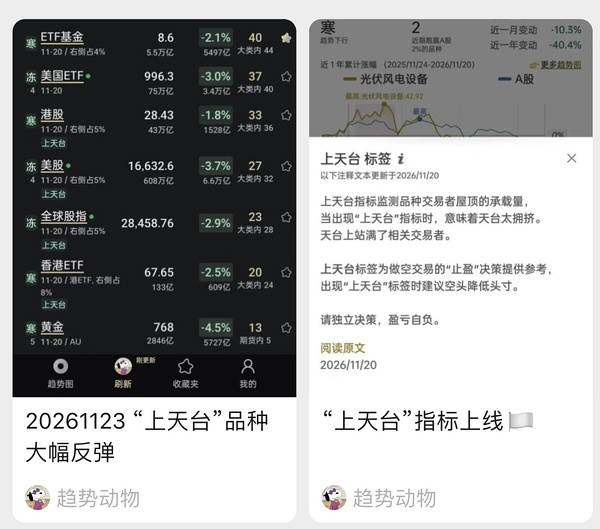
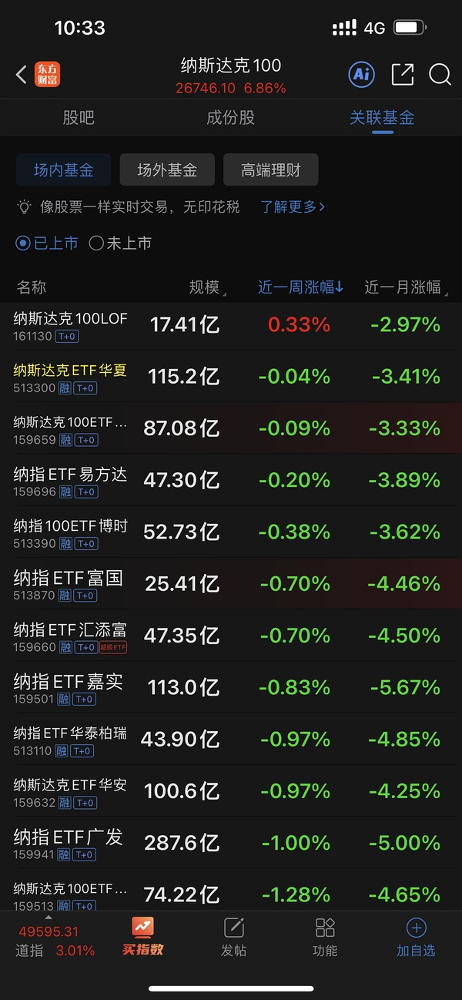
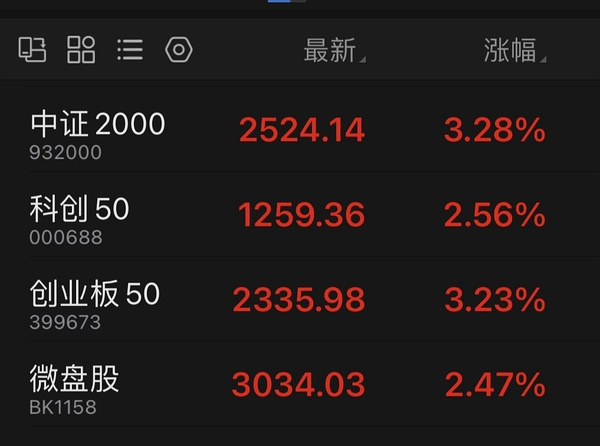
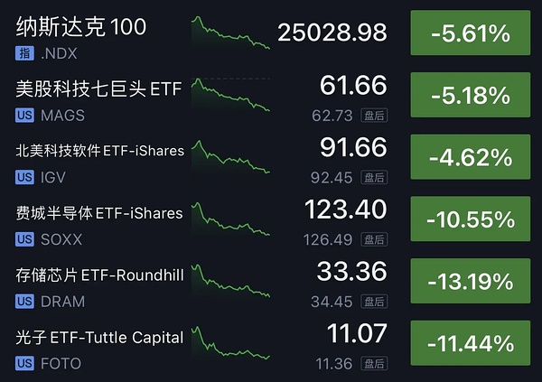
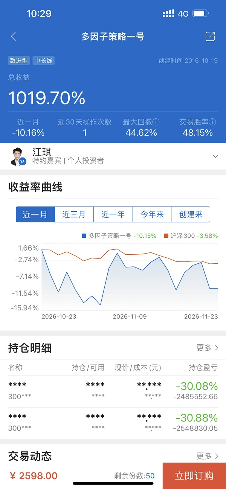
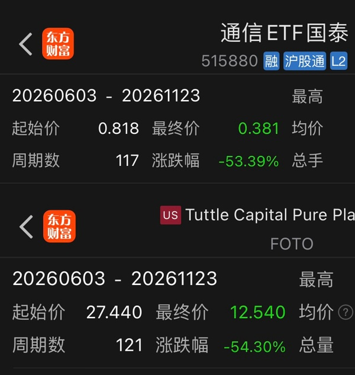
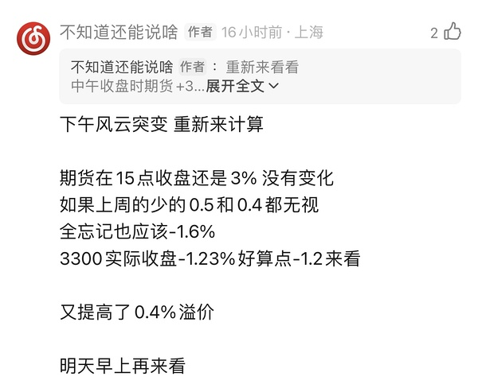
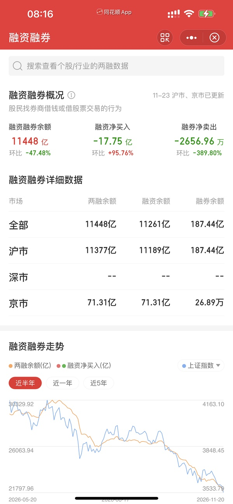
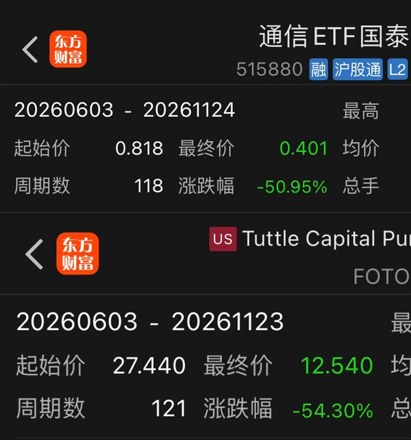
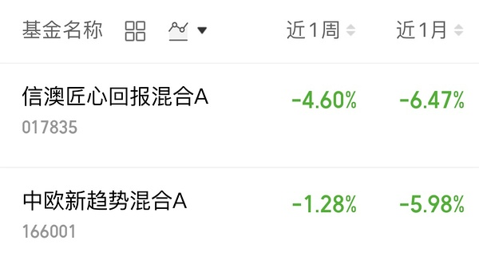

# 📋 楼主每日发言推送

> **推送日期**：2026-11-24 ｜ **执行时间**：2026-11-24 11:02:50 ｜ **监控用户**：`不知道还能说啥`
> **追踪模式**：`topic`（用户主页广播·豆瓣话题）

## 📊 持仓追踪
> 上次更新：2026-11-24 ｜ 基于楼主发言持续追踪（共 15 项）

| 标的 | 状态 | 类型 | 现价 | 提及 |
|------|------|------|------|------|
| 招商银行 | 底仓·四年前 32 元×7000 股买入·四年分红未复投仍 7000 股·不动 | 红利/银行 | 43.20（-0.14%） | 底仓·不动；7000股/摊薄成本约24.27元；1…；成本约32元 |
| 大连圣亚 | 持有（11-18 加仓@37.74 被深套）·今日无动作·卖单 46.90/45.22 未触及 | 冰雪·正牌双子星 | 30.81（1.68%） | 持有（11-18加仓@37.74深套）；11-23… |
| 雪人集团 | 持有·11-19 手动买入 2 笔@≈13.5（两笔 cbs 钱搬入）·卖单 13.84/14.84/15.84 | 冰雪·交易仓 | 12.45（0.24%） | 持有；11-23 +5.08%反抽；无新买卖自述 |
| 幸福蓝海 | 持有·今日换仓买入 1 笔@≈15.50（09:43）＋11-16 笔@16.91·明日卖单 15.84（由 18.64/20.44 下移） | 电影 | 14.63（3.47%） | 持有；11-23 +11.51%（09:51『看好… |
| 中国电影 | 持有·剩余仓无单·锁仓『慢就是快』 | 电影·核心不动仓 | 16.11（1.38%） | 持有·重仓（09:55『重仓中影少亏了不少钱』；1… |
| 博纳影业 | 持有小仓·今日跌停 5.69（=6.32×0.9）·卖单 6.94 未触及（高 6.22）·明日买 614 计划 | 电影 | 5.53（1.84%） | 持有小仓；11-23 +9.92%（涨停级）；11… |
| 纳斯达克ETF华夏 | 持有·不卖场内（溢价品种）·开盘预测 -1.5% 落空他自己认赖皮 | QDII·场内纳指 | 2.578（3.45%） | 持有·不卖场内；11-23 -1.23%；14:1… |
| 中韩半导体ETF | 持有·今日无动作自述 | QDII·场内 | 3.574（4.96%） | 持有；11-23 +0.89%（强势板块补跌后小反… |
| 盛天网络 | 11-11 买入·持有（口径仍待确认） | 游戏·电竞 | 9.66（1.79%） | 持有（口径待确认）；11-23 +10.86%（涨… |
| 游戏自建仓 | 11-10 买入·持有·11-11 自述 +5%（时点值未更新） | 游戏·电竞 | 暂无 | 持有；11-23无提及 |
| 美债场外基金 | 持有·国庆前买入·11-11 自述 +1.4%（时点值未更新）·债灾自述接近转亏 | 场外·美债 | 暂无 | 持有；11-23无新自述 |
| 传媒低位10cm | 11-12 自述『只加一个低位的』＋11-16 14:22『我要去买一个传媒了』（是否执行无自述）·拒绝点名 | 传媒·低位 | 暂无 | 持有；11-23『重新满仓』买入多只传媒四连板（未… |
| 东方海洋 | 11-16 买入探针仓 <2%·无卖单自述·当日跌停（11-12 曾涨停 5.16 卖出，见 day_actions_1112） | 探针·羊情绪组 | 4.54（9.93%） | 探针仓<2%·持有；11-23涨停4.13（两连板… |
| 六只债券基金 | 持有·00:38『这些我都有 第二个和第三个在这轮中灾难中经受住了考验』·债灾自述实亏·『债持不炒，每调买机』 | 场外·债基 | 暂无 | 持有；11-23 13:27『债券被干崩了 头疼』… |
| 芒果超媒 | 持有·11-20(周五)已有＋11-23加仓·明日 35.94 清仓计划 | 传媒·四连板(mg) | 32.34（3.39%） | 11.20；11-16/11-20 起持有并加仓（mg）；11… |

> ⚠️ 执行任务时如发现新操作，请更新 `state.json` 的 `positions`。成本价和市值有数据才填，没有则保留「暂无」。

## 🌅 今日总览
### 📌 市场背景
市场背景：今日A股以传媒/游戏AI应用端反弹为主轴，融资余额减少89.85亿；美股纳指期货冲高后回落，黄金与纳指同向联动。

关键引用：「上��毒打会忘记吗」「双创50齐头并进把2000干掉了」「中国光领先美国太多了」

### 📌 今日操作
| 操作 | 标的 | 详情 |
|---|---|---|
| ⏭️ 计划 | 周经理+张经理→国富亚洲(QDII) | 今晚盘后一次性转换约20万，额度刚开 |
| ❌ 无实际买入 | — | 今日明确称'什么都没加'，仅观战回本 |
| ❌ 无卖出 | — | 未提及任何卖出动作 |

### 📌 今日议题
| 议题 | 态度 | 核心观点 | 关键引用 |
|---|---|---|---|
| 融资余额缩量 vs 上周爆雷记忆 | 📉谨慎 | 昨日融资流出少未必是好事，上周'毒打'记忆犹新 | 「昨天融资盘流出很少啊！今天是不是要狠狠干了？上周毒打会忘记吗」|
| 中国光 vs 美国光 | 📈看多中国光 | 通信板块带动中国光全面领先美国光，甚至昨晚暴力反攻后'美国光还不如中国光' | 「我们昨天的暴力反攻后美国光还不如中国光」「中国光领先美国太多了」|
| 纳指(3300)溢价测算 | ➡️中性 | 详细拆解期货涨幅、溢价抹除后的开盘预测，指出3300仍在维持高溢价模式 | 「来算3300了…若抹去昨天溢价0.4则3.1%开盘」「3300选择了继续提高溢价模式」|
| QDII基金配置选择 | 📈偏好国富亚洲 | 保守选nana，求进选国富亚洲（攻守兼备纯美股），盘后 conversion 进行中 | 「保守型选nana 求进型选国富」「国富攻守兼备我觉得是最佳的也适合大部分人」|
| 原油/黄金对称性 | ➡️讨论 | 质疑原油是否也在做'对称交易'，类比黄金白银同向联动 | 「原油是有消息面吗还是也是像黄金那样对称交易啊」「好像真没有真的是对称性交易」|
| AI漫剧/传媒板块 | 📈看多 | 横店影视、上海电影2连板，持仓内'三连板在望'，整体延续强势 | 「AI漫剧概念延续涨势」「持仓中三连板 龙版三连板在望」|
| 幸福蓝海 vs 光线传媒 | 💬比较 | 提醒幸福别'龟兔赛跑'，光线已追上涨幅，要有紧迫感 | 「幸福别龟兔赛跑了人家光线追上来了」「要有紧迫感的意识啊」)

### 📌 看好板块/方向
**中国光/通信/AI算力链**：认为中国光技术领先美国太多，通信涨停催化，创业板人工智能可20cm弹性
**国富亚洲(QDII)**：明确表态'攻守兼备最佳''适合大部分人'，盘后执行转换
**AI漫剧/传媒应用端**：横店影视2连板、上海电影2连板、慈文/华智数媒居前，持仓相关标的三连板在望
**双创50**：与C50联动上攻，'把2000干掉了'，C50靠宁德时代+阳光电源推动

### 📌 风险提示
「上周毒打会忘记吗」——对融资盘连续缩量反弹保持警惕，视其为潜在风险信号而非单纯利好
「3300选择了继续提高溢价模式」——提示纳斯达克ETF高溢价风险，追高成本隐忧
「昨天融资盘流出很少啊……上周毒打」——融资余额单日变化不能简单等同于做多信号，需结合前期爆仓记忆综合判断

## 📊 本次结果
- **今日发言**：86 条
- **累计存档**：23852 条

## 📝 该最新广播作者发言聚合（共 86 条）
### 其他讨论（提及 58 次，占比 67%）2026-11-24 00:19:45
- 哈哈哈哈上周生气时候添加的
- 原油是有消息面吗
还是也是像黄金那样 对称交易啊？
- 趋势动物周末新出的这个上天台指标挺牛逼哈哈哈

### 纳斯达克100 指数（他用来对照场内 ETF 溢价/涨幅的基准，非标的）｜11-13 00:16『今天图上看 nana依然是大阳线』＋07:57『昨天-0.7收盘 但是nana晚上其实只有-0.3 现在期货+0.5 今天场内应该开盘+0.9%』→ 实测 513300 开盘 2.710＝+0.82%（误差 0.08pp）（提及 5 次，占比 6%）2026-11-24 07:16:55
- nana30%都要新高了😂

看空美股是十几年来准确率最低的选项 大家总是乐此不疲
- 也没东西跟啊 我都all in过nana 已经没有可投金额
早已收手躺平了
- plu
我翻一下
nana可能新高也可能21000

### 513300 纳斯达克ETF华夏｜11-11 10:49「3300还行 不过今天我不满意」＋13:24「咱们3300还是近期数据最好的」（提及 3 次，占比 3%）2026-11-24 08:10:56
- 来算3300了
3300昨天收盘-1.2对应期货+3
但是因此欠下了三个溢价（一个0.5 两个0.4）
晚上最终nana收盘+6.8 盘前-0.3 

再忽视三个溢价不弥补情况下
今天3300开盘 +3.5%
若抹去昨天溢价0.4 则3.1
- 除了那个lof

3300是最近表现最好的

- 3300选择了继续提高溢价模式😂😂😂😂😂
和昨天开盘受到周末情绪蔓延导致杀溢价
情绪180度

### 300413 芒果超媒（对照，非持仓）｜11-13 14:01 本月涨幅 41.70% vs 幸福 53.76% →『幸福已经拉开芒果12%』＝12.06pp 精确命中；当日 −4.83%（提及 3 次，占比 3%）2026-11-24 08:18:50
- 芒果昨天都没板啊哈哈 是另外个果板了🤣
- 是的 但我只有芒果一个单子 所以肯定还是很高仓位的
- 芒果挺好心 还带接人的

### 中证2000指数（他当微盘股基准）｜11-11 11:11「除了机器人 今天其他题材全输给了2000」（提及 3 次，占比 3%）2026-11-24 09:52:16
- 报 是2000领衔

- 2000还是那个2000 万能钥匙
- 双创50齐头并进 把2000干掉了🤣🤣🤣🤣

### 双义：股票=中国长城 / 基金=华安文体健康混合（用户 11-05 指认）（提及 2 次，占比 2%）2026-11-24 08:19:36
- 其实昨天下面三个这个跌幅
满手硬件-10很正常了😂
合理猜测 建信推高了总仓位

- 双胞胎

### ＝小华兄弟·华夏移动互联混合(QDII)（推断·证据不足不入表）｜11-16 17:26 裸报 -2.5% 疑似场外持有，无第一人称买入/持有自述、无截图（提及 1 次，占比 1%）2026-11-24 00:15:47
- 第一建信 第二华夏兄弟应该都没悬念的😂

### 新易盛＋中际旭创＋天孚通信（CPO三巨头合称）｜11-11 14:13「都去易中天了🤣」（非持仓）（提及 1 次，占比 1%）2026-11-24 08:00:18
- 总算要打破 7%易中天第二天必跌的魔咒

### 友友、网友们（提及 1 次，占比 1%）2026-11-24 08:36:27
- 我今天又要回本了uu🤣

### 300426（传媒·他只在盯，非持仓）｜11-13 本月涨幅榜第一（09:47 截图 78.91%／14:01 74.11%）（提及 1 次，占比 1%）2026-11-24 09:43:47
- AI漫剧概念延续涨势，横店影视、上海电影均2连板，幸福蓝海、光线传媒、华智数媒、慈文传媒涨幅居前。

### 605577 龙版传媒｜11-11 11:50「最早龙版也是因为自己每次公告文案都不一样才4连板就被监管」（讲监管规则，非持仓）（提及 1 次，占比 1%）2026-11-24 09:44:17
- 持仓中 三连板

龙版三连板在望

### 幸福蓝海（提及 1 次，占比 1%）2026-11-24 09:46:48
- 幸福别龟兔赛跑了
人家光线追上来了

### 招商银行（提及 1 次，占比 1%）2026-11-24 09:51:21
- 报：招商银行 翻红

### 中欧新趋势混合(LOF)A（提及 1 次，占比 1%）2026-11-24 10:09:49
- 等盘后我用周经理张经理全部转换国富

### 东方海洋（提及 1 次，占比 1%）2026-11-24 10:17:40
- 冰山几乎等于九阳 东方海洋那种了

### 301171 易点天下（对手盘，非持仓）｜11-13 10:07『奶茶out 幸福人的底气是可以说芒果out』；当日 −6.72%（提及 1 次，占比 1%）2026-11-24 10:42:47
- 蓝色人 奶茶人在哪里 还不开喷？？

### 保利发展（提及 1 次，占比 1%）2026-11-24 10:49:59
- 支付宝 天天基金应该都可以中直接转美

### 603103（院线·非持仓）｜11-13 09:33 截图 19.31 +10.03% 涨停，与文投/金逸并列＝『转院线迹象』的另外两票（提及 1 次，占比 1%）2026-11-24 10:50:23
- AI应用端持续走高 值得买20cm涨停
AI漫剧概念反复活跃，带动AI应用端持续走高，值得买、遥望科技、新炬网络涨停，此前浙文影业、利欧股份、横店影视涨停，青木科技、光云科技、壹网壹创、蓝色光标、引力传媒涨幅靠前。

### 📄 全部发言（共 86 条）
- (2026-11-24 00:15:47) 第一建信 第二华夏兄弟应该都没悬念的😂  ⊳ （引用 @点-重生炒垃圾）不如选第二🤣🤣🤣不知道网易云能不能当第二

- (2026-11-24 00:19:45) 哈哈哈哈上周生气时候添加的  ⊳ （引用 @六倍做多退休）我今天才看到帖子后面的各种的小括号 好搞笑 都是吐槽

- (2026-11-24 00:20:25) 原油是有消息面吗
还是也是像黄金那样 对称交易啊？

- (2026-11-24 07:14:55) [图] 趋势动物周末新出的这个上天台指标挺牛逼哈哈哈

- (2026-11-24 07:16:55) nana30%都要新高了😂

看空美股是十几年来准确率最低的选项 大家总是乐此不疲  ⊳ （引用 @点-重生炒垃圾）哈哈哈哈，plu酸酸的

- (2026-11-24 07:38:34) 嗯 增加了一些第三次加息预期  ⊳ （引用 @VVV坚定持有VVV）这个更新了吗

- (2026-11-24 07:39:37) 是的 小幅提高
明天晚上pce物价 还是得期待坏数字  ⊳ （引用 @招招碎片收集中）不知道耶 我没存旧的，如果是追星的话 那概率似乎也没暴涨，爽爽嘟

- (2026-11-24 07:52:44) 加息预期最终是要靠cpi 就业坏数字压下去的
靠股债跷跷板压制美债收益率不是长久之计🤣  ⊳ （引用 @momo）现在是不是有一种一根筋两头堵的感觉🚬 加息预期又回来了 

- (2026-11-24 07:55:18) [图] 我看了这个
昨天暴力反攻后 美国光还不如中国光😂

  ⊳ （引用 @没有感情的村民）创业板几个点低于预期

- (2026-11-24 08:00:18) 总算要打破 7%易中天第二天必跌的魔咒  ⊳ （引用 @没有感情的村民）plus光🤣

- (2026-11-24 08:03:59) 😂😂😂😂😂😂😂😂😂  ⊳ （引用 @招招碎片收集中）我会永远记住杨东这个人的！！！

- (2026-11-24 08:10:56) [图] 来算3300了
3300昨天收盘-1.2对应期货+3
但是因此欠下了三个溢价（一个0.5 两个0.4）
晚上最终nana收盘+6.8 盘前-0.3 

再忽视三个溢价不弥补情况下
今天3300开盘 +3.5%
若抹去昨天溢价0.4 则3.1%开盘

- (2026-11-24 08:14:28) 昨天你还说布伦特原油怎么还不下90

昨天晚上就下啦🤣🤣🤣🤣🤣🤣

👍👍👍👍  ⊳ （引用 @一直在摸🐟）这两天还热啊，你隔壁这两天挺冷的😂

- (2026-11-24 08:17:24) [图] 昨天融资盘流出很少啊！
今天是不是要狠狠干了？
上周毒打会忘记吗😂

- (2026-11-24 08:18:50) 芒果昨天都没板啊哈哈 是另外个果板了🤣  ⊳ （引用 @招招碎片收集中）那大芒果要连板？

- (2026-11-24 08:19:36) [图] 其实昨天下面三个这个跌幅
满手硬件-10很正常了😂
合理猜测 建信推高了总仓位

  ⊳ （引用 @VVV坚定持有VVV）用合理的价格投资伟大的公司，建啊这段时间你一定要买买买了啊🥹

- (2026-11-24 08:36:27) 我今天又要回本了uu🤣  ⊳ （引用 @赛博朋克2077）现在买是不是抄楼主底了

- (2026-11-24 08:37:33) 是的
上海2022年关门时候 很多基金经理在陆家嘴住了四个月  ⊳ （引用 @moli）原来他们下单是要回公司的吗，那他们岂不是要熬夜

- (2026-11-24 08:39:05) 也没东西跟啊 我都all in过nana 已经没有可投金额
早已收手躺平了  ⊳ （引用 @卡卡西丁）好久没跟了，啥情况？要暴涨了吗？场外都不敢打开来看

- (2026-11-24 08:45:53) 好像真没有 真的是对称性交易

就像黄金白银大涨那样  ⊳ （引用 @一直在摸🐟）好好好🥳🥳🥳下个目标下80🤭是有啥消息面么，不至于勋妃回宫威力这么大吧🤣🤣🤣🤣🤣

- (2026-11-24 08:47:43) 两市融资余额较上日减少89.85亿元
截至11月23日，上交所融资余额报11189.33亿元，较前一交易日减少18.35亿元；深交所融资余额报10158.74亿元，较前一交易日减少71.50亿元；两市合计21348.07亿元，较前一交易日减少89.85亿元。

- (2026-11-24 08:50:07) 是的 但我只有芒果一个单子 所以肯定还是很高仓位的  ⊳ （引用 @momo📈📈📈）今天要是有触发，持币等机会？

- (2026-11-24 09:09:30) 很明显最近黄金和娜娜同向
他看多黄金 看空娜娜 不太合理
趋势动物两个一起看空反而符合目前情况  ⊳ （引用 @.）plu还是看跌

- (2026-11-24 09:13:27) plu
我翻一下
nana可能新高也可能21000  ⊳ （引用 @👑）这谁

- (2026-11-24 09:14:32) 但是那个低点并没低多少
我就是吸取了那次教训 我索性这一次all in
如果按照四年前走 我会很多次买到高价的点🤣  ⊳ （引用 @VVV坚定持有VVV）我记得楼发22年买纳指的图，买入的圈之后确实反弹了一大段，然后又刷新新低来着
难道历史真的会回回都一样吗🤣

- (2026-11-24 09:17:19) 我们的光要远远领先美国光了😂😂😂😂😂  ⊳ （引用 @sickid）通信ETF涨停，买不进去了哈哈哈哈

- (2026-11-24 09:18:15) 通信涨停
ETF还得有折价

因为很多20 他只能10

创业板人工智能可以20%  ⊳ （引用 @sickid）通信ETF涨停，买不进去了哈哈哈哈

- (2026-11-24 09:27:06) 中国光领先美国太多了  ⊳ （引用 @👑）竟然通信etf都没封板

- (2026-11-24 09:33:10) 芒果挺好心 还带接人的

- (2026-11-24 09:36:07) 退出登录了
东方财富关机都能触发条件单的

- (2026-11-24 09:37:50) 😂😂😂😂😂  ⊳ （引用 @扶我起来还能买）好好好 楼楼请多发言 一般你退出登录后话会比较多哈哈

- (2026-11-24 09:38:20) 中影都快要修复那根跌停了

- (2026-11-24 09:40:16) 才10分钟  ⊳ （引用 @红烧肉肉）今天持仓跑不过创50了，光太猛了

- (2026-11-24 09:43:04) 你们为什么都是盘中看单子
昨天盘后都在干嘛呢

你现在有情绪的  ⊳ （引用 @只会女枪的憨憨）幸福有1584的条件单是吗

- (2026-11-24 09:43:47) AI漫剧概念延续涨势，横店影视、上海电影均2连板，幸福蓝海、光线传媒、华智数媒、慈文传媒涨幅居前。

- (2026-11-24 09:44:17) 持仓中 三连板

龙版三连板在望  ⊳ （引用 @YuanZi💕）有人去东方海洋嘛😂

- (2026-11-24 09:45:16) 我还是强调
中国光领先美国光太多了！

你们懂我意思吗

- (2026-11-24 09:45:31) 👍👍👍👍  ⊳ （引用 @YuanZi💕）主打是一个胆子大

- (2026-11-24 09:46:48) 幸福别龟兔赛跑了
人家光线追上来了

- (2026-11-24 09:47:00) 要有紧迫感的意识啊  ⊳ （引用 @不知道还能说啥）幸福别龟兔赛跑了
人家光线追上来了

- (2026-11-24 09:48:22) 👍👍👍👍👍👍👍👍👍👍这个好  ⊳ （引用 @山中食人花）如果还有uu想买 国富代销也开了
直销果然卖不动吧

- (2026-11-24 09:50:33) 这个适合大部分人 有进攻能力 也会防守  ⊳ （引用 @超级v快快来）会不会别的也开额度！

- (2026-11-24 09:51:21) 报：招商银行 翻红

- (2026-11-24 09:52:16) [图] 报 是2000领衔

- (2026-11-24 09:52:50) 2000还是那个2000 万能钥匙  ⊳ （引用 @不知道还能说啥）报 是2000领衔

- (2026-11-24 09:53:05) 👍👍👍缺口是弱者的谈资  ⊳ （引用 @🈵仓即暴涨🤑）幸福缺口没了🤣

- (2026-11-24 09:54:15) 踩线了  ⊳ （引用 @高手云集上钻）我还在等42以下买，怎么就红了

- (2026-11-24 09:56:32) 上周第二根阴线抄底的回本了

很简单的道理  ⊳ （引用 @向生活低头）XF你怎么了？

- (2026-11-24 09:57:02) 他们买东西都是为了回本的

我反正退出登录

看你们留言

- (2026-11-24 09:59:33) [图] 目前中国光领先美国光3.3%

我觉得不合理 你们觉得呢😂

- (2026-11-24 10:00:07) 不是
上周第二天大阴线抄底的回本了
抛压开始了  ⊳ （引用 @sickid）你说主力自救？

- (2026-11-24 10:00:53) 美国跳水

- (2026-11-24 10:09:49) 等盘后我用周经理张经理全部转换国富

- (2026-11-24 10:10:51) 大家中午吃什么

- (2026-11-24 10:12:31) 美国人都像你这样就好啦！！！  ⊳ （引用 @小白吐司）早上吃多了，中午不吃了

- (2026-11-24 10:13:11) 狄经理那个盘后20万AC  ⊳ （引用 @sickid）哪个国富？

- (2026-11-24 10:14:44) 嗯 15:00以后就是股市的25号  ⊳ （引用 @👑）哦哦，国富盘后才改限额吗

- (2026-11-24 10:16:10) [图] 这两个 最近防守可以

  ⊳ （引用 @点-重生炒垃圾）张经理的产品全名叫啥，我忘记了，我不想打开，喊我朋友去转换

- (2026-11-24 10:17:15) 新浪财经

夜盘都能实时看  ⊳ （引用 @我爱上班！）美股白天的走势在哪里可以看见，没有翻墙工具，昨天同事白天就告诉我美股涨了

- (2026-11-24 10:17:40) 冰山几乎等于九阳 东方海洋那种了  ⊳ （引用 @该用户已过期）⛄️是在脱离冰山？🤣🤣这两天涨都不太跟了

- (2026-11-24 10:20:36) 保守型选nana 
求进型选国富  ⊳ （引用 @油炸花生）楼，国富和场内nana，你更推荐哪个，假设都能拿住

- (2026-11-24 10:24:06) 嗯盘后转换就等于明天早上换  ⊳ （引用 @六倍做多退休）转换的话 就相当于明天盘后的净值买入是吗

- (2026-11-24 10:25:40) 现在差不多-0.1% 比几小时前高了0.2%

所以3.7%正常开盘

如果抹0.4%就是3.3%开
如果开的更低就是莫更多上周的溢价了  ⊳ （引用 @不知道还能说啥）来算3300了
3300昨天收盘-1.2对应期货+3
但是因此欠下了三个溢价（一个0.5 两个0.4）
晚上最终nana收盘+6.8 盘前-0.3 

再忽视三个溢价不弥补情况下
今天3300开盘 +3.5%
若抹去昨天溢价0.4 则3.1

- (2026-11-24 10:26:04) 盘后 一次性  ⊳ （引用 @木槿）我也正在想把这两个今天卖出转成狄经理，楼是打算一次买入吗，还是分批买？今天刚大涨了

- (2026-11-24 10:27:30) 和nana同向😂  ⊳ （引用 @🈵仓即暴涨🤑）金子又死了啊

- (2026-11-24 10:28:31) 盘后20万  ⊳ （引用 @🈵仓即暴涨🤑）这两都没有还能转啥😇中可以转美了？没那么多额度吧

- (2026-11-24 10:29:22) [图] 双胞胎

  ⊳ （引用 @六倍做多退休）江老师是不是还是没有动静

- (2026-11-24 10:32:35) 开盘激烈交易换手
最终选择了不杀溢价
且试图继续太高溢价率😂  ⊳ （引用 @不知道还能说啥）现在差不多-0.1% 比几小时前高了0.2%

所以3.7%正常开盘

如果抹0.4%就是3.3%开
如果开的更低就是莫更多上周的溢价了

- (2026-11-24 10:33:41) [图] 除了那个lof

3300是最近表现最好的

- (2026-11-24 10:35:23) 3300选择了继续提高溢价模式😂😂😂😂😂
和昨天开盘受到周末情绪蔓延导致杀溢价
情绪180度

- (2026-11-24 10:38:25) 双创50齐头并进 把2000干掉了🤣🤣🤣🤣

- (2026-11-24 10:38:51) 这一波c50靠的宁德时代 阳光电源啊？  ⊳ （引用 @不知道还能说啥）双创50齐头并进 把2000干掉了🤣🤣🤣🤣

- (2026-11-24 10:39:56) 过了60日线也是前途无量啊 上次被卡住了 这次再来😂  ⊳ （引用 @momo）我们阳光扛得起吗🥲

- (2026-11-24 10:41:57) 不担心
中国鸡哪怕被退回
我也能重新买  ⊳ （引用 @momo）楼楼，直接转换你不担心到了转换成功那天额度没了变成转换不进去吗？

- (2026-11-24 10:42:47) 蓝色人 奶茶人在哪里 还不开喷？？  ⊳ （引用 @点-重生炒垃圾）我不服，值得买要涨停了

- (2026-11-24 10:44:20) 狄经理开门是因为杨晓磊那边投顾带队大幅减仓导致额度打开的 额度应该不少 不太可能就一天

如果额度少会单日5万10万  ⊳ （引用 @粒昂）感觉大家担心的是狄经理只开一天

- (2026-11-24 10:45:33) 国富攻守兼备 我觉得是最佳的 也适合大部分人
而且还是纯美  ⊳ （引用 @柴可猪斯基）楼楼网易云是不是不如国富哇 我想把网易云换成国富是否可行捏

- (2026-11-24 10:46:28) 盘后才开额度
你现在转不了
现在没有额度  ⊳ （引用 @没有感情的村民）盘后转换是看好a明天再涨涨吗

- (2026-11-24 10:47:41) 嗯盘后就是明天了  ⊳ （引用 @超幸運小行星✨）应该是因为今天转不过去😂明天狄经理才开门

- (2026-11-24 10:48:25) 是公司不方便螺狮粉吗🤣🤣🤣🤣  ⊳ （引用 @吃五包螺蛳粉）泡椒牛肉鲜烫米线 太妃榛香拿铁 巧克力麦芬

- (2026-11-24 10:49:59) 支付宝 天天基金应该都可以中直接转美  ⊳ （引用 @桑尼菌）等于今天盘前卖，明天快速到账就买入吧

- (2026-11-24 10:50:23) AI应用端持续走高 值得买20cm涨停
AI漫剧概念反复活跃，带动AI应用端持续走高，值得买、遥望科技、新炬网络涨停，此前浙文影业、利欧股份、横店影视涨停，青木科技、光云科技、壹网壹创、蓝色光标、引力传媒涨幅靠前。

- (2026-11-24 10:52:18) 那你就扩大了投资计划

自己给自己做好心理预期就行  ⊳ （引用 @404找回了）楼 不转换直接买也行不

- (2026-11-24 10:56:04) 你一点不给人家机会啊😂  ⊳ （引用 @Aaa摆烂咸鱼🥳）影视不也是AI应用😂

- (2026-11-24 10:56:59) 是的  ⊳ （引用 @momo）转是不是要比正常买晚一天？

- (2026-11-24 10:59:18) 狄经理的大买家  ⊳ （引用 @香草吧噗发财）这人这么厉害 有这么大号召力？之前都关注了一下 后来全取关了

## 🧠 投资风格分析
> 📏 增量更新指引：仅当今日发言确有新依据时才修订对应维度，无变化不强行重写；单维度修订建议 ≤150 字。

- 投资理念与方法：坚持用长期估值百分位评估资产，如纳指100五年2%、十年4%，不以剩余修复空间简单外推收益；强调夏普/卡玛更高、回撤大的品种修复能力更强。冰点判断坚持五条件缺一不可，融资盘看批量流出而非单点爆破。对恐慌事件要求同等心态与恐慌强度才可类比，区分生命威胁（2020口罩）与叙事冲击（AI故事）。同时关注红利指数成分调整机制，理解涨多踢出、跌多纳入的反向规则。
- 风险偏好：对融资盘爆仓风险敏感，关注融资余额批量流出而非单点爆破，认为爆融资盘会出冰点。回避高波动垃圾微盘，称「2000太垃圾 不到极端情况不买」，但认为极端崩盘时国家队会扫货2000。会在情绪回暖时参与强势板块，同时对强势板块补跌保持警惕。对主题炒作保持一定距离，强调进攻强品种跌幅也最大。
- 交易与仓位：强调操作与观点一致，反对一边看跌一边补仓或切换进攻最强；主张卖出后资金去向比卖出本身更关键，会快速将资金转入强势板块。今日再次重申「只要卖出肯定飞 因为情绪刚开始 但是重要的是卖的钱去的哪里」，并在卖出横店、慈文后立即转入芒果，保持言行合一。
- 心理特质：对波动与回撤高度钝化，普跌中仍信心十足，期待情绪回暖与回血；盘中爱用KPI考核持仓、批评不努力标的，但上周普跌时一个都不喷，区分「一起跌」与「该努力」的语境。今日再次强调「上周一起跌 你看我一个都不喷的 这周我可是要考核他们kpi的呀」，并批评幸福、雪人等不主动的持仓。

> ⚠️ 本板块由 Actions 全自动增量更新（复用当日发言与今日总览），每次仅在内容足够支撑时才改动。

## 🏷️ 昵称映射表
### 📖 昵称规律（供 AI 判断新昵称时参考）
【昵称命名规律（用于推断未知新昵称）】
- 拼音首字母缩写：取标的/基金名汉字拼音首字母串（含数字代码），多为 ETF/股票代码口语化｜示例：yl=引力传媒｜zy=掌阅科技｜sj=视觉中国｜cc=华安文体健康混合｜C50=创业板50ETF｜k50=科创50｜kun=昆仑万维｜xhxc=新瀚新材｜zxfc=中欣氟材
- 小/老+姓氏代指：「小X」「老X」通常指姓 X 的标的或该标的的基金经理；「X兄弟」多为同系基金｜示例：小惠=惠发食品｜老莫=万家品质生活(莫海波)｜小华=华夏全球科技先锋(QDII)A｜小华兄弟=华夏移动互联(QDII)｜小浦=浦银安盛全球智能科技(QDII)A｜小广=广发全球精选(QDII)A｜小远=华宝致远(QDII)C｜招招=招商银行｜小德=德明利｜赵姨=兆易创新｜露露=泸州老窖｜空调=格力电器
- 戏称/黑话→题材板块：生活化比喻或黑话对应某个题材/板块，而非单一标的；出现时多指板块方向｜示例：卖国=PCB板块(英伟达AI链)｜爱国=国产自主(半导体设备/芯片)｜奶茶=易点天下｜老师=中文在线｜蓝色=蓝色光标｜宇航员=航空航天板块｜华子=华泰保兴安悦债券｜国际=国际复材｜巨无霸=长鑫科技等重大IPO
- 谐音/取字：昵称含标的名关键字（取一字或谐音），多为 A 股个股或基金简称｜示例：万华=万华化学｜东百=东百集团｜宝=保利发展｜讨饭/亚洲讨饭/建信新兴=建信新兴市场(QDII)A｜华宝zy=华宝致远(QDII)A
- 机构/基金经理昵称：以基金公司名、经理姓、或平台代称指代对应基金产品｜示例：周经理=中欧新趋势混合(LOF)A｜张经理=信澳匠心回报混合A｜网易云/音乐世家=富国全球科技互联网股票(QDII)A｜国富亚洲=国富亚洲机会股票(QDII)A｜国泰纳指=国泰纳斯达克100指数(QDII)｜易方达全球=易方达全球成长精选混合(QDII)A｜浦银安盛=浦银安盛全球智能科技(QDII)A

### 📋 已收录映射
| 昵称 | 对应名称 |
|------|----------|
| C50 | 创业板50ETF |
| cc | 双义：股票=中国长城 / 基金=华安文体健康混合（用户 11-05 指认） |
| k50 | 科创50 |
| kun | 昆仑万维 |
| sj | 视觉中国 |
| xhxc | 新瀚新材（用户确认；代码待核） |
| yl | 引力传媒 603598（对手盘，非他持仓）｜11-06 +37.15%；11-09 本月+37.79% |
| zxfc | 中欣氟材 |
| zy | 双义：他本人口径=603533 掌阅科技（用户 11-05 确认）；11-09 楼友两条『zy』按 16 元/电影语境指 600977 中国电影。引用必须带语境，不许收敛 |
| 万华 | 万华化学 |
| 东百 | 东百集团 |
| 亚洲讨饭 | 建信新兴市场混合(QDII)A |
| 保利发展 | 保利发展 |
| 华子 | 华子＝007540 华泰保兴安悦债券A（华泰保兴基金·安悦债券A类份额），满仓30年超长利率债的长债基金（用户 2026-11-16 确认，无歧义，不是歧义项）；00:42 楼友『华子今年战绩无敌吧』→他答『30超长债牛逼没办法』；13:47『纯利率债就是华子那种 不过华子满仓30债 有些是满仓5-10年』；**与460108不是同一只**：460108＝华泰柏瑞稳健收益债券C（他持有的纯利率债·重仓国开/农发/国债，见六基行），华子007540 是华泰保兴的长债基金，勿混 |
| 华宝 zy | 华宝致远混合(QDII)A |
| 华宝zy | 华宝致远混合(QDII)A |
| 卖国 | PCB、光模块、通信板块（英伟达AI产业链） |
| 周经理 | 中欧新趋势混合(LOF)A |
| 国富亚洲 | 国富亚洲机会股票(QDII)A |
| 国泰纳指 | 国泰纳斯达克100指数(QDII) |
| 奶茶 | 301171 易点天下（对手盘，非持仓）｜11-13 10:07『奶茶out 幸福人的底气是可以说芒果out』；当日 −6.72% |
| 宇航员 | 航空航天板块 |
| 宝 | 保利发展 |
| 小华 | 华夏全球科技先锋混合(QDII)A |
| 小华兄弟 | 华夏移动互联混合(QDII) |
| 小广 | 广发全球精选股票(QDII)A |
| 小德 | 德明利 |
| 小惠 | 惠发食品 |
| 小浦 | 浦银安盛全球智能科技(QDII)A |
| 小远 | 华宝致远混合(QDII)C｜只在盯，未证他持有 |
| 巨无霸 | 长鑫科技等重大IPO企业 |
| 建信新兴 | 建信新兴市场混合(QDII)A |
| 张经理 | 信澳匠心回报混合A |
| 招招 | 招商银行 |
| 易方达全球 | 易方达全球成长精选混合(QDII)A |
| 浦银安盛 | 浦银安盛全球智能科技(QDII)A |
| 爱国 | 国产自主（半导体设备/芯片制造） |
| 空调 | 格力电器 |
| 网易云 | 富国全球科技互联网股票(QDII)A |
| 老师 | 中文在线 |
| 老莫 | 万家品质生活混合A(519195) |
| 蓝色 | 300058 蓝色光标（广告组合，非他持仓）｜11-12 高 15.97＝20cm 涨停价、收 14.76 +10.89%（炸板）；10:21『他和蓝色 奶茶 sg他们是广告组合』 |
| 讨饭 | 建信新兴市场混合(QDII)A |
| 赵姨 | 兆易创新 |
| 赵哥 | 兆易创新 |
| 露露 | 泸州老窖 |
| 安安 | 安记食品 |
| 音乐世家 | 富国全球科技互联网股票(QDII)A |
| 老伯伯 | 铜冠铜箔 |
| nk | 纳指科技ETF景顺 159509（联接=景顺长城纳斯达克科技ETF联接A）｜11-06 A级：截图溢价率37.08% |
| bk | 标普信息科技LOF 161128（场外=易方达标普信息科技QDII-LOF）｜11-06 A级 |
| txx | 天下秀 |
| 媛媛 | 今世缘 |
| uu | 友友、网友们 |
| 温暖老师 | 某个特别牛逼的散户 |
| 余老师 | 余利，某牛逼投资者 |
| ycm | 粤传媒 002181｜11-09 12:12「非电影传媒就留给大家玩了 我一个都不会碰了」→ 推断已不持有 |
| 江老师 | 江琪（投资博主） |
| 水果老师 | 投资博主 |
| 小爱 | 我爱我家 |
| ty | 天娱数科 |
| bn | 博纳影业 |
| sy | 601595 上海电影｜**他空仓**（11-09 起未回接）；11-12 09:38『天天念叨sy的给你们机会了』＋09:41『现在-6给你们机会了哈』＋13:15『马上sy跌停 bn还要尊敬一下他』＋13:51『与此同时 sy跌停』＋14:00『sy历来以残暴虐杀手法闻名』；实测收 42.15 −9.99% 跌停 |
| CBS | 长白山 |
| 东哥 | 东百集团 |
| 芒果 | 300413 芒果超媒（对照，非持仓）｜11-13 14:01 本月涨幅 41.70% vs 幸福 53.76% →『幸福已经拉开芒果12%』＝12.06pp 精确命中；当日 −4.83% |
| 阿中 | 中国电影 |
| 欢欢 | 欢瑞世纪 |
| 雪人 | 雪人集团 |
| 大连 | 大连圣亚 |
| 幸福 | 幸福蓝海 |
| 小粤 | 粤传媒 |
| 阿博 | 博纳影业 |
| 创成长 | 创业板成长etf |
| asd | 002747 埃斯顿｜11-11 15:09『我昨天去的另外一个 今天也吸到asd了』＝11-11 低吸买入；11-12 10:17『我昨天加了asd今天刚刚加了另外个』＋10:35『asd火箭发射』（盘中高 32.19，收 29.95 −4.37%）；买价未披露。**11-11 轮误删、11-12 恢复** |
| 恋爱脑 | 002582 好想你｜11-12 14:39:31『清了恋爱脑』＝清仓（卖价未披露；10.48 卖单两日均未触及→手动卖）；14:28『我如果去掉恋爱脑 也就比你多一个机器人』；当日收 9.76 −2.89% |
| 恋爱 | 002582 好想你（同『恋爱脑』）｜11-12 14:39 已清仓，不再持有 |
| 小羊 | 000678 襄阳轴承｜11-05 已卖（卡当日最高 20.40）；11-12 14:16『襄阳掉了』＋14:44『厉害襄阳』＝只评论走势，非持仓 |
| 中马 | 中马传动 |
| 晶雪 | 晶雪节能 |
| xf | 幸福蓝海 |
| 建设 | 建设工业 |
| 北方 | 北方导航/北方国际（未定，11-04「我在北方了」） |
| _ambiguity_note | 歧义未收敛（禁止当唯一映射）：轮子=巨轮智能/五洲新春；sj=视觉中国（传媒语境）/神剑股份（宇航员语境）；cc=中国长城/华安文体健康混合；北方=北方导航或北方国际；zy=掌阅科技（用户 11-05 确认原值正确）。证据分级：A=价位/均线/月涨幅实测命中；B=量级或单日命中/用户口述；C=仅昵称或语义，不得据此写『他持有』；沿用原仓=本轮未复核，不写进结论正文。三条判据：①条件单四位数要先按同时段动词行判买卖方向（cbs 3644 是买单不是卖单）；②『祝福/你们/你的X』句式＝评论他人持仓，不是他的操作；③同一昵称在不同语境可指两只票（zy=掌阅/中影），按价位与板块取，不许收敛成一个。 11-11 补：plus雪＝他自己也没说清（11:12「你应该不知道plus雪是哪个」），不许猜；bdd＝有传媒属性所以他不去（13:42），仍未定案；『五连阳』这类盘中口径不等于日K实测（招行 11-06 为平盘十字星）。 11-12 补：①盘中快照≠收盘（14:15 三日账第三日 幸福+0.5/光线−4.5 为盘中值，收盘 −0.53/−4.97；他写的『拉开5.3%』按自列数字相加应为 5.5，属口算误差，不得据此推翻实测）；②历史卖单不重复计触发（中影 15.84 虽∈11-12 区间[15.39,15.98]，但 11-10 已成交、无存续卖单）；③清仓自述不封锁后续再买（asd 11-06 清→11-11 15:09 再吸，11-11 轮据此误删）；④『果果』只是推断映射，不得当持仓证据；⑤机器人第二仓与传媒低位10cm 代码未披露，福赛仅为楼友提问他作答，不许映射。 11-13 补：①**本月涨幅类口述可核**，基准＝10-30 收盘，且要用**发言时刻的分钟价**复算（14:01 截图 53.76% 与分钟线独立复算分毫不差，『拉开芒果12%』＝12.06pp）；②**基金表『折价率』列负号＝溢价**（513300 −15.28% ⇒ 溢价 15.28%，与 11-06 的 16.36% 同口径），别读成折价；③**『我手里就7只股票了/我只有电影冰雪了』是他题材仓口径**，不得据此删除无卖出自述的持仓行（铁律 6）；④**『全部跌停』类口述是盘中快照**（东方海洋盘中最低 4.64＝跌停价、收 −6.59%，未封死）；⑤plus雪＝晶雪只是**品种识别**，他 11-09 已自述清仓，不得当持有证据。 11-16补：①华子与460108是否同一只未定案（华子亦可能楼友昵称），不得据华子写他持有30债；②14:22『T掉追加的』对象歧义（主读法＝大连11-10加筆T，备选＝幸福老股T），无成交自述不改笔数；③博纳09:52『今天』与底仓口径冲突，加仓@6.37按09:45『加仓bn』＋09:46『-6』取；④『2开头招行』语义未定不映射；⑤华夏兄弟17:26裸报-2.5%证据不足不入表。 11-16补：①14:22『T掉追加的』对象歧义（主读法＝大连11-10加筆T，备选＝幸福老股T），无成交自述不改笔数；②博纳09:52『今天』与底仓口径冲突，加仓@6.37按09:45『加仓bn』＋09:46『-6』取；③『2开头招行』语义未定不映射；④华夏兄弟17:26裸报-2.5%证据不足不入表。 11-17补：①『太子爷』『bdd』『畅畅』未定案不映射；②雪人今日14.01加仓笔受T+1，14.84卖单卖的是可卖老仓（非当日买笔）；③晶雪25.64回落单他自述触发、日K高25.78证实（分钟接口H25.35偏低为已知不稳）；④光线11-17部分卖出@11.82按11-16追高笔推定(B)，仍持老仓；⑤传媒『以身入局』拒绝点名不外推代码。 11-17补：①『太子爷』『bdd』『畅畅』未定案不映射；②雪人今日14.01加仓笔受T+1，14.84卖单卖的是可卖老仓（非当日买笔）；③晶雪25.64回落单他自述触发、日K高25.78证实（分钟接口H25.35偏低为已知不稳）；④光线11-17部分卖出@11.82按11-16追高笔推定(B)，仍持老仓；⑤传媒『以身入局』拒绝点名不外推代码。 11-17补：①『太子爷』『bdd』『畅畅』未定案不映射；②雪人今日14.01加仓笔受T+1，14.84卖单卖的是可卖老仓（非当日买笔）；③晶雪25.64回落单他自述触发、日K高25.78证实（分钟接口H25.35偏低为已知不稳）；④光线11-17部分卖出@11.82按11-16追高笔推定(B)，仍持老仓；⑤传媒『以身入局』拒绝点名不外推代码。 11-18补：①雪人『兑现今天加的雪儿』受T+1，今日14.17买笔不可当日卖，兑现的是可卖老仓；②传媒『这周开干』拒绝点名不外推代码；③晶雪上週买回成本未披露、清仓收益不计算；④长白山(cbs)两笔成本36.44/38.8、同价33.65卖出。 11-19补：①雪人13.84卖单在开盘高13.94时可能触发（不写死成交价，记B待核）；②晶雪『今天20买』是给楼友的话、无第一人称买入→不回接；③中证1000ETF象征性小额买入、金额未披露；④大连11-18加仓@37.74 被套（11-19跌停32.33），11-19『我没买』无动作。 11-19补：①【1000】＝gjd国家队（他澄清『我说的是gjd』），非中证1000ETF、非本人买入，已从持仓删除；②雪人13.84卖单在开盘高13.94时可能触发（记B待核）；③晶雪『今天20买』是给楼友的话、无第一人称买入→不回接；④大连11-18加仓@37.74 被套（11-19跌停32.33），11-19无动作。 11-19补：①『1000』＝中证1000，『gjd』＝国家队；合起来是『国家队在象征性买中证1000』——他评论国家队托市，非本人买入/持仓（已从持仓删除误记）；②雪人13.84卖单在开盘高13.94时可能触发（记B待核）；③晶雪『今天20买』是给楼友的话、无第一人称买入→不回接；④大连11-18加仓@37.74 被套（11-19跌停32.33），11-19无动作。 11-20补：①今日无交易（11:57『我今天什么单子都没开了』『其他一个都不卖』）；②雪人13.84/14.84/15.84卖单未触及（11-20高12.76＜13.84）；③大连再跌停29.10、东方海洋涨停3.75(探针)；④xxz/东哥 未定案不映射。当日盈亏总结已写入 stock_pnl_note（等权涨跌率口径）。 11-21补（周六休市）：①今日无交易，价格沿用11-20收盘；②新帖被审核→晚上切新帖（故21:03只抓新帖20条，旧帖11-21另有51条，已合并入语料v26）；③cpi=新闻非昵称；④当日盈亏总结写'休市=0'。 11-23补：①修正上轮漏记——11-20(周五)卖光线→买横店603103+慈文002343(两个四连板)；②11-23横店被S/慈文手动S→重新满仓；③芒果超媒300413持有+加仓、明日35.94清仓；④『那几个10都四连板过』＝另持数只未点名传媒四连板，不外推代码；⑤中影重仓。 |
| nana场内 | 513300 纳斯达克ETF华夏｜11-09 14:34「不愧是513300 当年的普通nana ETF之王」，当日唯一红的纳指ETF |
| 雪儿 | 雪人集团 002639｜11-06「大连和雪儿」＋11-11 14:26「雪儿今天不错啊 大家昨天不是期待他接人嘛 这个任务做到了今天」（接人＝5日线接回，与雪人条件单口径一致） |
| 存钱罐 | 光线传媒 300251（他自述小仓）｜11-13 15:11『我相信光虽迟但到 我会肯定保留上周的存钱仓位』＝存钱罐口径再次落到光线 |
| 枣子 | 002582 好想你（同『恋爱脑』）｜11-12 14:39 已清仓，不再持有 |
| 王老师 | 人：王博雅投资（QDII 场内溢价口径），不是标的 |
| 印度 | 自嘲代指中国（推断，勿当事实） |
| 10086 | 中国移动（他当指标用，非持仓） |
| 阳光乳业 | 001318 阳光乳业（他的『喝的』/牛奶）｜11-09 A级：13:59 分时截图 S 标记≈13.5＋10:52「我去掉了羊来抄底」 |
| 羊 | 生肖羊概念组（带阳/洋/光/太/泉的一篮子）｜11-09 14:04 他自己贴的分组；**11-13 崩盘实证**：15:58 截图跌幅榜 澳洋健康 −10.06、阳光照明 −10.05、红太阳 −10.04、大东方 −10.03、阳光乳业 −10.02、襄阳轴承 −9.98、鲁阳节能 −9.95、大西洋 −9.73、太阳电缆 −9.29、圣阳股份 −8.64、泉阳泉 −6.60、东方海洋 −6.59；他 14:48『我昨天起码说了6次 控制仓位 因为羊和东方昨天松动了！！！！这是情绪核心』 |
| 小明 | 605179 一鸣食品｜11-09 10:07 有人问『喝的小明？』他答『羊』＝喝的已换成阳光乳业 |
| 皇台 | 000995 皇台酒业｜11-09 与雪人 PK 当日换手率龙虎榜 |
| 海哥 | 人：转债估值博主（不是标的）｜11-09 12:48「海哥周五那个新债…我买了点试试看是市场错了还是海哥错了」 |
| 申菱转债 | 123290（申菱环境 301018 的转债）｜11-09 13:50 买 150 张 @133 多；11-10 11:20『我开了149.9』卖单；11-12 分钟线 10:03–11:12 持续≥149.9（高 152.313）→触发推定清仓，+12.28%（成本 133.5 推定）记入 stock_pnl，已从持仓表删除 |
| 盛天 | 300494 盛天网络｜11-11 A级：11:29 分时截图 B 标记 @11.00＋「不止 而且我跟了他一把」（跟摄像大哥） |
| dfhy | 002086 东方海洋｜11-11 13:56 楼友问 dfhy 绕异动→他『我没算 这几天可能都是异动吧』；11-12 14:39 涨停 5.16 卖出（＝4.69×1.10 到分＋分钟 14:36 封板＋财联社 17天9板）；**11-16 09:28『看东方海洋了』＋15:17『东方海洋上周四不好示范』＝买回探针仓 <2%**，羊仪表盘四图蓝高亮 002086，当日跌停收 4.34（昨 4.82）；探针非重仓 |
| xys | 300502 新易盛｜11-11 13:19「我那个买xys的女主播终于要开心了」＋13:21「她现在成本327了」→ **是女主播的仓，不是他的** |
| 冰山 | 000530 冰山冷热｜11-11 10:16「万一冰山跌停 他能跌到哪里再去」＋10:27「今天把冰山 晶雪按死 大连 CBS 正统上位」（非持仓，冰雪板块的山寨对照） |
| 冰冰 | 000530 冰山冷热｜11-11 14:03「那冰冰准备」（同『冰山』，非持仓） |
| 龙版 | 605577 龙版传媒｜11-11 11:50「最早龙版也是因为自己每次公告文案都不一样才4连板就被监管」（讲监管规则，非持仓） |
| 3300 | 513300 纳斯达克ETF华夏｜11-11 10:49「3300还行 不过今天我不满意」＋13:24「咱们3300还是近期数据最好的」 |
| nana100 | 纳斯达克100指数（他对照场内ETF溢价的基准）｜11-11 08:14「昨天513300涨了3.53% 但是nana100实际也就涨了3.4」 |
| 易中天 | 新易盛＋中际旭创＋天孚通信（CPO三巨头合称）｜11-11 14:13「都去易中天了🤣」（非持仓） |
| 冰雪双子星 | 大连圣亚600593＋长白山603099（他的正牌冰雪双仓）｜11-11 10:29「从不担心冰雪双子星」 |
| 2000 | 中证2000指数（他当微盘股基准）｜11-11 11:11「除了机器人 今天其他题材全输给了2000」 |
| cw | CoreWeave（CRWV，美股AI算力）｜11-11 11:18「cw那玩意硬起来了 大家看夜盘数字」 |
| ant | Anthropic（美股IPO）｜11-11 12:11「接下来是不是ant IPO也是利好」 |
| 摄像大哥 | 人：楼友（不是标的）｜11-11 他的两笔游戏＝电魂网络涨停＋顺网科技≈+7，属楼友口径；楼主自己买的是盛天网络＋另一只未披露代码的游戏 |
| 游戏哥哥 | 游戏板块拟人化（不是具体票）｜11-11 12:58「游戏哥哥：我来也」＋13:01「妹妹休息 哥哥接力？」 |
| 传媒妹妹 | 传媒板块拟人化（不是具体票）｜11-11 11:40「被传媒妹妹压制了」＋13:01「妹妹休息 哥哥接力？」 |
| sg | 002400 省广集团（广告组合，非他持仓）｜11-12 A级映射：10:09:32『省广带起来了』＋10:21:36『他和蓝色 奶茶 sg他们是广告组合』；分钟线 10:00 6.70→10:09 6.89→10:21 6.94（昨收 6.70）命中『带起来』；当日收 6.64 −0.90%（冲高回落） |
| 果果 | 301052 果麦文化（**推断·B**，非持仓）｜11-12 13:05:01『果果紧随其后了』紧接 13:04:34『传媒出现两位数跌幅了 华策』；实测华策 −13.97%、果麦 −10.38% 同为两位数跌幅→谐音＋当日跌幅与语境命中；未见他自述买卖，不得当持仓证据 |
| 老登 | 机构抱团的老牌权重（白酒/消费/地产一类，**不是单只票**）｜11-12 07:51:44『如果这些资金回去重新抱团 最近涨起来的老登们非常危险…老登后续又要惨遭抛售 比如昨天大跌的白酒』 |
| plus雪 | 301010 晶雪节能（**B·推断；11-16 已买回持有**）｜11-13 10:04『plus雪是-20的…还能再跌-10』＝20cm，实测当日 −10.10%；15:25 答『多少出』报 24.94＝11-05 老卖单价（当日高 24.92 差 2 分未触及）；11-09 曾自述清仓 → **11-16 09:39『上周买了plus』＋14:53『掌声雪儿plus雪』＝上周买回、重新持有**；11-16 卖单 24.94 沿用，当日高 24.39 未触及；持仓屏 13:42:36 晶雪 23.110 |
| 复仇者联盟 | 电影档期锚（不是标的）｜11-13 10:18『复仇者联盟没有到来 全都不会清仓』＋10:29『复仇者联盟是12月的 流浪地球要2月』＝他把电影仓的兑现条件挂在片单档期上 |
| 流浪地球 | 电影档期锚（不是标的）｜同上，10:29『流浪地球要2月』 |
| nana | 纳斯达克100 指数（他用来对照场内 ETF 溢价/涨幅的基准，非标的）｜11-13 00:16『今天图上看 nana依然是大阳线』＋07:57『昨天-0.7收盘 但是nana晚上其实只有-0.3 现在期货+0.5 今天场内应该开盘+0.9%』→ 实测 513300 开盘 2.710＝+0.82%（误差 0.08pp） |
| 千红转债 | 楼友中签的新债（**不是他的标的**）｜11-13 09:17 他教对方『9:30就130停牌了 开个闹钟 14:56上号』『就是最后14:57去挂』＝转债上市首日尾盘挂单卖法 |
| 文投控股 | 600715（院线·他只在盯，非持仓）｜11-13 09:33 传媒板块截图 +10.03% 涨停、本月涨幅 66.67%（＝10-30 收盘基准独立复算分毫不差）；配 09:33『市场有转院线迹象』 |
| 华智数媒 | 300426（传媒·他只在盯，非持仓）｜11-13 本月涨幅榜第一（09:47 截图 78.91%／14:01 74.11%） |
| 横店影视 | 603103（院线·非持仓）｜11-13 09:33 截图 19.31 +10.03% 涨停，与文投/金逸并列＝『转院线迹象』的另外两票 |
| 金逸影视 | 002905（院线·非持仓）｜11-13 09:33 截图 9.90 +10.00% 涨停 |
| 日出东方 | 603366（羊字辈·情绪核心，非持仓）｜11-13 15:58『尤其今天表态的日出东方 别周一又跌停躺平了』；实测 +5.54%、最高 14.21 距涨停 14.49 一步 |
| plus | 301010 晶雪节能（上周买回、11-16 持有）｜09:39『上周买了plus』＋14:53『掌声雪儿plus雪』；卖单 24.94 沿用 11-05 老价，当日高 24.39 未触及 |
| 东方海洋 | 002086（＝dfhy）｜11-16 买回探针仓 <2%，当日跌停收 4.34（昨 4.82）；11-12 曾涨停 5.16 卖出；09:28『看东方海洋了』＋15:17『东方海洋上周四不好示范』 |
| 晶雪节能 | 301010（＝plus/plus雪）｜11-16 持有，卖单 24.94 未触及（高 24.39）；持仓屏 13:42:36 晶雪 23.110 |
| gjd | 国家队（推断 B）｜11-16 15:19/16:42 护盘语境，非具体标的 |
| plu | 人物·永远看空印度的博主（非标的）｜11-16 19:11『他永远看空印度的…924一开始他也看空的 不过他就一点好 看错了马上改』 |
| 华夏兄弟 | ＝小华兄弟·华夏移动互联混合(QDII)（推断·证据不足不入表）｜11-16 17:26 裸报 -2.5% 疑似场外持有，无第一人称买入/持有自述、无截图 |
| cbs | 长白山 603099（CBS黑话；11-18 已清仓卖出） |
| 1000 | 1000＝中证1000（指数／相关ETF）；2026-11-19 14:51『象征性扫了点1000』后他澄清『我说的是gjd』＝**国家队(gjd)在象征性买中证1000**（他在评论国家队托市行为，**不是他本人买入、也不是他的持仓**）；切勿读成他买了中证1000ETF |
| mg | 芒果超媒 300413（11-20起持有+11-23加仓，明日35.94清仓） |
| 横店 | 横店影视 603103（11-20买→11-23被S卖出，短打） |
| 慈文 | 慈文传媒 002343（11-20买→11-23手动S卖出，短打） |

> ⚠️ 以下为 LLM **建议**，未自动写入状态文件。请人工确认后，本地编辑 `state.json` 的 `nickname_map` / `positions`，或 `nickname_rules.json` 的 `rules` 并 push 生效。

## 持仓建议（待你确认）
- **国富（QDII，今日口径『纯美』，疑为国富全球科技互联混合(QDII)；既有映射另指国富亚洲机会股票(QDII)A）**（）〔买入/加仓（盘后转换建仓）〕— 依据：『等盘后我用周经理张经理全部转换国富』『狄经理那个盘后20万AC』『国富攻守兼备 我觉得是最佳的 也适合大部分人 而且还是纯美』『盘后20万』『求进型选国富』
- **中欧新趋势混合(LOF)A（周经理）**（166001）〔卖出（盘后全部转换至国富）〕— 依据：『等盘后我用周经理张经理全部转换国富』
- **信澳匠心回报混合A（张经理）**（015608）〔卖出（盘后全部转换至国富）〕— 依据：『等盘后我用周经理张经理全部转换国富』

## 新昵称映射建议（待你确认）
- `狄经理` = 推断B：管理今日打开QDII额度的『纯美』基金（疑为国富全球科技互联混合(QDII)基金经理），非既有映射内标的
- `国富` = 双义：既有映射=国富亚洲机会股票(QDII)A；今日『纯美』语境疑为国富全球科技互联混合(QDII)，未定案，引用须带语境
- `九阳` = 九阳股份(002242)（生肖羊·阳字辈对照票，非持仓）｜『冰山几乎等于九阳 东方海洋那种了』
- `双创50` = 双创50指数／相关ETF（当日与中证2000对比）｜『双创50齐头并进 把2000干掉了』
- `值得买` = 300785 值得买（AI应用端20cm涨停，非持仓）

## 新昵称规律建议（待你确认）
- 【QDII场内溢价推算】他把场内纳指ETF（3300）开盘价按『期货涨幅－昨日欠下的溢价』逐项扣减推算，并把『不杀溢价、继续抬高溢价率』当作强弱信号 ｜示例：『3300昨天收盘-1.2对应期货+3 但是因此欠下了三个溢价（一个0.5 两个0.4）…今天3300开盘+3.5% 若抹去昨天溢价0.4则3.1%开盘』『开盘激烈交易换手 最终选择了不杀溢价 且试图继续抬高溢价率』 ｜依据：今日多条3300开盘/溢价推算发言
- 【交易机制】场外QDII基金盘后转换＝按次日早上的净值/份额执行，当日无额度时点转入则转不了 ｜示例：『嗯盘后转换就等于明天早上换』『盘后才开额度 你现在转不了 现在没有额度』 ｜依据：今日转换国富相关发言
- 【涨跌幅限制与折溢价】ETF成分中20cm标的越多、ETF自身涨跌幅受限越小（10cm vs 20cm）会影响ETF折溢价与弹性 ｜示例：『通信涨停 ETF还得有折价』『因为很多20 他只能10』『创业板人工智能可以20%』 ｜依据：今日通信ETF/创业板人工智能发言
- 【跨市场比价指标】他自建『中国光vs美国光』的强弱对比，认为A股光模块（含PCB/通信）已明显领先美股光，并给出具体领先幅度 ｜示例：『昨天暴力反攻后 美国光还不如中国光』『我们的光要远远领先美国光了』『目前中国光领先美国光3.3% 我觉得不合理』 ｜依据：今日多次强调中国光领先美国光，附3.3%幅度
- 【情绪与抛压判据】反弹到『上周第二根大阴线抄底者』的成本回本位时，抛压会开始释放；单日融资流出量级偏小则倾向继续做多 ｜示例：『上周第二根阴线抄底的回本了 抛压开始了』『昨天融资盘流出很少啊！今天是不是要狠狠干了？上周毒打会忘记吗』『两市融资余额较上日减少89.85亿元』 ｜依据：今日融资余额数据与回本抛压发言
- 【情绪风向标】中证2000是微盘/题材情绪的『万能钥匙』，双创50与2000的强弱切换用于判断当日风格 ｜示例：『报 是2000领衔』『2000还是那个2000 万能钥匙』『双创50齐头并进 把2000干掉了』 ｜依据：今日盘中风格对比发言
- 【技术面态度】不把缺口当交易依据（『缺口是弱者的谈资』），更看60日线等趋势位突破 ｜示例：『👍👍👍缺口是弱者的谈资』『过了60日线也是前途无量啊 上次被卡住了 这次再来』 ｜依据：今日缺口与60日线发言
- 【历史规律/魔咒】存在『易中天（CPO三巨头）单日大涨7%后次日必跌』的魔咒，用以预判次日走势 ｜示例：『总算要打破 7%易中天第二天必跌的魔咒』 ｜依据：今日CPO相关发言
- 【品种相关性】近期黄金与纳指同向，若有人看多黄金又看空纳指则逻辑不自洽；两个都看空反而贴合当前走势 ｜示例：『很明显最近黄金和娜娜同向 他看多黄金 看空娜娜 不太合理 趋势动物两个一起看空反而符合目前情况』「和nana同向」 ｜依据：今日原油/黄金/纳指相关性发言
- 【宏观框架】加息预期最终要靠CPI/就业的坏数字压下去，靠股债跷跷板压美债收益率不长久的；PCE坏数字对他是利好期待 ｜示例：『加息预期最终是要靠cpi 就业坏数字压下去的 靠股债跷跷板压制美债收益率不是长久之计』『明天晚上pce物价 还是得期待坏数字』 ｜依据：今日宏观讨论
- 【交易习惯】用条件单托管（东财关机也能触发），盘中不开软件、退出登录，避免情绪化手动干预 ｜示例：『退出登录了 东方财富关机都能触发条件单的』『你们为什么都是盘中看单子 昨天盘后都在干嘛呢』 ｜依据：今日发言

*🤖 自动生成于 2026-11-24 11:02:50 ｜ 豆瓣楼主发言追踪*