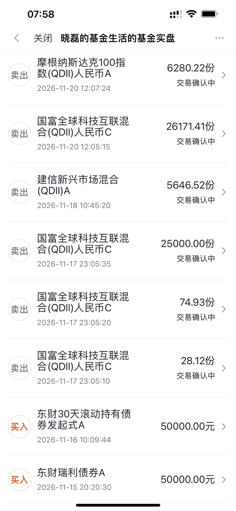
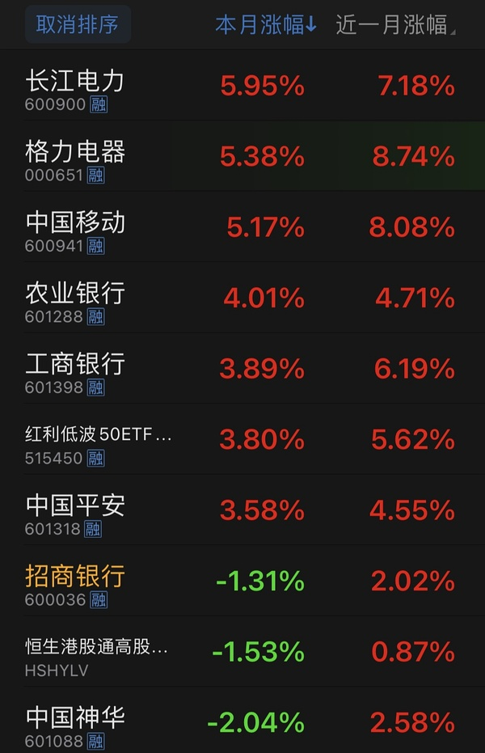
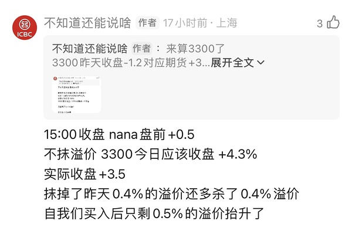
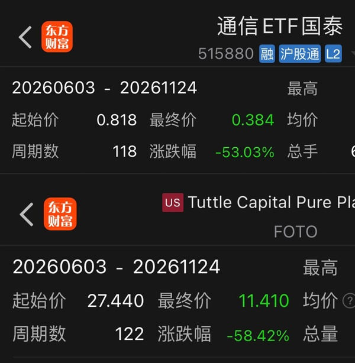
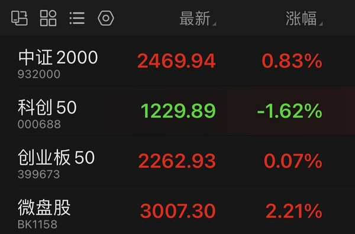

# 📋 楼主每日发言推送

> **推送日期**：2026-11-25 ｜ **执行时间**：2026-11-25 11:03:37 ｜ **监控用户**：`不知道还能说啥`
> **追踪模式**：`topic`（用户主页广播·豆瓣话题）

## 📊 持仓追踪
> 上次更新：2026-11-25 ｜ 基于楼主发言持续追踪（共 16 项）

| 标的 | 状态 | 类型 | 现价 | 提及 |
|------|------|------|------|------|
| 招商银行 | 底仓·四年前 32 元×7000 股买入·四年分红未复投仍 7000 股·不动 | 红利/银行 | 43.12（-0.92%） | 未动，点评「招招最近已经很拉了」；另提「空调已经翻…；成本约32元 |
| 大连圣亚 | 持有（11-18 加仓@37.74 被深套）·今日无动作·卖单 46.90/45.22 未触及 | 冰雪·正牌双子星 | 31.64（4.08%） | 未动，「大连12月是赚钱主力」「大连开始救账户了 … |
| 雪人集团 | 持有·11-19 手动买入 2 笔@≈13.5（两笔 cbs 钱搬入）·卖单 13.84/14.84/15.84 | 冰雪·交易仓 | 12.07（0.00%） | 计划盘中T，「今天我又可以T了」，未确认成交 |
| 幸福蓝海 | 持有·今日换仓买入 1 笔@≈15.50（09:43）＋11-16 笔@16.91·明日卖单 15.84（由 18.64/20.44 下移） | 电影 | 13.62（-3.68%） | 持有；11-23 +11.51%（09:51『看好… |
| 中国电影 | 持有·剩余仓无单·锁仓『慢就是快』 | 电影·核心不动仓 | 15.17（-4.35%） | 持仓承压，「中影跌幅太大 我绿了」「我不行 中影跌… |
| 博纳影业 | 持有小仓·今日跌停 5.69（=6.32×0.9）·卖单 6.94 未触及（高 6.22）·明日买 614 计划 | 电影 | 5.32（-1.66%） | 催促表态「阿博愣着干嘛呢 吸引注意力时候不就是现在… |
| 纳斯达克ETF华夏 | 持有·不卖场内（溢价品种）·开盘预测 -1.5% 落空他自己认赖皮 | QDII·场内纳指 | 2.510（-2.71%） | 持有·不卖场内；11-23 -1.23%；14:1… |
| 中韩半导体ETF | 持有·今日无动作自述 | QDII·场内 | 3.326（-4.09%） | 持有；11-23 +0.89%（强势板块补跌后小反… |
| 盛天网络 | 11-11 买入·持有（口径仍待确认） | 游戏·电竞 | 9.18（-1.29%） | 持有（口径待确认）；11-23 +10.86%（涨… |
| 游戏自建仓 | 11-10 买入·持有·11-11 自述 +5%（时点值未更新） | 游戏·电竞 | 暂无 | 持有；11-23无提及 |
| 美债场外基金 | 持有·国庆前买入·11-11 自述 +1.4%（时点值未更新）·债灾自述接近转亏 | 场外·美债 | 暂无 | 持有；11-23无新自述 |
| 传媒低位10cm | 11-12 自述『只加一个低位的』＋11-16 14:22『我要去买一个传媒了』（是否执行无自述）·拒绝点名 | 传媒·低位 | 暂无 | 持有；11-23『重新满仓』买入多只传媒四连板（未… |
| 东方海洋 | 11-16 买入探针仓 <2%·无卖单自述·当日跌停（11-12 曾涨停 5.16 卖出，见 day_actions_1112） | 探针·羊情绪组 | 4.60（1.32%） | 探针仓<2%·持有；11-23涨停4.13（两连板… |
| 六只债券基金 | 持有·00:38『这些我都有 第二个和第三个在这轮中灾难中经受住了考验』·债灾自述实亏·『债持不炒，每调买机』 | 场外·债基 | 暂无 | 持有；11-23 13:27『债券被干崩了 头疼』… |
| 芒果超媒 | 持有 | 传媒·四连板(mg) | 29.51（-5.75%） | 11.20；持仓未动，抱怨「吗的 芒果不给力」，并复盘「昨天龙… |
| 晶雪节能（plus） | 买入 |  | 暂无 | 11.25；自述「我兑现plus了」，卖出兑现，价位未披露 |

> ⚠️ 执行任务时如发现新操作，请更新 `state.json` 的 `positions`。成本价和市值有数据才填，没有则保留「暂无」。

## 🌅 今日总览
### 📌 市场背景
隔夜美股AI板块疲软、费半指数重挫近8%，楼主转述要闻后只回一句「消费个毛线呀😅」；外围台股盘中重挫7%—8%，他连续提示「大家看看外面」「全球联动」。A股情绪面他给出量化口径：「57涨停 3跌停 情绪正常」，稍后更新为「现在67涨停 3跌停😂」，并把上涨家数归因于「得益于微盘股大涨」。资金面他盯两市融资余额仅增2.20亿元，点评「融资盘昨天犹豫了🤣🤣🤣」。核心矛盾他锁定在微盘：「本质都是微盘股的问题」「微盘股火箭发射」，但盘中亦提示「微盘股刚刚跳水」；同时指出「各大宽指数都被科技绑定了」，并称「大A在装逼 光超涨的厉害」。

### 📌 今日操作
| 操作 | 标的 | 详情 |
| --- | --- | --- |
| ✅ | 晶雪节能（plus） | 自述「我兑现plus了」，卖出兑现，价位未披露 |
| ✅ | 旅游／羊 组合 | 自述「旅游 和 羊 现在没有了」，随即称「不过我又满仓了」，换入标的未点名 |
| ⏭️ | 芒果超媒 | 持仓未动，抱怨「吗的 芒果不给力」，并复盘「昨天龙版切芒果大败😀」 |
| ⏭️ | 中国电影（中影） | 持仓承压，「中影跌幅太大 我绿了」「我不行 中影跌太多了」 |
| ⏭️ | 博纳影业（阿博） | 催促表态「阿博愣着干嘛呢 吸引注意力时候不就是现在吗」，另评「阿博也不知道努力 就躺着看人家跌 傻东西」 |
| ⏭️ | 大连圣亚 | 未动，「大连12月是赚钱主力」「大连开始救账户了 也是好的开始」 |
| ⏭️ | 招商银行（招招） | 未动，点评「招招最近已经很拉了」；另提「空调已经翻红了」 |
| ❌ | 小慧、安安 | 明确不参与「不过我没玩就没有打开来看」，只记录其「死亡换手数字」 |

### 📌 今日议题
| 议题 | 态度 | 核心观点 | 关键引用 |
| --- | --- | --- | --- |
| 微盘股修复 | 📈看多 | 微盘是当前修复主线索，2000企稳后才是反击时点，不着急 | 「卧倒不懂 耐心等待微盘 2000企稳后反击」「微盘股复活了 一点不着急」 |
| 垃圾消费／食品商场旅游 | 📈看多 | 垃圾消费与微盘绑定最深，微盘一活就绝地反击，食品商场旅游互相扶持 | 「只要微盘股复活 垃圾消费将开启绝地反击」「很快食品商场旅游就会互相扶持」 |
| 电影板块属性 | ➡️中性 | 电影不跟微盘走，本月正收益全靠电影，但今日中影拖累账户翻绿 | 「电影其实不跟微盘」「中影跌幅太大 我绿了」 |
| 中国光／通信超涨 | 📉看空 | 中国光相对美国光超涨5%，通信需要补跌5%才补齐 | 「中国光ETF暂时超涨美国光ETF5%」「通信需要跌5%补足」 |
| 纳指ETF溢价核算 | 💬讨论 | 用溢价率倒推开盘价，不满盘中反复抬溢价 | 「今天不杀溢价不提高溢价 标准开盘-3.1%」「又开始bbbbbbb提高溢价了」 |
| 国家队（妈妈）动向 | 💬讨论 | 国家队在宽基与海外之间反向操作，指数涨幅是靠国家队换来的 | 「妈妈狂买创业板」「大家喜欢爱国 妈妈就买海外」 |
| 融资盘 | ➡️中性 | 融资余额仅小幅增加，融资盘昨日表现犹豫、节奏被打乱 | 「融资盘昨天犹豫了🤣🤣🤣」「昨天被打乱了节奏😂」 |
| 大连圣亚／旅游 | 📈看多 | 大连已脱离冰雪山寨货，纯种旅游，12月是赚钱主力 | 「大连12月是赚钱主力」「大连已经完全脱离冰山为代表的山寨货」 |
| 芒果超媒 | 📉看空 | 持仓里唯一在涨的传媒，但表现不给力，昨日切仓大败 | 「只有芒果」「昨天龙版切芒果大败😀」 |
| 外围与全球联动 | 📉看空 | 台股重挫、全球联动，大A只是靠国家队“装逼” | 「大家看看外面」「全球联动」 |
| 死亡换手笔记 | 💬讨论 | 小慧、安安这类票有自己的死亡换手数字，到数就必须跑 | 「到数字就必须跑路那个数字」「他们都有自己的死亡换手数字🤣」 |

### 📌 看好板块/方向
- **微盘股（中证2000）**：「微盘股火箭发射」「微盘股反击 垃圾消费的主阵地」，视为修复弹性最大的方向
- **垃圾消费／食品商场旅游**：「真正和微盘股息息相关的是垃圾消费」「很快食品商场旅游就会互相扶持」，与微盘同步反弹
- **旅游（大连圣亚为纯种）**：「旅游 和 羊」「大连是完全脱离冰山为代表的山寨货」「大连12月是赚钱主力」，旅游市值小、最需微盘复苏
- **电影／院线**：「这个月能正收益都是电影给的」，作为账户正收益来源仍在守
- **创业板（跟随国家队）**：「妈妈狂买创业板」「这个涨是妈妈换来的」，把国家队买入视作创业板支撑
- **微盘股基金（场外）**：主动发问「话说场外到底有uu加了微盘股基金的吗」，对场外工具保持关注

### 📌 风险提示
- 「中国光ETF暂时超涨美国光ETF5%」——光／通信存在约5%的补跌缺口，追高风险明确
- 「又开始bbbbbbb提高溢价了」——场内纳指ETF溢价被再度抬高，开盘价与净值背离，持有体验取决于溢价是否被抹
- 「只要-2就跑输nana」——以纳指为业绩基准衡量，回撤容忍度被压缩到2%以内
- 「大家看看外面」「全球联动」——台股盘中跌7%—8%，外围风险通过联动传导
- 「微盘股刚刚跳水」——微盘反弹并非单边，日内波动剧烈，卧倒等企稳的策略依赖2000不再破位
- 「中影跌幅太大 我绿了」——电影仓集中度高，单一标的即可把账户打绿
- 「昨天龙版切芒果大败😀😀😀😀」——切仓节奏失误已有实证，快速满仓换股本身是风险源
- 「融资盘昨天犹豫了🤣」——两市融资余额仅增2.20亿元，增量资金不足，反弹持续性存疑

## 📊 本次结果
- **今日发言**：77 条
- **累计存档**：24034 条

## 📝 该最新广播作者发言聚合（共 77 条）
### 其他讨论（提及 54 次，占比 70%）2026-11-25 07:56:35
- 杨晓磊有意买回国富

- 我订阅他组合的 帮你们盯一下
- 17号卖一次 20号卖一次 17号还是晚上卖等于18号卖 一共省下多少跌幅😂

### 大连圣亚（提及 6 次，占比 8%）2026-11-25 09:46:34
- 大连12月是赚钱主力
- 旅游板块异动拉升，祥源文旅直线涨停，大连圣亚、凯撒旅业、九华旅游、三峡旅游、君亭酒店跟涨。
- 昨天尾盘开始

大连已经完全脱离冰山为代表的山寨货

### 300413 芒果超媒（对照，非持仓）｜11-13 14:01 本月涨幅 41.70% vs 幸福 53.76% →『幸福已经拉开芒果12%』＝12.06pp 精确命中；当日 −4.83%（提及 3 次，占比 4%）2026-11-25 09:31:33
- 只有芒果
- 吗的
芒果不给力
- 昨天龙版切芒果大败😀😀😀😀

### 博纳影业（提及 2 次，占比 3%）2026-11-25 10:04:03
- 阿博愣着干嘛呢
吸引注意力时候不就是现在吗
- 阿博也不知道努力 就躺着看人家跌 傻东西

### 安记食品（提及 2 次，占比 3%）2026-11-25 10:45:53
- 你的笔记里没有小慧和安安的死亡换手记录吗

到数字就必须跑路那个数字
- 我的笔记里有小慧和安安的
不过我没玩就没有打开来看

他们都有自己的死亡换手数字🤣🤣🤣🤣🤣

### 纳斯达克100 指数（他用来对照场内 ETF 溢价/涨幅的基准，非标的）｜11-13 00:16『今天图上看 nana依然是大阳线』＋07:57『昨天-0.7收盘 但是nana晚上其实只有-0.3 现在期货+0.5 今天场内应该开盘+0.9%』→ 实测 513300 开盘 2.710＝+0.82%（误差 0.08pp）（提及 1 次，占比 1%）2026-11-25 07:45:03
- 只要-2就跑输nana

### 513300 纳斯达克ETF华夏｜11-11 10:49「3300还行 不过今天我不满意」＋13:24「咱们3300还是近期数据最好的」（提及 1 次，占比 1%）2026-11-25 08:17:12
- 来计算3300了
昨天3点收盘+0.5 实际晚上-2 盘前现在-0.6
今天不杀溢价不提高溢价 标准开盘-3.1%

### 国产自主（半导体设备/芯片制造）（提及 1 次，占比 1%）2026-11-25 10:26:41
- 大家喜欢爱国
妈妈就买海外🤣

大家追海外
妈妈买爱国

### 601595 上海电影｜**他空仓**（11-09 起未回接）；11-12 09:38『天天念叨sy的给你们机会了』＋09:41『现在-6给你们机会了哈』＋13:15『马上sy跌停 bn还要尊敬一下他』＋13:51『与此同时 sy跌停』＋14:00『sy历来以残暴虐杀手法闻名』；实测收 42.15 −9.99% 跌停（提及 1 次，占比 1%）2026-11-25 10:28:15
- 笑死
这样三天阿博和sy差不多了

### 格力电器（提及 1 次，占比 1%）2026-11-25 10:35:04
- 空调已经翻红了

### 招商银行（提及 1 次，占比 1%）2026-11-25 10:35:44
- 招招最近已经很拉了

### 📄 全部发言（共 77 条）
- (2026-11-25 07:45:03) 只要-2就跑输nana

- (2026-11-25 07:56:35) [图] 杨晓磊有意买回国富

- (2026-11-25 07:56:57) 我订阅他组合的 帮你们盯一下  ⊳ （引用 @不知道还能说啥）杨晓磊有意买回国富

- (2026-11-25 07:59:53) [图] 17号卖一次 20号卖一次 17号还是晚上卖等于18号卖 一共省下多少跌幅😂

  ⊳ （引用 @六倍做多退休）😂？

- (2026-11-25 08:03:15) 🤣  ⊳ （引用 @shirla）楼楼为啥换了个爱存不存的头像！😆😆😆

- (2026-11-25 08:03:53) 06:12:11【周三你需要知道的隔夜全球要闻：AI板块疲软费半指数重挫近8%；趋势追踪量化基金削减美债空头头寸；美国消费者信心升至近两年最高】

消费个毛线呀😅

- (2026-11-25 08:17:12) [图] 来计算3300了
昨天3点收盘+0.5 实际晚上-2 盘前现在-0.6
今天不杀溢价不提高溢价 标准开盘-3.1%

- (2026-11-25 08:31:18) [图] 中国光ETF暂时超涨美国光ETF5%
通信需要跌5%补足

- (2026-11-25 08:50:25) 两市融资余额较上日增加2.20亿元
截至11月24日，上交所融资余额报11195.33亿元，较前一交易日增加6.00亿元；深交所融资余额报10154.94亿元，较前一交易日减少3.80亿元；两市合计21350.27亿元，较前一交易日增加2.20亿元。

- (2026-11-25 08:50:33) 融资盘昨天犹豫了🤣🤣🤣🤣🤣🤣🤣  ⊳ （引用 @不知道还能说啥）两市融资余额较上日增加2.20亿元
截至11月24日，上交所融资余额报11195.33亿元，较前一交易日增加6.00亿元；深交所融资余额报10154.94亿元，较前一交易日减少3.80亿元；两市合计21350.27亿元，较前一交易日增加2.

- (2026-11-25 08:50:43) 昨天被打乱了节奏😂  ⊳ （引用 @VVV坚定持有VVV）🤔那今天又是我们垃圾主场了吧

- (2026-11-25 08:51:47) 别说外面了
就我们楼里昨天夜里看到美股
都在说会不会又玩科技了😂😂
资金还是被影响了  ⊳ （引用 @VVV坚定持有VVV）🤔那今天又是我们垃圾主场了吧

- (2026-11-25 09:31:33) 只有芒果  ⊳ （引用 @shirla）忘记问今天条件单了楼楼

- (2026-11-25 09:32:28) [图] 微盘股与众不同

- (2026-11-25 09:35:56) 商业航天板块走强，利君股份涨停，邵阳液压涨超7%，司南导航、久之洋、中京电子、春晖智控等个股跟涨。

- (2026-11-25 09:36:49) 只要微盘股进入状态  ⊳ （引用 @点-重生炒垃圾）雪，我们拿回失去的一切好吗？

- (2026-11-25 09:37:50) 卧倒不懂 耐心等待微盘 2000企稳后反击

- (2026-11-25 09:40:09) 你看商场几个老乡好 这就是微盘反击准备启动  ⊳ （引用 @🈵仓即暴涨🤑）看看能不能把盖子掀掉

- (2026-11-25 09:41:38) 很快食品商场旅游就会互相扶持  ⊳ （引用 @🈵仓即暴涨🤑）中央板了

- (2026-11-25 09:42:57) 微盘股火箭发射

- (2026-11-25 09:43:02) 非常非常非常重要  ⊳ （引用 @不知道还能说啥）微盘股火箭发射

- (2026-11-25 09:44:19) 没有  ⊳ （引用 @点-重生炒垃圾）美国科技反弹？

- (2026-11-25 09:45:57) 妈妈狂买创业板  ⊳ （引用 @点-重生炒垃圾）美国科技反弹？

- (2026-11-25 09:46:14) 中国光大幅度超涨美国  ⊳ （引用 @不知道还能说啥）妈妈狂买创业板

- (2026-11-25 09:46:34) 大连12月是赚钱主力  ⊳ （引用 @仓部加措）今天轮到大连发力啦啦啦😭

- (2026-11-25 09:47:20) 上周问你们的猫猫问题

你们说不可能修复连续大阴线

现在觉得可能不

- (2026-11-25 09:48:24) 这个涨是妈妈换来的  ⊳ （引用 @一切都会过去的）我希望是美国补涨而不是中国补跌🥹

- (2026-11-25 09:48:55) 旅游板块异动拉升，祥源文旅直线涨停，大连圣亚、凯撒旅业、九华旅游、三峡旅游、君亭酒店跟涨。

- (2026-11-25 09:49:37) 本质都是微盘股的问题  ⊳ （引用 @柚子mm）一阳改三观了😂

- (2026-11-25 09:50:29) 我兑现plus了

- (2026-11-25 09:51:33) 旅游 和 羊  ⊳ （引用 @乖乖是只嘤嘤怪）祥源文旅是哪的啊

- (2026-11-25 09:53:00) 现在没有了

不过我又满仓了  ⊳ （引用 @shirla）哎？哪个plus啊，我以为楼已经没有晶雪了

- (2026-11-25 09:54:05) 吗的
芒果不给力  ⊳ （引用 @YuanZi💕）龙板来了

- (2026-11-25 09:55:43) 他们本来就是旅游 😂纯种 双子星

那些乱七八糟的才是山寨货  ⊳ （引用 @稀里不糊涂）这次是旅游带着大连和长白山

- (2026-11-25 09:56:05) 昨天尾盘开始

大连已经完全脱离冰山为代表的山寨货  ⊳ （引用 @稀里不糊涂）这次是旅游带着大连和长白山

- (2026-11-25 09:57:42) 旅游都是一路的  ⊳ （引用 @冬天他一定会来）峨眉山能行不

- (2026-11-25 09:58:20) 旅游市值实在太小了
太需要微盘股复苏
就和垃圾食品那边一样  ⊳ （引用 @冬天他一定会来）峨眉山能行不

- (2026-11-25 09:59:24) [图] 

- (2026-11-25 10:00:24) 10:00:06 财联社11月25日电，台交所加权股价指数下跌7%至37,302.55点。(来自财联社APP)

- (2026-11-25 10:03:13) 应该是微盘股的修复问题😂之前都是A杀  ⊳ （引用 @六倍做多退休）是在打消费了吗 准备为12月zzj做准备？

- (2026-11-25 10:04:03) 阿博愣着干嘛呢
吸引注意力时候不就是现在吗

- (2026-11-25 10:07:33) 大的消费一直都在发科难财吧哈哈哈哈哈  ⊳ （引用 @六倍做多退休）😂因为我看青岛啤酒真的走的蛮不错的

- (2026-11-25 10:08:17) 中影跌幅太大
我绿了

- (2026-11-25 10:08:35) 😂😂😂😂😂😂😂😂😂😂

大连翻倍涨幅带我红回来啊  ⊳ （引用 @不知道还能说啥）中影跌幅太大
我绿了

- (2026-11-25 10:10:12) [图] 话说场外到底有uu加了微盘股基金的吗（我没钱）

- (2026-11-25 10:10:26) 只要微盘股复活 垃圾消费将开启绝地反击  ⊳ （引用 @不知道还能说啥）话说场外到底有uu加了微盘股基金的吗（我没钱）

- (2026-11-25 10:11:21) 我不骂 我挺满意的😂
因为今天很可能9+  ⊳ （引用 @嘻嘻子）你快骂骂大连🤬

- (2026-11-25 10:12:11) 昨天龙版切芒果大败😀😀😀😀  ⊳ （引用 @shirla）我前几天切了一点易方达血亏的科技过去hhh

- (2026-11-25 10:13:44) 牛逼啊👍👍👍👍👍👍还是你节奏好  ⊳ （引用 @shirla）我刚才龙版触发去了慈文😂😂瞎搞

- (2026-11-25 10:14:52) 微盘股早在上个月就下行 你知道仔细看
电影其实不跟微盘

上周爆杀没办法 全市场买单天普停牌
真正和微盘股息息相关的是垃圾消费  ⊳ （引用 @一切都会过去的）微盘这么好电影在干嘛呢

- (2026-11-25 10:17:05) 电影还垃圾？这个月能正收益都是电影给的  ⊳ （引用 @一切都会过去的）好吧电影独自垃圾

- (2026-11-25 10:17:52) 10:17:34 财联社11月25日电，台交所加权股价指数下跌8%至36,892.58点。(来自财联社APP)

大家看看外面

- (2026-11-25 10:19:58) 全球联动  ⊳ （引用 @moli）啥消息

- (2026-11-25 10:20:22) 大A在装逼 光超涨的厉害😂😂😂😂😂😂  ⊳ （引用 @moli）啥消息

- (2026-11-25 10:21:21) 应该是妈妈的威力才能装这个B😂  ⊳ （引用 @moli）补跌预定

- (2026-11-25 10:22:41) 得益于微盘股大涨
今天上涨家数更多

- (2026-11-25 10:22:58) 57涨停 3跌停 情绪正常  ⊳ （引用 @不知道还能说啥）得益于微盘股大涨
今天上涨家数更多

- (2026-11-25 10:25:28) 来啦  ⊳ （引用 @冬天他一定会来）东方海洋别输给九阳！冲！

- (2026-11-25 10:26:41) 大家喜欢爱国
妈妈就买海外🤣

大家追海外
妈妈买爱国  ⊳ （引用 @moli）妈妈为何不放手一跌

- (2026-11-25 10:27:39) 对账户太关键了  ⊳ （引用 @大连海底站岗员）zy在爬了

- (2026-11-25 10:28:15) 笑死
这样三天阿博和sy差不多了  ⊳ （引用 @ü）脖子今天还蛮抗跌的

- (2026-11-25 10:29:11) 盘前-0.9

溢价不抹不杀

应该开盘-3.4  ⊳ （引用 @不知道还能说啥）来计算3300了
昨天3点收盘+0.5 实际晚上-2 盘前现在-0.6
今天不杀溢价不提高溢价 标准开盘-3.1%

- (2026-11-25 10:29:22) 昨天有小作文  ⊳ （引用 @moli）今天债怎么也绿了😂

- (2026-11-25 10:30:04) 微盘股复活了
一点不着急  ⊳ （引用 @公主要发财）sy也在爬了

- (2026-11-25 10:31:56) 又开始bbbbbbb提高溢价了  ⊳ （引用 @monica）开盘-3

- (2026-11-25 10:32:58) SY漂亮

- (2026-11-25 10:35:04) 空调已经翻红了  ⊳ （引用 @公主要发财）同时招招也在上，哈哈哈。还能不能愉快的定投了

- (2026-11-25 10:35:44) [图] 招招最近已经很拉了

  ⊳ （引用 @公主要发财）同时招招也在上，哈哈哈。还能不能愉快的定投了

- (2026-11-25 10:37:00) 阿博也不知道努力 就躺着看人家跌 傻东西  ⊳ （引用 @🈵仓即暴涨🤑）咋又下去，下面到底有谁在

- (2026-11-25 10:44:33) 微盘股反击
垃圾消费的主阵地  ⊳ （引用 @早八走狗来财）青岛拉板？

- (2026-11-25 10:45:53) 你的笔记里没有小慧和安安的死亡换手记录吗

到数字就必须跑路那个数字  ⊳ （引用 @寒灯思旧事）惠惠加油吧，之前三连板的收益都没了😭

- (2026-11-25 10:48:20) 🤣大连开始救账户了 也是好的开始  ⊳ （引用 @大连海底站岗员）账户靠大连救不起来

- (2026-11-25 10:49:32) 各大宽指数都被科技绑定了  ⊳ （引用 @酸奶不舔盖）为啥现在大盘每天动不动就是一个点的涨跌幅

- (2026-11-25 10:51:18) 我的笔记里有小慧和安安的
不过我没玩就没有打开来看

他们都有自己的死亡换手数字🤣🤣🤣🤣🤣  ⊳ （引用 @钱多多多多多）小惠爆量换手还是太麻烦了
下一次18%换手我要做大仓位兑现了😂
不过他是真的很有规律
是那种真的 买在人人嫌弃 卖在人人都要🤣（以前你说的复制）

- (2026-11-25 10:53:02) 现在67涨停 3跌停😂  ⊳ （引用 @不知道还能说啥）57涨停 3跌停 情绪正常

- (2026-11-25 10:54:03) 我不行 中影跌太多了😂😂😂😂😂😂
要么传媒里有拉起来一些的 要么大连加大努力  ⊳ （引用 @西西西西）非常好 靠它我今天还红着

- (2026-11-25 10:55:04) 微盘股刚刚跳水  ⊳ （引用 @🈵仓即暴涨🤑）但绿的家数越来越多了😵

## 🧠 投资风格分析
> 📏 增量更新指引：仅当今日发言确有新依据时才修订对应维度，无变化不强行重写；单维度修订建议 ≤150 字。

- 投资理念与方法：以长期估值百分位为锚（纳指100五年2%、十年4%），不把剩余修复空间简单外推为收益，偏好夏普／卡玛更高、回撤后修复力更强的品种；冰点判断坚持五条件缺一不可，融资盘看批量流出而非单点爆破；对恐慌事件要求同等量级才可类比。同时对结构相关性有清晰分层：明确区分哪些板块真正与微盘绑定、哪些不跟（如电影与微盘、垃圾消费与微盘的关系分开处理）。看盘上习惯用量化口径把溢价率折算成开盘价，遇到溢价被抬升时用数字而非情绪定价。
- 风险偏好：对融资盘爆仓风险高度敏感，关注融资余额的批量流出而非单点爆破，认为爆融资盘会出冰点；回避高波动垃圾微盘，只在极端条件下才考虑2000，并预期极端崩盘时国家队会扫货。对主题炒作保持距离，承认进攻性最强的品种跌幅也最大；对场内QDII溢价风险敏感，宁可先算清溢价与净值的缺口再决定是否承担开盘缺口。
- 交易与仓位：强调操作与观点一致，反对一边看跌一边补仓或切向进攻最强；主张卖出后资金去向比卖出本身更关键，会快速把资金转入自己认定的强势方向，因此常出现“兑现即满仓”的节奏。对切仓失误会公开复盘而不掩饰，讲究板块内部“纯种”与“山寨货”的区分，宁可守着正宗主线也不拿替代品。
- 心理特质：对波动与回撤高度钝化，普跌中仍信心十足；盘中喜欢用KPI式口径逐只考核持仓，批评不主动、躺着的标的，同时对“一起跌”和“该努力”区分语境，不搞无差别开喷。整体语气带调侃与自嘲，账户翻绿也能一边抱怨一边给自己找主线，情绪不随单日涨跌漂移。

> ⚠️ 本板块由 Actions 全自动增量更新（复用当日发言与今日总览），每次仅在内容足够支撑时才改动。

## 🏷️ 昵称映射表
### 📖 昵称规律（供 AI 判断新昵称时参考）
【昵称命名规律（用于推断未知新昵称）】
- 拼音首字母缩写：取标的/基金名汉字拼音首字母串（含数字代码），多为 ETF/股票代码口语化｜示例：yl=引力传媒｜zy=掌阅科技｜sj=视觉中国｜cc=华安文体健康混合｜C50=创业板50ETF｜k50=科创50｜kun=昆仑万维｜xhxc=新瀚新材｜zxfc=中欣氟材
- 小/老+姓氏代指：「小X」「老X」通常指姓 X 的标的或该标的的基金经理；「X兄弟」多为同系基金｜示例：小惠=惠发食品｜老莫=万家品质生活(莫海波)｜小华=华夏全球科技先锋(QDII)A｜小华兄弟=华夏移动互联(QDII)｜小浦=浦银安盛全球智能科技(QDII)A｜小广=广发全球精选(QDII)A｜小远=华宝致远(QDII)C｜招招=招商银行｜小德=德明利｜赵姨=兆易创新｜露露=泸州老窖｜空调=格力电器
- 戏称/黑话→题材板块：生活化比喻或黑话对应某个题材/板块，而非单一标的；出现时多指板块方向｜示例：卖国=PCB板块(英伟达AI链)｜爱国=国产自主(半导体设备/芯片)｜奶茶=易点天下｜老师=中文在线｜蓝色=蓝色光标｜宇航员=航空航天板块｜华子=华泰保兴安悦债券｜国际=国际复材｜巨无霸=长鑫科技等重大IPO
- 谐音/取字：昵称含标的名关键字（取一字或谐音），多为 A 股个股或基金简称｜示例：万华=万华化学｜东百=东百集团｜宝=保利发展｜讨饭/亚洲讨饭/建信新兴=建信新兴市场(QDII)A｜华宝zy=华宝致远(QDII)A
- 机构/基金经理昵称：以基金公司名、经理姓、或平台代称指代对应基金产品｜示例：周经理=中欧新趋势混合(LOF)A｜张经理=信澳匠心回报混合A｜网易云/音乐世家=富国全球科技互联网股票(QDII)A｜国富亚洲=国富亚洲机会股票(QDII)A｜国泰纳指=国泰纳斯达克100指数(QDII)｜易方达全球=易方达全球成长精选混合(QDII)A｜浦银安盛=浦银安盛全球智能科技(QDII)A

### 📋 已收录映射
| 昵称 | 对应名称 |
|------|----------|
| C50 | 创业板50ETF |
| cc | 双义：股票=中国长城 / 基金=华安文体健康混合（用户 11-05 指认） |
| k50 | 科创50 |
| kun | 昆仑万维 |
| sj | 视觉中国 |
| xhxc | 新瀚新材（用户确认；代码待核） |
| yl | 引力传媒 603598（对手盘，非他持仓）｜11-06 +37.15%；11-09 本月+37.79% |
| zxfc | 中欣氟材 |
| zy | 双义：他本人口径=603533 掌阅科技（用户 11-05 确认）；11-09 楼友两条『zy』按 16 元/电影语境指 600977 中国电影。引用必须带语境，不许收敛 |
| 万华 | 万华化学 |
| 东百 | 东百集团 |
| 亚洲讨饭 | 建信新兴市场混合(QDII)A |
| 保利发展 | 保利发展 |
| 华子 | 华子＝007540 华泰保兴安悦债券A（华泰保兴基金·安悦债券A类份额），满仓30年超长利率债的长债基金（用户 2026-11-16 确认，无歧义，不是歧义项）；00:42 楼友『华子今年战绩无敌吧』→他答『30超长债牛逼没办法』；13:47『纯利率债就是华子那种 不过华子满仓30债 有些是满仓5-10年』；**与460108不是同一只**：460108＝华泰柏瑞稳健收益债券C（他持有的纯利率债·重仓国开/农发/国债，见六基行），华子007540 是华泰保兴的长债基金，勿混 |
| 华宝 zy | 华宝致远混合(QDII)A |
| 华宝zy | 华宝致远混合(QDII)A |
| 卖国 | PCB、光模块、通信板块（英伟达AI产业链） |
| 周经理 | 中欧新趋势混合(LOF)A |
| 国富亚洲 | 国富亚洲机会股票(QDII)A |
| 国泰纳指 | 国泰纳斯达克100指数(QDII) |
| 奶茶 | 301171 易点天下（对手盘，非持仓）｜11-13 10:07『奶茶out 幸福人的底气是可以说芒果out』；当日 −6.72% |
| 宇航员 | 航空航天板块 |
| 宝 | 保利发展 |
| 小华 | 华夏全球科技先锋混合(QDII)A |
| 小华兄弟 | 华夏移动互联混合(QDII) |
| 小广 | 广发全球精选股票(QDII)A |
| 小德 | 德明利 |
| 小惠 | 惠发食品 |
| 小浦 | 浦银安盛全球智能科技(QDII)A |
| 小远 | 华宝致远混合(QDII)C｜只在盯，未证他持有 |
| 巨无霸 | 长鑫科技等重大IPO企业 |
| 建信新兴 | 建信新兴市场混合(QDII)A |
| 张经理 | 信澳匠心回报混合A |
| 招招 | 招商银行 |
| 易方达全球 | 易方达全球成长精选混合(QDII)A |
| 浦银安盛 | 浦银安盛全球智能科技(QDII)A |
| 爱国 | 国产自主（半导体设备/芯片制造） |
| 空调 | 格力电器 |
| 网易云 | 富国全球科技互联网股票(QDII)A |
| 老师 | 中文在线 |
| 老莫 | 万家品质生活混合A(519195) |
| 蓝色 | 300058 蓝色光标（广告组合，非他持仓）｜11-12 高 15.97＝20cm 涨停价、收 14.76 +10.89%（炸板）；10:21『他和蓝色 奶茶 sg他们是广告组合』 |
| 讨饭 | 建信新兴市场混合(QDII)A |
| 赵姨 | 兆易创新 |
| 赵哥 | 兆易创新 |
| 露露 | 泸州老窖 |
| 安安 | 安记食品 |
| 音乐世家 | 富国全球科技互联网股票(QDII)A |
| 老伯伯 | 铜冠铜箔 |
| nk | 纳指科技ETF景顺 159509（联接=景顺长城纳斯达克科技ETF联接A）｜11-06 A级：截图溢价率37.08% |
| bk | 标普信息科技LOF 161128（场外=易方达标普信息科技QDII-LOF）｜11-06 A级 |
| txx | 天下秀 |
| 媛媛 | 今世缘 |
| uu | 友友、网友们 |
| 温暖老师 | 某个特别牛逼的散户 |
| 余老师 | 余利，某牛逼投资者 |
| ycm | 粤传媒 002181｜11-09 12:12「非电影传媒就留给大家玩了 我一个都不会碰了」→ 推断已不持有 |
| 江老师 | 江琪（投资博主） |
| 水果老师 | 投资博主 |
| 小爱 | 我爱我家 |
| ty | 天娱数科 |
| bn | 博纳影业 |
| sy | 601595 上海电影｜**他空仓**（11-09 起未回接）；11-12 09:38『天天念叨sy的给你们机会了』＋09:41『现在-6给你们机会了哈』＋13:15『马上sy跌停 bn还要尊敬一下他』＋13:51『与此同时 sy跌停』＋14:00『sy历来以残暴虐杀手法闻名』；实测收 42.15 −9.99% 跌停 |
| CBS | 长白山 |
| 东哥 | 东百集团 |
| 芒果 | 300413 芒果超媒（对照，非持仓）｜11-13 14:01 本月涨幅 41.70% vs 幸福 53.76% →『幸福已经拉开芒果12%』＝12.06pp 精确命中；当日 −4.83% |
| 阿中 | 中国电影 |
| 欢欢 | 欢瑞世纪 |
| 雪人 | 雪人集团 |
| 大连 | 大连圣亚 |
| 幸福 | 幸福蓝海 |
| 小粤 | 粤传媒 |
| 阿博 | 博纳影业 |
| 创成长 | 创业板成长etf |
| asd | 002747 埃斯顿｜11-11 15:09『我昨天去的另外一个 今天也吸到asd了』＝11-11 低吸买入；11-12 10:17『我昨天加了asd今天刚刚加了另外个』＋10:35『asd火箭发射』（盘中高 32.19，收 29.95 −4.37%）；买价未披露。**11-11 轮误删、11-12 恢复** |
| 恋爱脑 | 002582 好想你｜11-12 14:39:31『清了恋爱脑』＝清仓（卖价未披露；10.48 卖单两日均未触及→手动卖）；14:28『我如果去掉恋爱脑 也就比你多一个机器人』；当日收 9.76 −2.89% |
| 恋爱 | 002582 好想你（同『恋爱脑』）｜11-12 14:39 已清仓，不再持有 |
| 小羊 | 000678 襄阳轴承｜11-05 已卖（卡当日最高 20.40）；11-12 14:16『襄阳掉了』＋14:44『厉害襄阳』＝只评论走势，非持仓 |
| 中马 | 中马传动 |
| 晶雪 | 晶雪节能 |
| xf | 幸福蓝海 |
| 建设 | 建设工业 |
| 北方 | 北方导航/北方国际（未定，11-04「我在北方了」） |
| _ambiguity_note | 歧义未收敛（禁止当唯一映射）：轮子=巨轮智能/五洲新春；sj=视觉中国（传媒语境）/神剑股份（宇航员语境）；cc=中国长城/华安文体健康混合；北方=北方导航或北方国际；zy=掌阅科技（用户 11-05 确认原值正确）。证据分级：A=价位/均线/月涨幅实测命中；B=量级或单日命中/用户口述；C=仅昵称或语义，不得据此写『他持有』；沿用原仓=本轮未复核，不写进结论正文。三条判据：①条件单四位数要先按同时段动词行判买卖方向（cbs 3644 是买单不是卖单）；②『祝福/你们/你的X』句式＝评论他人持仓，不是他的操作；③同一昵称在不同语境可指两只票（zy=掌阅/中影），按价位与板块取，不许收敛成一个。 11-11 补：plus雪＝他自己也没说清（11:12「你应该不知道plus雪是哪个」），不许猜；bdd＝有传媒属性所以他不去（13:42），仍未定案；『五连阳』这类盘中口径不等于日K实测（招行 11-06 为平盘十字星）。 11-12 补：①盘中快照≠收盘（14:15 三日账第三日 幸福+0.5/光线−4.5 为盘中值，收盘 −0.53/−4.97；他写的『拉开5.3%』按自列数字相加应为 5.5，属口算误差，不得据此推翻实测）；②历史卖单不重复计触发（中影 15.84 虽∈11-12 区间[15.39,15.98]，但 11-10 已成交、无存续卖单）；③清仓自述不封锁后续再买（asd 11-06 清→11-11 15:09 再吸，11-11 轮据此误删）；④『果果』只是推断映射，不得当持仓证据；⑤机器人第二仓与传媒低位10cm 代码未披露，福赛仅为楼友提问他作答，不许映射。 11-13 补：①**本月涨幅类口述可核**，基准＝10-30 收盘，且要用**发言时刻的分钟价**复算（14:01 截图 53.76% 与分钟线独立复算分毫不差，『拉开芒果12%』＝12.06pp）；②**基金表『折价率』列负号＝溢价**（513300 −15.28% ⇒ 溢价 15.28%，与 11-06 的 16.36% 同口径），别读成折价；③**『我手里就7只股票了/我只有电影冰雪了』是他题材仓口径**，不得据此删除无卖出自述的持仓行（铁律 6）；④**『全部跌停』类口述是盘中快照**（东方海洋盘中最低 4.64＝跌停价、收 −6.59%，未封死）；⑤plus雪＝晶雪只是**品种识别**，他 11-09 已自述清仓，不得当持有证据。 11-16补：①华子与460108是否同一只未定案（华子亦可能楼友昵称），不得据华子写他持有30债；②14:22『T掉追加的』对象歧义（主读法＝大连11-10加筆T，备选＝幸福老股T），无成交自述不改笔数；③博纳09:52『今天』与底仓口径冲突，加仓@6.37按09:45『加仓bn』＋09:46『-6』取；④『2开头招行』语义未定不映射；⑤华夏兄弟17:26裸报-2.5%证据不足不入表。 11-16补：①14:22『T掉追加的』对象歧义（主读法＝大连11-10加筆T，备选＝幸福老股T），无成交自述不改笔数；②博纳09:52『今天』与底仓口径冲突，加仓@6.37按09:45『加仓bn』＋09:46『-6』取；③『2开头招行』语义未定不映射；④华夏兄弟17:26裸报-2.5%证据不足不入表。 11-17补：①『太子爷』『bdd』『畅畅』未定案不映射；②雪人今日14.01加仓笔受T+1，14.84卖单卖的是可卖老仓（非当日买笔）；③晶雪25.64回落单他自述触发、日K高25.78证实（分钟接口H25.35偏低为已知不稳）；④光线11-17部分卖出@11.82按11-16追高笔推定(B)，仍持老仓；⑤传媒『以身入局』拒绝点名不外推代码。 11-17补：①『太子爷』『bdd』『畅畅』未定案不映射；②雪人今日14.01加仓笔受T+1，14.84卖单卖的是可卖老仓（非当日买笔）；③晶雪25.64回落单他自述触发、日K高25.78证实（分钟接口H25.35偏低为已知不稳）；④光线11-17部分卖出@11.82按11-16追高笔推定(B)，仍持老仓；⑤传媒『以身入局』拒绝点名不外推代码。 11-17补：①『太子爷』『bdd』『畅畅』未定案不映射；②雪人今日14.01加仓笔受T+1，14.84卖单卖的是可卖老仓（非当日买笔）；③晶雪25.64回落单他自述触发、日K高25.78证实（分钟接口H25.35偏低为已知不稳）；④光线11-17部分卖出@11.82按11-16追高笔推定(B)，仍持老仓；⑤传媒『以身入局』拒绝点名不外推代码。 11-18补：①雪人『兑现今天加的雪儿』受T+1，今日14.17买笔不可当日卖，兑现的是可卖老仓；②传媒『这周开干』拒绝点名不外推代码；③晶雪上週买回成本未披露、清仓收益不计算；④长白山(cbs)两笔成本36.44/38.8、同价33.65卖出。 11-19补：①雪人13.84卖单在开盘高13.94时可能触发（不写死成交价，记B待核）；②晶雪『今天20买』是给楼友的话、无第一人称买入→不回接；③中证1000ETF象征性小额买入、金额未披露；④大连11-18加仓@37.74 被套（11-19跌停32.33），11-19『我没买』无动作。 11-19补：①【1000】＝gjd国家队（他澄清『我说的是gjd』），非中证1000ETF、非本人买入，已从持仓删除；②雪人13.84卖单在开盘高13.94时可能触发（记B待核）；③晶雪『今天20买』是给楼友的话、无第一人称买入→不回接；④大连11-18加仓@37.74 被套（11-19跌停32.33），11-19无动作。 11-19补：①『1000』＝中证1000，『gjd』＝国家队；合起来是『国家队在象征性买中证1000』——他评论国家队托市，非本人买入/持仓（已从持仓删除误记）；②雪人13.84卖单在开盘高13.94时可能触发（记B待核）；③晶雪『今天20买』是给楼友的话、无第一人称买入→不回接；④大连11-18加仓@37.74 被套（11-19跌停32.33），11-19无动作。 11-20补：①今日无交易（11:57『我今天什么单子都没开了』『其他一个都不卖』）；②雪人13.84/14.84/15.84卖单未触及（11-20高12.76＜13.84）；③大连再跌停29.10、东方海洋涨停3.75(探针)；④xxz/东哥 未定案不映射。当日盈亏总结已写入 stock_pnl_note（等权涨跌率口径）。 11-21补（周六休市）：①今日无交易，价格沿用11-20收盘；②新帖被审核→晚上切新帖（故21:03只抓新帖20条，旧帖11-21另有51条，已合并入语料v26）；③cpi=新闻非昵称；④当日盈亏总结写'休市=0'。 11-23补：①修正上轮漏记——11-20(周五)卖光线→买横店603103+慈文002343(两个四连板)；②11-23横店被S/慈文手动S→重新满仓；③芒果超媒300413持有+加仓、明日35.94清仓；④『那几个10都四连板过』＝另持数只未点名传媒四连板，不外推代码；⑤中影重仓。 |
| nana场内 | 513300 纳斯达克ETF华夏｜11-09 14:34「不愧是513300 当年的普通nana ETF之王」，当日唯一红的纳指ETF |
| 雪儿 | 雪人集团 002639｜11-06「大连和雪儿」＋11-11 14:26「雪儿今天不错啊 大家昨天不是期待他接人嘛 这个任务做到了今天」（接人＝5日线接回，与雪人条件单口径一致） |
| 存钱罐 | 光线传媒 300251（他自述小仓）｜11-13 15:11『我相信光虽迟但到 我会肯定保留上周的存钱仓位』＝存钱罐口径再次落到光线 |
| 枣子 | 002582 好想你（同『恋爱脑』）｜11-12 14:39 已清仓，不再持有 |
| 王老师 | 人：王博雅投资（QDII 场内溢价口径），不是标的 |
| 印度 | 自嘲代指中国（推断，勿当事实） |
| 10086 | 中国移动（他当指标用，非持仓） |
| 阳光乳业 | 001318 阳光乳业（他的『喝的』/牛奶）｜11-09 A级：13:59 分时截图 S 标记≈13.5＋10:52「我去掉了羊来抄底」 |
| 羊 | 生肖羊概念组（带阳/洋/光/太/泉的一篮子）｜11-09 14:04 他自己贴的分组；**11-13 崩盘实证**：15:58 截图跌幅榜 澳洋健康 −10.06、阳光照明 −10.05、红太阳 −10.04、大东方 −10.03、阳光乳业 −10.02、襄阳轴承 −9.98、鲁阳节能 −9.95、大西洋 −9.73、太阳电缆 −9.29、圣阳股份 −8.64、泉阳泉 −6.60、东方海洋 −6.59；他 14:48『我昨天起码说了6次 控制仓位 因为羊和东方昨天松动了！！！！这是情绪核心』 |
| 小明 | 605179 一鸣食品｜11-09 10:07 有人问『喝的小明？』他答『羊』＝喝的已换成阳光乳业 |
| 皇台 | 000995 皇台酒业｜11-09 与雪人 PK 当日换手率龙虎榜 |
| 海哥 | 人：转债估值博主（不是标的）｜11-09 12:48「海哥周五那个新债…我买了点试试看是市场错了还是海哥错了」 |
| 申菱转债 | 123290（申菱环境 301018 的转债）｜11-09 13:50 买 150 张 @133 多；11-10 11:20『我开了149.9』卖单；11-12 分钟线 10:03–11:12 持续≥149.9（高 152.313）→触发推定清仓，+12.28%（成本 133.5 推定）记入 stock_pnl，已从持仓表删除 |
| 盛天 | 300494 盛天网络｜11-11 A级：11:29 分时截图 B 标记 @11.00＋「不止 而且我跟了他一把」（跟摄像大哥） |
| dfhy | 002086 东方海洋｜11-11 13:56 楼友问 dfhy 绕异动→他『我没算 这几天可能都是异动吧』；11-12 14:39 涨停 5.16 卖出（＝4.69×1.10 到分＋分钟 14:36 封板＋财联社 17天9板）；**11-16 09:28『看东方海洋了』＋15:17『东方海洋上周四不好示范』＝买回探针仓 <2%**，羊仪表盘四图蓝高亮 002086，当日跌停收 4.34（昨 4.82）；探针非重仓 |
| xys | 300502 新易盛｜11-11 13:19「我那个买xys的女主播终于要开心了」＋13:21「她现在成本327了」→ **是女主播的仓，不是他的** |
| 冰山 | 000530 冰山冷热｜11-11 10:16「万一冰山跌停 他能跌到哪里再去」＋10:27「今天把冰山 晶雪按死 大连 CBS 正统上位」（非持仓，冰雪板块的山寨对照） |
| 冰冰 | 000530 冰山冷热｜11-11 14:03「那冰冰准备」（同『冰山』，非持仓） |
| 龙版 | 605577 龙版传媒｜11-11 11:50「最早龙版也是因为自己每次公告文案都不一样才4连板就被监管」（讲监管规则，非持仓） |
| 3300 | 513300 纳斯达克ETF华夏｜11-11 10:49「3300还行 不过今天我不满意」＋13:24「咱们3300还是近期数据最好的」 |
| nana100 | 纳斯达克100指数（他对照场内ETF溢价的基准）｜11-11 08:14「昨天513300涨了3.53% 但是nana100实际也就涨了3.4」 |
| 易中天 | 新易盛＋中际旭创＋天孚通信（CPO三巨头合称）｜11-11 14:13「都去易中天了🤣」（非持仓） |
| 冰雪双子星 | 大连圣亚600593＋长白山603099（他的正牌冰雪双仓）｜11-11 10:29「从不担心冰雪双子星」 |
| 2000 | 中证2000指数（他当微盘股基准）｜11-11 11:11「除了机器人 今天其他题材全输给了2000」 |
| cw | CoreWeave（CRWV，美股AI算力）｜11-11 11:18「cw那玩意硬起来了 大家看夜盘数字」 |
| ant | Anthropic（美股IPO）｜11-11 12:11「接下来是不是ant IPO也是利好」 |
| 摄像大哥 | 人：楼友（不是标的）｜11-11 他的两笔游戏＝电魂网络涨停＋顺网科技≈+7，属楼友口径；楼主自己买的是盛天网络＋另一只未披露代码的游戏 |
| 游戏哥哥 | 游戏板块拟人化（不是具体票）｜11-11 12:58「游戏哥哥：我来也」＋13:01「妹妹休息 哥哥接力？」 |
| 传媒妹妹 | 传媒板块拟人化（不是具体票）｜11-11 11:40「被传媒妹妹压制了」＋13:01「妹妹休息 哥哥接力？」 |
| sg | 002400 省广集团（广告组合，非他持仓）｜11-12 A级映射：10:09:32『省广带起来了』＋10:21:36『他和蓝色 奶茶 sg他们是广告组合』；分钟线 10:00 6.70→10:09 6.89→10:21 6.94（昨收 6.70）命中『带起来』；当日收 6.64 −0.90%（冲高回落） |
| 果果 | 301052 果麦文化（**推断·B**，非持仓）｜11-12 13:05:01『果果紧随其后了』紧接 13:04:34『传媒出现两位数跌幅了 华策』；实测华策 −13.97%、果麦 −10.38% 同为两位数跌幅→谐音＋当日跌幅与语境命中；未见他自述买卖，不得当持仓证据 |
| 老登 | 机构抱团的老牌权重（白酒/消费/地产一类，**不是单只票**）｜11-12 07:51:44『如果这些资金回去重新抱团 最近涨起来的老登们非常危险…老登后续又要惨遭抛售 比如昨天大跌的白酒』 |
| plus雪 | 301010 晶雪节能（**B·推断；11-16 已买回持有**）｜11-13 10:04『plus雪是-20的…还能再跌-10』＝20cm，实测当日 −10.10%；15:25 答『多少出』报 24.94＝11-05 老卖单价（当日高 24.92 差 2 分未触及）；11-09 曾自述清仓 → **11-16 09:39『上周买了plus』＋14:53『掌声雪儿plus雪』＝上周买回、重新持有**；11-16 卖单 24.94 沿用，当日高 24.39 未触及；持仓屏 13:42:36 晶雪 23.110 |
| 复仇者联盟 | 电影档期锚（不是标的）｜11-13 10:18『复仇者联盟没有到来 全都不会清仓』＋10:29『复仇者联盟是12月的 流浪地球要2月』＝他把电影仓的兑现条件挂在片单档期上 |
| 流浪地球 | 电影档期锚（不是标的）｜同上，10:29『流浪地球要2月』 |
| nana | 纳斯达克100 指数（他用来对照场内 ETF 溢价/涨幅的基准，非标的）｜11-13 00:16『今天图上看 nana依然是大阳线』＋07:57『昨天-0.7收盘 但是nana晚上其实只有-0.3 现在期货+0.5 今天场内应该开盘+0.9%』→ 实测 513300 开盘 2.710＝+0.82%（误差 0.08pp） |
| 千红转债 | 楼友中签的新债（**不是他的标的**）｜11-13 09:17 他教对方『9:30就130停牌了 开个闹钟 14:56上号』『就是最后14:57去挂』＝转债上市首日尾盘挂单卖法 |
| 文投控股 | 600715（院线·他只在盯，非持仓）｜11-13 09:33 传媒板块截图 +10.03% 涨停、本月涨幅 66.67%（＝10-30 收盘基准独立复算分毫不差）；配 09:33『市场有转院线迹象』 |
| 华智数媒 | 300426（传媒·他只在盯，非持仓）｜11-13 本月涨幅榜第一（09:47 截图 78.91%／14:01 74.11%） |
| 横店影视 | 603103（院线·非持仓）｜11-13 09:33 截图 19.31 +10.03% 涨停，与文投/金逸并列＝『转院线迹象』的另外两票 |
| 金逸影视 | 002905（院线·非持仓）｜11-13 09:33 截图 9.90 +10.00% 涨停 |
| 日出东方 | 603366（羊字辈·情绪核心，非持仓）｜11-13 15:58『尤其今天表态的日出东方 别周一又跌停躺平了』；实测 +5.54%、最高 14.21 距涨停 14.49 一步 |
| plus | 301010 晶雪节能（上周买回、11-16 持有）｜09:39『上周买了plus』＋14:53『掌声雪儿plus雪』；卖单 24.94 沿用 11-05 老价，当日高 24.39 未触及 |
| 东方海洋 | 002086（＝dfhy）｜11-16 买回探针仓 <2%，当日跌停收 4.34（昨 4.82）；11-12 曾涨停 5.16 卖出；09:28『看东方海洋了』＋15:17『东方海洋上周四不好示范』 |
| 晶雪节能 | 301010（＝plus/plus雪）｜11-16 持有，卖单 24.94 未触及（高 24.39）；持仓屏 13:42:36 晶雪 23.110 |
| gjd | 国家队（推断 B）｜11-16 15:19/16:42 护盘语境，非具体标的 |
| plu | 人物·永远看空印度的博主（非标的）｜11-16 19:11『他永远看空印度的…924一开始他也看空的 不过他就一点好 看错了马上改』 |
| 华夏兄弟 | ＝小华兄弟·华夏移动互联混合(QDII)（推断·证据不足不入表）｜11-16 17:26 裸报 -2.5% 疑似场外持有，无第一人称买入/持有自述、无截图 |
| cbs | 长白山 603099（CBS黑话；11-18 已清仓卖出） |
| 1000 | 1000＝中证1000（指数／相关ETF）；2026-11-19 14:51『象征性扫了点1000』后他澄清『我说的是gjd』＝**国家队(gjd)在象征性买中证1000**（他在评论国家队托市行为，**不是他本人买入、也不是他的持仓**）；切勿读成他买了中证1000ETF |
| mg | 芒果超媒 300413（11-20起持有+11-23加仓，明日35.94清仓） |
| 横店 | 横店影视 603103（11-20买→11-23被S卖出，短打） |
| 慈文 | 慈文传媒 002343（11-20买→11-23手动S卖出，短打） |

> ⚠️ 以下为 LLM **建议**，未自动写入状态文件。请人工确认后，本地编辑 `state.json` 的 `nickname_map` / `positions`，或 `nickname_rules.json` 的 `rules` 并 push 生效。

*🤖 自动生成于 2026-11-25 11:03:37 ｜ 豆瓣楼主发言追踪*