# 📋 楼主每日发言推送

> **推送日期**：2026-11-25 ｜ **执行时间**：2026-11-25 21:13:31 ｜ **监控用户**：`不知道还能说啥`
> **追踪模式**：`topic`（用户主页广播·豆瓣话题）

## 📊 持仓追踪
> 上次更新：2026-11-25 ｜ 基于楼主发言持续追踪（共 17 项）

| 标的 | 状态 | 类型 | 现价 | 提及 |
|------|------|------|------|------|
| 招商银行 | 底仓·四年前 32 元×7000 股买入·四年分红未复投仍 7000 股·不动 | 红利/银行 | 43.20（-0.74%） | 「招招最近已经很拉了」持有；成本约32元 |
| 大连圣亚 | 持有 | 冰雪·正牌双子星 | 30.96（1.84%） | 「大连12月是赚钱主力」「大连开始救账户了」持有不… |
| 雪人集团 | 持有·11-19 手动买入 2 笔@≈13.5（两笔 cbs 钱搬入）·卖单 13.84/14.84/15.84 | 冰雪·交易仓 | 11.47（-4.97%） | 持有，未触发卖单 |
| 幸福蓝海 | 卖出 | 电影 | 13.07（-7.57%） | 「只要微盘股复活 垃圾消费将开启绝地反击」——持有 |
| 中国电影 | 卖出 | 电影·核心不动仓 | 14.81（-6.62%） | 「中影跌幅太大 我绿了」「阿博也不知道努力」——持… |
| 博纳影业 | 卖出 | 电影 | 5.14（-4.99%） | 「阿博愣着干嘛呢 吸引注意力时候不就是现在吗」——… |
| 纳斯达克ETF华夏 | 持有·不卖场内（溢价品种）·开盘预测 -1.5% 落空他自己认赖皮 | QDII·场内纳指 | 2.480（-3.88%） | 盘前预估标准开盘-3.4%，实际收-3.9%略提溢… |
| 中韩半导体ETF | 持有·今日无动作自述 | QDII·场内 | 3.226（-6.98%） | 持有；11-23 +0.89%（强势板块补跌后小反… |
| 盛天网络 | 11-11 买入·持有（口径仍待确认） | 游戏·电竞 | 9.01（-3.12%） | 持有（口径待确认）；11-23 +10.86%（涨… |
| 游戏自建仓 | 11-10 买入·持有·11-11 自述 +5%（时点值未更新） | 游戏·电竞 | 暂无 | 持有；11-23无提及 |
| 美债场外基金 | 持有·国庆前买入·11-11 自述 +1.4%（时点值未更新）·债灾自述接近转亏 | 场外·美债 | 暂无 | 持有；11-23无新自述 |
| 传媒低位10cm | 11-12 自述『只加一个低位的』＋11-16 14:22『我要去买一个传媒了』（是否执行无自述）·拒绝点名 | 传媒·低位 | 暂无 | 持有；11-23『重新满仓』买入多只传媒四连板（未… |
| 东方海洋 | 11-16 买入探针仓 <2%·无卖单自述·当日跌停（11-12 曾涨停 5.16 卖出，见 day_actions_1112） | 探针·羊情绪组 | 4.34（-4.41%） | 探针仓<2%·持有；11-23涨停4.13（两连板… |
| 六只债券基金 | 持有·00:38『这些我都有 第二个和第三个在这轮中灾难中经受住了考验』·债灾自述实亏·『债持不炒，每调买机』 | 场外·债基 | 暂无 | 持有；11-23 13:27『债券被干崩了 头疼』… |
| 芒果超媒 | 持有 | 传媒·四连板(mg) | 28.62（-8.59%） | 11.20；「吗的，芒果不给力」持仓无动 |
| 晶雪节能（plus） | 买入 |  | 暂无 | 11.25；「我兑现plus了」，盘中卖单价待核 |
| 晶雪节能(plus) | 买入 |  | 暂无 | 11.25；「我早上去掉了plus」，今日卖出获利 |

> ⚠️ 执行任务时如发现新操作，请更新 `state.json` 的 `positions`。成本价和市值有数据才填，没有则保留「暂无」。

## 🌅 今日总览
### 📌 市场背景
全球市场联动加剧，美股走弱拖累A股科技板块。美股方面，隔夜「费半指数重挫近8%」，且「美债收益率上到4.75」引发市场波动。A股层面，「两市融资余额较上日增加2.20亿元」，市场出现「57涨停 3跌停」，但微盘股表现疲弱，「5000家下跌」。债市方面，因MLF缩量续作导致「债券大跌」，打破了原有的股债跷跷板效应，楼主称「没股债跷跷板」。

### 📌 今日操作
| 操作 | 标的 | 详情 |
| :-- | :-- | :-- |
| ❌ | 国富亚洲(539002) | 观察「杨晓磊有意买回国富」，因「国富额度危」未买入或已卖 |
| ❌ | 龙版传媒(605577) | 「昨天就S了龙版」，兑现仓位 |
| ✅ | 晶雪节能(plus) | 「我早上去掉了plus」，今日卖出获利 |

### 📌 今日议题
| 议题 | 态度 | 核心观点 | 关键引用 |
| :-- | :-- | :-- | :-- |
| 微盘股与垃圾消费 | 📈 | 二者联动极强，微盘股复苏是垃圾消费（食品/旅游）绝地反击的前提 | 「垃圾消费的万能钥匙就是跟微盘股走的」 |
| QDII基金选择 | 💬 | 在美股大跌背景下，主投亚洲（非美）的基金防守能力最强，优于重仓光/美光的基金 | 「亚洲因为赖皮肯定是稳如狗」 |
| 旅游板块 | 📈 | 大连作为旅游板块龙头（纯种），市值小需微盘股复苏，且已脱离冰山等山寨概念 | 「大连12月是赚钱主力」 |
| 电影/传媒 | ➡️ | 对博纳影业表现失望，认为其不努力，对比上海电影（sy）的强势感到焦虑 | 「阿博也不知道努力 就躺着看人家跌」 |
| 红利与银行 | 📈 | 认为红利低波中前20大没有银行，银行是避险选择，但当前市场处于微盘股反弹初期 | 「银行只是红利的一部分」 |

### 📌 看好板块/方向
- **旅游板块**：大连圣亚作为纯种双子星之一，是账户回红的关键主力，且旅游板块异动拉升，祥源文旅等跟涨，需微盘股复苏配合。
- **亚洲新兴市场**：在美股科技股大跌时，主投亚洲的QDII基金（建信新兴等）因持仓非美资产，表现相对稳健，跑赢纳斯达克100。
- **垃圾消费**：食品、商场等板块与微盘股绑定最深，随着微盘股进入状态，将迎来绝地反击。
- **红利（低波/防御）**：当科技股被国家队（妈妈）压制时，红利股成为资金避险方向，但楼主强调红利低波主要不是银行，而是整体风格切换。

### 📌 风险提示
- 「中影跌幅太大 我绿了」——中国电影重仓套牢风险，需警惕传媒板块补跌。
- 「如果美国是继续下跌 这个超涨必然归还」——A股光模块/通信板块因超涨美国光ETF，若美股大跌将导致溢价抹杀、大幅回调。
- 「国富额度危」——热门QDII基金限购或额度紧张，追高买入可能面临溢价风险或买不进。
- 「2024.1月尤其记忆犹新」——微盘股若未企稳，垃圾消费和电影板块将面临连续A杀，建议远离。
- 「美债又是杯水车薪」——美债收益率波动与股债跷跷板逻辑失效，债券基金（如华子）在大跌中难以提供有效对冲。

## 📊 本次结果
- **今日发言**：255 条
- **累计存档**：24253 条

## 📝 该最新广播作者发言聚合（共 255 条）
### 其他讨论（提及 174 次，占比 68%）2026-11-25 07:56:35
- 杨晓磊有意买回国富

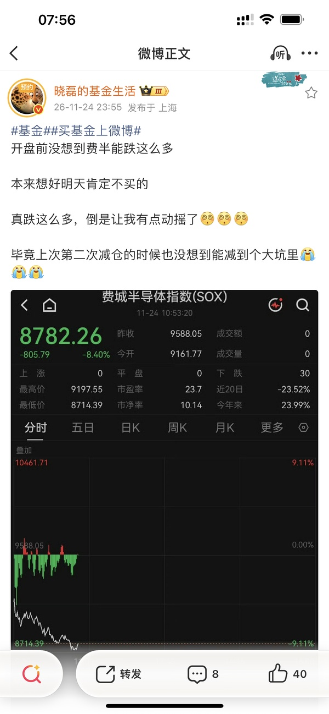
- 我订阅他组合的 帮你们盯一下
- 17号卖一次 20号卖一次 17号还是晚上卖等于18号卖 一共省下多少跌幅😂

### 大连圣亚（提及 12 次，占比 5%）2026-11-25 09:46:34
- 大连12月是赚钱主力
- 旅游板块异动拉升，祥源文旅直线涨停，大连圣亚、凯撒旅业、九华旅游、三峡旅游、君亭酒店跟涨。
- 昨天尾盘开始

大连已经完全脱离冰山为代表的山寨货

### 中文在线（提及 9 次，占比 4%）2026-11-25 15:03:53
- V老师不会同意你🤣
- V老师看到哪个产品去了

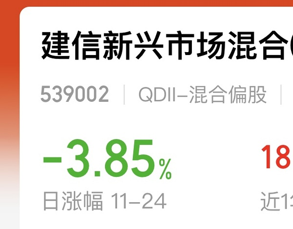
- 仰巨教授：变盘点11.30日

赵老师：昨晚变盘点12.9日

### 博纳影业（提及 7 次，占比 3%）2026-11-25 10:04:03
- 阿博愣着干嘛呢
吸引注意力时候不就是现在吗
- 阿博也不知道努力 就躺着看人家跌 傻东西
- 傻玩意bn
今天等着再被sy大逆转反超？

### 纳斯达克100 指数（他用来对照场内 ETF 溢价/涨幅的基准，非标的）｜11-13 00:16『今天图上看 nana依然是大阳线』＋07:57『昨天-0.7收盘 但是nana晚上其实只有-0.3 现在期货+0.5 今天场内应该开盘+0.9%』→ 实测 513300 开盘 2.710＝+0.82%（误差 0.08pp）（提及 5 次，占比 2%）2026-11-25 07:45:03
- 只要-2就跑输nana
- 如果是月初开始买的 应该不大
但我买的早啊 肯定大的

但是自从我月初买入nana后走势差不多 这个心情很平稳
- 我去

今天投票选项是不是没有开够啊
还会有第六个跑赢nana的吗

现在小广 小浦 小远 网易云音乐都跑赢了
亚洲跑赢是肯定的 已经五个了

### 双义：股票=中国长城 / 基金=华安文体健康混合（用户 11-05 指认）（提及 5 次，占比 2%）2026-11-25 11:03:32
- 我看看后面是中国补跌还是美国补涨😂😂😂😂

- 看到国富一惊
杨晓磊没买狄经理的国富
只要他不买 目前情况下 
应该不可能一天就没额度

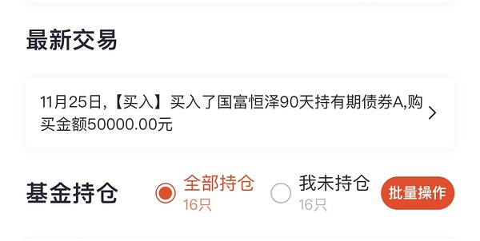
- 👍👍👍👍
只有经历过大起大落 
大家可能才能理解 为什么那个是最大比例

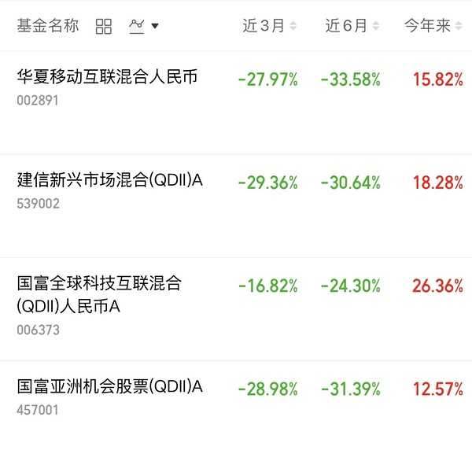

### 中证2000指数（他当微盘股基准）｜11-11 11:11「除了机器人 今天其他题材全输给了2000」（提及 4 次，占比 2%）2026-11-25 09:37:50
- 卧倒不懂 耐心等待微盘 2000企稳后反击
- 你也知道的 不到全场死绝 妈妈不会碰2000😂
2024.1月尤其记忆犹新
- 千股跌停才是激活妈妈买2000的条件😂😂😂😂

### ＝小华兄弟·华夏移动互联混合(QDII)（推断·证据不足不入表）｜11-16 17:26 裸报 -2.5% 疑似场外持有，无第一人称买入/持有自述、无截图（提及 4 次，占比 2%）2026-11-25 17:50:03
- 华夏兄弟-3.56%
- 看看这个图
华夏兄弟已经不再进攻

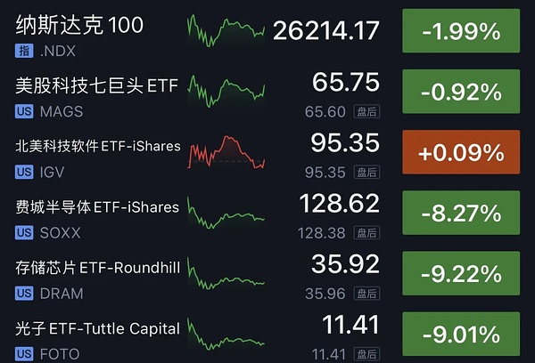
- 算上他的韩国台湾了
他前四大没有美国股票
所以昨天跟不上

这样三天加起来 比华夏兄弟好点🤣🤣🤣🤣

### 300413 芒果超媒（对照，非持仓）｜11-13 14:01 本月涨幅 41.70% vs 幸福 53.76% →『幸福已经拉开芒果12%』＝12.06pp 精确命中；当日 −4.83%（提及 3 次，占比 1%）2026-11-25 09:31:33
- 只有芒果
- 吗的
芒果不给力
- 昨天龙版切芒果大败😀😀😀😀

### 301010 晶雪节能（上周买回、11-16 持有）｜09:39『上周买了plus』＋14:53『掌声雪儿plus雪』；卖单 24.94 沿用 11-05 老价，当日高 24.39 未触及（提及 3 次，占比 1%）2026-11-25 09:50:29
- 我兑现plus了
- 我早上去掉了plus啊

我现在的我都喜欢
- 不过我今天plus卖的可以😂😂😂😂😂😂😂

### 友友、网友们（提及 3 次，占比 1%）2026-11-25 10:10:12
- 话说场外到底有uu加了微盘股基金的吗（我没钱）

- 笑死了

刚刚uu问我4点买和我们昨天转换是不是一样

本来是一样的 但是这次有个休市日 应该是不太一样了

这次就复杂在休市一天
- uu啊 沪深300全是科技股主导了
你看看走势 如果红利股主导 那个300能走成那样吗
我都点开过
我还发过呢

融资盘：我们宁愿战死 绝不碰银行股 绝不买任何红利 

融资盘：谁买红利谁是狗

![图片](https://raw.githubusercontent.com/homjanon/douban-tracker/main/data/images/2026

### 601595 上海电影｜**他空仓**（11-09 起未回接）；11-12 09:38『天天念叨sy的给你们机会了』＋09:41『现在-6给你们机会了哈』＋13:15『马上sy跌停 bn还要尊敬一下他』＋13:51『与此同时 sy跌停』＋14:00『sy历来以残暴虐杀手法闻名』；实测收 42.15 −9.99% 跌停（提及 3 次，占比 1%）2026-11-25 10:28:15
- 笑死
这样三天阿博和sy差不多了
- 那么看不起sy的爆发力？
- 这个就不提了 😂 
不过如果换sy 打击更大哈哈哈哈哈

### 605577 龙版传媒｜11-11 11:50「最早龙版也是因为自己每次公告文案都不一样才4连板就被监管」（讲监管规则，非持仓）（提及 3 次，占比 1%）2026-11-25 11:16:54
- 不用在意这一天
龙版提示没有结束
- 龙版提示不是🤣
- 你比我好啊
我昨天就S了龙版

### 513300 纳斯达克ETF华夏｜11-11 10:49「3300还行 不过今天我不满意」＋13:24「咱们3300还是近期数据最好的」（提及 2 次，占比 1%）2026-11-25 08:17:12
- 来计算3300了
昨天3点收盘+0.5 实际晚上-2 盘前现在-0.6
今天不杀溢价不提高溢价 标准开盘-3.1%

### 国产自主（半导体设备/芯片制造）（提及 1 次，占比 0%）2026-11-25 10:26:41
- 大家喜欢爱国
妈妈就买海外🤣

大家追海外
妈妈买爱国

### 格力电器（提及 1 次，占比 0%）2026-11-25 10:35:04
- 空调已经翻红了

### 招商银行（提及 1 次，占比 0%）2026-11-25 10:35:44
- 招招最近已经很拉了

### 余利，某牛逼投资者（提及 1 次，占比 0%）2026-11-25 11:29:10
- 哦 也可以余老师说的 银行差 但是其他红利继续爆发😂

### 航空航天板块（提及 1 次，占比 0%）2026-11-25 13:57:19
- 今天宇航员没反应啊？

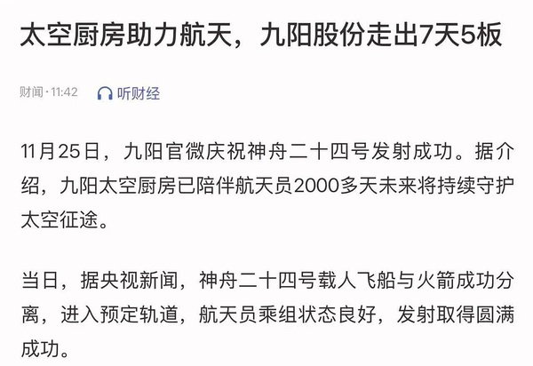

### 长白山 603099（CBS黑话；11-18 已清仓卖出）（提及 1 次，占比 0%）2026-11-25 14:56:47
- 你昨天不是说都是大连cbs冰雪吗😂

### 浦银安盛全球智能科技(QDII)A（提及 1 次，占比 0%）2026-11-25 15:19:02
- 今天投票

亚洲最多
小浦 小远  国富 紧随其后

亚洲因为赖皮肯定是稳如狗 就看其他几个了

### 东方海洋（提及 1 次，占比 0%）2026-11-25 16:15:22
- 你没有发现之前一起的所有冰雪都不跟他了吗😂
和东方海洋 她们一样了
今天午后襄阳也不带机器人
你得把他看作是市场高标了

### 广发全球精选股票(QDII)A（提及 1 次，占比 0%）2026-11-25 19:05:50
- 小广-1.45
小浦-1.66

### 富国全球科技互联网股票(QDII)A（提及 1 次，占比 0%）2026-11-25 20:20:51
- 不是 
网易云音乐前四大都不是美国导致的今天少跌
亚洲同理

三天累计计算你就知道谁是真的防守

### 📄 全部发言（共 255 条）
- (2026-11-25 07:45:03) 只要-2就跑输nana

- (2026-11-25 07:56:35) [图] 杨晓磊有意买回国富

- (2026-11-25 07:56:57) 我订阅他组合的 帮你们盯一下  ⊳ （引用 @不知道还能说啥）杨晓磊有意买回国富

- (2026-11-25 07:59:53) [图] 17号卖一次 20号卖一次 17号还是晚上卖等于18号卖 一共省下多少跌幅😂

  ⊳ （引用 @六倍做多退休）😂？

- (2026-11-25 08:03:15) 🤣  ⊳ （引用 @shirla）楼楼为啥换了个爱存不存的头像！😆😆😆

- (2026-11-25 08:03:53) 06:12:11【周三你需要知道的隔夜全球要闻：AI板块疲软费半指数重挫近8%；趋势追踪量化基金削减美债空头头寸；美国消费者信心升至近两年最高】

消费个毛线呀😅

- (2026-11-25 08:17:12) [图] 来计算3300了
昨天3点收盘+0.5 实际晚上-2 盘前现在-0.6
今天不杀溢价不提高溢价 标准开盘-3.1%

- (2026-11-25 08:31:18) [图] 中国光ETF暂时超涨美国光ETF5%
通信需要跌5%补足

- (2026-11-25 08:50:25) 两市融资余额较上日增加2.20亿元
截至11月24日，上交所融资余额报11195.33亿元，较前一交易日增加6.00亿元；深交所融资余额报10154.94亿元，较前一交易日减少3.80亿元；两市合计21350.27亿元，较前一交易日增加2.20亿元。

- (2026-11-25 08:50:33) 融资盘昨天犹豫了🤣🤣🤣🤣🤣🤣🤣  ⊳ （引用 @不知道还能说啥）两市融资余额较上日增加2.20亿元
截至11月24日，上交所融资余额报11195.33亿元，较前一交易日增加6.00亿元；深交所融资余额报10154.94亿元，较前一交易日减少3.80亿元；两市合计21350.27亿元，较前一交易日增加2.

- (2026-11-25 08:50:43) 昨天被打乱了节奏😂  ⊳ （引用 @VVV坚定持有VVV）🤔那今天又是我们垃圾主场了吧

- (2026-11-25 08:51:47) 别说外面了
就我们楼里昨天夜里看到美股
都在说会不会又玩科技了😂😂
资金还是被影响了  ⊳ （引用 @VVV坚定持有VVV）🤔那今天又是我们垃圾主场了吧

- (2026-11-25 09:31:33) 只有芒果  ⊳ （引用 @shirla）忘记问今天条件单了楼楼

- (2026-11-25 09:32:28) [图] 微盘股与众不同

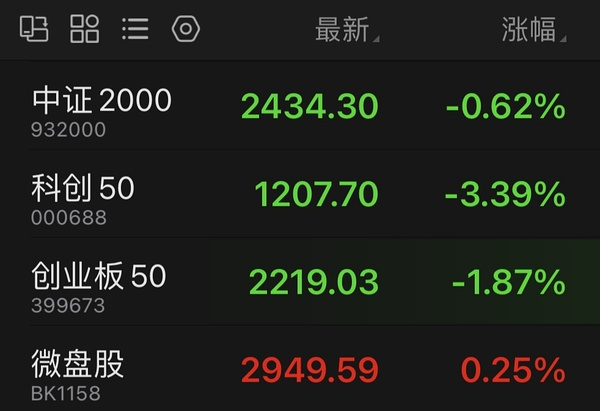

- (2026-11-25 09:35:56) 商业航天板块走强，利君股份涨停，邵阳液压涨超7%，司南导航、久之洋、中京电子、春晖智控等个股跟涨。

- (2026-11-25 09:36:49) 只要微盘股进入状态  ⊳ （引用 @点-重生炒垃圾）雪，我们拿回失去的一切好吗？

- (2026-11-25 09:37:50) 卧倒不懂 耐心等待微盘 2000企稳后反击

- (2026-11-25 09:40:09) 你看商场几个老乡好 这就是微盘反击准备启动  ⊳ （引用 @🈵仓即暴涨🤑）看看能不能把盖子掀掉

- (2026-11-25 09:41:38) 很快食品商场旅游就会互相扶持  ⊳ （引用 @🈵仓即暴涨🤑）中央板了

- (2026-11-25 09:42:57) 微盘股火箭发射

- (2026-11-25 09:43:02) 非常非常非常重要  ⊳ （引用 @不知道还能说啥）微盘股火箭发射

- (2026-11-25 09:44:19) 没有  ⊳ （引用 @点-重生炒垃圾）美国科技反弹？

- (2026-11-25 09:45:57) 妈妈狂买创业板  ⊳ （引用 @点-重生炒垃圾）美国科技反弹？

- (2026-11-25 09:46:14) 中国光大幅度超涨美国  ⊳ （引用 @不知道还能说啥）妈妈狂买创业板

- (2026-11-25 09:46:34) 大连12月是赚钱主力  ⊳ （引用 @仓部加措）今天轮到大连发力啦啦啦😭

- (2026-11-25 09:47:20) 上周问你们的猫猫问题

你们说不可能修复连续大阴线

现在觉得可能不

- (2026-11-25 09:48:24) 这个涨是妈妈换来的  ⊳ （引用 @一切都会过去的）我希望是美国补涨而不是中国补跌🥹

- (2026-11-25 09:48:55) 旅游板块异动拉升，祥源文旅直线涨停，大连圣亚、凯撒旅业、九华旅游、三峡旅游、君亭酒店跟涨。

- (2026-11-25 09:49:37) 本质都是微盘股的问题  ⊳ （引用 @柚子mm）一阳改三观了😂

- (2026-11-25 09:50:29) 我兑现plus了

- (2026-11-25 09:51:33) 旅游 和 羊  ⊳ （引用 @乖乖是只嘤嘤怪）祥源文旅是哪的啊

- (2026-11-25 09:53:00) 现在没有了

不过我又满仓了  ⊳ （引用 @shirla）哎？哪个plus啊，我以为楼已经没有晶雪了

- (2026-11-25 09:54:05) 吗的
芒果不给力  ⊳ （引用 @YuanZi💕）龙板来了

- (2026-11-25 09:55:43) 他们本来就是旅游 😂纯种 双子星

那些乱七八糟的才是山寨货  ⊳ （引用 @稀里不糊涂）这次是旅游带着大连和长白山

- (2026-11-25 09:56:05) 昨天尾盘开始

大连已经完全脱离冰山为代表的山寨货  ⊳ （引用 @稀里不糊涂）这次是旅游带着大连和长白山

- (2026-11-25 09:57:42) 旅游都是一路的  ⊳ （引用 @冬天他一定会来）峨眉山能行不

- (2026-11-25 09:58:20) 旅游市值实在太小了
太需要微盘股复苏
就和垃圾食品那边一样  ⊳ （引用 @冬天他一定会来）峨眉山能行不

- (2026-11-25 09:59:24) [图] 

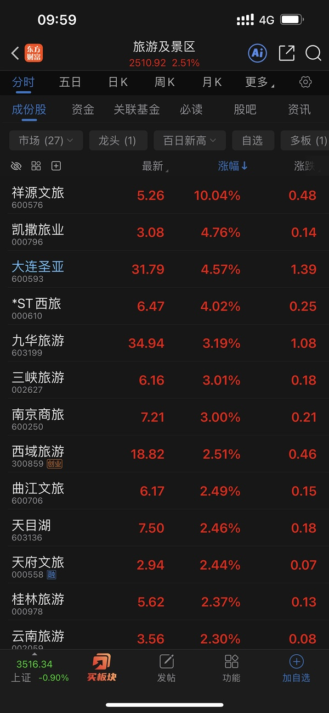

- (2026-11-25 10:00:24) 10:00:06 财联社11月25日电，台交所加权股价指数下跌7%至37,302.55点。(来自财联社APP)

- (2026-11-25 10:03:13) 应该是微盘股的修复问题😂之前都是A杀  ⊳ （引用 @六倍做多退休）是在打消费了吗 准备为12月zzj做准备？

- (2026-11-25 10:04:03) 阿博愣着干嘛呢
吸引注意力时候不就是现在吗

- (2026-11-25 10:07:33) 大的消费一直都在发科难财吧哈哈哈哈哈  ⊳ （引用 @六倍做多退休）😂因为我看青岛啤酒真的走的蛮不错的

- (2026-11-25 10:08:17) 中影跌幅太大
我绿了

- (2026-11-25 10:08:35) 😂😂😂😂😂😂😂😂😂😂

大连翻倍涨幅带我红回来啊  ⊳ （引用 @不知道还能说啥）中影跌幅太大
我绿了

- (2026-11-25 10:10:12) [图] 话说场外到底有uu加了微盘股基金的吗（我没钱）

- (2026-11-25 10:10:26) 只要微盘股复活 垃圾消费将开启绝地反击  ⊳ （引用 @不知道还能说啥）话说场外到底有uu加了微盘股基金的吗（我没钱）

- (2026-11-25 10:11:21) 我不骂 我挺满意的😂
因为今天很可能9+  ⊳ （引用 @嘻嘻子）你快骂骂大连🤬

- (2026-11-25 10:12:11) 昨天龙版切芒果大败😀😀😀😀  ⊳ （引用 @shirla）我前几天切了一点易方达血亏的科技过去hhh

- (2026-11-25 10:13:44) 牛逼啊👍👍👍👍👍👍还是你节奏好  ⊳ （引用 @shirla）我刚才龙版触发去了慈文😂😂瞎搞

- (2026-11-25 10:14:52) 微盘股早在上个月就下行 你知道仔细看
电影其实不跟微盘

上周爆杀没办法 全市场买单天普停牌
真正和微盘股息息相关的是垃圾消费  ⊳ （引用 @一切都会过去的）微盘这么好电影在干嘛呢

- (2026-11-25 10:17:05) 电影还垃圾？这个月能正收益都是电影给的  ⊳ （引用 @一切都会过去的）好吧电影独自垃圾

- (2026-11-25 10:17:52) 10:17:34 财联社11月25日电，台交所加权股价指数下跌8%至36,892.58点。(来自财联社APP)

大家看看外面

- (2026-11-25 10:19:58) 全球联动  ⊳ （引用 @moli）啥消息

- (2026-11-25 10:20:22) 大A在装逼 光超涨的厉害😂😂😂😂😂😂  ⊳ （引用 @moli）啥消息

- (2026-11-25 10:21:21) 应该是妈妈的威力才能装这个B😂  ⊳ （引用 @moli）补跌预定

- (2026-11-25 10:22:41) 得益于微盘股大涨
今天上涨家数更多

- (2026-11-25 10:22:58) 57涨停 3跌停 情绪正常  ⊳ （引用 @不知道还能说啥）得益于微盘股大涨
今天上涨家数更多

- (2026-11-25 10:25:28) 来啦  ⊳ （引用 @冬天他一定会来）东方海洋别输给九阳！冲！

- (2026-11-25 10:26:41) 大家喜欢爱国
妈妈就买海外🤣

大家追海外
妈妈买爱国  ⊳ （引用 @moli）妈妈为何不放手一跌

- (2026-11-25 10:27:39) 对账户太关键了  ⊳ （引用 @大连海底站岗员）zy在爬了

- (2026-11-25 10:28:15) 笑死
这样三天阿博和sy差不多了  ⊳ （引用 @ü）脖子今天还蛮抗跌的

- (2026-11-25 10:29:11) 盘前-0.9

溢价不抹不杀

应该开盘-3.4  ⊳ （引用 @不知道还能说啥）来计算3300了
昨天3点收盘+0.5 实际晚上-2 盘前现在-0.6
今天不杀溢价不提高溢价 标准开盘-3.1%

- (2026-11-25 10:29:22) 昨天有小作文  ⊳ （引用 @moli）今天债怎么也绿了😂

- (2026-11-25 10:30:04) 微盘股复活了
一点不着急  ⊳ （引用 @公主要发财）sy也在爬了

- (2026-11-25 10:31:56) 又开始bbbbbbb提高溢价了  ⊳ （引用 @monica）开盘-3

- (2026-11-25 10:32:58) SY漂亮

- (2026-11-25 10:35:04) 空调已经翻红了  ⊳ （引用 @公主要发财）同时招招也在上，哈哈哈。还能不能愉快的定投了

- (2026-11-25 10:35:44) [图] 招招最近已经很拉了

  ⊳ （引用 @公主要发财）同时招招也在上，哈哈哈。还能不能愉快的定投了

- (2026-11-25 10:37:00) 阿博也不知道努力 就躺着看人家跌 傻东西  ⊳ （引用 @🈵仓即暴涨🤑）咋又下去，下面到底有谁在

- (2026-11-25 10:44:33) 微盘股反击
垃圾消费的主阵地  ⊳ （引用 @早八走狗来财）青岛拉板？

- (2026-11-25 10:45:53) 你的笔记里没有小慧和安安的死亡换手记录吗

到数字就必须跑路那个数字  ⊳ （引用 @寒灯思旧事）惠惠加油吧，之前三连板的收益都没了😭

- (2026-11-25 10:48:20) 🤣大连开始救账户了 也是好的开始  ⊳ （引用 @大连海底站岗员）账户靠大连救不起来

- (2026-11-25 10:49:32) 各大宽指数都被科技绑定了  ⊳ （引用 @酸奶不舔盖）为啥现在大盘每天动不动就是一个点的涨跌幅

- (2026-11-25 10:51:18) 我的笔记里有小慧和安安的
不过我没玩就没有打开来看

他们都有自己的死亡换手数字🤣🤣🤣🤣🤣  ⊳ （引用 @钱多多多多多）小惠爆量换手还是太麻烦了
下一次18%换手我要做大仓位兑现了😂
不过他是真的很有规律
是那种真的 买在人人嫌弃 卖在人人都要🤣（以前你说的复制）

- (2026-11-25 10:53:02) 现在67涨停 3跌停😂  ⊳ （引用 @不知道还能说啥）57涨停 3跌停 情绪正常

- (2026-11-25 10:54:03) 我不行 中影跌太多了😂😂😂😂😂😂
要么传媒里有拉起来一些的 要么大连加大努力  ⊳ （引用 @西西西西）非常好 靠它我今天还红着

- (2026-11-25 10:55:04) 微盘股刚刚跳水  ⊳ （引用 @🈵仓即暴涨🤑）但绿的家数越来越多了😵

- (2026-11-25 11:01:33) 昨天大连那边有好消息
今天传媒同样有好消息

龙版刷掉了昨天的针
至少意味着龙版并没有提示传媒见顶

- (2026-11-25 11:03:32) [图] 我看看后面是中国补跌还是美国补涨😂😂😂😂

  ⊳ （引用 @稀里不糊涂）指数真绿啊

- (2026-11-25 11:07:45) 大部分都给大连了啊
本来应该433后来变成了64
大连自己下跌变成了差不多55  ⊳ （引用 @momo）话说楼之前cbs给雪人的钱会考虑还回去双子星嘛

- (2026-11-25 11:09:41) 你买是今晚的美股

转换就不是  ⊳ （引用 @速派女孩将发财）我们今天买狄经理 是买的收盘后的价格 还是买的昨天收盘后的价格啊

- (2026-11-25 11:12:24) [图] 

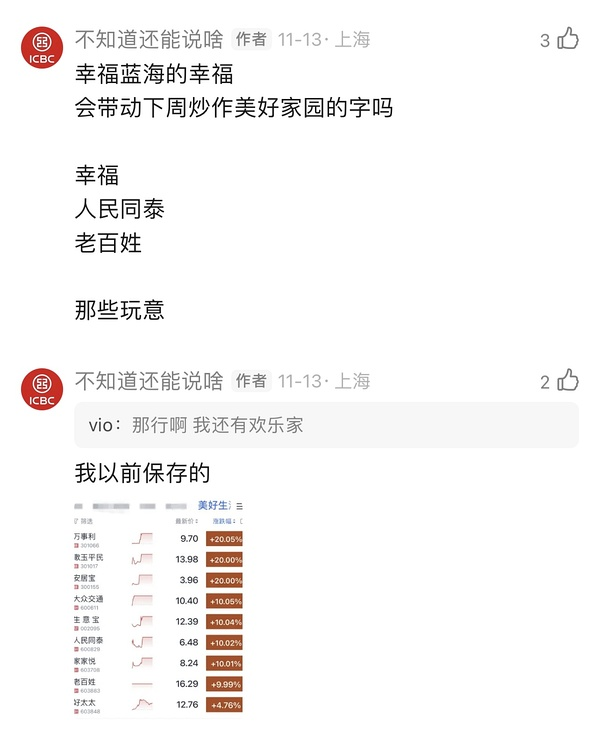  ⊳ （引用 @有空青年胃不饱）现在是搞美好祝愿吗 好多涨停、万事利 人名同泰 家家悦 合富 桂发祥 好当家 报喜鸟渣土但是炸板了

- (2026-11-25 11:12:50) 我昨天详细解释过

你今天中国鸡最终晚上净值都不知道 金额都不知道的  ⊳ （引用 @粒昂）我以为转换也是买的今晚美股收盘后

- (2026-11-25 11:13:33) [图] 13号你就能去布局

  ⊳ （引用 @momo）如果我们能知道啥时候炒，就好了，能提前布局

- (2026-11-25 11:14:09) 红利微盘自己人😂  ⊳ （引用 @sickid）银行深V上来了，唉

- (2026-11-25 11:16:08) 老垃圾人了

每年这时间都玩这些

你可以笔记记下来 而且股票不带变的  ⊳ （引用 @momo）根本没注意！

- (2026-11-25 11:16:54) 不用在意这一天
龙版提示没有结束  ⊳ （引用 @🈵仓即暴涨🤑）这把是真的吧

- (2026-11-25 11:17:42) 12月还会玩春节相关  ⊳ （引用 @momo）可以可以☺️

- (2026-11-25 11:19:17) 那么看不起sy的爆发力？  ⊳ （引用 @Aaa摆烂咸鱼🥳）开盘慈文换上影，失败了，感觉慈文今天还挺抗跌

- (2026-11-25 11:19:36) 你名字换晚了  ⊳ （引用 @🈵仓即暴涨🤑）不是一天的问题，是我本月还碧绿😒

- (2026-11-25 11:21:29) 发挥不了

看好继续炒垃圾 就不能看空红利 互相矛盾  ⊳ （引用 @没有感情的村民）楼的头像魔力还没发挥

- (2026-11-25 11:23:33) 😂😂😂😂😂😂这东西是真的每年必有  ⊳ （引用 @哄哄🐮）😂那天我跑去模拟盘摸了hhh，挑了几个顺眼了，只有人民同泰大涨大跌。

- (2026-11-25 11:24:47) 傻玩意bn
今天等着再被sy大逆转反超？

- (2026-11-25 11:26:39) 其实按照规律
今天应该百股涨停的

大家昨天也看到了这个模式

- (2026-11-25 11:27:42) 今天应该很多人就是这么操作的  ⊳ （引用 @该用户已过期）快按耐不住跛子换给上影的心了

- (2026-11-25 11:29:10) 哦 也可以余老师说的 银行差 但是其他红利继续爆发😂  ⊳ （引用 @没有感情的村民）😵😵😵

- (2026-11-25 11:48:19) [图] ……

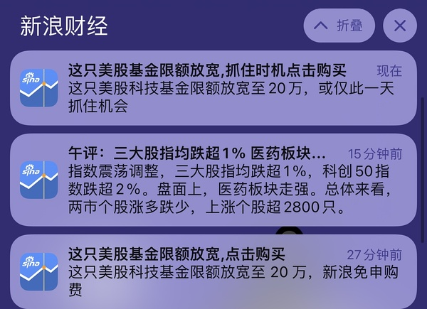

- (2026-11-25 11:50:39) 半小时提示2次什么鬼 已经买了不用提醒我了  ⊳ （引用 @不知道还能说啥）……

- (2026-11-25 11:50:58) 主要是半小时推送两次了😂  ⊳ （引用 @一直在摸🐟）国富的广告啊

- (2026-11-25 11:54:09) 还有羊  ⊳ （引用 @sickid）祥源文旅居然是旅游+短剧？

- (2026-11-25 11:55:15) 我们怎么在传媒完成大亏到大赚超级大逆转的
冰雪也一样  ⊳ （引用 @该用户已过期）我以为你是坚守不动呢🤣🤣我没有cbs了……我只有二熊

- (2026-11-25 12:04:28) 我觉得是新浪自己的广告
新浪基金最近营销很多
在新浪买基金很多不要手续费  ⊳ （引用 @一直在摸🐟）国富的广告啊

- (2026-11-25 12:05:00) 龙版提示不是🤣  ⊳ （引用 @点-重生炒垃圾）垃圾传媒是不是跟着机器人一起退潮了。。。。消费当道？消费是不是逆指数来一天就算了？

- (2026-11-25 12:07:46) [图] 垃圾消费的万能钥匙就是跟微盘股走的

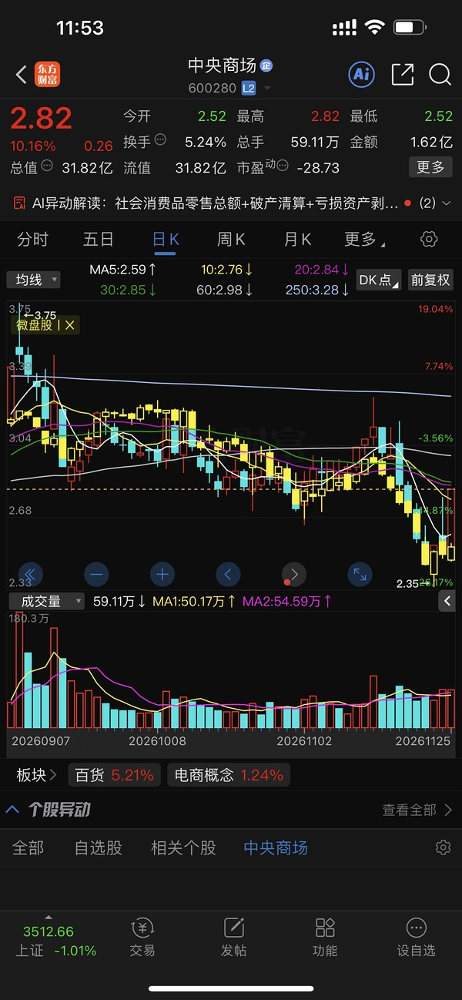  ⊳ （引用 @点-重生炒垃圾）垃圾传媒是不是跟着机器人一起退潮了。。。。消费当道？消费是不是逆指数来一天就算了？

- (2026-11-25 12:10:52) 老破小和郊区几个地方是在涨😂
有不少地方租金已经高于贷款月供了  ⊳ （引用 @sickid）港股居然在涨内房股，中金说上海房价已转涨？真的吗

- (2026-11-25 12:14:10) 像小慧那种几乎吃了五个跌停😂😂😂
他们确实应该嗨一把了
传媒这边大部分都是四连板结束了 而且第四天的跌停其实也不是真跌停 都被咱们这种博弈资金捞上来了🤣

他们是应该修复了  ⊳ （引用 @sickid）怎么感觉因为今天缩量，垃圾和垃圾之间有点互吸？

- (2026-11-25 12:20:01) 可能的 他去年也专门周线N字  ⊳ （引用 @sickid）你觉得中影有可能头肩吗？离5月线也有点远

- (2026-11-25 12:27:01) [图] 看到国富一惊
杨晓磊没买狄经理的国富
只要他不买 目前情况下 
应该不可能一天就没额度

- (2026-11-25 12:32:23) 应该兑现

但是我兑现了也会出去浪 我不如呆着  ⊳ （引用 @momo）s姐，如果中影有可能头肩的话，那现在该怎么操作

- (2026-11-25 12:38:36) 中影八月就见底一路上攻 你觉得他们一样吗  ⊳ （引用 @稀里不糊涂）中影头肩那xf是不是也涨不起来啊

- (2026-11-25 13:13:08) 因为这一次26号休市关盘  ⊳ （引用 @楚楚）这是转换的

- (2026-11-25 13:19:17) 散户有这个能力几个月都能控异动控到多次就差一分吗  ⊳ （引用 @啊呆呆呆呆）里面都没有游资了，如果格局下去都不抢跑散户搞不好能一直抱团顶上去，就是之前做圣阳的那个散户叫野人那个，他就带着他的一堆散户粉丝在格局这个九阳。🤣

- (2026-11-25 13:20:57) bn咋了
三天累计反超sy了  ⊳ （引用 @只想搞钱）不是bn你跟我这闹呢

- (2026-11-25 13:23:52) 今天碳酸锂-7  ⊳ （引用 @速派女孩将发财）宁德时代214 新低了 是什么意思啊？各位老师？
减产传闻是真的嘛

- (2026-11-25 13:25:40) 报

国富额度危

杨晓磊买入了

- (2026-11-25 13:25:59) [图] 

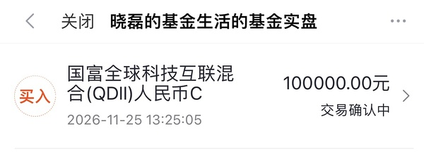  ⊳ （引用 @不知道还能说啥）报

国富额度危

杨晓磊买入了

- (2026-11-25 13:26:40) 谁帮我算算
18号 20号他卖 现在买 到底省了多少钱？  ⊳ （引用 @康贝瑞拉）他又回来了

- (2026-11-25 13:27:13) 他的10万会放大上千人1万 10万  ⊳ （引用 @速派女孩将发财）他发车买了10w

- (2026-11-25 13:28:34) 国富大金主  ⊳ （引用 @momo）他是谁啊

- (2026-11-25 13:30:02) 额度也是他卖了才出来的呀  ⊳ （引用 @Victoria）讨厌啊

- (2026-11-25 13:38:53) 有的  ⊳ （引用 @有人区生菜）还有奇迹吗

- (2026-11-25 13:40:33) …….
那等于低卖高买了？  ⊳ （引用 @六倍做多退休）我计算了下之前的操作相当于按照5.3668的净值卖掉了57274.46份

- (2026-11-25 13:40:57) 大家等的东西可能不一样😂  ⊳ （引用 @稀里不糊涂）等尾盘冰雪了

- (2026-11-25 13:43:15) 我去
又没股债跷跷板

美债又是杯水车薪  ⊳ （引用 @六倍做多退休）。。股的确很烂 债也很烂😰 又是全方位的大鼻窦 

- (2026-11-25 13:44:19) 涨停60+也没变动😂  ⊳ （引用 @sickid）现在才7个跌停

- (2026-11-25 13:46:37) 问题还是因为周一暴涨了😂 他周五卖的那笔没有任何便宜

最关键的是 他又在今天买了  ⊳ （引用 @六倍做多退休）18号的净值5.5966 卖了25103.05 20号净值5.1463卖了26171.41 算出来是这样诶 不过不确定明天更新的净值如何 😂 

- (2026-11-25 13:49:28) [图] 

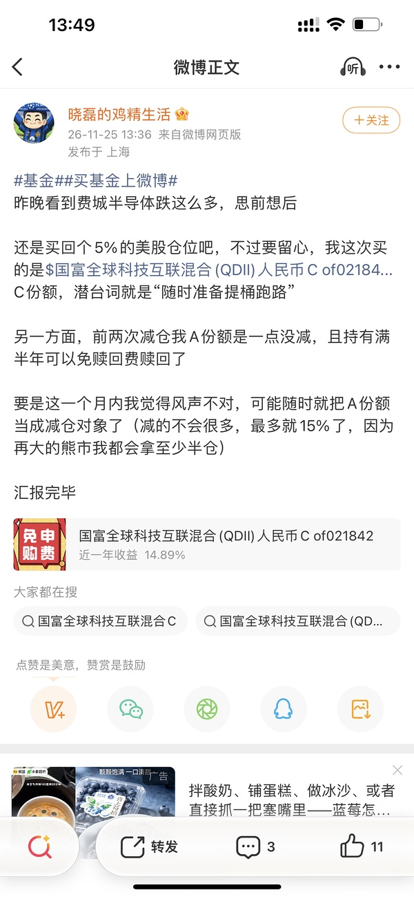  ⊳ （引用 @六倍做多退休）其实我好奇 他们判断美股下行 那么15%-20%的跌幅吧 应该也不着急现在买回来 基金做t可还行

- (2026-11-25 13:53:35) 很多跌幅又差不多了
又是大家去掉讨厌的 换到喜欢的时候了😂

- (2026-11-25 13:54:44) 我早上去掉了plus啊

我现在的我都喜欢  ⊳ （引用 @该用户已过期）你换啥了？

- (2026-11-25 13:57:19) [图] 今天宇航员没反应啊？

- (2026-11-25 14:06:30) 来看看
市场有冰点吗

涨停50+ 跌停少的可怜 ：不符合
市场爆量吗 是缩量3000 ：不符合
所有指数都大跌吗 上证50跌幅不到1% ：不符合

结论：没有冰点

- (2026-11-25 14:07:36) [图] 关键这个没补回来

而且美国在跌 还得多补

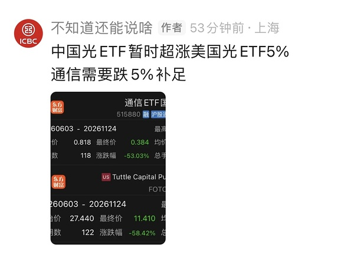  ⊳ （引用 @凯恩拿下金球😋）深证率先新低了

- (2026-11-25 14:09:07) 怎么了？
周一大赢都没吞没呢  ⊳ （引用 @稀里不糊涂）楼你还是满仓吗

- (2026-11-25 14:13:29) 是美国反弹  ⊳ （引用 @稀里不糊涂）拉创业板了

- (2026-11-25 14:13:52) 正好小反弹😂  ⊳ （引用 @哄哄🐮）期货-1.32%

- (2026-11-25 14:22:19) 我又没变来变去过  ⊳ （引用 @小肥肥）楼楼现在啥板块呀

- (2026-11-25 14:23:39) bn：追平全不费工夫  ⊳ （引用 @该用户已过期）sy要躺板板啊😭😭

- (2026-11-25 14:24:00) 龙头就是龙头  ⊳ （引用 @YuanZi💕）龙板涨停

- (2026-11-25 14:27:13) bn：那么努力有用吗 还是一地鸡毛 你们还是会骂的 🤣  ⊳ （引用 @该用户已过期）有本事往上追啊🤣🤣它这是纯躺赢了

- (2026-11-25 14:29:11) 等了新低也没用的
全球联动  ⊳ （引用 @何为）他们是不是在等科创50新低呢？

- (2026-11-25 14:30:25) 是的  ⊳ （引用 @夜空中最亮的星）啊，我想问一下，我京东赎回的新趋势和信澳今天4点能到账，然后再去买国富的话是不是和你们一键转换的是同一天买入成功的啊？

- (2026-11-25 14:36:38) 你比我好啊
我昨天就S了龙版  ⊳ （引用 @shirla）😂😂早上换慈文大失败啊

- (2026-11-25 14:37:11) 不过我今天plus卖的可以😂😂😂😂😂😂😂  ⊳ （引用 @shirla）😂😂早上换慈文大失败啊

- (2026-11-25 14:40:50) 你们没信心问我可没用  ⊳ （引用 @Aaa摆烂咸鱼🥳）楼之前的中韩半导体还拿着不

- (2026-11-25 14:43:23) [图] 在啊

bn赢

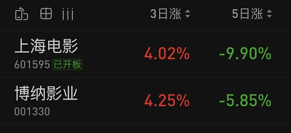  ⊳ （引用 @shirla）楼楼sy还留着没，让他跟bn他俩pk！

- (2026-11-25 14:44:32) 你在做梦呢😂  ⊳ （引用 @山中食人花）楼的半导体应该还是赚钱的 现在溢价还有7.66呢

- (2026-11-25 14:46:49) 你怎么只看溢价呢

韩国如果再跌20% 溢价也可以是7%啊

你是不是误解了  ⊳ （引用 @山中食人花）啊 你没赚钱了吗 哈哈哈
我看溢价还可以呢

- (2026-11-25 14:50:17) 因为微盘股

如果大家觉得微盘股没有企稳
要远离垃圾消费

想的要和做的一样  ⊳ （引用 @稀里不糊涂）消费也全被带下来了

- (2026-11-25 14:55:19) 因为妈妈来了  ⊳ （引用 @只想搞钱）格力框框拉

- (2026-11-25 14:56:47) 你昨天不是说都是大连cbs冰雪吗😂  ⊳ （引用 @梳碧湖砍柴人）今天又是大绿，我也没钱买国富了

- (2026-11-25 14:59:21) 虽然大连不足以对冲传媒那边
但是总算迈出了第一步
也是好事👍  ⊳ （引用 @👑）今天的英雄——大连（额！）

- (2026-11-25 14:59:47) 期待你后续拿出足以对冲的实力  ⊳ （引用 @不知道还能说啥）虽然大连不足以对冲传媒那边
但是总算迈出了第一步
也是好事👍

- (2026-11-25 15:01:22) 和昨天尾盘一样 大连开始植入了自主思维🤣🤣🤣🤣🤣🤣🤣🤣🤣🤣  ⊳ （引用 @👑）它其实连雪人都对冲不了，但是它好歹没绿，最后还v了点 加加油吧

- (2026-11-25 15:03:17) 我给大家说个冷知识
在我主要的持仓里 （就是龙版那种不算）
累计三天反弹涨幅最好的是大连

- (2026-11-25 15:03:53) V老师不会同意你🤣  ⊳ （引用 @一切都会过去的）国富更好啊

- (2026-11-25 15:05:42) 我现在-3.2  ⊳ （引用 @小肥肥）娜娜现在是在底部区域了吗🤣

- (2026-11-25 15:06:11) 26号休市关盘
现在26号了  ⊳ （引用 @何为）国富买不了啦?

- (2026-11-25 15:07:34) 笑死了

刚刚uu问我4点买和我们昨天转换是不是一样

本来是一样的 但是这次有个休市日 应该是不太一样了

这次就复杂在休市一天  ⊳ （引用 @不知道还能说啥）26号休市关盘
现在26号了

- (2026-11-25 15:07:52) 4点他不让你买了  ⊳ （引用 @不知道还能说啥）笑死了

刚刚uu问我4点买和我们昨天转换是不是一样

本来是一样的 但是这次有个休市日 应该是不太一样了

这次就复杂在休市一天

- (2026-11-25 15:08:01) 15:07:44【5只宽基ETF成交额较上一日实现翻倍 沪深300ETF华夏（510330）创近10个月天量】财联社11月25日电，据财联社盯盘数据显示，沪深300ETF易方达（510310）全天成交95.5亿元，较上一日增4倍，沪深300ETF华夏（510330）全天成交125.8亿元，创2026年1月28日以来天量，中证500ETF南方（510500）、科创50ETF易方达（588080）、上证50ETF华夏（510050）全天成交超73亿元，均较上一日增超1倍。(来自财联社APP)

- (2026-11-25 15:08:56) 我觉得我们最近光严重超涨 都是妈妈的功劳

但是如果美国是继续下跌

这个超涨必然归还  ⊳ （引用 @不知道还能说啥）15:07:44【5只宽基ETF成交额较上一日实现翻倍 沪深300ETF华夏（510330）创近10个月天量】财联社11月25日电，据财联社盯盘数据显示，沪深300ETF易方达（510310）全天成交95.5亿元，较上一日增4倍，沪深300

- (2026-11-25 15:11:05) 近三天

创业板+3 0 -4 =-1
韩国 -3 +6 -6=-3
日本-5 +4 -2.8=-3.8

这个少跌有妈妈的功劳
但是命运不在妈妈手里  ⊳ （引用 @不知道还能说啥）我觉得我们最近光严重超涨 都是妈妈的功劳

但是如果美国是继续下跌

这个超涨必然归还

- (2026-11-25 15:15:47) [图] 你这个问题
我得有两点提醒你了

1，这个图你肯定没看 如果是女孩子就相当于一个世代皇室贵族想要迎娶你 但你却看向了一夜爆发户

2，你应该也忘记了我我最初说的配置比例里哪个应该最高

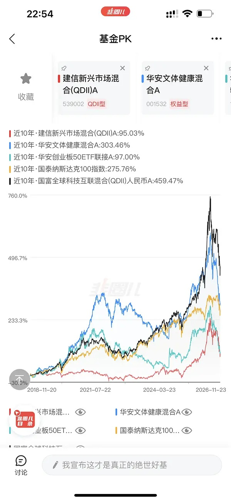  ⊳ （引用 @粒昂）我也想问这次建信开额度的话，楼楼会转一点吗，虽然这个额度对楼楼应该太少了

- (2026-11-25 15:19:02) 今天投票

亚洲最多
小浦 小远  国富 紧随其后

亚洲因为赖皮肯定是稳如狗 就看其他几个了

- (2026-11-25 15:22:49) [图] 👍👍👍👍
只有经历过大起大落 
大家可能才能理解 为什么那个是最大比例

  ⊳ （引用 @荣誉黑粉涨停版）帮大家回忆一下，不客气

- (2026-11-25 15:27:15) 来记录3300了
今天15点收盘期货-1.7%
不杀遗漏0.5%的情况下  标准收盘应该-4.2%
实际3300收盘-3.9% 再次略微提高了0.3%溢价
买入后累计提升0.8%溢价了  ⊳ （引用 @不知道还能说啥）来计算3300了
昨天3点收盘+0.5 实际晚上-2 盘前现在-0.6
今天不杀溢价不提高溢价 标准开盘-3.1%

- (2026-11-25 15:31:02) 你看好微盘股继续跌的时候  ⊳ （引用 @Meow🦁）楼楼，请问东方海洋这类型要看到什么信号才会出呀

- (2026-11-25 15:34:01) [图] 最新阶段 名媛和盈盈不行啊？
都是大酒了
但是缺席了一个大酒 缺谁谁尴尬🤣🤣🤣

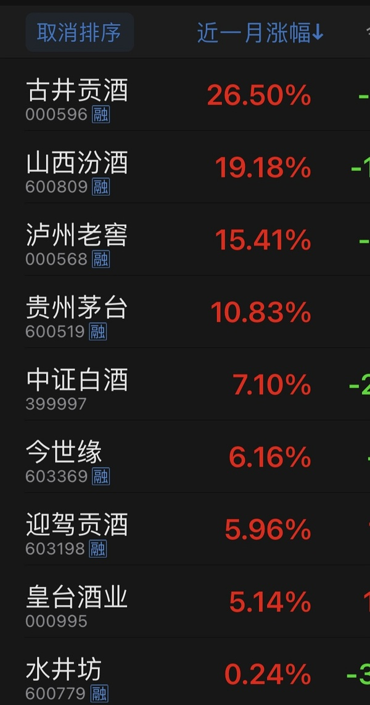

- (2026-11-25 15:35:25) 他最后一笔要65以下😂😂😂  ⊳ （引用 @sickid）那个谁还在定投舞娘吗

- (2026-11-25 15:36:04) 没人建议她去买银行吗  ⊳ （引用 @momo）😂

- (2026-11-25 15:36:34) 买到了 写的27转入🤣
因为26关盘 感恩节
现在已经是股市26了  ⊳ （引用 @小鱼）奇怪国富支付宝停止申购了，那前天转换的买到了吗😓

- (2026-11-25 15:38:46) 考虑到杨晓磊今天是下午发车
可能很多很多跟投人没看到
看到了已经是现在这种盘后了😂😂
但是现在又不能买了
所以国富至少27号肯定还能买大额（也就是明天盘后肯定还有额度）  ⊳ （引用 @小鱼）奇怪国富支付宝停止申购了，那前天转换的买到了吗😓

- (2026-11-25 15:40:19) [图] 银行只是红利的一部分😂

红利低波现在前20大根本没银行

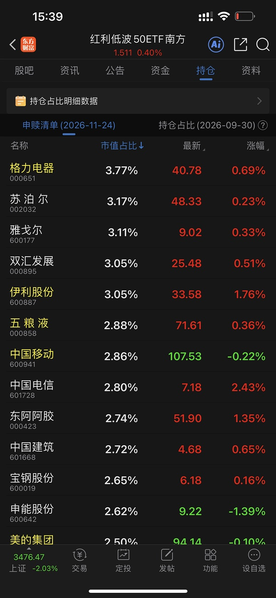  ⊳ （引用 @稀里不糊涂）六便士提示银行谨慎介入，余力也说，趋势动物依旧红利右侧，银行还涨一下是不是也要下来了

- (2026-11-25 15:43:03) 今天5000家下跌  ⊳ （引用 @qiu啾）才看到sy今天异动的原因是红果监✘管新规。传媒会被影响吗

- (2026-11-25 15:44:15) 这知名医院附近好像也有关系😂  ⊳ （引用 @sickid）因为这两个地段都很好哈哈哈

- (2026-11-25 15:45:23) 真的假的？

手机等等党能大获全胜吗  ⊳ （引用 @没有感情的村民）尼玛，今天项目同事跟我说内存一条降了5000，我服了

- (2026-11-25 15:46:42) 不是
如果pce很好 美债收益率不会这么崩
就是恐慌性抛售😂

麻烦的是 我们还少跌了不少 妈妈一松手就得补跌  ⊳ （引用 @小白吐司）nana是因为今晚的PCE吗

- (2026-11-25 15:54:19) [图] 😂怎么说呢
话术和业绩都好 而且大户很多
你看他的人

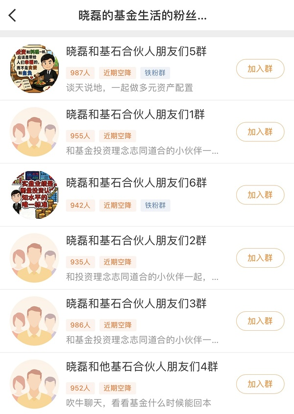  ⊳ （引用 @shirla）这个这个他号召力这么强是为嘛？

- (2026-11-25 16:01:55) 趋势动物今年准确率如日中天哦
几乎没有错过  ⊳ （引用 @稀里不糊涂）估计银行是真不能介入了，好几个这么说，最多再涨涨

- (2026-11-25 16:05:46) [图] 有的银行小暑了 有的刚立夏😂

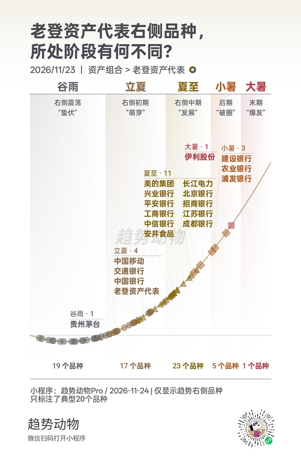  ⊳ （引用 @shirla）说明啥，最近是极端趋势行情吗🤣🤣

- (2026-11-25 16:07:05) 当之无愧除了亚洲外选票最多的😂  ⊳ （引用 @VVV坚定持有VVV）小远1.56👍🏻

- (2026-11-25 16:10:40) 他还没摆脱😂大连昨天尾盘已经摆脱  ⊳ （引用 @该用户已过期）楼，雪人最近咋回事啊？🤣🤣

- (2026-11-25 16:12:18) 我提醒你一下哦
plu的21000 是nana100 不是nana
现在nana100 26000  ⊳ （引用 @荣誉黑粉涨停版）离传说中的21000还有12%😮‍💨

- (2026-11-25 16:15:22) 你没有发现之前一起的所有冰雪都不跟他了吗😂
和东方海洋 她们一样了
今天午后襄阳也不带机器人
你得把他看作是市场高标了  ⊳ （引用 @该用户已过期）但是也不跟冰山了啊🤣🤣它不如一直跟到底做龙二！

- (2026-11-25 16:20:29) 避险
股债跷跷板  ⊳ （引用 @稀里不糊涂）老美是不是走了一步错棋啊，美股涨美债上行，美股跌美债下行这是啥意味啊

- (2026-11-25 16:23:58) 美股跌 美债收益率就会下
加息预期就是看美债收益率的😂

目前在看美股涨跌 不是两次就三次的摇摆中

2年期美债收益率上到4.75 三次 5%四次
4.5 2次 而且完全不定价第三次 

你就看这个就行 实时的
利率概率图就是根据这个交易的  ⊳ （引用 @稀里不糊涂）现在点阵图定价几次加息了

- (2026-11-25 16:27:00) 跌的时候不会有😂  ⊳ （引用 @vio）有没有好点的消息了，崩溃

- (2026-11-25 16:34:04) 累了
今天债券大跌  ⊳ （引用 @sickid）短线博主说明天如果再低开下杀破位，可以买科创和🤖

- (2026-11-25 16:35:54) 🤣这一年好像很多车的价格也是狠狠杀猪盘  ⊳ （引用 @冰雪go）我刚刚看了一眼基金…心梗了
买车计划推迟两年吧

- (2026-11-25 16:39:31) 累了 最近中国都没股债跷跷板了………..  ⊳ （引用 @sickid）难得看到你也说累了

- (2026-11-25 16:57:26) 你也知道的 不到全场死绝 妈妈不会碰2000😂
2024.1月尤其记忆犹新  ⊳ （引用 @初筱玖）妈妈买点别的啊，小垃圾不跟老美

- (2026-11-25 16:57:57) 千股跌停才是激活妈妈买2000的条件😂😂😂😂  ⊳ （引用 @初筱玖）妈妈买点别的啊，小垃圾不跟老美

- (2026-11-25 16:59:23) 现在已经80%
券商已经调了 上面通知他们提前调节的  ⊳ （引用 @qiu啾）关注的博主说:融✘资✘盘那边高位下来已经回撤28%了，按今天这个跌法，这几天被强平的会越来越多。撑到30号，保证✘金比例降低到80%，才会缓解。
其实也差不多是换月了吧

- (2026-11-25 17:06:33) 不说ai问题了
这个月初放的cpi 就业都是大超预期
真的没有好消息😂😂😂😂

看看今晚pce是不是一超到底  ⊳ （引用 @qiu啾）是啊，我还在想提前调节了。其实还是等感恩节后对岸缓解吧，或者叠加换月buff

- (2026-11-25 17:09:34) [图] uu啊 沪深300全是科技股主导了
你看看走势 如果红利股主导 那个300能走成那样吗
我都点开过
我还发过呢

融资盘：我们宁愿战死 绝不碰银行股 绝不买任何红利 

融资盘：谁买红利谁是狗

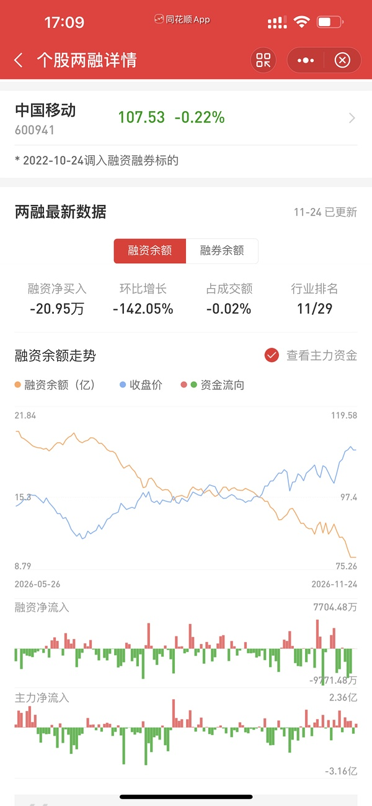  ⊳ （引用 @速派女孩将发财）北证融资余额只有34亿了 沪深300融资都是买红利的吧 那也没什么可以杀的了吧 🥹

- (2026-11-25 17:10:53) [图] 融资盘：死也要死的光荣🤣

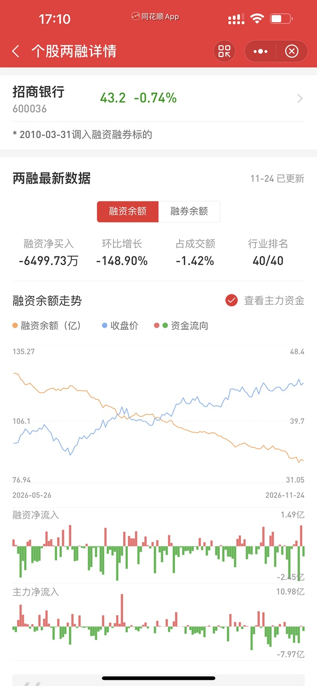  ⊳ （引用 @速派女孩将发财）北证融资余额只有34亿了 沪深300融资都是买红利的吧 那也没什么可以杀的了吧 🥹

- (2026-11-25 17:13:25) 现在这样还叫阴跌吗🤣🤣🤣🤣🤣  ⊳ （引用 @荣誉黑粉涨停版）要杀就赶紧杀，我讨厌阴跌

- (2026-11-25 17:14:28) 昨天抓的人级别不低🤣🤣🤣🤣🤣🤣

你想抓wu了  ⊳ （引用 @初筱玖）那还得有个抓人底

- (2026-11-25 17:15:44) 是的

我们是否应该怀疑 数据在故意做好

到时候几个月后全是前几个月数据下修  ⊳ （引用 @稀里不糊涂）美国人心态这么好的吗，他们房贷利率7都能扛住，然后最近股市跌这么多还有消费的心情

- (2026-11-25 17:17:17) 北50年初认输了
我认输都是北交所的效率 那时候没跌那么多😂
虽然就五万 也是钱啊 跌成狗了
而且这玩意没有政策 我一点看不到起来的可能性🤣🤣🤣  ⊳ （引用 @速派女孩将发财）一句话： 北证50 不仅不是本轮表现最好的板块指数，反而是主要宽基里跌幅最大的一只（高点回撤 -53.2%、年内 -47.5%），只在个别单周和单日反弹中跑赢过科创50、创业板指；宽基中真正抗跌的是上证50（-13.4%），行业里则是中证银

- (2026-11-25 17:18:30) 今晚发的pce是10月数据
下个月初发这个月cpi和非农  ⊳ （引用 @稀里不糊涂）下次发消费数据是在12月初吗

- (2026-11-25 17:24:16) 没有出现大的亏钱负反馈

- (2026-11-25 17:29:50) 今天得不买传媒不买科技不买机器人的 应该跌幅还好😂😂😂😂  ⊳ （引用 @sickid）我传媒多，超级大的负反馈！

- (2026-11-25 17:31:35) 和上周不一样的就是今天有50+涨停😂  ⊳ （引用 @稀里不糊涂）跌近5000家都没出现吗？我今天一天就把周一涨的全亏回去了，还多亏了

- (2026-11-25 17:32:48) 但是他们的市场 美股美债
包括全球的黄金白银那些
还真的就看这些可以手动的数字😂😂😂😂😂😂  ⊳ （引用 @嗯嗯你对了）……我说真的，一直都觉得老美的数据是根据他们的需要来填的，不代表真实性，反正大不了后面修正就行了

- (2026-11-25 17:38:08) 这个就不提了 😂 
不过如果换sy 打击更大哈哈哈哈哈  ⊳ （引用 @稀里不糊涂）楼你当时为啥切龙版去芒果啊

- (2026-11-25 17:50:03) 华夏兄弟-3.56%

- (2026-11-25 17:50:41) [图] 看看这个图
华夏兄弟已经不再进攻

  ⊳ （引用 @不知道还能说啥）华夏兄弟-3.56%

- (2026-11-25 18:31:04) 如果是月初开始买的 应该不大
但我买的早啊 肯定大的

但是自从我月初买入nana后走势差不多 这个心情很平稳  ⊳ （引用 @高手云集上钻）楼，你现在是心情跟2022年相比，差别大吗

- (2026-11-25 18:37:22) 算上他的韩国台湾了
他前四大没有美国股票
所以昨天跟不上

这样三天加起来 比华夏兄弟好点🤣🤣🤣🤣  ⊳ （引用 @vio）网易云-0.4

- (2026-11-25 18:40:05) 现在投票多选题要全部选对 难度陡增😂😂😂😂

- (2026-11-25 18:42:30) 你可以给美国  ⊳ （引用 @小牛～）楼楼 创业板持续新低 只记得之前10月假期时候提到场外C50是否减仓 现在呢？

- (2026-11-25 18:46:37) 我没见到银行大家踊跃买入
大家每天都在等着银行崩盘😂

- (2026-11-25 18:48:26) 没动 动了的我都说了
在创业板新低时候 美国不遑多让😂  ⊳ （引用 @小牛～）我其实想问 我能不能现在用低价换我之前高价买的？楼你场外C50和CC都没动是吗

- (2026-11-25 18:53:15) 我没科技股 我不可能

而且银行崩了 大概率垃圾玩不起来

红微是一个组合  ⊳ （引用 @凯恩拿下金球😋）银行单日最大跌幅的时候，我们持仓可以涨停吗🥹

- (2026-11-25 19:05:50) 小广-1.45
小浦-1.66

- (2026-11-25 19:07:02) 我去

今天投票选项是不是没有开够啊
还会有第六个跑赢nana的吗

现在小广 小浦 小远 网易云音乐都跑赢了
亚洲跑赢是肯定的 已经五个了  ⊳ （引用 @不知道还能说啥）小广-1.45
小浦-1.66

- (2026-11-25 19:11:37) 三天合计

小浦-1.2
小远-1.1
网易云-3.52
华夏兄弟-4.16

- (2026-11-25 19:11:48) 那个就是nana呀  ⊳ （引用 @超幸運小行星✨）长盛一直不配拥有姓名啊

- (2026-11-25 19:13:41) nana100三天合计-1.1  ⊳ （引用 @不知道还能说啥）三天合计

小浦-1.2
小远-1.1
网易云-3.52
华夏兄弟-4.16

- (2026-11-25 19:19:27) [图] V老师看到哪个产品去了

  ⊳ （引用 @VVV坚定持有VVV）建-4.87

- (2026-11-25 19:25:23) 😂原来是这样  ⊳ （引用 @VVV坚定持有VVV）我算的三天合计🤣今天3.85还行

- (2026-11-25 19:32:52) 公司与行业最大空头 仰巨教授 空翻多了😂😂😂

- (2026-11-25 19:37:06) 我看的晚
只看到那句 这个位置没必要看空了🤣

他说他几个月前说熊市了 现在就没必要看空🤣比给他确实是装上了  ⊳ （引用 @momo）什么

- (2026-11-25 19:37:33) A  ⊳ （引用 @云小朵飘啊飘）美还是A？

- (2026-11-25 19:37:58) 仰巨教授：变盘点11.30日

赵老师：昨晚变盘点12.9日  ⊳ （引用 @不知道还能说啥）公司与行业最大空头 仰巨教授 空翻多了😂😂😂

- (2026-11-25 19:38:45) 赵老师：美国预防式加息 并不是加息周期的开始

- (2026-11-25 19:39:23) 仰巨：美国不会激进加息收缩现在就很脆弱的股市流动性

- (2026-11-25 19:41:46) [图] 好了
我摸清他们路数了
我选择五个就是今天的正确答案

小远 小广 小浦 网易云音乐 亚洲 跑赢夜里的nana

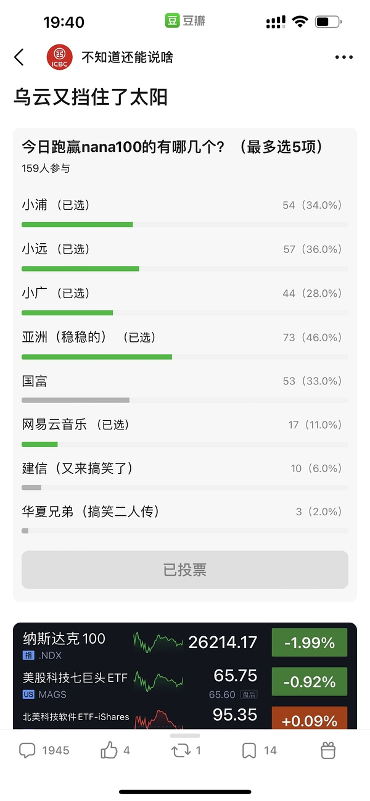

- (2026-11-25 19:44:12) 赵老师：不看好消费 都已经炒到新晋ST了

- (2026-11-25 19:44:23) 新晋ST板块今天大面积涨停  ⊳ （引用 @不知道还能说啥）赵老师：不看好消费 都已经炒到新晋ST了

- (2026-11-25 19:45:25) 赵袭

楼里知道的  ⊳ （引用 @一切都会过去的）赵老师是哪个

- (2026-11-25 19:46:17) 赵老师说的12.9是美联储议息
他说这是最后一次加息  ⊳ （引用 @sickid）还要下周变盘啊……真受不了了

- (2026-11-25 19:49:21) 赵老师从基本面说的 消费毫无基本面🤣  ⊳ （引用 @点-重生炒垃圾）雪算不算消费

- (2026-11-25 19:51:51) 仰巨：
之前明确看空黄金 每次阳子都问我我每次都看空 今天看美元指数即将见顶 大跌阶段可能将要结束

- (2026-11-25 19:52:31) 阳子：有人问实在是忍不住了 想去买银行了
赵老师：我反对

- (2026-11-25 19:52:37) 🤣🤣🤣🤣🤣🤣🤣🤣🤣🤣🤣🤣  ⊳ （引用 @稀里不糊涂）反对买银行😂

- (2026-11-25 19:53:39) 但是他建议继续观望 你等美元下跌呗  ⊳ （引用 @稀里不糊涂）750是不是可以买点的意思

- (2026-11-25 19:54:10) 最近趋势动物开挂 你可以等他说右侧下行结束

人家装逼有东西装 只能听着🤣  ⊳ （引用 @稀里不糊涂）750是不是可以买点的意思

- (2026-11-25 19:56:52) 其实我觉得不是12就是1
一月还有一次
我比你们在意这个更多 
除了和你们同甘共苦的美股 大A

我还有十来万美债 😂😂😂😂
目前美债全靠美股跌赚钱 真是赚了也是哭  ⊳ （引用 @稀里不糊涂）赵袭居然看12月就是最后一次加息，好消息啊

- (2026-11-25 20:00:54) 今天pce
12.4日非农
这两个数据得帮忙啊  ⊳ （引用 @稀里不糊涂）12月更快了，没几天了😂😂

- (2026-11-25 20:01:41) 新晋ST板块
我东方财富没有这个哈哈 没有分的那么细  ⊳ （引用 @速派女孩将发财）看看我们欢瑞🥰 虽然我没有 但是我觉得欢瑞起来对传媒也好

- (2026-11-25 20:01:48) 21:30  ⊳ （引用 @稀里不糊涂）pce几点发啊，一定要是差数据啊

- (2026-11-25 20:05:15) 嗯嗯 明天盘后就是股市的周五了🤣  ⊳ （引用 @momo）今天买不了大额的国服 明天放假 所以周五才能买对吗

- (2026-11-25 20:05:40) 现在很明显 只要纳斯达克不好 黄金不会好🤣  ⊳ （引用 @一切都会过去的）我看k线说后面结束下行700-800震荡

- (2026-11-25 20:08:19) 会不会是美国的奇迹日😂  ⊳ （引用 @sickid）纳斯达克100指数期货跌幅扩大至3%。

今晚我真不想看了……

- (2026-11-25 20:10:25) 这是以前老美的常规技能🤣现在藏起来了  ⊳ （引用 @稀里不糊涂）老美也来低开高走？

- (2026-11-25 20:19:58) [图] sy家人没来啊😂

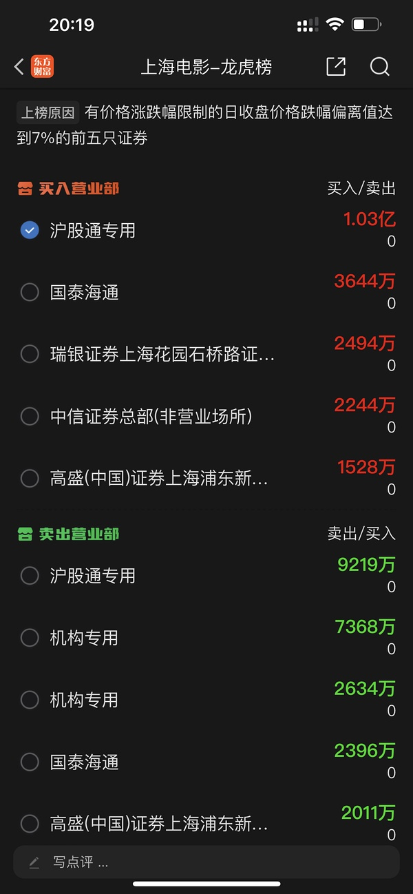

- (2026-11-25 20:20:51) 不是 
网易云音乐前四大都不是美国导致的今天少跌
亚洲同理

三天累计计算你就知道谁是真的防守  ⊳ （引用 @shirla）这个攻防阵营是不是就区分开啦

- (2026-11-25 20:55:58) 机构去九阳了😂  ⊳ （引用 @点-重生炒垃圾）更恐怖啊，机构跑路

- (2026-11-25 21:01:39) 为保持银行体系流动性充裕，2026年11月25日将以固定数量、利率招标、多重价位中标方式开展8000亿元MLF操作，期限为1年期。
记者注意到，2026年11月25日将有10000亿元1年期MLF操作到期，这意味着本次操作后，1年期MLF缩量续作2000亿元。

债券大跌原因  ⊳ （引用 @六倍做多退休）感觉没有

- (2026-11-25 21:03:24) 江老师开播了
我现在看不了

- (2026-11-25 21:03:30) 😂  ⊳ （引用 @sickid）点进直播江老师第一句话：无语。

- (2026-11-25 21:04:08) [图] 江老师也是-42了😂

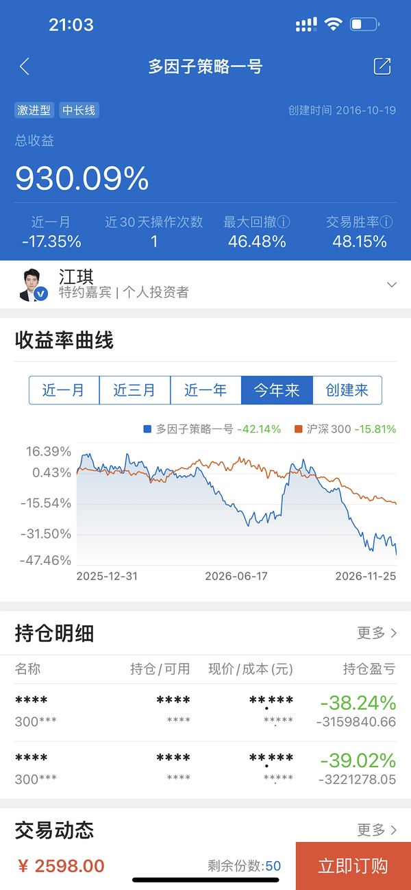  ⊳ （引用 @sickid）点进直播江老师第一句话：无语。

- (2026-11-25 21:08:50) 老师们还在猜数字 猜对了牛逼 猜错了怪美国继续跌🤣  ⊳ （引用 @Waiting一下）创业板真的要去1700吗？！！！我去！！！要死了

## 🧠 投资风格分析
> 📏 增量更新指引：仅当今日发言确有新依据时才修订对应维度，无变化不强行重写；单维度修订建议 ≤150 字。

- 投资理念与方法：坚持以估值百分位与溢价率为锚，对QDII基金实施严苛的防守型筛选。今日明确「亚洲因为赖皮肯定是稳如狗」，将「非美持仓占比」作为美股大跌时的核心风控指标；主张红利微盘自我循环机制，指出「大家喜欢爱国，妈妈就买海外；大家追海外，妈妈买爱国」；强调板块内部「纯种」与「山寨」的区分，认定大连是旅游板块正宗，而冰山为山寨；将微盘股视为垃圾消费的「万能钥匙」，认为电影板块与微盘股关联度不如消费紧密，需独立看待。
- 风险偏好：对融资盘爆仓风险高度敏感，关注融资余额的批量流出而非单点爆破，认为爆融资盘会出冰点；回避高波动垃圾微盘，只在极端条件下才考虑2000，并预期极端崩盘时国家队会扫货。对主题炒作保持距离，承认进攻性最强的品种跌幅也最大；对场内QDII溢价风险敏感，宁可先算清溢价与净值的缺口再决定是否承担开盘缺口。
- 交易与仓位：强调操作与观点一致，反对一边看跌一边补仓或切向进攻最强；主张卖出后资金去向比卖出本身更关键，会快速把资金转入自己认定的强势方向，因此常出现“兑现即满仓”的节奏。对切仓失误会公开复盘而不掩饰，讲究板块内部“纯种”与“山寨货”的区分，宁可守着正宗主线也不拿替代品。
- 心理特质：对波动与回撤高度钝化，普跌中仍信心十足；盘中喜欢用KPI式口径逐只考核持仓，批评不主动、躺着的标的，同时对“一起跌”和“该努力”区分语境，不搞无差别开喷。整体语气带调侃与自嘲，账户翻绿也能一边抱怨一边给自己找主线，情绪不随单日涨跌漂移。

> ⚠️ 本板块由 Actions 全自动增量更新（复用当日发言与今日总览），每次仅在内容足够支撑时才改动。

## 🏷️ 昵称映射表
### 📖 昵称规律（供 AI 判断新昵称时参考）
【昵称命名规律（用于推断未知新昵称）】
- 拼音首字母缩写：取标的/基金名汉字拼音首字母串（含数字代码），多为 ETF/股票代码口语化｜示例：yl=引力传媒｜zy=掌阅科技｜sj=视觉中国｜cc=华安文体健康混合｜C50=创业板50ETF｜k50=科创50｜kun=昆仑万维｜xhxc=新瀚新材｜zxfc=中欣氟材
- 小/老+姓氏代指：「小X」「老X」通常指姓 X 的标的或该标的的基金经理；「X兄弟」多为同系基金｜示例：小惠=惠发食品｜老莫=万家品质生活(莫海波)｜小华=华夏全球科技先锋(QDII)A｜小华兄弟=华夏移动互联(QDII)｜小浦=浦银安盛全球智能科技(QDII)A｜小广=广发全球精选(QDII)A｜小远=华宝致远(QDII)C｜招招=招商银行｜小德=德明利｜赵姨=兆易创新｜露露=泸州老窖｜空调=格力电器
- 戏称/黑话→题材板块：生活化比喻或黑话对应某个题材/板块，而非单一标的；出现时多指板块方向｜示例：卖国=PCB板块(英伟达AI链)｜爱国=国产自主(半导体设备/芯片)｜奶茶=易点天下｜老师=中文在线｜蓝色=蓝色光标｜宇航员=航空航天板块｜华子=华泰保兴安悦债券｜国际=国际复材｜巨无霸=长鑫科技等重大IPO
- 谐音/取字：昵称含标的名关键字（取一字或谐音），多为 A 股个股或基金简称｜示例：万华=万华化学｜东百=东百集团｜宝=保利发展｜讨饭/亚洲讨饭/建信新兴=建信新兴市场(QDII)A｜华宝zy=华宝致远(QDII)A
- 机构/基金经理昵称：以基金公司名、经理姓、或平台代称指代对应基金产品｜示例：周经理=中欧新趋势混合(LOF)A｜张经理=信澳匠心回报混合A｜网易云/音乐世家=富国全球科技互联网股票(QDII)A｜国富亚洲=国富亚洲机会股票(QDII)A｜国泰纳指=国泰纳斯达克100指数(QDII)｜易方达全球=易方达全球成长精选混合(QDII)A｜浦银安盛=浦银安盛全球智能科技(QDII)A

### 📋 已收录映射
| 昵称 | 对应名称 |
|------|----------|
| C50 | 创业板50ETF |
| cc | 双义：股票=中国长城 / 基金=华安文体健康混合（用户 11-05 指认） |
| k50 | 科创50 |
| kun | 昆仑万维 |
| sj | 视觉中国 |
| xhxc | 新瀚新材（用户确认；代码待核） |
| yl | 引力传媒 603598（对手盘，非他持仓）｜11-06 +37.15%；11-09 本月+37.79% |
| zxfc | 中欣氟材 |
| zy | 双义：他本人口径=603533 掌阅科技（用户 11-05 确认）；11-09 楼友两条『zy』按 16 元/电影语境指 600977 中国电影。引用必须带语境，不许收敛 |
| 万华 | 万华化学 |
| 东百 | 东百集团 |
| 亚洲讨饭 | 建信新兴市场混合(QDII)A |
| 保利发展 | 保利发展 |
| 华子 | 华子＝007540 华泰保兴安悦债券A（华泰保兴基金·安悦债券A类份额），满仓30年超长利率债的长债基金（用户 2026-11-16 确认，无歧义，不是歧义项）；00:42 楼友『华子今年战绩无敌吧』→他答『30超长债牛逼没办法』；13:47『纯利率债就是华子那种 不过华子满仓30债 有些是满仓5-10年』；**与460108不是同一只**：460108＝华泰柏瑞稳健收益债券C（他持有的纯利率债·重仓国开/农发/国债，见六基行），华子007540 是华泰保兴的长债基金，勿混 |
| 华宝 zy | 华宝致远混合(QDII)A |
| 华宝zy | 华宝致远混合(QDII)A |
| 卖国 | PCB、光模块、通信板块（英伟达AI产业链） |
| 周经理 | 中欧新趋势混合(LOF)A |
| 国富亚洲 | 国富亚洲机会股票(QDII)A |
| 国泰纳指 | 国泰纳斯达克100指数(QDII) |
| 奶茶 | 301171 易点天下（对手盘，非持仓）｜11-13 10:07『奶茶out 幸福人的底气是可以说芒果out』；当日 −6.72% |
| 宇航员 | 航空航天板块 |
| 宝 | 保利发展 |
| 小华 | 华夏全球科技先锋混合(QDII)A |
| 小华兄弟 | 华夏移动互联混合(QDII) |
| 小广 | 广发全球精选股票(QDII)A |
| 小德 | 德明利 |
| 小惠 | 惠发食品 |
| 小浦 | 浦银安盛全球智能科技(QDII)A |
| 小远 | 华宝致远混合(QDII)C｜只在盯，未证他持有 |
| 巨无霸 | 长鑫科技等重大IPO企业 |
| 建信新兴 | 建信新兴市场混合(QDII)A |
| 张经理 | 信澳匠心回报混合A |
| 招招 | 招商银行 |
| 易方达全球 | 易方达全球成长精选混合(QDII)A |
| 浦银安盛 | 浦银安盛全球智能科技(QDII)A |
| 爱国 | 国产自主（半导体设备/芯片制造） |
| 空调 | 格力电器 |
| 网易云 | 富国全球科技互联网股票(QDII)A |
| 老师 | 中文在线 |
| 老莫 | 万家品质生活混合A(519195) |
| 蓝色 | 300058 蓝色光标（广告组合，非他持仓）｜11-12 高 15.97＝20cm 涨停价、收 14.76 +10.89%（炸板）；10:21『他和蓝色 奶茶 sg他们是广告组合』 |
| 讨饭 | 建信新兴市场混合(QDII)A |
| 赵姨 | 兆易创新 |
| 赵哥 | 兆易创新 |
| 露露 | 泸州老窖 |
| 安安 | 安记食品 |
| 音乐世家 | 富国全球科技互联网股票(QDII)A |
| 老伯伯 | 铜冠铜箔 |
| nk | 纳指科技ETF景顺 159509（联接=景顺长城纳斯达克科技ETF联接A）｜11-06 A级：截图溢价率37.08% |
| bk | 标普信息科技LOF 161128（场外=易方达标普信息科技QDII-LOF）｜11-06 A级 |
| txx | 天下秀 |
| 媛媛 | 今世缘 |
| uu | 友友、网友们 |
| 温暖老师 | 某个特别牛逼的散户 |
| 余老师 | 余利，某牛逼投资者 |
| ycm | 粤传媒 002181｜11-09 12:12「非电影传媒就留给大家玩了 我一个都不会碰了」→ 推断已不持有 |
| 江老师 | 江琪（投资博主） |
| 水果老师 | 投资博主 |
| 小爱 | 我爱我家 |
| ty | 天娱数科 |
| bn | 博纳影业 |
| sy | 601595 上海电影｜**他空仓**（11-09 起未回接）；11-12 09:38『天天念叨sy的给你们机会了』＋09:41『现在-6给你们机会了哈』＋13:15『马上sy跌停 bn还要尊敬一下他』＋13:51『与此同时 sy跌停』＋14:00『sy历来以残暴虐杀手法闻名』；实测收 42.15 −9.99% 跌停 |
| CBS | 长白山 |
| 东哥 | 东百集团 |
| 芒果 | 300413 芒果超媒（对照，非持仓）｜11-13 14:01 本月涨幅 41.70% vs 幸福 53.76% →『幸福已经拉开芒果12%』＝12.06pp 精确命中；当日 −4.83% |
| 阿中 | 中国电影 |
| 欢欢 | 欢瑞世纪 |
| 雪人 | 雪人集团 |
| 大连 | 大连圣亚 |
| 幸福 | 幸福蓝海 |
| 小粤 | 粤传媒 |
| 阿博 | 博纳影业 |
| 创成长 | 创业板成长etf |
| asd | 002747 埃斯顿｜11-11 15:09『我昨天去的另外一个 今天也吸到asd了』＝11-11 低吸买入；11-12 10:17『我昨天加了asd今天刚刚加了另外个』＋10:35『asd火箭发射』（盘中高 32.19，收 29.95 −4.37%）；买价未披露。**11-11 轮误删、11-12 恢复** |
| 恋爱脑 | 002582 好想你｜11-12 14:39:31『清了恋爱脑』＝清仓（卖价未披露；10.48 卖单两日均未触及→手动卖）；14:28『我如果去掉恋爱脑 也就比你多一个机器人』；当日收 9.76 −2.89% |
| 恋爱 | 002582 好想你（同『恋爱脑』）｜11-12 14:39 已清仓，不再持有 |
| 小羊 | 000678 襄阳轴承｜11-05 已卖（卡当日最高 20.40）；11-12 14:16『襄阳掉了』＋14:44『厉害襄阳』＝只评论走势，非持仓 |
| 中马 | 中马传动 |
| 晶雪 | 晶雪节能 |
| xf | 幸福蓝海 |
| 建设 | 建设工业 |
| 北方 | 北方导航/北方国际（未定，11-04「我在北方了」） |
| _ambiguity_note | 歧义未收敛（禁止当唯一映射）：轮子=巨轮智能/五洲新春；sj=视觉中国（传媒语境）/神剑股份（宇航员语境）；cc=中国长城/华安文体健康混合；北方=北方导航或北方国际；zy=掌阅科技（用户 11-05 确认原值正确）。证据分级：A=价位/均线/月涨幅实测命中；B=量级或单日命中/用户口述；C=仅昵称或语义，不得据此写『他持有』；沿用原仓=本轮未复核，不写进结论正文。三条判据：①条件单四位数要先按同时段动词行判买卖方向（cbs 3644 是买单不是卖单）；②『祝福/你们/你的X』句式＝评论他人持仓，不是他的操作；③同一昵称在不同语境可指两只票（zy=掌阅/中影），按价位与板块取，不许收敛成一个。 11-11 补：plus雪＝他自己也没说清（11:12「你应该不知道plus雪是哪个」），不许猜；bdd＝有传媒属性所以他不去（13:42），仍未定案；『五连阳』这类盘中口径不等于日K实测（招行 11-06 为平盘十字星）。 11-12 补：①盘中快照≠收盘（14:15 三日账第三日 幸福+0.5/光线−4.5 为盘中值，收盘 −0.53/−4.97；他写的『拉开5.3%』按自列数字相加应为 5.5，属口算误差，不得据此推翻实测）；②历史卖单不重复计触发（中影 15.84 虽∈11-12 区间[15.39,15.98]，但 11-10 已成交、无存续卖单）；③清仓自述不封锁后续再买（asd 11-06 清→11-11 15:09 再吸，11-11 轮据此误删）；④『果果』只是推断映射，不得当持仓证据；⑤机器人第二仓与传媒低位10cm 代码未披露，福赛仅为楼友提问他作答，不许映射。 11-13 补：①**本月涨幅类口述可核**，基准＝10-30 收盘，且要用**发言时刻的分钟价**复算（14:01 截图 53.76% 与分钟线独立复算分毫不差，『拉开芒果12%』＝12.06pp）；②**基金表『折价率』列负号＝溢价**（513300 −15.28% ⇒ 溢价 15.28%，与 11-06 的 16.36% 同口径），别读成折价；③**『我手里就7只股票了/我只有电影冰雪了』是他题材仓口径**，不得据此删除无卖出自述的持仓行（铁律 6）；④**『全部跌停』类口述是盘中快照**（东方海洋盘中最低 4.64＝跌停价、收 −6.59%，未封死）；⑤plus雪＝晶雪只是**品种识别**，他 11-09 已自述清仓，不得当持有证据。 11-16补：①华子与460108是否同一只未定案（华子亦可能楼友昵称），不得据华子写他持有30债；②14:22『T掉追加的』对象歧义（主读法＝大连11-10加筆T，备选＝幸福老股T），无成交自述不改笔数；③博纳09:52『今天』与底仓口径冲突，加仓@6.37按09:45『加仓bn』＋09:46『-6』取；④『2开头招行』语义未定不映射；⑤华夏兄弟17:26裸报-2.5%证据不足不入表。 11-16补：①14:22『T掉追加的』对象歧义（主读法＝大连11-10加筆T，备选＝幸福老股T），无成交自述不改笔数；②博纳09:52『今天』与底仓口径冲突，加仓@6.37按09:45『加仓bn』＋09:46『-6』取；③『2开头招行』语义未定不映射；④华夏兄弟17:26裸报-2.5%证据不足不入表。 11-17补：①『太子爷』『bdd』『畅畅』未定案不映射；②雪人今日14.01加仓笔受T+1，14.84卖单卖的是可卖老仓（非当日买笔）；③晶雪25.64回落单他自述触发、日K高25.78证实（分钟接口H25.35偏低为已知不稳）；④光线11-17部分卖出@11.82按11-16追高笔推定(B)，仍持老仓；⑤传媒『以身入局』拒绝点名不外推代码。 11-17补：①『太子爷』『bdd』『畅畅』未定案不映射；②雪人今日14.01加仓笔受T+1，14.84卖单卖的是可卖老仓（非当日买笔）；③晶雪25.64回落单他自述触发、日K高25.78证实（分钟接口H25.35偏低为已知不稳）；④光线11-17部分卖出@11.82按11-16追高笔推定(B)，仍持老仓；⑤传媒『以身入局』拒绝点名不外推代码。 11-17补：①『太子爷』『bdd』『畅畅』未定案不映射；②雪人今日14.01加仓笔受T+1，14.84卖单卖的是可卖老仓（非当日买笔）；③晶雪25.64回落单他自述触发、日K高25.78证实（分钟接口H25.35偏低为已知不稳）；④光线11-17部分卖出@11.82按11-16追高笔推定(B)，仍持老仓；⑤传媒『以身入局』拒绝点名不外推代码。 11-18补：①雪人『兑现今天加的雪儿』受T+1，今日14.17买笔不可当日卖，兑现的是可卖老仓；②传媒『这周开干』拒绝点名不外推代码；③晶雪上週买回成本未披露、清仓收益不计算；④长白山(cbs)两笔成本36.44/38.8、同价33.65卖出。 11-19补：①雪人13.84卖单在开盘高13.94时可能触发（不写死成交价，记B待核）；②晶雪『今天20买』是给楼友的话、无第一人称买入→不回接；③中证1000ETF象征性小额买入、金额未披露；④大连11-18加仓@37.74 被套（11-19跌停32.33），11-19『我没买』无动作。 11-19补：①【1000】＝gjd国家队（他澄清『我说的是gjd』），非中证1000ETF、非本人买入，已从持仓删除；②雪人13.84卖单在开盘高13.94时可能触发（记B待核）；③晶雪『今天20买』是给楼友的话、无第一人称买入→不回接；④大连11-18加仓@37.74 被套（11-19跌停32.33），11-19无动作。 11-19补：①『1000』＝中证1000，『gjd』＝国家队；合起来是『国家队在象征性买中证1000』——他评论国家队托市，非本人买入/持仓（已从持仓删除误记）；②雪人13.84卖单在开盘高13.94时可能触发（记B待核）；③晶雪『今天20买』是给楼友的话、无第一人称买入→不回接；④大连11-18加仓@37.74 被套（11-19跌停32.33），11-19无动作。 11-20补：①今日无交易（11:57『我今天什么单子都没开了』『其他一个都不卖』）；②雪人13.84/14.84/15.84卖单未触及（11-20高12.76＜13.84）；③大连再跌停29.10、东方海洋涨停3.75(探针)；④xxz/东哥 未定案不映射。当日盈亏总结已写入 stock_pnl_note（等权涨跌率口径）。 11-21补（周六休市）：①今日无交易，价格沿用11-20收盘；②新帖被审核→晚上切新帖（故21:03只抓新帖20条，旧帖11-21另有51条，已合并入语料v26）；③cpi=新闻非昵称；④当日盈亏总结写'休市=0'。 11-23补：①修正上轮漏记——11-20(周五)卖光线→买横店603103+慈文002343(两个四连板)；②11-23横店被S/慈文手动S→重新满仓；③芒果超媒300413持有+加仓、明日35.94清仓；④『那几个10都四连板过』＝另持数只未点名传媒四连板，不外推代码；⑤中影重仓。 |
| nana场内 | 513300 纳斯达克ETF华夏｜11-09 14:34「不愧是513300 当年的普通nana ETF之王」，当日唯一红的纳指ETF |
| 雪儿 | 雪人集团 002639｜11-06「大连和雪儿」＋11-11 14:26「雪儿今天不错啊 大家昨天不是期待他接人嘛 这个任务做到了今天」（接人＝5日线接回，与雪人条件单口径一致） |
| 存钱罐 | 光线传媒 300251（他自述小仓）｜11-13 15:11『我相信光虽迟但到 我会肯定保留上周的存钱仓位』＝存钱罐口径再次落到光线 |
| 枣子 | 002582 好想你（同『恋爱脑』）｜11-12 14:39 已清仓，不再持有 |
| 王老师 | 人：王博雅投资（QDII 场内溢价口径），不是标的 |
| 印度 | 自嘲代指中国（推断，勿当事实） |
| 10086 | 中国移动（他当指标用，非持仓） |
| 阳光乳业 | 001318 阳光乳业（他的『喝的』/牛奶）｜11-09 A级：13:59 分时截图 S 标记≈13.5＋10:52「我去掉了羊来抄底」 |
| 羊 | 生肖羊概念组（带阳/洋/光/太/泉的一篮子）｜11-09 14:04 他自己贴的分组；**11-13 崩盘实证**：15:58 截图跌幅榜 澳洋健康 −10.06、阳光照明 −10.05、红太阳 −10.04、大东方 −10.03、阳光乳业 −10.02、襄阳轴承 −9.98、鲁阳节能 −9.95、大西洋 −9.73、太阳电缆 −9.29、圣阳股份 −8.64、泉阳泉 −6.60、东方海洋 −6.59；他 14:48『我昨天起码说了6次 控制仓位 因为羊和东方昨天松动了！！！！这是情绪核心』 |
| 小明 | 605179 一鸣食品｜11-09 10:07 有人问『喝的小明？』他答『羊』＝喝的已换成阳光乳业 |
| 皇台 | 000995 皇台酒业｜11-09 与雪人 PK 当日换手率龙虎榜 |
| 海哥 | 人：转债估值博主（不是标的）｜11-09 12:48「海哥周五那个新债…我买了点试试看是市场错了还是海哥错了」 |
| 申菱转债 | 123290（申菱环境 301018 的转债）｜11-09 13:50 买 150 张 @133 多；11-10 11:20『我开了149.9』卖单；11-12 分钟线 10:03–11:12 持续≥149.9（高 152.313）→触发推定清仓，+12.28%（成本 133.5 推定）记入 stock_pnl，已从持仓表删除 |
| 盛天 | 300494 盛天网络｜11-11 A级：11:29 分时截图 B 标记 @11.00＋「不止 而且我跟了他一把」（跟摄像大哥） |
| dfhy | 002086 东方海洋｜11-11 13:56 楼友问 dfhy 绕异动→他『我没算 这几天可能都是异动吧』；11-12 14:39 涨停 5.16 卖出（＝4.69×1.10 到分＋分钟 14:36 封板＋财联社 17天9板）；**11-16 09:28『看东方海洋了』＋15:17『东方海洋上周四不好示范』＝买回探针仓 <2%**，羊仪表盘四图蓝高亮 002086，当日跌停收 4.34（昨 4.82）；探针非重仓 |
| xys | 300502 新易盛｜11-11 13:19「我那个买xys的女主播终于要开心了」＋13:21「她现在成本327了」→ **是女主播的仓，不是他的** |
| 冰山 | 000530 冰山冷热｜11-11 10:16「万一冰山跌停 他能跌到哪里再去」＋10:27「今天把冰山 晶雪按死 大连 CBS 正统上位」（非持仓，冰雪板块的山寨对照） |
| 冰冰 | 000530 冰山冷热｜11-11 14:03「那冰冰准备」（同『冰山』，非持仓） |
| 龙版 | 605577 龙版传媒｜11-11 11:50「最早龙版也是因为自己每次公告文案都不一样才4连板就被监管」（讲监管规则，非持仓） |
| 3300 | 513300 纳斯达克ETF华夏｜11-11 10:49「3300还行 不过今天我不满意」＋13:24「咱们3300还是近期数据最好的」 |
| nana100 | 纳斯达克100指数（他对照场内ETF溢价的基准）｜11-11 08:14「昨天513300涨了3.53% 但是nana100实际也就涨了3.4」 |
| 易中天 | 新易盛＋中际旭创＋天孚通信（CPO三巨头合称）｜11-11 14:13「都去易中天了🤣」（非持仓） |
| 冰雪双子星 | 大连圣亚600593＋长白山603099（他的正牌冰雪双仓）｜11-11 10:29「从不担心冰雪双子星」 |
| 2000 | 中证2000指数（他当微盘股基准）｜11-11 11:11「除了机器人 今天其他题材全输给了2000」 |
| cw | CoreWeave（CRWV，美股AI算力）｜11-11 11:18「cw那玩意硬起来了 大家看夜盘数字」 |
| ant | Anthropic（美股IPO）｜11-11 12:11「接下来是不是ant IPO也是利好」 |
| 摄像大哥 | 人：楼友（不是标的）｜11-11 他的两笔游戏＝电魂网络涨停＋顺网科技≈+7，属楼友口径；楼主自己买的是盛天网络＋另一只未披露代码的游戏 |
| 游戏哥哥 | 游戏板块拟人化（不是具体票）｜11-11 12:58「游戏哥哥：我来也」＋13:01「妹妹休息 哥哥接力？」 |
| 传媒妹妹 | 传媒板块拟人化（不是具体票）｜11-11 11:40「被传媒妹妹压制了」＋13:01「妹妹休息 哥哥接力？」 |
| sg | 002400 省广集团（广告组合，非他持仓）｜11-12 A级映射：10:09:32『省广带起来了』＋10:21:36『他和蓝色 奶茶 sg他们是广告组合』；分钟线 10:00 6.70→10:09 6.89→10:21 6.94（昨收 6.70）命中『带起来』；当日收 6.64 −0.90%（冲高回落） |
| 果果 | 301052 果麦文化（**推断·B**，非持仓）｜11-12 13:05:01『果果紧随其后了』紧接 13:04:34『传媒出现两位数跌幅了 华策』；实测华策 −13.97%、果麦 −10.38% 同为两位数跌幅→谐音＋当日跌幅与语境命中；未见他自述买卖，不得当持仓证据 |
| 老登 | 机构抱团的老牌权重（白酒/消费/地产一类，**不是单只票**）｜11-12 07:51:44『如果这些资金回去重新抱团 最近涨起来的老登们非常危险…老登后续又要惨遭抛售 比如昨天大跌的白酒』 |
| plus雪 | 301010 晶雪节能（**B·推断；11-16 已买回持有**）｜11-13 10:04『plus雪是-20的…还能再跌-10』＝20cm，实测当日 −10.10%；15:25 答『多少出』报 24.94＝11-05 老卖单价（当日高 24.92 差 2 分未触及）；11-09 曾自述清仓 → **11-16 09:39『上周买了plus』＋14:53『掌声雪儿plus雪』＝上周买回、重新持有**；11-16 卖单 24.94 沿用，当日高 24.39 未触及；持仓屏 13:42:36 晶雪 23.110 |
| 复仇者联盟 | 电影档期锚（不是标的）｜11-13 10:18『复仇者联盟没有到来 全都不会清仓』＋10:29『复仇者联盟是12月的 流浪地球要2月』＝他把电影仓的兑现条件挂在片单档期上 |
| 流浪地球 | 电影档期锚（不是标的）｜同上，10:29『流浪地球要2月』 |
| nana | 纳斯达克100 指数（他用来对照场内 ETF 溢价/涨幅的基准，非标的）｜11-13 00:16『今天图上看 nana依然是大阳线』＋07:57『昨天-0.7收盘 但是nana晚上其实只有-0.3 现在期货+0.5 今天场内应该开盘+0.9%』→ 实测 513300 开盘 2.710＝+0.82%（误差 0.08pp） |
| 千红转债 | 楼友中签的新债（**不是他的标的**）｜11-13 09:17 他教对方『9:30就130停牌了 开个闹钟 14:56上号』『就是最后14:57去挂』＝转债上市首日尾盘挂单卖法 |
| 文投控股 | 600715（院线·他只在盯，非持仓）｜11-13 09:33 传媒板块截图 +10.03% 涨停、本月涨幅 66.67%（＝10-30 收盘基准独立复算分毫不差）；配 09:33『市场有转院线迹象』 |
| 华智数媒 | 300426（传媒·他只在盯，非持仓）｜11-13 本月涨幅榜第一（09:47 截图 78.91%／14:01 74.11%） |
| 横店影视 | 603103（院线·非持仓）｜11-13 09:33 截图 19.31 +10.03% 涨停，与文投/金逸并列＝『转院线迹象』的另外两票 |
| 金逸影视 | 002905（院线·非持仓）｜11-13 09:33 截图 9.90 +10.00% 涨停 |
| 日出东方 | 603366（羊字辈·情绪核心，非持仓）｜11-13 15:58『尤其今天表态的日出东方 别周一又跌停躺平了』；实测 +5.54%、最高 14.21 距涨停 14.49 一步 |
| plus | 301010 晶雪节能（上周买回、11-16 持有）｜09:39『上周买了plus』＋14:53『掌声雪儿plus雪』；卖单 24.94 沿用 11-05 老价，当日高 24.39 未触及 |
| 东方海洋 | 002086（＝dfhy）｜11-16 买回探针仓 <2%，当日跌停收 4.34（昨 4.82）；11-12 曾涨停 5.16 卖出；09:28『看东方海洋了』＋15:17『东方海洋上周四不好示范』 |
| 晶雪节能 | 301010（＝plus/plus雪）｜11-16 持有，卖单 24.94 未触及（高 24.39）；持仓屏 13:42:36 晶雪 23.110 |
| gjd | 国家队（推断 B）｜11-16 15:19/16:42 护盘语境，非具体标的 |
| plu | 人物·永远看空印度的博主（非标的）｜11-16 19:11『他永远看空印度的…924一开始他也看空的 不过他就一点好 看错了马上改』 |
| 华夏兄弟 | ＝小华兄弟·华夏移动互联混合(QDII)（推断·证据不足不入表）｜11-16 17:26 裸报 -2.5% 疑似场外持有，无第一人称买入/持有自述、无截图 |
| cbs | 长白山 603099（CBS黑话；11-18 已清仓卖出） |
| 1000 | 1000＝中证1000（指数／相关ETF）；2026-11-19 14:51『象征性扫了点1000』后他澄清『我说的是gjd』＝**国家队(gjd)在象征性买中证1000**（他在评论国家队托市行为，**不是他本人买入、也不是他的持仓**）；切勿读成他买了中证1000ETF |
| mg | 芒果超媒 300413（11-20起持有+11-23加仓，明日35.94清仓） |
| 横店 | 横店影视 603103（11-20买→11-23被S卖出，短打） |
| 慈文 | 慈文传媒 002343（11-20买→11-23手动S卖出，短打） |

> ⚠️ 以下为 LLM **建议**，未自动写入状态文件。请人工确认后，本地编辑 `state.json` 的 `nickname_map` / `positions`，或 `nickname_rules.json` 的 `rules` 并 push 生效。

## 持仓建议（待你确认）
- **龙版传媒**（605577）〔卖出〕— 依据：昨天就S了龙版
- **晶雪节能**（301010）〔清仓〕— 依据：我早上去掉了plus啊
- **纳斯达克ETF华夏**（513300）〔持有〕— 依据：自从我月初买入nana后走势差不多
- **建信新兴市场混合(QDII)A**（539002）〔持有〕— 依据：三天合计小浦-1.2...亚洲 跑赢是肯定的
- **华泰保兴安悦债券A**（007540）〔持有〕— 依据：我还有十来万美债

## 新昵称映射建议（待你确认）
- `plus` = 晶雪节能
- `小广` = 广发全球精选股票(QDII)A
- `小浦` = 浦银安盛全球智能科技(QDII)A
- `小远` = 华宝致远混合(QDII)C
- `网易云` = 富国全球科技互联网股票(QDII)A
- `亚洲` = 建信新兴市场混合(QDII)A

## 新昵称规律建议（待你确认）
- 【投票语境映射】在基金跑赢纳斯达克（nana）的语境下，'亚洲'指代建信新兴市场混合QDII ｜示例：亚洲 小浦 小远 国富 ｜依据：今天投票 亚洲最多 小浦 小远 国富

*🤖 自动生成于 2026-11-25 21:13:31 ｜ 豆瓣楼主发言追踪*