# 📋 楼主每日发言推送

> **推送日期**：2026-11-26 ｜ **执行时间**：2026-11-26 16:03:58 ｜ **监控用户**：`不知道还能说啥`
> **追踪模式**：`topic`（用户主页广播·豆瓣话题）

## 📊 持仓追踪
> 上次更新：2026-11-26 ｜ 基于楼主发言持续追踪（共 18 项）

| 标的 | 状态 | 类型 | 现价 | 提及 |
|------|------|------|------|------|
| 招商银行 | 底仓·四年前 32 元×7000 股买入·四年分红未复投仍 7000 股·不动 | 红利/银行 | 43.38（0.42%） | 底仓·不动；7000股/摊薄成本约24.27元；1…；成本约32元 |
| 大连圣亚 | 持有（11-18 加仓@37.74 被深套）·今日无动作·卖单 46.90/45.22 未触及 | 冰雪·正牌双子星 | 31.71（2.42%） | 无挂单：「我在冰雪没有任何单子 我个人非常看好」 |
| 雪人集团 | 持有·11-19 手动买入 2 笔@≈13.5（两笔 cbs 钱搬入）·卖单 13.84/14.84/15.84 | 冰雪·交易仓 | 12.62（10.03%） | 持有；11-25 -4.97%；无新买卖自述 |
| 幸福蓝海 | 持有·今日换仓买入 1 笔@≈15.50（09:43）＋11-16 笔@16.91·明日卖单 15.84（由 18.64/20.44 下移） | 电影 | 12.53（-4.13%） | 持有；11-25 -7.57%回吐 |
| 中国电影 | 持有·剩余仓无单·锁仓『慢就是快』 | 电影·核心不动仓 | 14.65（-1.08%） | 未动：「我中影也没动」 |
| 博纳影业 | 持有小仓·今日跌停 5.69（=6.32×0.9）·卖单 6.94 未触及（高 6.22）·明日买 614 计划 | 电影 | 5.08（-1.17%） | 持有小仓；11-25 -4.99% |
| 纳斯达克ETF华夏 | 持有·不卖场内（溢价品种）·开盘预测 -1.5% 落空他自己认赖皮 | QDII·场内纳指 | 2.522（1.69%） | 持有·不卖场内；11-25 -3.88%；每天算3… |
| 中韩半导体ETF | 持有·今日无动作自述 | QDII·场内 | 3.202（-0.74%） | 持有；11-25 -6.98%（半导体设备补跌） |
| 盛天网络 | 11-11 买入·持有（口径仍待确认） | 游戏·电竞 | 8.81（-2.22%） | 持有（口径待确认）；11-25 -3.12% |
| 游戏自建仓 | 11-10 买入·持有·11-11 自述 +5%（时点值未更新） | 游戏·电竞 | 暂无 | 持有；11-24/25无提及 |
| 美债场外基金 | 持有·国庆前买入·11-11 自述 +1.4%（时点值未更新）·债灾自述接近转亏 | 场外·美债 | 暂无 | 持有；11-24/25无新自述（美债收益率跟踪中） |
| 传媒低位10cm | 11-12 自述『只加一个低位的』＋11-16 14:22『我要去买一个传媒了』（是否执行无自述）·拒绝点名 | 传媒·低位 | 暂无 | 持有；11-24/25 传媒篮子高换手（龙版11-… |
| 东方海洋 | 卖出 | 探针·羊情绪组 | 4.77（9.91%） | 今天本来想去，没来得及 |
| 六只债券基金 | 持有·00:38『这些我都有 第二个和第三个在这轮中灾难中经受住了考验』·债灾自述实亏·『债持不炒，每调买机』 | 场外·债基 | 暂无 | 持有；11-25 8000亿MLF缩量续作2000… |
| 芒果超媒 | 持有·11-20(周五)已有＋11-23加仓·明日 35.94 清仓计划 | 传媒·四连板(mg) | 27.61（-3.53%） | 持有（35.94卖单未触发：11-24高33.25… |
| 龙版传媒 | 持有 |  | 暂无 | 11.25；昨天plus换的sy换龙了，本来的sy还在 |
| plus (晶雪节能) | 买入 |  | 暂无 | 11.25；「我早上去掉了plus啊」「不过我今天plus卖的… |
| 未点名 | 买入 |  | 暂无 | 11.26；换了点仓，继续退出登录 |

> ⚠️ 执行任务时如发现新操作，请更新 `state.json` 的 `positions`。成本价和市值有数据才填，没有则保留「暂无」。

## 🌅 今日总览
### 📌 市场背景
今日发言主要围绕美股反弹与A股结构分化：楼主称「纳斯达克终结八连阴！！！今天是阳线了😂」「纳斯达克没有刷新周五低点！！！」，同时提醒「最近美国似乎盘前不能大红 大红的几次早上看都是悲剧😂」。A股方面，他观察到「今天冰雪人扬眉吐气」「今天变成了机器人领跌市场」，并称「3300现在已经2.6%了 确实是离谱」；还提到宽基ETF午后放量、银行分化、黄金白银nana原油跳水。

### 📌 今日操作
| 操作 | 标的 | 详情 |
|---|---|---|
| ✅ | 再转换（未点名） | 用昨天plus出来的钱做再转换 |
| ✅ | 龙版传媒 | 昨天加仓的部分早上给龙版了 |
| ✅ | 上海电影→龙版传媒 | 昨天plus换的sy换龙了，本来的sy还在 |
| ✅ | 未点名 | 认错，开盘今天买回了 |
| ✅ | 换仓（未点名） | 换了点仓，继续退出登录 |
| ⏭️ | 冰雪旅游 | 争取回补一点冰雪旅游仓位，任务在身 |
| ❌ | 东方海洋 | 今天本来想去，没来得及 |
| ❌ | 300 | 今天没有去300 |
| ⏭️ | 中影 | 中影也没动 |
| ⏭️ | 冰雪 | 我在冰雪没有任何单子 |

### 📌 今日议题
| 议题 | 态度 | 核心观点 | 关键引用 |
|---|---|---|---|
| 美股/纳指反弹 | ➡️讨论 | 纳指终结八连阴，但盘前大红后回落模式需防 | 「纳斯达克终结八连阴！！！今天是阳线了😂」「大红的几次早上看都是悲剧😂」 |
| 3300溢价 | 📉看空溢价 | 场内纳指ETF溢价被抬高，价格已离谱 | 「3300现在已经2.6%了 确实是离谱」「溢价率合计被抬高了1%」 |
| 银行/红利 | ➡️讨论 | 银行时点危，红利不只有银行 | 「红利不是只有银行啊」「红利低波50ETF前二十大没有银行股」 |
| 冰雪旅游 vs 传媒 | 📈看多冰雪/📉看空传媒 | 冰雪旅游在传媒机器人回调时展现，传媒弱 | 「今天冰雪人扬眉吐气」「传媒那个金 弱爆了 没嗨起来啊」 |
| 电影/中影 | 📈看多 | 电影本月红，中影幸福可对冲 | 「这个月电影都是红的 为什么不能高兴？」「我中影幸福多 我还是能够对冲的😂」 |
| 东方海洋 | 📈看多 | 只认东方海洋，不去九阳 | 「九阳我不去 我只认准东方海洋😂」「东方海洋有出息啊 期待你干掉九阳」 |
| 新股申购 | 💬讨论 | 建议申购猎奇智能，首日有炒作但后期一般关注 | 「建议申购，后期建议一般关注」「今天那只新股超级牛逼 记得去刮彩票」 |
| 黄金白银铜/nana联动 | ➡️讨论 | 商品与纳指联动，集体跳水 | 「现在nana 黄金 白银 铜 币 全都是一根绳子上的」「黄金白银nana原油集体跳水」 |

### 📌 看好板块/方向
- **冰雪旅游（大连圣亚、长白山、雪人集团）**：今日称「今天冰雪人扬眉吐气」，四天大连+9、cbs+9.8、雪儿+6，并计划回补冰雪旅游仓位。
- **电影（中影、幸福蓝海、博纳影业）**：称「这个月电影都是红的 为什么不能高兴？」，中影幸福多可对冲，博纳近两天表现满意。
- **红利低波非银行**：强调「红利不是只有银行啊」，红利低波50ETF前二十大没有银行股。
- **东方海洋**：明确「我只认准东方海洋」，期待其干掉九阳。
- **龙版传媒**：换仓至龙版，并称「恭喜龙龙新高」。
- **创业板新股申购**：建议「记得申请今天新股」「超级大肉」「适合刮彩票」。

### 📌 风险提示
- 「3300现在已经2.6%了 确实是离谱」——场内纳指ETF溢价过高，追高需防杀溢价。
- 「大红的几次早上看都是悲剧😂」——美股盘前大红后回落风险。
- 「特别差的几个都是亚洲股票占比多的😂」——亚洲敞口占比高的QDII表现偏弱。
- 「银行时间上确实是危」——银行板块时点风险，工行/招行见顶规律。
- 「最忌讳的就是哪边好了 卖这边去哪边」——追强换仓容易两面挨打。
- 「黄金白银nana原油集体跳水」——商品与美股期货同步跳水。
- 「债又崩盘了」——债券回撤/固收+赎回压力。
- 「现在抱团股瓦解」——抱团股瓦解风险。
- 「SY违背了自己周线30%乖离上限的规律」——传媒个股超涨后有回调压力。
- 「明天周五 但是我没钱」——满仓无现金，周五调仓受限。

## 📊 本次结果
- **今日发言**：185 条
- **累计存档**：24544 条

## 📝 该最新广播作者发言聚合（共 185 条）
### 其他讨论（提及 127 次，占比 69%）2026-11-26 01:10:00
- 电影《大空头》原型迈克尔·伯里：已卖出剩余的纳斯达克100指数看跌期权头寸，目前持有约25%的现金，并正在着手进行投资；暂时几乎完全持有多头头寸，他将继续评估做空机会。

市场居然会看这个反弹
- 洗完澡准备睡了
睡前看到了V
期待早上有奇迹
- 特朗普：美股大幅下跌，根源在于11月3日的选举结果。这次选票上没有我的名字，但如果我参选，选举结果会和此前三次一样大不一样，股市以及大家的401(k)退休金账户都会一片红火。我早就跟你们说过。

### 纳斯达克ETF华夏 513300（提及 7 次，占比 4%）2026-11-26 07:50:47
- 又来计算3300了
昨天15点收盘-1.7 凌晨收盘实际-0.6 盘前现在0
不抹溢价应该开盘+1.1%

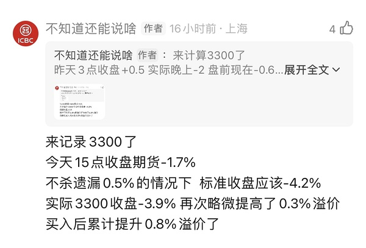
- 我来看看
现在盘前0.9%
应该3300标准涨2%

吗的 2.2现在😂😂😂😂😂😂真的提高了溢价

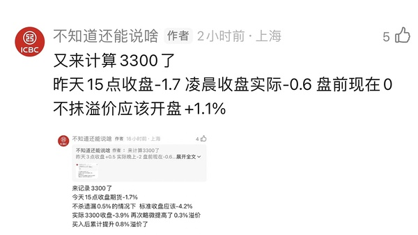
- 3300疯了

### 纳斯达克100指数（提及 6 次，占比 3%）2026-11-26 08:35:42
- 上去看了眼
中韩-12.8
nana-3.2
还行😂😂😂😂
nana亏损幅度又能减少了
到目前为止还没严重脱离6号的买入
- 伦敦金属交易所铜价上涨3%，从12月以来的最低点反弹。

现在nana 黄金 白银 铜 币 
全都是一根绳子上的
- 场内犹如判断nana就此反转一样😂

### 友友、网友们（提及 4 次，占比 2%）2026-11-26 08:58:55
- uu去看雪了？
- uu们你们模拟三倍空印度的
要失血了
- 我没钱
是uu们要抄我的底

我债券都连绿了 我累了

### 长白山 603099（提及 4 次，占比 2%）2026-11-26 11:51:30
- 你们要参照比对玩
暂时千万别看雪儿他们😂😂😂😂😂
不是一路人

你要看这批东西 如果这些个冲起来可以参照
加一些这批东西关注 比如昨天的祥源文旅

今年大连cbs暂时被遏制在旅游里 
不过也没有问题 旅游也确实能布局

![图片](data
- 现在有个问题蛮复杂的哦🤣
我们的手里两个冰雪（有uu有cbs那就是三个 我只是合并了）

现在雪儿毫无疑问就是冰雪
大连他们暂时是旅游！

这两天已经非常非常明显
他们暂时性质还不一样呢🤣
- 大连玩够了 就赶紧回家 教教cbs 什么是进攻

### 东方海洋（提及 3 次，占比 2%）2026-11-26 09:47:26
- 你不应该啊
你知道我很看好
必然满仓运行

今天本来想去东方海洋的 没来得及
- 九阳我不去
我只认准东方海洋😂
- 东方海洋有出息啊 期待你干掉九阳

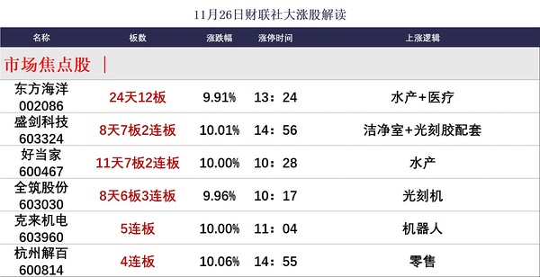

### 晶雪节能 301010（提及 3 次，占比 2%）2026-11-26 09:50:13
- 我用的是昨天plus出来的钱做的再转换
- 我昨天plus换的sy换龙了 但是本来的还在啊
- 期待明天周五逆天改命😂😂😂😂😂😂

没有了plus 少了冰雪仓位 我还要争取回补一点冰雪旅游那边的仓位 还是有任务在身

不是躺平模式

### 上海电影 601595（提及 3 次，占比 2%）2026-11-26 10:44:00
- 阿博也太懒了
因为sy肯定不能骂你
但是你就不能主动点赢得一下夸赞吗😂
- 那四个涨停也确实有些过分 就是大家每天喊sy牛逼的那四天
SY违背了自己周线30%乖离上限的规律 
即使没有情绪崩盘 这肯定也会抹掉 这就是之前我不会碰的

不过即使情绪崩盘 暂时也就抹掉了不应该涨的部分
我还是继续拿着的
- 完胜sy

### 博纳影业（提及 3 次，占比 2%）2026-11-26 10:56:23
- 阿博喷不了
他涨停都没吞
SY吞没了
- 我昨天加仓的早上给龙版了
就剩那个20日线标记的😂

但我有bn 早晚被sy一起带走
- 这两天的bn我能夸吗
我觉得还是满意的🤣🤣🤣🤣🤣🤣🤣🤣🤣

### 中证2000指数（提及 3 次，占比 2%）2026-11-26 11:14:21
- 2000又把大家赢了

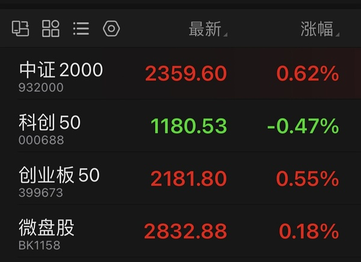
- 1000帮到了2000
没有妈妈的k50就不行了

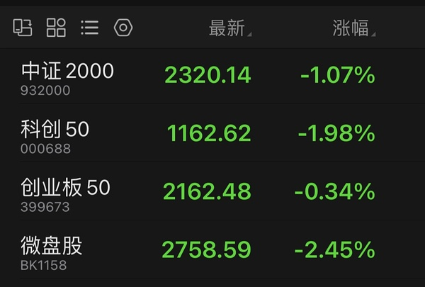
- 妈妈买1000
会传导至2000的情绪

2000情绪缓解也会传导
你看今天没什么跌停的

### 雪人集团（提及 3 次，占比 2%）2026-11-26 14:49:29
- 今天冰雪人扬眉吐气
- 冰雪多的冰雪人旅游人
应该能对冲今天传媒吧？
- 这个传媒人不行 传媒冰雪五五开的也不行😅
冰雪人才行了😂😂😂😂😂😂😂😂😂😂😂😂
主要是雪儿反包了昨天

昨天问的最多的就是雪儿为什么 怎么办

### 幸福蓝海（提及 2 次，占比 1%）2026-11-26 09:16:00
- 幸福 有种别撤单
- 我中影幸福多 我还是能够对冲的😂

### 中国长城 / 华安文体健康混合（提及 2 次，占比 1%）2026-11-26 09:55:51
- 晋级赛应该已经逐渐淘汰襄阳了

最终冠军争夺战

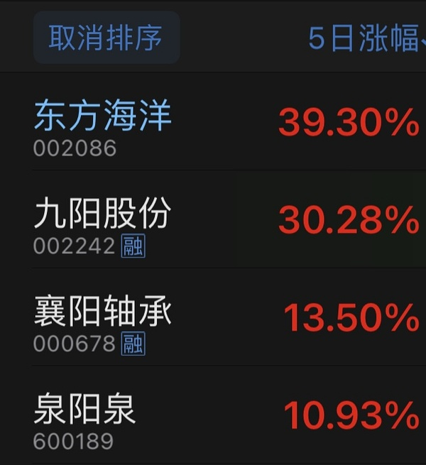
- 看来有资金和我一样担心 🤣 而且明天周五哈哈

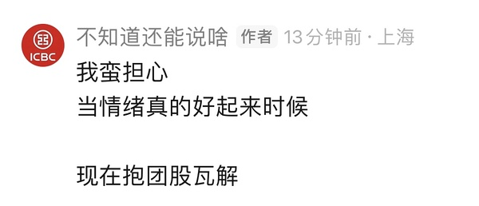

### 雪人集团 002639（提及 2 次，占比 1%）2026-11-26 10:27:13
- 一个个来
我雪儿也需要😂
- 雪儿之前起码做了五次隔日7+的零花钱

### 中文在线（提及 2 次，占比 1%）2026-11-26 10:42:53
- 昨天晚上赵老师说的

新晋ST板块批量涨停潮😂😂😂东方财富根本没有这个板块
- 老师 火箭发射

### 大连圣亚（提及 2 次，占比 1%）2026-11-26 11:27:56
- 大连：哥和他们先玩玩 到时候给你涨脸
- 你们是看雪儿操作大连的吗？他们暂时不是一路的

### 中证1000指数（提及 2 次，占比 1%）2026-11-26 14:27:10
- 部分宽基ETF午后放量，创业板ETF易方达（159915）、中证1000ETF南方(512100)等成交均明显放量。

不错 进步了
- 1000 创业板没有那些银行白酒大消费了

不管结果如何 手法上总算是变通了 我肯定是点赞

### 华夏移动互联混合（提及 1 次，占比 1%）2026-11-26 07:40:04
- 特别差的几个都是亚洲股票占比多的😂
华夏兄弟只预估-1.7 实际可能更少了

### 自嘲代指中国（提及 1 次，占比 1%）2026-11-26 09:04:25
- 👍👍👍👍👍👍👍👍👍

那个三倍空印度 没有长持吗🤣

### 建设工业（提及 1 次，占比 1%）2026-11-26 09:28:39
- A股卫星互联网板块高开，《新一代通信网建设实施方案》印发
A股卫星互联网板块高开，信维通信涨超15％，上海沪工竞价涨停，盛洋科技涨超9％，电科蓝天、乾照光电、通宇通讯、中国卫星等个股跟涨。工业和信息化部等三部委印发《新一代通信网建设实施方案

### 东百集团（提及 1 次，占比 1%）2026-11-26 10:07:49
- 你把这句写下来
12月很可能就得这么做

就像去年不买东哥 买其他商场是亏钱的

### 欢瑞世纪（提及 1 次，占比 1%）2026-11-26 10:42:31
- ST欢欢企图地天

### 生肖羊概念组（提及 1 次，占比 1%）2026-11-26 11:23:20
- 三羊真的鼎立了🤣🤣

我和襄阳道歉 他还在争夺中

### 江琪（提及 1 次，占比 1%）2026-11-26 12:49:48
- 看来江老师又看好海外链了😂

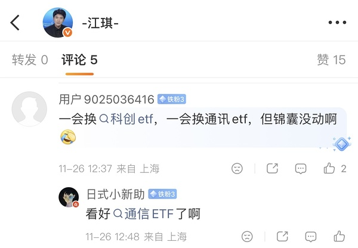

### 📄 全部发言（共 185 条）
- (2026-11-26 01:10:00) 电影《大空头》原型迈克尔·伯里：已卖出剩余的纳斯达克100指数看跌期权头寸，目前持有约25%的现金，并正在着手进行投资；暂时几乎完全持有多头头寸，他将继续评估做空机会。

市场居然会看这个反弹

- (2026-11-26 01:10:41) 洗完澡准备睡了
睡前看到了V
期待早上有奇迹  ⊳ （引用 @不知道还能说啥）电影《大空头》原型迈克尔·伯里：已卖出剩余的纳斯达克100指数看跌期权头寸，目前持有约25%的现金，并正在着手进行投资；暂时几乎完全持有多头头寸，他将继续评估做空机会。

市场居然会看这个反弹

- (2026-11-26 01:18:36) 特朗普：美股大幅下跌，根源在于11月3日的选举结果。这次选票上没有我的名字，但如果我参选，选举结果会和此前三次一样大不一样，股市以及大家的401(k)退休金账户都会一片红火。我早就跟你们说过。

- (2026-11-26 07:05:36) 笑死 奇迹日
我投票肯定选错了  ⊳ （引用 @🈵仓即暴涨🤑）后半夜发了什么威😏

- (2026-11-26 07:07:00) 纳斯达克终结八连阴！！！今天是阳线了😂  ⊳ （引用 @momo）奇迹了！已经算奇迹了吧

- (2026-11-26 07:07:25) 纳斯达克没有刷新周五低点！！！

- (2026-11-26 07:38:34) 最近美国似乎盘前不能大红 大红的几次早上看都是悲剧😂  ⊳ （引用 @sickid）被你说中了，我昨天都不敢附和怕会毒奶

- (2026-11-26 07:40:04) 特别差的几个都是亚洲股票占比多的😂
华夏兄弟只预估-1.7 实际可能更少了  ⊳ （引用 @vio）指数拉上去了，咱的基估值还是一般

- (2026-11-26 07:41:47) 我睡前看到了特朗普喊话和大空头平仓纳斯达克空单 就这两个  ⊳ （引用 @sickid）跟A学的，高开不行，低开平开才有希望，但以前我记得不是这样的……
但昨天拉起来的理由是什么，没看到啥特别的

- (2026-11-26 07:50:47) [图] 又来计算3300了
昨天15点收盘-1.7 凌晨收盘实际-0.6 盘前现在0
不抹溢价应该开盘+1.1%

- (2026-11-26 08:19:08) [图] 笑死 
因为美股下跌
pec发布后加息概率反而降低了

都出现了2% 12月利率不变的概率了🤣🤣🤣🤣

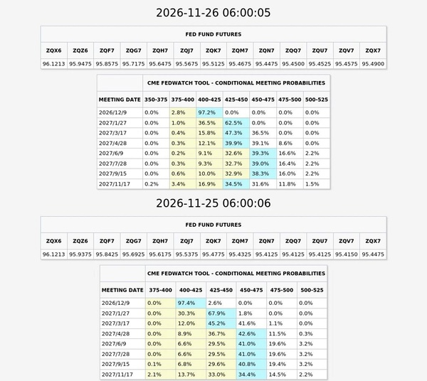

- (2026-11-26 08:19:36) 我把两天放一起给大家看 更直观了
美股可以影响加息预期  ⊳ （引用 @不知道还能说啥）笑死 
因为美股下跌
pec发布后加息概率反而降低了

都出现了2% 12月利率不变的概率了🤣🤣🤣🤣

- (2026-11-26 08:32:32) 大A确实牛逼

通信ETF目前-54 美国光-58
但是美国现在盘前+4

在A没开盘下 目前两者再度打平回撤

- (2026-11-26 08:35:42) 上去看了眼
中韩-12.8
nana-3.2
还行😂😂😂😂
nana亏损幅度又能减少了
到目前为止还没严重脱离6号的买入

- (2026-11-26 08:37:56) 他如果开了纳斯达克空单 早就发出来炫耀了😂  ⊳ （引用 @高手云集上钻）Plu可千万不要平空单，不要让他过上好日子

- (2026-11-26 08:46:59) 换上得第一天 工行绿了  ⊳ （引用 @monica）楼主打算什么时候把头像换回来，这个头像看着有点别扭hhh

- (2026-11-26 08:58:55) uu去看雪了？  ⊳ （引用 @温妤哦）占位

- (2026-11-26 09:04:25) 👍👍👍👍👍👍👍👍👍

那个三倍空印度 没有长持吗🤣  ⊳ （引用 @moli）昨天做空的模拟账户一键清仓止盈🤣

- (2026-11-26 09:04:53) 哪一部的  ⊳ （引用 @没有感情的村民）今天新闻直播间有一条贺岁档电影的播报

- (2026-11-26 09:07:25) 那个三倍空 是香港的 那个似乎是联动不起来😂😂😂  ⊳ （引用 @moli）🤣全球联动，一起买一起止盈

- (2026-11-26 09:09:12) 伦敦金属交易所铜价上涨3%，从12月以来的最低点反弹。

现在nana 黄金 白银 铜 币 
全都是一根绳子上的

- (2026-11-26 09:11:06) 他和加息降息有关系 还是得美国人不大力消费才是基本🤣🤣🤣🤣🤣  ⊳ （引用 @momo）楼楼是不是还是得要美元回落？

- (2026-11-26 09:12:53) 韩国央行预计2027年GDP增长4.1% 此前预测为2.9%

牛逼

- (2026-11-26 09:14:25) [图] 

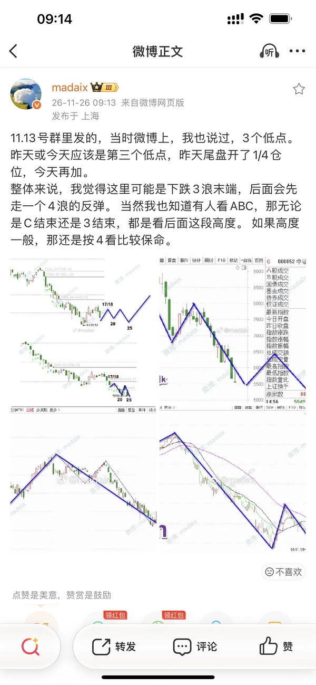

- (2026-11-26 09:15:25) 我看了去年工行就是这时候见顶
招行是下个月中  ⊳ （引用 @sickid）银行板块现在看日线就是一个五日线压制行情，似曾相识

- (2026-11-26 09:16:00) 幸福 有种别撤单

- (2026-11-26 09:18:08) 🤣🤣🤣🤣🤣🤣🤣🤣🤣🤣🤣🤣🤣  ⊳ （引用 @moli）他们都加息周期了咋预计这么低呢，我们可是降息周期都有4.5%

- (2026-11-26 09:19:17) 红利不是只有银行啊
昨天发给你们看了
红利低波50ETF前二十大没有银行股  ⊳ （引用 @Aaa摆烂咸鱼🥳）那是不是微盘也有影响，红微组合

- (2026-11-26 09:26:52) [图] 就是七月底模式

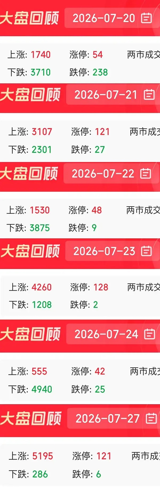  ⊳ （引用 @赛博朋克2077）4400家红，等下看看还剩几家

- (2026-11-26 09:27:11) 大家要熟悉这个模式  ⊳ （引用 @不知道还能说啥）就是七月底模式

- (2026-11-26 09:28:39) A股卫星互联网板块高开，《新一代通信网建设实施方案》印发
A股卫星互联网板块高开，信维通信涨超15％，上海沪工竞价涨停，盛洋科技涨超9％，电科蓝天、乾照光电、通宇通讯、中国卫星等个股跟涨。工业和信息化部等三部委印发《新一代通信网建设实施方案》。其中提出，推动高中低轨卫星系统协同发展，加快低轨卫星互联网系统建设，提升高轨高通量宽带通信卫星系统容量。

- (2026-11-26 09:43:55) 你们这个话说得自己觉得好笑吗🤣🤣跌了就是雷  ⊳ （引用 @ü）芒果是不是有什么雷

- (2026-11-26 09:44:28) 换了点仓 继续退出登录

- (2026-11-26 09:45:35) 认错 开盘今天买回了🤣😉😂  ⊳ （引用 @YuanZi💕）龙板好强

- (2026-11-26 09:45:45) 你真懂我  ⊳ （引用 @仓部加措）楼又切回到龙版么

- (2026-11-26 09:47:26) 你不应该啊
你知道我很看好
必然满仓运行

今天本来想去东方海洋的 没来得及  ⊳ （引用 @shirla）那今天得猛猛减点仓。条件单咋开的楼，我忘记开了😂😂😂😂

- (2026-11-26 09:48:55) 猪肉板块走低，正虹科技逼近跌停
猪肉板块走低，正虹科技逼近跌停，东瑞股份、华统股份、京基智农跟跌。

- (2026-11-26 09:50:13) 我用的是昨天plus出来的钱做的再转换  ⊳ （引用 @稀里不糊涂）芒果卖了吗楼

- (2026-11-26 09:52:43) [图] 大家比较情绪化😂该骂的视而不见

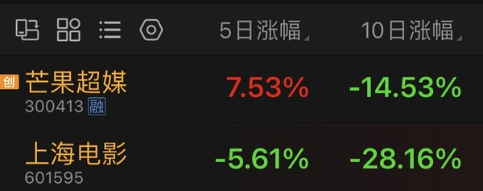  ⊳ （引用 @西西西西）其实我觉得芒果弹性还行呀

- (2026-11-26 09:54:22) 我在冰雪没有任何单子 我个人非常看好

你们自己决定卖不卖

- (2026-11-26 09:55:51) [图] 晋级赛应该已经逐渐淘汰襄阳了

最终冠军争夺战

- (2026-11-26 09:58:01) 我屁股在哪里就支持谁

一个股价4元 一个股价40🤣  ⊳ （引用 @不知道还能说啥）晋级赛应该已经逐渐淘汰襄阳了

最终冠军争夺战

- (2026-11-26 09:59:06) 换了头像以后
工行两连绿😂

- (2026-11-26 10:02:44) 九阳我不去
我只认准东方海洋😂  ⊳ （引用 @shirla）襄阳out，就看海洋和九阳了！

- (2026-11-26 10:04:56) 我觉得4元的才会最终胜出
翻倍也就8元
依然是散户喜欢的价格  ⊳ （引用 @shirla）是不是太高了啊，可是人家高端玩家，玩得可溜了😂😂😂

- (2026-11-26 10:07:49) 你把这句写下来
12月很可能就得这么做

就像去年不买东哥 买其他商场是亏钱的  ⊳ （引用 @momo）我知道了我以后只买龙头

- (2026-11-26 10:10:36) 你不是冰雪多吗？  ⊳ （引用 @该用户已过期）绿了😭😭

- (2026-11-26 10:11:26) 这句我截图了

下个月见  ⊳ （引用 @miumiu）楼楼坚定买冰雪的理由是啥啊，玩了大半个月了话说

- (2026-11-26 10:12:30) 不在的理由是什么 我中影也没动  ⊳ （引用 @没有感情的村民）楼，你的xf还在不

- (2026-11-26 10:14:14) 我昨天plus换的sy换龙了 但是本来的还在啊  ⊳ （引用 @👑）sy呢？

- (2026-11-26 10:23:10) 如果现在不知道我们的代号的
就真的别知道了 对你好  ⊳ （引用 @小肥肥）龙是啥？

- (2026-11-26 10:25:05) 赎回潮了🥲  ⊳ （引用 @六倍做多退休）30债？哈哈哈这又是怎么了

- (2026-11-26 10:25:31) 十天也就多跌了3%  ⊳ （引用 @该用户已过期）大连车太重了🤣🤣

- (2026-11-26 10:25:41) 工行下去了

银行分化了  ⊳ （引用 @公主要发财）招招宝贝能不能下来，怎么还拉起来了呀

- (2026-11-26 10:26:30) 工行农行那边下去了

但是中国神华申请出战

- (2026-11-26 10:27:13) 一个个来
我雪儿也需要😂  ⊳ （引用 @家不住海边）这个月行不行
先回去。两个跌停板还回来先

- (2026-11-26 10:28:31) 第一天电影大幅度反攻时候
你问大家有什么好高兴的

现在你又关心电影了吗  ⊳ （引用 @we）有电影的今天什么感觉 不想打开了

- (2026-11-26 10:29:38) 🤣你可以再切出去  ⊳ （引用 @仓部加措）楼楼快骂sy，昨天切给她又吃一个大面

- (2026-11-26 10:30:09) 这个月电影都是红的 为什么不能高兴？  ⊳ （引用 @we）跌快一周反攻一天该高兴么

- (2026-11-26 10:32:01) 那10月就买的大家还不能高兴了？  ⊳ （引用 @we）不是每个人都最低位买进去的

- (2026-11-26 10:33:55) 五周线回踩😂  ⊳ （引用 @没有感情的村民）抱团中后期？

- (2026-11-26 10:36:41) 不着急的

冰雪也需要回

还记得周一我说的吗

冰雪要在传媒机器人回调时候展现

就是现在这样  ⊳ （引用 @仓部加措）累了不想切了，反正楼楼原来的sy也不会动，底部就是熬了，等12月🥶

- (2026-11-26 10:40:46) 会
但是你得玩前排的  ⊳ （引用 @多笑笑吧）楼楼请教一下商场一般会玩到十二月中吗？

- (2026-11-26 10:42:10) 😂😂😂😂

那你应该很熟悉他

他几乎没有四连板过  ⊳ （引用 @多笑笑吧）中央从去年拿到现在，两个板都还没回本，那我再坚持坚持！哈哈哈

- (2026-11-26 10:42:31) ST欢欢企图地天

- (2026-11-26 10:42:53) 昨天晚上赵老师说的

新晋ST板块批量涨停潮😂😂😂东方财富根本没有这个板块  ⊳ （引用 @不知道还能说啥）ST欢欢企图地天

- (2026-11-26 10:44:00) 阿博也太懒了
因为sy肯定不能骂你
但是你就不能主动点赢得一下夸赞吗😂

- (2026-11-26 10:44:26) 雪儿之前起码做了五次隔日7+的零花钱  ⊳ （引用 @柚又）你们雪人怎么都回本得这么快，羡慕

- (2026-11-26 10:45:33) 小伙伴在如今环境还能对一个票上头
也是很奇特了😂  ⊳ （引用 @只想搞钱）我都给他加到第三仓位了...真是上头了

- (2026-11-26 10:46:25) 10:45:18 财联社11月26日电，恒生科技指数上涨4%至3,513.75点。大模型股大涨，智谱涨超15%，MINIMAX涨13%。(来自财联社APP)

- (2026-11-26 10:46:29) ………..  ⊳ （引用 @不知道还能说啥）10:45:18 财联社11月26日电，恒生科技指数上涨4%至3,513.75点。大模型股大涨，智谱涨超15%，MINIMAX涨13%。(来自财联社APP)

- (2026-11-26 10:46:52) uu们你们模拟三倍空印度的
要失血了  ⊳ （引用 @不知道还能说啥）10:45:18 财联社11月26日电，恒生科技指数上涨4%至3,513.75点。大模型股大涨，智谱涨超15%，MINIMAX涨13%。(来自财联社APP)

- (2026-11-26 10:48:32) [图] 我来看看
现在盘前0.9%
应该3300标准涨2%

吗的 2.2现在😂😂😂😂😂😂真的提高了溢价

  ⊳ （引用 @梳碧湖砍柴人）场内娜娜今天还能涨溢价…

- (2026-11-26 10:52:00) 工行农行都回踩了五周线😂  ⊳ （引用 @sickid）早上刚说完银行五日线压制，就给我冲破5日线了，妈的

- (2026-11-26 10:55:14) [图] 今天煤炭跟的是黄金有色吗

中国神华新高了

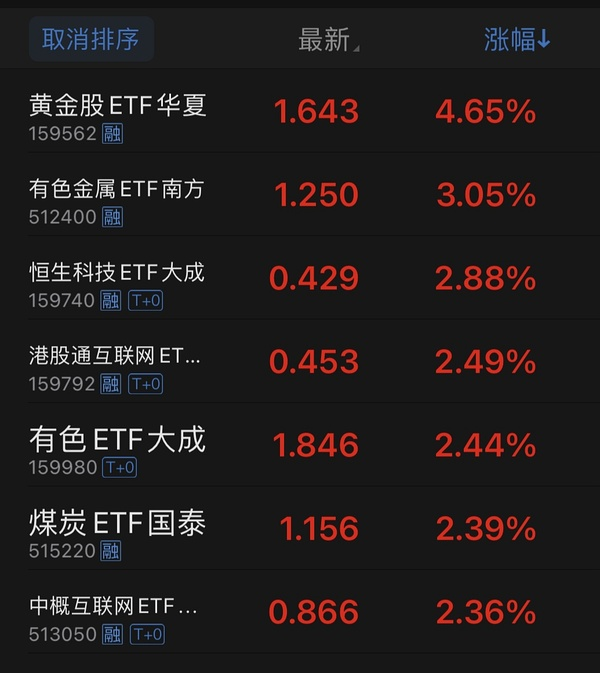

- (2026-11-26 10:56:23) 阿博喷不了
他涨停都没吞
SY吞没了  ⊳ （引用 @vio）博子哥  有性格

- (2026-11-26 10:57:36) 你也说了
你走了才拉板😂
不走不拉  ⊳ （引用 @只想搞钱）因为之前每次我一走他就拉板，导致有一种幻想🥲可能这次也得我献祭吧

- (2026-11-26 10:58:17) 🤣他不服气

还是三强鼎立  ⊳ （引用 @只想搞钱）襄阳牛

- (2026-11-26 11:00:44) 恭喜龙龙新高

- (2026-11-26 11:09:32) 然后搞上去45万？  ⊳ （引用 @该用户已过期）20几万封单一下子撤单是洗人了🤣🤣

- (2026-11-26 11:10:40) 创业板权限有的 别忘了申请今天新股
超级超级超级大肉

- (2026-11-26 11:14:21) [图] 2000又把大家赢了

- (2026-11-26 11:15:48) 适合大家刮彩票🤣  ⊳ （引用 @六倍做多退休）这个资金没优势哈哈哈 顶格也才那么点

- (2026-11-26 11:17:59) [图] 弱的一笔

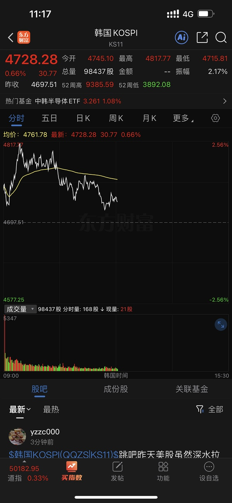

- (2026-11-26 11:23:20) 三羊真的鼎立了🤣🤣

我和襄阳道歉 他还在争夺中  ⊳ （引用 @Aaa摆烂咸鱼🥳）这个襄阳也是富贵险中求啊，这是机构或者量化大的吧

- (2026-11-26 11:24:19) 祝大家好运

20几万利润呢  ⊳ （引用 @点-重生炒垃圾）我申购了，这个名字好奇葩哈哈哈

- (2026-11-26 11:26:12) 这样大资金就没有优势了

比较公平  ⊳ （引用 @momomomomomo哒）这个申购上限也太少了.... 和中彩票没区别了 

- (2026-11-26 11:27:56) 大连：哥和他们先玩玩 到时候给你涨脸  ⊳ （引用 @椰椰谷谷）大连，你让我好丢脸

- (2026-11-26 11:29:13) 3300疯了

- (2026-11-26 11:29:32) 纳斯达克比刚刚的0.9有所回落
他却大幅度拉升  ⊳ （引用 @不知道还能说啥）3300疯了

- (2026-11-26 11:29:45) 👍👍👍👍  ⊳ （引用 @.）早上买了襄阳hhh

- (2026-11-26 11:30:30) [图] 国泰就嗨不起来

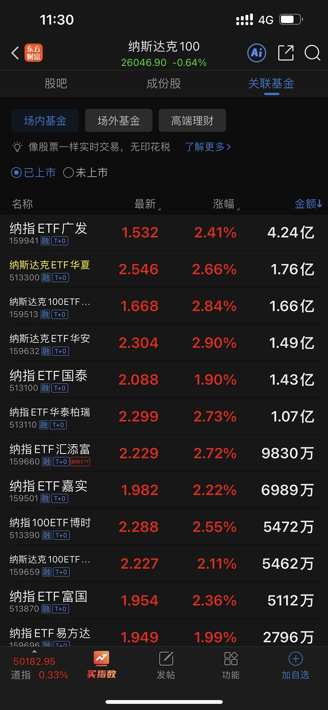

- (2026-11-26 11:31:04) 这样3300差不多又回到了6号的价格  ⊳ （引用 @不知道还能说啥）国泰就嗨不起来

- (2026-11-26 11:33:36) 目前能抄我底的日子暂时是

上周五 本周一 本周三和今天开盘

继续拭目以待 我到底会不会浮亏超过10%  ⊳ （引用 @不知道还能说啥）这样3300差不多又回到了6号的价格

- (2026-11-26 11:38:06) 你们是看雪儿操作大连的吗？他们暂时不是一路的  ⊳ （引用 @柴可猪斯基）世另我

- (2026-11-26 11:39:38) 可比公司：
招股意向书认定的可比公司分为国际封测设备巨头与国内相关设备/仪器公司两个层次，但完全对应的A股标的高度稀缺：
第一档：BESI（BESI.AS）、ASMPT（0522.HK）——全球半导体后道封测设备龙头，产品覆盖贴片、固晶、键合等，是猎奇智能在光模块贴片与耦合设备上最直接的国际竞争对手。
第二档：新益昌（688383.SH） ——国内固晶机龙头，与猎奇智能在“精密贴装设备”的技术底层上有一定共性，但下游重心在LED/Mini LED而非光模块，2025年营收7.27亿元、净利润为负，估值参照意义受盈利波动干扰较大。
第三档：联讯仪器 ——光电子器件测试设备领域市占率第一，2026H1营收15.31亿元、净利润5.67亿元，在“光模块设备”标签下的体量与盈利厚度均超过猎奇智能，但产品重心在测试而非贴片/耦合，工序定位不同。

核心：没有任何一家可比公司在“光模块贴片/耦合设备全球市占率领先+单一大客户深度绑定”这一组合上与猎奇智能完全对应。BESI和ASMPT提供的是国际龙头在成熟竞争格局中的估值下限参照，联讯仪器提供的是“光模块设备高景气阶段A股市场愿意给予的估值弹性”的上限参照。猎奇智能的合理估值需要在两者之间寻找位置。

结论：建议申购，后期建议一般关注。上市首日炒作高度预测：2026年上半年创业板新股首日平均涨幅约308%—371.9%，低于科创板（437%）但绝对值仍处于历史高位。

猎奇智能的首日定价需要同时权衡三组力量：
推高首日涨幅的力量：发行PE 31.3倍在创业板新股中处于偏低水平，2026年业绩爆发使动态估值极低；“光模块贴片设备全球第一”的标签在AI算力主题下具备极强的情绪吸引力；中际旭创参与战投提供了产业资本的背书信号；流通盘有限（网上发行量较小），有利于情绪推动。

- (2026-11-26 11:40:00) 今天那只新股超级牛逼 记得去刮彩票  ⊳ （引用 @不知道还能说啥）可比公司：
招股意向书认定的可比公司分为国际封测设备巨头与国内相关设备/仪器公司两个层次，但完全对应的A股标的高度稀缺：
第一档：BESI（BESI.AS）、ASMPT（0522.HK）——全球半导体后道封测设备龙头，产品覆盖贴片、固晶、键

- (2026-11-26 11:41:13) 光模块贴片设备全球第一 

人家有瞩目的标签  ⊳ （引用 @不知道还能说啥）今天那只新股超级牛逼 记得去刮彩票

- (2026-11-26 11:48:59) 那四个涨停也确实有些过分 就是大家每天喊sy牛逼的那四天
SY违背了自己周线30%乖离上限的规律 
即使没有情绪崩盘 这肯定也会抹掉 这就是之前我不会碰的

不过即使情绪崩盘 暂时也就抹掉了不应该涨的部分
我还是继续拿着的  ⊳ （引用 @Aaa摆烂咸鱼🥳）楼，上影11.12-11.20是不是出货了

- (2026-11-26 11:51:30) [图] 你们要参照比对玩
暂时千万别看雪儿他们😂😂😂😂😂
不是一路人

你要看这批东西 如果这些个冲起来可以参照
加一些这批东西关注 比如昨天的祥源文旅

今年大连cbs暂时被遏制在旅游里 
不过也没有问题 旅游也确实能布局

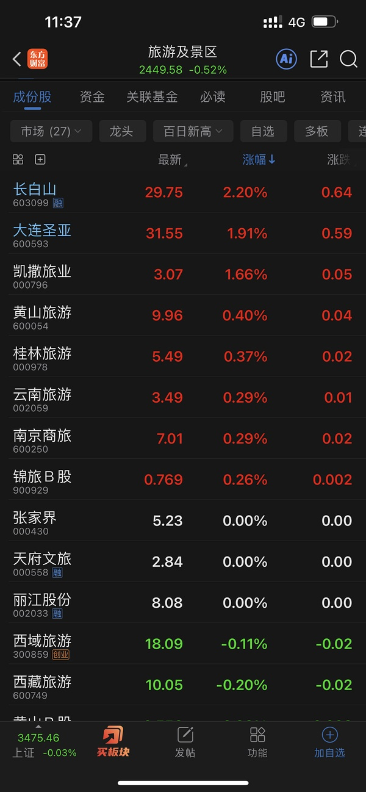  ⊳ （引用 @柴可猪斯基）是的 之前也看你说过 我这次挂住了才真长记性了

- (2026-11-26 11:55:34) A股又出新概念？今天，“金”字爆发

值得关注的是，今日含“金”字个股大爆发，其中金三江、金百泽、金禄电子20%涨停，涨幅居前。金健米业、金螳螂、金牛化工、金辰股份、金正大等多只含有“金”字个股涨停。

除了上述含“金”字个股外，自带“金”字的黄金板块涨幅居前，招金黄金涨超8%，赤峰黄金、四川黄金等涨超5%，中金黄金、山金国际、西部黄金等涨超4%。

- (2026-11-26 11:55:59) 学吧 继续学习🤣🤣🤣🤣  ⊳ （引用 @不知道还能说啥）A股又出新概念？今天，“金”字爆发

值得关注的是，今日含“金”字个股大爆发，其中金三江、金百泽、金禄电子20%涨停，涨幅居前。金健米业、金螳螂、金牛化工、金辰股份、金正大等多只含有“金”字个股涨停。

除了上述含“金”字个股外，自带“金”

- (2026-11-26 11:56:40) 传媒那个金 弱爆了 没嗨起来啊  ⊳ （引用 @不知道还能说啥）学吧 继续学习🤣🤣🤣🤣

- (2026-11-26 12:08:29) 我没钱
是uu们要抄我的底

我债券都连绿了 我累了  ⊳ （引用 @sickid）你早上还有钱抄啊？不是满仓了嘛

- (2026-11-26 12:09:57) 第三个 很明显是贵金属
因为白银股 铜啊 锡啊股都一起涨了😂  ⊳ （引用 @Frances）短线博主

下午抱团修复的话考虑卖权，羊的核心没死。而且也有补涨涨停，还有地板被扫货的。

昨天没出手的踏空，早上高开也没有买点。
科技硬件这里如果有元件的话，今天是应该有卖权的，而不是追进去。

贵金属多提一嘴，到底是贵金属呢，还是炒字头

- (2026-11-26 12:14:02) 收盘11:30是0.8% 
3300不杀溢价也应该只有1.9%涨幅
虽然现在+1 对应的也应该是2.1%涨幅

3300现在已经2.6%了 确实是离谱

国内玩nana的资金应该是绝顶聪明的
为何选在今天大幅度bbbbbbbbbb
他们觉得昨天的下跌只是因为感恩节资金提前出来吗？应该延续反弹吗？？  ⊳ （引用 @不知道还能说啥）又来计算3300了
昨天15点收盘-1.7 凌晨收盘实际-0.6 盘前现在0
不抹溢价应该开盘+1.1%

- (2026-11-26 12:33:44) 银行时间上确实是危

因为我昨天顺手看了下工行 就是去年这个时候不太行了
招行是下个月月中不行了😂😂😂

然我看人家讨论也有道理
很多银行一月有半年度分红
不是长年买的 会主动避开  ⊳ （引用 @Waiting一下）银行危？上一个我记得还是上海爷叔，上海建工😂😂😂

- (2026-11-26 12:37:59) 现在有个问题蛮复杂的哦🤣
我们的手里两个冰雪（有uu有cbs那就是三个 我只是合并了）

现在雪儿毫无疑问就是冰雪
大连他们暂时是旅游！

这两天已经非常非常明显
他们暂时性质还不一样呢🤣  ⊳ （引用 @momo（富姐版））这个规律延续几周了？有三四周？

- (2026-11-26 12:49:48) [图] 看来江老师又看好海外链了😂

- (2026-11-26 12:53:04) [图] 现在通信ETF-53.5
美国算上盘后暂时也是这样 差不多 

😂大A的光解决了超涨问题 再度差不多打平

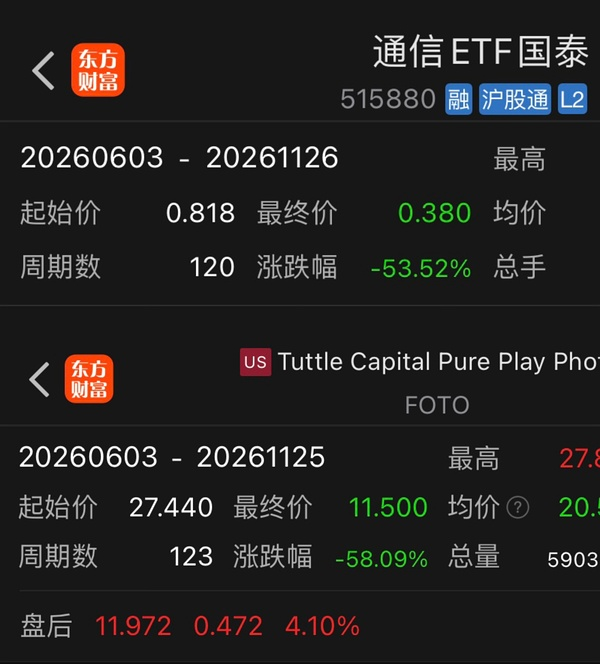

- (2026-11-26 13:12:29) 索性让电影再萎靡一天赶人走好了
明天继续冰雪来 打破周五历史宿命  ⊳ （引用 @YuanZi💕）今天雪人 明天周五电影来嘛🥹

- (2026-11-26 13:13:41) [图] 重仓3300的看的都摇头😂😂

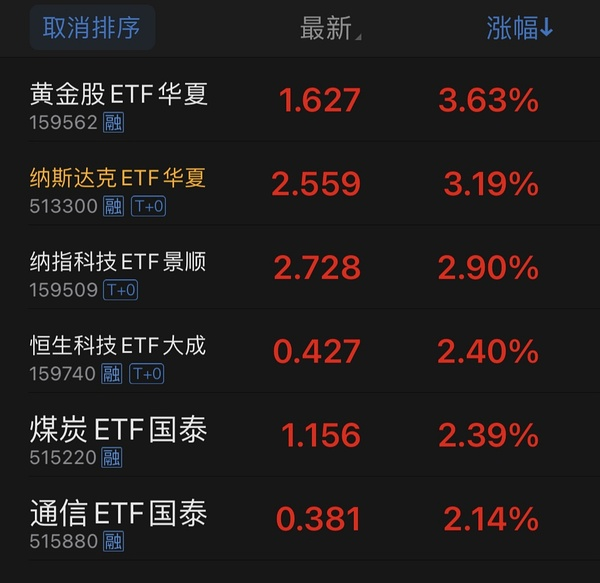

- (2026-11-26 13:15:54) 场内犹如判断nana就此反转一样😂  ⊳ （引用 @六倍做多退休）场内nana怎么溢价飙升 上次拿中韩换纳纳真的还不错诶

- (2026-11-26 13:16:54) 几年后注定大家还是会说那句

“2026年11月 要是全部给nana就好了”  ⊳ （引用 @👑）手里没几个股跑得赢娜娜，就雪人

- (2026-11-26 13:17:15) 妈呀 债又崩盘了  ⊳ （引用 @六倍做多退休）场内nana怎么溢价飙升 上次拿中韩换纳纳真的还不错诶

- (2026-11-26 13:18:25) 是的
他们不敢打NK吗🤣  ⊳ （引用 @六倍做多退休）看的一愣一愣的 场内应该就黄金股etf暂超吧

- (2026-11-26 13:20:13) 大连玩够了 就赶紧回家 教教cbs 什么是进攻

- (2026-11-26 13:23:19) 华为欧拉板块短线拉升，拓维信息涨停
华为欧拉板块短线拉升，拓维信息涨停，品高股份、润和软件、四川长虹、青云科技、艾融软件跟涨。

- (2026-11-26 13:25:25) 应该没有

不过这么低的缺口没什么好多看的 我都不看  ⊳ （引用 @没有感情的村民）缺口补了吗

- (2026-11-26 13:28:06) 👍👍👍👍👍👍👍👍👍  ⊳ （引用 @🈵仓即暴涨🤑）长白山:谁怕谁

- (2026-11-26 13:28:37) 我把那个祥源文旅 昨天装逼的加关注了 看看到底有多少能耐🤣🤣🤣🤣  ⊳ （引用 @🈵仓即暴涨🤑）长白山:谁怕谁

- (2026-11-26 13:31:22) 造纸板块午后走高 岳阳林纸、青山纸业涨停
造纸板块午后走高，岳阳林纸、青山纸业涨停，山鹰国际此前涨停，宜宾纸业跟涨。

- (2026-11-26 13:38:44) uu让我想起了你 “等科技反弹我就给红利”

你好像又在重复这个过程了  ⊳ （引用 @想当富有的咸鱼）不是十二月我们要从微盘撤退么，我打算到时候出来的钱就扔给3300了，安心点，招招实在不给机会

- (2026-11-26 13:39:49) 不容易
债券反弹了

- (2026-11-26 13:39:59) 累累的心略微缓解  ⊳ （引用 @不知道还能说啥）不容易
债券反弹了

- (2026-11-26 13:43:43) 现在因为固收+赎回

变成了部分共同体了  ⊳ （引用 @点-重生炒垃圾）债券对股市到底好事还是坏事，还是无所谓

- (2026-11-26 14:03:46) 我都担心他被带下去😂  ⊳ （引用 @乖乖是只嘤嘤怪）bn  你带带哥哥们

- (2026-11-26 14:10:31) 期货在交易啊
在大跳水  ⊳ （引用 @👑）今天老美不开门，也是为了预测吗

- (2026-11-26 14:11:29) 黄金白银nana原油集体跳水

- (2026-11-26 14:12:20) 完胜sy  ⊳ （引用 @乖乖是只嘤嘤怪）有事吗 bn 

- (2026-11-26 14:12:54) [图] 今天变成了机器人领跌市场

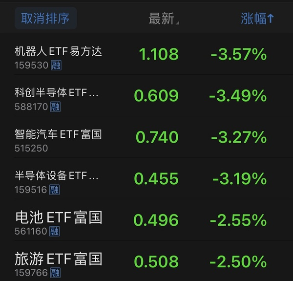

- (2026-11-26 14:13:43) 我昨天加仓的早上给龙版了
就剩那个20日线标记的😂

但我有bn 早晚被sy一起带走  ⊳ （引用 @sickid）我sy已经走了，造福你们还在的人

- (2026-11-26 14:15:40) 美国也确实是大跳水  ⊳ （引用 @梳碧湖砍柴人）娜娜杀溢价了

- (2026-11-26 14:16:31) 中午之前多的溢价确实是杀了 那个也确实是离谱  ⊳ （引用 @梳碧湖砍柴人）那现在是回暖了？

- (2026-11-26 14:22:24) [图] 你觉得是传媒的问题？
你看看这两根线区别在哪里😂😂😂😂

  ⊳ （引用 @稀里不糊涂）xf和上影会受到传媒板块影响吗

- (2026-11-26 14:25:12) 和昨天不一样🤣

- (2026-11-26 14:26:11) 这次我没找到ETF来的证据😂  ⊳ （引用 @sickid）2点半妈妈来了？

- (2026-11-26 14:26:47) [图] 哦看到啦 创业板

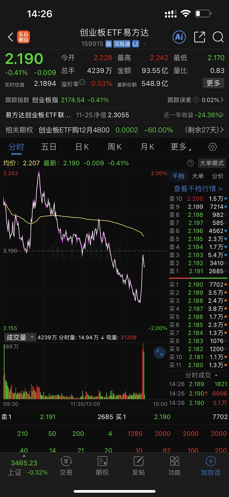  ⊳ （引用 @sickid）2点半妈妈来了？

- (2026-11-26 14:26:56) 今天没有去300  ⊳ （引用 @sickid）刚刚那波很强啊，而且银行茅台回落的

- (2026-11-26 14:27:10) 部分宽基ETF午后放量，创业板ETF易方达（159915）、中证1000ETF南方(512100)等成交均明显放量。

不错 进步了

- (2026-11-26 14:27:16) 值得夸奖👍👍👍👍👍👍  ⊳ （引用 @不知道还能说啥）部分宽基ETF午后放量，创业板ETF易方达（159915）、中证1000ETF南方(512100)等成交均明显放量。

不错 进步了

- (2026-11-26 14:27:29) 夸奖

变方法了  ⊳ （引用 @sickid）买了创业板和1000

- (2026-11-26 14:28:00) 这两个都没有银行 也没有茅台啥的了  ⊳ （引用 @sickid）买了创业板和1000

- (2026-11-26 14:29:16) [图] 1000帮到了2000
没有妈妈的k50就不行了

- (2026-11-26 14:30:31) 昨天还是50 300

今天至少变通了

我还是点赞的  ⊳ （引用 @👑）昨天其实妈妈来了，也被砸了，印度嘛，各个都有自己的想法

- (2026-11-26 14:32:31) 1000 创业板没有那些银行白酒大消费了

不管结果如何 手法上总算是变通了 我肯定是点赞  ⊳ （引用 @👑）这个还是看楼楼说我才知道的，确实以前是50 300，今天明显是1000，创业板

- (2026-11-26 14:35:35) 老师 火箭发射

- (2026-11-26 14:35:48) 所以传言换人了啊😂  ⊳ （引用 @moli）以前不是挺技术派的，怎么前段时间的操作像个新兵蛋子

- (2026-11-26 14:36:31) 那你看看韩国的嘴炮  ⊳ （引用 @云小朵飘啊飘）a股的古茗真的对管理层很包容。。。早就该做的事，到现在尸横遍野，也能得到夸奖😅

- (2026-11-26 14:36:53) 韩国今天嘴炮继续说考虑翻倍买  ⊳ （引用 @云小朵飘啊飘）a股的古茗真的对管理层很包容。。。早就该做的事，到现在尸横遍野，也能得到夸奖😅

- (2026-11-26 14:44:27) 我蛮担心
当情绪真的好起来时候

现在抱团股瓦解

- (2026-11-26 14:46:24) 今天高级操作哦 分段式的😂  ⊳ （引用 @sickid）又怂了，什么玩意儿，继续买啊

- (2026-11-26 14:46:42) 我有  ⊳ （引用 @momo）我们手里没有抱团股吧

- (2026-11-26 14:48:16) [图] 科创50: 妈妈不要我了

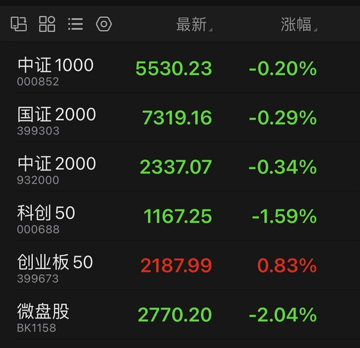

- (2026-11-26 14:49:29) 今天冰雪人扬眉吐气

- (2026-11-26 14:51:09) 妈妈买1000
会传导至2000的情绪

2000情绪缓解也会传导
你看今天没什么跌停的  ⊳ （引用 @潇湘烟雨）微盘股才是造了孽

- (2026-11-26 14:52:07) 特色是给你3个8 不是2个10  ⊳ （引用 @大河）🥲我还惦记着吃的那两个跌停，能不能还两个涨停

- (2026-11-26 14:53:17) 那你是旅游人 换名字了  ⊳ （引用 @🌼（躺平版））没雪人版的冰雪人并不快乐

- (2026-11-26 14:53:56) 会和传媒一样
忍过哀嚎 再大赚的 我和6月传媒一样信心十足  ⊳ （引用 @荣誉黑粉涨停版）3个8😃那就更美了，老大我们这样不会太贪心吗😃

- (2026-11-26 14:54:56) 这两天的bn我能夸吗
我觉得还是满意的🤣🤣🤣🤣🤣🤣🤣🤣🤣

- (2026-11-26 14:56:08) 别着急 12月  ⊳ （引用 @🌼（躺平版））那能不能让旅游人也爽一下啊求求了啊我的老天奶

- (2026-11-26 14:57:28) [图] 没有任何区别

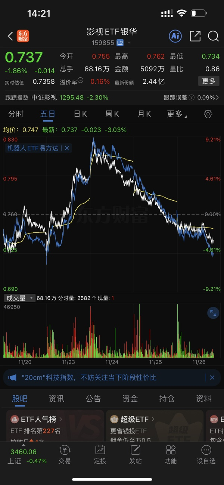  ⊳ （引用 @点-重生炒垃圾）传媒不会走成创新药那种吧，拉升诈骗拉升诈骗

- (2026-11-26 14:59:09) [图] 看来有资金和我一样担心 🤣 而且明天周五哈哈

  ⊳ （引用 @YuanZi💕）龙板跳水啊

- (2026-11-26 15:00:31) 冰雪多的冰雪人旅游人
应该能对冲今天传媒吧？

- (2026-11-26 15:01:41) 是的
正常就是这么玩的
但是最核心的可能会贯穿  ⊳ （引用 @vio）情绪回暖，抱团就散到各个地方 ？

- (2026-11-26 15:04:52) 我中影幸福多 我还是能够对冲的😂  ⊳ （引用 @🈵仓即暴涨🤑）那🉐看仓位几比几了😎

- (2026-11-26 15:05:51) 恶趣味

最后还是扫货300

300魔力转圈圈 爱不释手

- (2026-11-26 15:06:46) 期货交易的 在跳水  ⊳ （引用 @👑）今天也没有美股指引，明天周五咋办啊（每天杞人忧天ing）

- (2026-11-26 15:08:27) 恶趣味！！！  ⊳ （引用 @sickid）然后上涨红0.01，我还以为是有任务

- (2026-11-26 15:09:19) 明天周五
但是我没钱
所以没有那个困扰

大家有困扰的话
记得明天是周五哈

- (2026-11-26 15:11:20) 又来统计3300了
nana期货15点收盘0.4%
不抹掉0.8%溢价应该1.5%收盘
实际3300收盘1.7% 再度提升0.2%溢价

现在3300买入后溢价率合计被抬高了1%  ⊳ （引用 @不知道还能说啥）又来计算3300了
昨天15点收盘-1.7 凌晨收盘实际-0.6 盘前现在0
不抹溢价应该开盘+1.1%

- (2026-11-26 15:15:58) 期待明天周五逆天改命😂😂😂😂😂😂

没有了plus 少了冰雪仓位 我还要争取回补一点冰雪旅游那边的仓位 还是有任务在身

不是躺平模式  ⊳ （引用 @shirla）哈哈哈依旧满仓，那我放心了

- (2026-11-26 15:17:05) [图] 东方海洋有出息啊 期待你干掉九阳

- (2026-11-26 15:18:30) 自从闽发倒下后

市场再也没有过六连板

看这个机器人票了  ⊳ （引用 @不知道还能说啥）东方海洋有出息啊 期待你干掉九阳

- (2026-11-26 15:21:08) 没有  ⊳ （引用 @shirla）咱就说，明天有条件单吗楼楼😂😂😂

- (2026-11-26 15:22:12) [图] 我就不了
五天少了1个点就凑活看了😂😂😂😂😂
必经走势是一模一样

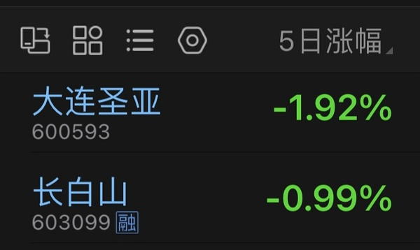  ⊳ （引用 @sickid）我想买回cbs了

- (2026-11-26 15:24:03) 这个传媒人不行 传媒冰雪五五开的也不行😅
冰雪人才行了😂😂😂😂😂😂😂😂😂😂😂😂
主要是雪儿反包了昨天

昨天问的最多的就是雪儿为什么 怎么办  ⊳ （引用 @👑）大家还能反包昨天，好厉害

- (2026-11-26 15:25:11) 然后去了哪里？  ⊳ （引用 @🈵仓即暴涨🤑）你今天卖了雪人我卖的比你还早

- (2026-11-26 15:26:29) [图] 小克是无敌牛逼的机器人

给你看个图 认识一下他的实力

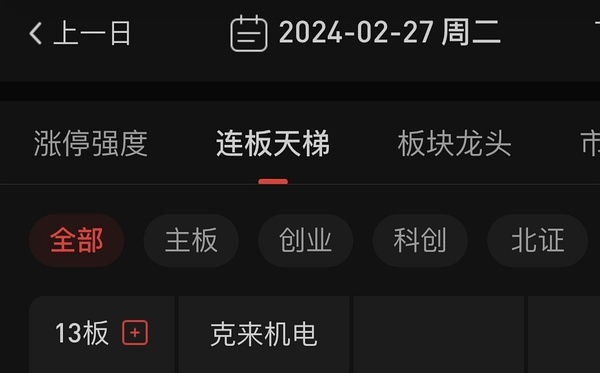  ⊳ （引用 @只想搞钱）那我的机器人很敏感了时刻关注，为他祈福

- (2026-11-26 15:27:51) 🤣🤣🤣🤣🤣🤣现在我们称之为旅游人  ⊳ （引用 @🈵仓即暴涨🤑）长白山大连😒

- (2026-11-26 15:33:29) 这四天我手里反弹最好的是冰雪和旅游😂
我已经看了
四天 大连+9 cbs+9.8 雪儿+6
期待大连五连涨  ⊳ （引用 @👑）我是传媒旅游冰雪人

- (2026-11-26 15:41:29) 最忌讳的就是哪边好了 卖这边去哪边😂  ⊳ （引用 @稀里不糊涂）楼楼好冷静，电影好的时候大家都在问冰雪怎么走成这个样子担心冰雪，现在冰雪好了，电影下来又着急

- (2026-11-26 15:43:36) [图] 他没看到最后哈哈哈哈哈哈哈哈哈
最后还是碰了300🤣🤣🤣🤣🤣🤣🤣🤣🤣

上瘾的 每天喝几口

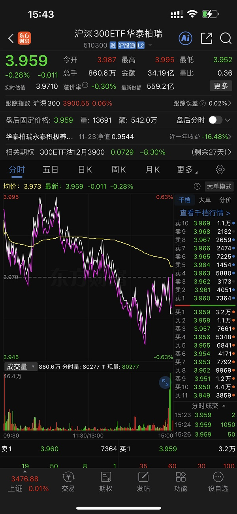  ⊳ （引用 @没有感情的村民）楼，表舅跟你一个观点，etf方向对了

- (2026-11-26 15:51:03) 没有人播报小远吗？

绝了-0.64

打平nana！

- (2026-11-26 15:59:03) 大家晚上想看还是能看的🤣🤣🤣
美股期货2点关🤣

2026年11月26日（周四）为感恩节，美股全天休市一天；
芝商所（CME）旗下贵金属、美国原油期货合约交易提前于北京时间27日03：30结束

股指期货合约交易提前于北京时间27日02：00结束。

洲际交易所（ICE）旗下布伦特原油期货合约交易提前于北京时间27日02：30结束。

## 🧠 投资风格分析
> 📏 增量更新指引：仅当今日发言确有新依据时才修订对应维度，无变化不强行重写；单维度修订建议 ≤150 字。

- 投资理念与方法：坚持红利≠银行，强调红利低波组合中非银行股更具配置价值；看好标的会明确表态并长期跟踪，用五周线回踩、去年见顶时点等均线/季节规律辅助判断；偏好低价股的弹性逻辑。今日再次以红利低波50ETF前二十大没有银行股佐证红利非银行，并用工行去年此时见顶、招行下月月中做时点判断。
- 风险偏好：对场内QDII溢价高度敏感，习惯用盘前涨幅与收盘价测算开盘缺口；对盘前大红后的回落模式保持警惕，认为亚洲敞口占比高的基金表现更差。今日计算3300溢价被抬高1%，称2.6%的溢价“离谱”，并称盘前大红后早上看多是悲剧、亚洲股票占比多的基金特别差。
- 交易与仓位：保持高周转、卖出即满仓的风格，短打与底仓分离；兑现资金会迅速做再转换，开盘纠错买回后继续退出登录，强调“必然满仓运行”。对未及买入的标的会明确记录为错过，不追高。今日用昨天plus兑现资金做再转换，将昨日加仓部分转至龙版，开盘买回，并记录没来得及去东方海洋。
- 心理特质：对短期波动钝化，持仓上涨时直接表达满意，看好就明确站队，不因单日涨跌改变态度；对市场情绪化归因保持调侃。今日称“这个月电影都是红的 为什么不能高兴？”、“我屁股在哪里就支持谁”，并以“跌了就是雷”调侃情绪化归因。

> ⚠️ 本板块由 Actions 全自动增量更新（复用当日发言与今日总览），每次仅在内容足够支撑时才改动。

## 🏷️ 昵称映射表
### 📖 昵称规律（供 AI 判断新昵称时参考）
【昵称命名规律（用于推断未知新昵称）】
- 拼音首字母缩写：取标的/基金名汉字拼音首字母串（含数字代码），多为 ETF/股票代码口语化｜示例：yl=引力传媒｜zy=掌阅科技｜sj=视觉中国｜cc=华安文体健康混合｜C50=创业板50ETF｜k50=科创50｜kun=昆仑万维｜xhxc=新瀚新材｜zxfc=中欣氟材
- 小/老+姓氏代指：「小X」「老X」通常指姓 X 的标的或该标的的基金经理；「X兄弟」多为同系基金｜示例：小惠=惠发食品｜老莫=万家品质生活(莫海波)｜小华=华夏全球科技先锋(QDII)A｜小华兄弟=华夏移动互联(QDII)｜小浦=浦银安盛全球智能科技(QDII)A｜小广=广发全球精选(QDII)A｜小远=华宝致远(QDII)C｜招招=招商银行｜小德=德明利｜赵姨=兆易创新｜露露=泸州老窖｜空调=格力电器
- 戏称/黑话→题材板块：生活化比喻或黑话对应某个题材/板块，而非单一标的；出现时多指板块方向｜示例：卖国=PCB板块(英伟达AI链)｜爱国=国产自主(半导体设备/芯片)｜奶茶=易点天下｜老师=中文在线｜蓝色=蓝色光标｜宇航员=航空航天板块｜华子=华泰保兴安悦债券｜国际=国际复材｜巨无霸=长鑫科技等重大IPO
- 谐音/取字：昵称含标的名关键字（取一字或谐音），多为 A 股个股或基金简称｜示例：万华=万华化学｜东百=东百集团｜宝=保利发展｜讨饭/亚洲讨饭/建信新兴=建信新兴市场(QDII)A｜华宝zy=华宝致远(QDII)A
- 机构/基金经理昵称：以基金公司名、经理姓、或平台代称指代对应基金产品｜示例：周经理=中欧新趋势混合(LOF)A｜张经理=信澳匠心回报混合A｜网易云/音乐世家=富国全球科技互联网股票(QDII)A｜国富亚洲=国富亚洲机会股票(QDII)A｜国泰纳指=国泰纳斯达克100指数(QDII)｜易方达全球=易方达全球成长精选混合(QDII)A｜浦银安盛=浦银安盛全球智能科技(QDII)A

### 📋 已收录映射
| 昵称 | 对应名称 |
|------|----------|
| C50 | 创业板50ETF |
| cc | 中国长城 / 华安文体健康混合 |
| k50 | 科创50 |
| kun | 昆仑万维 |
| sj | 视觉中国 |
| xhxc | 新瀚新材 |
| yl | 引力传媒 603598 |
| zxfc | 中欣氟材 |
| zy | 掌阅科技 603533 / 中国电影 600977 |
| 万华 | 万华化学 |
| 东百 | 东百集团 |
| 亚洲讨饭 | 建信新兴市场混合 |
| 保利发展 | 保利发展 |
| 华子 | 华泰保兴安悦债券A 007540 |
| 华宝 zy | 华宝致远混合 |
| 华宝zy | 华宝致远混合 |
| 卖国 | PCB、光模块、通信板块 |
| 周经理 | 中欧新趋势混合 |
| 国富亚洲 | 国富亚洲机会股票 |
| 国泰纳指 | 国泰纳斯达克100指数 |
| 奶茶 | 易点天下 301171 |
| 宇航员 | 航空航天板块 |
| 宝 | 保利发展 |
| 小华 | 华夏全球科技先锋混合 |
| 小华兄弟 | 华夏移动互联混合 |
| 小广 | 广发全球精选股票 |
| 小德 | 德明利 |
| 小惠 | 惠发食品 |
| 小浦 | 浦银安盛全球智能科技 |
| 小远 | 华宝致远混合 |
| 巨无霸 | 长鑫科技等重大IPO |
| 建信新兴 | 建信新兴市场混合 |
| 张经理 | 信澳匠心回报混合A |
| 招招 | 招商银行 |
| 易方达全球 | 易方达全球成长精选混合 |
| 浦银安盛 | 浦银安盛全球智能科技 |
| 爱国 | 国产自主 |
| 空调 | 格力电器 |
| 网易云 | 富国全球科技互联网股票 |
| 老师 | 中文在线 |
| 老莫 | 万家品质生活混合A 519195 |
| 蓝色 | 蓝色光标 300058 |
| 讨饭 | 建信新兴市场混合 |
| 赵姨 | 兆易创新 |
| 赵哥 | 兆易创新 |
| 露露 | 泸州老窖 |
| 安安 | 安记食品 |
| 音乐世家 | 富国全球科技互联网股票 |
| 老伯伯 | 铜冠铜箔 |
| nk | 纳指科技ETF景顺 159509 |
| bk | 标普信息科技LOF 161128 |
| txx | 天下秀 |
| 媛媛 | 今世缘 |
| uu | 友友、网友们 |
| 温暖老师 | 散户 |
| 余老师 | 余利 |
| ycm | 粤传媒 002181 |
| 江老师 | 江琪 |
| 水果老师 | 投资博主 |
| 小爱 | 我爱我家 |
| ty | 天娱数科 |
| bn | 博纳影业 |
| sy | 上海电影 601595 |
| CBS | 长白山 603099 |
| 东哥 | 东百集团 |
| 芒果 | 芒果超媒 300413 |
| 阿中 | 中国电影 |
| 欢欢 | 欢瑞世纪 |
| 雪人 | 雪人集团 |
| 大连 | 大连圣亚 |
| 幸福 | 幸福蓝海 |
| 小粤 | 粤传媒 |
| 阿博 | 博纳影业 |
| 创成长 | 创业板成长ETF |
| asd | 埃斯顿 002747 |
| 恋爱脑 | 好想你 002582 |
| 恋爱 | 好想你 002582 |
| 小羊 | 襄阳轴承 000678 |
| 中马 | 中马传动 |
| 晶雪 | 晶雪节能 |
| xf | 幸福蓝海 |
| 建设 | 建设工业 |
| 北方 | 北方导航 / 北方国际 |
| _ambiguity_note | 歧义未收敛（禁止当唯一映射）：轮子=巨轮智能/五洲新春；sj=视觉中国（传媒语境）/神剑股份（宇航员语境）；cc=中国长城/华安文体健康混合；北方=北方导航或北方国际；zy=掌阅科技（用户 11-05 确认原值正确）。证据分级：A=价位/均线/月涨幅实测命中；B=量级或单日命中/用户口述；C=仅昵称或语义，不得据此写『他持有』；沿用原仓=本轮未复核，不写进结论正文。三条判据：①条件单四位数要先按同时段动词行判买卖方向（cbs 3644 是买单不是卖单）；②『祝福/你们/你的X』句式＝评论他人持仓，不是他的操作；③同一昵称在不同语境可指两只票（zy=掌阅/中影），按价位与板块取，不许收敛成一个。 11-11 补：plus雪＝他自己也没说清（11:12「你应该不知道plus雪是哪个」），不许猜；bdd＝有传媒属性所以他不去（13:42），仍未定案；『五连阳』这类盘中口径不等于日K实测（招行 11-06 为平盘十字星）。 11-12 补：①盘中快照≠收盘（14:15 三日账第三日 幸福+0.5/光线−4.5 为盘中值，收盘 −0.53/−4.97；他写的『拉开5.3%』按自列数字相加应为 5.5，属口算误差，不得据此推翻实测）；②历史卖单不重复计触发（中影 15.84 虽∈11-12 区间[15.39,15.98]，但 11-10 已成交、无存续卖单）；③清仓自述不封锁后续再买（asd 11-06 清→11-11 15:09 再吸，11-11 轮据此误删）；④『果果』只是推断映射，不得当持仓证据；⑤机器人第二仓与传媒低位10cm 代码未披露，福赛仅为楼友提问他作答，不许映射。 11-13 补：①**本月涨幅类口述可核**，基准＝10-30 收盘，且要用**发言时刻的分钟价**复算（14:01 截图 53.76% 与分钟线独立复算分毫不差，『拉开芒果12%』＝12.06pp）；②**基金表『折价率』列负号＝溢价**（513300 −15.28% ⇒ 溢价 15.28%，与 11-06 的 16.36% 同口径），别读成折价；③**『我手里就7只股票了/我只有电影冰雪了』是他题材仓口径**，不得据此删除无卖出自述的持仓行（铁律 6）；④**『全部跌停』类口述是盘中快照**（东方海洋盘中最低 4.64＝跌停价、收 −6.59%，未封死）；⑤plus雪＝晶雪只是**品种识别**，他 11-09 已自述清仓，不得当持有证据。 11-16补：①华子与460108是否同一只未定案（华子亦可能楼友昵称），不得据华子写他持有30债；②14:22『T掉追加的』对象歧义（主读法＝大连11-10加筆T，备选＝幸福老股T），无成交自述不改笔数；③博纳09:52『今天』与底仓口径冲突，加仓@6.37按09:45『加仓bn』＋09:46『-6』取；④『2开头招行』语义未定不映射；⑤华夏兄弟17:26裸报-2.5%证据不足不入表。 11-16补：①14:22『T掉追加的』对象歧义（主读法＝大连11-10加筆T，备选＝幸福老股T），无成交自述不改笔数；②博纳09:52『今天』与底仓口径冲突，加仓@6.37按09:45『加仓bn』＋09:46『-6』取；③『2开头招行』语义未定不映射；④华夏兄弟17:26裸报-2.5%证据不足不入表。 11-17补：①『太子爷』『bdd』『畅畅』未定案不映射；②雪人今日14.01加仓笔受T+1，14.84卖单卖的是可卖老仓（非当日买笔）；③晶雪25.64回落单他自述触发、日K高25.78证实（分钟接口H25.35偏低为已知不稳）；④光线11-17部分卖出@11.82按11-16追高笔推定(B)，仍持老仓；⑤传媒『以身入局』拒绝点名不外推代码。 11-17补：①『太子爷』『bdd』『畅畅』未定案不映射；②雪人今日14.01加仓笔受T+1，14.84卖单卖的是可卖老仓（非当日买笔）；③晶雪25.64回落单他自述触发、日K高25.78证实（分钟接口H25.35偏低为已知不稳）；④光线11-17部分卖出@11.82按11-16追高笔推定(B)，仍持老仓；⑤传媒『以身入局』拒绝点名不外推代码。 11-17补：①『太子爷』『bdd』『畅畅』未定案不映射；②雪人今日14.01加仓笔受T+1，14.84卖单卖的是可卖老仓（非当日买笔）；③晶雪25.64回落单他自述触发、日K高25.78证实（分钟接口H25.35偏低为已知不稳）；④光线11-17部分卖出@11.82按11-16追高笔推定(B)，仍持老仓；⑤传媒『以身入局』拒绝点名不外推代码。 11-18补：①雪人『兑现今天加的雪儿』受T+1，今日14.17买笔不可当日卖，兑现的是可卖老仓；②传媒『这周开干』拒绝点名不外推代码；③晶雪上週买回成本未披露、清仓收益不计算；④长白山(cbs)两笔成本36.44/38.8、同价33.65卖出。 11-19补：①雪人13.84卖单在开盘高13.94时可能触发（不写死成交价，记B待核）；②晶雪『今天20买』是给楼友的话、无第一人称买入→不回接；③中证1000ETF象征性小额买入、金额未披露；④大连11-18加仓@37.74 被套（11-19跌停32.33），11-19『我没买』无动作。 11-19补：①【1000】＝gjd国家队（他澄清『我说的是gjd』），非中证1000ETF、非本人买入，已从持仓删除；②雪人13.84卖单在开盘高13.94时可能触发（记B待核）；③晶雪『今天20买』是给楼友的话、无第一人称买入→不回接；④大连11-18加仓@37.74 被套（11-19跌停32.33），11-19无动作。 11-19补：①『1000』＝中证1000，『gjd』＝国家队；合起来是『国家队在象征性买中证1000』——他评论国家队托市，非本人买入/持仓（已从持仓删除误记）；②雪人13.84卖单在开盘高13.94时可能触发（记B待核）；③晶雪『今天20买』是给楼友的话、无第一人称买入→不回接；④大连11-18加仓@37.74 被套（11-19跌停32.33），11-19无动作。 11-20补：①今日无交易（11:57『我今天什么单子都没开了』『其他一个都不卖』）；②雪人13.84/14.84/15.84卖单未触及（11-20高12.76＜13.84）；③大连再跌停29.10、东方海洋涨停3.75(探针)；④xxz/东哥 未定案不映射。当日盈亏总结已写入 stock_pnl_note（等权涨跌率口径）。 11-21补（周六休市）：①今日无交易，价格沿用11-20收盘；②新帖被审核→晚上切新帖（故21:03只抓新帖20条，旧帖11-21另有51条，已合并入语料v26）；③cpi=新闻非昵称；④当日盈亏总结写'休市=0'。 11-23补：①修正上轮漏记——11-20(周五)卖光线→买横店603103+慈文002343(两个四连板)；②11-23横店被S/慈文手动S→重新满仓；③芒果超媒300413持有+加仓、明日35.94清仓；④『那几个10都四连板过』＝另持数只未点名传媒四连板，不外推代码；⑤中影重仓。 11-24/25补：①这两天无净新增稳定权益标的（龙版11-24兑现、plus11-25兑现均为短打、未入表）；②芒果超媒35.94卖单未触发仍持；③场外基金轮动(转国富/华夏额度/五个QDII)非权益仓，仅画像；④『31那个』指芒果31元单、SY未确认买入。 |
| nana场内 | 纳斯达克ETF华夏 513300 |
| 雪儿 | 雪人集团 002639 |
| 存钱罐 | 光线传媒 300251 |
| 枣子 | 好想你 002582 |
| 王老师 | 王博雅投资 |
| 印度 | 自嘲代指中国 |
| 10086 | 中国移动 |
| 阳光乳业 | 阳光乳业 001318 |
| 羊 | 生肖羊概念组 |
| 小明 | 一鸣食品 605179 |
| 皇台 | 皇台酒业 000995 |
| 海哥 | 转债估值博主 |
| 申菱转债 | 申菱转债 123290 |
| 盛天 | 盛天网络 300494 |
| dfhy | 东方海洋 002086 |
| xys | 新易盛 300502 |
| 冰山 | 冰山冷热 000530 |
| 冰冰 | 冰山冷热 000530 |
| 龙版 | 龙版传媒 605577 |
| 3300 | 纳斯达克ETF华夏 513300 |
| nana100 | 纳斯达克100指数 |
| 易中天 | 新易盛＋中际旭创＋天孚通信 |
| 冰雪双子星 | 大连圣亚 600593＋长白山 603099 |
| 2000 | 中证2000指数 |
| cw | CoreWeave |
| ant | Anthropic |
| 摄像大哥 | 楼友 |
| 游戏哥哥 | 游戏板块拟人化 |
| 传媒妹妹 | 传媒板块拟人化 |
| sg | 省广集团 002400 |
| 果果 | 果麦文化 301052 |
| 老登 | 机构抱团老牌权重 |
| plus雪 | 晶雪节能 301010 |
| 复仇者联盟 | 电影档期锚 |
| 流浪地球 | 电影档期锚 |
| nana | 纳斯达克100指数 |
| 千红转债 | 楼友新债 |
| 文投控股 | 文投控股 600715 |
| 华智数媒 | 华智数媒 300426 |
| 横店影视 | 横店影视 603103 |
| 金逸影视 | 金逸影视 002905 |
| 日出东方 | 603366 |
| plus | 晶雪节能 301010 |
| 东方海洋 | 东方海洋 002086 |
| 晶雪节能 | 晶雪节能 301010 |
| gjd | 国家队 |
| plu | 看空印度的博主 |
| 华夏兄弟 | 华夏移动互联混合 |
| cbs | 长白山 603099 |
| 1000 | 中证1000指数 |
| mg | 芒果超媒 300413 |
| 横店 | 横店影视 603103 |
| 慈文 | 慈文传媒 002343 |

> ⚠️ 以下为 LLM **建议**，未自动写入状态文件。请人工确认后，本地编辑 `state.json` 的 `nickname_map` / `positions`，或 `nickname_rules.json` 的 `rules` 并 push 生效。

## 持仓建议（待你确认）
- **雪人集团**（002639）〔持有〕— 依据：提到“雪儿之前起码做了五次隔日7+的零花钱”、“主要看雪儿反包了昨天”、“这四天我手里反弹最好的是冰雪和旅游...雪儿+6”
- **长白山**（603099）〔持有〕— 依据：提到“大连cbs暂时被遏制在旅游里”、“大连+9 cbs+9.8”
- **大连圣亚**（600593）〔持有〕— 依据：提到“大连玩够了 就赶紧回家”、“大连+9”
- **博纳影业**（001128）〔持有〕— 依据：提到“我有bn”、“这两天的bn我能夸吗”
- **上海电影**（601595）〔持有〕— 依据：提到“阿博喷不了...SY吞没了”
- **龙版传媒**（605577）〔持有〕— 依据：提到“恭喜龙龙新高”
- **纳斯达克ETF华夏**（513300）〔持有〕— 依据：提到“重仓3300的看的都摇头”
- **晶雪节能**（301010）〔清仓〕— 依据：提到“没有了plus 少了冰雪仓位”、“昨天我plus出来的钱做的再转换”
- **华泰保兴安悦债券A**（007540）〔持有〕— 依据：提到“我债券都连绿了”

## 新昵称映射建议（待你确认）
- `阿博` = 博纳影业
- `龙龙` = 龙版传媒
- `小克` = 机器人板块代表
- `三羊` = 襄阳轴承、小羊、中马

## 新昵称规律建议（待你确认）
- 【持仓状态】plus(晶雪节能)已清仓，资金已再转换 ｜示例：没有了plus 少了冰雪仓位 ｜依据：今天发言中明确表示plus已卖出

*🤖 自动生成于 2026-11-26 16:03:58 ｜ 豆瓣楼主发言追踪*