# 📋 楼主每日发言推送

> **推送日期**：2026-11-27 ｜ **执行时间**：2026-11-27 14:14:42 ｜ **监控用户**：`不知道还能说啥`
> **追踪模式**：`topic`（用户主页广播·豆瓣话题）

## 📊 持仓追踪
> 上次更新：2026-11-27 ｜ 基于楼主发言持续追踪（共 19 项）

| 标的 | 状态 | 类型 | 现价 | 提及 |
|------|------|------|------|------|
| 招商银行 | 底仓·四年前 32 元×7000 股买入·四年分红未复投仍 7000 股·不动 | 红利/银行 | 42.60（-1.80%） | 底仓·不动；7000股/摊薄成本约24.27元；1…；成本约32元 |
| 大连圣亚 | 持有（11-18 加仓@37.74 被深套）·今日无动作·卖单 46.90/45.22 未触及 | 冰雪·正牌双子星 | 31.00（-2.24%） | 无挂单：「我在冰雪没有任何单子 我个人非常看好」 |
| 雪人集团 | 持有·11-19 手动买入 2 笔@≈13.5（两笔 cbs 钱搬入）·卖单 13.84/14.84/15.84 | 冰雪·交易仓 | 12.75（1.03%） | 持有；11-25 -4.97%；无新买卖自述 |
| 幸福蓝海 | 持有·今日换仓买入 1 笔@≈15.50（09:43）＋11-16 笔@16.91·明日卖单 15.84（由 18.64/20.44 下移） | 电影 | 14.24（13.65%） | 持有；11-25 -7.57%回吐 |
| 中国电影 | 持有·剩余仓无单·锁仓『慢就是快』 | 电影·核心不动仓 | 15.89（8.46%） | 未动：「我中影也没动」 |
| 博纳影业 | 持有小仓·今日跌停 5.69（=6.32×0.9）·卖单 6.94 未触及（高 6.22）·明日买 614 计划 | 电影 | 5.29（4.13%） | 持有小仓；11-25 -4.99% |
| 纳斯达克ETF华夏 | 持有·不卖场内（溢价品种）·开盘预测 -1.5% 落空他自己认赖皮 | QDII·场内纳指 | 2.596（2.93%） | 无新增，沿用6号全仓 |
| 中韩半导体ETF | 持有·今日无动作自述 | QDII·场内 | 3.483（8.78%） | 持有；11-25 -6.98%（半导体设备补跌） |
| 盛天网络 | 11-11 买入·持有（口径仍待确认） | 游戏·电竞 | 9.29（5.45%） | 持有（口径待确认）；11-25 -3.12% |
| 游戏自建仓 | 11-10 买入·持有·11-11 自述 +5%（时点值未更新） | 游戏·电竞 | 暂无 | 持有；11-24/25无提及 |
| 美债场外基金 | 持有·国庆前买入·11-11 自述 +1.4%（时点值未更新）·债灾自述接近转亏 | 场外·美债 | 暂无 | 持有；11-24/25无新自述（美债收益率跟踪中） |
| 传媒低位10cm | 11-12 自述『只加一个低位的』＋11-16 14:22『我要去买一个传媒了』（是否执行无自述）·拒绝点名 | 传媒·低位 | 暂无 | 持有；11-24/25 传媒篮子高换手（龙版11-… |
| 六只债券基金 | 持有·00:38『这些我都有 第二个和第三个在这轮中灾难中经受住了考验』·债灾自述实亏·『债持不炒，每调买机』 | 场外·债基 | 暂无 | 持有；11-25 8000亿MLF缩量续作2000… |
| 芒果超媒 | 卖出 | 传媒·四连板(mg) | 30.18（9.31%） | 割肉卖出，调仓至plus |
| 龙版传媒 | 卖出 |  | 暂无 | 11.25；高抛卖出 |
| plus (晶雪节能) | 买入 |  | 暂无 | 11.25；「我早上去掉了plus啊」「不过我今天plus卖的… |
| 未点名 | 买入 |  | 暂无 | 11.26；换了点仓，继续退出登录 |
| plus(晶雪节能) | 买入 |  | 暂无 | 11.27；买入，目标-10.5%跌幅，实际买到更低，称「开局… |
| 晶雪节能 (plus) | 买入 |  | 暂无 | 11.27；买入，成本对应-10.5%跌幅 |

> ⚠️ 执行任务时如发现新操作，请更新 `state.json` 的 `positions`。成本价和市值有数据才填，没有则保留「暂无」。

## 🌅 今日总览
### 📌 市场背景
市场背景：今日A股呈现**科技跟随美股超涨、红利板块（非银）大幅回调**的分化格局。楼主观察到「美股 黄金白银 原油一起嗨」带动A股通信、半导体等科技线「通信在完全跟进」，同时「高股息后排 非银行的崩了」，具体表现为中国神华、中国移动等权重股大跌。楼主反复强调当前科技板块处于「超涨了」状态，认为这是市场情绪的反带，并提醒「超涨必归还」，下周需警惕补跌风险。

### 📌 今日操作
| 操作 | 标的 | 详情 |
|---|---|---|
| ❌ | 龙版传媒 | 高抛卖出 |
| ❌ | 芒果超媒 | 割肉卖出，调仓至plus |
| ✅ | 晶雪节能 (plus) | 买入，成本对应-10.5%跌幅 |
| ✅ | 冰雪旅游 (大连/长白山) | 加仓/买入 |
| ⏭️ | 纳斯达克ETF | 无新增，沿用6号全仓 |
| ⏭️ | 东方海洋 | 设置条件单：若周一两连跌停则加仓2万 |

### 📌 今日议题
| 议题 | 态度 | 核心观点 | 关键引用 |
|---|---|---|---|
| 科技板块超涨 | 📉 | 通信/光模块跟随美股夜盘大涨，但已严重超涨，下周大概率抹去涨幅，心态要平。 | 「美国光现在+6%...超涨了4%」 |
| 红利/非银板块 | 💬 | 中国神华、移动等大跌，但认为是抱团松动的一部分，不至于崩盘。 | 「高股息后排 非银行的崩了」 |
| 电影/传媒 | 📈 | 春节档必来，情绪转折点前看好，幸福蓝海表现最好。 | 「春节档一定会来...」 |
| 晶雪节能(plus) | 📈 | 逆势买入，认为其有望成为新龙头，目前亏损但信心足。 | 「plus来做新的龙头吧！！！」 |
| 债券市场 | 💬 | 银行赎回潮导致理财被抛售，认为利空利率债，但长期看好存款回归。 | 「赎回潮了 银行永续债...」 |

### 📌 看好板块/方向
- **冰雪旅游**：楼主加仓并看好晶雪节能（plus）成为新龙头，认为冬天冰雪概念有季节性逻辑。
- **电影/传媒**：楼主重仓中国电影、幸福蓝海等，坚信「春节档一定会来」，当前情绪低点适合布局。
- **纳斯达克/美股科技**：楼主全仓持有纳斯达克ETF，认为美股强劲（光+6%，半导+4.5%）是A股科技的支撑，但警惕A股超涨。

### 📌 风险提示
- 「超涨必归还 超跌必补回」——楼主多次（7次）提醒科技板块短期涨幅过大，下周若美股补跌或A股独立调整，心态要放平，避免高位接盘。
- 「高股息后排 非银行的崩了」——红利策略近期面临挑战，非银行红利股（神华、移动等）出现大幅回撤，需警惕抱团瓦解后的流动性风险。
- 「下周如果抹去 大家心态要放平」——明确提示下周存在补跌风险，建议投资者降低收益预期，不要因短期波动而改变长期配置逻辑。

## 📊 本次结果
- **今日发言**：173 条
- **累计存档**：24720 条

## 📝 该最新广播作者发言聚合（共 173 条）
### 其他讨论（提及 126 次，占比 73%）2026-11-27 08:46:33
- 昨天收盘0.4
现在0.7%左右 变化不大

- 几个头部白酒体量也大 能接住公募基金的钱

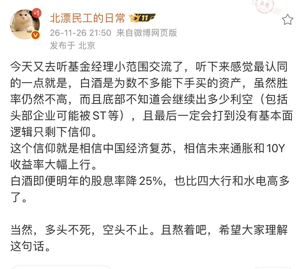
- 10变5 笑死人

### 晶雪节能 301010（提及 11 次，占比 6%）2026-11-27 09:56:53
- 没有
继续看好

今天plus我买到-10.5了🤣🤣🤣

你们买到-12不
- 😂😂😂你牛逼
我-3割了 给那边plus了😂
- 我现在要plus和芒果比赛了😂😂😂

### 幸福蓝海（提及 6 次，占比 3%）2026-11-27 10:28:42
- 加油啊中影幸福 今天支柱了
- 危急关头
才知道谁是对你真的好

谢谢中影幸福 很关键
- 今天暂时传媒第一名是幸福

### 东方海洋 002086（提及 5 次，占比 3%）2026-11-27 08:52:07
- 东方海洋又有新概念啦？
- 东方海洋周一跌停两连板的话 我加仓2万
- 市场情绪反带抱团情绪

东方海洋火箭发射

### 纳斯达克100指数（提及 4 次，占比 2%）2026-11-27 10:35:43
- 昨天场内资金一开始执着于bbbbbb nana 是对的
- 这不是因为这个？

如果nana午后跳水 我们会不跳？

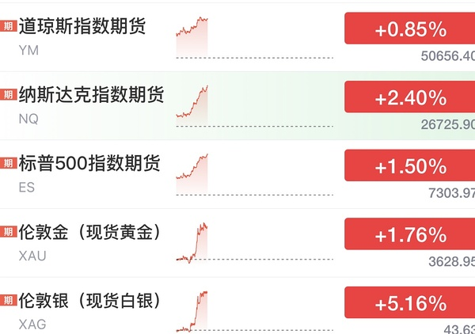
- 主动基金都是之前买的
这个nana6号all了全部的钱 且动用了我存着的A股冰点抄底专用款

之前说过的就等一个恐慌vix飙升 用完本次全部计划的钱
6号都用完了

### 芒果超媒 300413（提及 3 次，占比 2%）2026-11-27 09:53:13
- 高抛了龙版 割了芒果
加了冰雪旅游

因为有担心 所以不慌

- 今天在你和芒果二选一
留了下你 
你能证明我选对吗
- 芒果快要追上幸福了

### 纳斯达克ETF华夏 513300（提及 3 次，占比 2%）2026-11-27 10:36:11
- 小伙伴们
我没去看
但我看位置也知道 我3300重新盈利了🤣
- 我看看3300
收盘0.4 现在2

应该涨1.6%标准版

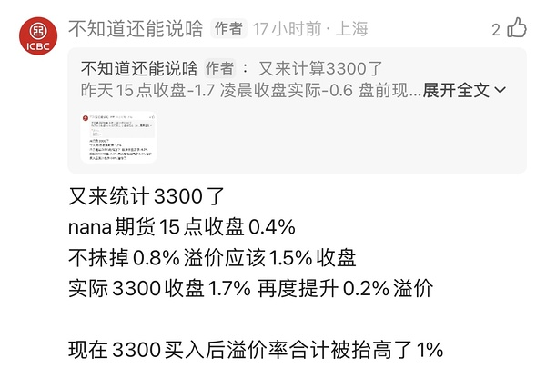
- 你是不是从来不看我每天早上和盘后
都分析一个叫做3300的东西
你觉得我没事分析他干嘛？🤣

### 友友、网友们（提及 3 次，占比 2%）2026-11-27 12:20:16
- 还是得等cpi 非农交出垃圾数据

不过只要他们想涨了
数字就肯定差了

我同意uu昨天说的 他们这个数字是用来服务市场的
- 再次提醒

特别是容易上头的uu们
- 终于不会有uu质疑我满仓了😂

### 上海电影 601595（提及 2 次，占比 1%）2026-11-27 11:11:42
- sy 火箭发射
- 他比sy好啊这周

### 中国长城 / 华安文体健康混合（提及 2 次，占比 1%）2026-11-27 13:01:06
- 本轮全球联动
看好美国 就不看空大A
我的cc和c50是不会动的
大家后续不用问我哈
- cc没有看的必要
大换仓过

### 泸州老窖（提及 1 次，占比 1%）2026-11-27 09:16:03
- 露露舞娘现在 今年还是-30😂

### 中国移动（提及 1 次，占比 1%）2026-11-27 10:32:18
- 10086 -3

### 雪人集团 002639（提及 1 次，占比 1%）2026-11-27 10:34:00
- 😂我也么这么梦
再反带雪儿

### 投资博主（提及 1 次，占比 1%）2026-11-27 11:04:36
- 水果老师最近状态不好

我记得那个周一 水果老师说看好传媒机会大于风险
但其实那是之前下跌的开始

### 新易盛 300502（提及 1 次，占比 1%）2026-11-27 12:50:39
- 我那个女主播应该早点改简介变成同花顺私生女的

改完以后 xys几乎没怎么绿过了😂😂😂😂😂

### 博纳影业（提及 1 次，占比 1%）2026-11-27 13:10:46
- 应该很多人bn换sy了😂

### 中证1000指数（提及 1 次，占比 1%）2026-11-27 13:34:21
- 中证1000股指期货（IM）主力合约触及涨停，涨幅10%，现报5959点。

### 中文在线（提及 1 次，占比 1%）2026-11-27 13:52:40
- 加息概率提高了😂因为美债收益率提升

v老师中午发了

### 📄 全部发言（共 173 条）
- (2026-11-27 08:46:33) [图] 昨天收盘0.4
现在0.7%左右 变化不大

- (2026-11-27 08:52:07) 东方海洋又有新概念啦？  ⊳ （引用 @qiu啾）太有想象力了，都是聪明蛋

- (2026-11-27 08:54:11) [图] 几个头部白酒体量也大 能接住公募基金的钱

- (2026-11-27 09:16:03) 露露舞娘现在 今年还是-30😂  ⊳ （引用 @荣誉黑粉涨停版）我不接受😤😠🤬

- (2026-11-27 09:19:12) 10变5 笑死人  ⊳ （引用 @吃西瓜的人）我决定我还是这几天加仓点开了额度的吧

- (2026-11-27 09:26:10) 他出狱了 ！  ⊳ （引用 @ekiwang）新华可以带带传媒吗

- (2026-11-27 09:53:13) [图] 高抛了龙版 割了芒果
加了冰雪旅游

因为有担心 所以不慌

  ⊳ （引用 @ekiwang）楼楼换了些什么？

- (2026-11-27 09:53:50) 操作完毕 
继续聊天

- (2026-11-27 09:54:55) 拿着 那个没动 而且也来不及  ⊳ （引用 @11）dfhy还拿吗

- (2026-11-27 09:55:05) [图] 我都是提前说的

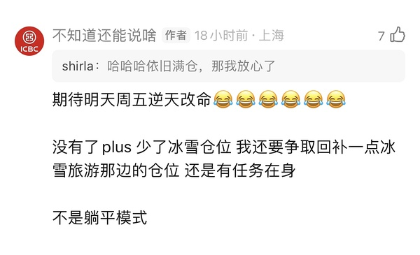  ⊳ （引用 @ekiwang）我还说昨天你说的果然来了😂
捡了 plus 吗

- (2026-11-27 09:55:51) 东方海洋周一跌停两连板的话 我加仓2万  ⊳ （引用 @11）dfhy还拿吗

- (2026-11-27 09:56:53) 没有
继续看好

今天plus我买到-10.5了🤣🤣🤣

你们买到-12不  ⊳ （引用 @Lyra）海洋没动啊楼楼😂😂

- (2026-11-27 09:58:46) 开局对抱团股的松动有负反馈 威力会逐渐减弱的  ⊳ （引用 @vio）开拉了 同学们，机器人先动了

- (2026-11-27 09:59:45) 这个问题短期内别问 一直都是  ⊳ （引用 @稀里不糊涂）楼还是满仓？

- (2026-11-27 10:01:11) 😂😂😂你牛逼
我-3割了 给那边plus了😂

- (2026-11-27 10:03:01) 今天开局崩 不是尾盘才崩  ⊳ （引用 @西西西西）冰雪的周五又来了

- (2026-11-27 10:03:44) 我现在要plus和芒果比赛了😂😂😂  ⊳ （引用 @🈵仓即暴涨🤑）出来了

- (2026-11-27 10:04:54) 开局plus提前计提了各路一个跌停 我才去的😂
我觉得抱团股目前的瓦解不至于-20 计提两个哈哈  ⊳ （引用 @西西西西）那我用芒果换⛄️了

- (2026-11-27 10:07:04) 😂😂😂😂你真猛

这个我做不了 没有先手了  ⊳ （引用 @🈵仓即暴涨🤑）来了

- (2026-11-27 10:10:09) 你们快去看外面

- (2026-11-27 10:10:13) 什么消息面  ⊳ （引用 @不知道还能说啥）你们快去看外面

- (2026-11-27 10:10:23) 10:07:56【纽约期银日内涨7% 现货白银向上触及43美元/盎司】财联社11月27日电，纽约期银日内涨7%，现报43.38美元/盎司。现货白银向上触及43美元/盎司，日内上涨3.71%。(来自财联社APP)

- (2026-11-27 10:10:28) 消息面是什么

- (2026-11-27 10:11:05) 美股 黄金白银 原油一起嗨😂

- (2026-11-27 10:12:55) 我不知道呀 现在是美国晚上😂  ⊳ （引用 @vio）什么意思 我没懂呢  啥消息

- (2026-11-27 10:14:21) [图] 市场资金做出反应

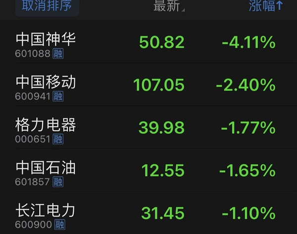

- (2026-11-27 10:17:02) [图] 应用也涨的科技线

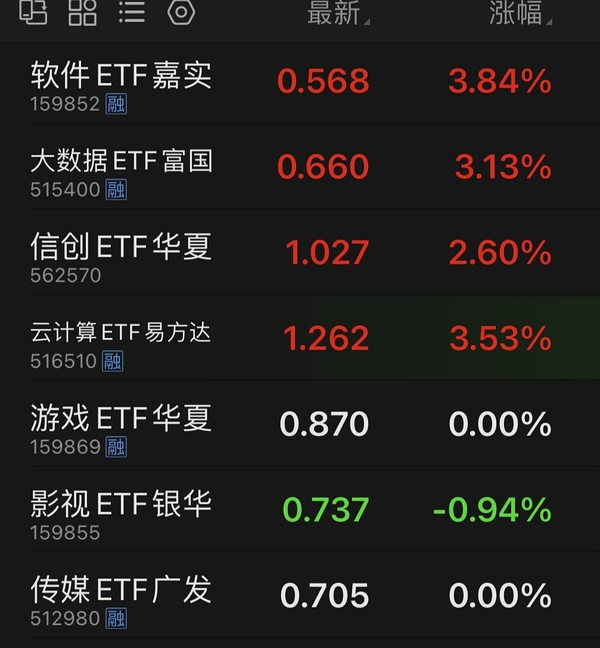  ⊳ （引用 @sickid）半导体和机器人跷跷板

- (2026-11-27 10:18:29) 华为产业链涨势扩大 华胜天成等十余股涨停
华为算力概念盘中持续走高，带动华为产业链整体涨势扩大，华胜天成封涨停，此前汉鑫科技、天源迪科、润和软件、云鼎科技、恒为科技、拓维信息等多股涨停，法本信息、慧博云通、软通动力、科蓝软件、诚迈科技等均涨超10%。

- (2026-11-27 10:27:18) 高股息后排 非银行的崩了

- (2026-11-27 10:28:42) 加油啊中影幸福 今天支柱了

- (2026-11-27 10:30:11) 我今天不敢说
上周五也是开盘这样的？  ⊳ （引用 @六倍做多退休）😂啊这 转换的国富

- (2026-11-27 10:30:37) 创新药概念震荡反弹 百洋制药涨超13%
创新药概念盘中震荡反弹，百洋制药涨超13%，广生堂、海创药业、美迪西、昭衍新药、石药创新、百诚医药均涨超5%。

- (2026-11-27 10:31:34) 危急关头
才知道谁是对你真的好

谢谢中影幸福 很关键

- (2026-11-27 10:32:00) 中国神华-5

- (2026-11-27 10:32:18) 10086 -3  ⊳ （引用 @不知道还能说啥）中国神华-5

- (2026-11-27 10:32:47) 电影人周五永不服输😂  ⊳ （引用 @sickid）回了一半中影直接就拉上去了，牛

- (2026-11-27 10:33:22) 我们通信应该在跟进foto ETF😂😂😂  ⊳ （引用 @六倍做多退休）笑死了 😂

- (2026-11-27 10:34:00) 😂我也么这么梦
再反带雪儿  ⊳ （引用 @柚子mm）我能梦一个雪plus拉红吗？

- (2026-11-27 10:34:11) 纽约期银日内涨8%，现报43.78美元/盎司。

没有消息面吗

- (2026-11-27 10:34:20) 就没有消息面 这样拉啊？  ⊳ （引用 @不知道还能说啥）纽约期银日内涨8%，现报43.78美元/盎司。

没有消息面吗

- (2026-11-27 10:35:05) 这看起来不像是那么嗨的消息面😂  ⊳ （引用 @没有感情的村民）特朗普的感恩节致辞聚焦经济数据、移民问题及政治对手

唐纳德·特朗普总统在一篇长篇感恩节致辞中谈到了经济数据、移民政策及政治对手。

特朗普呼吁调查第三季度GDP增长率从3.4%上调至4.3%的修订，称这是一次“创纪录的错误”。

他还批评

- (2026-11-27 10:35:43) 昨天场内资金一开始执着于bbbbbb nana 是对的  ⊳ （引用 @六倍做多退休）如果保持下去的话 是的。。

- (2026-11-27 10:36:11) 小伙伴们
我没去看
但我看位置也知道 我3300重新盈利了🤣

- (2026-11-27 10:37:06) 感恩节过完了
资金回来了？  ⊳ （引用 @moli）硬拉😂

- (2026-11-27 10:37:59) 理由可以编的

涨的时候理由可以有很多
跌的时候也一样  ⊳ （引用 @嗯嗯你对了）如果可以的话，希望从今天开始就莫名其妙的涨，不需要理由！！！无理由硬涨也不是不可以😇😇😇

- (2026-11-27 10:41:31) 克莱机电冲击6连板  ⊳ （引用 @柚子mm）冰山下来也没再崩了，是不是就此脱离了影响

- (2026-11-27 10:43:09) 高股息遇到了本轮以来 最强大的挑战
后排大崩

- (2026-11-27 10:43:30) 中国神华-5 中移动向-4前进  ⊳ （引用 @不知道还能说啥）高股息遇到了本轮以来 最强大的挑战
后排大崩

- (2026-11-27 10:44:00) 中国神华 一阴包三阳😂  ⊳ （引用 @不知道还能说啥）中国神华-5 中移动向-4前进

- (2026-11-27 10:45:02) [图] 我觉得这个危机在开盘十五分钟里已经度过了

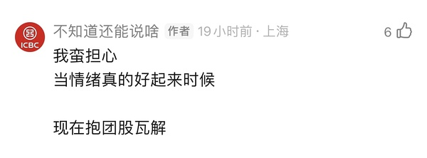  ⊳ （引用 @YuanZi💕）今天会百股涨停嘛

- (2026-11-27 10:45:25) 与此同时 50 300绿色  ⊳ （引用 @👑）1000etf竟然三个点

- (2026-11-27 10:47:17) [图] 我看看3300
收盘0.4 现在2

应该涨1.6%标准版

- (2026-11-27 10:47:43) 今天确实是暂时1.6 保持不杀溢价不抹溢价的标准  ⊳ （引用 @不知道还能说啥）我看看3300
收盘0.4 现在2

应该涨1.6%标准版

- (2026-11-27 10:48:03) 难道大家美国基金一路在涨吗  ⊳ （引用 @Aaa摆烂咸鱼🥳）就算熊市也应该有个不小的反弹啊，咱们A一路跌到现在🥹

- (2026-11-27 10:49:07) 我没钱只能转换😂  ⊳ （引用 @公主要发财）早上极速下杀，我各种捞了点，今天拼人品了，哈哈哈

- (2026-11-27 10:50:16) 我忍痛砍掉了芒果也只是因为那边plus更吸引到我
造孽啊

现在plus的收益不如芒果不动😂😂😂😂  ⊳ （引用 @公主要发财）早上极速下杀，我各种捞了点，今天拼人品了，哈哈哈

- (2026-11-27 10:51:44) 现在foto也在大涨
通信在完全跟进

再度保持相同

- (2026-11-27 10:54:57) 报：中国移动-4

- (2026-11-27 11:03:05) 你对全市场崩盘和抱团崩盘有些误解

全市场崩盘的样子你上周见过  ⊳ （引用 @11）我记得之前说第二次高位崩盘在十二月中 现在是提前了？还是九阳跌停的时候会再来一次？🍊老师昨天说接下来除了抱团别的都没有赚钱效应 一下又变了🤣

- (2026-11-27 11:04:36) 水果老师最近状态不好

我记得那个周一 水果老师说看好传媒机会大于风险
但其实那是之前下跌的开始  ⊳ （引用 @11）我记得之前说第二次高位崩盘在十二月中 现在是提前了？还是九阳跌停的时候会再来一次？🍊老师昨天说接下来除了抱团别的都没有赚钱效应 一下又变了🤣

- (2026-11-27 11:05:21) 选了plus就相信他 

不信不买  ⊳ （引用 @乖乖是只嘤嘤怪）造孽啊 跟我一样的想法 

- (2026-11-27 11:06:34) 我重仓电影 你问我没用  ⊳ （引用 @稀里不糊涂）传媒是不是结束了

- (2026-11-27 11:07:35) 消费电子板块走高，捷荣技术涨停
消费电子板块走高，捷荣技术涨停，胜蓝股份、朗特智能涨超10%，瀛通通讯、科森科技、海能实业、凯旺科技、昀冢科技等跟涨。

- (2026-11-27 11:07:57) 高股息红利股逆势下挫 中国神华跌超5%
高股息红利股盘中逆势下挫，中国神华跌超5%，中国石化、中国移动、南京银行、美的集团、格力电器、中国石油等跟跌。

- (2026-11-27 11:08:16) 红了
还是靠电影双雄

- (2026-11-27 11:10:00) 我的头像在展现威力🤣  ⊳ （引用 @sickid）幸福来了，早上2个点加的，能不能给我零花钱

- (2026-11-27 11:11:07) 今天开盘的啊  ⊳ （引用 @啊呆呆呆呆）今天美股不开盘，大A能不能周五不跳水。🤣

- (2026-11-27 11:11:28) 但你老是问传媒结束没  ⊳ （引用 @稀里不糊涂）还得靠电影啊

- (2026-11-27 11:11:42) sy 火箭发射

- (2026-11-27 11:12:12) 今天在你和芒果二选一
留了下你 
你能证明我选对吗  ⊳ （引用 @不知道还能说啥）sy 火箭发射

- (2026-11-27 11:13:55) 美国说了算  ⊳ （引用 @稀里不糊涂）大科技不会企稳了吧

- (2026-11-27 11:15:04) 漂亮啊plus😂

大家有芒果的 我不好说干翻

大家一起努力吧哈哈哈哈

- (2026-11-27 11:16:19) 昨天我还给你们看过
国内半导体和soxx是一样的  ⊳ （引用 @稀里不糊涂）半设走的蛮好的，都没新低了

- (2026-11-27 11:18:08) 你们现在信心足了
上周开盘也是+2的哦  ⊳ （引用 @momomomomomo哒）转换的岂不是买入今晚可能红彤彤的老美

- (2026-11-27 11:19:39) 我头像换的好吗
各位小伙伴

- (2026-11-27 11:20:42) [图] 我头像真牛逼呢

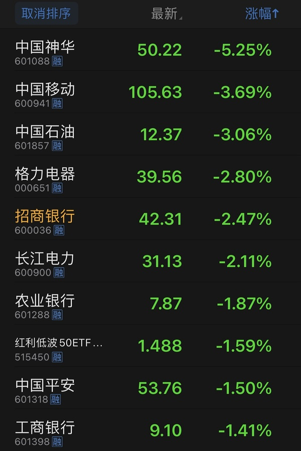

- (2026-11-27 11:21:12) 周线还是正常
如果下周继续跌 就不再正常了😂

- (2026-11-27 11:21:55) 很多周线依然完美的  ⊳ （引用 @没有感情的村民）银行立夏到冬至？？

- (2026-11-27 11:23:04) 市场情绪反带抱团情绪

东方海洋火箭发射

- (2026-11-27 11:23:54) plus来做新的龙头吧！！！

- (2026-11-27 11:25:08) 垃圾宁德

这一波一点作用没起到
同流合污的垃圾玩意  ⊳ （引用 @sickid）c50 4个点，🐮

- (2026-11-27 11:26:57) 我在和你强调一下
春节档一定会来
冬天也是

另外下一次情绪转折在12.17-12.19

对了
你问我一个满仓电影冰雪的人也不客观 问别人比较好  ⊳ （引用 @momo）楼楼，如果科技持续反弹一段时间，那我们电影冰雪还能跟着涨吗

- (2026-11-27 11:28:00) 东方海洋不给我两连板跌停买

- (2026-11-27 11:28:25) 之前几天表现好  ⊳ （引用 @赛博朋克2077）现在yl还要跳绿了

- (2026-11-27 11:31:50) 跨年还有一个多月呢  ⊳ （引用 @11）目前还是九阳强吧

- (2026-11-27 11:33:11) 你真牛逼😂😂😂😂😂😂😂😂希望他像跑马拉松那种一开始总是跟在第一名身后 最后完成反超夺冠的选手一样  ⊳ （引用 @momo）早上跌停的时候没有任何犹豫的接了，看好就要相信，相信就要买！

- (2026-11-27 11:35:06) [图] 这不是因为这个？

如果nana午后跳水 我们会不跳？

  ⊳ （引用 @何为）转折点这么早的吗？还以为最早也会是月末最后一天呢，感觉妈妈是不是故意搞人心态呢!

- (2026-11-27 11:36:21) [图] 给大家看下美股夜盘目前幅度

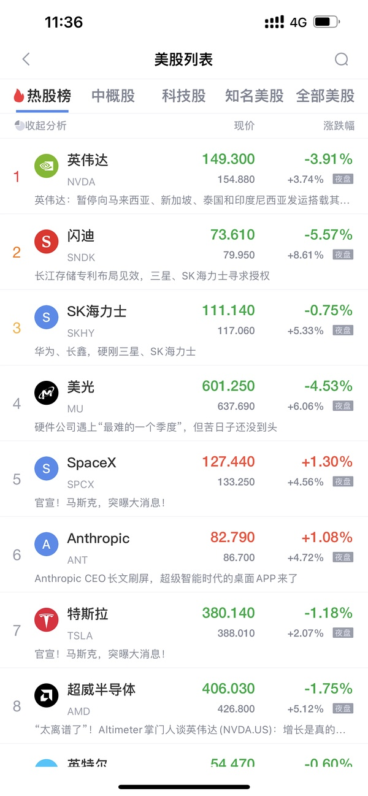

- (2026-11-27 11:37:43) 现在美国光ETF夜盘+5

我们通信ETF应该+5跟随 
我看了国泰通信ETF现在+4.7 基本一致

- (2026-11-27 11:38:53) 现在美国半导体soxx夜盘+4.5
科创半导体之前多跌了1%
应该+5.5跟进

目前科创半导体+8 有所超涨

- (2026-11-27 11:44:02) 现在是之前11.18 19情绪从顶峰到冰点到触底转折拐弯时间 这个弯会一直拐到12月17附近 也就是冰点再到顶峰

我想你应该理解意思的  ⊳ （引用 @momo）好的楼楼！这个情绪转折是啥意思，好还是不好的转折

- (2026-11-27 11:48:08) [图] 这个图再发下
希望大家不以涨喜不以跌悲

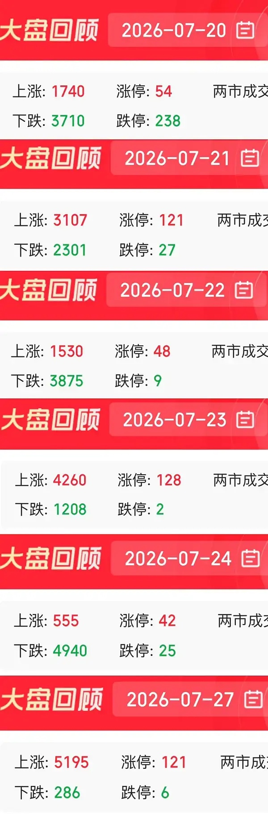

- (2026-11-27 11:49:36) 也有个大缺口 过了你放心点  ⊳ （引用 @纸飞机）楼楼，看雪人5日线拐头了，又可以回到高抛出，五日线回接的节奏了不😋

- (2026-11-27 11:52:46) 现在美国为啥嗨 😂  ⊳ （引用 @sickid）中文昨天为什么突然嗨了仍然是未解之谜

- (2026-11-27 11:55:25) 在我场内6号all in纳斯达克以后
目前最大收盘亏损出现在11/25日 -3.2%
今天再度回正（暂时）

会不会本轮我的最大持仓亏损就是-3.2？🤣

- (2026-11-27 12:00:05) [图] 具体走势我就不管了
反正我按照我22年的经验
我认为我6号的all in点
就是底部附近
可能经常会上上下下 但我认为误差就和2022年这个一样
我怎么想的我就怎么做了
和四年前不一样 
这次我选择了一次性all in
因为四年前定投会经常买到上升段 虽然最低位置也定投到了 但是总计反而拉高了持仓成本
四年后我选择了另外的方式

图上就是四年前我第一笔买入位置 最低点确实不在那边

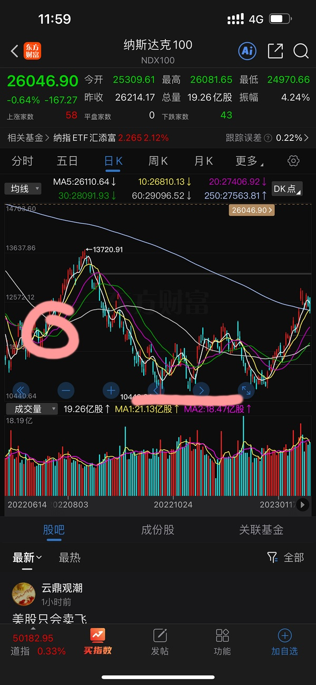  ⊳ （引用 @点-重生炒垃圾）我看水果早读说纳指走了标准的回踩振荡k线，这是啥意思，风险解除了？

- (2026-11-27 12:05:16) 赎回潮了 银行永续债 都是大跌呀  ⊳ （引用 @moli）华发事件也没什么边际利空，城投债跌这么猛

- (2026-11-27 12:08:49) [图] 有城t债的债券基金也不是都城t 也有其他债券
触发赎回 带动其他债券也被抛售
然后其他债券抛售也带动了其他所有债券净值下跌 触发更多理财投资者赎回

还有那个固收基金好像最近被赎回了几千亿了 里面股债一起抛售 傻缺东西🥲🥲🥲🥲🥲🥲

国家电网 中石化这种公司债券也都被抛售中

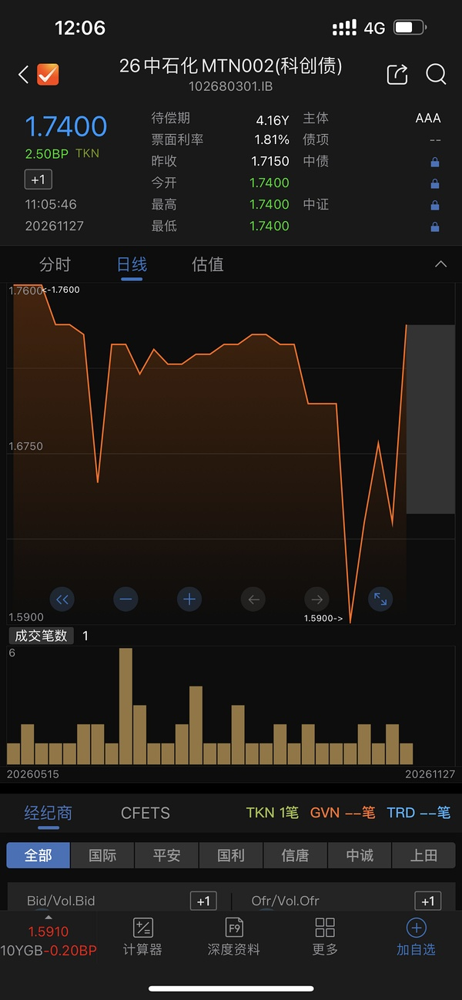  ⊳ （引用 @moli）华发事件也没什么边际利空，城投债跌这么猛

- (2026-11-27 12:09:52) 你是不是从来不看我每天早上和盘后
都分析一个叫做3300的东西
你觉得我没事分析他干嘛？🤣  ⊳ （引用 @多笑笑吧）楼楼买的那个呀！

- (2026-11-27 12:13:13) 抄底还是得选利率债

这一轮理财杀伤以后 必然很多投资者再也不会投资理财
重回存款或者那种超短债

而存款和超短债的底层都是利率债券和存单
后续更多资金回到存款
还是利好利率债  ⊳ （引用 @moli）这不就螺旋负反馈了🤔

- (2026-11-27 12:17:21) 中韩半导体亏损要回到-9了 要个位数了🤣
午后能不能冲一下回到-5啊

棒子加把劲 最近完全不如国产区啊

- (2026-11-27 12:17:47) 因为美股反攻
美债收益率就上去了哈哈🤣  ⊳ （引用 @VVV坚定持有VVV）概率继续增加

- (2026-11-27 12:20:16) 还是得等cpi 非农交出垃圾数据

不过只要他们想涨了
数字就肯定差了

我同意uu昨天说的 他们这个数字是用来服务市场的  ⊳ （引用 @VVV坚定持有VVV）那就是没完的意思😂等吧，等待是一种美德

- (2026-11-27 12:22:27) 你自己决定

我女朋友策略可是从来没动过  ⊳ （引用 @多笑笑吧）楼楼，那红利现在要不要跑，等下来在重新进呀，我本意想着当养老，但是现在收益有点可观

- (2026-11-27 12:28:17) 是啊
十月底买的呀
最近不是跌跌不休吗😂  ⊳ （引用 @何为）楼楼抄底也被套了这么多!

- (2026-11-27 12:39:31) [图] 今天开盘之前

昨天发了

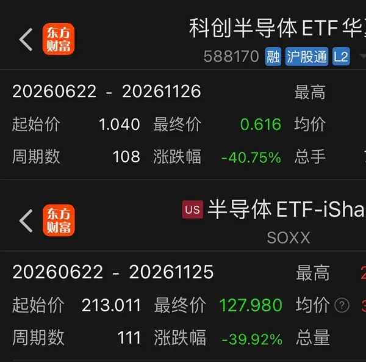  ⊳ （引用 @何为）但是科创半设前两天跌了十个多点，也还没还回来呢，前天-8我场外买了准备做T，昨天高开一点后就往下砸又-2，最近半设跌超6个点买入做t的胜率好像还成。

- (2026-11-27 12:41:13) 👍👍👍👍  ⊳ （引用 @就酱）再直观一点

- (2026-11-27 12:44:17) 我昨天怕的是今天尾盘像开盘这样
这个杀伤力就大了

好在他们用的是这个模式
顺便让我龙版高抛了😂

本来我还准备今天东方海洋9+高抛的呢🤣  ⊳ （引用 @🈵仓即暴涨🤑）今天最绿6000午饭前拉红1000+，振幅有点子大😇

- (2026-11-27 12:45:55) 现在0跌停
情绪完全回归

- (2026-11-27 12:49:06) 电影多一点 不过多没那么多了  ⊳ （引用 @🈵仓即暴涨🤑）你现在冰电是不是要五五开了😏

- (2026-11-27 12:50:39) 我那个女主播应该早点改简介变成同花顺私生女的

改完以后 xys几乎没怎么绿过了😂😂😂😂😂

- (2026-11-27 12:51:35) 看了1就不看后面的了

如果现在纳斯达克期货是-2 这个消息有何用  ⊳ （引用 @扶我起来还能买）报 大佳发文

- (2026-11-27 12:59:04) 主动基金都是之前买的
这个nana6号all了全部的钱 且动用了我存着的A股冰点抄底专用款

之前说过的就等一个恐慌vix飙升 用完本次全部计划的钱
6号都用完了  ⊳ （引用 @悲伤只在地下铁）楼楼的qdii是定投还是一次性买入呢 我定投几个月被套了30%左右🙂‍↕️现在国富额度开了 一次性加仓了1/4 还有一些仓位在犹豫…

- (2026-11-27 13:01:06) 本轮全球联动
看好美国 就不看空大A
我的cc和c50是不会动的
大家后续不用问我哈

- (2026-11-27 13:02:50) 看下帖子标题

答案有了

- (2026-11-27 13:03:05) 不大
A股主导  ⊳ （引用 @一直在摸🐟）小华的预估和实际差别大么，差别不大的话看着都眉清目秀了😂

- (2026-11-27 13:04:53) 现在还会问我这个问题吗  ⊳ （引用 @稀里不糊涂）楼还是满仓？

- (2026-11-27 13:05:30) 提醒大家一下
中国半导体和光都超涨了

- (2026-11-27 13:05:42) 全球联动  ⊳ （引用 @不知道还能说啥）提醒大家一下
中国半导体和光都超涨了

- (2026-11-27 13:05:52) 深度提醒  ⊳ （引用 @不知道还能说啥）提醒大家一下
中国半导体和光都超涨了

- (2026-11-27 13:06:31) 本周6% 并不差  ⊳ （引用 @大连海底站岗员）废物bn

- (2026-11-27 13:07:32) 继续提醒

不要到时候跌的多又心态差

超涨了  ⊳ （引用 @不知道还能说啥）提醒大家一下
中国半导体和光都超涨了

- (2026-11-27 13:08:21) 这次是全球联动

超涨必归还
超跌必补回  ⊳ （引用 @不知道还能说啥）继续提醒

不要到时候跌的多又心态差

超涨了

- (2026-11-27 13:10:46) 应该很多人bn换sy了😂  ⊳ （引用 @ekiwang）sy 你怎么爆发力变了

- (2026-11-27 13:11:05) [图] 

  ⊳ （引用 @稀里不糊涂）太吓人了，暴涨暴跌的股市

- (2026-11-27 13:11:42) 不以涨喜 不以跌悲

我退出登录了 看你们留言

- (2026-11-27 13:12:58) 再次提醒

下周比美国多跌 也别心态差  ⊳ （引用 @不知道还能说啥）提醒大家一下
中国半导体和光都超涨了

- (2026-11-27 13:13:24) 当然也可以期待美国补足涨幅  ⊳ （引用 @不知道还能说啥）再次提醒

下周比美国多跌 也别心态差

- (2026-11-27 13:14:20) 抱团带崩开盘情绪
市场情绪再反带抱团复活
妙啊  ⊳ （引用 @YuanZi💕）东方海洋也要来了

- (2026-11-27 13:16:00) 今天暂时传媒第一名是幸福

- (2026-11-27 13:16:08) 还没有超越幸福涨幅的😂  ⊳ （引用 @不知道还能说啥）今天暂时传媒第一名是幸福

- (2026-11-27 13:16:59) 再次提醒

特别是容易上头的uu们  ⊳ （引用 @不知道还能说啥）提醒大家一下
中国半导体和光都超涨了

- (2026-11-27 13:18:25) 波动小的在红利低波 你看不上  ⊳ （引用 @稀里不糊涂）是的，我觉得这真的很吓人，投资a股真的不行，波动太大了

- (2026-11-27 13:19:08) 他比sy好啊这周  ⊳ （引用 @赛博朋克2077）想拍死它

- (2026-11-27 13:19:25) 这是前日的  ⊳ （引用 @momo）为啥恐慌还在爆拉

- (2026-11-27 13:20:25) 这周是涨的啊 不存在跌的少吧  ⊳ （引用 @该用户已过期）靠的是跌的少🤣🤣

- (2026-11-27 13:26:05) 不是我泼大家冷水

希望大家知道 超涨了 

下周心态要放平  ⊳ （引用 @小鱼）今天能不能联动指引下纳纳😂

- (2026-11-27 13:27:18) 👍👍👍👍👍👍  ⊳ （引用 @momo）不以涨喜，不以跌悲

- (2026-11-27 13:28:29) 终于不会有uu质疑我满仓了😂

- (2026-11-27 13:29:19) 芒果-3割 现在+7 =10%
plus-10.5买 现在-1.5 =9%

吗的亏了

- (2026-11-27 13:29:40) plus加把劲 别让我亏啊  ⊳ （引用 @不知道还能说啥）芒果-3割 现在+7 =10%
plus-10.5买 现在-1.5 =9%

吗的亏了

- (2026-11-27 13:31:20) 他这周表现的不算差 
我很客观  ⊳ （引用 @乖乖是只嘤嘤怪）我破崩了 bn、

- (2026-11-27 13:31:34) 那差远了  ⊳ （引用 @没有感情的村民）今天比924厉害？

- (2026-11-27 13:33:20) 哦其实嗨的是926之后
924先白酒那种  ⊳ （引用 @没有感情的村民）创业板924没有这么多涨幅啊

- (2026-11-27 13:34:21) 中证1000股指期货（IM）主力合约触及涨停，涨幅10%，现报5959点。

- (2026-11-27 13:34:29) 期货市场定价继续涨啊  ⊳ （引用 @不知道还能说啥）中证1000股指期货（IM）主力合约触及涨停，涨幅10%，现报5959点。

- (2026-11-27 13:36:02) 传媒还是幸福今日榜一
没有超过他的

- (2026-11-27 13:37:04) 我没有 而且我今天也买了

满仓继续  ⊳ （引用 @赛博朋克2077）提问：今天雪人有卖单嘛

- (2026-11-27 13:38:36) 我重仓电影

这种问题我就不回答了  ⊳ （引用 @没有感情的村民）如果牛回，似乎传媒也可以参与？

- (2026-11-27 13:40:18) 台湾证交所加权股价指数收高0.4%报39,308.08。

台湾0.4

- (2026-11-27 13:40:47) 跟着妈妈不会错的
他们自己会给自己放利好

人家买好多了  ⊳ （引用 @没有感情的村民）我才定投了一周cc🤣

- (2026-11-27 13:42:07) 人来的多了

再次提醒 大幅度超涨

下周如果抹去 大家心态要放平

今天涨9%的自己心里当5%就行  ⊳ （引用 @不知道还能说啥）提醒大家一下
中国半导体和光都超涨了

- (2026-11-27 13:42:52) 国泰通信ETF涨停都开始折价了😂  ⊳ （引用 @sickid）227个涨停

- (2026-11-27 13:43:20) 你们的心态就是这样
下周要做好抹超涨准备

而不是你这个预期呀  ⊳ （引用 @momo）连涨一周谢谢

- (2026-11-27 13:43:47) plus和芒果巅峰对决吧😂😂😂😂

- (2026-11-27 13:44:49) 我今天提醒第六次了

下周补跌还是一群喷的 肯定的

超涨必归还
超跌必补回  ⊳ （引用 @一二弄一二）苦口婆心楼😂

- (2026-11-27 13:45:34) 我在等那句

nana算个毛啊 A股一天就20%  ⊳ （引用 @六倍做多退休）哈哈哈哈 财神同意了

- (2026-11-27 13:48:32) 芒果快要追上幸福了

- (2026-11-27 13:49:15) 主要看美国是否强化  ⊳ （引用 @嗯嗯你对了）还能剩一半？？？？平时不都是打一套组合拳才给吃一口枣的吗？他现在这样子都有点担心是不是要把我当年猪宰了😱😱😱

- (2026-11-27 13:49:58) 你不是跟着他们操作的吗😂😂😂😂😂  ⊳ （引用 @没有感情的村民）他们狗不狗？买的差不多了，开始放利好给自己抬轿子

- (2026-11-27 13:50:35) 他早上-7 他+7就等于一个14%创业板了🤣  ⊳ （引用 @柴可猪斯基）不是这啥 午觉醒来发现宽基指数都要涨停了 怎么大连还是绿的

- (2026-11-27 13:51:15) 主要是很容易大家下周看美国继续涨
我们跌

又要说心态崩了

问题是现在大幅度超涨  ⊳ （引用 @云小朵飘啊飘）😂😂我来不及刷楼了，只看了楼主的，楼楼说了无数遍，大家要冷静，不要上头🤣🤣🤣

- (2026-11-27 13:52:40) 加息概率提高了😂因为美债收益率提升

v老师中午发了  ⊳ （引用 @六倍做多退休）纳指期货也要3%了 而我至今都摸不着头脑 难道真加息结束了？

- (2026-11-27 13:56:52) 一月底还有大A春节 资金离场  ⊳ （引用 @混乱中立同人女）楼 这么拉 1月解禁还是有影响的对吧？

- (2026-11-27 13:58:46) 美国光现在+6%
我们+10涨停 且有略微折价

超涨了4%

当然也可以美国补足涨幅的

- (2026-11-27 14:00:36) 不会的

情绪下次转折要12.17左右了

你看垃圾抱团都被带起来不少  ⊳ （引用 @点-重生炒垃圾）科技补跌，影响冰雪和传媒吗？

- (2026-11-27 14:01:29) 幸福还在努力给大家幸福

- (2026-11-27 14:04:58) 也可以是美国补足涨幅啊

我每天反正看的 会看数据的  ⊳ （引用 @柴可猪斯基）楼楼我想请教一下 你说今天这样的超涨下周会补跌 像大连长白山这样的根本没涨 补跌应该也不大跟吧 还是按照12.17的节奏来对吧

- (2026-11-27 14:05:41) 假的 大换仓过  ⊳ （引用 @timing）现在是10.68

- (2026-11-27 14:05:59) cc没有看的必要
大换仓过  ⊳ （引用 @momomomomomo哒）哪位UU还有养鸡宝 今天CC估值有多少啊 让我开心把

- (2026-11-27 14:09:16) 手续费越高越好啊
这样买进去你就不会要卖出了
放十几年🤣  ⊳ （引用 @红烧肉肉）我另一个账号手续费高不免五还不给调，弃用了

- (2026-11-27 14:12:04) 股指期货新浪模拟盘自带八倍还是10倍杠杆
如果满仓 今天都能直接追保证金了🤣我924单日爆仓至今都不给我模拟玩  ⊳ （引用 @moli）plu开空单了吗，想知道他能不能吃点亏

- (2026-11-27 14:13:06) 我发了七次
我们超涨了！！！！！！！！！！！！！！！！  ⊳ （引用 @🈵仓即暴涨🤑）人家也没跳啊

## 🧠 投资风格分析
> 📏 增量更新指引：仅当今日发言确有新依据时才修订对应维度，无变化不强行重写；单维度修订建议 ≤150 字。

- 投资理念与方法：坚持红利≠银行，强调红利低波组合中非银行股更具配置价值；看好标的会明确表态并长期跟踪，用五周线回踩、去年见顶时点等均线/季节规律辅助判断；偏好低价股的弹性逻辑。今日再次以红利低波50ETF前二十大没有银行股佐证红利非银行，并用工行去年此时见顶、招行下月月中做时点判断。
- 风险偏好：对抱团股瓦解有预判，认为「不至于-20」，能容忍短期波动。对无消息面大涨保持怀疑（「理由可以编的」），但承认资金面驱动。
- 交易与仓位：坚持高周转与动态再平衡。今日通过「高抛龙版」「割芒果」兑现收益或止损，迅速将资金转换为「冰雪旅游」（大连/长白山）及「晶雪节能」（plus），体现其对热点切换的敏锐捕捉能力。持有「纳斯达克ETF」采用一次性All-in策略（6号买入），不再定投，认为该策略在冰点效率更高。对「东方海洋」设置条件单（跌停加仓），严格执行计划交易。
- 心理特质：极强的「预期管理」意识。今日连续7次提醒「超涨」，旨在为后续可能的回调提前「打预防针」，避免投资者因短期暴涨而盲目乐观、因短期回调而心态崩盘。使用幽默化解焦虑（如「笑死人」「🤣」），并在亏损时强调「不慌」（因为有担心所以不慌，因操作已到位）。

> ⚠️ 本板块由 Actions 全自动增量更新（复用当日发言与今日总览），每次仅在内容足够支撑时才改动。

## 🏷️ 昵称映射表
### 📖 昵称规律（供 AI 判断新昵称时参考）
【昵称命名规律（用于推断未知新昵称）】
- 拼音首字母缩写：取标的/基金名汉字拼音首字母串（含数字代码），多为 ETF/股票代码口语化｜示例：yl=引力传媒｜zy=掌阅科技｜sj=视觉中国｜cc=华安文体健康混合｜C50=创业板50ETF｜k50=科创50｜kun=昆仑万维｜xhxc=新瀚新材｜zxfc=中欣氟材
- 小/老+姓氏代指：「小X」「老X」通常指姓 X 的标的或该标的的基金经理；「X兄弟」多为同系基金｜示例：小惠=惠发食品｜老莫=万家品质生活(莫海波)｜小华=华夏全球科技先锋(QDII)A｜小华兄弟=华夏移动互联(QDII)｜小浦=浦银安盛全球智能科技(QDII)A｜小广=广发全球精选(QDII)A｜小远=华宝致远(QDII)C｜招招=招商银行｜小德=德明利｜赵姨=兆易创新｜露露=泸州老窖｜空调=格力电器
- 戏称/黑话→题材板块：生活化比喻或黑话对应某个题材/板块，而非单一标的；出现时多指板块方向｜示例：卖国=PCB板块(英伟达AI链)｜爱国=国产自主(半导体设备/芯片)｜奶茶=易点天下｜老师=中文在线｜蓝色=蓝色光标｜宇航员=航空航天板块｜华子=华泰保兴安悦债券｜国际=国际复材｜巨无霸=长鑫科技等重大IPO
- 谐音/取字：昵称含标的名关键字（取一字或谐音），多为 A 股个股或基金简称｜示例：万华=万华化学｜东百=东百集团｜宝=保利发展｜讨饭/亚洲讨饭/建信新兴=建信新兴市场(QDII)A｜华宝zy=华宝致远(QDII)A
- 机构/基金经理昵称：以基金公司名、经理姓、或平台代称指代对应基金产品｜示例：周经理=中欧新趋势混合(LOF)A｜张经理=信澳匠心回报混合A｜网易云/音乐世家=富国全球科技互联网股票(QDII)A｜国富亚洲=国富亚洲机会股票(QDII)A｜国泰纳指=国泰纳斯达克100指数(QDII)｜易方达全球=易方达全球成长精选混合(QDII)A｜浦银安盛=浦银安盛全球智能科技(QDII)A

### 📋 已收录映射
| 昵称 | 对应名称 |
|------|----------|
| C50 | 创业板50ETF |
| cc | 中国长城 / 华安文体健康混合 |
| k50 | 科创50 |
| kun | 昆仑万维 |
| sj | 视觉中国 |
| xhxc | 新瀚新材 |
| yl | 引力传媒 603598 |
| zxfc | 中欣氟材 |
| zy | 掌阅科技 603533 / 中国电影 600977 |
| 万华 | 万华化学 |
| 东百 | 东百集团 |
| 亚洲讨饭 | 建信新兴市场混合 |
| 保利发展 | 保利发展 |
| 华子 | 华泰保兴安悦债券A 007540 |
| 华宝 zy | 华宝致远混合 |
| 华宝zy | 华宝致远混合 |
| 卖国 | PCB、光模块、通信板块 |
| 周经理 | 中欧新趋势混合 |
| 国富亚洲 | 国富亚洲机会股票 |
| 国泰纳指 | 国泰纳斯达克100指数 |
| 奶茶 | 易点天下 301171 |
| 宇航员 | 航空航天板块 |
| 宝 | 保利发展 |
| 小华 | 华夏全球科技先锋混合 |
| 小华兄弟 | 华夏移动互联混合 |
| 小广 | 广发全球精选股票 |
| 小德 | 德明利 |
| 小惠 | 惠发食品 |
| 小浦 | 浦银安盛全球智能科技 |
| 小远 | 华宝致远混合 |
| 巨无霸 | 长鑫科技等重大IPO |
| 建信新兴 | 建信新兴市场混合 |
| 张经理 | 信澳匠心回报混合A |
| 招招 | 招商银行 |
| 易方达全球 | 易方达全球成长精选混合 |
| 浦银安盛 | 浦银安盛全球智能科技 |
| 爱国 | 国产自主 |
| 空调 | 格力电器 |
| 网易云 | 富国全球科技互联网股票 |
| 老师 | 中文在线 |
| 老莫 | 万家品质生活混合A 519195 |
| 蓝色 | 蓝色光标 300058 |
| 讨饭 | 建信新兴市场混合 |
| 赵姨 | 兆易创新 |
| 赵哥 | 兆易创新 |
| 露露 | 泸州老窖 |
| 安安 | 安记食品 |
| 音乐世家 | 富国全球科技互联网股票 |
| 老伯伯 | 铜冠铜箔 |
| nk | 纳指科技ETF景顺 159509 |
| bk | 标普信息科技LOF 161128 |
| txx | 天下秀 |
| 媛媛 | 今世缘 |
| uu | 友友、网友们 |
| 温暖老师 | 散户 |
| 余老师 | 余利 |
| ycm | 粤传媒 002181 |
| 江老师 | 江琪 |
| 水果老师 | 投资博主 |
| 小爱 | 我爱我家 |
| ty | 天娱数科 |
| bn | 博纳影业 |
| sy | 上海电影 601595 |
| CBS | 长白山 603099 |
| 东哥 | 东百集团 |
| 芒果 | 芒果超媒 300413 |
| 阿中 | 中国电影 |
| 欢欢 | 欢瑞世纪 |
| 雪人 | 雪人集团 |
| 大连 | 大连圣亚 |
| 幸福 | 幸福蓝海 |
| 小粤 | 粤传媒 |
| 阿博 | 博纳影业 |
| 创成长 | 创业板成长ETF |
| asd | 埃斯顿 002747 |
| 恋爱脑 | 好想你 002582 |
| 恋爱 | 好想你 002582 |
| 小羊 | 襄阳轴承 000678 |
| 中马 | 中马传动 |
| 晶雪 | 晶雪节能 |
| xf | 幸福蓝海 |
| 建设 | 建设工业 |
| 北方 | 北方导航 / 北方国际 |
| _ambiguity_note | 歧义未收敛（禁止当唯一映射）：轮子=巨轮智能/五洲新春；sj=视觉中国（传媒语境）/神剑股份（宇航员语境）；cc=中国长城/华安文体健康混合；北方=北方导航或北方国际；zy=掌阅科技（用户 11-05 确认原值正确）。证据分级：A=价位/均线/月涨幅实测命中；B=量级或单日命中/用户口述；C=仅昵称或语义，不得据此写『他持有』；沿用原仓=本轮未复核，不写进结论正文。三条判据：①条件单四位数要先按同时段动词行判买卖方向（cbs 3644 是买单不是卖单）；②『祝福/你们/你的X』句式＝评论他人持仓，不是他的操作；③同一昵称在不同语境可指两只票（zy=掌阅/中影），按价位与板块取，不许收敛成一个。 11-11 补：plus雪＝他自己也没说清（11:12「你应该不知道plus雪是哪个」），不许猜；bdd＝有传媒属性所以他不去（13:42），仍未定案；『五连阳』这类盘中口径不等于日K实测（招行 11-06 为平盘十字星）。 11-12 补：①盘中快照≠收盘（14:15 三日账第三日 幸福+0.5/光线−4.5 为盘中值，收盘 −0.53/−4.97；他写的『拉开5.3%』按自列数字相加应为 5.5，属口算误差，不得据此推翻实测）；②历史卖单不重复计触发（中影 15.84 虽∈11-12 区间[15.39,15.98]，但 11-10 已成交、无存续卖单）；③清仓自述不封锁后续再买（asd 11-06 清→11-11 15:09 再吸，11-11 轮据此误删）；④『果果』只是推断映射，不得当持仓证据；⑤机器人第二仓与传媒低位10cm 代码未披露，福赛仅为楼友提问他作答，不许映射。 11-13 补：①**本月涨幅类口述可核**，基准＝10-30 收盘，且要用**发言时刻的分钟价**复算（14:01 截图 53.76% 与分钟线独立复算分毫不差，『拉开芒果12%』＝12.06pp）；②**基金表『折价率』列负号＝溢价**（513300 −15.28% ⇒ 溢价 15.28%，与 11-06 的 16.36% 同口径），别读成折价；③**『我手里就7只股票了/我只有电影冰雪了』是他题材仓口径**，不得据此删除无卖出自述的持仓行（铁律 6）；④**『全部跌停』类口述是盘中快照**（东方海洋盘中最低 4.64＝跌停价、收 −6.59%，未封死）；⑤plus雪＝晶雪只是**品种识别**，他 11-09 已自述清仓，不得当持有证据。 11-16补：①华子与460108是否同一只未定案（华子亦可能楼友昵称），不得据华子写他持有30债；②14:22『T掉追加的』对象歧义（主读法＝大连11-10加筆T，备选＝幸福老股T），无成交自述不改笔数；③博纳09:52『今天』与底仓口径冲突，加仓@6.37按09:45『加仓bn』＋09:46『-6』取；④『2开头招行』语义未定不映射；⑤华夏兄弟17:26裸报-2.5%证据不足不入表。 11-16补：①14:22『T掉追加的』对象歧义（主读法＝大连11-10加筆T，备选＝幸福老股T），无成交自述不改笔数；②博纳09:52『今天』与底仓口径冲突，加仓@6.37按09:45『加仓bn』＋09:46『-6』取；③『2开头招行』语义未定不映射；④华夏兄弟17:26裸报-2.5%证据不足不入表。 11-17补：①『太子爷』『bdd』『畅畅』未定案不映射；②雪人今日14.01加仓笔受T+1，14.84卖单卖的是可卖老仓（非当日买笔）；③晶雪25.64回落单他自述触发、日K高25.78证实（分钟接口H25.35偏低为已知不稳）；④光线11-17部分卖出@11.82按11-16追高笔推定(B)，仍持老仓；⑤传媒『以身入局』拒绝点名不外推代码。 11-17补：①『太子爷』『bdd』『畅畅』未定案不映射；②雪人今日14.01加仓笔受T+1，14.84卖单卖的是可卖老仓（非当日买笔）；③晶雪25.64回落单他自述触发、日K高25.78证实（分钟接口H25.35偏低为已知不稳）；④光线11-17部分卖出@11.82按11-16追高笔推定(B)，仍持老仓；⑤传媒『以身入局』拒绝点名不外推代码。 11-17补：①『太子爷』『bdd』『畅畅』未定案不映射；②雪人今日14.01加仓笔受T+1，14.84卖单卖的是可卖老仓（非当日买笔）；③晶雪25.64回落单他自述触发、日K高25.78证实（分钟接口H25.35偏低为已知不稳）；④光线11-17部分卖出@11.82按11-16追高笔推定(B)，仍持老仓；⑤传媒『以身入局』拒绝点名不外推代码。 11-18补：①雪人『兑现今天加的雪儿』受T+1，今日14.17买笔不可当日卖，兑现的是可卖老仓；②传媒『这周开干』拒绝点名不外推代码；③晶雪上週买回成本未披露、清仓收益不计算；④长白山(cbs)两笔成本36.44/38.8、同价33.65卖出。 11-19补：①雪人13.84卖单在开盘高13.94时可能触发（不写死成交价，记B待核）；②晶雪『今天20买』是给楼友的话、无第一人称买入→不回接；③中证1000ETF象征性小额买入、金额未披露；④大连11-18加仓@37.74 被套（11-19跌停32.33），11-19『我没买』无动作。 11-19补：①【1000】＝gjd国家队（他澄清『我说的是gjd』），非中证1000ETF、非本人买入，已从持仓删除；②雪人13.84卖单在开盘高13.94时可能触发（记B待核）；③晶雪『今天20买』是给楼友的话、无第一人称买入→不回接；④大连11-18加仓@37.74 被套（11-19跌停32.33），11-19无动作。 11-19补：①『1000』＝中证1000，『gjd』＝国家队；合起来是『国家队在象征性买中证1000』——他评论国家队托市，非本人买入/持仓（已从持仓删除误记）；②雪人13.84卖单在开盘高13.94时可能触发（记B待核）；③晶雪『今天20买』是给楼友的话、无第一人称买入→不回接；④大连11-18加仓@37.74 被套（11-19跌停32.33），11-19无动作。 11-20补：①今日无交易（11:57『我今天什么单子都没开了』『其他一个都不卖』）；②雪人13.84/14.84/15.84卖单未触及（11-20高12.76＜13.84）；③大连再跌停29.10、东方海洋涨停3.75(探针)；④xxz/东哥 未定案不映射。当日盈亏总结已写入 stock_pnl_note（等权涨跌率口径）。 11-21补（周六休市）：①今日无交易，价格沿用11-20收盘；②新帖被审核→晚上切新帖（故21:03只抓新帖20条，旧帖11-21另有51条，已合并入语料v26）；③cpi=新闻非昵称；④当日盈亏总结写'休市=0'。 11-23补：①修正上轮漏记——11-20(周五)卖光线→买横店603103+慈文002343(两个四连板)；②11-23横店被S/慈文手动S→重新满仓；③芒果超媒300413持有+加仓、明日35.94清仓；④『那几个10都四连板过』＝另持数只未点名传媒四连板，不外推代码；⑤中影重仓。 11-24/25补：①这两天无净新增稳定权益标的（龙版11-24兑现、plus11-25兑现均为短打、未入表）；②芒果超媒35.94卖单未触发仍持；③场外基金轮动(转国富/华夏额度/五个QDII)非权益仓，仅画像；④『31那个』指芒果31元单、SY未确认买入。 |
| nana场内 | 纳斯达克ETF华夏 513300 |
| 雪儿 | 雪人集团 002639 |
| 存钱罐 | 光线传媒 300251 |
| 枣子 | 好想你 002582 |
| 王老师 | 王博雅投资 |
| 印度 | 自嘲代指中国 |
| 10086 | 中国移动 |
| 阳光乳业 | 阳光乳业 001318 |
| 羊 | 生肖羊概念组 |
| 小明 | 一鸣食品 605179 |
| 皇台 | 皇台酒业 000995 |
| 海哥 | 转债估值博主 |
| 申菱转债 | 申菱转债 123290 |
| 盛天 | 盛天网络 300494 |
| dfhy | 东方海洋 002086 |
| xys | 新易盛 300502 |
| 冰山 | 冰山冷热 000530 |
| 冰冰 | 冰山冷热 000530 |
| 龙版 | 龙版传媒 605577 |
| 3300 | 纳斯达克ETF华夏 513300 |
| nana100 | 纳斯达克100指数 |
| 易中天 | 新易盛＋中际旭创＋天孚通信 |
| 冰雪双子星 | 大连圣亚 600593＋长白山 603099 |
| 2000 | 中证2000指数 |
| cw | CoreWeave |
| ant | Anthropic |
| 摄像大哥 | 楼友 |
| 游戏哥哥 | 游戏板块拟人化 |
| 传媒妹妹 | 传媒板块拟人化 |
| sg | 省广集团 002400 |
| 果果 | 果麦文化 301052 |
| 老登 | 机构抱团老牌权重 |
| plus雪 | 晶雪节能 301010 |
| 复仇者联盟 | 电影档期锚 |
| 流浪地球 | 电影档期锚 |
| nana | 纳斯达克100指数 |
| 千红转债 | 楼友新债 |
| 文投控股 | 文投控股 600715 |
| 华智数媒 | 华智数媒 300426 |
| 横店影视 | 横店影视 603103 |
| 金逸影视 | 金逸影视 002905 |
| 日出东方 | 603366 |
| plus | 晶雪节能 301010 |
| 东方海洋 | 东方海洋 002086 |
| 晶雪节能 | 晶雪节能 301010 |
| gjd | 国家队 |
| plu | 看空印度的博主 |
| 华夏兄弟 | 华夏移动互联混合 |
| cbs | 长白山 603099 |
| 1000 | 中证1000指数 |
| mg | 芒果超媒 300413 |
| 横店 | 横店影视 603103 |
| 慈文 | 慈文传媒 002343 |

> ⚠️ 以下为 LLM **建议**，未自动写入状态文件。请人工确认后，本地编辑 `state.json` 的 `nickname_map` / `positions`，或 `nickname_rules.json` 的 `rules` 并 push 生效。

## 持仓建议（待你确认）
- **龙版传媒**（605577）〔卖出〕— 依据：高抛了龙版
- **plus (晶雪节能)**（301010）〔买入〕— 依据：今天plus我买到-10.5了 / plus加把劲 别让我亏啊 / plus和芒果巅峰对决吧

*🤖 自动生成于 2026-11-27 14:14:42 ｜ 豆瓣楼主发言追踪*