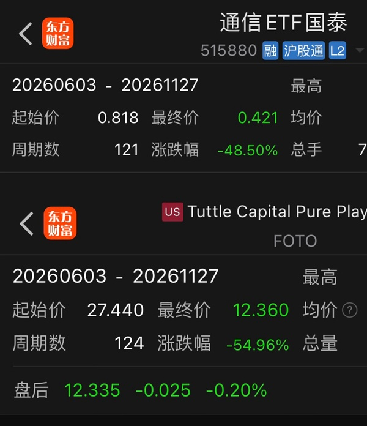
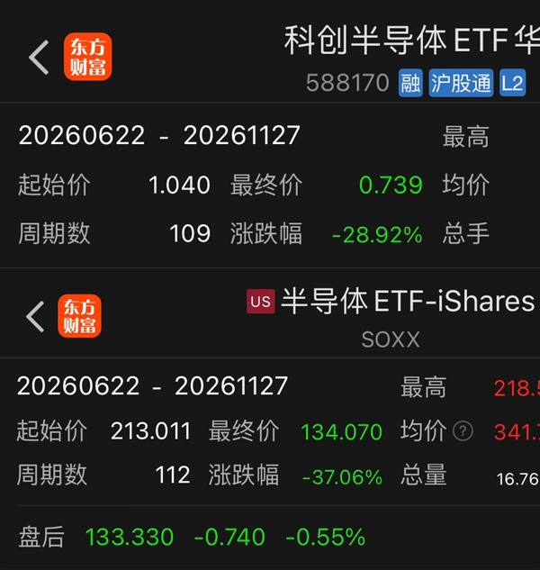
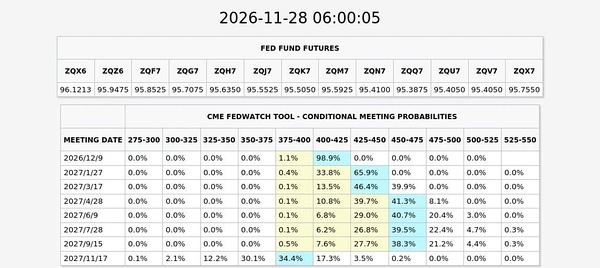
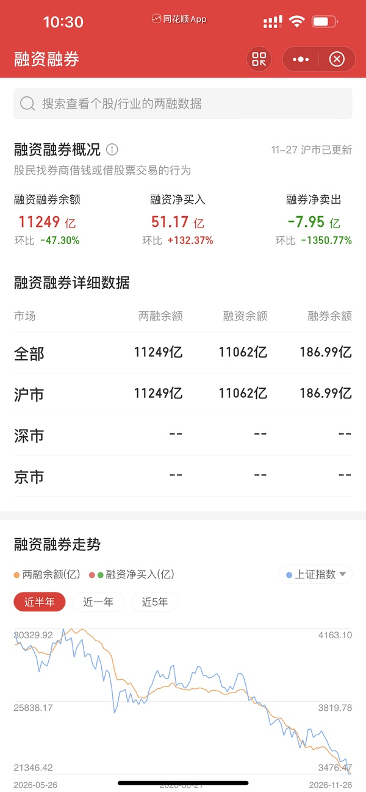

# 📋 楼主每日发言推送

> **推送日期**：2026-11-28 ｜ **执行时间**：2026-11-28 16:01:44 ｜ **监控用户**：`不知道还能说啥`
> **追踪模式**：`topic`（用户主页广播·豆瓣话题）

## 📊 持仓追踪
> 上次更新：2026-11-28 ｜ 基于楼主发言持续追踪（共 16 项）

| 标的 | 状态 | 类型 | 现价 | 提及 |
|------|------|------|------|------|
| 招商银行 | 底仓·四年前 32 元×7000 股买入·四年分红未复投仍 7000 股·不动 | 红利/银行 | 42.58（-1.84%） | 底仓·不动；7000股/摊薄成本约24.27元；1…；成本约32元 |
| 大连圣亚 | 持有（11-18 加仓@37.74 被深套）·今日无动作·卖单 46.90/45.22 未触及 | 冰雪·正牌双子星 | 31.61（-0.32%） | 持有（冰雪旅游）；11-26『四天大连+9』、11… |
| 长白山 | 持有·11-18卖出后已重新买入（11-26『我手里 cbs+9.8』证实再持）；11-27 -0.87% | 冰雪·正牌(cbs) | 29.75（-0.87%） | 11-26 15:33『这四天我手里…大连+9 c… |
| 雪人集团 | 持有·11-19 手动买入 2 笔@≈13.5（两笔 cbs 钱搬入）·卖单 13.84/14.84/15.84 | 冰雪·交易仓 | 12.97（2.77%） | 持有（冰雪）；11-27『先高抛龙版 来雪人』＝加… |
| 晶雪节能 | 11-27 买回@≈-10.5%（≈19.04）·持有 | 冰雪·plus | 22.53（4.06%） | 11.27；11-27 09:56『今天plus我买到-10.… |
| 幸福蓝海 | 持有·今日换仓买入 1 笔@≈15.50（09:43）＋11-16 笔@16.91·明日卖单 15.84（由 18.64/20.44 下移） | 电影 | 14.40（14.92%） | 持有；11-27 +14.92%（大涨）；14:5… |
| 中国电影 | 持有·剩余仓无单·锁仓『慢就是快』 | 电影·核心不动仓 | 15.97（9.01%） | 持有·重仓（11-27『我重仓电影没动过』）；11… |
| 博纳影业 | 持有小仓·今日跌停 5.69（=6.32×0.9）·卖单 6.94 未触及（高 6.22）·明日买 614 计划 | 电影 | 5.38（5.91%） | 持有（11-26『我有bn 早晚被sy一起带走』）… |
| 纳斯达克ETF华夏 | 持有 | QDII·场内纳指 | 2.600（3.09%） | 「拿的稳稳的」，持有不动，未提及具体买卖操作，视为… |
| 中韩半导体ETF | 持有·今日无动作自述 | QDII·场内 | 3.522（9.99%） | 持有；11-27 +9.99%（涨停） |
| 盛天网络 | 11-11 买入·持有（口径仍待确认） | 游戏·电竞 | 9.39（6.58%） | 持有（口径待确认）；11-27 +6.58% |
| 东方海洋 | 11-16 买入探针仓 <2%·无卖单自述·当日跌停（11-12 曾涨停 5.16 卖出，见 day_actions_1112） | 探针·羊情绪组 | 4.34（-9.01%） | 探针仓<2%·持有；11-27 -9.01%；09… |
| 游戏自建仓 | 11-10 买入·持有·11-11 自述 +5%（时点值未更新） | 游戏·电竞 | 暂无 | 持有；11-26/27无提及 |
| 美债场外基金 | 持有·国庆前买入·11-11 自述 +1.4%（时点值未更新）·债灾自述接近转亏 | 场外·美债 | 暂无 | 持有；11-26/27无新自述 |
| 传媒低位10cm | 11-12 自述『只加一个低位的』＋11-16 14:22『我要去买一个传媒了』（是否执行无自述）·拒绝点名 | 传媒·低位 | 暂无 | 持有；传媒篮子高换手（龙版11-27高抛、芒果11… |
| 六只债券基金 | 持有·00:38『这些我都有 第二个和第三个在这轮中灾难中经受住了考验』·债灾自述实亏·『债持不炒，每调买机』 | 场外·债基 | 暂无 | 持有；11-27 12:13『抄底选利率债 理财杀… |

> ⚠️ 执行任务时如发现新操作，请更新 `state.json` 的 `positions`。成本价和市值有数据才填，没有则保留「暂无」。

## 🌅 今日总览
### 📌 市场背景
市场背景：楼主指出近期市场风格改变，不再高开低走。原文「一改此前经常的高开低走一路走低」。同时提示融资盘回归，资金面活跃。原文「融资盘回归」。此外，观察到科技板块表现强势，原文「中国光超涨6.5%」。

### 📌 今日操作
| 操作 | 标的 | 详情 |
| :--- | :--- | :--- |
| ✅ | 纳斯达克ETF华夏 | 「拿的稳稳的」，持有不动，未提及具体买卖操作，视为持仓确认 |
| ⏭️ | 其他持仓 | 发言中无其他具体买卖指令或成交自述 |

### 📌 今日议题
| 议题 | 态度 | 核心观点 | 关键引用 |
| :--- | :--- | :--- | :--- |
| 银行理财回撤 | 💬 | 低风险理财出现大面积亏损，引发对稳健收益安全性的讨论，且规模缩减 | 「R1...接连出现账面亏损」 |
| 利率债市场 | ➡️ | 观察到利率期货市场出现异常波动或系统显示问题 | 「利率期货都出bug了」 |
| 科技板块 | 📈 | 认为中国光、半导体板块近期涨幅过大，处于超涨状态 | 「中国光超涨6.5%」 |
| 市场资金面 | ➡️ | 注意到杠杆资金重新入场 | 「融资盘回归」 |

### 📌 看好板块/方向
- **科技板块（光/半导体）**：楼主观察到其近期表现强势，超涨明显，虽未明确表达看多意图，但记录了市场的高位状态。

### 📌 风险提示
- 「中国光超涨6.5%」——楼主提示科技板块短线涨幅过大，存在回调风险。
- 「R1...账面亏损」——风险传导提示，低风险理财亏损引发投资者不安，需警惕流动性或利率波动对稳健资产的冲击。
- 「利率期货都出bug了」——市场情绪或技术层面出现异常，需关注宏观利率波动的剧烈程度。

## 📊 本次结果
- **今日发言**：8 条
- **累计存档**：24923 条

## 📝 该最新广播作者发言聚合（共 8 条）
- (2026-11-28 00:08:37) 拿的稳稳的
今天没有人和你抢  ⊳ （引用 @小鱼）我第一吗😁

- (2026-11-28 02:00:46) 这个人少的夜晚
市场真不错😂
一改此前经常的高开低走一路走低

- (2026-11-28 08:22:30) [图] 中国光超涨6.5%

  ⊳ （引用 @点-重生炒垃圾）中美光差多少，美光光好厉害啊，a社和闪迪领涨

- (2026-11-28 08:28:16) [图] 中国半导体超涨8%

- (2026-11-28 08:31:26) 美国光见顶时间  ⊳ （引用 @一颗牛奶糖）其实我有点好奇 为啥是从6.3开始看

- (2026-11-28 08:39:22) 近期，大量投资者发现，原本被视为“存款替代品”的R1（低风险）、R2（中低风险）级银行理财产品接连出现账面亏损。据新浪金融研究院11月20日报道，在近一年披露净值的净值型银行理财产品中，11月已有超4.3万只产品发生回撤，最大回撤幅度达19.73%。

这种大面积的“绿意盎然”，让长期习惯于稳健收益的普通投资者感到困惑与不安，也引发了市场对低风险理财安全性的广泛讨论。

根据普益标准近期披露数据，截至11月24日，全市场银行理财存续规模为34.57万亿元，较10月末减少约3429亿元。其中，固定收益类理财规模减少约4623亿元，现金管理类理财规模增加约1415亿元。

- (2026-11-28 08:45:43) [图] 利率期货都出bug了 明年11月怎么回事😂

- (2026-11-28 10:30:16) [图] 融资盘回归

## 🧠 投资风格分析
> 📏 增量更新指引：仅当今日发言确有新依据时才修订对应维度，无变化不强行重写；单维度修订建议 ≤150 字。

- 投资理念与方法：坚持红利≠银行，重视红利低波中非银行配置；用均线、季节时点与低价弹性辅助判断。今日新增：以全球联动框架比较中美半导体/光回撤，强调用数据验证而非消息面；在冰点采用一次性All-in替代定投，认为定投易抬高成本；关注理财赎回向利率债的传导。
- 风险偏好：对抱团股瓦解有预判，认为跌幅有限（「不至于-20」），能容忍短期波动；对无消息面大涨保持怀疑，强调「理由可以编的」，但承认资金面驱动。今日强化：对超涨后的回归风险保持高度警惕，反复提示并用「超涨必归还」做预期管理；对抱团松动负反馈判断「威力会逐渐减弱」。
- 交易与仓位：坚持高周转与动态再平衡，兑现盈利或止损后迅速切换热点；用条件单/计划交易执行（如东方海洋两连板跌停加2万），并提前设置卖单（幸福改1654）；对核心仓（电影、C50/cc）明确持有不动，区分短打与底仓；纳斯达克采用一次性All-in而非定投。
- 心理特质：极强的预期管理意识，今日自述多次提醒「超涨了」，用「超涨必归还」为回调打预防针；强调「不以涨喜 不以跌悲」，担心跟风者心态崩；以幽默化解焦虑（「笑死人」「造孽啊」），亏损时强调「有担心 所以不慌」，不因单日大涨改变重仓电影等核心判断。

> ⚠️ 本板块由 Actions 全自动增量更新（复用当日发言与今日总览），每次仅在内容足够支撑时才改动。

## 🏷️ 昵称映射表
### 📖 昵称规律（供 AI 判断新昵称时参考）
【昵称命名规律（用于推断未知新昵称）】
- 拼音首字母缩写：取标的/基金名汉字拼音首字母串（含数字代码），多为 ETF/股票代码口语化｜示例：yl=引力传媒｜zy=掌阅科技｜sj=视觉中国｜cc=华安文体健康混合｜C50=创业板50ETF｜k50=科创50｜kun=昆仑万维｜xhxc=新瀚新材｜zxfc=中欣氟材
- 小/老+姓氏代指：「小X」「老X」通常指姓 X 的标的或该标的的基金经理；「X兄弟」多为同系基金｜示例：小惠=惠发食品｜老莫=万家品质生活(莫海波)｜小华=华夏全球科技先锋(QDII)A｜小华兄弟=华夏移动互联(QDII)｜小浦=浦银安盛全球智能科技(QDII)A｜小广=广发全球精选(QDII)A｜小远=华宝致远(QDII)C｜招招=招商银行｜小德=德明利｜赵姨=兆易创新｜露露=泸州老窖｜空调=格力电器
- 戏称/黑话→题材板块：生活化比喻或黑话对应某个题材/板块，而非单一标的；出现时多指板块方向｜示例：卖国=PCB板块(英伟达AI链)｜爱国=国产自主(半导体设备/芯片)｜奶茶=易点天下｜老师=中文在线｜蓝色=蓝色光标｜宇航员=航空航天板块｜华子=华泰保兴安悦债券｜国际=国际复材｜巨无霸=长鑫科技等重大IPO
- 谐音/取字：昵称含标的名关键字（取一字或谐音），多为 A 股个股或基金简称｜示例：万华=万华化学｜东百=东百集团｜宝=保利发展｜讨饭/亚洲讨饭/建信新兴=建信新兴市场(QDII)A｜华宝zy=华宝致远(QDII)A
- 机构/基金经理昵称：以基金公司名、经理姓、或平台代称指代对应基金产品｜示例：周经理=中欧新趋势混合(LOF)A｜张经理=信澳匠心回报混合A｜网易云/音乐世家=富国全球科技互联网股票(QDII)A｜国富亚洲=国富亚洲机会股票(QDII)A｜国泰纳指=国泰纳斯达克100指数(QDII)｜易方达全球=易方达全球成长精选混合(QDII)A｜浦银安盛=浦银安盛全球智能科技(QDII)A

### 📋 已收录映射
| 昵称 | 对应名称 |
|------|----------|
| C50 | 创业板50ETF |
| cc | 中国长城 / 华安文体健康混合 |
| k50 | 科创50 |
| kun | 昆仑万维 |
| sj | 视觉中国 |
| xhxc | 新瀚新材 |
| yl | 引力传媒 603598 |
| zxfc | 中欣氟材 |
| zy | 掌阅科技 603533 / 中国电影 600977 |
| 万华 | 万华化学 |
| 东百 | 东百集团 |
| 亚洲讨饭 | 建信新兴市场混合 |
| 保利发展 | 保利发展 |
| 华子 | 华泰保兴安悦债券A 007540 |
| 华宝 zy | 华宝致远混合 |
| 华宝zy | 华宝致远混合 |
| 卖国 | PCB、光模块、通信板块 |
| 周经理 | 中欧新趋势混合 |
| 国富亚洲 | 国富亚洲机会股票 |
| 国泰纳指 | 国泰纳斯达克100指数 |
| 奶茶 | 易点天下 301171 |
| 宇航员 | 航空航天板块 |
| 宝 | 保利发展 |
| 小华 | 华夏全球科技先锋混合 |
| 小华兄弟 | 华夏移动互联混合 |
| 小广 | 广发全球精选股票 |
| 小德 | 德明利 |
| 小惠 | 惠发食品 |
| 小浦 | 浦银安盛全球智能科技 |
| 小远 | 华宝致远混合 |
| 巨无霸 | 长鑫科技等重大IPO |
| 建信新兴 | 建信新兴市场混合 |
| 张经理 | 信澳匠心回报混合A |
| 招招 | 招商银行 |
| 易方达全球 | 易方达全球成长精选混合 |
| 浦银安盛 | 浦银安盛全球智能科技 |
| 爱国 | 国产自主 |
| 空调 | 格力电器 |
| 网易云 | 富国全球科技互联网股票 |
| 老师 | 中文在线 |
| 老莫 | 万家品质生活混合A 519195 |
| 蓝色 | 蓝色光标 300058 |
| 讨饭 | 建信新兴市场混合 |
| 赵姨 | 兆易创新 |
| 赵哥 | 兆易创新 |
| 露露 | 泸州老窖 |
| 安安 | 安记食品 |
| 音乐世家 | 富国全球科技互联网股票 |
| 老伯伯 | 铜冠铜箔 |
| nk | 纳指科技ETF景顺 159509 |
| bk | 标普信息科技LOF 161128 |
| txx | 天下秀 |
| 媛媛 | 今世缘 |
| uu | 友友、网友们 |
| 温暖老师 | 散户 |
| 余老师 | 余利 |
| ycm | 粤传媒 002181 |
| 江老师 | 江琪 |
| 水果老师 | 投资博主 |
| 小爱 | 我爱我家 |
| ty | 天娱数科 |
| bn | 博纳影业 |
| sy | 上海电影 601595 |
| CBS | 长白山 603099 |
| 东哥 | 东百集团 |
| 芒果 | 芒果超媒 300413 |
| 阿中 | 中国电影 |
| 欢欢 | 欢瑞世纪 |
| 雪人 | 雪人集团 |
| 大连 | 大连圣亚 |
| 幸福 | 幸福蓝海 |
| 小粤 | 粤传媒 |
| 阿博 | 博纳影业 |
| 创成长 | 创业板成长ETF |
| asd | 埃斯顿 002747 |
| 恋爱脑 | 好想你 002582 |
| 恋爱 | 好想你 002582 |
| 小羊 | 襄阳轴承 000678 |
| 中马 | 中马传动 |
| 晶雪 | 晶雪节能 |
| xf | 幸福蓝海 |
| 建设 | 建设工业 |
| 北方 | 北方导航 / 北方国际 |
| _ambiguity_note | 歧义未收敛（禁止当唯一映射）：轮子=巨轮智能/五洲新春；sj=视觉中国（传媒语境）/神剑股份（宇航员语境）；cc=中国长城/华安文体健康混合；北方=北方导航或北方国际；zy=掌阅科技（用户 11-05 确认原值正确）。证据分级：A=价位/均线/月涨幅实测命中；B=量级或单日命中/用户口述；C=仅昵称或语义，不得据此写『他持有』；沿用原仓=本轮未复核，不写进结论正文。三条判据：①条件单四位数要先按同时段动词行判买卖方向（cbs 3644 是买单不是卖单）；②『祝福/你们/你的X』句式＝评论他人持仓，不是他的操作；③同一昵称在不同语境可指两只票（zy=掌阅/中影），按价位与板块取，不许收敛成一个。 11-11 补：plus雪＝他自己也没说清（11:12「你应该不知道plus雪是哪个」），不许猜；bdd＝有传媒属性所以他不去（13:42），仍未定案；『五连阳』这类盘中口径不等于日K实测（招行 11-06 为平盘十字星）。 11-12 补：①盘中快照≠收盘（14:15 三日账第三日 幸福+0.5/光线−4.5 为盘中值，收盘 −0.53/−4.97；他写的『拉开5.3%』按自列数字相加应为 5.5，属口算误差，不得据此推翻实测）；②历史卖单不重复计触发（中影 15.84 虽∈11-12 区间[15.39,15.98]，但 11-10 已成交、无存续卖单）；③清仓自述不封锁后续再买（asd 11-06 清→11-11 15:09 再吸，11-11 轮据此误删）；④『果果』只是推断映射，不得当持仓证据；⑤机器人第二仓与传媒低位10cm 代码未披露，福赛仅为楼友提问他作答，不许映射。 11-13 补：①**本月涨幅类口述可核**，基准＝10-30 收盘，且要用**发言时刻的分钟价**复算（14:01 截图 53.76% 与分钟线独立复算分毫不差，『拉开芒果12%』＝12.06pp）；②**基金表『折价率』列负号＝溢价**（513300 −15.28% ⇒ 溢价 15.28%，与 11-06 的 16.36% 同口径），别读成折价；③**『我手里就7只股票了/我只有电影冰雪了』是他题材仓口径**，不得据此删除无卖出自述的持仓行（铁律 6）；④**『全部跌停』类口述是盘中快照**（东方海洋盘中最低 4.64＝跌停价、收 −6.59%，未封死）；⑤plus雪＝晶雪只是**品种识别**，他 11-09 已自述清仓，不得当持有证据。 11-16补：①华子与460108是否同一只未定案（华子亦可能楼友昵称），不得据华子写他持有30债；②14:22『T掉追加的』对象歧义（主读法＝大连11-10加筆T，备选＝幸福老股T），无成交自述不改笔数；③博纳09:52『今天』与底仓口径冲突，加仓@6.37按09:45『加仓bn』＋09:46『-6』取；④『2开头招行』语义未定不映射；⑤华夏兄弟17:26裸报-2.5%证据不足不入表。 11-16补：①14:22『T掉追加的』对象歧义（主读法＝大连11-10加筆T，备选＝幸福老股T），无成交自述不改笔数；②博纳09:52『今天』与底仓口径冲突，加仓@6.37按09:45『加仓bn』＋09:46『-6』取；③『2开头招行』语义未定不映射；④华夏兄弟17:26裸报-2.5%证据不足不入表。 11-17补：①『太子爷』『bdd』『畅畅』未定案不映射；②雪人今日14.01加仓笔受T+1，14.84卖单卖的是可卖老仓（非当日买笔）；③晶雪25.64回落单他自述触发、日K高25.78证实（分钟接口H25.35偏低为已知不稳）；④光线11-17部分卖出@11.82按11-16追高笔推定(B)，仍持老仓；⑤传媒『以身入局』拒绝点名不外推代码。 11-17补：①『太子爷』『bdd』『畅畅』未定案不映射；②雪人今日14.01加仓笔受T+1，14.84卖单卖的是可卖老仓（非当日买笔）；③晶雪25.64回落单他自述触发、日K高25.78证实（分钟接口H25.35偏低为已知不稳）；④光线11-17部分卖出@11.82按11-16追高笔推定(B)，仍持老仓；⑤传媒『以身入局』拒绝点名不外推代码。 11-17补：①『太子爷』『bdd』『畅畅』未定案不映射；②雪人今日14.01加仓笔受T+1，14.84卖单卖的是可卖老仓（非当日买笔）；③晶雪25.64回落单他自述触发、日K高25.78证实（分钟接口H25.35偏低为已知不稳）；④光线11-17部分卖出@11.82按11-16追高笔推定(B)，仍持老仓；⑤传媒『以身入局』拒绝点名不外推代码。 11-18补：①雪人『兑现今天加的雪儿』受T+1，今日14.17买笔不可当日卖，兑现的是可卖老仓；②传媒『这周开干』拒绝点名不外推代码；③晶雪上週买回成本未披露、清仓收益不计算；④长白山(cbs)两笔成本36.44/38.8、同价33.65卖出。 11-19补：①雪人13.84卖单在开盘高13.94时可能触发（不写死成交价，记B待核）；②晶雪『今天20买』是给楼友的话、无第一人称买入→不回接；③中证1000ETF象征性小额买入、金额未披露；④大连11-18加仓@37.74 被套（11-19跌停32.33），11-19『我没买』无动作。 11-19补：①【1000】＝gjd国家队（他澄清『我说的是gjd』），非中证1000ETF、非本人买入，已从持仓删除；②雪人13.84卖单在开盘高13.94时可能触发（记B待核）；③晶雪『今天20买』是给楼友的话、无第一人称买入→不回接；④大连11-18加仓@37.74 被套（11-19跌停32.33），11-19无动作。 11-19补：①『1000』＝中证1000，『gjd』＝国家队；合起来是『国家队在象征性买中证1000』——他评论国家队托市，非本人买入/持仓（已从持仓删除误记）；②雪人13.84卖单在开盘高13.94时可能触发（记B待核）；③晶雪『今天20买』是给楼友的话、无第一人称买入→不回接；④大连11-18加仓@37.74 被套（11-19跌停32.33），11-19无动作。 11-20补：①今日无交易（11:57『我今天什么单子都没开了』『其他一个都不卖』）；②雪人13.84/14.84/15.84卖单未触及（11-20高12.76＜13.84）；③大连再跌停29.10、东方海洋涨停3.75(探针)；④xxz/东哥 未定案不映射。当日盈亏总结已写入 stock_pnl_note（等权涨跌率口径）。 11-21补（周六休市）：①今日无交易，价格沿用11-20收盘；②新帖被审核→晚上切新帖（故21:03只抓新帖20条，旧帖11-21另有51条，已合并入语料v26）；③cpi=新闻非昵称；④当日盈亏总结写'休市=0'。 11-23补：①修正上轮漏记——11-20(周五)卖光线→买横店603103+慈文002343(两个四连板)；②11-23横店被S/慈文手动S→重新满仓；③芒果超媒300413持有+加仓、明日35.94清仓；④『那几个10都四连板过』＝另持数只未点名传媒四连板，不外推代码；⑤中影重仓。 11-24/25补：①这两天无净新增稳定权益标的（龙版11-24兑现、plus11-25兑现均为短打、未入表）；②芒果超媒35.94卖单未触发仍持；③场外基金轮动(转国富/华夏额度/五个QDII)非权益仓，仅画像；④『31那个』指芒果31元单、SY未确认买入。 11-27补：①长白山(cbs)11-18卖出后已重新持有（11-26『我手里 cbs+9.8』证实再持，买入价未披露）；②晶雪(plus)11-27买回@-10.5(≈19.04)；③龙版11-27高抛、芒果11-27割出，均短打不入表；④幸福卖单由15.84上移到16.54（下周）；⑤『加冰雪旅游』＝回补冰雪(大连/长白山/雪人/plus)。 |
| nana场内 | 纳斯达克ETF华夏 513300 |
| 雪儿 | 雪人集团 002639 |
| 存钱罐 | 光线传媒 300251 |
| 枣子 | 好想你 002582 |
| 王老师 | 王博雅投资 |
| 印度 | 自嘲代指中国 |
| 10086 | 中国移动 |
| 阳光乳业 | 阳光乳业 001318 |
| 羊 | 生肖羊概念组 |
| 小明 | 一鸣食品 605179 |
| 皇台 | 皇台酒业 000995 |
| 海哥 | 转债估值博主 |
| 申菱转债 | 申菱转债 123290 |
| 盛天 | 盛天网络 300494 |
| dfhy | 东方海洋 002086 |
| xys | 新易盛 300502 |
| 冰山 | 冰山冷热 000530 |
| 冰冰 | 冰山冷热 000530 |
| 龙版 | 龙版传媒 605577 |
| 3300 | 纳斯达克ETF华夏 513300 |
| nana100 | 纳斯达克100指数 |
| 易中天 | 新易盛＋中际旭创＋天孚通信 |
| 冰雪双子星 | 大连圣亚 600593＋长白山 603099 |
| 2000 | 中证2000指数 |
| cw | CoreWeave |
| ant | Anthropic |
| 摄像大哥 | 楼友 |
| 游戏哥哥 | 游戏板块拟人化 |
| 传媒妹妹 | 传媒板块拟人化 |
| sg | 省广集团 002400 |
| 果果 | 果麦文化 301052 |
| 老登 | 机构抱团老牌权重 |
| plus雪 | 晶雪节能 301010 |
| 复仇者联盟 | 电影档期锚 |
| 流浪地球 | 电影档期锚 |
| nana | 纳斯达克100指数 |
| 千红转债 | 楼友新债 |
| 文投控股 | 文投控股 600715 |
| 华智数媒 | 华智数媒 300426 |
| 横店影视 | 横店影视 603103 |
| 金逸影视 | 金逸影视 002905 |
| 日出东方 | 603366 |
| plus | 晶雪节能 301010 |
| 东方海洋 | 东方海洋 002086 |
| 晶雪节能 | 晶雪节能 301010 |
| gjd | 国家队 |
| plu | 看空印度的博主 |
| 华夏兄弟 | 华夏移动互联混合 |
| cbs | 长白山 603099 |
| 1000 | 中证1000指数 |
| mg | 芒果超媒 300413 |
| 横店 | 横店影视 603103 |
| 慈文 | 慈文传媒 002343 |

> ⚠️ 以下为 LLM **建议**，未自动写入状态文件。请人工确认后，本地编辑 `state.json` 的 `nickname_map` / `positions`，或 `nickname_rules.json` 的 `rules` 并 push 生效。

## 新昵称规律建议（待你确认）
- 【规律类别】利率期货都出bug了 明年11月 ｜示例：利率期货、理财赎回、国债 ｜依据：今日发言中提及'利率期货都出bug了 明年11月'，结合理财赎回背景

*🤖 自动生成于 2026-11-28 16:01:44 ｜ 豆瓣楼主发言追踪*